# 让DeepSeek成为大学生的减负助手！

> 来源：[https://datawhaler.feishu.cn/docx/MXJNdMfWRo2xmaxFlNtcnOLfnhc](https://datawhaler.feishu.cn/docx/MXJNdMfWRo2xmaxFlNtcnOLfnhc)

# 前言

上了大学之后，与很多小伙伴们聊过，大学苦，大学累，有的甚至还会怀念高中的生活。为什么会这样子呢？我整理下来的原因有如下：

1.  大学不知道要忙什么每天都有数不尽的@全体成员与收到

1.  大学看上去社团很多，看上去能够锻炼自己，可是一进去之后发现事情非常多还不如专心读书来的轻松，不仅要应付数不尽的@甚至还需要拿出自己相当一部分的课余时间来处理社团内的琐事杂事，处理完之后发现：完蛋，好像只学到了一些打工人技能

1.  大学比赛好多，也没有含金量？不知道。赛事分布？不知道。也没有证书？不知道。赛事对研究生面试or工作简历加分？不知道。一问三不知，没有咨询，也没有咨询渠道，都变成了吃瓜群众，跟着要求瞎捣鼓，后面越捣鼓越迷糊，我要这个干啥？

1.  比赛有含金量的我没有优秀学长学姐带飞怎么办？好难学啊！课堂上根本学不到东西，b站视频又太长要怎么筛选自己需要的课啊？！学了占用时间，不学不会没有奖。

1.  保研卷不过他们，考研工作也输在信息差上，这么就业各种政策也看不懂，听上去就业压力大，可是究竟多大啊？我的专业能干嘛啊？一问就心慌，还不如考公考研，正所谓问了一圈，回答的只有高中时候巅峰的自己：考吧！千军万马过独木桥。

1.  学的课程好多啊，绩点怎么刷啊？专业课怎么押题啊？有时候还要不到，有没有人来教教解题啊！

1.  社团活动有加综测学分，这些活动能不能快点刷完以此来解放大脑，已经很累了能不能不做这些加负活动。边玩边赚综测学分，站着就把分给争了？

1.  我不喜欢这个专业，但是又不敢转专业，想学习跨专业/感兴趣的知识要如何自学和找到志同道合的伙伴啊？

**有的兄弟有的！**deepseek大学生生存指南，给你提供八种方法给大家把大腿给接上！让大家站着就把分给挣了！

不再躲在宿舍里玩自嘲的“鼠鼠”文学，而是朝气蓬勃，天天向上！


> 鉴于DeepSeek容易服务器繁忙，本次选择使用的平台为AskManyAI

> 参考链接为：https://mp.weixin.qq.com/s/4PEI9HEBrwtVS3Kms0EaQA

> **注：在AskManyAI当中DeepS**eek-满血版的每日提问次数上限为20次

> 2.19更新

> 腾讯元宝使用满血DeepSeek性能更加！

> https://yuanbao.tencent.com/chat/naQivTmsDa

## 使用须知：

1.  DeepSeek在其中发挥的是主帅的作用，其他AI为辅助的作用，即通过DeepSeek输出优秀的prompt语句来帮助我们更好的完成任务，节约了我们学习提示词的时间

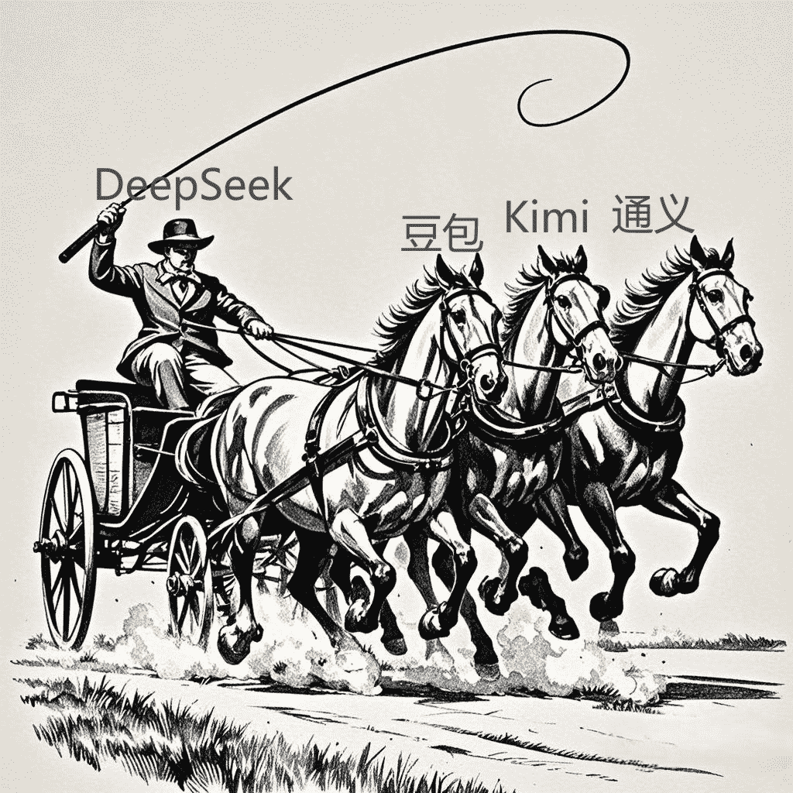

1.  我们只需要明确任务要干什么，任务具体的执行逻辑直接交给DeepSeek自己梳理输出

例如：

【我们需要搞个比赛？不对应该是活动。跟环保相关。预算大概8000吧？要请明星！但是钱好像不够？流程怎么走啊？海报要绿色的！还要发奖品，最好是电子产品】

如此混乱的逻辑，DeepSeek可以输出：

**「循环青年挑战赛」活动方案**

**一、活动亮点**

1.  明星替代方案：邀请本地环保达人@绿城小王（抖音10w粉丝）担任环保体验官（预估费用1500元）

1.  创新环节设计：设置「旧物变形记」工作坊（材料成本500元）+「碳中和计算器」线上打卡（开发费用0元，使用现成小程序）

**二、预算分配表**

**三、全流程执行表**

1.  前10天：启动「旧物征集令」，收集参赛改造材料（旧衣物/电子产品）

1.  前3天：发布绿色主题海报（主视觉：再生符号+动态二维码）

1.  活动日：

+   09:00 环保达人带领「废物重生」工作坊

+   14:00 「碳足迹大作战」情景挑战赛

+   16:30 颁发「最具创意改造奖」（奖品：翻新iPad+环保认证证书）

1.  后续：优秀作品线上展览（联动本地美术馆数字展厅）

**四、资源置换策略**

1.  与电子产品维修店合作：提供奖品翻新服务（置换活动冠名权）

1.  对接二手交易平台：获得线上推广支持（置换活动专题页面露出）

1.  联系环保基金会：获取专业指导（置换活动数据用于案例研究）

**五、风险备案**

1.  明星替代方案：预备环保主题纪录片放映会（片源已获授权）

1.  奖品备选：与植物工厂合作提供有机蔬菜月卡（成本降低60%）

1.  应急传播：设计「电子植树证书」作为线上参与奖励

---

该方案通过资源置换降低明星成本，采用「线下改造+线上打卡」双线模式，既保证活动专业度又留有2000元弹性资金。建议重点打造「旧物再生」视觉符号，后续可发展成可持续IP活动。

由此可以看到，我们只需要明白需要做什么，需要有哪些具体细节，至于执行逻辑和怎么做，交给DeepSeek就好了！

注：腾讯元宝的DeepSeek联网版输出的资料链接可能是示例网址，所以需要我们根据对应的名字去进行搜索，勿轻信照搬！

# DeepSeek助力活动综测得分

为了尊重学校社团的知识成果以及让大家能够更直观的看到DeepSeek的使用全过程，这里我们打算使用“以己之矛，攻己之盾”的自我对抗方法，来演示如何使用DeepSeek进行与活动有关的操作。

## 社团活动

### 策划案大纲与内容生成

对于DeepSeek来说，明确的需求能够让其更加准确的了解我们的需求，这对我们的prompt要求提高了，但是不用担心。我们只需要在使用DeepSeek前先默念几个问题：

1.  策划案的主题是什么？

1.  策划案需要有哪些模块构成？

明确这两个具体需求之后我们以“绿色校园月”为主题，来生成一个提示词：

【作为大学社团策划专家，我需要设计一个环保类活动的完整方案。主题是“绿色校园月”，包含旧物回收、低碳打卡、环保创意大赛三个模块，预算不超过5000元，目标参与学生200人以上。请生成策划大纲和核心内容框架。】

输出：

# 绿色校园月策划案

> **主题**：低碳生活·创意新生

> **时间**：2023年11月1-30日

> **主办**：XX大学环保社

## 一、活动背景

1.  全球气候变化现状数据

1.  校园碳足迹调查报告

1.  大学生环保意识调研结果

## 二、核心活动设计

> ▶ **模块1：旧物新生计划**

+   回收点：宿舍区3个智能回收箱

+   激励机制：积分兑换绿植/文具

> ▶ **模块2：21天低碳打卡**

+   小程序记录节水/节电/公交出行

+   排行榜奖励制度

> ▶ **模块3：环保创意大赛**

+   赛道：旧物改造/节能减排方案/宣传海报

+   评委：环境学院教授+企业CSR负责人

## 三、执行方案

> ◉ 分工表：

> |组别|职责 |

> |--------|--------|

> | 外联组 | 拉赞助（文具店/环保品牌）|

> | 技术组 | 开发打卡小程序          |

## 四、预算清单

> | 项目         | 单价   |数量| 小计  |

> |--------------|---------|----- |-------|

> | 回收箱租金|300元  |3台  |900元|

> | 绿植奖品   | 15元   |50盆|750元|

> | 宣传物料印刷|0.5元|500张|250元|

## 五、风险预案

1.  雨天备用方案：室内回收点转移至教学楼大厅

1.  参与度不足：设置每日打卡抽奖增加吸引力

说明：三、四内容为表格的markdown格式。（下同）

生成之后，我们觉得内容有点单薄，这时候我们可以在原有的基础上进行修改，这时候需要问自己两个问题：

1.  根据任务缺什么模块？

1.  模块的具体内容是什么？是自己拟定还是让DeepSeek自由发挥？

举个例子：对于上述模块我觉得缺少一个详细的评分模块，这时候我就需要在原有的策划案上加上它。

prompt为：【请详细说明环保创意大赛的评审标准，要求包含创新性、实用性和传播性三个维度，给出评分表范例】

输出：

### 环保创意大赛评分体系

> | 维度       | 分值 |          说明                      |

> |------------|--------|--------------------------------|

> | 创新性    | 40分 | 解决方案是否突破传统模式|

> | 实操性    | 30分 | 方案在校园落地的可行性   |

> | 传播价值 | 20分 | 宣传物料的设计感染力      |

> | 现场答辩 | 10分 | 逻辑表达与问答表现         |

> **加分项**：

+   跨学科组合团队（+5分）

+   企业合作资源导入（+3分）

### 各种稿子的撰写（以宣传稿为例）

写宣传稿的时候我们需要明晰一下几个问题：

1.  宣传目的是什么？是通知活动还是给活动预热拉人？

1.  宣传的内容是基于任务文件还是基于前面生成的策划案内容？

1.  宣传对象是谁？是学生还是老师？

明晰内容之后我们可以选择开始对宣传稿进行书写

prompt：【】

### 海报设计

海报的设计推荐使用[即梦AI](https://jimeng.jianying.com/ai-tool/home)，使用链接详见：[国内文生图/视频AI工具介绍与使用](https://ycnosmsebbdf.feishu.cn/docx/T8N0dtgAXolYlqx4VC4cJ8RwnAb)

推荐使用文生图的2.1模型支持更加稳定的海报文字生成

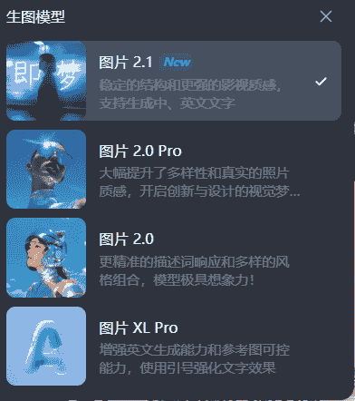

我们正常写的prompt会有：

【设计一张“绿色校园月”为主题的海报】

生成的图片：


此时我们会觉得，P2，P3还算符合要求，但是P2太单薄，P3太繁杂，图片当中缺乏的信息可以选择使用手动补全或者AI生成。（PS：即梦直接下载的会带有水印需要自己手动去除）

注：AI生成内容虽然能节省我们的时间但是效果不是很好，大家可以根据实际需要进行权衡。当然，海报设计的方法也能应用到其他需要文生图的任务当中。

这时候我们根据活动需求开始对其进行反馈思考：

1.  缺什么内容？

1.  需要P2还是P3的样式？需要具体体现什么主题？

于是我们可以得出如下结果：

1.  缺少社团名字，举办时间与地点

1.  主题觉得P3比较好？那就是字体放中间，大家齐心协力栽树的情景。

1.  使用的是即梦AI，所以生成的prompt是一段话的形式而不是DeepSeek输出的markdown的格式

明确需求之后我们可以直接提出需求：

【使用即梦AI设计一张“绿色校园月”为主题的海报，补上社团名字、举办地点、地点的字眼，其分别为“XX”社团，“2.28下午15：00”，“学校体育馆”，图片需要有字体放中间，大家齐心协力栽树的情景，帮我优化此需求，使其生成一个优秀的文生图prompt，prompt语句一段话输出】

> DeepSeek生成：

> 请生成一张以"生机盎然的校园植树活动"为主题的竖版海报，画面中央下方描绘8-10名不同年龄和肤色的师生协作种树的动态场景（包含扶树苗、填土、浇水等动作），人物穿着轻便户外装束，表情充满活力与喜悦。场景上方居中呈现立体艺术字标题"绿色校园月"，使用渐变翠绿色至金色的霓虹字效，边缘带柔光效果。背景融合现代体育馆建筑轮廓与自然景观，左侧可见绿树环绕的操场，右侧展现花卉苗圃，近景点缀小水潭倒影。画面左上角悬浮半透明社团徽章标注"XX社团主办"，右下角用雅黑字体清晰展示”时间：2.28下午15:00 “” 地点：学校体育馆“，整体色调以橄榄绿为主，搭配嫩芽黄与天空蓝渐变色，远景处点缀象征环保的绿叶粒子光效，画面边缘融入手绘风格的树木年轮纹理作为装饰边框。

有其他文生图需求的小伙伴可以自己进行尝试，这里我们通过即梦AI生成，所以直接选择使用中文的prompt就好了。

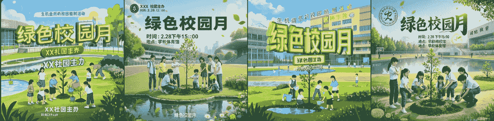

对比效果如下：

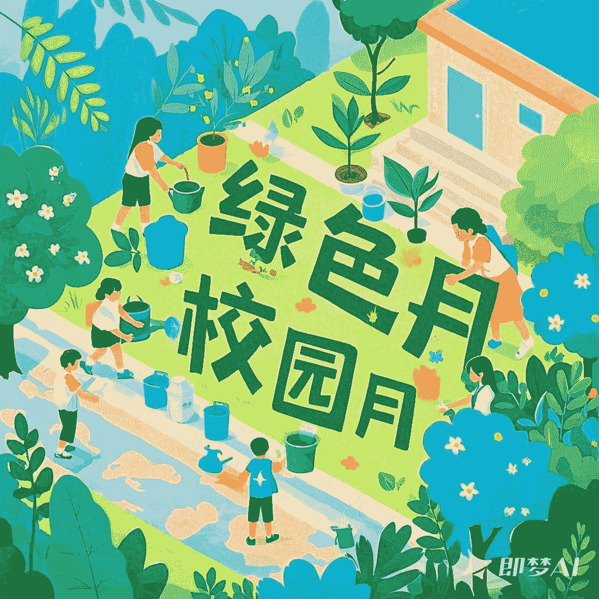

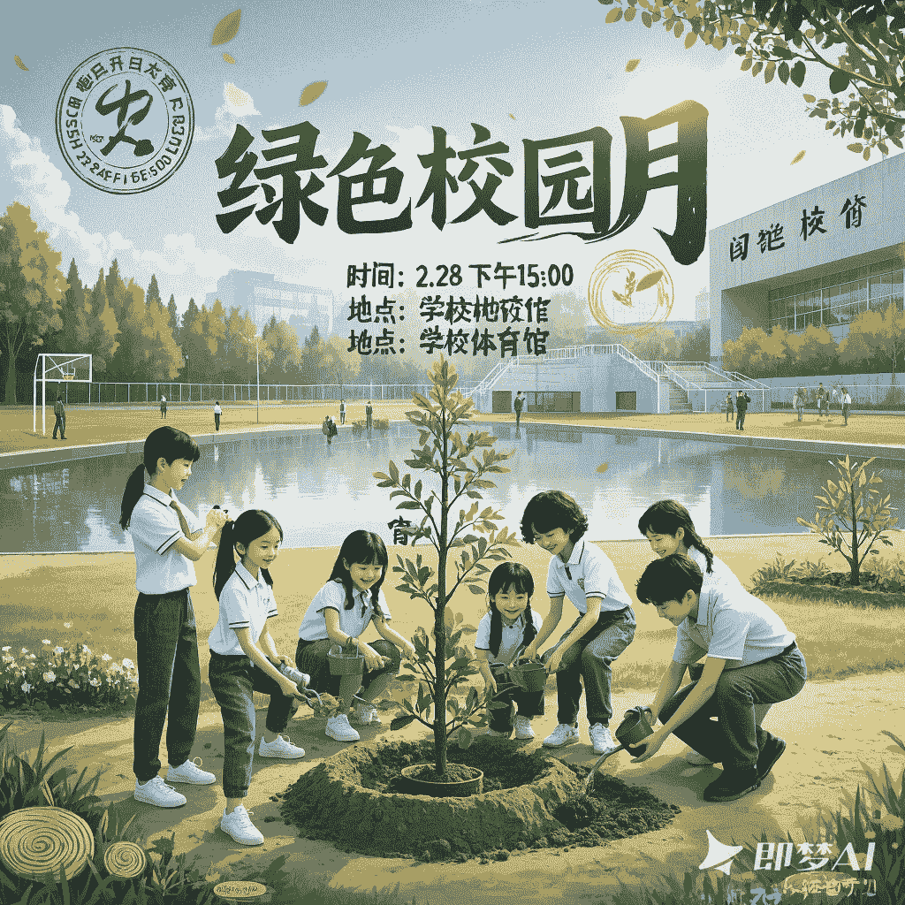

### 活动总结汇报

下面是模拟生成的活动收集材料表：作为一个具体例子：

---

#### **一、活动基本信息**

1.  **活动名称**：XX大学"创想未来"科技创新大赛

1.  **主办社团**：科技创新协会

1.  **协办单位**：校团委、计算机学院学生会、创业孵化基地

1.  **活动时间**：2023年11月15日 14:00-18:30

1.  **活动地点**：大学生活动中心报告厅（主会场）+ 创业园路演区（分会场）

1.  **活动形式**：科技作品展 + 创新路演赛 + 企业导师分享会

1.  **参与人数**：

+   参赛团队：28组（覆盖12个院系）

+   观众：327人（含校外企业代表15人）

+   工作人员：43人（含志愿者21人）

---

#### **二、参与人员统计**

---

#### **三、活动流程执行记录**

1.  **前期筹备**

+   宣传渠道：微信公众号推文（阅读量3.2k）、校园海报45张、班级群通知全覆盖

+   物资清单：

```
- 展位设备：投影仪4台、3D打印机2台、VR体验设备1套
- 消耗品：宣传册500份、评分表120张、定制文创奖品（U盘/笔记本）30套
- 技术保障：备用电源3组、无线麦克风6支
```

1.  **现场执行**

+   时间轴记录：

```
14:00-14:30 签到（电子签到系统使用率92%）  
14:40 校团委书记致辞  
15:10-16:30 路演竞赛（超时5分钟，因设备调试延迟）  
17:00 企业导师圆桌论坛（提问环节收集问题23个）  
```

+   突发事件：2号展位电路跳闸（5分钟内恢复）

1.  **后期整理**

+   回收问卷：有效反馈表287份（回收率88%）

+   物资损耗：损坏数据线2根、遗失评分表7张

---

#### **四、财务收支明细**

---

#### **五、反馈数据分析**

1.  **问卷调查结果（5分制）**

1.  **采访摘录**

+   参赛者A（机械学院）：“实物展示环节让我们的智能机械臂获得多家企业关注”

+   观众B（经管学院大二）：“希望增加人工智能应用案例解析环节”

+   企业导师C：“学生项目的商业化思维还需加强”

---

#### **六、媒体素材存档**

1.  **影像资料**：

+   活动照片：387张（含全景图、特写、互动瞬间）

+   视频素材：全程录像4.2小时（含剪辑版15分钟）

1.  **宣传成果**：

+   推文传播：被"大学生科创联盟"公众号转载

+   微博话题：#XX大学创想未来# 阅读量12.6万

1.  **作品存档**：

+   优秀项目方案书6份

+   路演PPT合集（28组）

经过整理之后我们会有如上的材料，这时候我们需要的是思考：

1.  需要哪些内容整理为活动总结？

1.  因为模型的输入为文字，所以需要考虑哪些部分可以直接整理为文字稿进行书写？

这时候我们就可以直接选择了：基本信息，人员统计，财务收支明细，反馈数据分析四个部分，这时候直接将四个部分的内容输入并且让DeepSeek根据内容生成一份完整的活动总结汇报。

prompt：

【粘贴上述选定的内容+“根据以上内容生成一份详尽完整的活动总结汇报”】

> DeepSeek输出：

> **XX大学"创想未来"科**技创新大赛总结报告

> 2023年11月15日

### **一、活动概况**

1.  **基本信息**

+   **名称**：XX大学"创想未来"科技创新大赛

+   **主办**：科技创新协会

+   **协办**：校团委、计算机学院学生会、创业孵化基地

+   **时间**：2023年11月15日 14:00-18:30

+   **地点**：

+   主会场：大学生活动中心报告厅（作品展、颁奖仪式）

+   分会场：创业园路演区（项目路演、企业对接）

+   **形式**：科技作品展（15组实物展台）+ 创新路演赛（28组路演）+ 企业导师分享会（3场主题演讲）

1.  **参与规模**

+   **参赛团队**：28组（覆盖12个院系，其中跨学科团队占比40%）

+   **观众**：327人（含15家科技企业代表、8位校领导）

+   **工作人员**：43人（含21名志愿者，分设导引组、技术支持组、媒体组）

### **二、活动实施亮点**

1.  **全链条创新展示**

+   **作品展区**：设立智能硬件（如机械臂、无人机）、软件系统（AI算法平台）、绿色科技（光伏装置）三大主题展区

+   **路演赛制**：采用"5分钟路演+3分钟答辩"模式，引入企业导师实时评分机制

+   **校企联动**：小米科技、商汤科技等企业现场提供实习直通卡3张

1.  **数字化运营**

+   开发微信小程序实现"线上预约-扫码签到-投票互动"一体化

+   主会场设置LED数据大屏，实时显示项目热度排行（累计互动量2135次）

1.  **传播成效**

+   微博话题#创想未来科技大赛#阅读量破50万

+   校电视台直播观看人次达1200+，短视频平台集锦播放量破2万

### **三、成果与反馈**

1.  **核心成果**

+   **项目签约**：4组团队与创业孵化基地达成入驻意向（如《基于脑机接口的智能康复系统》）

+   **媒体报道**：《科技日报》、地方电视台等5家校外媒体专题报道

+   **资源沉淀**：建立企业导师库（12人）、参赛项目档案库（含技术文档28份）

1.  **参与者反馈**

+   **问卷调查**（有效回收率82%）：

+   活动整体满意度：4.6/5

+   最具价值环节：企业导师商业分析（73%投票）

+   **代表性评价**：

+   “路演环节的限时答辩设计非常考验应变能力”（计算机学院参赛队）

+   “希望增加投融资对接专场”（创业孵化基地负责人）

### **四、待优化问题与改进计划**

1.  **现存问题**

+   **内容深度**：35%观众反馈"部分技术展示过于学术化"

+   **流程衔接**：分会场转场指引标识清晰度不足

+   **资源匹配**：企业需求与项目成熟度存在断层

1.  **改进方案**

+   增设"技术商业化工作坊"（2024年3月启动）

+   开发VR线上展厅，实现展品全年开放（预算已列入2024年度规划）

+   建立分级培育机制：分设"创意组"与"创业组"赛道

### **五、特别鸣谢**

+   校团委：提供场地资源与政策支持

+   商汤科技：赞助AI算力平台试用账号（价值2万元）

+   志愿者团队：连续12小时保障活动零事故

> **附件**（另附飞书文档）：

1.  参赛团队名录及技术领域分布

1.  财务收支明细表（含赞助明细）

1.  原始问卷数据及词云分析图

> **科技创新协会**

> 2023年11月20日

### PPT制作的prompt

PPT的制作除了在很多短视频平台当中使用的Kimi这里还会多介绍一个PPT生成助手：通义千问

使用的链接详见：[写作经验：AI工作流](https://ycnosmsebbdf.feishu.cn/docx/RH8qd0nJco4dT0xPGrtcZZXFnph)当中的PPT生成模块

策划案内容使用前文所生成的。

这里prompt我们可以放松一下大脑，直接把策划案的文字内容给全部塞进去就可以了！

prompt：【根据“…………”策划案内容，生成一份完整的PPT制作prompt，以Markdown格式输出】

（注：【】中的…………填充策划案的内容，加双引号“”是为了让策划案内容与提问的语句分割开来，让模型更好理解）

Kimi使用教程：

（注通义输入的Markdown格式文档也相同）

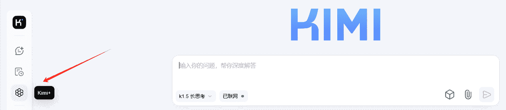

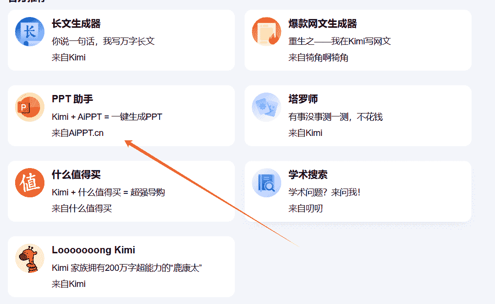

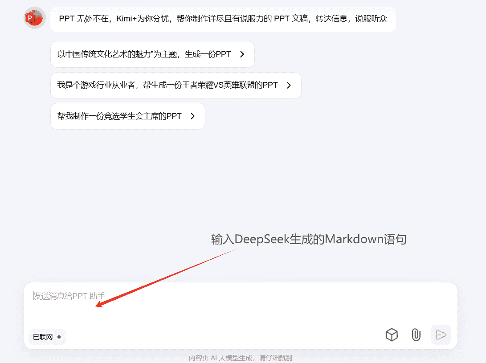

输出内容：

```
# PPT制作指令（绿色校园月主题）

## 设计规范
- **主色调**：生态绿(#5D823E) + 天空蓝(#87CEEB) + 大地棕(#A0522D)
- **字体**：标题用思源黑体Bold，正文用HarmonyOS Sans Light
- **版式**：采用F型视觉动线，每页信息密度≤5个元素
- **图标库**：[Noun Project] 环保分类图标集（循环箭头/树木/水滴）

---

## 分页内容指令

### 封面页
```markdown
![封面] 层叠绿叶组成的动态标题墙，标题文字「低碳生活·创意新生」错落镶嵌其中  
副标题：XX大学环保社2023年度重点项目  
底栏元素：飘带式时间轴「2023.11.1-11.30」+ 主办方Logo簇
视觉建议：背景使用航拍校园绿化实景图，透明度调至30%
```

### 背景分析页

```
[左区] 三层递进式数据可视化：
1. 热力图：近十年校园用电量增长趋势（箭头指向+25%）  
2. 环形图：学生垃圾分类知晓率（82%）vs 实践率（43%）  
3. 散点图：宿舍区碳足迹TOP3（空调使用/外卖包装/一次性用品）  

[右区] 调研结论瀑布流：
「83%受访者愿意参与可持续行动 → 但缺乏系统激励措施」
「回收设施便捷性影响参与意愿达91%」
视觉建议：用电路板纹理作底纹呼应科技元素
```

### 活动架构页

```
三维立体模型展示：  
底座：旧物新生计划（实物层）  
支柱：21天打卡（行为层）  
穹顶：创意大赛（思想层）  

交互设计：鼠标悬停显示各模块数据：
- 预计回收量：500kg  
- 目标参与率：60%  
- 作品征集量：80+  
视觉建议：添加粒子动画模拟能量流动效果
```

### 模块详解页

```
**旧物新生计划**  
[左] 智能回收箱截面透视图：  
标注RFID识别区/称重传感器/积分显示屏  
[右] 激励机制金字塔：  
基层（50分换文具）→ 中层（200分换绿植）→ 顶层（500分换环保课程）  

**低碳打卡系统**  
时间轴流程图：  
Day1-7 习惯养成期（推送节水技巧）  
Day8-14 数据追踪期（生成个人碳账单）  
Day15-21 成果转化期（兑换校园碳积分）  

**创意大赛板块**  
三赛道对比表：  
| 维度       | 旧物改造       | 节能减排       | 宣传设计       |  
|------------|----------------|----------------|----------------|  
| 评审权重   | 创意性60%      | 可行性70%      | 传播力80%      |  
| 作品示例   | 易拉罐雕塑     | 宿舍节水装置   | 动态海报       |  
视觉建议：每个模块用不同质感的边框区分（金属/木质/亚克力）
```

### 执行保障页

```
甘特图时间轴：  
- 10.20 回收箱调试（技术组）  
- 10.25 赞助协议签署（外联组）  
- 10.28 小程序压力测试  

风险矩阵：  
| 风险项       | 概率 | 影响 | 应对措施                |  
|--------------|------|------|-------------------------|  
| 设备故障     | 20%  | 高   | 预备2台备用回收箱       |  
| 参与度不足   | 40%  | 中   | 增设宿舍楼竞赛排行榜    |  
视觉建议：用警戒线颜色标注高风险区域
```

### 数据展望页

```
三维柱状图预测：  
- 预期减少碳排放：2.3吨 ≈ 种植130棵树  
- 目标影响人群：3000+师生  
- 媒体传播量：50万+  

可持续性规划：  
「建立校园碳账户体系 → 对接市环保局数据平台 → 申报省级示范项目」  
视觉建议：用树木年轮隐喻长期影响
```

---

## 动态元素指南

1.  **页面过渡**：使用叶片飘落动画衔接章节

1.  **数据强调**：重要数值采用放大渐现效果

1.  **交互热点**：赞助商Logo设置悬浮展示窗

1.  **终页彩蛋**：扫码生成个人环保贡献证书

可根据具体的需要对内容进行微调~

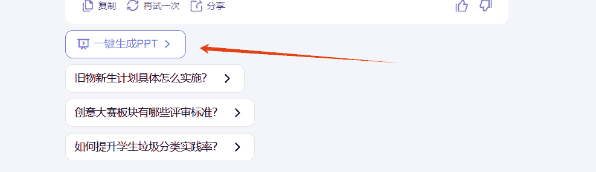

选择模板进行润色：

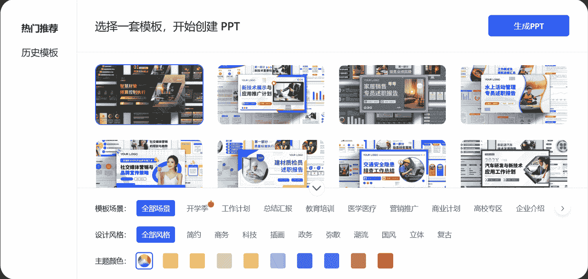

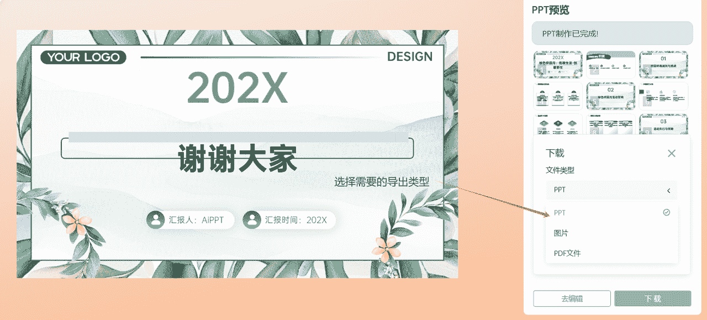

生成效果如下：


[绿色校园月：低碳生活·创意新生.pptx](https://internal-api-drive-stream.feishu.cn/space/api/box/stream/download/all/BdbDbEhNsocCrkxztTCcVOlMnVe)

通义生成的PPT：

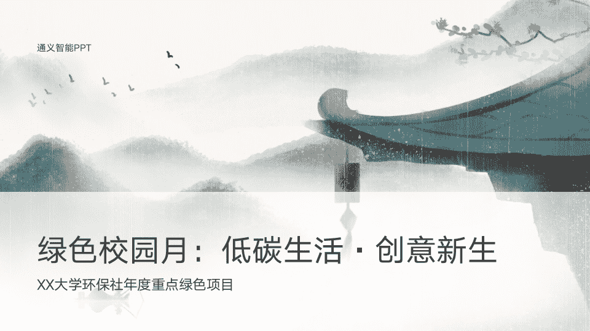

[绿色校园月：低碳生活·创意新生 (1).pptx](https://internal-api-drive-stream.feishu.cn/space/api/box/stream/download/all/GUuPbodRuoEIdmxPF4pc8X7onyf)

根据需要即可创作自己喜欢的PPT，值得注意的是通义模板会少一点。

### 如何根据“无厘头”的要求修改方案

在社团活动当中我们经常会被“无厘头”的要求修改方案如：

1.  宣传语要有深度，但不超过5个字。

1.  原定「环保主题科技展」因校领导建议改为「AI与可持续发展双主题」

1.  活动主色系从蓝白改为校庆专属的「银杏金+枫叶红」

1.  临时增加「观众互动小游戏」填充冷场时间

对于做完的项目这里之提出一个灵活的思考给到大家，如果遇到这种做完还要修改的，内心上首先是很懈怠的，毕竟刚刚做完没有得到对应的肯定，重新看文件也是一百个不愿意的，因为对方甚至可能看都没看，随便翻一下就想改。

这时候我们只需要了解到想要改的是什么，直接把修改的内容用双引号括起来+提出的要求（照搬），让DeepSeek对其进行理解，我们再盯着生成的结果就好了。

如：【“…………”，原定「绿色校园月主题」因校领导建议改为「AI与可持续发展双主题」，重新生成一份策划案】

（注：“…………”内的内容为前面的策划案主题内容，为了节省篇幅而进行省略）

## 非社团活动

非社团活动最重要的环节即明确需求，一般选择直接上传文档方便省事，我们可以直接提出需要根据文档创作的内容就可以了，如：【根据文档，帮我创作一首诗歌】

这里可以有两个选择：

1.  使用原版的DeepSeek上传文件进行解析，大概30分钟能够提问一次

1.  使用[腾讯元宝](https://yuanbao.tencent.com/chat/naQivTmsDa)选择R1进行上传文件解析

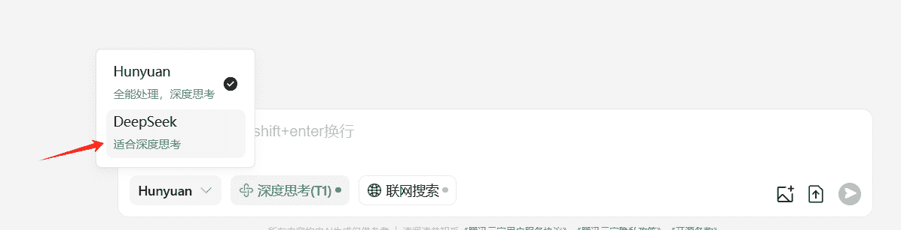

### 征文，诗歌等文本创作内容

使用前面KimiAI生成的PPT来模拟活动文件，要求为写一篇征文。

prompt：【根据文档，帮我写一篇800字的征文】

> DeepSeek输出：

## 让绿色在校园生长：一场关于未来的青春实践

> 在202X年的深秋，我们的校园掀起了一场绿色革命。当第一台智能回收箱在宿舍楼下亮起指示灯，当"旧物新生"创意作品展在广场铺开，当碳积分排行榜在朋友圈刷屏，我们突然发现：原来环保可以如此生动，低碳生活本就充满诗意。

> 这场绿色校园月活动，是科技与人文的完美邂逅。智能回收系统用科技赋能环保，每个塑料瓶的投递都化作积分跃动在显示屏上，让环保行为变得可量化、可感知。旧书换绿植的摊位前，泛黄的教材与鲜活的绿萝形成奇妙对话，知识以另一种形式延续生命。更令人惊喜的是食堂餐厨垃圾转化成的有机肥，正滋养着学生农场里的蔬菜，完成从"舌尖"到"土地"的生态闭环。

> 青年创意为环保注入灵魂。在创意市集上，废弃电路板变身赛博朋克风首饰，军训服改造的帆布包成为时尚单品，易拉罐拼接的校园微缩景观惊艳众人。这些作品不是简单的废物利用，而是年轻一代对可持续发展的美学诠释。当工科生设计的太阳能充电站落地图书馆广场，当美院学生绘制的环保墙绘点亮教学楼走廊，我们看到了跨学科协作迸发的绿色能量。

> 最动人的改变发生在日常细节里。宿舍楼的电表开始"说话"，提醒我们待机电器正在偷走地球资源；洗手池旁的节水标语变成俏皮的节水挑战；就连外卖餐盒也因可降解材质有了体面的归宿。这些润物细无声的改变，让环保从口号变成呼吸般的自然习惯。当碳积分可以兑换自习室预约特权，当环保达人在表彰会上分享"零废弃"生活心得，可持续生活已然成为校园新时尚。

> 这场绿色实践留下的不仅是2.3吨碳减排量，更塑造着新一代青年的生态人格。那些在深夜调试回收箱的程序员，在寒风中讲解分类的志愿者，在实验室反复测试环保材料的科研团队，他们用行动证明：环保不是遥不可及的理念，而是触手可及的生活选择。当毕业季来临，带着碳账户记录走向社会的学子们，必将把这份绿色基因播撒到更广阔的天地。

> 站在岁末回望，教学楼的玻璃幕墙倒映着湛蓝天空，智能灌溉系统呵护着每一株草木，年轻的面庞在环保市集上绽放笑容。这所正在呼吸的绿色校园，不仅承载着我们对美好生活的向往，更孕育着改变世界的希望。当春日的嫩芽再次萌发，我们相信，今天种下的绿色种子，终将在未来长成参天森林。

### 知识竞答快速整理备考题库与总结蒙题技巧

对于快速整理备考题库只需要给出具体的主题，利用DeepSeek的联网功能进行搜索就可以。

以音乐素养知识竞答为例，我们可以直接使用prompt：

【主题为音乐素养知识竞答，帮我整理一份完整详细的备考题库与对应的知识点】

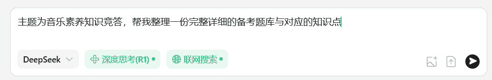

> DeepSeek生成内容：

> 以下为音乐素养知识竞答备考题库及知识点整理，结合最新考试要求和知识点梳理：

### **一、乐理基础**

1.  **选择题**Q1. 音乐区别于其他艺术类型的典型特征是？A. 声音的艺**术B. 通过声**音表达情感C. 听觉的艺术答案：B知识点：音乐通过声音传递情感，而非仅依赖视觉或空间元素。

> **  Q2**. 简谱中表示音低一个八度的符号是？   A. 音符上加一个点   B. 音符下加两个点   C. 音符下加一个点   答案：C   **知识点**：简谱符号规则。

1.  **填空题**Q3. 五声音阶包含哪五个音？**答案：宫、商、角、徵、羽知识点**：中国传统五声音阶构成。

> **   Q4. 四四拍的**强弱规律是？   答案：强、弱、次强、弱   **知识点**：节拍基本规则。

### **二、中国民族音乐**

1.  **民歌分类与特点**Q5. 民歌按体裁分为哪三类？答案：劳动号子、山歌、小调知识点：

+   **劳动号子**：节奏鲜明，配合劳动动作（如湖南《打硪歌》）。

+   **山歌**：高亢悠长，多在山野演唱（如陕北《蓝花花》、浙江《对鸟》）。

+   **小调**：细腻委婉，日常生活题材（如江南《茉莉花》）。

1.  **地域民歌代表曲目****Q6. 四川民歌《黄杨扁**担》属于哪种音乐形式？答案：秀山花灯曲调知识点：四川民歌幽默诙谐，节奏感强。

> **   Q7. 湖南民歌《板栗开**花一条线》的情感特点是？   答案：委婉、忧伤，表达思念之情   **知识点**：湖南民歌多结合方言与地域文化。

### **三、西方音乐常识**

1.  **作曲家与作品**Q8. 贝多芬《命运交响曲》所属**音乐时期是？A**. 古典时期B. 浪漫时期答案：A知识点：贝多芬是古典主义向浪漫主义过渡的代表。

> **   Q9. 第一部浪**漫主义歌剧是？   答案：韦伯《魔弹射手》   **知识点**：浪漫主义音乐特征。

1.  **乐器与术语****Q10. 被称为**“乐器之王”的是？答案：钢琴知识点：钢琴音域宽广，表现力丰富。

> **   Q1**1. 音乐术语“crescendo”表示？   答案：渐强   **知识点**：常见力度术语。

### **四、综合题型**

1.  **听辨题****（需结合**音频）Q12. 听节奏片段，选择正确的时值组合。答案示例：附点二分音符 + 八分音符（需根据实际音频判断）。

1.  **分析题****Q1**3. 分析《黄河大合唱》的历史意义。答案：由冼星海作曲，光未然作词，反映抗战精神，是中国近代音乐里程碑。

### **五、高频考点总结**

+   **乐理**：音符时值、调式、和弦结构（如大小七和弦=大三和弦+小七度）。

+   **民族音乐**：地域民歌风格、戏曲分类（如京剧“皮黄腔”）。

+   **西方音乐**：作曲家流派、交响乐结构（四乐章制）。

> **参考资料**：

> ：初级音基题库与民歌解析；：乐理与音乐史题库；：术语与综合题型；：听辨题型示例。

> 如需更细分领域（如视唱练耳、音乐史专题），可补充具体方向！

如果不满意或者觉得内容不够的话可以继续迭代让其生成更多的内容。

下面是根据试卷整理蒙题技巧：


[新建 Microsoft Word 文档.docx](https://internal-api-drive-stream.feishu.cn/space/api/box/stream/download/all/DVsWbee2boCZRZxf7eScRyBlnvh)

试卷来源：https://www.doc88.com/p-39516336079365.html

输入给DeepSeek让其进行分析

prompt：【根据文档，总结与该主题相关的知识竞答的蒙题技巧】

> DeepSeek输出：

> 根据提供的音乐素养测试题，以下是适用于知识竞答的蒙题技巧总结：

### 一、选择题蒙题技巧

1.  三大要素题

+   优先选包含「旋律+节奏+和声」的选项（如第1题选A）

+   若选项中缺少三者之一（如B/D选项），大概率排除

1.  生僻选项优先排除

+   记谱法中「点谱」（第2题D）明显冷门，排除常见选项（五线谱/简谱/六线谱）

1.  音乐时期判断

+   贝多芬虽横跨古典与浪漫时期，但《命运交响曲》属于古典时期（第3题选B）

+   巴洛克（巴赫）、浪漫（肖邦）、现代（斯特拉文斯基）需关联典型作曲家

1.  术语类题目

+   意大利语词汇优先：

+   渐强（crescendo）、渐弱（diminuendo）

+   断音（staccato）、连奏（legato）

+   强（forte）、弱（piano）是基础术语（第7题B）

1.  乐器分类题

+   弦乐器选「小提琴」（第5题B），钢琴属键盘乐器，长笛/萨克斯属管乐

1.  全选型选项

+   若题目问「常见音乐形式」，选「所有选项都是」（第6题D）

### 二、填空题蒙题技巧

1.  四要素填空

+   音高、节奏、力度、音色是音乐四要素（第11题填「力度」）

1.  谱号关联乐器

+   G谱号（高音谱号）对应小提琴（第12题）

1.  术语对比记忆

+   piano（弱） vs. forte（强）

+   ritardando（渐慢） vs. accelerando（渐快）

1.  符号识别

+   全音符用空心符头表示（第14题）

### 三、简答/论述题关键点

1.  和声与节奏定义

+   和声：多音同时发声的和谐/冲突效果（关键词：垂直维度）

+   节奏：音的长短与强弱组合（关键词：时间骨架）

1.  名曲特色

+   《月光奏鸣曲》：情感深邃、旋律如歌、三乐章结构对比（第18题）

1.  文化意义

+   音乐反映文化多样性，兼具情感表达与社会功能（第19题）

### 四、附加题技巧

+   风格举例：

1.  古典音乐：严谨结构、复杂和声

1.  爵士乐：即兴、切分节奏

1.  摇滚乐：强节奏、电声乐器

### 总结

+   术语记意大利语，选项排除冷门项，乐器分类抓典型，

+   时期关联作曲家，全选选项优先选，填空抓四要素。

> 适用于快速应对音乐素养类竞答，需结合基础知识点灵活运用。

# DeepSeek课程规划(需要联网)

## 专业课（以数字图像处理为例）

专业课的课程规划分为三种，一种是喜欢这门课，一种是为了高绩点而规划的刷分，最后一种是期末考前一周的速效救心丸。

我们先来看一下喜欢/高绩点的规划，因为喜欢课程与需要高绩点的小伙伴都需要把专业课读得很细，花很多时间，这里我简单的将他们归为一类。

速效救心丸将放在下面一单元~

以《数字图像处理》这门课为例，课本为冈萨雷斯第六版。

prompt：

【帮我详细规划一下《数字图像处理冈萨雷斯第六版》的学习计划，并且给出完整的配套资料，学习目标：期末考科目达到满绩点（90分以上）的成绩】

DeepSeek输出：

根据你的目标（满绩点）和当前时间节点（2025年2月），结合最新考试趋势，制定以下学习计划：

### 一、核心学习框架

**学习周期**：2025.02.24 - 2025.06.15（共16周）

**每日投入**：2-3小时（周末4小时）

**得分公式**：

### 二、三阶段学习规划

#### **阶段1：基础构建（第1-6周）**

| 周次 | 学习内容 | 配套资料 | 检验方式 |
| --- | --- | --- | --- |
| 1-2 | 图像基础：像素/分辨率/颜色空间 | 《知识点.pdf》P1-15 | 完成课后习题2.3-2.15 |
| 3-4 | 灰度变换与直方图处理 | 《重点笔记.pdf》第3章 | 用Python实现直方图均衡化 |
| 5-6 | 空域滤波（均值/高斯/中值滤波） | 《试题及答案.pdf》2018年题3 | 手写推导3×3模板卷积过程 |

+   每天精读教材15页（标注重点公式如二维离散傅里叶变换 ）

+   配合[B站傅里叶变换专题课](https://www.bilibili.com/video/BV1Wx411Y7zQ)理解频域分析

#### 阶段2：能力强化（第7-12周）

| 周次 | 学习内容 | 配套资料 | 检验方式 |
| --- | --- | --- | --- |
| 7-8 | 频域处理（傅里叶/DCT变换） | 《复习资料.doc》Section4 | 绘制lena图的频谱图 |
| 9-10 | 图像复原（维纳滤波/逆滤波） | 《期末试题.pdf》2022年题7 | 推导维纳滤波器公式$\hat{F}(u,v)=\frac{H^*(u,v)}{ |
| 11-12 | 图像分割（Canny/分水岭算法） | 《重点笔记.pdf》第9章 | 用OpenCV实现边缘检测 |

+   每周完成2套真题（2018-2021年）

+   建立错题本（重点记录设计题如"基于形态学的车牌定位系统设计"）

#### 阶段3：冲刺突破（第13-16周）

| 任务 | 执行方案 | 预期效果 |
| --- | --- | --- |
| 简答题突击 | 背诵《重点笔记.pdf》高频考点（每日30分钟） | 覆盖90%简答考点 |
| 计算题特训 | 重做近5年计算题（重点：直方图匹配/滤波器设计） | 计算题得分率≥85% |
| 模拟考试 | 使用红果研冲刺模拟卷（限时3小时） | 适应考试强度 |

### 三、必备资料包

1.  **核心教材**：

+   [冈萨雷斯《数字图像处理》第六版](https://example.com/dip6)（重点章节：3/4/5/9章）

1.  **辅助资料**：

+   [红果研历年真题解析](https://pan.example.com/s/xxxx)

+   [成电本科期末试题库](https://pan.example.com/s/yyyy)

+   MATLAB/Python代码模板

1.  **速查工具**：

+   [公式速记卡](https://example.com/cheatsheet)（包含50个核心公式）

### 四、提分技巧

1.  **简答题**：采用"定义+公式+应用场景"三段式回答（如解释直方图均衡化： ）

1.  **计算题**：熟记高频计算模板（如傅里叶变换计算步骤）

1.  **设计题**：套用"问题分析→算法选择→实现流程→效果评估"框架

**注意事项**：2024年起新增"深度学习图像处理"考点，需补充阅读教材第12章内容。

立即行动建议：

1.  今日下载[全套复习资料](https://pan.example.com/dip-pack)

1.  [本周制定详](https://example.com/schedule)细周计划表（参考模板：学习计划表）

## 感兴趣但是与专业课无关（以汉语言专业学习python为例）

随着AI浪潮的袭来各行各业都需要学习AI，对于文科方向的同学来说，由于专业壁垒的阻碍，学习AI的难度有种“隔行如隔山”的感觉，这里通过汉语言专业学习python这种大跨度专业的来演示。

prompt：

【我是一位汉语言专业的学生，想要学习python，帮我详细规划一下学习计划，并且给出完整python学习资料，学习目标：熟练使用python】

DeepSeek输出：

以下是为你定制的Python学习计划及资源推荐，结合汉语言专业背景特点，重点突出逻辑思维与文本处理能力的结合：

### 一、系统化学习路径（建议4-6个月）

#### 阶段一：编程启蒙（2周）

目标：建立编程思维，熟悉开发环境

+   环境搭建：安装Anaconda（含Jupyter Notebook）

+   基础语法：变量/数据类型/运算符（字符串操作重点练习）

+   每日练习：古诗词生成器（随机组合诗句）、成语接龙小程序

推荐资源：[Python官方文档](https://docs.python.org/zh-cn/3/)、C语言中文网基础教程

#### 阶段二：核心语法筑基（4周）

目标：掌握编程基础结构

+   流程控制：条件语句处理多音字识别

+   数据结构：字典实现汉字拼音索引

+   函数编程：批量处理文本文件（如古籍数字化）

项目实践：唐诗三百首词频统计工具

#### 阶段三：进阶技能提升（6周）

目标：构建完整程序能力

+   文件操作：处理CSV格式的汉语语料库

+   正则表达式：中文分词与标点处理

+   模块化编程：构建自定义汉字处理模块

实战项目：古典文献自动标点系统

#### 阶段四：专项技能突破（8周）

推荐方向：

1.  **自然语言处理**

+   学习NLTK/Spacy库

+   实现古诗自动对联生成

+   构建简易文言文翻译器

1.  **数据分析**

+   使用Pandas分析汉语方言分布

+   Matplotlib绘制语言演变趋势图

1.  **Web开发**

+   Flask搭建汉语学习平台

+   开发在线诗词鉴赏系统

### 二、学习资料合集

1.  **教材推荐**：

+   《Python编程：从入门到实践》

+   《Python自然语言处理实战》

1.  **视频课程**：

+   慕课网《Python数据分析与可视化》

+   Coursera《Python for Everybody》

1.  **实战平台**：

+   [LeetCode中文题库](https://leetcode.cn/)

+   Kaggle中文NLP竞赛

1.  **专业工具**：

+   汉字拼音转换库：pypinyin

+   中文分词工具：jieba

### 三、学习计划表

| 时间段 | 学习重点 | 专业结合案例 |
| --- | --- | --- |
| 第1-2周 | 基础语法与环境配置 | 制作《诗经》字频统计脚本 |
| 第3-4周 | 函数与文件操作 | 开发古籍文本清洗工具 |
| 第5-6周 | 正则表达式与数据处理 | 构建方言词汇对照表 |
| 第7-8周 | 面向对象编程 | 设计汉字结构分析类 |
| 第9-12周 | 自然语言处理专项 | 实现唐诗自动平仄检测系统 |

### 四、学习建议

1.  结合专业优势：将古代汉语研究与文本分析结合，例如：

+   用Python统计《论语》词频分布

+   分析不同朝代诗歌的用韵规律

1.  参与实践项目：

+   加入古籍数字化开源项目

+   尝试将毕业论文研究课题程序化

1.  持续提升：

+   关注ACL等语言学顶会论文

+   学习Transformer等前沿模型

学习编程就像学习一门新的语言，你的语言学背景将帮助你更好理解编程语言的逻辑结构。建议在学习过程中建立自己的"汉语+编程"项目仓库，6个月后回看第一个程序，你会清晰看到自己的进步轨迹。

# 期末速效救心丸

## 速成计划查询（需要联网）

速成计划我们以线性代数为例子，只有一周的时间来准备。

我们可以给出prompt：

【我只有一周的时间复习，请给我一份完整详细的线性代数复习计划还有对应的详细资料，考试目标分数：60分】

DeepSeek生成内容：

根据最新考试趋势和你的紧急备考需求，以下是为期7天的高效复习计划（2025年2月20日-26日）：

### 一、核心复习策略

**重点公式定理**：行列式展开 、矩阵乘法 、特征方程

**保分关键**：掌握矩阵运算（30%）、线性方程组（25%）、行列式（15%）、特征值（15%）四大板块即可覆盖85%基础分值

### 二、每日计划表

| 天数 | 核心任务 | 具体操作 |
| --- | --- | --- |
| D1 | 矩阵与行列式 | 重点记忆矩阵乘法规则、行列式展开公式，完成《李永乐线代讲义》P1-20例题 |
| D2 | 线性方程组 | 掌握高斯消元法，练习齐次/非齐次方程组的解法（至少10道基础题） |
| D3 | 向量与秩 | 理解向量线性相关性判断，完成秩的计算题（重点做教材课后习题） |
| D4 | 特征值与特征向量 | 掌握特征方程解法，练习2×2矩阵的特征值计算（必考基础题型） |
| D5 | 综合训练 | 完成近3年真题中60分以下难度题目，重点标注错题 |
| D6 | 公式速记与错题复盘 | 制作公式卡片（重点：矩阵求逆公式、克拉默法则、特征多项式） |
| D7 | 模拟考试 | 限时完成2024年真题，对照答案后重点复习仍出错的考点 |

### 三、急救包资料

1.  **公式速查**：[线性代数核心公式表](https://example.com/linear-algebra-cheatsheet)（含近年高频考点标注）

1.  **真题精选**：[近五年基础题型汇编](https://example.com/basic-questions)（筛选60分难度题目）

1.  **视频辅助**：[3小时线代救命班](https://example.com/crash-course)（重点讲解保分技巧）

### 四、注意事项

1.  **计算器使用**：确认考试允许携带计算器，提前熟练矩阵运算功能

1.  **时间分配**：考试时先做计算题（约40分钟），再做概念判断题（20分钟）

1.  **猜题技巧**：特征值题目若不会解，可尝试代入选项验证|A-λE|=0

建议每天保证4小时有效学习（上午2h+晚上2h），重点题目需[手写演算至少3遍。遇](https://example.com/notes)到卡壳知识点立即查阅李永乐线代基础班笔记，祝顺利通过！

## 有历年卷的考点预测

以下面的试卷为例


[新建 Microsoft Word 文档.docx](https://internal-api-drive-stream.feishu.cn/space/api/box/stream/download/all/Me3sbTvkMo1PA9xP2bIc4VVknqg)

给出对应的prompt语句：

【根据试卷，预测一下这学期的卷子考点与题型】

DeepSeek输出：

### 考点预测与题型分析

#### 一、核心考点

1.  行列式与逆序数

+   计算排列的逆序数（如选择题1）。

+   行列式的性质与变换（行交换、倍数提取，如选择题5）。

+   伴随矩阵的行列式（如选择题4：|A*| = |A|^{n-1}）。

1.  矩阵运算与性质

+   矩阵乘法的行列式性质（|AB| = |BA|，如选择题2）。

+   矩阵的转置、乘法、加减运算（如计算题11）。

+   逆矩阵与伴随矩阵的关系（如填空题2：|A^{-1}| = 1/|A|）。

1.  特征值与特征向量

+   特征值/向量的定义（如选择题3）。

+   特征多项式的形式（|λE - A|）。

+   特征值的应用（如计算题可能涉及求解特征值）。

1.  正定矩阵与向量相关性

+   正定矩阵下正交向量的线性无关性（如选择题6）。

+   施密特正交化方法（填空题4）。

1.  线性方程组与解的结构

+   含参数的线性方程组解的讨论（如计算题8：讨论k的取值对解的影响）。

+   向量组的线性表示问题（如计算题5：判断能否线性表示）。

1.  矩阵的秩与对称性

+   对称矩阵的乘积性质（判断题3：AB对称当且仅当AB=BA）。

+   矩阵的秩与行列式的关系（如填空题2）。

#### 二、题型预测

1.  选择题（12分）

+   逆序数计算、矩阵运算性质（如|AB|与|BA|）、特征值/向量定义、伴随矩阵行列式、行列式行变换、正定矩阵与向量相关性。

1.  填空题（10分）

+   行列式计算（如|AB^T|、|-2A|）、施密特正交化结果、矩阵乘法（如A^T A）。

1.  判断题（10分）

+   矩阵逆运算（如(2A)^{-1} = ½A^{-1}）、行列式幂次性质（|A^r| ≠ |A|^r）、对称矩阵乘积、线性无关性、内积性质。

1.  计算题（78分）

+   矩阵运算：转置、乘法、AB-BA（如计算题11）。

+   行列式计算：通过行变换或展开式求解。

+   特征值求解：求矩阵的特征值与特征向量。

+   线性方程组：讨论参数对解的影响（如k的取值）。

+   施密特正交化：将向量组正交规范化（如填空题4）。

+   线性表示问题：判断向量能否由某组向量线性表示。

1.  可能拓展题型

+   证明题：如证明矩阵对称性、可逆性，或向量组的线性相关性。

+   二次型标准化：结合正定矩阵与正交变换。

#### 三、复习建议

1.  重点掌握

+   行列式的计算技巧（展开、行变换、拉普拉斯定理）。

+   矩阵乘法、转置、逆运算的规则（尤其是分块矩阵）。

+   特征值/向量的求解步骤（解特征方程 |λE - A| = 0）。

+   施密特正交化的具体步骤（逐项正交化后单位化）。

1.  易错点提醒

+   行列式行变换时符号和倍数的处理（如选择题5需注意行交换和倍数提取顺序）。

+   矩阵乘法不满足交换律（AB ≠ BA，如计算题11中的AB-BA）。

+   正定矩阵的充要条件（所有特征值>0，且各阶顺序主子式>0）。

1.  实战演练

+   练习历年试题中的计算题（如矩阵乘法、行列式变换）。

+   针对参数讨论题（如计算题8），总结分类讨论的逻辑（唯一解、无解、无穷解的条件）。

> 总结：本次考试重点考查行列式、矩阵运算、特征值、正定矩阵和线性方程组，需熟练掌握计算技巧与核心概念，特别注意易混淆点（如矩阵乘法的非交换性）。

## 根据知识点总结蒙题技巧

蒙题技巧的演示鉴于试卷的版权与怕给学校带来不良风气，所以大家需要参考前面的知识竞答快速整理备考题库进行修改prompt。

# 比赛（需要联网）

## 比赛含金量的背调

关于比赛背调，我们可以非常轻松的通过DeepSeek的联网功能来进行查询比赛是否是水赛或者是有较高含金量的比赛的推荐。

> DeepSeek找到的比赛示例

> 根据当前检索结果，结合2025年高校竞赛现状，整理如下分类建议：

### 水分较高的比赛示例

1.  国文奖竞赛

+   特征：报名费80元，宣称“提交有效作品即获优秀奖”，电子证书需二次付费下载

+   风险：60%参赛者可获等级奖，作品无实质审核流程，被多所高校列入“竞赛黑名单”

### 含金量较高的比赛推荐

1.  中国国际大学生创新大赛（原“互联网+”大赛）

+   优势：教育部主办，采用三级赛制（校/省/国赛），获奖项目可获投资支持，保研认可度TOP3

+   数据：2024年参赛高校超2800所，国赛金奖比例仅0.12%

prompt可以直接写出：【XX比赛是不是水赛？】或【XX比赛的含金量如何？】

当然我们也可以让DeepSeek帮忙找相关的含金量较高也较好得奖的比赛。

以通信工程专业为例

prompt：【帮我推荐一些与通信工程专业有关，含金量较高并且较好得奖的比赛】

> DeepSeek生成内容：

### 一、通信领域专项竞赛

1.  “大唐杯”全国大学生新一代信息通信技术大赛

+   主办单位：工信部人才交流中心、中国通信企业协会

+   优势：

+   教育部A类竞赛，2024年省赛获奖率高达30%（省赛三等奖及以上）

+   赛道设置与通信工程强相关（如5G+AI设计、射频电路开发）

+   杭州电子科技大学等本地高校为承办单位，区域参赛优势明显

+   报名时间：2025年2月28日截止

### 二、泛电子信息类高价值竞赛

1.  全国大学生电子设计竞赛

+   主办单位：教育部&工信部

+   优势：

+   通信工程对口赛事，2024年国赛获奖率约15%（省赛阶段更高）

+   杭州企业（如海康威视）在招聘嵌入式工程师时优先考虑获奖者

1.  “互联网+”大学生创新创业大赛

+   主办单位：教育部

+   策略建议：

+   结合通信技术设计项目（如5G物联网应用），省赛获奖概率提升至20%

+   杭州赛区对数字经济项目有政策倾斜

### 三、数学与编程基础类竞赛

1.  全国大学生数学建模竞赛

+   适配方向：通信信号处理、算法优化

+   数据支撑：

+   2024年省奖获奖率约35%（浙江赛区）

+   建立数学模型能力可迁移至通信系统仿真

1.  全国大学生智能汽车竞赛

+   技术关联：嵌入式通信、自动控制

+   获奖技巧：

+   选择“无线充电组”等通信相关组别，国赛获奖率约25%

### 四、综合能力提升类竞赛

1.  “挑战杯”全国大学生课外学术科技作品竞赛

+   通信工程适配课题：

+   6G关键技术研究

+   星地融合通信系统设计

+   加分项：杭州高校对省赛特等奖项目提供创业孵化支持

### 竞赛选择公式建议

> 优先选择满足以下条件的比赛：

> 竞赛价值=获奖难度专业相关度×区域认可度

> 示例：大唐杯工程实践赛（专业相关度0.9 × 杭州认可度0.8） / 获奖难度0.3 = 2.4，显著高于一般竞赛

> 立即行动建议：

1.  本周完成大唐杯报名（官网：大唐杯报名入口）

1.  3月启动数学建模组队（需2名数学/计算机专业队友）

1.  5月申报校级创新创业项目（为“互联网+”省赛储备作品）

## 根据自身情况规划大概率得奖线路

继续以通信工程专业的学生为例

自身情况以简历的形式给大家查看：

> 姓名：张宇航

> 性别：男

> 年龄：21岁

#### 教育背景

> 2022.09 - 至今

> XX大学 | 通信工程专业 | 本科（大三在读）

+   主修课程：通信原理、数字信号处理、移动通信技术、嵌入式系统设计、微波技术与天线、信息论与编码

+   GPA：3.1/4.0（专业前45%）

+   课程实践：

+   完成《通信系统设计》课程项目，搭建基于MATLAB的QPSK调制解调系统，误码率控制在1e-4以下。

+   参与《嵌入式开发》小组课题，设计基于STM32的温湿度监测系统，实现数据无线传输（蓝牙模块HC-05）。

#### 专业技能

1.  通信技术能力：

+   掌握5G NR基础协议（如OFDM、MIMO），熟悉Wireshark抓包分析工具。

+   熟练使用MATLAB进行信号仿真（如FIR滤波器设计），可独立完成频谱分析。

1.  开发与硬件：

+   掌握C语言开发，能通过Keil完成STM32基础功能编程（如GPIO控制、UART通信）。

+   熟练使用Altium Designer绘制双层PCB板，完成简单电路焊接调试。

1.  语言与工具：

+   英语四级（CET-4，430分），可阅读通信协议英文文档（如3GPP标准）。

我们可以根据目前掌握的技能来让DeepSeek规划大概率得奖的路线，甚至如果有时间需要也是可以作为要求提给它。

prompt：【目前掌握：“…………”，想要拿到一个与通信工程有关的，含金量较高并且较容易获得的奖，需要25年8月份前拿到，请你帮我规划一下得奖线路，帮我拿到这个奖项】（注：“…………”中填写专业技能）

根据你的技能储备和2025年竞赛时间节点，推荐以下高性价比参赛方案：

### 一、核心推荐赛事

1.  2025年第六届全国电信和互联网行业职业技能竞赛（移动网络优化方向）

+   适配性分析：

+   你的5G协议知识（OFDM/MIMO）和Wireshark技能可直接应用于网络优化方案设计

+   竞赛分理论（20%）+实操（80%），STM32开发经验可快速转化为设备调试能力

+   时间节点：

+   资格赛：2025年6月30日前（线上理论测试）

+   选拔赛：2025年8月31日前（实操+答辩）

+   获奖策略：

+   将课程项目《QPSK调制解调系统》升级为"5G基站干扰检测装置"（需添加频谱分析模块）

+   使用Altium Designer设计微型频谱仪PCB板（参考ADF4350芯片方案）

1.  "大唐杯"全国大学生移动通信5G技术大赛

+   竞争力公式：获奖概率=组队合理性MATLAB仿真能力×协议理解深度≥0.35

+   执行要点：

+   3月前完成组队（1名数学建模+1名嵌入式开发队员）

+   选择"5G+工业互联网"赛道，复用STM32温湿度监测系统作为边缘节点

### 二、备选赛事

全国大学生电子设计竞赛

+   风险对冲方案：

+   7月参赛时选择"信号失真度测量装置"命题（与你现有频谱分析能力匹配）

+   提前准备AD9833信号发生模块+STM32F407核心板组合方案

### 三、实施路线图

### 四、成本效益分析

推荐立即行动：

1.  今日注册职业技能竞赛官网账号（中国通信企业协会）

1.  本周联系指导老师组建3人团队（需包含1名数学建模选手）

1.  下载《5G NR物理层协议精解》（3GPP TS 38.201-38.214）进行重点突破

可以根据具体需要而进行比赛计划修改

## 比赛需要的知识点快速总结

这里比赛我们举一个大学生数学建模大赛作为一个切入点来让DeepSeek规划出快速学习路线。

prompt：【我是一位大二的学生想要参加大学生数学建模大赛，目前掌握python编程与高等数学基础，根据比赛需要，帮我列出缺乏的知识点，以及给出对应知识点的快速学习路线与内容】

> DeepSeek生成内容：

### 一、核心缺失知识点与学习路线

#### 1. 数学建模专用算法（文献1、文献5）

+   短板：优化算法、统计模型、微分方程建模

+   学习方案：

+   优化模型（7天）：

+   掌握线性规划（PuLP库）、整数规划（ORTools）

+   案例：用Python实现「运输成本最小化」模型

from pulp import LpProblem, LpMinimize, LpVariable

prob = LpProblem("Transport", LpMinimize)

x = LpVariable("x", 0, None)  决策变量

prob += 3*x  目标函数

prob += x >= 5  约束条件

prob.solve()

+   统计模型（5天）：

+   重点学习多元线性回归（Scikit-learn）、时间序列分析（statsmodels）

+   速成技巧：直接调用sklearn.linear_model.LinearRegression实现销量预测

+   微分方程（3天）：

+   掌握常微分方程求解（SciPy的odeint）

+   案例：用Python模拟传染病SIR模型

#### 2. 数据预处理能力（文献2、文献10）

+   短板：缺失值处理、数据标准化、特征工程

+   学习方案：

+   数据清洗（3天）：

+   掌握Pandas的fillna()处理缺失值（均值/中位数填充）

+   异常值处理：3σ原则或箱线图法

+   数据标准化（2天）：

+   实现Min-Max标准化和Z-Score标准化

+   特征工程（5天）：

+   学习PCA降维（sklearn.decomposition.PCA）

+   案例：对「葡萄酒品质数据集」进行特征筛选

#### 3. 建模全流程技能（文献9、文献11）

+   短板：模型假设、灵敏度分析、论文结构

+   学习方案：

+   模型假设技巧（3天）：

+   学习「逐步逼近法」：先做强假设再逐步放宽

+   案例：对「共享单车调度问题」提出合理假设

+   灵敏度分析（2天）：

+   掌握参数扰动法（±10%参数变化）

+   使用Matplotlib绘制参数-结果波动曲线

+   论文写作（5天）：

+   重点训练摘要写作（三段式结构：问题+方法+结论）

+   学习LaTeX基础排版（使用Overleaf模板）

### 二、学习资源推荐

1.  教材：

+   《数学建模算法与应用》（司守奎）

+   《Python数据科学手册》（Jake VanderPlas）

1.  代码库：

+   GitHub搜索“数学建模Python案例”

+   Kaggle竞赛数据集（练习特征工程）

1.  视频课程：

+   B站：清华大学数学建模公开课（线性规划专题）

+   Coursera：Applied Data Science with Python

### 三、竞赛能力提升公式

> 竞赛得分=0.4×(模型合理性)+0.3×(编程实现)+0.2×(写作规范)+0.1×(创新点)

> 建议：每天投入3小时（1h算法+1h编程+1h论文），优先突破模型合理性（文献6

> ）

### 四、立即行动清单

1.  今日：下载2024年国赛优秀论文（知网检索“高教社杯”）

1.  本周：用Python复现一个优化模型案例（如资源分配问题）

1.  15天内：组队完成一次模拟赛（选题建议：2023年C题「蔬菜类商品定价策略」）

## 比赛能够交给DeepSeek的任务

比赛当中能够交给DeepSeek的任务有如下：

1.  任务分工：根据每个人掌握技能的情况以及比赛要求，全部交给DeepSeek让其进行分工协作

1.  需要用到文生图，AI生成PPT等内容可以让其帮忙优化prompt语句

1.  最终稿的文字润色，以及中文稿翻译为英文稿后进行润色

1.  搜索必须的资料与学习规划

1.  简单的代码如使用matplotlib库进行画图可以代劳，但是涉及到建模的话效果不稳定。

1.  比赛中途需要突然更改作品的创作方向或者内容可以让DeepSeek迅速帮忙规划

# 毕业的选择

## 考研规划

考研规划会选择一个非常大的劣势来进行规划，因为在大学生活中，不是所有人都有奖项也不是所有人都有机会去发表论文。有时候虽然起点低，但是终点还未可知！我们一定要有信心能够双拳打碎“无实习无项目无论文”的三无困境！很多时候机构的老师在规划的时候也是打一个信息差，但是规划这条路上完全可以通过DeepSeek来搜索网络上的咨询（显性）+询问学长学姐（隐性）来咨询，明暗线的信息整理完后交给DeepSeek，那所规划的院校就八九不离十了！

> 考研规划这里使用一个编造的简历：

+   姓名：陈远

+   年龄：22岁

+   本科院校：某地方二本院校

+   本科专业：工商管理

+   GPA：3.0/4.0（专业排名50%）

+   亮点说明：

+   专业课（如《统计学》《运筹学》）均分85+，但公共课（如思政、体育）拉低总分

+   无实习、无论文、无奖项，唯一优势是数学相关课程基础尚可

+   技能证书：

+   英语四级（低分飘过），计算机二级（Office）

+   自学Python基础（能写简单爬虫和数据分析脚本）

我们可以直接把目前拥有的简历给直接投入到DeepSeek当中，值得注意的是我们在规划考研计划的时候肯定是按照“田忌赛马”的方式来进行备考，即多准备几间目标院校，可以先拿出自己最想要的，然后剩下的交给DeepSeek进行综合考量，然后备考过程当中随时询问DeepSeek探讨是否需要更换目标院校，以及对应的备考策略。

在上述例子当中，陈远想考清华大学，然后专业还不清楚，这时候我们直接把他的简历和目标院校直接投入到DeepSeek当中。

prompt：【简历为“…………”考研学校采用“冲稳保”的策略选择，需要给出备考学校与对应的专业，本人想要报考清华大学，请结合网络的所有资料，帮忙规划一下考研的升学计划】（注：”…………“内为简历内容，下同）

DeepSeek输出：

---

结合陈远的背景和“冲稳保”策略，建议如下规划：

### 一、目标院校与专业推荐

#### 1. **冲：清华大学**

+   **推荐专业**：应用统计（专硕）或管理科学与工程（学硕）

+   **理由**：数学相关课程（统计学85+、运筹学85+）是核心优势，清华应用统计专硕（代码0252）对数学能力要求极高，但2024年复试线为总分420分（政治/英语60分，业务课一/二140/130分），竞争极其激烈；管理科学与工程（代码120100）复试线350分（政治/英语50分，业务课一/二90/85分），数学要求较高，但需注意清华部分院系可能对跨考生有隐性门槛。

+   **风险**：清华应用统计专硕2024年统考名额仅个位数，且二本背景可能影响复试竞争力，需初试成绩极高（数学三140+，专业课130+）。

#### 2. **稳：211院校**

+   **推荐院校与专业**：

+   **北京交通大学（管理科学与工程）**：数学优势可覆盖运筹学、统计学等专业课，2024年复试线约340分。

+   **西南财经大学（应用统计）**：数学能力适配，复试线约370分，竞争较清华缓和。

+   **理由**：211院校对跨考包容性较强，且部分专业接受调剂。

#### 3. **保：双非院校**

+   **推荐院校与专业**：

+   **浙江工商大学（应用统计）**：数学相关课程优势突出，复试线约国家线（2024年A类线346分）。

+   **江西财经大学（管理科学与工程）**：专业课与数学强相关，录取门槛较低。

---

### 二、备考策略（以清华应用统计为例）

#### 1. **初试科目与复习重点**

+   **数学三**：占总复习时间70%

+   **基础阶段（3-6月）**：张宇《基础30讲》+李永乐《660题》，重点补全概率论短板。

+   **强化阶段（7-9月）**：张宇《强化36讲》+《1000题》，每日4小时刷题，错题本标注思路。

+   **冲刺阶段（10-12月）**：近15年真题（优先奇数年）+李林6套卷，目标分数140+。

+   **英语一**：

+   **词汇**：3-9月用墨墨背单词APP覆盖5500考纲词，每日200词。

+   **阅读/翻译**：9月起精读《考研真相》真题，分析长难句。

+   **作文**：11月背诵王江涛模板，每周仿写2篇。

+   **政治**：9月启动，徐涛网课+肖秀荣《1000题》，12月集中背肖四肖八。

+   **专业课（942统计学）**：

+   **参考书**：茆诗松《概率论与数理统计教程》+清华课件。

+   **策略**：推导公式（如贝叶斯定理）+刷《圣才考研真题》，重点练习时间序列分析、回归模型。

#### 2. **背景提升**

+   **弥补科研空白**：用Python爬取Kaggle数据完成1-2个分析项目（如电商用户行为分析），提交GitHub代码+报告。

+   **竞赛**：报名全国大学生统计建模大赛（9月），争取低成本奖项。

#### 3. **调剂预案**

+   **清华校内调剂**：若初试过校线（325分）但未达专业线，可尝试清华深圳研究院（材料、环境等专业常有名额）。

+   **211院校调剂**：关注中国地质大学（武汉）应用统计等专业。

---

### 三、时间管理（文献1三阶段法）

| 阶段 | 时间 | 每日学习 | 核心任务 |
| --- | --- | --- | --- |
| 基础阶段 | 3-6月 | 6-8小时 | 数学基础+英语词汇+专业课通读 |
| 强化阶段 | 7-9月 | 9-10小时 | 数学刷题+英语真题+专业课精练 |
| 冲刺阶段 | 10-12月 | 10-12小时 | 全科模拟+政治大题+错题复盘 |

---

### 四、注意事项

1.  **心态调整**：避免前期过度熬夜，每周运动3次（如跑步）。

1.  **信息获取**：关注“清华研招办”官网8月考纲更新，加入清华应统考研QQ群获取内部资料。

## 考公规划

来看下一个简历，我们也是整理出来自己所拥有的简历，来让DeepSeek进行分析，但是问题是有时候不管考什么，我们都会很迷茫，无论是考研还是考公，我们只知道去考，一问起考什么，就是各种“背的呗”，“选择题“，”大题写一写“，一点考的方向（如院校专业，岗位）完全没有，竞争强弱，薪资待遇，完全都没有概念，运气好沦后面会发现跟我想象的完全不一样，运气不好沦为”陪跑“，因为别人一句话，而就投进去我觉得太拿自己的人生开玩笑了。如何规划考公，我们可以先让DeepSeek来规划一下，看看自己是否合适，岗位待遇是否心仪，如果都可以的话我们才能够放心大胆冲！

> 姓名：小红

> 性别：女

> 年龄：21岁

#### 教育背景

> 2022.09 - 至今

> XX大学 | 法务会计专业 | 本科（大三在读）

+   主修课程：经济法、税法、司法会计、审计学、财务管理、行政法与行政诉讼法、企业合规管理

+   GPA：3.0/4.0

+   课程实践：

+   完成《司法会计实务》课程项目，模拟某制造业企业虚开发票案件财务证据分析，独立编制涉案资金流向报告（涉案金额50万元）。

+   参与《行政法案例分析》小组课题，撰写“某市市场监管部门行政处罚程序合规性审查”报告，获课堂展示优秀评价（小组排名前10%）。

#### 专业技能

1.  法律与财务融合能力：

+   掌握《民法典》《税法》《审计法》核心条款，熟悉企业合规审查及财务舞弊识别流程。

+   熟练使用Excel进行财务数据分析（VLOOKUP、数据透视表），可操作用友U8财务软件完成基础账务处理。

1.  办公与信息技术：

+   全国计算机二级（MS Office），擅长公文排版、PPT制作及数据可视化图表设计。

+   基础Python技能，能通过Pandas库处理财务报表数据（如合并表格、异常值筛查）。

1.  语言能力：

+   英语四级（CET-4，460分），可阅读基础法律英文文档（如合同条款、监管文件）。

有了简历之后，我们根据上面的考研的prompt，依葫芦画瓢来写一个prompt：

【根据简历”…………“，帮我规划一个考公的上岸计划表，工作岗位想在江苏省】

DeepSeek输出：

---

根据小红的背景和江苏省考公特点，结合2025年考试日历及岗位需求，制定以下备考计划表：

### 一、岗位匹配建议

推荐岗位：

1.  财政局（财务监管岗）：匹配财务数据分析能力

1.  市场监督管理局（法务审计岗）：适配企业合规审查经验

1.  司法厅（司法行政岗）：契合法律条款掌握能力

竞争分析：

+   法律类/财务财会类岗位竞争比约1:50-1:80（2024年数据）

+   建议优先选择“限应届生+法务会计专业+英语四级”组合条件的岗位

---

### 二、备考时间轴（2025年2月-12月）

#### 阶段1：基础夯实（2-5月）

+   学习逻辑判断（类比推理/图形推理） | 3小时 |
| 申论 | - 精读《行政处罚程序合规性审查》报告，转化为申论素材

+   积累政府工作报告用语 | 2小时 |
| 专业课 | - 复习《审计法》《税法》核心条款

+   刷初级会计职称真题（经济法部分） | 1.5小时 |

工具推荐：

+   行测：粉笔APP（每日15题资料分析+10题逻辑判断）

+   申论：学习强国“法治中国”专栏（积累案例）

#### 阶段2：专项突破（6-9月）

+   言语理解：强化法律文本阅读（如合同条款分析） | 资料85%↑ | 申论 | - 仿写市场监管类公文（参考课程项目报告）

+   每周完成1篇大作文（结合企业合规案例） | 二类文↑ |
| 面试储备 | - 整理课程项目中“资金流向分析”经历，提炼3个公务员能力关键词（如严谨性、数据分析能力） |

数据支撑：

+   2024年江苏省考行测合格线60分，申论55分，总分需达115+

+   财政局岗位2024年进面分均值121.3分

#### 阶段3：冲刺模拟（10-12月）

+   下午模拟申论（14:00-16:30） | 每周1次 |
| 错题复盘 | - 建立Excel错题本（分类标注知识点）

+   重点攻克资料分析速算失误 | 每日30分钟 |
| 政策热点 | - 关注“江苏税务”“江苏市场监管”公众号

+   整理行政执法改革最新动态 | 每周2小时 |

---

### 三、关键节点提醒

1.  2025年2-3月：完成江苏省事业单位统考报名（备选岗位积累考场经验）

1.  2025年10月：国考岗位筛选（选择“税务稽查岗”等适配岗位练手）

1.  2025年11月：江苏省考报名（使用“专业+应届生+证书”组合筛选低竞争岗位）

---

### 四、风险应对预案

+   行测瓶颈：若6月前资料分析正确率＜80%，启用《齐麟数资刷题组》强化

+   申论偏科：加入“申论批改营”（优先选择带法律案例分析的课程）

+   岗位流标：同步备考三支一扶（7月笔试），期满可转编

建议今日起使用甘特图工具（如腾讯文档）量化进度，重点强化法律条文应用（如《民法典》第153条合同效力规则）与财务数据分析的交叉能力

至于不懂的题目我们考研选择直接通过DeepSeek进行搜索介绍其具体的薪资情况与工作内容。如果有地域需求的话也可以通过输入多个地域来进行筛选岗位。

## 就业规划

就业规划也与前面两个类似，但是需要区分的是就业规划需要有一个了解公司的步骤，不是只有那一两家大厂可以投，能投最好，没有的话也需要考虑地域，薪资，岗位以及公司的待遇，还有公司的风气，拒绝无效加班与PUA。

这是一份金融专业的学生简历，我们对其的设定心仪的工作地区为杭州。

> 姓名：王浩

> 性别：男

> 年龄：21岁

> 求职意向：金融分析、银行柜员、财务助理方向

#### 教育背景

> 2022.09 - 至今

> XX大学 | 金融学专业 | 本科（大三在读）

+   主修课程：金融学、证券投资学、公司财务管理、国际金融、统计学、商业银行管理、风险管理

+   GPA：3.2/4.0（专业前40%）

+   课程实践：

+   完成《证券投资模拟》课程项目，管理虚拟投资组合（初始资金50万元），期末收益率达15.2%。

+   参与《公司财务分析》小组课题，编制某上市公司年报分析报告（重点分析资产负债率与ROE指标）。

#### 专业技能

1.  金融实务能力：

+   掌握财务指标分析（流动比率、净利润率等），熟悉同花顺/iFinD基础操作。

+   熟练使用Excel进行财务建模（数据透视表、财务函数），可独立完成利润表编制与敏感性分析。

1.  信息技术：

+   全国计算机二级（MS Office），擅长制作行业分析PPT（含动态图表）。

+   基础Python技能，能通过Matplotlib库绘制股票K线图及趋势分析。

1.  语言能力：

+   英语四级（CET-4，440分），可阅读金融类英文报道（如《经济学人》简讯）。

#### 校园经历

> 校学生会学术部干事 | 2022.09 - 2023.06

+   策划“金融热点辩论赛”，设计“数字货币监管利弊”辩题，参与学生超100人。

+   整理学术讲座纪要20+场，提炼关键内容形成共享文档（累计阅读量500+次）。

> 班级副班长 | 2021.09 - 至今

+   组织“金融读书会”，带领同学共读《穷查理宝典》并撰写读书笔记合集（总计3万字）。

+   协助辅导员完成奖学金评定数据核对，实现零误差。

#### 证书与技能

+   全国计算机二级（MS Office高级应用）

+   英语四级（CET-4）

+   基金从业资格证（备考中）

+   普通话二级甲等

#### 自我评价

+   逻辑清晰：通过证券投资模拟项目锻炼数据驱动决策能力，擅长从复杂信息中提取关键指标。

+   执行力强：在学术部任职期间高效协调多方资源，确保活动按期落地。

+   持续学习：自学Python实现股票数据可视化，定期跟踪央行货币政策报告。

这里我们需要完善一下我们的prompt，有几个问题需要自反馈一下：

1.  工作岗位的查询需要DeepSeek找类似Boss直聘的等招聘网站还是直接全网搜索

1.  需要找多少岗位？是一家公司投多个岗位简历，还是投多家公司只做一个岗位？

1.  公司文化，办公氛围等隐性资料查询不到的要怎么办？

…………（后续有可以补充）

明确之后，我们可以写出prompt：

【根据简历：”…………“，帮我规划一个就业计划，工作地域限定为杭州，求职意向为：金融分析、银行柜员、财务助理方向，希望26年暑假毕业前能够拿到offer】

DeepSeek生成：

根据王浩的简历和杭州地区金融岗位招聘需求，结合2025-2026年求职节点，制定以下就业计划：

### 一、核心竞争力匹配分析

优势领域

1.  金融分析适配性：证券投资模拟项目（收益率15.2%）、Python数据可视化能力（Matplotlib库）可对标网商银行金融预测岗和杭州银行交易研究岗的初级岗位需求。

1.  银行柜员适配性：校园辩论赛组织经验（100+参与规模）、奖学金数据核对零误差，符合泰隆银行服务经理岗要求的沟通能力和细致度。

1.  财务助理适配性：利润表编制与敏感性分析经验、Excel财务建模能力，匹配西湖区财务助理岗的税务申报和报表管理需求。

待补足短板

+   缺乏金融行业实习经历

+   基金从业资格证尚未取得

+   英语四级440分低于部分岗位门槛（如网商银行要求CET-6优先）

---

### 二、关键时间轴规划（2025.03-2026.06）

#### 阶段1：资格强化（2025.03-2025.06）

#### 阶段2：经历积累（2025.07-2025.12）

#### 阶段3：求职冲刺（2026.01-2026.06）

---

### 三、岗位投递优先级推荐

1.  核心目标：杭州银行总行交易银行部产品管理岗（需强化贸易融资知识）

1.  保底选择：泰隆银行服务经理（柜员）（2025年招聘量200+）

1.  冲刺岗位：网商银行金融预测与分析岗（需补充SQL技能和CFA备考计划）

---

### 四、风险应对建议

+   实习竞争激烈：若未获头部机构实习机会，可加入杭州金融科技公司（如恒生电子）的校园项目组，完成小微企业信贷分析等课题

+   证书延期获取：优先保证基金从业资格，证券从业资格延至2026年3月补考

+   薪资预期管理：杭州应届生金融岗位起薪中位数为5800元/月，需提前规划租房等生活成本

建议使用STAR法则重构简历经历（如将“虚拟投资组合管理”描述为“运用Python+Excel构建均值-方差模型，实现组合收益超越基准5.2%”），并持续跟踪杭州银行招聘官网

更新投递进度。

接下来如果有不满意的公司或者岗位我们可以直接根据需要来增加prompt细节来完善我们的心中所想。

祝大家心想事成！