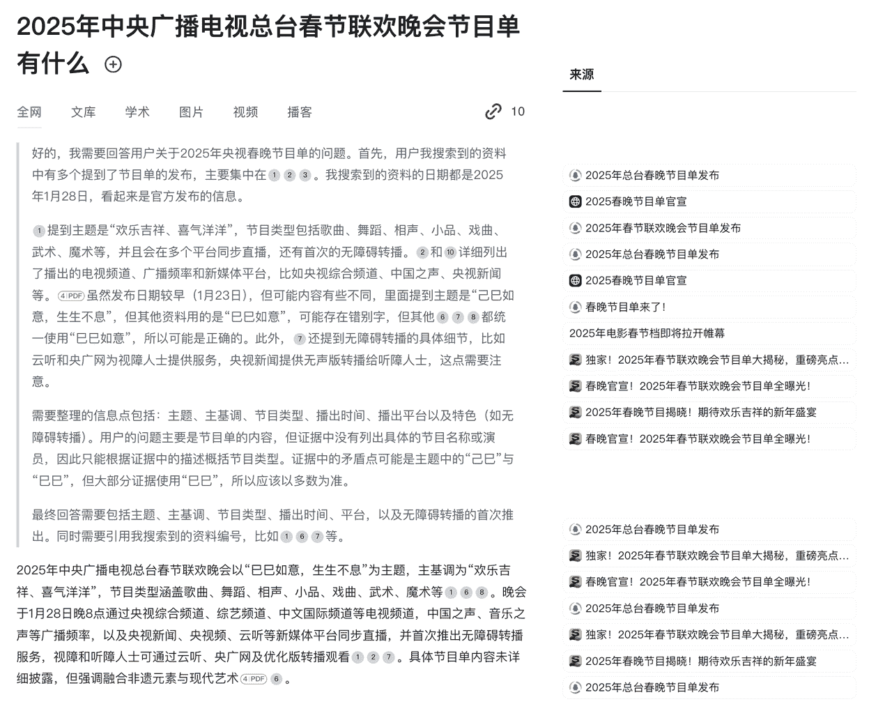
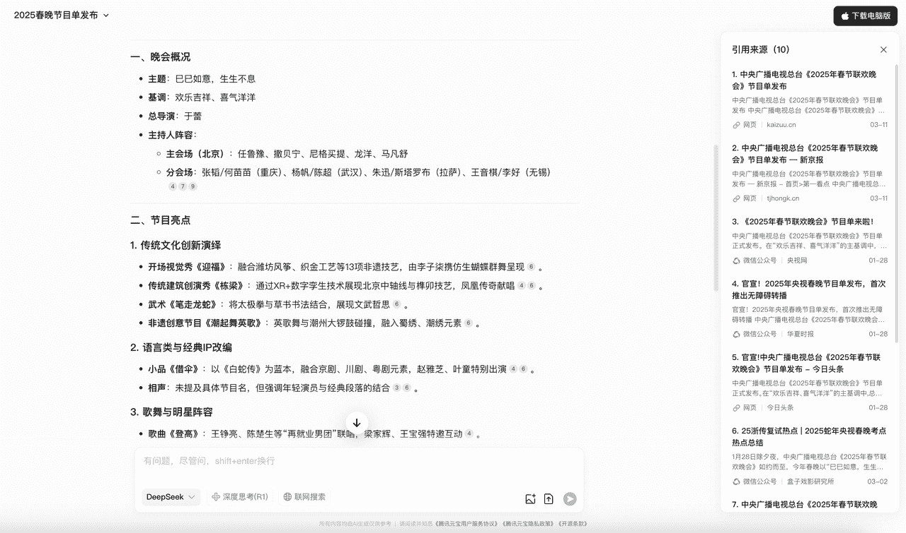
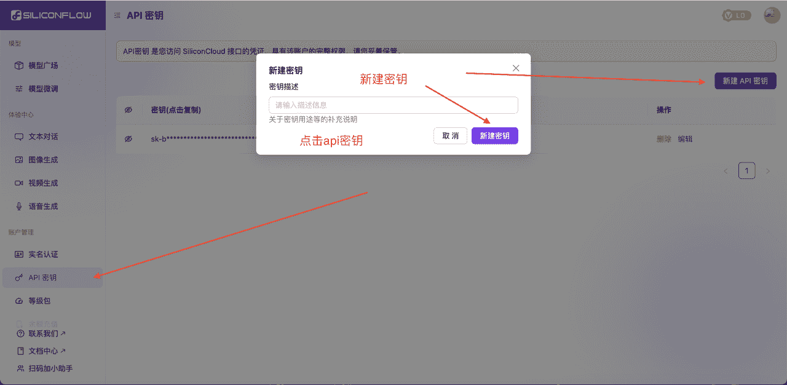
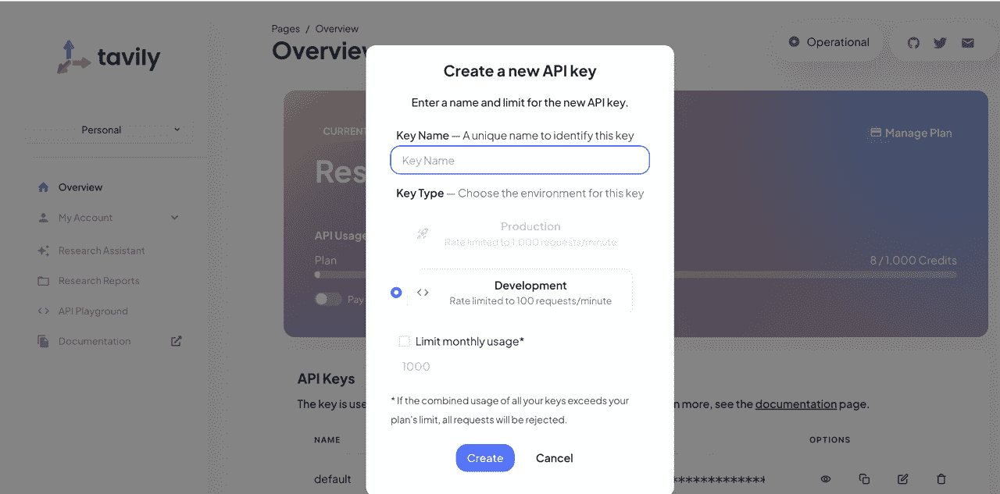
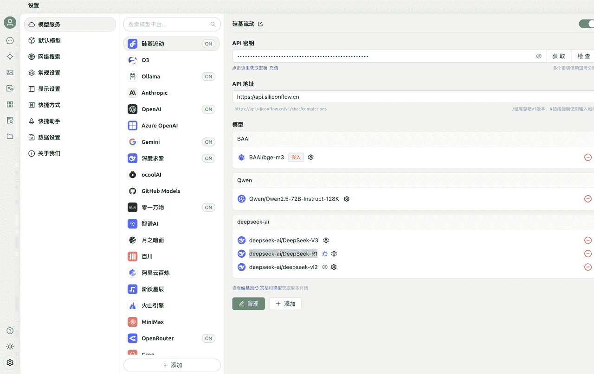
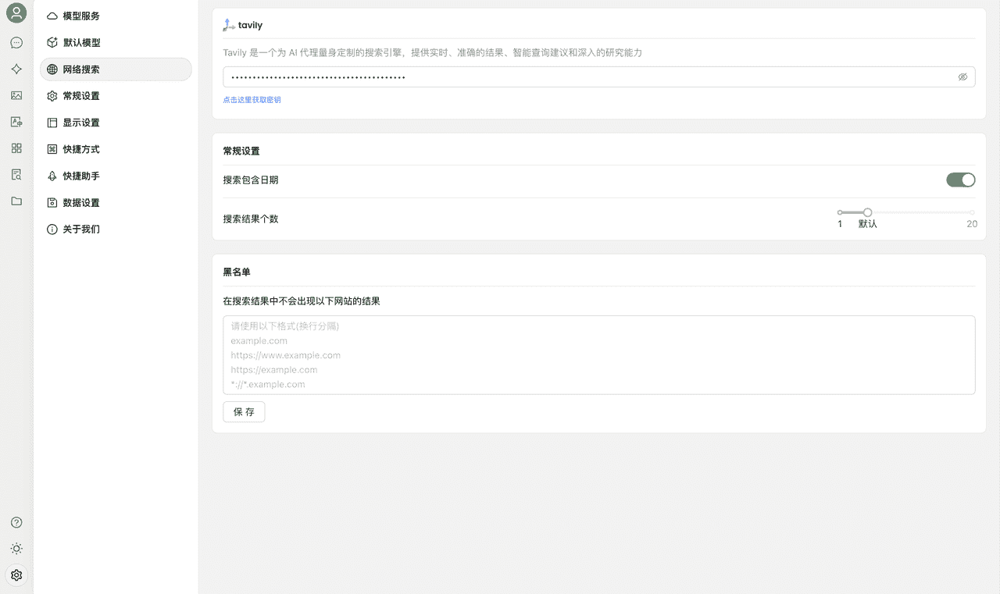
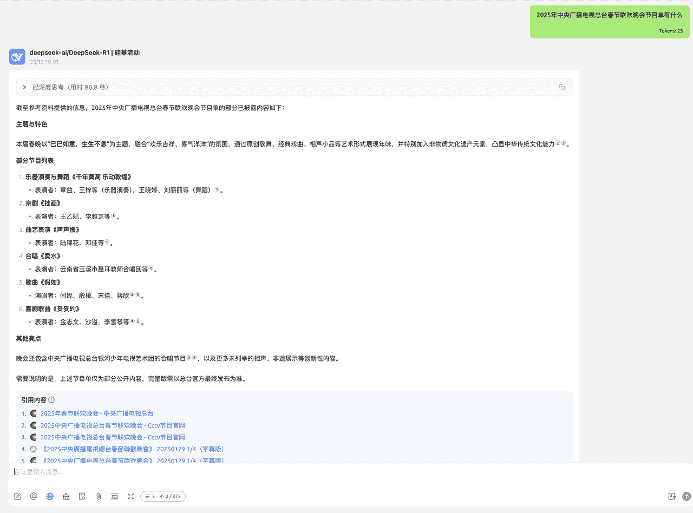

# 微学习26 | DeepSeek：满血可联网

> 来源：[https://datawhaler.feishu.cn/docx/UOfmd7w22oIuzpxlfFHcHXXAnEf](https://datawhaler.feishu.cn/docx/UOfmd7w22oIuzpxlfFHcHXXAnEf)

由于deepseek官方服务的火**爆，加上很多**人有其他的需求，因此会专注于满血、可联网这两个方向，通过一个简单的教程实现这一点。

## 方法一：直接使用

### 1. [秘塔AI搜索](https://metaso.cn/)

**秘塔AI搜索是由上海秘塔网络科技提供的智能检**索服务，秘塔AI搜索以非人工检索方式通过公开渠道自动检索第三方网页的链接或在用户自行上传的内容中自动检索并基于相关链接、文档的内容生成回答，以便用户能够快速获取检索结果，并找到和使用第三方网页或用户上传的各种文档、资料等内容。

秘塔AI搜索可以调用deepseek R1模型，并支持联网**，同时在联网功能下**还可细分搜索范围，例如全网、学术、文库等。也可以开启“研究模式”进行深入研究。

这里以“2025年中央广播电视总台春**节联**欢晚会节目单有什么”为例，进行演示。搜索范围全网，开启R1模型，搜索结果如下：

可以看出，结果中给出了引用连接的来源，主题等也都吻合。

### 2. [元宝](https://yuanbao.tencent.com/)

腾**讯元**宝搜索依托于混元、deepseek r1等大语言模型，同样支持联网搜索，但是没有细分范围，只能选择全网。

同样以“2025年中央广播电视总台春节联欢晚会节目单有什么”为例，进行演示。搜索结果如下：

可以看出，结果中同样给出了引用连接的来源，甚至给出了具体节目的参考链接，可以说非常详细了。

## 方法二：利用满血api+第三方软件

### 1. 使用硅基流动api

[点击链接](https://cloud.siliconflow.cn)注册账号之后，点击“**实名认证”**完成实名，然后点击左侧的**API密钥——新建API密钥**，输入描述信息之后，点击“**新建密钥**”，即可完成密钥创建。

### 2. 使用Tavily api

[Tavily](https://tavily.com/) 是一个为 **AI 代理量身定制的搜索引擎**，提供实时、准确的结果、智能查询建议和深入的研究能力。

**注册登陆账号**之后，点击API Keys旁边的+号，输入名称，点击Create，即可完成密钥创建。

### 3. 使用cherrystudio配置api

[Cherry Studio](https://cherry-ai.com/)是一个支持多服务商集成的AI对话客户端，支持deepseek、openai、claude、gemini、groq、qwen等多家服务商，支持联网搜索。

**下载安装好che**r**rystudio**之后，点击设置——模型服务，**打开**硅基流动服务，输入API-key，点击“管理”按钮添加模型，这里添加deepseek-ai/DeepSeek-R1模型，即可完成配置。

点击**设置——网络搜索**，输入Tavily的apikey，即可完成配置。

至此，即可实现满血、可联网的deepseek模型。同样以“2025年中央广播电视总台春节联欢晚会节目单有什么”为例进行演示。搜索结果如下：

结果中同样给出了引用连接的来源，甚至给出了具体节目的参考链接，但是部分节目并不在春晚节目内，因此需要自行判断。