# 本地私有DeepSeek与云端满血DeepSeek——模型提供商接入Dify

> 来源：[https://datawhaler.feishu.cn/docx/HaPmd0NB7oBe4xxcbDJc3kEmn5g](https://datawhaler.feishu.cn/docx/HaPmd0NB7oBe4xxcbDJc3kEmn5g)

> 当路途很远的时候，我们会想到坐飞机去

> 这个时候，“坐飞机去远方”是我们的目的

> 为了实现坐飞机目的，我们需要哪些东西呢？

> 没错，就是“飞机”和“机场”！

> 机场容纳飞机，给飞机提供基础设施底座，而飞机在机场的支持下带着我们远行~

> 有的小伙伴在疑惑：“为什么你要说这个？”

> 因为在我们现在的学习中，Dify就是这个“机场”，大模型就是这个“飞机”。大模型在Dify的支持下，尽情发挥着自己的超能力。

> 而模型提供商，顾名思义就是“卖飞机的人”

> 明白了这里面的逻辑关系，在后续的学习中，我们就会避免很多卡点~

> 注意，本篇是微学习22[《Dify：保姆级部署教程》](https://datawhaler.feishu.cn/wiki/WicIwpEfwiLKbFk0Onfcwv9Onkg)[的后续步骤。如果你想了解Di](https://datawhaler.feishu.cn/wiki/WicIwpEfwiLKbFk0Onfcwv9Onkg)fy本地部署相关教程，可以访问《Dify：保姆级部署教程》看看~

> 如果你只是想学习如何Ollama本地部署模型/轨迹流动API接入模型，可以直接跳过下方教程中的接入Dify部分~

好了，现在我们正式开始模型提供商接入Dify的教程

在“模型提供商接入Dify”这个过程，我们涉及了两个主体：“模型提供商”和“Dify”

**告诉大**家一个大佬思维：遇到技术问题，第一时间读文档！

文档，也称技术手册、README（请读我）、DOC，上面会记载着用户在使用这个软件、服务或芯片时，所需要的很多关键信息！比如我们现在想做“模型提供商接入Dify”，就应该先在DIfy的文档里寻找，有没有相关信息

看！我们找到了：https://docs.dify.ai/zh-hans/guides/model-configuration

后续如果想研究Dify的其它实用功能，也可以在这里找找看~

本教程提供两种模型接入方式：Ollama本地部署和硅基流动API调用

# 一、Ollama本地部署DeepSeek-R1（蒸馏版）并接入Dify

## 1.1 下载Ollama

1.  访问[Ollama](https://ollama.com/)官网：https://ollama.com/，点击Download下载软件

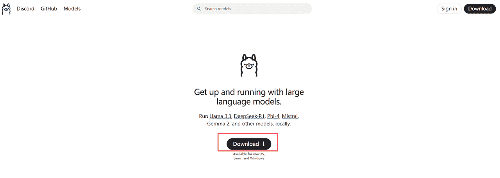

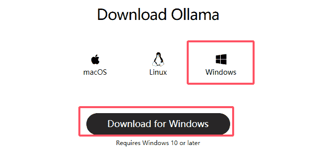

1.  下载可能会比较慢，如果不想等可以直接下载下面的安装包：


[OllamaSetup_2.exe](https://internal-api-drive-stream.feishu.cn/space/api/box/stream/download/all/CxAcb1PZIofGIAxUtpDcYPESnAb)

在下载的过程中，可以了解一下什么是Ollama

Ollama 是一个本地部署运行大模型的工具，让用户能够轻松地在自己的设备上部署和操作复杂的模型，而不必依赖云端服务。这对于需要数据隐私和低延迟的用户来说，简直是福音！

+   在没有 Ollama 之前，普通人想要在本地运行大型语言模型（LLM）简直是一场“技术噩梦”！ 想象一下，我们需要安装各种依赖库、框架（如 PyTorch、TensorFlow），还得确保版本兼容，甚至还得学习如何配置 CUDA 和驱动。

配好环境之后，我们还需要下载模型权重、调整参数、处理各种报错……光是让模型跑起来，可能就得花上几天时间。即使模型跑起来了，还得写脚本或者用复杂的工具来交互，对非技术人员来说简直是“劝退级”难度。

+   而 Ollama 的出现，彻底改变了这一切！它带来的便捷简直是“革命性”的：Ollama提供了简单的安装方式，几乎不需要任何复杂的配置，几分钟就能搞定。它还预先配好了多种流行的开源大模型（如 DeepSeek、Qwen、Llama 等），直接下载就能运行，完全不需要手动折腾。无论是 macOS 还是 Linux，Ollama 都能轻松运行，甚至对硬件的要求也相对友好。通过简单的命令就能启动模型、调整参数，甚至支持 API 调用，方便开发者集成到自己的应用中。所有计算都在本地完成，既保护了数据隐私，又避免了云服务的延迟和费用。

可以说，OLLAMA 让普通人也能轻松玩转大模型，真正实现了“技术民主化”。它就像是一个贴心的助手，把复杂的底层技术封装起来，只留下简单易用的界面，让每个人都能享受到 AI 的魅力！

1.  双击安装，直接点击Install即可

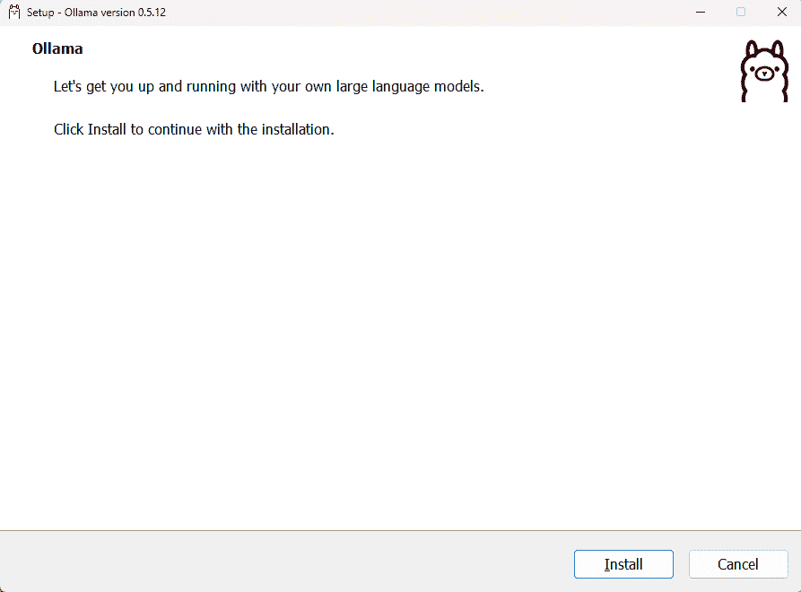

## 1.2 本地部署DeepSeek-R1蒸馏版

1.  安装好Ollama后，在桌面空白处按住键盘Shift，鼠标右键，选择在此处打开PowerShell窗口

1.  在执行指令之前，先根据你的**电脑显存大小**选择不同参数量和量化等级的模型：

1.  4G及以下：ollama run deepseek-r1:1.5b

1.  6~8G：ollama run deepseek-r1:7b

1.  12G及以上（台式机显卡）：ollama run deepseek-r1:14b

1.  24G及以上：ollama run deepseek-r1:32b

1.  如何查看电脑显存大小？

1.  按CTRL+SHIFT+ESC打开任务管理器，进入下图界面，观察显存大小

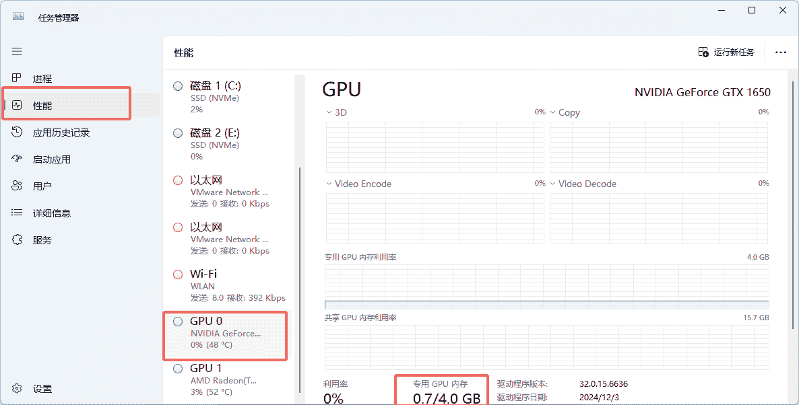

1.  显存小于1G的，一般是CPU自带的集成显卡，无法使用显卡加速。此时关注内存剩余量，以内存剩余量的70%作为显存大小，在上方选择模型：

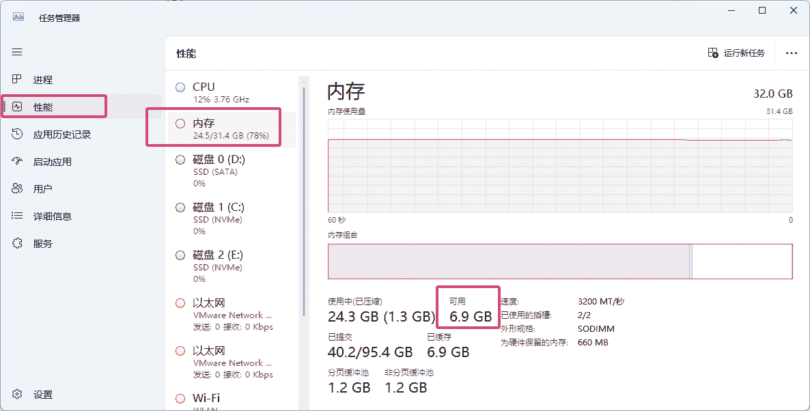

1.  在PowerShell中执行你选择的那句指令。此时Ollama会开始下载模型：

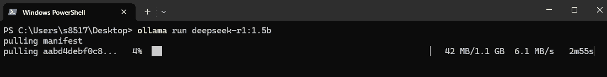

1.  下载好后，即可直接和大模型对话！

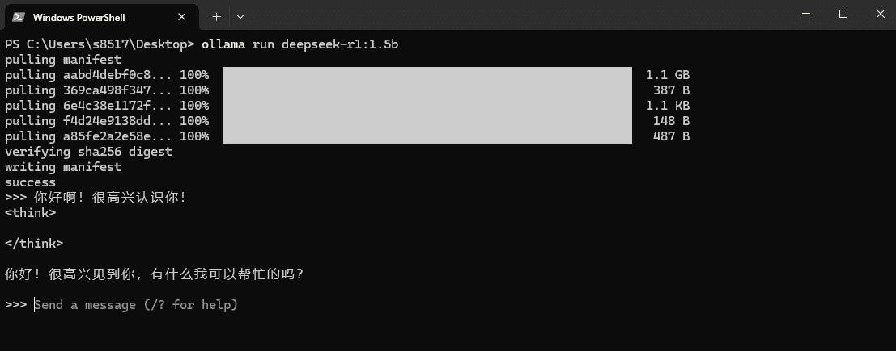

## 1.3 大模型接入Dify平台

1.  接入Dify平台：打开本地部署好的Dify（http://127.0.0.1/），按下图方式进入设置

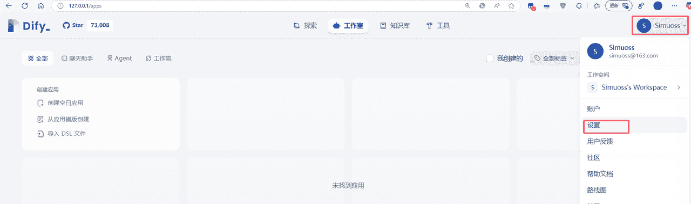

1.  选择模型供应商->Ollama：

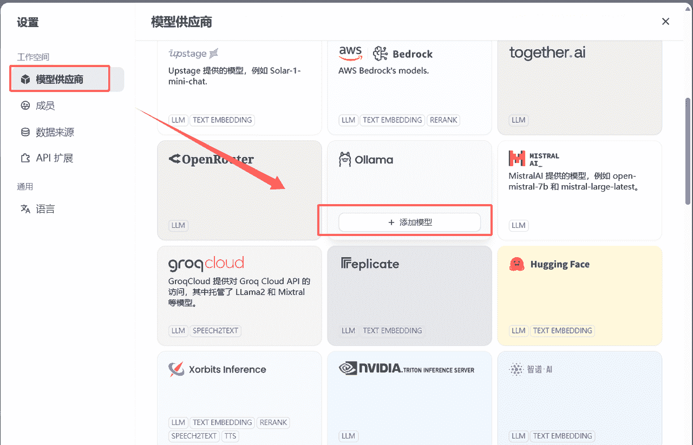

1.  新打开一个PowerShell（一定要新开一个，还记得怎么打开PowerShell吧），输入ollama list，再输入ipconfig，将对应的内容按下图所示填写进ollama模型设置：

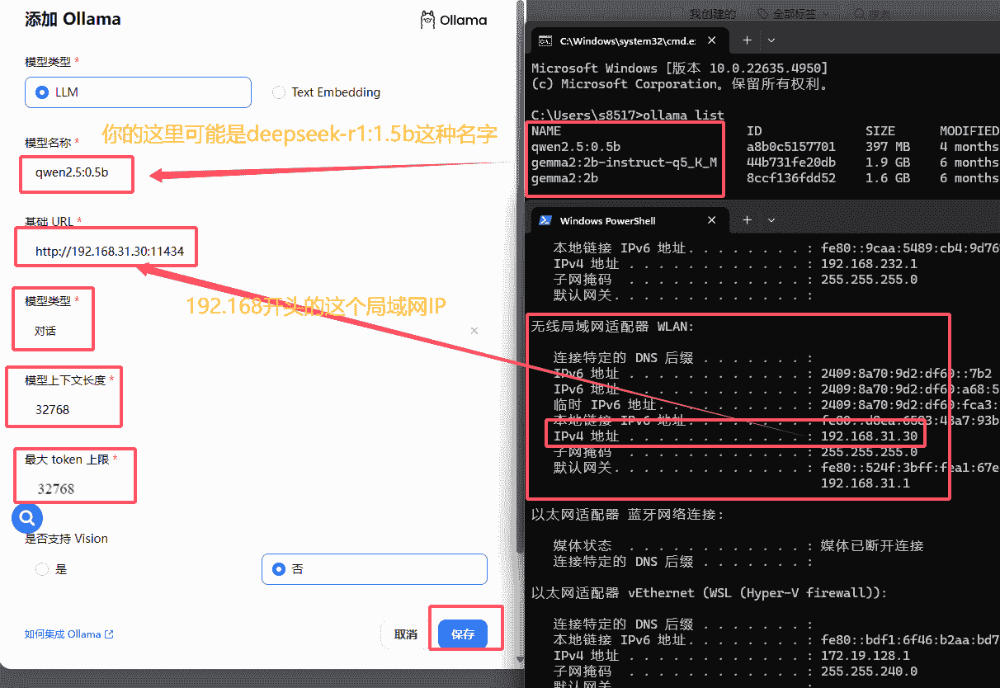

1.  这个时候点保存，大概率是点不动的，因为ollama默认设置是不放开公网访问的。此时在任务栏搜索中搜索“环境变量”，选择“系统环境变量”，并添加一个环境变量OLLAMA_HOST，设置为0.0.0.0，随后重启一下ollama软件。此时再点保存，就可以成功接入本地模型了。

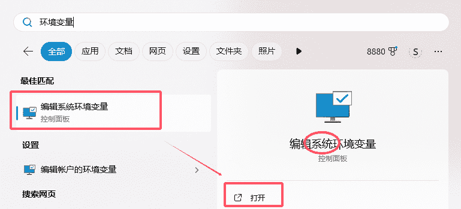

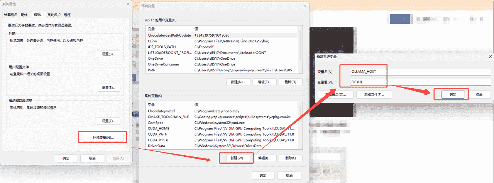

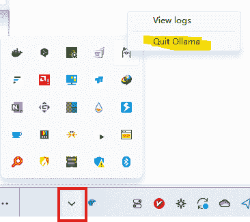

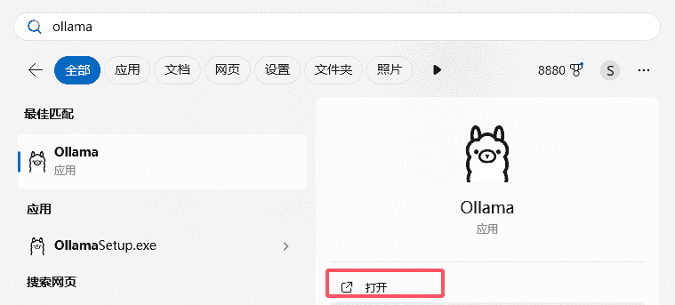

1.  成功接入！

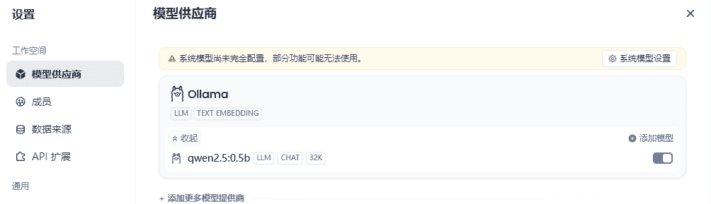

## 1.4 （可选）向量模型接入Dify平台

1.  通常我们在大模型之外，还需要一个Embedding模型（嵌入模型）。可以在PowerShell中执行指令：

```
ollama pull zyw0605688/gte-large-zh # 拉取gte-large-zh这个嵌入模型，它的中文效果比较好
```

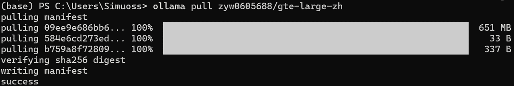

1.  还是按照之前的方法接入嵌入模型：

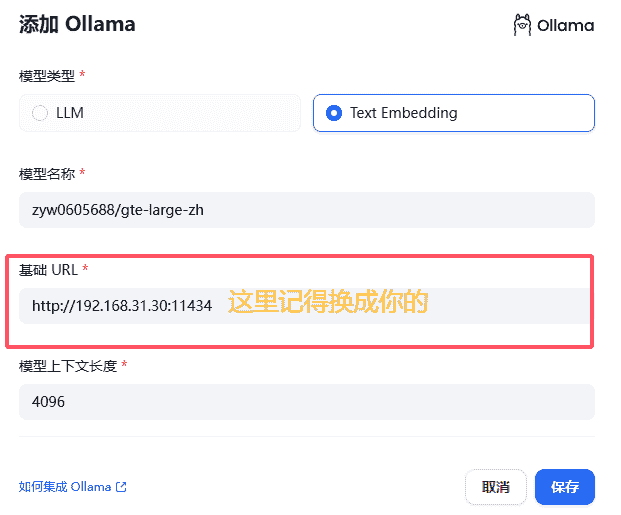

1.  配置完成！现在我们可以创建一个应用来和大模型对话了！

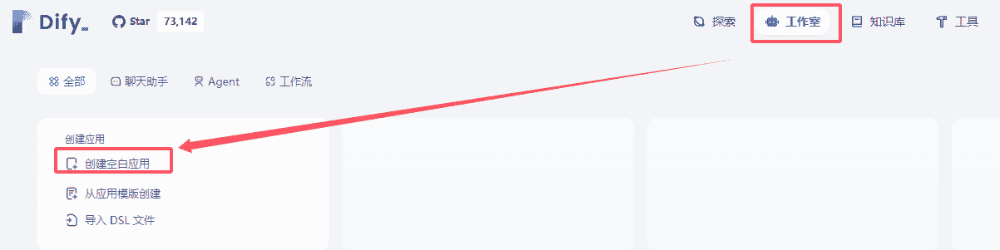

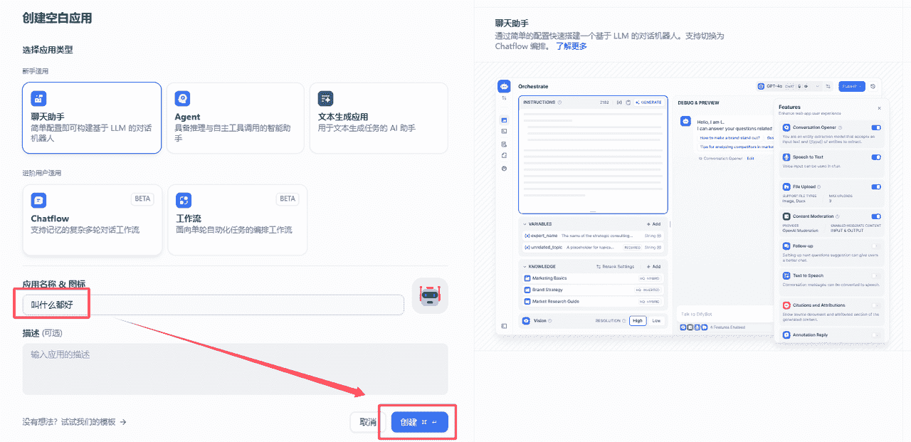

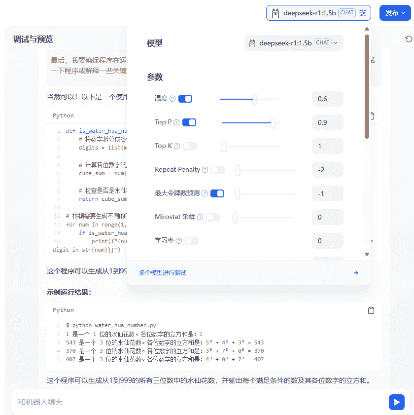

如上图所示设置，即可畅所欲言！


不过，与满血版的671B模型相比，我们的1.5B、7B的蒸馏模型实在是太小了！在一些复杂问题上很可能出现幻觉或者错误

如果想要体验满血版的R1在本地调用，可以尝试后面的硅基流动API接入~

# 二、Dify接入DeepSeek硅基流动API

## 2.1 注册硅基流动平台并获取密钥

1.  注册硅基流动平台：[硅基流动统一登录](https://cloud.siliconflow.cn/i/kfTZNRaa)（新用户送14块钱的体验金，够用很久）

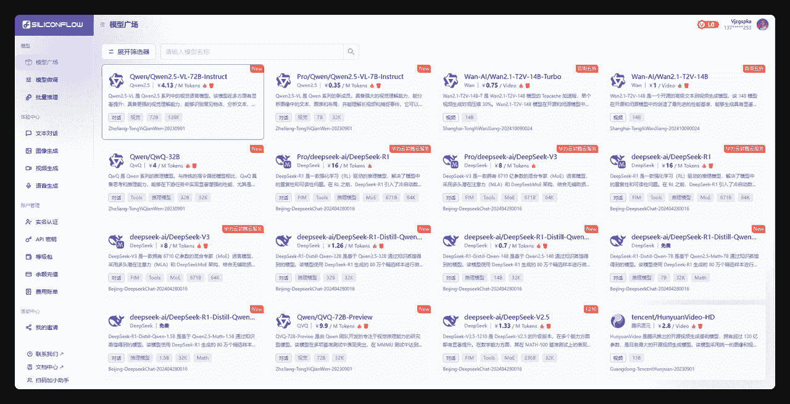

1.  注册后进入API密钥->新建密钥，名字可以随便起，随后复制密钥


## 2.2 接入Dify平台

1.  返回Dify的模型接入界面，找到硅基流动，添加密钥：


1.  保存后，满血版R1就在这里！


1.  随后在【工作室】新建【应用】，或者进入之前建好的【应用】时，都可以选到这个满血版R1来体验了！


1.  如上图所示硅基流动平台还有很多其他模型，也很值得尝试！

# 常见问题与解决方案

## Ollama模型拉取前面很快，但是后面只剩下几十kb/s

**在Power**Shell窗口中按下Ctrl+C，打断当前指令

再按**方向键的上键**，回到上一条模型拉取的指令，重新执行，速度就又回来了

而且支持续着之前的进度下载！

## 我想使用Ollama本地部署其它模型

可以在下方的Ollama官网挑选其它的模型~


比较推荐试试Qwen2.5-VL-7B-Instruct这一款模型，阿里通义千问团队出品（千问系列在DeepSeekV3和R1发布之前，就已经是中国开源大模型在国际上的门面了，很强）

## 还有其它模型提供商吗？我想试试不同的模型！

有哦！比如：

| 品牌 | 平台名 | 链接 | 介绍 |
| --- | --- | --- | --- |
| 阿里 | 阿里百炼 | 阿里云登录 - 欢迎登录阿里云，安全稳定的云计算服务平台 | 国内平台，可接入Qwen、DeepSeek、百川智能、零一万物、元语智能、智谱AI、Meta（Llama）、MiniMax等模型。试用期部分热门模型免费 |
| 字节 | 火山引擎 | 火山方舟大模型体验中心-火山引擎 | 国内平台，可接入豆包、DeepSeek、Kimi等模型。试用期每种模型免费50万Token |
| OpenRouter | OpenRouter | [OpenRouter](https://openrouter.ai/) | 国外平台，可接入ChatGPT、Claude等任意主流模型，但需要国外支付方式，比较麻烦 |

有兴趣的话，可以自行测试体验~