# 微学习05 | DeepSeek+Ollama+ChatBox：本地部署

> 来源：[https://datawhaler.feishu.cn/docx/T5AGdco0ToZ8SWxQbSycDiSPnPc](https://datawhaler.feishu.cn/docx/T5AGdco0ToZ8SWxQbSycDiSPnPc)

# 一、标题释义

+   DeepSeek：众所周知的国产大模型（免费），[它的](https://www.deepseek.com/)特色是把深度思考的过程也告知了用户。官网

+   Ollama：开源的大型语言模型服务工具（免费），旨在帮助用户快速在本地运行大[模型](https://ollama.com/)。通过简单的安装指令，用户可以通过一条命令轻松启动和运行开源的大型语言模型。官网

+   Ch[at](https://chatboxai.app/zh)Box：  AI 客户端应用和智能助手（作为模型API和本地模型的连接工具免费），支持众多先进的 AI 模型和 API，可在 Windows、MacOS、Android、iOS、Linux 和网页版上使用。官网

DeepSeek+Ollama+ChatBox的含义就是：通过Ollama运行DeepSeek大模型，形成大模型服务。通过ChatBox对接Ollama的大模型服务，完成用户和大模型的交互。

# 二、安装步骤

## （一）Ollama安装

本节描述如何安装Ollama。

[以Windows](https://ollama.com/)安装为例，打开 Ollama官网

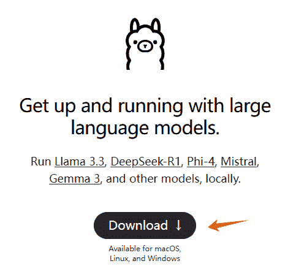

点击Download：

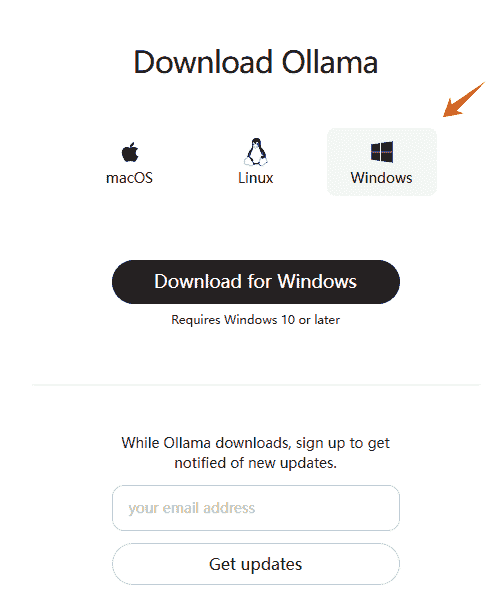

选择Windows平台，点击"Download for Windows"：

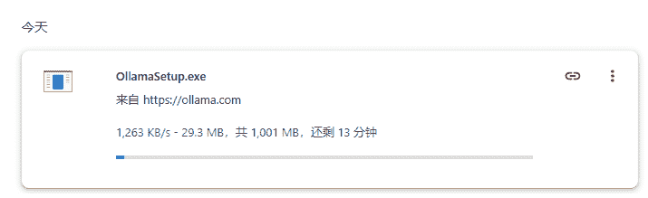

耐心等待下载结束。

双击 OllamaSetup.exe 执行安装：

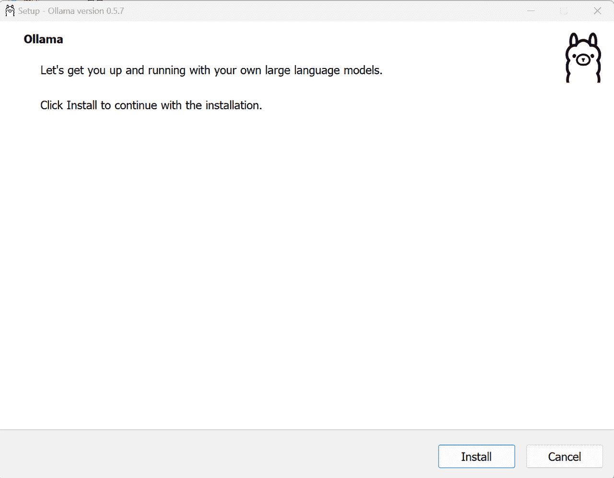

点击"Install"安装即可。

安装完毕之后，系统托盘栏会有一个图标：

右键点击后会出现以下内容：

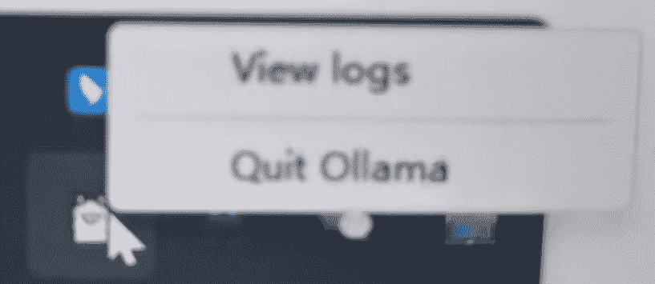

如果打开Windows左下角的搜索栏，搜索Ollama，会出现以下内容：（小猪变得清晰了）

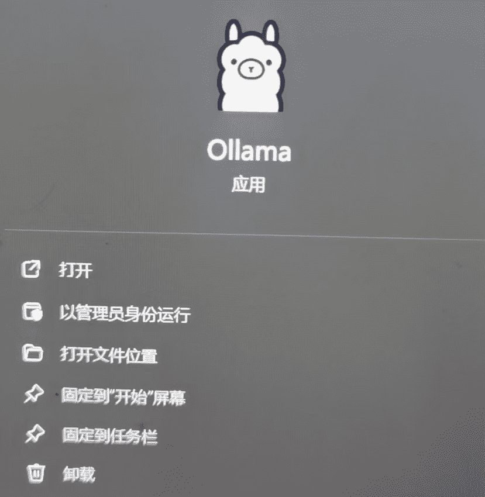

这都是Ollama存在的标志。

TIPS1：如果你的C盘不够怎么办？

如果你的C盘剩余空间不足以放下几个G、十几个G、甚至几十个G的模型文件，那么您可以在系统环境变量中做如下配置：

编辑系统环境变量

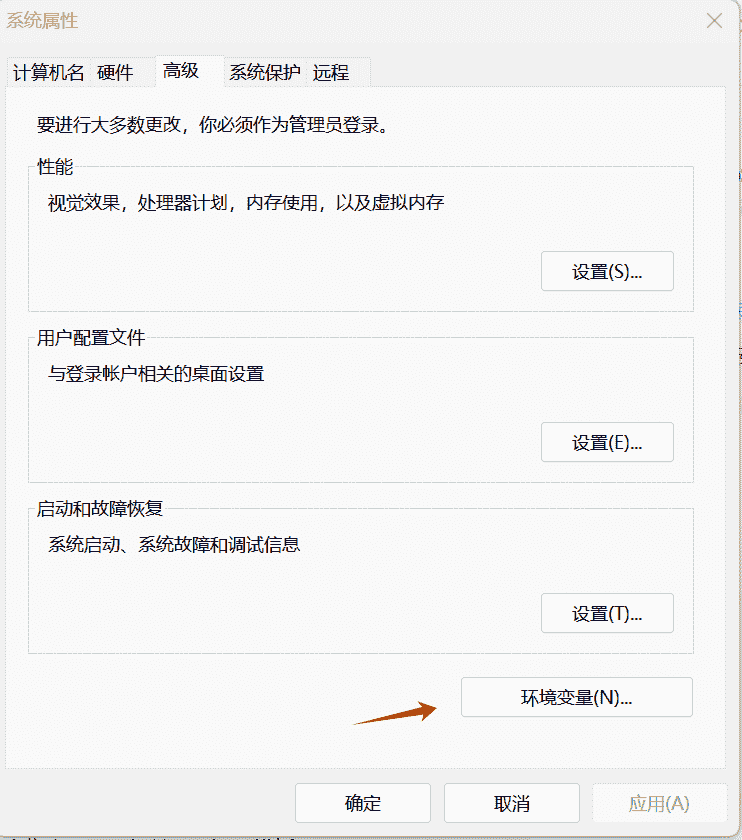

环境变量->系统变量->新增：

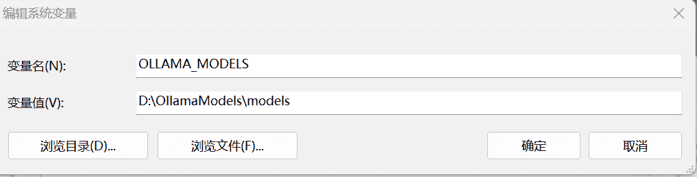

以模型文件下载到 D:\OllamaModels\models 为例。

模型下载完毕后一般是如下的目录结构：

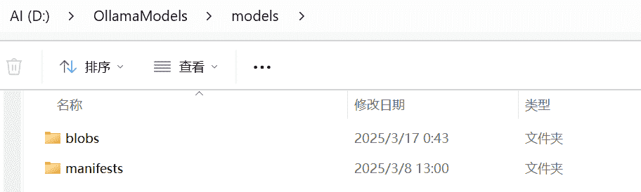

TIPS2：如何设置允许外部连接Ollama？

在环境变量设置中：

+   OLLAMA_HOST需设置成 0.0.0.0

+   OLLAMA_PORT需设成11434

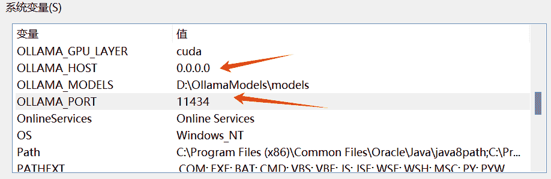

## （二）DeepSeek安装

本节描述如何使用Ollama安装DeepSeek-R1大模型。

打开 https://ollama.com/search，在搜索栏搜索 DeepSeek-R1

点击进去：

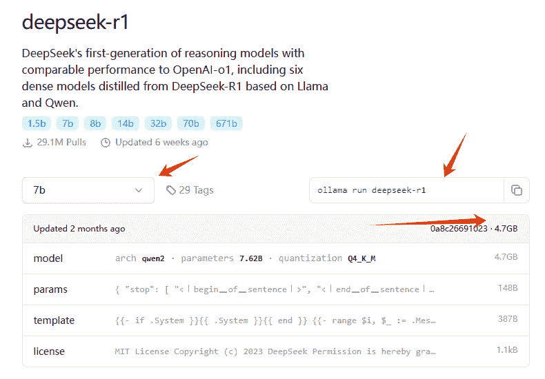

在这里可以看到 deepseek-r1有1.5b到671b不等的7个模型(除了671b的都是蒸馏版本)。可以点击下拉框选择模型，并且在右边看到安装方法和模型的大小。上图显示7b模型占用大小为 4.7G。

打开命令行提示符：

ollama list 可以看到现在Ollama已经有的模型：

以安装32b deepseek-r1 蒸馏模型为例，输入ollama run deepseek-r1:32b

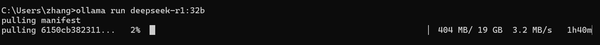

此时耐心等待模型下载完毕即可：

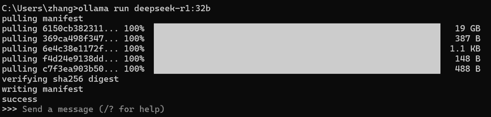

## （三）ChatBoxAI安装

本节描述如何安装ChatBoxAI。

[以Windows安装为](https://chatboxai.app/zh)例，打开 ChatBoxAI官网：

点击"免费下载（for Windows）"

耐心等待下载完毕：（如果迟迟没下载则点击“手工下载 for Windows(PC)"按钮）

双击 Chatbox开头的.exe文件执行安装：

## （四）ChatBox连接Ollama配置

启动ChatBox：

选择 ”使用自己的API Key或本地模型“

可以先点击"x"关闭弹出窗口。

这个就是ChatBoxAI的界面。

点击左下角”设置“：

模型提供方，通过下拉框选择"OLLAMA API"，API域名填写 "http://127.0.0.1:11434"，按<TAB键>

系统会自动弹出Ollama已经有的模型，可以用下拉框选择：

选中一个模型，点击"保存"：

# 三、开始对话

进入Just Chat(新对话)页面就可以对话了。

