# 微学习14 | 文本嵌入（Text Embedding）模型简介

> 来源：[https://datawhaler.feishu.cn/docx/S9xydsXLWoJyoNxsHdpcZ5n8npb](https://datawhaler.feishu.cn/docx/S9xydsXLWoJyoNxsHdpcZ5n8npb)

# 一、Embedding概述

因为计算机本身不能识别单词、词语、字符等标识符（toke**n），所以需要把这**些标识符数字化。嵌入（Embedding）是将高维稀疏数据（如单词、句子或图像）转换成低维密集向量的一种技术。

有一句话叫做“**万物皆可Embedding**"，意思是 **任**何类型的数据（文本、图像、音频、视频、用户行为、物**理现象等）都可**以通过某种数学方法转化为低维稠密的向量（Embedding），从而让计算机能够更高效地处理和理解这些数据。通过Embedding，所有类型的数据都能被统一表示为向量，方便计算机进行相似性计算、分类、聚类等任务。例如：通过词向量（Word2Vec），计算机可以理解“猫”和“狗”的语义相似性；通过图像Embedding，可以判断两张图片是否属于同一类别。因此Embedding有着广泛的应用场景。

可以这么说：Embedding是AI理解世界的一种通用语言。

本次微学习仅介绍文本嵌入模型（Text Embedding）。

# 二、Text Embedding模型排行榜

## （一）MTEB

[Text Embedd](https://huggingface.co/spaces/mteb/leaderboard)ing模型排行榜可以在leaderboard中找到：

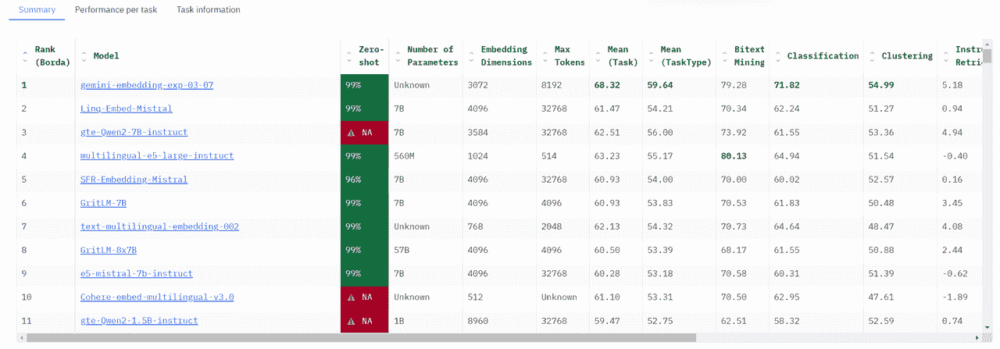

MTEB（Massive Text Embedding B[en](https://arxiv.org/abs/2210.07316)chmark）是嵌入模型的评估基准。论文

MTEB包含8个语义向量任务，涵盖58个数据集和112种语言。通过在MTEB上对33个模型进行基准测试，建立了迄今为止最全面的文本嵌入基准。

代码仓：[h](https://github.com/embeddings-benchmark/mteb#leaderboard)ttps://github.com/embeddings-benchmark/mteb#leaderboard

## （二）C-MTEB

中文海量文本embedding任务排行榜C-MTEB针对中文海量文本embedding的各项任务都有单独的排行榜，包含6个任务，35个数据集。

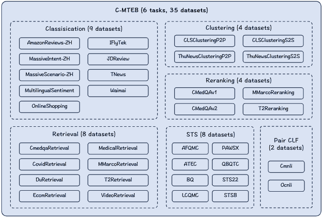

C-MTEB作为中文文本向量性能的评测标准，以其全面性和权威性在业内享有盛誉。

[检索任务榜单下效果较好的](https://huggingface.co/BAAI/bge-large-zh)是BGE系列的bge-large-zh模型。

下面希望通过介绍一些典型的Text Embedding模型的历史或轶事，让同学们对这些模型大致有点印象。

# 三、典型Text Embedding模型简介

## （一）Text2Vec：text2vec-base-chinese/text2vec-base-multilingual/text2vec-large-chinese

### （1）模型概述

text2vec**发布于2022年3月**，是一种基于词袋模型的文本嵌入方法。它通过构建词汇的共现矩阵，然后应用奇异值分解（SVD）等矩阵分解技术来生成文本的向量表示。text2vec模型简单易用，适用于处理大规模的文本数据。然而，由于它忽略了词序信息，因此在某些复杂的NLP任务中可能表现不佳。

+   text2vec-base-chinese模型（V1.1.4）：是用CoSENT方法训练，基于hfl/chinese-macbert-base在中文STS-B数据训练得到，并在中文STS-B测试集评估达到较好效果。

+   text2vec-base-chinese-nli模型（V1.2.0）：基于nghuyong/ernie-3.0-base-zh模型，使用了中文NLI数据集shibing624/nli_zh全部语料训练的CoSENT文本匹配模型，在各评估集表现提升明显。

+   text2vec-base-chinese-nli模型（V1.2.1）：针对CoSENT的loss计算对排序敏感特点，人工挑选并整理出高质量的有相关性排序的STS数据集shibing624/nli-zh-all/text2vec-base-chinese-sentence-dataset，在各评估集表现相对之前有提升

+   text2vec-base-multilingual模型（V1.2.2）：用CoSENT方法训练，基于sentence-transformers/paraphrase-multilingual-MiniLM-L12-v2用人工挑选后的多语言STS数据集shibing624/nli-zh-all/text2vec-base-multilingual-dataset训练得到，并在中英文测试集评估相对于原模型效果有提升。

+   text2vec-large-chinese模型（V1.2.4）：用CoSENT方法监督训练，基于BAAI/bge-large-zh-noinstruct用中文匹配数据集训练得到，并在中文测试集评估相对于原模型效果有提升，短文本区分度上提升明显

### （2）模型地址

模型地址：

+   [h](https://huggingface.co/maidalun1020/bce-embedding-base_v1)ttps://huggingface.co/shibing624/text2vec-base-chinese

+   [h](https://modelscope.cn/models/maidalun/bce-embedding-base_v1)ttps://huggingface.co/shibing624/text2vec-base-multilingual

+   https://huggingface.co/shibing624/text2vec-bge-large-chinese

代码地址：

+   https://github.com/shibing624/text2vec

### （3）模型使用

依赖库：

```
pip install -U text2vec
或
git clone https://github.com/shibing624/text2vec.git
cd text2vec
pip install --no-deps .
```

样例代码：

```
import sys

sys.path.append(&#x27;..&#x27;)
from text2vec import SentenceModel
from text2vec import Word2Vec


def compute_emb(model):
    # Embed a list of sentences
    sentences = [
        &#x27;卡&#x27;,
        &#x27;银行卡&#x27;,
        &#x27;如何更换花呗绑定银行卡&#x27;,
        &#x27;花呗更改绑定银行卡&#x27;,
        &#x27;This framework generates embeddings for each input sentence&#x27;,
        &#x27;Sentences are passed as a list of string.&#x27;,
        &#x27;The quick brown fox jumps over the lazy dog.&#x27;
    ]
    sentence_embeddings = model.encode(sentences)
    print(type(sentence_embeddings), sentence_embeddings.shape)

    # The result is a list of sentence embeddings as numpy arrays
    for sentence, embedding in zip(sentences, sentence_embeddings):
        print(&quot;Sentence:&quot;, sentence)
        print(&quot;Embedding shape:&quot;, embedding.shape)
        print(&quot;Embedding head:&quot;, embedding[:10])
        print()


if __name__ == &quot;__main__&quot;:
    # 中文句向量模型(CoSENT)，中文语义匹配任务推荐，支持fine-tune继续训练
    t2v_model = SentenceModel(&quot;shibing624/text2vec-base-chinese&quot;)
    compute_emb(t2v_model)

    # 支持多语言的句向量模型（CoSENT），多语言（包括中英文）语义匹配任务推荐，支持fine-tune继续训练
    sbert_model = SentenceModel(&quot;shibing624/text2vec-base-multilingual&quot;)
    compute_emb(sbert_model)

    # 中文词向量模型(word2vec)，中文字面匹配任务和冷启动适用
    #w2v_model = Word2Vec(&quot;w2v-light-tencent-chinese&quot;)
    #compute_emb(w2v_model)
```

注：该模型需要比较旧的transformers库，不建议大家尝试。

## （二）M3E：m3e-small/m3e-base/m3e-large

### （1）模型概述

**M3E（Mo**k**a Massi**ve Mixed Embedding）是MokaAI 2023年发布的开源中文Embedding模型。该模型采用了大规模混合嵌入技术，旨在提高词向量的表达能力和泛化能力。M3E在训练过程中充分考虑了词语之间的语义关系、上下文信息以及领域知识等因素，从而生成了更加丰富、准确的词向量。

+   **Moka——**由MokaAI训练，开源和评测。

+   **Massive——**经过千万级（2200w+）的中文句对训练。

+   **Mixed——**旨在提供一个 ALL IN ONE 的文本嵌入模型，只需要一个模型就可以覆盖全部的应用场景，支持中英双语的同质文本相似度计算、异质文本检索等功能。

m3e-small是较小尺寸的M3E模型，m3e-base是标准尺寸的M3E模型，m3e-large是较大尺寸的M3E模型。 M3E模型的特点如下：

+   **大规模混合嵌入**：M3E采用了大规模混合嵌入技术，将不同类型的词向量进行融合，从而生成更加全面、准确的词向量表示。这种技术能够充分利用各种词向量的优点，提高词向量的表达能力和泛化能力。

+   **丰富的语义信息**：M3E在训练过程中充分考虑了词语之间的语义关系、上下文信息以及领域知识等因素。这些因素的有效融合使得M3E生成的词向量更加具有丰富的语义信息，能够更好地表达词语的真实含义。

+   **高性能表现**：在多个数据集上的评测结果表明，M3E在检索任务和文本分类任务上均表现出了卓越的性能。例如，在T2Ranking 1W中文数据集上，M3E在ndcg@10上达到了0.8004，超过了openai-ada-002的0.7786；在6种文本分类数据集上，M3E在accuracy上达到了0.6157，超过了openai-ada-002的0.5956。这些成绩充分证明了M3E在实际应用中的优势。

M3E团队建议：

+   如果使用场景主要是中文，少量英文的情况，建议使用 m3e 系列的模型

+   多语言使用场景，并且不介意数据隐私的话，建议使用 openai text-embedding-ada-002模型

+   代码检索场景，推荐使用 openai text-embedding-ada-002

+   文本检索场景，使用具备文本检索能力的模型

### （2）模型地址

模型地址：

+   https://huggingface.co/moka-ai/m3e-base

+   https://huggingface.co/moka-ai/m3e-small

+   https://huggingface.co/moka-ai/m3e-large

+   https://modelscope.cn/models/AI-ModelScope/m3e-small

+   https://modelscope.cn/models/AI-ModelScope/m3e-base

+   https://modelscope.cn/models/AI-ModelScope/m3e-large

下载模型：

（A）下载modelscope的模型

可以参考以下代码：

```
from modelscope import snapshot_download, AutoModel, AutoTokenizer
import os

modelscope_model_path = &#x27;AI-ModelScope/m3e-base&#x27;
model_dir = snapshot_download(modelscope_model_path, cache_dir=&#x27;D:\\models&#x27;, revision=&#x27;master&#x27;)
```

（B）下载HuggingFace的模型

可以参考以下代码：

```
# 下载模型
from huggingface_hub import snapshot_download
import os

os.environ[&#x27;HF_ENDPOINT&#x27;] = &#x27;https://hf-mirror.com&#x27;

model_id = &quot;moka-ai/m3e-base&quot;
snapshot_download(
  repo_id=model_id,
  local_dir=&quot;D:\\models\\moka-ai\\m3e-base&quot;,
  local_dir_use_symlinks=False,
  revision=&quot;main&quot;,
  resume_download=True,
  use_auth_token=&quot;hf_xxx&quot;)
```

代码地址：

+   https://github.com/wangyingdong/m3e-base

### （3）模型使用

依赖库：

```
pip install -U sentence-transformers
```

样例代码：

```
from sentence_transformers import SentenceTransformer

model = SentenceTransformer(&#x27;moka-ai/m3e-base&#x27;)

#Our sentences we like to encode
sentences = [
    &#x27;* Moka 此文本嵌入模型由 MokaAI 训练并开源，训练脚本使用 uniem&#x27;,
    &#x27;* Massive 此文本嵌入模型通过**千万级**的中文句对数据集进行训练&#x27;,
    &#x27;* Mixed 此文本嵌入模型支持中英双语的同质文本相似度计算，异质文本检索等功能，未来还会支持代码检索，ALL in one&#x27;
]

#Sentences are encoded by calling model.encode()
embeddings = model.encode(sentences)

#Print the embeddings
for sentence, embedding in zip(sentences, embeddings):
    print(&quot;Sentence:&quot;, sentence)
    print(&quot;Embedding:&quot;, embedding)
    print(&quot;&quot;)
```

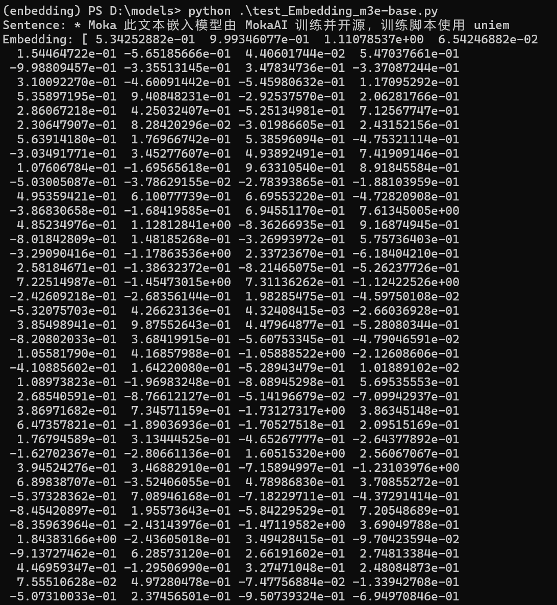

## （三）BGE：bge-small/bge-base/bge-large

### （1）模型概述

**BGE（Bilingu**al Gen**eral Em**bedding）模型是北京智源人工智能研究院（BAAI）2023年8月推出的中英文语义向量模型。它首先使用RetroMAE预训练算法在大规模语料库上进行预训练，然后利用难负样本挖掘方法进行微调。bge模型能够有效地捕获跨语言的语义信息，因此在处理跨语言NLP任务时表现出色。RetroMAE预训练算法论文地址：https://arxiv.org/abs/2205.12035

bge-small-en和bge-small-zh是较小尺寸的BGE模型，bge-base-en和bge-base-zh是标准尺寸的BGE模型，bge-large-en和bge-large-zh是较大尺寸的BGE模型。

BGE的技术特点如下：

+   高效预训练和大规模文本微调；

+   在两个大规模语料集上采用了RetroMAE预训练算法，进一步增强了模型的语义表征能力；

+   通过负采样和难负样例挖掘，增强了语义向量的判别力；

+   借鉴Instruction Tuning的策略，增强了在多任务场景下的通用能力

### （2）模型地址

模型地址：

+   [https://huggingface.](https://huggingface.co/BAAI/bge-small-en)co/BAAI/bge-small-en

+   [https://huggingface.](https://huggingface.co/BAAI/bge-small-zh)co/BAAI/bge-small-zh

+   [https://huggingface](https://huggingface.co/BAAI/bge-base-en).co/BAAI/bge-base-en

+   [https://huggingface](https://huggingface.co/BAAI/bge-base-zh).co/BAAI/bge-base-zh

+   [https://huggingface.](https://huggingface.co/BAAI/bge-large-en)co/BAAI/bge-large-en

+   https://huggingface.co/BAAI/bge-large-en-v1.5

+   [https://huggingface.](https://huggingface.co/BAAI/bge-large-zh)co/BAAI/bge-large-zh

+   https://huggingface.co/BAAI/bge-large-zh-v1.5

代码地址：

+   https://github.com/FlagOpen/FlagEmbedding

### （3）模型使用

依赖库：

```
pip install -U FlagEmbedding
或
git clone https://github.com/FlagOpen/FlagEmbedding.git
cd FlagEmbedding
pip install -e .
```

样例代码：

```
from FlagEmbedding import FlagModel
sentences_1 = [&quot;样例数据-1&quot;, &quot;样例数据-2&quot;]
sentences_2 = [&quot;样例数据-3&quot;, &quot;样例数据-4&quot;]
model = FlagModel(&#x27;BAAI/bge-large-zh-v1.5&#x27;, 
                  query_instruction_for_retrieval=&quot;为这个句子生成表示以用于检索相关文章：&quot;,
                  use_fp16=True) # Setting use_fp16 to True speeds up computation with a slight performance degradation
embeddings_1 = model.encode(sentences_1)
embeddings_2 = model.encode(sentences_2)
similarity = embeddings_1 @ embeddings_2.T
print(&#x27;similarity:&#x27;)
print(similarity)

# for s2p(short query to long passage) retrieval task, suggest to use encode_queries() which will automatically add the instruction to each query
# corpus in retrieval task can still use encode() or encode_corpus(), since they don&#x27;t need instruction
queries = [&#x27;query_1&#x27;, &#x27;query_2&#x27;]
passages = [&quot;样例文档-1&quot;, &quot;样例文档-2&quot;]
q_embeddings = model.encode_queries(queries)
p_embeddings = model.encode(passages)
scores = q_embeddings @ p_embeddings.T

print(&#x27;scores:&#x27;)
print(scores)
```

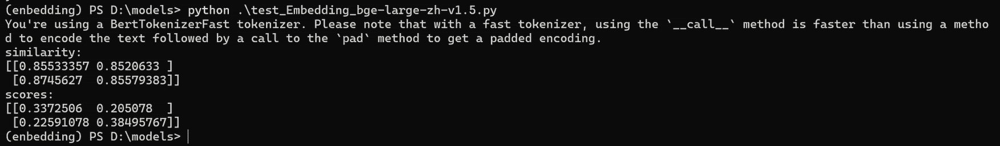

## （四）BCEmbedding：bce-embedding-base_v1

### （1）模型概述

BCEmbedding（Bilingual and Cros**slin****gual Embedd**ing）是网易有道2024年1月3日发布的两阶段检索算法库。

BCEmbedding以其出色的双语和跨语种能力而著称，在语义检索中消除中英语言之间的差异。BCEmbedding是一个二阶段检索算法模型库，由召回模块和精排模块组成，核心是EmbeddingModel(bce-embedding-base_v1)和RerankerModel(bce-reranker-base_v1)两款模型。

bce-embedding-base_v1模型是一款基于XLMRoberta的句子向量编码模型，拥有中英双语种编码能力。用于离线提取知识库语料提取语义向量，并由向量数据库保存。用户提问时，该模型实时地提取用户问题的语义向量，用于之后结合向量数据库进行一阶段检索。

bce-reranker-base_v1模型是一款基于XLMRoberta的句子向量编码模型，拥有中英日韩四个语种跨语种语义精排能力。一阶段检索后，该模型依次评估各文档与用户问题的相关性，输出有意义的语义相关分数。之后根据相关分数进行过滤和排序，实现对文档的选优。

二阶段检索算法结合召回和精排二者的优势，召回阶段可以快速找到用户问题相关文本片段，精排阶段可以将正确相关片段尽可能排在靠前位置，并过滤掉低质量的片段。二阶段检索可以很好地权衡检索效果和效率，具有巨大应用价值。

### （2）模型地址

模型地址：

+   [h](https://huggingface.co/maidalun1020/bce-embedding-base_v1)ttps://huggingface.co/maidalun1020/bce-embedding-base_v1（HuggingFace）

+   [h](https://modelscope.cn/models/maidalun/bce-embedding-base_v1)ttps://modelscope.cn/models/maidalun/bce-embedding-base_v1 （魔搭社区）

代码地址：

+   https://github.com/netease-youdao/BCEmbedding

### （3）模型使用

依赖库：

```
pip install BCEmbedding==0.1.5
或
git clone git@github.com:netease-youdao/BCEmbedding.git
cd BCEmbedding
pip install -v -e .
```

样例代码：

```
from BCEmbedding import EmbeddingModel

# list of sentences
sentences = [&#x27;sentence_0&#x27;, &#x27;sentence_1&#x27;]

# init embedding model
model = EmbeddingModel(model_name_or_path=&quot;maidalun1020/bce-embedding-base_v1&quot;)

# extract embeddings
embeddings = model.encode(sentences)
```

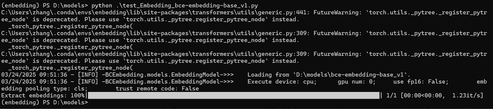

## （五）BGE-M3：bge-m3

### （1）模型概述

BGE-M3是**北京智源人工智能研究院**（BAAI）**2024年1月30日**推出的模型。论文地址：https://arxiv.org/abs/2402.03216 。论文提出了一种新的embedding模型，称为M3-Embedding，它在多语言性（Multi-Linguality）、多功能性（Multi-Functionality）和多粒度性（Multi-Granularity）方面表现出色。M3-Embedding支持超过100种工作语言，支持8192长度的输入文本，同时支持密集检索（Dense Retrieval）、多向量检索（Multi-Vector Retrieval）和稀疏检索（Sparse Retrieval），为现实世界中的信息检索（IR）应用提供了统一的模型基础，通过这几种检索方式的组合，取得了良好的混合召回效果。

bge-m3是结合了BGE和M3E特点的模型。

BGE-M3模型的特点如下：

+   多语言（Multi-Linguality），训练集包含100+种以上语言， 具备领先的多语言、跨语言检索能力。既包含每种语言内部**的语义匹配****任务(La**nguage X to Language X)，又包含不同语言之间的语义匹配任务(Language X to Language Y)，丰富且优质的训练数据帮助BGE-M3建立了出色的多语言检索(Multi-Lingual Retrieval)与跨语言检索能力(Cross-Lingual Retrieval)。

+   多功能（Multi-Functionality），支持稠密检索（Dense Retrieval），还支持稀疏检索（Sparse Retrieval）与多向量检索（Multi-vector Retrieval）。BGE-M3既可以借助特殊token [CLS]的输出向量用以来完成稠密检索(Dense Retrieval)任务，又可以利用其他一般性token的输出向量用以支持稀疏检索(Sparse Retrieval)与多向量检索(Multi-vector Retrieval)。三种检索功能的高度集成使得BGE-M3可以一站式服务不同的现实场景，如语义搜索、关键字搜索、重排序同时，无需使用多个模型进行多个推理，BGE-M3一次推理就可以得到多个不同模式的输出，无需额外开销，并能高效支持混合检索，联合三种检索模式可获得更加精准的检索结果。

+   多粒度（Multi-Granularity），BGE-M3目前可以处理最大长度为8192 的输入文本，支持“句子”、“段落”、“篇章”、“文档”等不同粒度的输入文本。在训练BGE-M3时，在现有长文本检索数据集的基础之上，通过模型合成的方式获取了大量文本长度分布多样化的训练数据；BGE-M3通过改进分批(batch)与缓存(cache)策略，使得训练过程具备足够高的吞吐量与负样本规模，从而确保了训练结果的质量。基于数据与算法双层面的优化处理，BGE-M3得以高质量的支持“句子”、“段落”、“篇章”、“文档”等不同粒度的输入文本。

### （2）模型地址

模型地址：

+   https://huggingface.co/BAAI/bge-m3

代码地址：

+   https://github.com/FlagOpen/FlagEmbedding

### （3）模型使用

依赖库：

```
pip install -U FlagEmbedding
或
git clone https://github.com/FlagOpen/FlagEmbedding.git
cd FlagEmbedding
pip install -e .
```

样例代码：

```
from FlagEmbedding import BGEM3FlagModel

model = BGEM3FlagModel(&#x27;BAAI/bge-m3&#x27;,  
                       use_fp16=True) # Setting use_fp16 to True speeds up computation with a slight performance degradation

sentences_1 = [&quot;What is BGE M3?&quot;, &quot;Defination of BM25&quot;]
sentences_2 = [&quot;BGE M3 is an embedding model supporting dense retrieval, lexical matching and multi-vector interaction.&quot;, 
               &quot;BM25 is a bag-of-words retrieval function that ranks a set of documents based on the query terms appearing in each document&quot;]

embeddings_1 = model.encode(sentences_1, 
                            batch_size=12, 
                            max_length=8192, # If you don&#x27;t need such a long length, you can set a smaller value to speed up the encoding process.
                            )[&#x27;dense_vecs&#x27;]
embeddings_2 = model.encode(sentences_2)[&#x27;dense_vecs&#x27;]
similarity = embeddings_1 @ embeddings_2.T
print(similarity)
# [[0.6265, 0.3477], [0.3499, 0.678 ]]
```

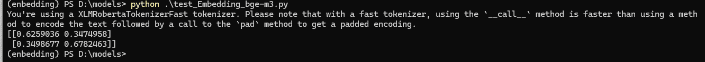

##

## （六）OpenAI：text-embedding-ada-002

### （1）模型概述

t**ext-em**b**edding-a****da-00**2是OpenAI于2022年12月发布的一个基于transformer的embedding模型，需付费使用。它通过在大规模语料库上进行预训练，学习到了丰富的语义信息。它能够捕获词序信息，因此在处理复杂的NLP任务时表现出色。然而，由于其模型结构的复杂性，它需要消耗较多的计算资源。

模型特点如下：

+   统一能力：OpenAI通过将五个独立的模型(文本相似性、文本搜索-查询、文本搜索-文档、代码搜索-文本和代码搜索-代码)合并为一个新的模型

+   在一系列不同的文本搜索、句子相似性和代码搜索基准中，比以前的嵌入模型表现得更好

+   上下文：上下文长度为8192，处理长文档更方便

+   嵌入尺寸：只有1536个维度，是davinci-001嵌入尺寸的八分之一，使新的嵌入在处理矢量数据库时更具成本效益

### （2）模型地址

模型地址：

+   未开源

API地址：

+   https://openai.xiniushu.com/docs/guides/embeddings

## （七）Google：gemini-embedding-exp-03-07/text-embedding-004/embedding-001

### （1）模型概述

Gemini API 是**Google**推出的Embedding模型，可为字词、短语、代码和句子生成最先进的嵌入，可用于语义搜索、文本分类、聚类等任务。

Gemini API 提供了三个用于生成文本嵌入的模型：

+   gemini-embedding-exp-03-07

+   text-embedding-004

+   [embedding-001](https://ai.google.dev/gemini-api/docs/models/gemini?hl=zh-cn#embedding)

### （2）模型地址

模型地址：

+   未开源

API地址：

+   https://ai.google.dev/gemini-api/docs/embeddings?hl=zh-cn

### （3）模型使用

依赖库：

```
pip install -U -q google-generativeai
```

样例代码：

```
from google import genai
client = genai.Client(api_key=&quot;GEMINI_API_KEY&quot;)
result = client.models.embed_content(
    model=&quot;gemini-embedding-exp-03-07&quot;,
    contents=&quot;How does alphafold work?&quot;,
)

print(result.embeddings)
```

# 四、如何选型

Text Embedding模型如何选择是小伙伴们常见的问题。

一般来说，每家模型提供商在发布模型的时候，其实自己也有推荐，但是大多希望在自己发布的模型中的进行选择。在前面的介绍中略有相关的场景描述。

那对于不同模型提供商的模型该如何选择呢？这里提供两个思路：一是看模型发布时间，往往发布较迟的模型会比早期的模型效果好一些。像text2vec发布时间较早，它的问题也比较多。二是看MTEB或C-MTEB榜单，一般排名靠前的效果会好些。（这就像豆瓣电影评分，打分低一般就能说明电影确实拍的不好看。）

请用户务必知道的一点是：模型对不同的文本源和不同的使用目的，实现的效果会不一样的。用户要拿多个模型去做对比测试，最终测试的结果可能某个模型是对此类文本是最好的。所谓"实践出真知"，千万不要忽视实践的力量。可以使用不同的Text Embedding模型来对同一组文本进行嵌入表示，并比较它们在文本分类、聚类或语义相似性计算等任务中的表现，这样可以帮助我们更加深入地了解这些模型的优缺点，并为实际应用中的模型选择提供参考。

当然，有些大佬会有自己的一些推荐，也可以参考权威人士的意见，比如在处理大规模的文本分类任务时，text2vec模型可能是一个不**错的选择；而在**处理复杂的语义理解任务时，openai-text embedding、m3e或bge模型可能更具优势。但是权威也不能全信，要有自己的质疑，用证据证明效果好或者不好，这可以通过"RAG评估"的方法实现。

为了更好地满足实际应用的需求，还可以尝试对这些Text Embedding模型进行改进和优化。例如，可以通过引入更多的监督信息、结合其他类型的特征或采用更先进的训练方法来提高嵌入向量的质量和性能。这些探索和研究将有助于推动Text Embedding领域的发展并带来更多实用的技术成果。

# 五、常用AI工具中的Embedding设置

## （一）Dify中Embedding设置

打开Dify页面：

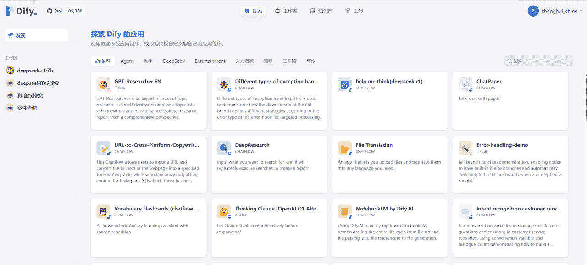

点击右上角用户名->设置->模型供应商：

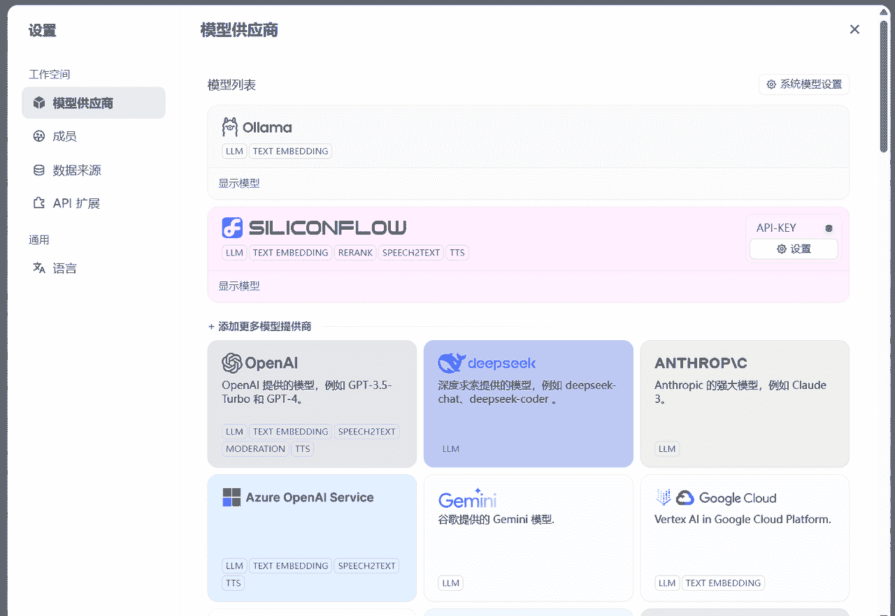

找到下面带 TEXT EMBEDDING标签的供应商（比如SILCONFLOW硅基流动）

点击添加模型-》 "设置"


输入API Key:


点击"显示模型"

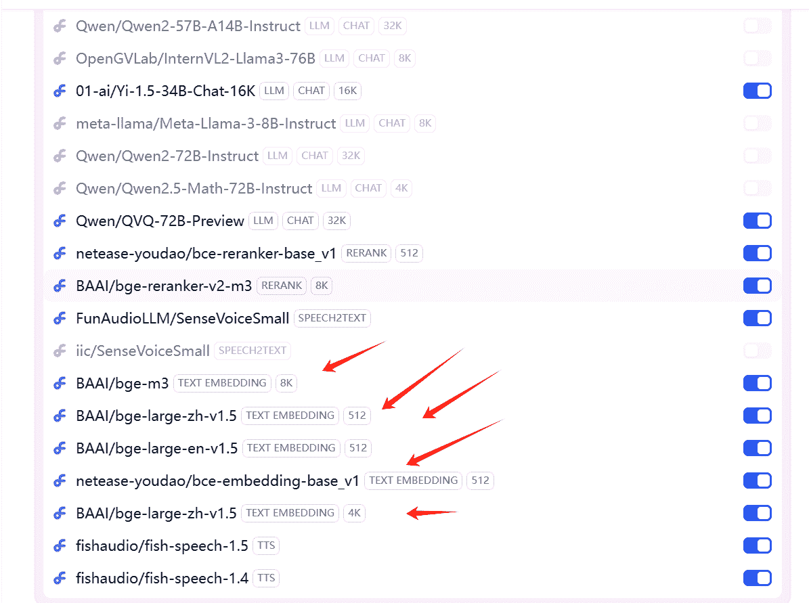

可以看到知识库文档解析可以使用的Text Embedding模型。（这些模型在前面章节均有介绍）

点击"系统模型设置"

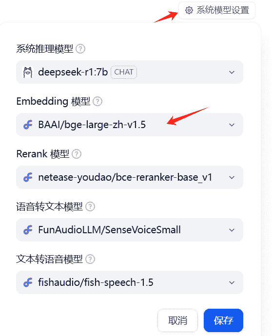

可以在上述Text Embedding模型中选择一个缺省的模型。

如果新建了知识库，可以在该知识库的“设置"中，选择所需的Embedding模型：

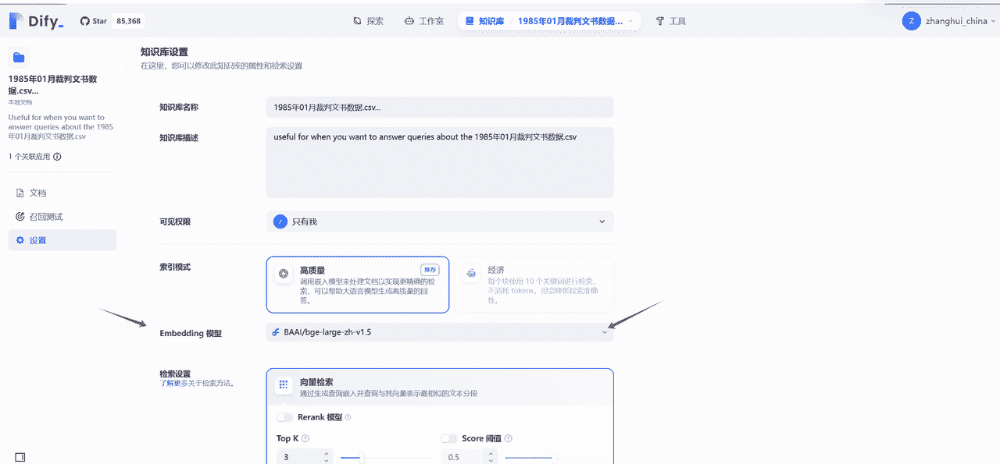

## （二）RAGFlow中Embedding设置

打开RAGFlow页面：

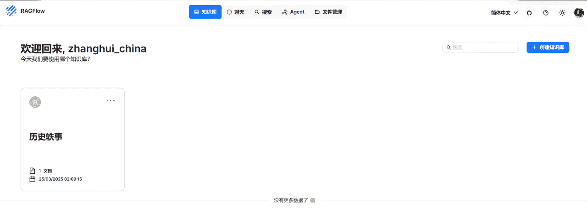

点击右上角用户名->模型供应商：

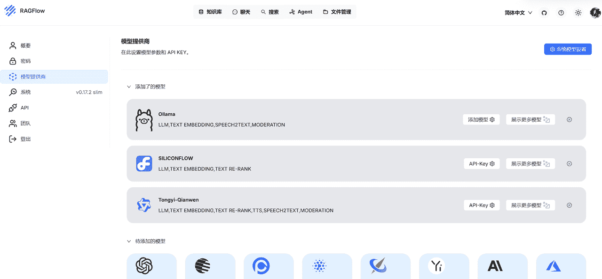

找到下面带 TEXT EMBEDDING标签的供应商（比如SILCONFLOW硅基流动）

点击添加模型，输入API Key后，点击"展示更多模型":

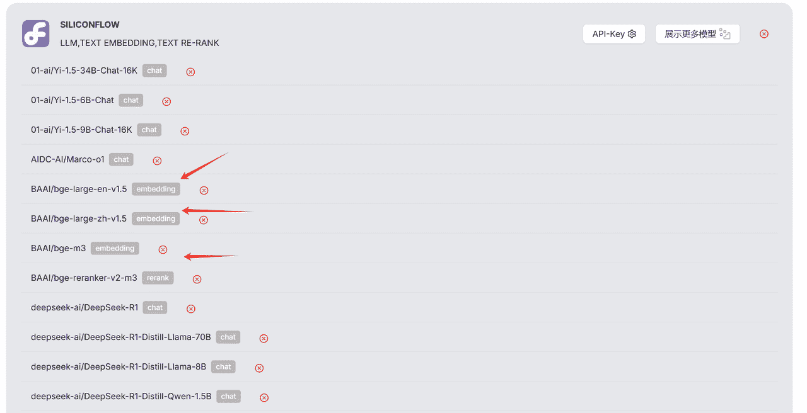

可以看到知识库文档解析可以使用的Text Embedding模型。（这些模型在前面章节均有介绍）

点击"系统模型设置":

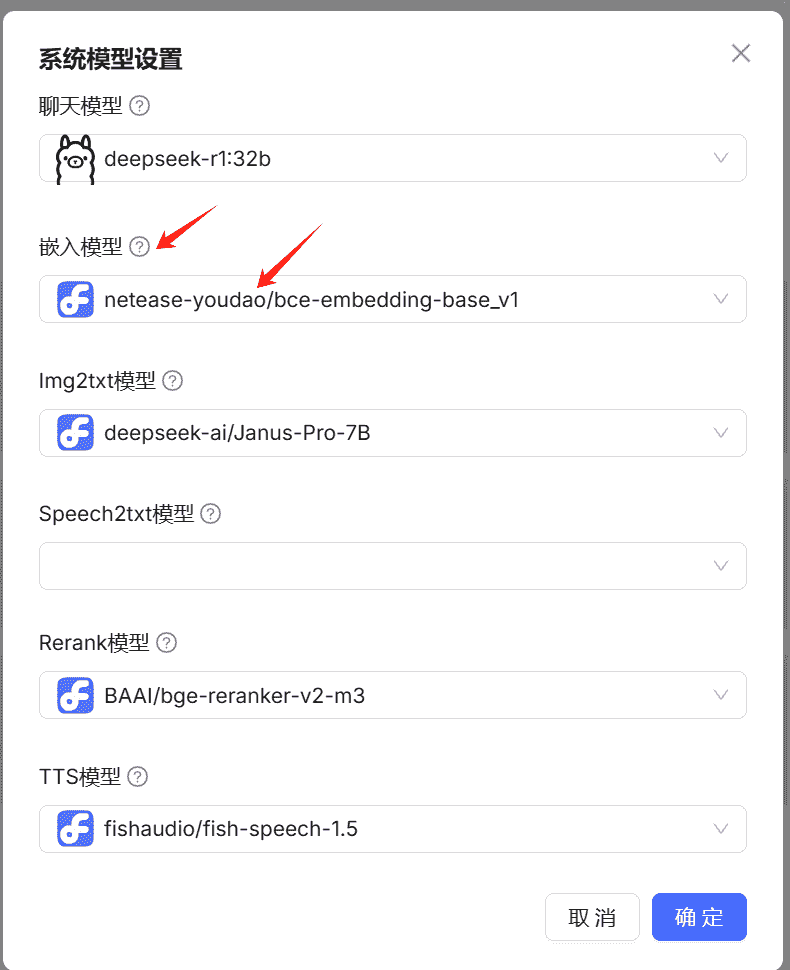

可以在上述Text Embedding模型中选择一个缺省的模型。

如果新建了知识库，可以在该知识库的“配置"中，查看Embedding模型信息：

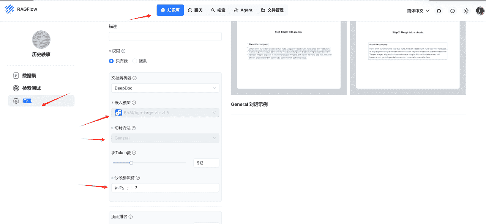

# 附录：参考资料

1、[Grissom](https://www.zhihu.com/people/grissom-sh) ：万字长文深入浅出文本嵌入（Text-Embedding）技术 https://zhuanlan.zhihu.com/p/24777288778

2、[JadePeng](https://cloud.tencent.com/developer/user/1177380) ：BGE M3-Embedding 模型介绍 https://cloud.tencent.com/developer/article/2410404

3、[新兰](https://developer.baidu.com/author/home.html?authorId=17757813) ：M3E：引领开源中文Embedding模型新SOTA https://developer.baidu.com/article/details/3267437

4、[路人与大师](https://juejin.cn/user/1359430581753229/posts)：langchain chatchat中我们不得不关注的配置 https://juejin.cn/post/7337630368906788902

5、[v_JULY_v](https://blog.csdn.net/v_JULY_v) ：一文通透Text Embedding模型：从text2vec、openai-text embedding到m3e、bge https://blog.csdn.net/v_july_v/article/details/135311471

6、梅琳marlin ：深入探索Text Embedding模型：从text2vec、openai-text embedding到m3e、bge https://cloud.baidu.com/article/3267429

---

> 本文作者：@张小白

> 原文链接：https://zhuanlan.zhihu.com/p/29949362142

<https://datawhaler.feishu.cn/sync/LfRzdAExlsoykRbUZymc0Jrfngh>

# 欢迎投稿参与共建、下次微学习就学你的内容！

<https://datawhaler.feishu.cn/sync/CPNrdTvwgshasbb2UjecLzVinPe>