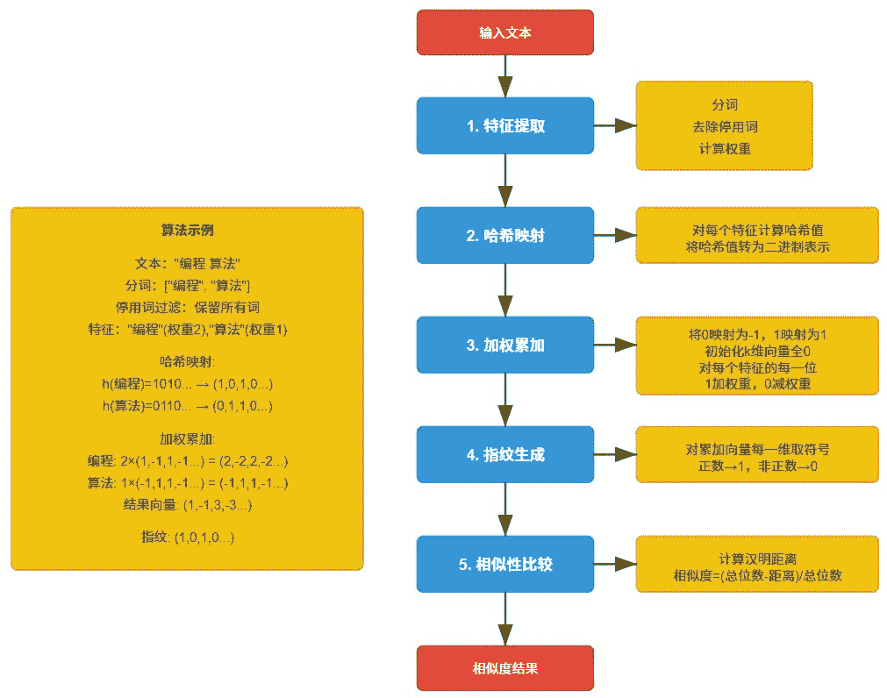

# 🪶 RAG去重小助手SimHash算法：轻松解决文本相似度检测与查重难题

> 来源：[https://datawhaler.feishu.cn/docx/SmoFdUxlUoiKVdx9WPCcWruZnLe](https://datawhaler.feishu.cn/docx/SmoFdUxlUoiKVdx9WPCcWruZnLe)



## 🎯 文章目标

本文面向爬虫开发者、数据分析师和RAG爱好者，旨在帮助大家：

+   理解SimHash算法的基本原理和优势

+   掌握基于SimHash的文本相似度检测实现方法

+   学会应用Python实现文本查重和相似内容识别

> **💡 小提示**：本文包含完整的Python代码实现，复制即可运行！

## 📄 主题

**本次主题**：使用SimHash算法实现高效文本相似度检测

### 📚 通过本文你将收获

+   SimHash算法的工作原理与应用场景

+   文本相似度检测的完整Python实现方案

+   实用的文本查重技巧与优化方法

+   基于相似度百分比的智能判断策略

+   在搜索引擎、RAG系统与爬虫中的应用实践

---

## 🚁 前言

在信息爆炸的时代，如何快速识别相似文本、检测抄袭内容，已成为内容创作、学术研究和搜索引擎等领域的关键挑战。传统的逐字比对方法计算量大且效率低下，而基于哈希的局部敏感算法提供了一种优雅高效的解决方案。上一篇文章中，我们有讲到通过`bert`等嵌入模型通过对文本之间的向量进行计算并对比相似度进行召回，但是大家有没有发现会出现一个问题，如果两个文本片段极度相似，交集重合率较高，怎么办？本文将详细介绍SimHash算法，并通过Python实现一套完整的文本相似度检测算法，看完这篇文章我想你应该知道怎么办了。

---

✨ 你好，我是筱可，欢迎来到「筱可 AI 研习社」！

🚀 **标签关键词：**| AI 实战派开发者 | 技术成长陪伴者 | RAG 前沿探索者 | 文档处理先锋 |

## 🏞️ 一、SimHash算法原理与应用场景

SimHash是一种局部敏感哈希算法(Locality-Sensitive Hashing, LSH)，由Google工程师Moses Charikar于2002年提出，主要用于大规模文本去重和相似度检测。与传统哈希算法不同，SimHash的核心特点是"相似的文本会产生相似的哈希值"，这使它特别适合文本相似度检测场景。

### 🧠 1.1 SimHash的基本思想

#### 传统哈希 vs 局部敏感哈希

传统哈希算法(如MD5、SHA-1)设计的核心目标是最小化碰撞，即完全不同的输入应产生尽可能不同的哈希值。这种设计具有"雪崩效应"——输入的微小变化会导致输出的巨大变化。

相比之下，SimHash作为局部敏感哈希的代表，其设计理念完全不同：

+   **相似性保持**：相似的输入应产生相似的哈希值

+   **差异反映**：输入的变化程度应与哈希值的变化程度相匹配

+   **降维表示**：将高维特征空间压缩为低维指纹，同时保留相似性信息

这一特性使SimHash特别适合"近似匹配"问题，如文本相似度检测、去重和内容聚类。

### ⚙️ 1.2 SimHash的工作流程

SimHash算法的基本步骤如下：

1.  **分词与特征提取**：将文本切分为词语或特征单元

+   对于中文文本，通常使用分词工具(如`jieba`)进行分词

+   对于英文文本，可以简单按空格分词或使用更复杂的NLP技术，比如词干提取等

+   可选择性地过滤停用词，保留更有意义的特征

1.  **特征权重计算**：为每个特征分配权重

+   最简单的方法是使用词频(TF)作为权重

+   权重决定了特征对最终指纹的影响程度

1.  **特征哈希**：为每个特征计算哈希值

+   使用传统哈希函数(如MD5、SHA1)计算每个特征的哈希值

+   将哈希值转换为二进制序列，通常取前k位(k通常为64或128)

+   每个特征的哈希值构成一个k维向量

1.  **加权合并**：根据特征权重合并所有哈希值

+   初始化一个k维向量，所有维度置零

+   遍历每个特征，对其哈希值加权贡献：1的位置加权，0的位置减权

+   最终得到一个综合了所有特征影响的加权向量

1.  **降维生成指纹**：将加权结果转换为二进制指纹

+   对加权向量的每个维度判断：大于0置为1，否则置为0

+   得到的二进制序列即为文本的SimHash指纹

+   这个指纹是文本内容的一个紧凑表示

1.  **相似度计算**：通过汉明距离计算指纹相似度

+   汉明距离：两个等长字符串对应位置不同的位数

+   距离越小表示越相似，距离越大表示越不同

+   汉明距离可以转换为百分比形式的相似度评分

与传统哈希算法追求"雪崩效应"不同，SimHash实现了"局部敏感"，即文本内容的微小变化只会导致哈希值的微小变化，这为我们提供了衡量文本相似度的有效方法。

### 🔢 1.3 SimHash算法的数学原理

从数学角度，SimHash算法可以更精确地表述为以下步骤和公式：

#### 输入定义

+   特征集： ，每个特征   关联一个权重  （例如词频、TF-IDF值）

+   目标指纹长度： （通常为64或128位）

#### 数学推导过程

1.  **特征哈希映射**：

对每个特征   使用哈希函数   生成   位二进制向量：

1.  其中   可以是MD5、SHA-1等哈希函数，取其输出的前   位。

1.  **加权向量计算**：

初始化一个   维向量  ，初始值为零。然后：

+   将哈希值   的   映射为  ：

+   加权累加所有特征的贡献：

1.  最终向量可表示为：

1.  **指纹生成**：

对   的每一维应用符号函数，生成二进制指纹  ：

1.  简化表示为：

1.  **相似度计算**：

对于两个指纹   和  ，计算汉明距离：

1.  其中   为1表示位不同，为0表示位相同。

1.  相似度可以表示为：

#### 简化总公式

SimHash的指纹生成可以总结为一个简洁的公式：

这个公式体现了SimHash的核心思想：通过特征的加权组合，生成能够保留相似性的指纹。

### 🌟 1.4 算法原理的直观理解

为了更直观地理解SimHash，我们可以将其想象为一个"投票"系统：

1.  每个特征(如词语)通过哈希函数生成一个随机的"投票模式"(即哈希值)

1.  重要特征(权重高)的"投票"影响更大

1.  所有特征的"投票"汇总后，形成最终决策(指纹)

1.  如果两篇文章共享许多重要特征，它们的"投票结果"(指纹)会很相似

从几何角度看，可以理解为：

+   每个特征的哈希值代表该特征在k维空间中的方向

+   权重表示在该方向上的力度

+   所有特征的力量综合作用，决定最终落在k维空间中的哪个象限

+   指纹表示的就是这个象限的坐标符号

### 📊 1.5 具体计算示例

让我们通过一个简化的例子来理解SimHash的计算过程：

假设我们有一个简短文本"人工智能技术"，分词后得到特征集  "人工", "智能", "技术" ，每个词的权重都为1（相当于词频），目标是生成8位指纹。

**步骤1: 特征哈希**

为简化示例，假设哈希函数返回以下8位结果：

"人工"

"智能"

"技术"

**步骤2: 哈希值映射与加权**

将0映射为-1，将1映射为1，并应用权重（这里都是1）：

+   "人工":

+   "智能":

+   "技术":

**步骤3: 累加向量**

**步骤4: 生成指纹**

应用符号函数：

这个8位指纹   就是文本"人工智能技术"的SimHash值。如果我们想比较它与另一个文本的相似度，只需计算两个指纹的汉明距离。

**步骤5: 相似度比较**

假设我们有另一个文本"AI智能科技"的指纹为 。两个指纹的汉明距离为：

（第2位和第8位不同）

相似度计算：

这表明两个文本有75%的相似度，在大多数应用中可能被判定为相似或相关。

### 🌐 1.6 应用场景

SimHash算法因其高效性和局部敏感性，在多个领域有广泛应用，以下是几个典型场景及其工程实践：

#### 1.6.1 网页去重与搜索引擎优化

搜索引擎处理互联网规模的数据时，面临海量重复或相似内容的挑战。以Google为例，其网页索引系统需要处理数以亿计的页面，其中大量页面存在内容重复或相似的情况：

+   **网页去重**：避免在搜索结果中显示高度相似的页面，提升用户体验

+   通过SimHash将网页内容转换为64位指纹，快速比较数十亿网页的相似度

+   对相似页面进行聚类，仅保留最具代表性的页面

+   **索引空间优化**：识别并合并相似内容，大幅减少存储需求

+   计算页面指纹后，使用分块索引加速检索

+   **爬虫效率提升**：调整爬取策略，减少对相似内容的重复处理

+   计算URL规范化后的指纹，识别参数不同但内容相似的页面

+   根据历史版本指纹差异，动态调整爬取优先级和频率

Google工程师Charikar在2002年提出SimHash，正是为了解决这一系列挑战，其高效性使其成为现代搜索引擎不可或缺的技术。

#### 1.6.2 RAG系统中的知识管理和检索优化

我们知道检索增强生成(Retrieval-Augmented Generation, RAG)是大型语言模型应用的重要架构，通过检索相关文档增强模型知识，但是我们进行检索的时候是不是会发现有大量类似的信息被检索回来了，但是我们又没有办法判断谁和谁是有大量重复片段的，所以Simhash就可以登场了。SimHash在RAG中有以下应用：

+   **知识库构建与维护**：

+   对新文档计算SimHash指纹，与现有库比较

+   设置不同相似度级别，决定合并、更新或保留为独立文档

+   定期进行相似度聚类，优化存储结构

+   **检索过程优化**：

+   构建两阶段检索：先用语义向量检索候选集，再用SimHash过滤相似文档

+   确保结果多样性，避免提供重复信息

+   动态调整检索深度，根据查询复杂度和相似度分布

通过SimHash，RAG系统能高效管理和利用知识库，平衡检索效率与质量。

#### 1.6.3 论文查重与学术诚信

+   **抄袭检测**：识别学术论文中的相似段落

+   对论文分段计算指纹，检测与其他文献的相似度

+   结合动态阈值，适应不同学科的查重要求

+   **版本追踪**：识别论文的多版本或改编稿

+   通过指纹比较，追踪内容演变路径

#### 1.6.4 新闻聚合与内容管理

+   **相似新闻分组**：将相似主题的新闻聚类

+   对新闻标题和正文生成指纹，快速聚合相关报道

+   **垃圾内容过滤**：识别重复或低质量内容

+   检测内容农场生成的重复信息，优化内容推荐

#### 1.6.5 爬虫系统中的高效处理

大规模爬虫系统利用SimHash提升内容收集效率：

+   **URL过滤与优先级**：

+   计算URL规范化表示并生成指纹

+   识别参数不同但内容相似的URL

+   为内容差异大的URL分配更高优先级

+   **增量爬取策略**：

+   定期抓取网页快照，计算与历史版本的指纹差异

+   根据内容变化频率和幅度，动态调整爬取间隔

+   对重要网站实施精细变化检测，确保及时捕获更新

+   **内容识别与归类**：

+   识别网站模板和生成模式

+   发现低质量复制站点

+   构建主题聚类，追踪热点传播路径

#### 实践建议

+   **合理选择阈值**：根据场景调整相似度阈值，通常在70%-95%之间

+   **优化分词策略**：针对专业领域引入领域词典，比如`bge-m3`就是一个领域词

## 💻 二、Python实现SimHash算法

让我们通过Python代码实现SimHash算法，包含文本处理、指纹生成和相似度计算功能。

### 🛠️ 2.1 核心代码实现

首先导入必要库并定义停用词列表：

```
import hashlib
import jieba
import pandas as pd
from collections import defaultdict

# 中文停用词列表
STOPWORDS = set(['的', '了', '和', '是', '就', '都', '而', '及', '与', '这', '那', ...])
```

然后实现SimHash核心函数：

```
def simhash(text, hash_bits=64, use_stopwords=False, stopwords_file=None):
    # 分词
    words = jieba.lcut(text)
    v = [0] * hash_bits  # 初始化向量
    
    # 加载停用词
    stopwords = load_stopwords(stopwords_file) if use_stopwords else set()
    
    # 计算词频作为权重
    word_weights = defaultdict(int)
    for word in words:
        if word.strip() and (not use_stopwords or word not in stopwords):
            word_weights[word] += 1
    
    # 无有效特征时返回全0指纹
    if not word_weights:
        return '0' * hash_bits
    
    # 加权累加
    for word, weight in word_weights.items():
        hash_value = hashlib.md5(word.encode('utf-8')).hexdigest()
        binary_hash = bin(int(hash_value, 16))[2:].zfill(hash_bits)[:hash_bits]
        for i in range(hash_bits):
            bit = int(binary_hash[i])
            v[i] += weight if bit == 1 else -weight
    
    # 生成指纹
    return ''.join('1' if value > 0 else '0' for value in v)
```

### 📏 2.2 相似度计算与判断

有了指纹后，通过汉明距离计算相似度：

```
def hamming_distance(hash1, hash2):
    """计算两个指纹的汉明距离"""
    if len(hash1) != len(hash2):
        raise ValueError("指纹长度不一致")
    return sum(c1 != c2 for c1, c2 in zip(hash1, hash2))

def get_similarity(hash1, hash2):
    """计算两个指纹的相似度（重复率）"""
    if len(hash1) != len(hash2):
        raise ValueError("指纹长度不一致")
    distance = hamming_distance(hash1, hash2)
    return (len(hash1) - distance) / len(hash1) * 100

def is_similar(hash1, hash2, threshold=70.0):
    """判断两个指纹是否相似"""
    return get_similarity(hash1, hash2) >= threshold
```

这里将相似度门槛设为70%，即超过70%时判定为相似。

## 📈 三、实验与效果分析

通过实验验证SimHash算法的效果。

### 🔍 3.1 停用词过滤的影响

比较使用和不使用停用词的效果：

```
基本示例 - 比较停用词过滤效果:
文本1: 我喜欢编程和学习新东西
文本2: 我喜欢写代码和学习新技术

过滤效果比较:
  过滤方式  汉明距离    相似度  判断
 使用停用词    20 68.75% 不相似
不使用停用词    14 78.12%  相似
```

**停用词过滤降低相似度灵敏度**：使用停用词时相似度为68.75%，低于70%，判断为"不相似"；不使用时为78.12%，判断为"相似"。这表明停用词过滤聚焦关键词，去除噪声。

### ✂️ 3.2 短句相似度比较

对短句进行比较：

```
短句示例比较:
   文本1    文本2  汉明距离    相似度  判断
今天天气真好 今天天气很好    14 78.12%  相似
今天天气真好 明天天气不错    33 48.44% 不相似
今天天气真好  今天下雨了    31 51.56% 不相似
今天天气很好 明天天气不错    33 48.44% 不相似
今天天气很好  今天下雨了    23 64.06% 不相似
明天天气不错  今天下雨了    34 46.88% 不相似
```

结果显示，只有"今天天气真好"和"今天天气很好"相似（78.12%），其他低于70%，符合语义直觉。

### 📜 3.3 长句相似度比较

对长句的比较：


# SimHash 文本相似度与抄袭检测

## 三、SimHash 应用场景

```
长句示例比较:
文本序号1 文本序号2  汉明距离    相似度  判断
长文本 1 长文本 2    22 65.62% 不相似
长文本 1 长文本 3    27 57.81% 不相似
长文本 2 长文本 3    27 57.81% 不相似
```

长句相似度均低于70%，表明SimHash对长文本语义变化敏感。

### 🕵️ 3.4 抄袭检测场景

模拟抄袭检测：

```
文本相似度矩阵:
      文本    原文 抄袭版本1 抄袭版本2 不相关文本
      原文 100.00%    73.44%    93.75%      53.12%
 抄袭版本1  73.44%   100.00%    76.56%      54.69%
 抄袭版本2  93.75%    76.56%   100.00%      50.00%
不相关文本  53.12%    54.69%    50.00%     100.00%
```

结果表明：

1. 原文与抄袭版本2相似度高达93.75%

1. 原文与抄袭版本1为73.44%

1. 不相关文本相似度低于55%

SimHash有效识别抄袭，即使经过改写也能检测相似性。

## 🛡️ 四、SimHash的优势与局限性

### ✅ 4.1 主要优势

1. 计算效率高，适合大规模数据

+ 计算复杂度低，支持并行处理

+ 存储空间小，指纹压缩比高

+ 汉明距离计算快，`O(k)`复杂度

+ 可扩展至PB级数据

1. 局部敏感性强，捕获细微相似

+ 保留文本结构和核心特征

+ 权重区分关键内容

+ 提供连续相似度量度

+ 对轻微修改有抗干扰能力

### ⚠️ 4.2 主要局限

1. 特征质量依赖性：分词或特征选择不当影响准确性

1. 阈值选择问题：需根据场景调优

1. 对抗同义词替换局限：同义词替换降低检测相似度

### 🗑️ 4.3 停用词的重要性

停用词过滤：

1. 提高特征质量，聚焦核心内容

1. 增强抗干扰能力

1. 提升计算效率

实验显示，停用词过滤显著影响相似度。

## 🌍 五、总结与展望

### 🗺️ 5.1 技术全景图

+ SimHash是优秀的局部敏感哈希算法

+ 通过汉明距离计算相似度

+ 停用词、分词和阈值影响效果

+ 在搜索引擎、RAG和爬虫中应用广泛

### 📝 5.2 学习汇总

+ 详解SimHash原理和Python实现

+ 通过实验验证效果

+ 提供优化建议和应用案例

+ 探讨工程实践

### 🛠️ 5.3 动手挑战

1. 将SimHash应用到你的数据集

1. 实验不同阈值效果

1. 集成到RAG或爬虫项目

### ❓ 5.4 互动问题

1. 什么场景下阈值应更高或更低？

1. SimHash相比传统字符串匹配的优劣？

1. 如何改进SimHash？

1. RAG系统中如何结合向量检索和SimHash？

> **名言**：

> "找到相似，是为了发现独特；理解重复，是为了创造新意。"

> ——筱可

**欢迎留言分享想法，每条留言我都会认**真阅读！你的反馈是我创作的最大动力 ❤️

---

### 💗 立即行动

1. 点赞、收藏、关注，顺手分享给可能感兴趣的朋友。

1. 为账号加个星标或特别关注，获取更多精彩内容。

1. 以本文为灵感，整理一份属于自己的笔记。

---

### 🚗 行动召唤

📢 "与其等着 AI 改变世界，不如自己参与变革！在这里，让 AI 成为你弯道超车的秘密武器。"

---

### 👨💻 完整代码资源

文末附上完整SimHash算法Python实现，可直接复制使用：


# SimHash 文本相似度检测

```python
import hashlib
import jieba
import pandas as pd
from collections import defaultdict

# 中文停用词列表
STOPWORDS = set([
    '的', '了', '和', '是', '就', '都', '而', '及', '与', '这', '那', '有', '在', '中', '为',
    '以', '于', '不', '也', '之', '很', '但', '对', '到', '可', '个', '如', '此', '会', '上',
    '来', '去', '把', '被', '让', '着', '从', '给', '所', '能', '等', '得', '地', '又', '或',
    '者', '每', '并', '然', '已', '却', '才', '做', '需', '其', '通过', '使用', '实现', '你',
    '我', '他', '她', '它', '们', '什么', '怎么', '如何', '该', '由', '下', '将', '这些', '那些'
])

def load_stopwords(file_path=None):
    """
    加载停用词表
    :param file_path: 停用词文件路径（每行一个词）
    :return: 停用词集合
    """
    if file_path:
        try:
            with open(file_path, 'r', encoding='utf-8') as f:
                return set([line.strip() for line in f])
        except Exception as e:
            print(f"加载停用词文件失败: {e}")
            return STOPWORDS
    return STOPWORDS

def simhash(text, hash_bits=64, use_stopwords=False, stopwords_file=None):
    """
    生成SimHash指纹
    :param text: 输入文本
    :param hash_bits: 指纹位数（默认64）
    :param use_stopwords: 是否使用停用词过滤
    :param stopwords_file: 自定义停用词文件路径
    :return: 二进制指纹字符串
    """
    # 分词
    words = jieba.lcut(text)
    v = [0] * hash_bits  # 初始化向量
    
    # 加载停用词
    stopwords = load_stopwords(stopwords_file) if use_stopwords else set()
    
    # 计算词频作为权重（可替换为TF-IDF）
    word_weights = defaultdict(int)
    for word in words:
        if word.strip() and (not use_stopwords or word not in stopwords):
            word_weights[word] += 1
    
    # 无有效特征时返回全0指纹
    if not word_weights:
        return '0' * hash_bits
    
    # 加权累加
    for word, weight in word_weights.items():
        hash_value = hashlib.md5(word.encode('utf-8')).hexdigest()
        binary_hash = bin(int(hash_value, 16))[2:].zfill(hash_bits)[:hash_bits]
        for i in range(hash_bits):
            bit = int(binary_hash[i])
            v[i] += weight if bit == 1 else -weight
    
    # 生成指纹
    return ''.join('1' if value > 0 else '0' for value in v)

def hamming_distance(hash1, hash2):
    """
    计算两个指纹的汉明距离
    :param hash1: 第一个指纹
    :param hash2: 第二个指纹
    :return: 汉明距离
    """
    if len(hash1) != len(hash2):
        raise ValueError("指纹长度不一致")
    return sum(c1 != c2 for c1, c2 in zip(hash1, hash2))

def get_similarity(hash1, hash2):
    """
    计算两个指纹的相似度（重复率）
    :param hash1: 第一个指纹
    :param hash2: 第二个指纹
    :return: 相似度百分比
    """
    if len(hash1) != len(hash2):
        raise ValueError("指纹长度不一致")
    distance = hamming_distance(hash1, hash2)
    return (len(hash1) - distance) / len(hash1) * 100

def is_similar(hash1, hash2, threshold=70.0):
    """
    判断两个指纹是否相似
    :param hash1: 第一个指纹
    :param hash2: 第二个指纹
    :param threshold: 相似度百分比阈值（默认70%）
    :return: 是否相似
    """
    return get_similarity(hash1, hash2) >= threshold

if __name__ == "__main__":
    print("SimHash 文本相似度检测示例\n")
    
    # 基本示例 - 相似短句
    text1 = "我喜欢编程和学习新东西"
    text2 = "我喜欢写代码和学习新技术"
    
    # 比较使用停用词和不使用停用词的效果
    hash1_with_stopwords = simhash(text1, use_stopwords=True)
    hash2_with_stopwords = simhash(text2, use_stopwords=True)
    hash1_without_stopwords = simhash(text1, use_stopwords=False)
    hash2_without_stopwords = simhash(text2, use_stopwords=False)
    
    print("基本示例 - 比较停用词过滤效果:")
    print(f"文本1: {text1}")
    print(f"文本2: {text2}")
    
    # 创建比较表格
    comparison = {
        "过滤方式": ["使用停用词", "不使用停用词"],
        "汉明距离": [
            hamming_distance(hash1_with_stopwords, hash2_with_stopwords),
            hamming_distance(hash1_without_stopwords, hash2_without_stopwords)
        ]
    }
    
    # 添加相似度列
    comparison["相似度"] = [
        f"{get_similarity(hash1_with_stopwords, hash2_with_stopwords):.2f}%",
        f"{get_similarity(hash1_without_stopwords, hash2_without_stopwords):.2f}%"
    ]
    
    # 添加判断列
    comparison["判断"] = [
        "相似" if is_similar(hash1_with_stopwords, hash2_with_stopwords) else "不相似",
        "相似" if is_similar(hash1_without_stopwords, hash2_without_stopwords) else "不相似"
    ]
    
    print("\n过滤效果比较:")
    print(pd.DataFrame(comparison).to_string(index=False))
    print("\n" + "-"*50 + "\n")
    
    # 使用停用词进行后续测试
    USE_STOPWORDS = True
    
    # 更多短句示例
    short_texts = [
        "今天天气真好",
        "今天天气很好",
        "明天天气不错",
        "今天下雨了"
    ]
    
    print("短句示例比较:")
    hashes = [simhash(text, use_stopwords=USE_STOPWORDS) for text in short_texts]
    
    # 创建比较结果的DataFrame
    comparison_data = []
    for i in range(len(short_texts)):
        for j in range(i+1, len(short_texts)):
            dist = hamming_distance(hashes[i], hashes[j])
            similarity = get_similarity(hashes[i], hashes[j])
            judgment = "相似" if is_similar(hashes[i], hashes[j]) else "不相似"
            comparison_data.append({
                "文本1": short_texts[i],
                "文本2": short_texts[j],
                "汉明距离": dist,
                "相似度": f"{similarity:.2f}%",
                "判断": judgment
            })
    
    short_df = pd.DataFrame(comparison_data)
    print(short_df.to_string(index=False))
    
    print("\n" + "-"*50 + "\n")
    
    # 长句示例
    long_texts = [
        "人工智能是计算机科学的一个重要分支，它致力于研究和开发能够模拟、延伸和扩展人类智能的理论、方法、技术及应用系统。",
        "人工智能作为计算机科学的核心领域，专注于开发可以模拟并扩展人类智能的理论与应用系统，其技术方法涵盖了多个学科。",
        "大数据技术是一种能够处理和分析海量数据集的方法和工具，它已经在商业、医疗和科学研究等众多领域产生了深远影响。"
    ]
    
    print("长句示例比较:")
    long_hashes = [simhash(text, use_stopwords=USE_STOPWORDS) for text in long_texts]
    
    # 创建长句比较的DataFrame
    long_comparison = []
    for i in range(len(long_texts)):
        for j in range(i+1, len(long_texts)):
            dist = hamming_distance(long_hashes[i], long_hashes[j])
            similarity = get_similarity(long_hashes[i], long_hashes[j])
            judgment = "相似" if is_similar(long_hashes[i], long_hashes[j]) else "不相似"
            long_comparison.append({
                "文本序号1": f"长文本 {i+1}",
                "文本序号2": f"长文本 {j+1}",
                "汉明距离": dist,
                "相似度": f"{similarity:.2f}%",
                "判断": judgment
            })
    
    long_df = pd.DataFrame(long_comparison)
    print(long_df.to_string(index=False))
            
    print("\n" + "-"*50 + "\n")
    
    # 模拟文本抄袭检测场景
    print("文本抄袭检测示例:")
    original = "SimHash算法是一种局部敏感哈希算法，主要用于大规模文本去重和相似性检测。"
    copy1 = "SimHash是一种局部敏感哈希技术，广泛应用于大规模文本去重和相似度检测。"
    copy2 = "SimHash算法是一种局部敏感哈希方法，主要用于大规模文本去重和相似性检测工作。"
    different = "TF-IDF是一种统计方法，用于评估单词对于文档集合中某一文档的重要程度。"
    
    texts = [original, copy1, copy2, different]
    names = ["原文", "抄袭版本1", "抄袭版本2", "不相关文本"]
    
    hashes = [simhash(text, use_stopwords=USE_STOPWORDS) for text in texts]
    
    print("文本相似度矩阵:")
    
    # 创建相似度矩阵的DataFrame
    matrix_data = []
    for i, name1 in enumerate(names):
        row_data = {"文本": name1}
        for j, name2 in enumerate(names):
            if i == j:
                # 对角线显示自身比较
                row_data[name2] = "100.00%"
            else:
                dist = hamming_distance(hashes[i], hashes[j])
                similarity = get_similarity(hashes[i], hashes[j])
                row_data[name2] = f"{similarity:.2f}%"
        matrix_data.append(row_data)
    
    # 设置更好的显示选项
    pd.set_option('display.unicode.ambiguous_as_wide', True)
    pd.set_option('display.unicode.east_asian_width', True)
    pd.set_option('display.width', 120)
    
    # 创建并显示相似度矩阵DataFrame
    similarity_df = pd.DataFrame(matrix_data)
    print(similarity_df.to_string(index=False))
    
    print("\n完整示例演示结束")
```


# 🙋♂️ 入群交流 & 资料领取

1. **入群方式** (二选一)

+ 👸号菜单点击「社群」，扫码直接入群
+ 回复关键词「入群」，添加作者🛰️人工邀请

1. **资料领取** (二选一)

+ 入群后查看群公告，获取学习资源
+ 👸号菜单点击「资料领取」，自动发送网盘链接（定期更新）

## 📓 附录

### 往期文章

+ 从模式匹配到语义理解：文本嵌入技术的演变与 RAG 系统优化
+ 别再瞎猜了！用 RAGAS 精准定位 RAG 系统短板
+ PDF提取神器！将双栏学术论文转换为单栏Markdown实战（上）
+ 从零打造RAG检索系统：BM25让检索快到飞起
+ 打造RAG应用必知：BM25算法实战解析，让你不落人后
+ 手把手教程：用MinerU构建自动化文档转换流水线
+ [飞桨版面检测分析的命令看不懂？恭喜！您已获得 `arg`](http://mp.weixin.qq.com/s/5b8PqqViSpvgMjpfJqOxCQ?token=1077873472&lang=zh_CN)parse 入门手册一本，快快学起来吧！
+ pdf提取逆天神器，基于飞浆平台的版面检测与版面识别(1)
+ [大模型应用极简开发快速入门](http://mp.weixin.qq.com/s/kHeVK6hManVUaci2p-42GQ)
+ [基于 Streamlit 和 De](https://mp.weixin.qq.com/s/38BcsiGF1WhKx4DaA-8l0A)epSeek 的智能文档助手开发实战指南
+ 告别低效沟通：提示词框架助你玩转deepseek
