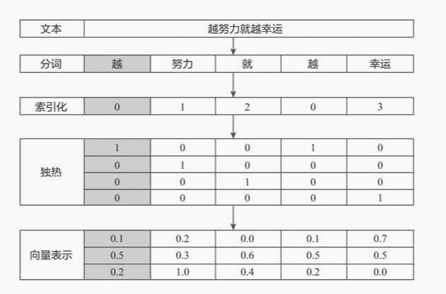
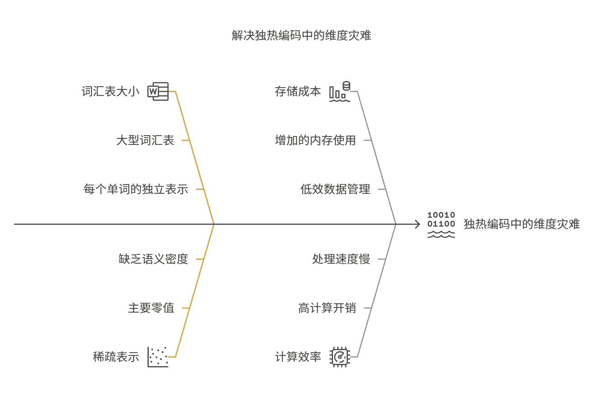
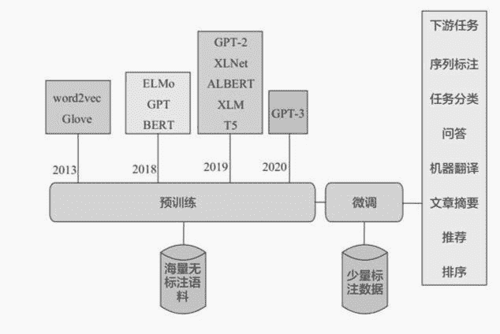
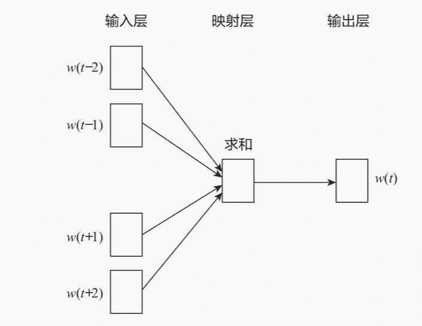
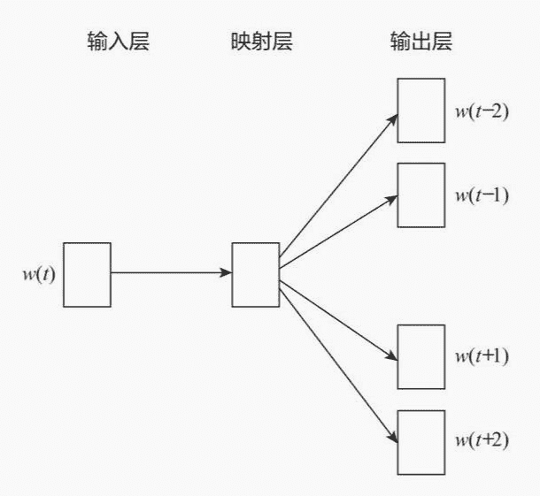
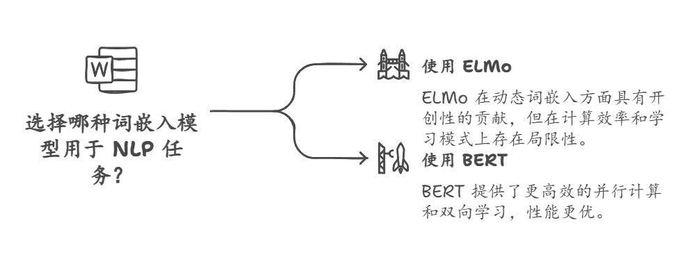
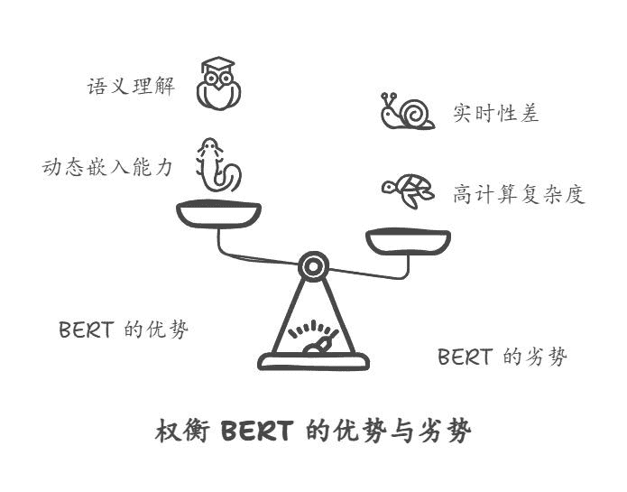
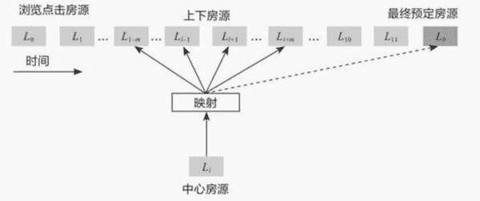

# 从模式匹配到语义理解：文本嵌入技术的演变与 RAG 系统优化

> 来源：`https://datawhaler.feishu.cn/docx/IDkGdkf9foGTG3xYZdvcyRAEnIh`


✨ 你好，我是筱可，欢迎来到「筱可 AI 研习社」！

🚀 标签关键词：| AI 实战派开发者 | 技术成长陪伴者 | RAG 前沿探索者 | 文档处理先锋 |

## 🎯 文章目标

本文面向希望深入理解文本嵌入技术及其在 RAG 系统中的应用的开发者，旨在帮助大家：

+ 了解从传统模式匹配到现代语义嵌入的演变历程；

+ 理解每种嵌入方法的优劣势；

+ 学会在实际项目中应用这些技术，尤其是在 RAG 系统的检索与生成优化中。

> 💡 小提示
> 本文的知识点将在后续优化 RAG 系统时发挥重要作用。建议重点掌握文本嵌入的核心原理和代码实战部分，尤其是 `BM25` 和 `BERT` 的内容。通过本文，你不仅能理解嵌入技术的“前世今生”，还能在自己的 RAG 项目中灵活运用这些技术。让我们开始吧！

---

## 📄 主题

**本次主题**：从模式匹配到语义理解的革命——文本嵌入技术的演变与应用

### 📚 通过本文你将收获

+ 文本嵌入技术的演变历程：从传统模式匹配到现代语义嵌入；

+ 每种嵌入方法的优劣势对比：独热编码、词袋模型、`TF-IDF`、`BM25`、`N-gram`、`Word2Vec`、`GloVe`、`ELMo` 和 `BERT`；

+ 如何在 RAG 系统中利用嵌入技术优化检索与生成；

+ 实用的代码示例：训练 `Word2Vec`、`GloVe` 模型，加载 `Word2Vec`、`GloVe` 预训练模型，使用 `BERT` 实现语义搜索和问答；

+ 实践经验与优化建议：选择适合你项目的检索策略。

### 📣 下期预告

《基于嵌入技术优化 RAG 系统：从检索增强到生成质量提升》

---

## 🚁 前言

在上一篇文章中，我们详细探讨了 `RAGAS` 评估框架，帮助大家学会如何科学评估 `RAG` 系统的性能。然而，评估固然重要，但如果系统的检索和生成能力本身不够强大，再科学的评估也只是“亡羊补牢”。而要提升 `RAG` 系统的核心能力，文本嵌入技术是绕不开的关键一环。

想象一下，你在构建一个知识问答系统，用户问“猫的种类有哪些？”，而文档里写的是“不同品种的猫有着不同的性格”。如果系统只懂简单的关键词匹配，可能完全找不到这篇文档，因为“种类”和“品种”表面上并不一样。但如果系统能理解两者的语义相似性，就能轻松检索到相关文档并生成准确的回答。这正是文本嵌入技术的价值所在——从“死板”的模式匹配，进化到“聪明”的语义理解。

本文将全面剖析文本嵌入技术的演变历程，从传统的模式匹配到现代的语义嵌入，带你弄清楚每种方法的原理、优劣势以及在 `RAG` 系统中的实际应用。虽然我们不需要每次都从头实现这些嵌入技术，但理解它们的原理和适用场景，能让你在开发 `RAG` 系统时少走弯路，做出更明智的技术选型。

---

## 🐱 一、文本嵌入技术的演变：从模式匹配到语义理解

### 1.1 什么是文本嵌入

简单来说，文本嵌入（Text Embedding）就是将文本（单词、短语、句子甚至文档）转化为计算机能理解的数字向量。这些向量不仅能高效存储和计算，还能捕捉文本的语义信息。例如，“猫”和“小猫”在向量空间中应该离得很近，而“猫”和“汽车”则应该离得很远。通过这些向量，我们可以用数学的方式解决语义搜索、文本分类、问答系统等复杂任务。

在 `RAG` 系统中，文本嵌入尤为重要。检索阶段需要嵌入技术快速找到语义相关的文档，生成阶段则需要嵌入技术确保生成内容与检索上下文一致。因此，理解嵌入技术的演变，能帮助我们更好地优化 `RAG` 系统的性能。

### 1.2 为什么需要文本嵌入

传统的文本处理方法，比如模式匹配，虽然简单直接，但在面对大规模数据和复杂语义需求时，效率和准确性都捉襟见肘。举个例子，假设你在检索“人工智能的应用”时，如果只用关键词匹配，可能会错过包含“AI 用例”或“机器学习场景”的文档，因为这些词表面上并不完全一致。而文本嵌入技术通过语义向量解决了这个问题，让系统不仅能“看字面”，还能“懂意思”。

更具体地，文本嵌入技术解决了以下核心问题：

1. **效率问题**：通过低维密集向量表示，避免高维稀疏表示带来的计算和存储瓶颈。

1. **语义问题**：捕捉单词、句子之间的语义相似性，比如让“猫”和“小猫”在向量空间中靠得很近。

1. **上下文问题**：现代嵌入技术（如 `BERT`）还能根据上下文动态调整向量表示，解决多义词和长距离依赖问题。

### 1.3 本文的结构

为了帮助大家系统掌握文本嵌入技术，我们将按照技术演变的时间线展开讲解：

1. **传统模式匹配的困境**：从效率到语义的瓶颈；

1. **传统表示方法的探索**：独热编码、词袋模型、`TF-IDF`、`BM25` 和 `N-gram` 的优劣势；

1. **现代嵌入技术的革命**：`Word2Vec`、`GloVe`、`ELMo` 和 `BERT` 的原理与应用；

1. 嵌入技术在 `RAG` 系统中的实战：如何用嵌入技术优化检索与生成；

1. **总结全文**：技术对比与总结。

---

## 🦄 二、传统模式匹配的困境：效率与语义的双重瓶颈

### 2.1 模式匹配的效率问题

在文本检索的早期，模式匹配是最直接的方法。无论是人还是计算机，都习惯通过特定的字符、单词或短语来定位信息。例如，搜索“人工智能”时，我们希望找到包含这个词组的文档。这种方法虽然简单，但在面对大规模数据时，效率低得让人抓狂。

举个例子，假设你有一亿篇文档，想找包含“人工智能”的文档。模式匹配的做法是逐篇扫描文档，一个字符一个字符地比对。如果文档中有拼写错误（比如“人工智脑”），或者使用了同义表达（比如“AI”），模式匹配就完全失效。更别说，这种逐字逐句的比对方式，在面对大规模数据集时，计算复杂度几乎是灾难级的。

### 2.2 模式匹配的语义问题

效率问题还不是模式匹配的最大短板，更致命的是它完全不懂语义。举个例子，“猫”和“小猫”在语义上关系很近，但在模式匹配的框架下，它们就是两个完全不同的字符串。搜索“猫”时，包含“小猫”的文档根本不会出现在结果中。同样，“看表演”和“表演看”在语义上可能是天差地别，但在模式匹配中，它们可能会被错误地当成一回事。这种“只看表面、不懂内在”的做法，根本无法满足语义搜索、文本分类等复杂需求。

### 2.3 模式匹配在 RAG 系统中的局限

在 `RAG` 系统中，模式匹配的局限性尤为明显。假设用户问“猫的种类有哪些？”，而文档中写的是“不同品种的猫有着不同的性格”。如果检索阶段只用模式匹配，可能会因为“种类”和“品种”不一致而错过这篇文档。更糟的是，如果检索阶段漏掉了关键信息，生成阶段再聪明也没用。因此，我们需要一种更高效、更智能的文本表示方法，这正是文本嵌入技术的起点。

---

## 🐶 三、传统表示方法的探索：从高维稀疏到初步语义

在文本嵌入的概念出现之前，研究者们尝试了多种方法来表示文本数据。这些方法虽然在某些任务中有效，但都逃不掉“维度爆炸”和“语义缺失”两大瓶颈。下面我们逐一分析这些传统方法，看看它们的优劣势，并用具体的例子说明问题所在。

### 3.1 独热编码（One-Hot Encoding）

**原理**：独热编码是最简单粗暴的文本表示方法，它将词汇表中的每个单词转化为一个高维稀疏向量，向量的长度等于词汇表的大小，每个单词在自己的位置上是 1，其他位置全是 0。

**向量化流程**：独热编码的生成过程可以分为以下步骤：

1. **文本预处理**：将原始文本分词，例如将“猫喜欢狗”分为“猫”、“喜欢”、“狗”。

1. **构建索引**：为词汇表中的每个单词分配一个唯一的索引，例如“猫”对应 0，“狗”对应 1，“喜欢”对应 2。

1. **生成独热向量**：根据索引生成向量，例如“猫”表示为 `[1, 0, 0]`，“狗”表示为 `[0, 1, 0]`，“喜欢”表示为 `[0, 0, 1]`。

为了更直观地理解这一过程，可以参考下图（图片来源：《深入浅出Embedding：原理解析与应用实践》）：



**例子**：假设有个词汇表包含“猫”、“狗”和“鸟”，索引如下：

| 单词 | 索引 |

| --- | --- |

| 猫 | 0 |

| 狗 | 1 |

| 鸟 | 2 |

那么，“猫”被表示为 `[1, 0, 0]`，“狗”为 `[0, 1, 0]`，“鸟”为 `[0, 0, 1]`。

**优劣势**：

+ **优势**：简单直观，计算复杂度低。

+ **劣势**：

1. **维度灾难**：如果词汇表有 10 万个单词，每个单词的向量长度就是 10 万维，其中 99,999 维都是 0，存储和计算成本极高。

1. **语义缺失**：独热编码完全不懂语义，“猫”和“小猫”的向量是正交的（即没有任何相似性），这显然不符合语义的实际情况。

1. **词汇表限制**：如果“小猫”不在词汇表中，它甚至无法被表示。

**应用场景**：仅适合小型词汇表或简单的分类任务。



**补充说明**：独热编码虽然简单，但其稀疏性和高维性导致了严重的维度灾难问题。例如，在一个包含 10 万单词的词汇表中，每个单词的向量维度高达 10 万维，其中 99,999 维都是 0，这不仅增加了存储和计算成本，还无法承载语义信息。正如《深入浅出Embedding：原理解析与应用实践》中所述，独热编码的这些缺点促使了后续嵌入技术（如 `Word2Vec`）的发展，用低维密集向量替代了高维稀疏表示。

---

### 3.2 词袋模型（Bag-of-Words, BoW）

**原理**：词袋模型将文档表示为一个向量，每一维表示词汇表中某个单词在文档中的出现次数或频率。

**例子**：假设有以下两篇文档和一个词汇表：

| 词汇表 | 索引 |

| --- | --- |

| 猫 | 0 |

| 狗 | 1 |

| 喜欢 | 2 |

+ 文档 1：“猫喜欢狗”

+ 文档 2：“狗喜欢猫”

在词袋模型中，这两篇文档的向量表示为：

+ 文档 1：`[1, 1, 1]`（“猫”出现 1 次，“狗”出现 1 次，“喜欢”出现 1 次）

+ 文档 2：`[1, 1, 1]`（“狗”出现 1 次，“猫”出现 1 次，“喜欢”出现 1 次）

**优劣势**：

+ **优势**：比独热编码稍强，因为它考虑了单词的统计特征。

+ **劣势**：

1. **维度灾难**：向量维度仍然等于词汇表大小，存储和计算成本高。

1. **语义缺失**：完全忽略单词顺序信息，“看表演”和“表演看”会被表示为完全相同的向量，尽管它们的语义可能完全不同。

1. **上下文缺失**：无法捕捉单词之间的上下文关系。

**应用场景**：适用于简单的文档分类、信息检索任务或垃圾邮件过滤。

---

### 3.3 `TF-IDF` 与 `BM25`

**原理**：为了改进词袋模型，研究者提出了基于单词重要性的表示方法，如 `TF-IDF`（词频-逆文档频率）和 `BM25`。`TF-IDF` 通过衡量单词在文档中的频率（TF）和在整个语料库中的稀有程度（IDF），给每个单词分配不同的权重，从而突出对文档更有区分度的词汇。`BM25` 是 `TF-IDF` 的升级版，优化了计算方式，特别在信息检索领域表现出色。

**例子**：假设有以下语料库：

+ 文档 1：“猫喜欢狗”

+ 文档 2：“狗喜欢猫”

+ 文档 3：“猫和鸟”

在这个语料库中，“猫”和“狗”出现频率较高（分别在 3 篇和 2 篇文档中出现），而“鸟”只在 1 篇文档中出现。因此，“鸟”的 IDF 值会高于“猫”和“狗”，这意味着包含“鸟”的文档在搜索“鸟”相关内容时会获得更高的权重。

**优劣势**：

+ **优势**：

1. **区分度强**：能突出稀有词汇的重要性，提升检索的准确性。

1. **计算成本适中**：相比模式匹配，效率更高。

+ **劣势**：

1. **语义缺失**：无法捕捉语义相似性，例如“猫”和“小猫”的语义关系无法通过 `TF-IDF` 或 `BM25` 的向量表示出来。

1. **上下文缺失**：忽略单词顺序和上下文信息。

**应用场景**：信息检索、关键词提取、搜索引擎（如 `Elasticsearch` 的默认排序算法基于 `BM25`）。

---

### 3.4 `N-gram` 技术

**原理**：为了捕捉单词的顺序信息，研究者引入了 `N-gram` 技术，即将连续的 `N` 个单词视为一个单元。

**例子**：对于短语“看表演”，2-gram 会提取出“看表”和“表演”两个单元。假设有以下两句话：

+ 句子 1：“我看表演”

+ 句子 2：“表演看我”

用 2-gram 表示，这两句话的特征为：

+ 句子 1：`["我看", "看表", "表演"]`

+ 句子 2：`["表演", "演看", "看我"]`

这样，“看表演”和“表演看”就能被区分开来，因为它们的 2-gram 特征不同。

**优劣势**：

+ **优势**：

1. **顺序信息**：能捕捉单词的局部顺序信息。

1. **短距离依赖**：在一定程度上能捕捉短距离的上下文关系。

+ **劣势**：

1. **维度灾难**：随着 `N` 的增大，可能的 `N-gram` 组合数量呈指数级增长。例如，在一个 10 万单词的词汇表中，2-gram 的组合数量可能高达 100 亿（10 万 × 10 万）。

1. **语义缺失**：仍然无法很好地捕捉长距离依赖关系和复杂的语义信息。例如，“昨天我看了一场精彩的表演”和“表演是我昨天看的东西”语义上很相似，但它们的 `N-gram` 特征差异较大。

**应用场景**：语言建模、短语匹配、拼写纠错。

---

### 3.5 传统方法的瓶颈总结

传统文本表示方法（独热编码、词袋模型 和 `N-gram`）以及传统信息检索方法（如 `TF-IDF`、`BM25`）虽然在某些任务中表现不错，但都存在显著的局限性，具体如下：

**维度灾难：**

传统文本表示方法生成的向量通常是高维且稀疏的，不仅显著增加了计算和存储成本，还容易引发维数灾难（curse of dimensionality），导致模型在高维空间中难以捕捉有效的模式，进而影响收敛速度和泛化能力。例如，在一个 10 万单词的词汇表中，独热编码和词袋模型生成的向量维度高达 10 万维，其中大部分元素为 0，极大地降低了数据的有效信息密度。

**语义缺失：**

这些方法主要依赖统计特征（比如单词的出现次数或频率），无法捕捉单词或句子之间的语义相似性。例如，“猫”和“小猫”在语义上高度相关，但在传统方法中被视为完全无关的独立实体；类似地，“我爱你”和“你爱我”在语义上有显著差异，但词袋模型因忽略语序而无法区分。类似地，`BM25` 等信息检索方法虽然在文档排序任务中表现优异，但同样无法建模语义关系，限制了其在需要深层语义理解的任务中的应用。

**上下文无关性：**

传统文本表示方法通常忽略单词的上下文信息，同一个单词在不同语境中的含义被视为相同。例如，“bank”在“river bank”和“bank account”中有完全不同的含义，但独热编码或词袋模型无法区分。

正是因为这些短板，才催生了现代文本嵌入技术的发展。下一代的嵌入方法（如 `Word2Vec`、`GloVe`、`ELMo`、`BERT`）通过引入密集的低维向量表示和语义建模，显著提升了自然语言处理的表现，重新定义了文本表示的标准。

---

## 🦁 四、现代嵌入技术的革命：从 Word2Vec 到 BERT



为了解决传统方法的瓶颈，现代文本嵌入技术引入了密集的低维向量表示，并利用神经网络从海量语料库中学习语义信息。这些方法不仅解决了维度爆炸的问题，还能有效捕捉单词和句子之间的语义相似性。下面我们详细讲解四种具有代表性的现代嵌入技术：`Word2Vec`、`GloVe`、`ELMo` 和 `BERT`，用通俗的语言和贴切的例子解释它们的原理，同时提供核心公式和 Python 代码实战，帮助大家加深理解。

---

### 4.1 `Word2Vec`：通过“猜词游戏”学语义

**原理**：`Word2Vec`（Word to Vector）是一种基于神经网络的词嵌入方法，由 Mikolov 等人于 2013 年提出。其核心思路是通过“猜词游戏”理解单词的语义：如果两个单词经常出现在类似的上下文中，它们的语义很可能也相似。`Word2Vec` 有两种主要模型：`CBOW`（Continuous Bag of Words）和 `Skip-Gram`。

+ **`CBOW` 模型**：用上下文预测目标词，类似于“填空游戏”。例如，对于句子“猫喜欢吃鱼”，`CBOW` 用“猫”、“吃”、“鱼”预测目标词“喜欢”。

+ **`Skip-Gram` 模型**：用目标词预测上下文，类似于“联想游戏”。例如，用“喜欢”预测“猫”、“吃”、“鱼”。

**核心公式**：

+ **`CBOW` 目标函数**：最大化给定上下文条件下目标词的概率。假设目标词是  ，上下文是  （其中   是窗口大小），目标函数为：

+ 其中，  通过 `softmax` 函数计算：

是目标词的输出向量；

是上下文词输入向量的平均值，即  ；

是词汇表。

+ **`Skip-Gram` 目标函数**：最大化给定目标词条件下上下文词的概率。目标函数为：

+ 其中，  同样通过 `softmax` 函数计算：

**两种预测方式的示例（来自《深入浅出Embedding：原理解析与应用实践 (吴茂贵, 王红星) 》）**：为了更直观地理解 `CBOW` 和 `Skip-Gram` 的预测方式，我们来看一个简单的例子（示例来源：《深入浅出Embedding：原理解析与应用实践》）。假设有一个句子：“今天 下午 2点钟 搜索 引擎 组 开 组会”。我们可以采用以下两种方式进行预测：

1. 方法 1（`CBOW`，根据上下文预测目标值）：


# Word2Vec 与 GloVe 词嵌入模型

## Word2Vec 模型

对于每个单词（或词），使用其周围的上下文来预测当前单词的概率。例如，假设目标词是“2点钟”，我们可以使用“2点钟”的上文“今天、下午”和下文“搜索、引擎、组”来预测“2点钟”。在这种情况下，`CBOW` 模型的任务是根据上下文“今天、下午、搜索、引擎、组”生成目标词“2点钟”的概率。

### 方法 2（Skip-Gram，由目标值预测上下文）

对于每个单词，使用该单词本身来预测其上下文的概率。例如，使用“2点钟”来预测其上下文“今天、下午、搜索、引擎、组”中的每个词。在这种情况下，`Skip-Gram` 模型的任务是根据目标词“2点钟”生成上下文“今天、下午、搜索、引擎、组”的概率。

这两种方法的共同限制条件是，对于相同的输入，输出每个单词的概率之和为 1。

### 模型结构图
为了更直观地理解 `CBOW` 和 `Skip-Gram` 的工作原理，可以参考下图（图片来源：《深入浅出Embedding：原理解析与应用实践》）：

### `CBOW`



### `Skip-Gram`



### `Skip-Gram` 训练数据集示例
为了便于训练 `Word2Vec` 模型，我们需要将语料库转化为适合模型输入的训练数据。以下是一个 `Skip-Gram` 的训练数据示例（示例来源：《深入浅出Embedding：原理解析与应用实践》）。假设有一个句子：“the quick brown fox jumped over the lazy dog”，我们设置窗口大小（`window-size`）为 2，即根据目标词预测其左右各 2 个单词。生成的训练数据集如下表所示：

| 输入单词 | 左边单词（上） | 右边单词（下） | 上下文，目标单词 | 输入、输出 `Skip-Gram`（根据目标单词预测上下文） |
| --- | --- | --- | --- | --- |
| quick | the | brown | (the, brown), quick | (quick, brown)  (brown, quick) |
| brown | quick | fox | (quick, fox), brown | (brown, quick)  (fox, brown) |
| fox | brown | jumped | (brown, jumped), fox | (fox, brown)  (jumped, fox) |
| lazy | the | dog | (the, dog), lazy | (lazy, the)  (dog, lazy) |

在实际训练中，每个单词需要先转换为独热编码形式，作为模型的输入。

### 例子
经过训练，`Word2Vec` 可以学到以下语义关系：

+ “猫”的向量和“狗”的向量靠得很近（因为它们经常出现在类似的上下文中，如“猫喜欢吃鱼”和“狗喜欢吃肉”）。

+ “喜欢”的向量和“讨厌”的向量也靠得很近（因为它们在语义上相关，如“我喜欢猫”和“我讨厌猫”）。

`Word2Vec` 还能解决类比问题，例如“国王:王后 :: 男人: ?”，通过向量运算（`王后 - 国王 ≈ 女人 - 男人`）计算出答案为“女人”。

### 优劣势

### 优势

+ **低维密集表示**：将单词映射到低维密集向量空间（通常几十到几百维），解决了维度爆炸问题。

+ **语义捕捉**：能捕捉单词之间的语义相似性，例如“猫”和“狗”的向量距离很近。

### 劣势

+ **多义词问题**：`Word2Vec` 是基于单词的嵌入方法，无法处理多义词。例如，“bank”在“river bank”（河岸）和“bank account”（银行账户）中含义不同，但在 `Word2Vec` 中只有一个向量表示。

+ **上下文限制**：只考虑局部上下文（固定窗口大小），无法捕捉长距离依赖关系。例如，在句子“我昨天看了一场表演，真的很精彩”中，“表演”和“精彩”的关系可能跨越很长距离，`Word2Vec` 可能无法捕捉。

### 代码实战
下面我们用 `Python` 的 `gensim` 库训练一个简单的 `Word2Vec` 模型，完成以下任务：

+ 训练 `Word2Vec` 模型，生成词向量；
+ 计算单词之间的相似度；
+ 解决类比问题；
+ 找到与某个单词最相似的单词。

> `注意`：为了支持中文处理，我们使用了中文分词工具 `jieba` 和中文预训练模型。如果处理英文，可以直接使用 Google News 的预训练模型。

```python
# 运行环境说明：
# - Python 版本：3.10 或以上
# - 依赖库安装命令：
#   pip install gensim jieba

# 导入必要的库
import jieba
from gensim.models import Word2Vec

# 准备一个小型语料库（实际应用中建议使用更大的语料库）
corpus = [
    "猫喜欢吃鱼",
    "狗喜欢吃肉",
    "猫和狗是宠物",
    "国王和王后统治国家",
    "男人和女人是朋友"
]

# 对语料库进行预处理（中文分词）
tokenized_corpus = [list(jieba.cut(sentence)) for sentence in corpus]
print("分词后的语料库:")
for tokens in tokenized_corpus:
    print(tokens)

# 训练 Word2Vec 模型（使用 Skip-Gram 模型）
model = Word2Vec(
    sentences=tokenized_corpus,  # 输入分词后的语料库
    vector_size=100,            # 词向量维度
    window=5,                   # 上下文窗口大小
    min_count=1,                # 忽略出现次数少于 1 的单词
    sg=1,                       # 使用 Skip-Gram 模型（sg=1），CBOW 模型为 sg=0
    epochs=10                   # 训练轮数
)

# 保存模型
model.save("word2vec_model.model")

# 任务 1：获取单词的向量表示
print("\n任务 1：获取单词的向量表示")
cat_vector = model.wv['猫']  # 获取“猫”的词向量
print("‘猫’的词向量（前 5 维）：", cat_vector[:5])

# 任务 2：计算单词之间的相似度
print("\n任务 2：计算单词之间的相似度")
similarity = model.wv.similarity('猫', '狗')  # 计算“猫”和“狗”的相似度
print("‘猫’和‘狗’的相似度：", similarity)

# 任务 3：解决类比问题（国王:王后 :: 男人: ?）
print("\n任务 3：解决类比问题")
result = model.wv.most_similar(positive=['男人', '王后'], negative=['国王'], topn=1)
print("‘国王:王后 :: 男人: ?’的答案是：", result[0][0])

# 任务 4：找到与某个单词最相似的单词
print("\n任务 4：找到与‘猫’最相似的单词")
similar_words = model.wv.most_similar('猫', topn=3)
print("与‘猫’最相似的 3 个单词：", similar_words)
```

### 运行结果

```
分词后的语料库:
['猫', '喜欢', '吃', '鱼']
['狗', '喜欢', '吃', '肉']
['猫', '和', '狗', '是', '宠物']
['国王', '和', '王后', '统治', '国家']
['男人', '和', '女人', '是', '朋友']

任务 1：获取单词的向量表示
‘猫’的词向量（前 5 维）： [-0.00872748  0.00213016 -0.00087354 -0.00931909 -0.00942814]

任务 2：计算单词之间的相似度
‘猫’和‘狗’的相似度： 0.06398086

任务 3：解决类比问题
‘国王:王后 :: 男人: ?’的答案是： 猫

任务 4：找到与‘猫’最相似的单词
与‘猫’最相似的 3 个单词： [('王后', 0.1669117510318756), ('喜欢', 0.13887985050678253), ('吃', 0.13149002194404602)]
```

### 结果分析
由于语料库太小（只有 5 句话，词汇表仅 16 个词），模型效果较差。例如，“猫”和“狗”的相似度只有 0.06398086，类比问题的答案也不正确（“国王:王后 :: 男人: ?”的答案是“猫”，而不是“女人”）。这说明，要想获得更好的效果，必须使用更大的语料库（如维基百科或新闻数据），大家也可以试试用现在的大语言模型生成语料哈。

为获得更好的效果，`gensim` 还提供了预训练的 `Word2Vec` 模型（比如 Google News 的预训练模型），可以通过以下代码加载并使用：

```python
# 加载预训练的 Word2Vec 模型（需要先下载） 大家可以去网上搜，因为模型有点大，大概是3GB
from gensim.models import KeyedVectors
pretrained_model = KeyedVectors.load_word2vec_format('GoogleNews-vectors-negative300.bin', binary=True)

# 注意：Google News 模型是英文模型，不包含中文词汇，需要使用英文词汇测试
# 下面使用英文词汇进行测试

# 任务 1：获取单词的向量表示
print("任务 1：获取单词的向量表示")
cat_vector = pretrained_model['cat']  # 直接从 KeyedVectors 获取向量
print("'cat'的词向量（前 5 维）：", cat_vector[:5])  # 只显示前 5 维以节省空间

# 任务 2：计算单词之间的相似度
print("\n任务 2：计算单词之间的相似度")
similarity = pretrained_model.similarity('cat', 'dog')  # 直接使用 similarity 方法
print("'cat'和 'dog'的相似度：", similarity)

# 任务 3：解决类比问题（king:queen :: man: ?）
print("\n任务 3：解决类比问题")
result = pretrained_model.most_similar(positive=['man', 'queen'], negative=['king'], topn=1)
print("'king:queen :: man: ?'的答案是：", result[0][0])

# 任务 4：找到与某个单词最相似的单词
print("\n任务 4：找到与 'cat'最相似的单词")
similar_words = pretrained_model.most_similar('cat', topn=3)
print("与 'cat'最相似的 3 个单词：", similar_words)
```

### 运行结果

```
任务 1：获取单词的向量表示
'cat'的词向量（前 5 维）： [ 0.0123291   0.20410156 -0.28515625  0.21679688  0.11816406]

任务 2：计算单词之间的相似度
'cat'和 'dog'的相似度： 0.76094574

任务 3：解决类比问题
'king:queen :: man: ?'的答案是： woman

任务 4：找到与 'cat'最相似的单词
与 'cat'最相似的 3 个单词： [('cats', 0.8099379539489746), ('dog', 0.760945737361908), ('kitten', 0.7464985251426697)]
```

### 注意
预训练的 Google News 模型是基于英文语料库训练的，因此效果较好。例如，“cat”和“dog”的相似度为 0.76094574，类比问题的答案也准确（“king:queen :: man: ?”的答案是“woman”）。如果需要处理中文，可以寻找中文的预训练模型。

> `优化建议`：在实际应用中，可以使用预训练的 Word2Vec 模型，例如中文维基百科的预训练模型，或者通过更大的语料库自行训练。根据经验显示，即使是使用 CPU 进行训练，速度也不会太慢。例如，知乎上有回答提到：“300G 的语料库，训练时间大概在 2 小时多一点。这个时间与语料大小、复杂程度（平均每个天然分隔之间有多少个元素），以及训练参数、计算资源大小相关。”

> 注：我自己没有试

---

## 4.2 GloVe：通过“朋友圈”学语义

### 原理
`GloVe`（Global Vectors for Word Representation）是一种词嵌入方法，由 `Pennington` 等人于 2014 年提出。与 `Word2Vec` 的“猜词游戏”不同，`GloVe` 通过分析整个语料库中单词的“朋友关系”（即哪些单词经常一起出现）来学习词嵌入。

`GloVe` 的核心步骤是：

+ 构建共现矩阵（`co-occurrence matrix`），记录每对单词在语料库中一起出现的频率；
+ 通过矩阵分解将高维共现矩阵压缩为低维向量表示。

### 例子
假设有一个小型语料库：

+ 句子 1：“猫喜欢鱼。”
+ 句子 2：“狗喜欢肉。”
+ 句子 3：“猫和鱼。”

构建的共现矩阵如下（假设窗口大小为整个句子）：

| | 猫 | 狗 | 鱼 | 肉 | 喜欢 | 和 |
| --- | --- | --- | --- | --- | --- | --- |
| 猫 | 0 | 0 | 2 | 0 | 1 | 1 |
| 狗 | 0 | 0 | 0 | 1 | 1 | 0 |
| 鱼 | 2 | 0 | 0 | 0 | 1 | 1 |
| 肉 | 0 | 1 | 0 | 0 | 1 | 0 |
| 喜欢 | 1 | 1 | 1 | 1 | 0 | 0 |
| 和 | 1 | 0 | 1 | 0 | 0 | 0 |

在这个矩阵中，“猫”和“鱼”的共现次数为 2，因为它们在句子 1 和句子 3 中一起出现；“狗”和“肉”的共现次数为 1，因为它们在句子 2 中一起出现。

### 核心公式
`GloVe` 的目标是通过最小化损失函数，让单词向量的点积尽量接近共现矩阵的对数值。损失函数为：

和 是单词 和 的词向量；

和 是偏置项；

是共现矩阵中 和 的共现次数；

是权重函数，用于减少稀疏共现的影响，定义为：

+ 其中，  通常设为 100，  通常设为 0.75。

### 优劣势

### 优势

+ **全局信息**：利用整个语料库的共现统计信息，能更好地捕捉全局语义关系。

+ **类比能力**：在类比任务（如“国王:王后 :: 男人: ?”）中表现稳定。

### 劣势

+ **多义词问题**：与 `Word2Vec` 类似，无法处理多义词问题。例如，“bank”在“river bank”和“bank account”中只有一个向量表示。

+ **语料依赖**：对语料库的质量和多样性要求高，如果语料库不够大或不够多样，学到的向量可能不准确。

下面不用 `gensim` 简化训练流程，给大家看看更细致的模型训练代码，仅供参考。

### 代码实战


```python
import numpy as np
from collections import defaultdict
import pickle
import jieba

class GloVe:
    def __init__(self, embedding_size=100, context_size=5, x_max=100, alpha=0.75):
        """
        初始化GloVe模型参数
        embedding_size: 词向量维度
        context_size: 上下文窗口大小
        x_max: 权重函数参数
        alpha: 权重函数指数
        """
        self.embedding_size = embedding_size
        self.context_size = context_size
        self.x_max = x_max
        self.alpha = alpha
        self.word2index = {}
        self.index2word = {}
        self.vocab_size = 0
        self.word_vectors = None
        self.context_vectors = None
        self.biases = None
        self.context_biases = None
        self.cooccur = None

    def build_vocab(self, corpus):
        """
        构建词汇表
        corpus: 分词后的文本列表
        """
        vocab = set()
        for sentence in corpus:
            vocab.update(sentence)
        
        self.vocab_size = len(vocab)
        self.word2index = {word: idx for idx, word in enumerate(vocab)}
        self.index2word = {idx: word for word, idx in self.word2index.items()}
        
        # 初始化参数矩阵
        self.word_vectors = np.random.uniform(
            -0.5/self.embedding_size, 
            0.5/self.embedding_size, 
            (self.vocab_size, self.embedding_size)
        )
        self.context_vectors = np.random.uniform(
            -0.5/self.embedding_size, 
            0.5/self.embedding_size, 
            (self.vocab_size, self.embedding_size)
        )
        self.biases = np.zeros(self.vocab_size)
        self.context_biases = np.zeros(self.vocab_size)

    def build_cooccurence_matrix(self, corpus):
        """
        构建共现矩阵
        """
        cooccur = defaultdict(float)
        
        for sentence in corpus:
            for i, center_word in enumerate(sentence):
                center_idx = self.word2index[center_word]
                # 定义上下文窗口
                start = max(0, i - self.context_size)
                end = min(len(sentence), i + self.context_size + 1)
                
                for j in range(start, end):
                    if i != j:  # 不计算单词与自身的共现
                        context_word = sentence[j]
                        context_idx = self.word2index[context_word]
                        # 使用距离加权
                        distance = abs(i - j)
                        weight = 1.0 / distance
                        cooccur[(center_idx, context_idx)] += weight
        
        self.cooccur = cooccur

    def weight_function(self, x):
        """
        计算权重函数 f(x)
        """
        if x < self.x_max:
            return (x / self.x_max) ** self.alpha
        return 1.0

    def train(self, num_epochs=100, learning_rate=0.05):
        """
        训练GloVe模型
        """
        for epoch in range(num_epochs):
            total_loss = 0
            # 随机打乱词对
            word_pairs = list(self.cooccur.keys())
            np.random.shuffle(word_pairs)
            
            for word_idx, context_idx in word_pairs:
                cooccur_count = self.cooccur[(word_idx, context_idx)]
                weight = self.weight_function(cooccur_count)
                
                # 计算loss
                word_vec = self.word_vectors[word_idx]
                context_vec = self.context_vectors[context_idx]
                word_bias = self.biases[word_idx]
                context_bias = self.context_biases[context_idx]
                
                inner_product = np.dot(word_vec, context_vec)
                log_cooccur = np.log(cooccur_count + 1)
                
                loss = weight * (inner_product + word_bias + context_bias - log_cooccur) ** 2
                total_loss += loss
                
                # 计算梯度
                grad_common = 2 * weight * (inner_product + word_bias + context_bias - log_cooccur)
                grad_word = grad_common * context_vec
                grad_context = grad_common * word_vec
                grad_bias = grad_common
                grad_context_bias = grad_common
                
                # 更新参数
                self.word_vectors[word_idx] -= learning_rate * grad_word
                self.context_vectors[context_idx] -= learning_rate * grad_context
                self.biases[word_idx] -= learning_rate * grad_bias
                self.context_biases[context_idx] -= learning_rate * grad_context_bias
            
            if epoch % 10 == 0:
                print(f"Epoch {epoch}, Loss: {total_loss}")

    def get_word_vector(self, word):
        """
        获取单词的向量表示
        """
        idx = self.word2index.get(word)
        if idx is not None:
            # 返回中心词向量和上下文向量的和
            return self.word_vectors[idx] + self.context_vectors[idx]
        return None

    def save_model(self, filepath):
        """
        保存模型
        """
        model_data = {
            'embedding_size': self.embedding_size,
            'context_size': self.context_size,
            'x_max': self.x_max,
            'alpha': self.alpha,
            'word2index': self.word2index,
            'index2word': self.index2word,
            'word_vectors': self.word_vectors,
            'context_vectors': self.context_vectors,
            'biases': self.biases,
            'context_biases': self.context_biases
        }
        with open(filepath, 'wb') as f:
            pickle.dump(model_data, f)

    def load_model(self, filepath):
        """
        加载模型
        """
        with open(filepath, 'rb') as f:
            model_data = pickle.load(f)
        self.embedding_size = model_data['embedding_size']
        self.context_size = model_data['context_size']
        self.x_max = model_data['x_max']
        self.alpha = model_data['alpha']
        self.word2index = model_data['word2index']
        self.index2word = model_data['index2word']
        self.word_vectors = model_data['word_vectors']
        self.context_vectors = model_data['context_vectors']
        self.biases = model_data['biases']
        self.context_biases = model_data['context_biases']
        self.vocab_size = len(self.word2index)

    def similarity(self, word1, word2):
        """
        计算两个单词的余弦相似度
        """
        vec1 = self.get_word_vector(word1)
        vec2 = self.get_word_vector(word2)
        if vec1 is None:
            print(f"错误：单词 '{word1}' 不在词汇表中")
            return None
        if vec2 is None:
            print(f"错误：单词 '{word2}' 不在词汇表中")
            return None
        norm1 = np.linalg.norm(vec1)
        norm2 = np.linalg.norm(vec2)
        if norm1 == 0 or norm2 == 0:
            print(f"错误：单词 '{word1}' 或 '{word2}' 的向量范数为零")
            return None
        return np.dot(vec1, vec2) / (norm1 * norm2)

    def most_similar(self, positive, negative=None, topn=10):
        """
        找到与目标最相似的单词，支持类比任务
        positive: 正向单词列表
        negative: 负向单词列表
        topn: 返回前n个最相似的单词
        """
        if isinstance(positive, str):
            positive = [positive]
        if negative is None:
            negative = []

        # 计算目标向量
        target_vector = np.zeros(self.embedding_size)
        valid_words = 0
        for word in positive:
            vec = self.get_word_vector(word)
            if vec is not None:
                target_vector += vec
                valid_words += 1
            else:
                print(f"警告：单词 '{word}' 不在词汇表中，已忽略")
        for word in negative:
            vec = self.get_word_vector(word)
            if vec is not None:
                target_vector -= vec
                valid_words += 1
            else:
                print(f"警告：单词 '{word}' 不在词汇表中，已忽略")

        if valid_words == 0:
            print("错误：所有输入单词都不在词汇表中")
            return []

        # 计算所有单词与目标向量的相似度
        similarities = {}
        target_norm = np.linalg.norm(target_vector)
        if target_norm == 0:
            print("错误：目标向量的范数为零")
            return []

        for word in self.word2index:
            if word in positive or word in negative:
                continue
            vec = self.get_word_vector(word)
            if vec is not None:
                vec_norm = np.linalg.norm(vec)
                if vec_norm > 0:  # 确保向量范数不为零
                    sim = np.dot(target_vector, vec) / (target_norm * vec_norm)
                    similarities[word] = sim

        # 按相似度排序并返回前topn个结果
        sorted_similarities = sorted(similarities.items(), key=lambda x: x[1], reverse=True)
        return sorted_similarities[:topn]

# 使用示例
if __name__ == "__main__":
    # 提供的语料库
    raw_corpus = [
        "猫喜欢吃鱼",
        "狗喜欢吃肉",
        "猫和狗是宠物",
        "国王和王后统治国家",
        "男人和女人是朋友"
    ]
    
    # 对语料库进行分词
    corpus = [list(jieba.cut(sentence)) for sentence in raw_corpus]
    
    # 初始化模型
    glove = GloVe(
        embedding_size=50,  # 词向量维度
        context_size=2,     # 上下文窗口大小
        x_max=100,          # 权重函数参数
        alpha=0.75         # 权重函数指数
    )
    
    # 构建词汇表
    glove.build_vocab(corpus)
    
    # 打印分词结果和词汇表，便于调试
    print("分词后的语料库：")
    for i, sentence in enumerate(corpus):
        print(f"句子 {i+1}: {sentence}")
    print("\n词汇表：", list(glove.word2index.keys()))
    
    # 构建共现矩阵
    glove.build_cooccurence_matrix(corpus)
    
    # 训练模型
    glove.train(num_epochs=100, learning_rate=0.05)
    
    # 保存模型
    glove.save_model("glove_model.pkl")
    
    # 加载模型
    glove = GloVe()  # 创建新实例
    glove.load_model("glove_model.pkl")
    
    # 警告：语料库较小
    print("\n警告：当前语料库较小（仅包含5句话），训练结果可能不够准确。建议使用更大的语料库以获得更好的词向量质量。\n")
    
    # 任务1：获取单词的向量表示
    print("任务1：获取单词的向量表示")
    cat_vector = glove.get_word_vector("猫")
    if cat_vector is not None:
        print("‘猫’的词向量（前5维）：", cat_vector[:5])  # 只显示前5维以节省空间
    else:
        print("错误：单词 '猫' 不在词汇表中")

    # 任务2：计算单词之间的相似度
    print("\n任务2：计算单词之间的相似度")
    similarity = glove.similarity("猫", "狗")  # 计算“猫”和“狗”的相似度
    if similarity is not None:
        print("‘猫’和‘狗’的相似度：", similarity)

    # 任务3：解决类比问题（国王:王后 :: 男人: ?）
    print("\n任务3：解决类比问题")
    result = glove.most_similar(positive=["男人", "王后"], negative=["国王"], topn=1)
    if result:
        print("‘国王:王后 :: 男人: ?’的答案是：", result[0][0])
    else:
        print("错误：无法完成类比任务，请检查输入单词是否在词汇表中")

    # 任务4：找到与某个单词最相似的单词
    print("\n任务4：找到与‘猫’最相似的单词")
    similar_words = glove.most_similar("猫", topn=3)
    if similar_words:
        print("与‘猫’最相似的3个单词：", similar_words)
    else:
        print("错误：无法找到与‘猫’相似的单词，请检查词汇表")
```


### 4.1 Word2Vec 模型训练与运行结果

**运行结果：**

```
分词后的语料库：
句子 1: ['猫', '喜欢', '吃', '鱼']
句子 2: ['狗', '喜欢', '吃', '肉']
句子 3: ['猫', '和', '狗', '是', '宠物']
句子 4: ['国王', '和', '王后', '统治', '国家']
句子 5: ['男人', '和', '女人', '是', '朋友']

词汇表： ['男人', '肉', '国王', '鱼', '统治', '国家', '猫', '和', '朋友', '是', '吃', '女人', '狗', '喜欢', '王后', '宠物']
Epoch 0, Loss: 0.6995345681052169
Epoch 10, Loss: 0.42096856776706854
Epoch 20, Loss: 0.2612675914908695
Epoch 30, Loss: 0.16868681315173
Epoch 40, Loss: 0.11430092717466604
Epoch 50, Loss: 0.08180413522998431
Epoch 60, Loss: 0.061994170162045
Epoch 70, Loss: 0.04963274412152639
Epoch 80, Loss: 0.0417162118280476
Epoch 90, Loss: 0.036485369294988385

警告：当前语料库较小（仅包含5句话），训练结果可能不够准确。建议使用更大的语料库以获得更好的词向量质量。

任务1：获取单词的向量表示
‘猫’的词向量（前5维）： [-0.00064873 -0.00340106  0.00565072 -0.00936326  0.00293152]

任务2：计算单词之间的相似度
‘猫’和‘狗’的相似度： -0.0076590423919320185

任务3：解决类比问题
‘国王:王后 :: 男人: ?’的答案是： 国家

任务4：找到与‘猫’最相似的单词
与‘猫’最相似的3个单词： [('喜欢', 0.23133399678767397), ('朋友', 0.18686580870212346), ('女人', 0.1415844220619233)]
```

**结果分析**：从上面来看，效果与我们自己训的 `Word2Vec` 一样不太好，因为语料库太小了。

在实际应用中，我们通常直接使用预训练的 `GloVe` 模型。下面代码展示如何加载预训练的 `GloVe` 模型并完成以下任务：

1. 获取单词的向量表示；
2. 计算单词之间的相似度；
3. 解决类比问题；
4. 找到与某个单词最相似的单词。

> **注意**：下面的代码使用的是英文预训练模型。如果需要处理中文，可以寻找中文的预训练 `GloVe` 模型，或者使用 `Word2Vec` 代替，去网上找就行，下面使用的模型文件大概是300MB。

```
# 运行环境说明：
# - Python 版本：3.10 或以上
# - 依赖库安装命令：
#   pip install gensim

# 导入必要的库
from gensim.models import KeyedVectors
import os

# GloVe 模型文件路径（需先下载，例如 glove.6B.100d.txt）
glove_input_file = 'glove.6B.100d.txt'

# 加载 GloVe 模型
model = KeyedVectors.load_word2vec_format(glove_input_file, binary=False, no_header=True)

# 任务 1：获取单词的向量表示
print("\n任务 1：获取单词的向量表示")
cat_vector = model['cat']  # 获取“cat”的词向量
print("‘cat’的词向量（前 5 维）：", cat_vector[:5])

# 任务 2：计算单词之间的相似度
print("\n任务 2：计算单词之间的相似度")
similarity = model.similarity('cat', 'dog')  # 计算“cat”和“dog”的相似度
print("‘cat’和‘dog’的相似度：", similarity)

# 任务 3：解决类比问题（king:queen :: man: ?）
print("\n任务 3：解决类比问题")
result = model.most_similar(positive=['man', 'queen'], negative=['king'], topn=1)
print("‘king:queen :: man: ?’的答案是：", result[0][0])

# 任务 4：找到与某个单词最相似的单词
print("\n任务 4：找到与‘cat’最相似的单词")
similar_words = model.most_similar('cat', topn=3)
print("与‘cat’最相似的 3 个单词：", similar_words)
```

**运行结果**：

```
任务 1：获取单词的向量表示
‘cat’的词向量（前 5 维）： [ 0.23088  0.28283  0.6318  -0.59411 -0.58599]

任务 2：计算单词之间的相似度
‘cat’和‘dog’的相似度： 0.8798075

任务 3：解决类比问题
‘king:queen :: man: ?’的答案是： woman

任务 4：找到与‘cat’最相似的单词
与‘cat’最相似的 3 个单词： [('dog', 0.8798074722290039), ('rabbit', 0.7424427270889282), ('cats', 0.732300341129303)]
```

**结果分析**：由于 `GloVe` 模型是用海量的英文语料库训练的，效果看起来非常好。例如，“cat”和“dog”的相似度高达 0.8798075，类比问题的答案也很准确。不过，该模型是英文的，无法处理中文。如果需要处理中文，可以寻找中文的预训练 `GloVe` 模型，或者使用 `Word2Vec`。

### 4.3 ELMo：从静态到动态的语境词嵌入

**原理**：`ELMo`（Embeddings from Language Models）是一种由 Peters 等人于 2018 年提出的语境词嵌入方法，标志着词嵌入技术从静态嵌入（Static Word Embedding，如 `Word2Vec` 和 `GloVe`）向动态嵌入（Contextualized Word Embedding）的转变。与 `Word2Vec` 和 `GloVe` 不同，`ELMo` 的核心创新在于根据单词的上下文生成动态的词向量表示，从而解决了多义词问题。简单来说，同一个单词在不同句子中会有不同的向量表示，就像一个“会变脸”的演员，能根据场景调整自己的角色。

`ELMo` 的核心思想是基于双向语言模型（Bidirectional Language Model, `biLM`）。它通过两层 `LSTM`（长短期记忆网络）分别从左到右和从右到左建模文本序列，从而捕捉单词的双向上下文信息。最终，`ELMo` 将每一层的隐藏状态进行加权组合，生成上下文相关的词嵌入。

**训练过程**：`ELMo` 的训练分为两个阶段：

1. **预训练阶段**：使用大量无标注语料库，训练一个双向语言模型。给定一个句子，`ELMo` 的目标是最大化以下目标函数：

   +   第一个 表示从左到右的语言模型，预测下一个词；
   +   第二个 表示从右到左的语言模型，预测上一个词。

   通过这种方式，`ELMo` 能同时捕捉单词的前向和后向上下文信息。

2. **应用阶段**：在下游任务中，`ELMo` 的输出（每一层的隐藏状态）可以作为特征输入到任务特定的模型中。`ELMo` 的输出向量是每一层 `LSTM` 隐藏状态的加权和，公式如下：

   是第 个单词在第 层 `LSTM` 的隐藏状态；
   是每一层的权重（通过任务特定的训练学习得到）；
   是缩放因子，用于调整嵌入的幅度；
   是 `LSTM` 的层数。

**例子**：`ELMo` 的动态嵌入能很好地解决多义词问题。例如，对于单词“trouble”，在以下两句话中：

   +   句子 1：“Don't trouble trouble.”（别烦恼了。）
   +   句子 2：“The machine is in trouble.”（机器出故障了。）

   在 `Word2Vec` 或 `GloVe` 中，“trouble”只有一个固定的向量表示，无法区分其不同含义；而在 `ELMo` 中，“trouble”的向量会根据上下文动态生成，如下（仅为示意）：

   +   句子 1 中，“trouble”的向量：[0.15, -0.32, 0.58, ...]（表示烦恼的含义）
   +   句子 2 中，“trouble”的向量：[-0.27, 0.65, -0.12, ...]（表示故障的含义）

**优劣势**：

+ **优势**：

   1. **动态嵌入**：根据上下文生成不同的向量表示，解决了多义词问题。例如，“trouble”在不同语境中有不同的表示，能更准确地捕捉语义。
   1. **双向建模**：通过双向 `LSTM`，能同时捕捉单词的前向和后向上下文信息，提升了语义理解能力。
   1. **通用性强**：预训练的 `ELMo` 模型可以直接用于各种下游任务（如文本分类、问答系统），只需微调即可。

+ **劣势**：

   1. **训练效率低**：`ELMo` 依赖于 `LSTM` 架构，训练过程是顺序进行的，无法像 `Transformer` 那样并行计算，因此在面对超大语料库时训练非常耗时。
   1. **记忆能力有限**：虽然 `LSTM` 有一定的记忆功能，但其长期记忆效果不如 `Transformer`，尤其在处理超长文本时表现较差。
   1. **复杂度较高**：相比 `Word2Vec` 和 `GloVe`，`ELMo` 的模型结构更复杂，计算成本更高。

**应用场景**：`ELMo` 在语义搜索、问答系统和文本分类等任务中有广泛应用。在 `RAG` 系统的检索阶段，它能生成上下文相关的动态嵌入向量，提升语义匹配的精确度。然而，由于 `ELMo` 基于 `LSTM` 架构，需要按序列顺序处理文本，在处理大规模语料库时计算效率较低，因此在实时性要求高的场景中，往往会被 `BERT` 等基于 `Transformer` 的模型替代。

**与 `BERT` 的关系**：`ELMo` 是动态词嵌入技术的开创者，实现了从静态词嵌入到情境词嵌入的重要转变，为解决一词多义问题提供了有效方案。它的创新为后续 `BERT` 等预训练模型奠定了概念基础。然而，`ELMo` 的 `Bi-LSTM` 架构存在明显局限性：训练过程必须严格按从左到右或从右到左的顺序进行，且虽然使用双向 `LSTM`，但实际上只是拼接两个方向的向量，仍属于单向学习模式。相比之下，`BERT` 采用的 `Transformer` 架构能真正实现并行计算和双向学习，更有效地捕捉长距离依赖关系。这使得 `BERT` 在性能上全面超越了 `ELMo`，特别是在需要大量语料库训练的场景中表现更为出色。尽管如此，`ELMo` 在推动词嵌入从静态到动态的演变过程中的贡献依然不可忽视。



### 4.4 BERT：根据上下文“变脸”的嵌入

**原理**：`BERT`（Bidirectional Encoder Representations from Transformers）是一种革命性的嵌入方法，由 Devlin 等人于 2018 年提出。与 `Word2Vec` 和 `GloVe` 的静态词嵌入（每个单词只有一个固定的向量表示）不同，`BERT` 引入了上下文相关的动态嵌入，能根据单词所在的上下文生成不同的向量表示。换句话说，同一个单词在不同句子中会有不同的“面孔”。

`BERT` 的核心创新在于基于 `Transformer` 架构的双向语言模型。传统语言模型（如 `Word2Vec`）通常是单向的（要么从左到右，要么从右到左），而 `BERT` 通过“掩码语言模型”（Masked Language Model, MLM）任务实现了双向建模。`Transformer` 架构由 Google 在 2017 年的论文《Attention is All You Need》中提出（论文来源：《深入浅出Embedding：原理解析与应用实践》），被评为 2017 年 NLP 领域的年度最佳论文。`Transformer` 的两大亮点是：

1. **并行处理**：通过 `Self-Attention` 机制，`Transformer` 可以并行处理序列中的所有单词，而不像 `LSTM` 那样需要按顺序计算，从而显著提升了训练效率。
1. **长期依赖**：`Self-Attention` 机制能够有效捕捉序列中任意两个单词之间的关系，解决了 `LSTM` 在长距离依赖问题上的不足。

正是由于这些优势，`BERT` 选择了 `Transformer` 的 `Encoder` 模块作为其核心架构，从而在性能上全面超越了基于 `LSTM` 的 `ELMo`。

**训练过程**：在训练 `BERT` 时，模型会随机“掩盖”句子中的某些单词（用特殊符号 `[MASK]` 代替），然后根据上下文预测被掩盖的单词。例如，对于句子“猫喜欢吃鱼”，`BERT` 可能会看到：

> “猫 `[MASK]` 吃鱼。”

`BERT` 的任务是根据“猫”、“吃”、“鱼”这些上下文，预测 `[MASK]` 位置的单词是“喜欢”。

**核心公式**：

+   **MLM 目标函数**：最大化给定上下文条件下掩码单词的预测概率。假设输入句子是 ，其中某些位置被替换为 `[MASK]`，目标函数为：

   是被掩码的位置集合；
   是给定上下文条件下掩码位置   的单词   的预测概率，通过 `Transformer` 编码器计算。

+   **NSP 目标函数**：`BERT` 还引入了“下一句预测”（Next Sentence Prediction, `NSP`）任务，用于学习句子之间的关系。目标函数为：

   和   是两个输入句子；
   是一个二分类标签，表示   是否为   的下一句。

   总损失函数为  。

**例子**：`BERT` 的动态嵌入能解决多义词问题。例如，对于单词“bank”，在以下两句话中：

   +   句子 1：“I deposited money in the bank.”（我把钱存进银行。）
   +   句子 2：“We picnicked by the river bank.”（我们在河岸边野餐。）

   在 `Word2Vec` 或 `GloVe` 中，“bank”只有一个固定的向量表示；而在 `BERT` 中，“bank”的向量会根据上下文动态生成，如下（仅为示意）：

   +   句子 1 中，“bank”的向量：[0.12, -0.45, 0.67, ...]（表示金融含义）
   +   句子 2 中，“bank”的向量：[-0.33, 0.78, -0.15, ...]（表示地理含义）

**应用示例**：在语义搜索中，假设用户搜索“猫的种类”，语料库中有文档：

> “不同品种的猫有着不同的性格。”

   传统方法因为“种类”和“品种”不一致而错过这篇文档，而 `BERT` 能理解两者的语义相似性，优先返回该文档。



**优劣势**：

+ **优势**：

   1. **动态嵌入**：根据上下文生成不同的向量表示，解决了多义词问题。
   1. **长距离依赖**：通过 `Transformer` 架构，能捕捉长距离的上下文关系。
   1. **语义理解**：在语义搜索、问答系统等任务中表现卓越。

+ **劣势**：

   1. **计算复杂度高**：需要大量计算资源（`GPU/TPU`），训练和推理成本高。
   1. **实时性差**：在需要快速推理的任务中，速度不如 `Word2Vec` 或 `GloVe`。不过目前 `RAG` 项目里面的embedding模型用的比较多的是 `bge-m3`，它也是基于 `bert` 的。

**`BERT` 与 `GPT` 的对比**：

`BERT` 作为一种基于 `Transformer` 的嵌入模型，在 NLP 领域取得了巨大成功，但它并不是唯一的解决方案。另一种重要的模型是 `GPT`（Generative Pre-trained `Transformer`），两者在架构、训练方式和应用场景上有显著差异。以下是对比表格（表格来源：《深入浅出Embedding：原理解析与应用实践》）：

| 特性 | `GPT-3` | `BERT` |
| --- | --- | --- |
| 架构 | `Transformer` 的 `Decoder` 模块 | `Transformer` 的 `Encoder` 模块 |
| 训练方式 | 随机初始化的语言模型，自监督训练 | Masked 语言模型和 `NSP` 任务训练 |
| 注意力机制 | `Masked Self-Attention` | `Self-Attention` |
| 参数规模 | 1750 亿个参数 | 3.4 亿个参数 |
| 训练数据 | 4990 亿标识符的语料库 | 25 亿标识符的语料库 |


| 学习方式 | 所有下游任务使用一个模型，通过提示示例来学习 | 可针对不同下游 NLP 任务在自定义数据上进一步微调 |

| 学习样例 | 零示例、单个示例、少量示例方法 | 不特定，依赖于微调数据 |

**启发**：在 [RAG](https://github.com/FlagOpen/FlagEmbedding/blob/master/Tutorials/1_Embedding/1.2.1_BGE_Series.ipynb) 系统中，`BERT` 更适合用于检索阶段的语义匹配，因为其双向建模能力能更好地捕捉上下文语义；而 `GPT` 更适合用于生成阶段，因为其单向生成能力更适合生成连贯的文本。两者结合使用，可以进一步提升 `RAG` 系统的性能。不过目前确实有基于大语言模型构建的，后续使用`bge`模型的时候会有一个部分涉及到，比如`BAAI/bge-multilingual-gemma2`就是一个基于`LLM`的多语言嵌入模型，并在多语言基准测试中取得 `SOTA` 结果。

参考地址：`https://github.com/FlagOpen/FlagEmbedding/blob/master/Tutorials/1_Embedding/1.2.1_BGE_Series.ipynb`

**代码实战**：由于 `BERT` 的训练成本极高，需要几十 G 显存进行预训练，所以我们这里不做训练，而是使用预训练的 `BERT` 模型，通过 `transformers` 库进行推理。下面代码展示如何加载预训练的 `BERT` 模型并完成以下任务：

1. 获取句子的嵌入向量；
2. 计算句子之间的相似度（语义搜索）；
3. 解决问答任务。

```
# 运行环境说明：
# - Python 版本：3.10 或以上
# - 依赖库安装命令：
#   pip install transformers torch numpy scipy jieba

# 导入必要的库
from transformers import BertTokenizer, BertModel, pipeline
import torch
import numpy as np
from scipy.spatial.distance import cosine

# 加载预训练的 BERT 模型和分词器（英文模型）
# 如果需要处理中文，请更换为中文模型，例如：
# tokenizer = BertTokenizer.from_pretrained('bert-base-chinese')
# model = BertModel.from_pretrained('bert-base-chinese')
tokenizer = BertTokenizer.from_pretrained('bert-base-uncased')
model = BertModel.from_pretrained('bert-base-uncased')

# 定义一个函数，用于获取句子的嵌入向量
def get_sentence_embedding(sentence):
    inputs = tokenizer(sentence, return_tensors='pt', padding=True, truncation=True, max_length=128)
    with torch.no_grad():
        outputs = model(**inputs)
    # 取 [CLS] token 的隐藏状态作为句子的嵌入
    sentence_embedding = outputs.last_hidden_state[:, 0, :].numpy()
    return sentence_embedding

# 任务 1：获取句子的嵌入向量
print("\n任务 1：获取句子的嵌入向量")
sentence = "Cats love to eat fish."  # 使用英文句子以匹配模型
# 如果使用中文模型，可以改为中文句子，例如：
# sentence = "猫喜欢吃鱼。"
embedding = get_sentence_embedding(sentence)
print("‘Cats love to eat fish.’的嵌入向量（前 5 维）：", embedding[0, :5])

# 任务 2：计算句子之间的相似度（语义搜索）
print("\n任务 2：计算句子之间的相似度（语义搜索）")
def cosine_similarity(vec1, vec2):
    return 1 - cosine(vec1, vec2)

query = "Different types of cats have different personalities."  # 使用英文查询以匹配模型
# 如果使用中文模型，可以改为中文查询，例如：
# query = "不同种类的猫有不同的性格。"
documents = [
    "Various breeds of cats exhibit unique traits.",
    "Dogs are loyal and friendly pets.",
    "Cats love to eat fish."
]
query_embedding = get_sentence_embedding(query)
document_embeddings = [get_sentence_embedding(doc) for doc in documents]
similarities = [cosine_similarity(query_embedding[0], doc_embedding[0]) for doc_embedding in document_embeddings]
most_similar_idx = np.argmax(similarities)
print(f"查询：'{query}'")
print(f"最相似的文档：'{documents[most_similar_idx]}'，相似度：{similarities[most_similar_idx]}")

# 任务 3：问答任务
print("\n任务 3：问答任务")
# 如果需要处理中文问答任务，请更换为中文模型，例如：
# qa_pipeline = pipeline("question-answering", model="uer/roberta-base-chinese-extractive-qa")
qa_pipeline = pipeline("question-answering", model="bert-large-uncased-whole-word-masking-finetuned-squad")
question = "What is the average lifespan of a cat?"  # 使用英文问题以匹配模型
# 如果使用中文模型，可以改为中文问题，例如：
# question = "猫的平均寿命是多少？"
document = "The average lifespan of a domestic cat is 15 years."
result = qa_pipeline(question=question, context=document)
print(f"问题：{question}")
print(f"文档：{document}")
print(f"答案：{result['answer']}")

# 注意：如果需要处理中文，请参考下面的建议
print("\n重要提示：")
print("当前代码使用的是英文模型（bert-base-uncased 和 bert-large-uncased-whole-word-masking-finetuned-squad），")
print("因此示例中使用了英文句子。如果需要处理中文，建议更换为中文预训练模型，例如 bert-base-chinese 或 uer/roberta-base-chinese-extractive-qa。")
```

**运行结果**：
```
任务 1：获取句子的嵌入向量
‘Cats love to eat fish.’的嵌入向量（前 5 维）： [ 0.24298148  0.11151051 -0.43524572 -0.02778768 -0.3984919 ]

任务 2：计算句子之间的相似度（语义搜索）
查询：'Different types of cats have different personalities.'
最相似的文档：'Various breeds of cats exhibit unique traits.'，相似度：0.9110014683942056

任务 3：问答任务
问题：What is the average lifespan of a cat?
文档：The average lifespan of a domestic cat is 15 years.
答案：15 years

重要提示：
当前代码使用的是英文模型（`bert-base-uncased` 和 `bert-large-uncased-whole-word-masking-finetuned-squad`），
因此示例中使用了英文句子。如果需要处理中文，建议更换为中文预训练模型，例如 `bert-base-chinese` 或 `uer/roberta-base-chinese-extractive-qa`。
```

**结果分析**：`BERT` 的强大之处在于其动态嵌入能力。例如，在语义搜索任务中，`BERT` 能准确抓住`"Different types of cats have different personalities."`和`"Various breeds of cats exhibit unique traits."`的语义相似性，相似度高达 `0.911`。在问答任务中，`BERT` 也能从文档中精准提取答案`"15 years"`。不过，由于 `BERT` 的计算复杂度高，建议在有 GPU 的设备上运行上述代码，我这里运行是基于`CPU`环境，内存占用大概是`32GB * 5%`，运行时间是一分钟，基于`jupyter`环境。如果要处理中文，记得换成中文的预训练模型（比如 `bert-base-chinese`）。

最后我们用`bert`测试下`“国王:王后 :: 男人: ?”`是什么效果。

```
#
word_king = "king"
word_queen = "queen"
word_man = "man"
word_woman = "woman"  # 预期结果应该是woman

# 获取词的向量表示
def get_word_embedding(word):
    inputs = tokenizer(word, return_tensors='pt', padding=True, truncation=True)
    with torch.no_grad():
        outputs = model(**inputs)
    # 使用第一个token的embedding（因为是单个词，所以这就是词的embedding）
    word_embedding = outputs.last_hidden_state[:, 0, :].numpy()
    return word_embedding[0]

# 获取各个词的向量
king_vec = get_word_embedding(word_king)
queen_vec = get_word_embedding(word_queen)
man_vec = get_word_embedding(word_man)

# 计算类比向量：king - queen ≈ man - x，所以 x ≈ man - (king - queen)
analogy_vec = man_vec - (king_vec - queen_vec)

# 使用余弦相似度找到最接近的词
test_words = ["woman", "girl", "lady", "female", "princess", "cat", "dog"]
similarities = []

for word in test_words:
    word_vec = get_word_embedding(word)
    similarity = cosine_similarity(analogy_vec, word_vec)
    similarities.append((word, similarity))

# 按相似度排序
similarities.sort(key=lambda x: x[1], reverse=True)

# 打印结果
print("\n类比结果：")
print(f"国王:王后 :: 男人:?")
for word, sim in similarities:
    print(f"{word}: {sim:.4f}")
```

运行结果：
```
类比结果：
国王:王后 :: 男人:?
woman: 0.9566
girl: 0.9476
princess: 0.9436
cat: 0.9372
dog: 0.9325
lady: 0.9178
female: 0.8705
```

**结果分析**：从结果可以看出，`BERT` 成功地解决了这个经典的类比问题，`"woman"`与我们计算的类比向量的相似度高达 `0.9566`，远高于其他候选词。这表明 `BERT` 的嵌入向量确实捕捉到了词语之间的语义关系和模式，不仅仅是表面的共现关系。值得注意的是，与`"woman"`语义相近的其他词如`"girl"`、`"princess"`和`"lady"`也具有较高的相似度，这进一步证明了 `BERT` 的嵌入空间具有连贯的语义结构。

这个结果与之前测试的 `Word2Vec` 和 `GloVe` 模型表现相似，都能正确识别出`"woman"`作为答案，这说明不同的现代嵌入技术在捕捉语义关系方面都相当有效。然而，`BERT` 的优势在于它能根据上下文生成动态的嵌入向量，这使它在处理多义词和复杂语境时表现更为出色。这个简单的类比测试虽然没有完全展示 `BERT` 的这一优势，但其高精度的结果仍然证明了 `BERT` 嵌入的强大语义捕捉能力。

### 4.5 嵌入技术的实际应用案例

一个典型的例子是 Airbnb 推荐系统中对 `Item Embedding` 的应用（案例来源：《深入浅出Embedding：原理解析与应用实践》）。

作为全球最大的短租平台，Airbnb 的核心业务是为房主和租客提供一个中介平台，帮助租客找到合适的短租房（`listing`）。在这个过程中，推荐系统的作用至关重要，因为它直接影响客户的订购率。Airbnb 的推荐系统通过以下方式使用 `Item Embedding` 优化推荐效果：

1. **房源的嵌入表示**：Airbnb 将每个房源（`listing`）表示为一个低维密集向量（即 `Item Embedding`）。这些向量通过神经网络训练，能够捕捉房源的内在特征，例如地理位置、价格、房型、关键词描述等。

2. **用户行为的嵌入学习**：通过分析用户的浏览和点击行为，Airbnb 学习房源之间的相似性。例如，如果用户浏览了房源 A 后又点击了房源 B，则 A 和 B 在嵌入空间中的向量会更接近。

3. **推荐流程**：在推荐过程中，Airbnb 使用中心房源（用户当前浏览的房源）的嵌入向量，映射到其他相似的房源，最终生成推荐列表。

为了更直观地理解这一流程，可以参考下图（图片来源：《深入浅出Embedding：原理解析与应用实践》）：



**启发**：这个案例说明，嵌入技术不仅适用于自然语言处理（`NLP`），还可以广泛应用于推荐系统、图像处理等领域。通过将复杂的对象（如房源、商品、用户行为）表示为低维密集向量，嵌入技术能够有效捕捉对象之间的内在关系，从而提升系统的性能。在你的 `RAG` 系统中，也可以借鉴类似的思路，例如将文档或查询表示为嵌入向量，用于优化检索和生成。

---

### 4.6 传统方法与现代嵌入技术的对比

与传统方法相比，现代嵌入技术（如 `Word2Vec`、`GloVe`、`ELMo`、`BERT`）具有以下优势：

1. **低维密集表示**：将单词或句子表示为低维密集向量（通常几十到几百维），解决了维度爆炸问题。例如，`Word2Vec` 和 `GloVe` 通常使用 `300` 维向量，`BERT` 的隐藏层维度为 `768` 维，远低于传统方法的几万维。

2. **语义捕捉**：能捕捉单词和句子之间的语义相似性。例如，“猫”和“狗”的向量在 `Word2Vec`、`GloVe`、`ELMo` 和 `BERT` 中都非常接近，而“看表演”和“表演看”的向量则能被区分开来。

3. **上下文建模**：特别是 `ELMo` 和 `BERT`，通过引入上下文相关的动态嵌入，解决了多义词和长距离依赖问题。

这些优势使现代嵌入技术在各种 `NLP` 任务中大放异彩，例如：

+ **语义搜索**：使用 `BERT`，搜索引擎能返回语义相关的结果，即使查询和文档使用的不是同一个词。例如，搜索“如何训练猫”时，包含“教猫新技能”的文档也会被返回。


+   **文本分类**：使用 `Word2Vec` 或 `BERT`，可以将文本表示为向量，输入分类器进行情感分析。例如，“这部电影很棒”和“这个影片真不错”会被表示为相似的向量，从而被分类为正面情感。

+   **问答系统**：`BERT` 在问答任务中表现尤为强大。例如，给定问题“猫的寿命是多少？”和文档“家猫的平均寿命为 15 年”，`BERT` 能准确提取答案“15 年”。

以下是传统方法与现代嵌入技术的对比表格：

| 方法 | 表示方式 | 维度 | 语义捕捉能力 | 上下文建模能力 | 计算复杂度 | 典型应用场景 |
| --- | --- | --- | --- | --- | --- | --- |
| 独热编码 | 高维稀疏向量 | 词汇表大小（如 10 万维） | 无（完全正交） | 无 | 低 | 简单的分类任务 |
| 词袋模型 | 高维稀疏向量 | 词汇表大小（如 10 万维） | 弱（基于统计） | 无 | 低 | 文档分类、信息检索 |
| `TF-IDF` | 高维稀疏向量 | 词汇表大小（如 10 万维） | 弱（基于重要性） | 无 | 中 | 信息检索、关键词提取 |
| `BM25` | 高维稀疏向量 | 词汇表大小（如 10 万维） | 弱（基于重要性） | 无 | 中 | 搜索引擎、信息检索 |
| `N-gram` | 高维稀疏向量 | 组合数量（如 100 亿维） | 弱（考虑顺序） | 弱（短距离依赖） | 高 | 语言建模、短语匹配 |
| `Word2Vec` | 低维密集向量 | 几十到几百维（如 300 维） | 中（基于局部上下文） | 弱（固定窗口） | 中 | 词相似度、类比推理、文本分类 |
| `GloVe` | 低维密集向量 | 几十到几百维（如 300 维） | 中（基于全局共现） | 弱（无上下文） | 中 | 词相似度、类比推理、文本分类 |
| `ELMo` | 低维密集向量 | 几百维（如 1024 维） | 强（动态上下文） | 中（双向 `LSTM`） | 高 | 语义搜索、问答系统、文本分类 |
| `BERT` | 低维密集向量 | 几百维（如 768 维） | 强（动态上下文） | 强（长距离依赖） | 高 | 语义搜索、问答系统、文本分类 |

---

## 🐾 五、嵌入技术在 RAG 系统中的实战应用

### 5.1 嵌入技术在检索阶段的应用

在 `RAG` 系统的检索阶段，嵌入技术可以显著提升检索的语义准确性。以下是几种常见嵌入技术的应用场景：

+   `Word2Vec`/`GloVe`：适合关键词级别的语义匹配，例如扩展查询词汇（“猫”扩展到“狗”）。

+   `ELMo`/`BERT`：适合句子或段落级别的语义匹配，例如搜索“猫的种类”时找到“不同品种的猫”。

+   **混合方法**：结合 `BM25` 和 `BERT`，先用 `BM25` 快速过滤候选文档，再用 `BERT` 进行语义排序。

### 5.2 嵌入技术在生成阶段的应用

在生成阶段，嵌入技术可以用来确保生成内容与检索上下文一致。例如，使用 `BERT` 生成查询和文档的嵌入向量，计算它们的相似度，作为生成模型的约束条件。

小提示：还记得上一篇文章中提到的`Answer Relevence`么😄。

### 5.3 优化建议

+   **选择合适的嵌入模型**：如果实时性要求高，可以使用 `Word2Vec` 或 `GloVe`；如果需要高精度语义理解，可以使用 `ELMo` 或 `BERT`。不过，`BERT` 虽然在性能上更强，但其计算复杂度较高，建议在有 `GPU` 的设备上使用。目前主流的嵌入模型仍以 `BERT` 为基础，例如 `bge` 系列的模型（如 `bge-m3`）是基于 `BERT` 构建的。

+   **结合传统方法**：在检索阶段，可以先用 `BM25` 过滤候选文档，再用 `BERT` 排序，以提升效率。

+   **评估与优化**：结合 `RAGAS` 框架（如上一篇文章所述），评估嵌入模型在上下文召回率、精确度等指标上的表现，根据结果调整模型或参数。

## 📒 六、总结与展望

### 🚀 6.1 技术全景图

+   **文本嵌入技术的演变**：从模式匹配到传统表示（独热编码、词袋模型、`TF-IDF`、`BM25`、`N-gram`），再到现代嵌入（`Word2Vec`、`GloVe`、`ELMo`、`BERT`）。

+   **核心指标**：维度、语义捕捉能力、上下文建模能力、计算复杂度。

+   **应用场景**：语义搜索、文本分类、问答系统、`RAG` 系统优化。

### 📓 6.2 学习汇总

+   **传统方法的瓶颈**：维度爆炸和语义缺失。

+   **现代嵌入的优势**：低维密集表示、语义捕捉、上下文建模。

+   **如何选择**：根据任务需求权衡效率和精度。

### 🔥 6.3 动手挑战

1.  构建一个小型语料库，使用 `Word2Vec` 训练词嵌入模型，比较不同窗口大小对相似度的影响。

1.  使用预训练的 `Word2vec`、`GloVe`、`Bert` 模型实现一个简单的类比推理任务，例如“国王:王后 :: 男人: ?”。

1.  使用 `BERT` 实现一个语义搜索系统，比较它与 `BM25` 在检索准确性上的差异。

### ♻️ 6.4 互动问题

1.  在你的 `RAG` 系统项目中，你更倾向于使用哪种技术？为什么？

1.  你觉得 `BERT` 的高计算复杂度值得吗？有没有替代方案？

1.  在语义搜索中，如何平衡召回率和精确度？

1.  思考下：目前的`RAG`项目为什么常用的是`BM25`进行稀疏向量检索配合嵌入模型进行密集向量检索呢？

> **名言**：
>
> 技术的发展不是为了炫技，而是为了解决问题。选择合适的嵌入技术，才能让你的 `RAG` 系统真正“聪明”起来。
>
> ——筱可

欢迎在留言区分享你的想法，每条留言我都会认真阅读！你的反馈是我创作的最大动力 ❤️

### 💗 立即行动

1.  **点赞、收藏、关注**，顺手分享给可能感兴趣的朋友。

1.  为账号加个星标或特别关注，获取更多精彩内容。

1.  以本文为灵感，整理一份属于自己的笔记。

### 🚗 行动召唤

📢 "与其等着 AI 改变世界，不如自己参与变革！在这里，让 AI 成为你弯道超车的秘密武器。"

🙋♂️ 入群交流 & 资料领取

1.  **入群方式** (二选一)

+   👸号菜单点击「社群」，扫码直接入群

+   回复关键词「入群」，添加作者🛰️人工邀请

1.  **资料领取** (二选一)

+   入群后查看群公告，获取学习资源

+   👸号菜单点击「资料领取」，自动发送网盘链接（定期更新）

## 📓 附录

### 往期文章

+   别再瞎猜了！用 `RAGAS` 精准定位 `RAG` 系统短板

+   `PDF`提取神器！将双栏学术论文转换为单栏`Markdown`实战（上）

+   从零打造`RAG`检索系统：`BM25`让检索快到飞起

+   打造`RAG`应用必知：`BM25`算法实战解析，让你不落人后

+   手把手教程：用`MinerU`构建自动化文档转换流水线

+   [飞桨版面检测分析的命令看不懂？恭喜！您已获得 `arg`](http://mp.weixin.qq.com/s/5b8PqqViSpvgMjpfJqOxCQ?token=1077873472&lang=zh_CN)`parse` 入门手册一本，快快学起来吧！

+   `PDF`提取逆天神器，基于飞浆平台的版面检测与版面识别(1)

+   [大模型应用极简开发快速入门](http://mp.weixin.qq.com/s/kHeVK6hManVUaci2p-42GQ)

+   [基于 `Streamlit` 和 `De`](https://mp.weixin.qq.com/s/38BcsiGF1WhKx4DaA-8l0A)`epSeek` 的智能文档助手开发实战指南

+   告别低效沟通：提示词框架助你玩转`deepseek`
