# 从零打造RAG检索系统：BM25让检索快到飞起

> 来源：[https://datawhaler.feishu.cn/docx/XDRydeuvPokI0UxWo8Bc448nnyh](https://datawhaler.feishu.cn/docx/XDRydeuvPokI0UxWo8Bc448nnyh)

## 🚁前言

上一篇文章，我们深入讲解了BM25检索算法的原理，也使用具体的代码实现了算法并进行检索测试，这一次我们终于开始了正式的RAG技术的介绍。并将在这一次的文章内结合上次构建的BM25算法构建我们第一个版本的RAG系统。

为了能够让大家理解什么是RAG，本作者专门在本次教程中使用BM25检索的方式构建一个RAG系统。

至于为什么没有用向量检索的形式，主要是为了降低大家体验RAG的成本，因为向量模型一般都比较大（也不算特别大），或者是去调用别人的模型服务，大多要钱，而且也会提升系统的复杂度，且向量化也是需要时间的，我们先用BM25算法构建出来一个RAG系统闭环最后持续快速迭代这个系统，先将优秀的方式加进去，不管是后面加Agent模式，或者是加入图谱检索的模式都可以，不过我们在这之前要做的是先构建出来一个闭环，是否加入向量检索其实就不是重点了。

**还**有一点是，这篇文章里面我优化了上次的BM25算法，支持了混合语言检索模式😄！后面会简单提到如何实现的。

**文章目标**

这篇文章主要给没有RAG基础知识的同学看的。

目标是让大家能理解什么是RAG。

目标的核心在于让大家能够使用RAG技术提升用户与大模型之间的交互体验。

当然，**有基础的也可以看，因为我会涉及到代码实战部**分，相信完整看下来的同学会有一些收获的。

具体的思路可以期待一下，我会在上次构建的智能文档助手基础上做改进，后续RAG技术会经常出现在我的文章里面，所以这次的文章也是很重要的了。

## 📄主题

**本次的主题是**：

基于BM25检索算法构建RAG智能文档问答助手。

**小提示：**

本次主题**相当重要**，我们后面构建的**RAG系统的核心基础知识就在这里了**，保持你的注意力，好好看，好好学哦！

**通过本文你将收获**：

+   什么是RAG技术

+   RAG主要分成哪些模块

+   RAG能够用来做什么

+   如何使用RAG给AI赋能

+   有哪些优化RAG的方法

**额外知识：**

+   BM25检索算法支持混合语言检索

+   markdown格式的文本分块算法

+   支持多种解析pdf的方式，并展示mineru处理pdf的效果

**下期预告**：

《给RAG系统引入评估体系，对我们的RAG系统进行评估，并持续迭代等等》

✨你好，我是筱可，欢迎来到「筱可AI研习社」！

🚀 标签关键词：| AI实战派开发者 | 技术成长陪伴者 | RAG前沿探索者 |

## 🐱一、RAG 技术简介

### 1.1 什么是 RAG？

RAG（Retrieval-Augmented Generation，检索增强生成）是一种结合检索系统与生成模型的技术框架。**它通过从外部知识库中检索相关信息，并将这些信息融入生成模型的输入中，从而提升生成内容的准确性和相关性**。简单来说，RAG 让 AI 不仅依靠预训练知识，还能根据实时检索到的信息回答问题。

主要的区别就是有没有外挂知识库。**核心是检索也就是RAG当中的R，在我的理解中代表着一个检索管道的意思，这个管道有很多地方值得我们去进行优化**，在后面的文章里面，我们会进行深入的探索，敬请期待。

在开始本部分之前，我们先有一个大概的印象，RAG的核心三个阶段，“检索前”，“检索后”，“生成”。

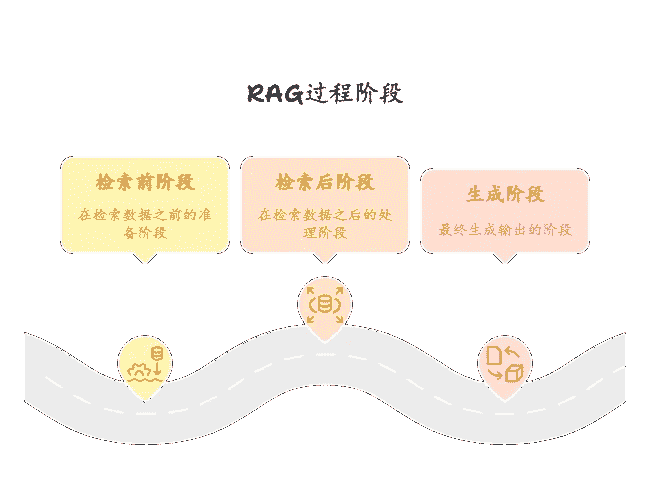

**三**个阶段里面，都有着大量的工作可以让我们去做，比如检索前我们需要对数据进行最基本的处理，尽可能让数据在进入数据库之前达到干净，不能说完全干净，但是要达到基本可用的程度。

举例**子来说，你不能将pdf读取到的二进制字节码存入数据库吧，如果是存文件**理论上是这样存的，但是我们是需要进行文本数据检索的，所以我们必须要存储成可以检索的数据形式，检索的方式可以是多样的，不管你是使用关键词检索、向量检索、混合检索等等。但终归是需要转换成一个可以用来检索的数据格式，所以我们还是需要对类似pdf的文件提取成纯文本的形式。

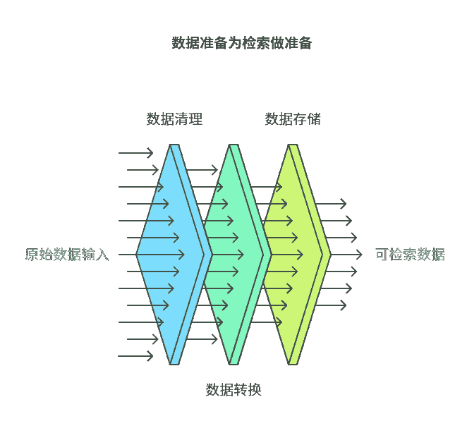

检索后和生成的部分我们不展开了因为我们本次的文章不对他们做太多处理。后面我们会展开谈到的，敬请期待！

### 1.2 为什么需要RAG？

大型语言模型（LLMs ) 在对话式任务中展现出了相当强悍的能力，但它们仍然面临重大限制，特别是在特定领域或知识密集型任务中 ，特别是在处理超出训练数据或需要当前信息的查询时会产生“幻觉”。所以我们需要提供基于现实的真实数据给模型在生成过程当中作为参考知识进行回答问题，从而进行降低幻觉发生的可能，减少错误回答产生。

对比没有RAG和有RAG有什么区别，可以看下面这个图：


### 1.3 本次 RAG 的主要模块

+   BM25算法检索作为检索层

+   pdf文件读取和文本分块作为数据入库前的处理层

整体的流程可以参考下面这张图来理解：

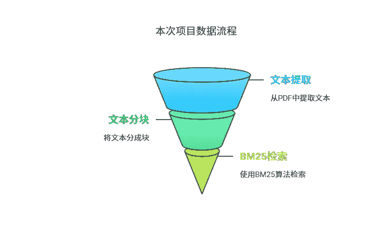

注意：这里我们没有引入数据库和向量数据库，主要是为了方便大家理解

### 1.3 RAG 的应用场景

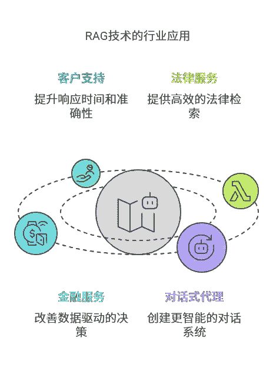

1.3.1 客户支持与服务

RAG可以用于构建智能客服系统，通过检索企业知识库和帮助文档，快速回答客户问题，确保答案的准确性和时效性。

1.3.2 法律与金融服务

在法律领域，RAG可以帮助从业者快速检索相关判例法或法规，为案件提供准确的法律依据。金融分析师则可以利用RAG整合最新市场数据和研究报告，为投资决策提供支持。

1.3.4 对话式智能体与聊天机器人

RAG可以集成到聊天机器人中，使其能够检索实时数据并生成更准确、更具上下文关联的回答，具体举例来说，面向用户的kimi就算是这一类，加入了联网功能的deepseek也是。

## 🪶二、前置知识

这部分我们将会分别提到文本分块的算法、MinerU转换pdf文件的进一步封装和BM25算法支持混合语言检索模式

### 2.1 基于markdown格式文档的分块算法

这里我们设计了一个针对Markdown文本进行分块的算法。该算法的主要目的是将Markdown文档按照标题和内容进行分块，并根据指定的长度进行合并，同时考虑中英文标点符号的差异，确保分块的合理性和可读性。

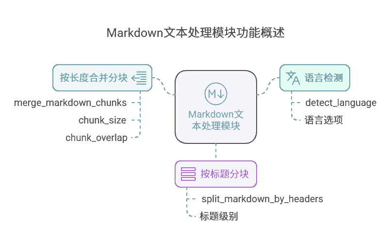

主要是分成三个部分，概括性的描述就是这几步：

+   判断语言：看看文本主要是中文还是英文。

+   按标题拆分：把 Markdown 文本根据标题（比如 #、##）分成一块一块。

+   按长度合并：把拆好的块再按指定长度重新组合，考虑中英文标点和重叠部分。

#### 具体代码

```
#!/usr/bin/env python
# -*- coding: utf-8 -*-
# author：筱可
# 2025-02-22
&quot;&quot;&quot;
#### 使用说明：
该模块提供了处理Markdown文本的功能，包括语言检测、按标题分块和按长度合并分块。

#### 主要功能：
1. `detect_language`: 检测文本中的主语言，判断是否以中文或英文为主。
2. `split_markdown_by_headers`: 根据标题级别将Markdown文本分块。
3. `merge_markdown_chunks`: 将已分块的Markdown文本合并，支持按固定长度分割，同时考虑中文和英文标点。
4. `_split_text_by_size`: 按照给定长度对文本进行分割，支持中英文智能分割。

#### 参数说明：
1. detect_language 函数：
    - text (str): 输入的文本。
    - 返回值：&#x27;zh&#x27; 表示中文占主导，&#x27;en&#x27; 表示英文占主导。

2. split_markdown_by_headers 函数：
    - text (str): 输入的Markdown文本。
    - min_level (int): 处理的最小标题级别，默认为1。
    - max_level (int): 处理的最大标题级别，默认为6。
    - 返回值：一个字典列表，包含标题、内容和标题级别。

3. merge_markdown_chunks 函数：
    - chunks (List[Dict[str, any]]): 已分块的Markdown文本。
    - chunk_size (int): 每个块的最大长度，默认为1000。
    - chunk_overlap (int): 块之间的重叠长度，默认为200。
    - separator (str): 块之间的分隔符，默认为&quot;\n\n&quot;。
    - language (str): 语言选项，默认为&#x27;auto&#x27;，自动检测语言，&#x27;zh&#x27; 表示中文，&#x27;en&#x27; 表示英文。
    - 返回值：合并后的Markdown分块。

4. _split_text_by_size 函数：
    - text (str): 要分割的文本。
    - chunk_size (int): 每个分块的最大长度。
    - chunk_overlap (int): 分块之间的重叠部分。
    - header (str): 当前分块的标题。
    - level (int): 当前分块的标题级别。
    - language (str): 语言选项，默认为&#x27;auto&#x27;，可以手动指定&#x27;zh&#x27;或&#x27;en&#x27;。
    - 返回值：一个字典列表，每个字典包含一个分块的标题、内容和级别。

#### 注意事项：
1. 确保传入的文本符合Markdown格式。
2. 对于合并后的文本，可能需要手动调整块之间的分隔符和内容。
3. `chunk_size` 和 `chunk_overlap` 需要合理设置，以避免产生过小或过大的文本块。

#### 更多信息：
无
&quot;&quot;&quot;

from typing import List, Dict

from detect_language import split_text_detect_language


def split_markdown_by_headers(
        text: str,
        min_level: int = 1,
        max_level: int = 6
) -&gt; List[Dict[str, any]]:
    &quot;&quot;&quot;
    功能描述: 将Markdown文本按标题级别分块。

    参数:
        text (str): 输入的Markdown文本。
        min_level (int): 处理的最小标题级别，默认为1。
        max_level (int): 处理的最大标题级别，默认为6。

    返回值:
        List[Dict[str, any]]: 一个字典列表，包含标题、内容和标题级别。
    &quot;&quot;&quot;
    if not isinstance(text, str):
        raise TypeError(&quot;text参数必须是字符串&quot;)
    if not isinstance(min_level, int) or not isinstance(max_level, int):
        raise TypeError(&quot;min_level和max_level必须是整数&quot;)
    if not text.strip():
        return &quot;&quot;    
    # 确保标题级别在1到6之间
    min_header_level = max(1, min(6, min_level))
    max_header_level = max(min_header_level, min(6, max_level))

    # 将文本按行分割
    lines = text.split(&#x27;\n&#x27;)
    chunks = []
    current_chunk = {&#x27;header&#x27;: &#x27;&#x27;, &#x27;content&#x27;: [], &#x27;level&#x27;: 0}

    # 遍历每一行
    for line in lines:
        is_header = False
        # 检查当前行是否为标题
        for level in range(min_header_level, max_header_level + 1):
            header_prefix = &#x27;#&#x27; * level + &#x27; &#x27;
            if line.strip().startswith(header_prefix):
                # 如果当前块有内容或标题，将其添加到块列表中
                if current_chunk[&#x27;content&#x27;] or current_chunk[&#x27;header&#x27;]:
                    chunks.append({
                        &#x27;header&#x27;: current_chunk[&#x27;header&#x27;],
                        &#x27;content&#x27;: &#x27;\n&#x27;.join(current_chunk[&#x27;content&#x27;]).strip(),
                        &#x27;level&#x27;: current_chunk[&#x27;level&#x27;]
                    })
                # 初始化新的块
                current_chunk = {
                    &#x27;header&#x27;: line.strip()[level + 1:].strip(),
                    &#x27;content&#x27;: [],
                    &#x27;level&#x27;: level
                }
                is_header = True
                break
        # 如果当前行不是标题，将其添加到当前块的内容中
        if not is_header:
            current_chunk[&#x27;content&#x27;].append(line)

    # 将最后一个块添加到块列表中
    if current_chunk[&#x27;content&#x27;] or current_chunk[&#x27;header&#x27;]:
        chunks.append({
            &#x27;header&#x27;: current_chunk[&#x27;header&#x27;],
            &#x27;content&#x27;: &#x27;\n&#x27;.join(current_chunk[&#x27;content&#x27;]).strip(),
            &#x27;level&#x27;: current_chunk[&#x27;level&#x27;]
        })
    return chunks


def merge_markdown_chunks(
        chunks: List[Dict[str, any]],
        chunk_size: int = 1000,
        chunk_overlap: int = 200,
        separator: str = &quot;\n\n&quot;,
        language: str = &#x27;auto&#x27;  # 新增参数控制语言分割类型
) -&gt; List[Dict[str, any]]:
    &quot;&quot;&quot;
    功能描述: 合并Markdown分块，按固定长度分割，支持中英文标点。

    参数:
        chunks (List[Dict[str, any]]): 已分块的Markdown文本。
        chunk_size (int): 每个块的最大长度，默认为1000。
        chunk_overlap (int): 块之间的重叠长度，默认为200。
        separator (str): 块之间的分隔符，默认为&quot;\n\n&quot;。
        language (str): 语言选项，默认为&#x27;auto&#x27;，自动检测语言，&#x27;zh&#x27; 表示中文，&#x27;en&#x27; 表示英文。

    返回值:
        List[Dict[str, any]]: 合并后的Markdown分块。
    &quot;&quot;&quot;
    if not isinstance(chunks, list):
        raise TypeError(&quot;chunks参数必须是列表&quot;)
    if not isinstance(chunk_size, int) or not isinstance(chunk_overlap, int):
        raise TypeError(&quot;chunk_size和chunk_overlap必须是整数&quot;)
    if chunk_size &lt;= chunk_overlap:
        raise ValueError(&quot;chunk_size必须大于chunk_overlap&quot;)
    if chunk_size &lt;= 0 or chunk_overlap &lt; 0:
        raise ValueError(&quot;chunk_size必须大于0且chunk_overlap不能为负数&quot;)

    # 初始化合并后的块列表
    merged_chunks = []
    # 当前文本块内容
    current_text = &quot;&quot;
    # 当前文本块的标题级别
    current_level = 0
    # 当前文本块的标题
    current_header = &quot;&quot;

    # 遍历所有的分块
    for chunk in chunks:
        # 获取当前分块的文本内容，如果有标题则包含标题
        chunk_text = f&quot;{chunk[&#x27;header&#x27;]}\n{chunk[&#x27;content&#x27;]}&quot; if chunk[&#x27;header&#x27;] else chunk[&#x27;content&#x27;]

        # 如果当前分块有标题且当前文本块不为空
        if chunk[&#x27;level&#x27;] &gt; 0 and current_text:
            # 如果当前文本块不为空白
            if current_text.strip():

                # 将当前文本块按指定大小分割并添加到合并后的块列表中
                merged_chunks.extend(_split_text_by_size(
                    current_text.strip(),
                    chunk_size,
                    chunk_overlap,
                    current_header,
                    current_level,
                    language
                ))

            # 重置当前文本块内容
            current_text = &quot;&quot;
            # 更新当前文本块的标题和标题级别
            current_header = chunk[&#x27;header&#x27;]
            current_level = chunk[&#x27;level&#x27;]
        # 将当前分块的文本内容添加到当前文本块中，使用分隔符连接
        if current_text.strip():
            current_text += separator + chunk_text
        else:
            current_text = chunk_text

    # 如果最后一个文本块不为空白
    if current_text.strip():
        # 将最后一个文本块按指定大小分割并添加到合并后的块列表中
        merged_chunks.extend(_split_text_by_size(
            current_text.strip(),
            chunk_size,
            chunk_overlap,
            current_header,
            current_level,
            language
        ))

    # 返回合并后的块列表
    return merged_chunks


def _split_text_by_size(
        text: str,
        chunk_size: int,
        chunk_overlap: int,
        header: str,
        level: int,
        language: str = &#x27;auto&#x27;
) -&gt; List[Dict[str, any]]:
    &quot;&quot;&quot;
    功能描述: 内部函数：按固定长度分割文本，支持中英文智能分割

    参数:
        text (str): 要分割的文本。
        chunk_size (int): 每个分块的最大长度。
        chunk_overlap (int): 分块之间的重叠部分。
        header (str): 当前分块的标题。
        level (int): 当前分块的标题级别。
        language (str): 语言选项，默认为&#x27;auto&#x27;，可以手动指定&#x27;zh&#x27;或&#x27;en&#x27;。

    返回值:
        List[Dict[str, any]]: 按要求分割后的文本块。
    &quot;&quot;&quot;
    # 定义中英文分割标点
    EN_PUNCTUATION = &#x27; \n\t.,!?&#x27;
    ZH_PUNCTUATION = &#x27; \n\t。！？，、；&#x27;

    # 确定使用哪种语言的分割规则
    if language == &#x27;auto&#x27;:
        # 自动检测语言
        lang = split_text_detect_language(text)
    else:
        # 使用指定的语言
        lang = language.lower()
    
    # 根据语言选择分割标点符号
    if lang == &#x27;zh&#x27;:
        split_chars = ZH_PUNCTUATION 
    elif lang == &#x27;en&#x27;:
        split_chars = EN_PUNCTUATION
    else:
        raise ValueError(&quot;Unsupported language type: {}&quot;.format(language))

    chunks = []
    text_length = len(text)
    start_pos = 0

    while start_pos &lt; text_length:
        # 计算当前块的结束位置
        end_pos = min(start_pos + chunk_size, text_length)

        if end_pos &lt; text_length:
            # 从end_pos向前找最近的标点符号
            while end_pos &gt; start_pos and text[end_pos - 1] not in split_chars:
                end_pos -= 1
            if end_pos == start_pos:
                # 如果没找到合适的标点，就硬切
                end_pos = start_pos + chunk_size

        # 获取当前块的内容并去除首尾空白字符
        chunk_content = text[start_pos:end_pos].strip()
        if chunk_content:
            # 添加当前块到结果列表
            chunks.append({
                &#x27;header&#x27;: header if not chunks else &#x27;&#x27;,
                &#x27;content&#x27;: chunk_content,
                &#x27;level&#x27;: level if not chunks else 0
            })

        # 更新start_pos，考虑重叠部分
        # 如果end_pos小于文本长度，则start_pos更新为end_pos减去chunk_overlap
        # 这样可以确保下一个块与当前块有重叠部分
        # 如果end_pos等于或大于文本长度，则start_pos更新为end_pos
        start_pos = end_pos - chunk_overlap if end_pos &lt; text_length else end_pos

    return chunks
```

#### 测试用例

```
from typing import List, Dict

from split_by_markdown import split_markdown_by_headers, \
    merge_markdown_chunks

# 使用示例
if __name__ == &quot;__main__&quot;:
    # 中英文混合示例
    markdown_text = &quot;&quot;&quot;
# 主标题
这是一个混合内容的示例。It has both Chinese and English。这里是中文部分。

## 二级标题
更多内容在这里。这是中文句子！This is an English sentence with more words to test splitting.

没有标题的段落。Another paragraph without header。这里继续中文。
    &quot;&quot;&quot;

    initial_chunks = split_markdown_by_headers(markdown_text)
    # 测试自动检测语言
    merged_chunks_auto = merge_markdown_chunks(initial_chunks, chunk_size=50, chunk_overlap=10)


    # 测试指定中文
    merged_chunks_zh = merge_markdown_chunks(initial_chunks, chunk_size=50, chunk_overlap=10, language=&#x27;zh&#x27;)
    # 测试指定英文
    merged_chunks_en = merge_markdown_chunks(initial_chunks, chunk_size=50, chunk_overlap=10, language=&#x27;en&#x27;)

    print(&quot;自动检测语言结果:&quot;)
    for i, chunk in enumerate(merged_chunks_auto):
        print(f&quot;Chunk {i}:&quot;)
        print(f&quot;Header: &#x27;{chunk[&#x27;header&#x27;]}&#x27;&quot;)
        print(f&quot;Level: {chunk[&#x27;level&#x27;]}&quot;)
        print(f&quot;Content: &#x27;{chunk[&#x27;content&#x27;]}&#x27;&quot;)
        print(&quot;-&quot; * 50)

    print(&quot;\n指定中文分割结果:&quot;)
    for i, chunk in enumerate(merged_chunks_zh):
        print(f&quot;Chunk {i}:&quot;)
        print(f&quot;Header: &#x27;{chunk[&#x27;header&#x27;]}&#x27;&quot;)
        print(f&quot;Level: {chunk[&#x27;level&#x27;]}&quot;)
        print(f&quot;Content: &#x27;{chunk[&#x27;content&#x27;]}&#x27;&quot;)
        print(&quot;-&quot; * 50)
```

#### 输出结果

```
自动检测语言结果:
Chunk 0:
Header: &#x27;&#x27;
Level: 0
Content: &#x27;主标题
这是一个混合内容的示例。It has both Chinese and English。&#x27;
--------------------------------------------------
Chunk 1:
Header: &#x27;&#x27;
Level: 0
Content: &#x27;d English。这里是中文部分。&#x27;
--------------------------------------------------
Chunk 2:
Header: &#x27;二级标题&#x27;
Level: 2
Content: &#x27;二级标题
更多内容在这里。这是中文句子！This is an English sentence&#x27;
--------------------------------------------------
Chunk 3:
Header: &#x27;&#x27;
Level: 0
Content: &#x27;sentence with more words to test splitting.&#x27;
--------------------------------------------------
Chunk 4:
Header: &#x27;&#x27;
Level: 0
Content: &#x27;litting.

没有标题的段落。Another paragraph without&#x27;
--------------------------------------------------
Chunk 5:
Header: &#x27;&#x27;
Level: 0
Content: &#x27;h without header。这里继续中文。&#x27;
--------------------------------------------------

指定中文分割结果:
Chunk 0:
Header: &#x27;&#x27;
Level: 0
Content: &#x27;主标题
这是一个混合内容的示例。It has both Chinese and English。&#x27;
--------------------------------------------------
Chunk 1:
Header: &#x27;&#x27;
Level: 0
Content: &#x27;d English。这里是中文部分。&#x27;
--------------------------------------------------
Chunk 2:
Header: &#x27;二级标题&#x27;
Level: 2
Content: &#x27;二级标题
更多内容在这里。这是中文句子！This is an English sentence&#x27;
--------------------------------------------------
Chunk 3:
Header: &#x27;&#x27;
Level: 0
Content: &#x27;sentence with more words to test splitting.&#x27;
--------------------------------------------------
Chunk 4:
Header: &#x27;&#x27;
Level: 0
Content: &#x27;litting.

没有标题的段落。Another paragraph without&#x27;
--------------------------------------------------
Chunk 5:
Header: &#x27;&#x27;
Level: 0
Content: &#x27;h without header。这里继续中文。&#x27;
--------------------------------------------------
```

上面的代码主要是实现了一个基于markdown格式的中英文文本智能分割的代码实现，具体智能分割指的是基于中英文标点符号进行分割。实现原理是通过检测向前是否发现标点符号进行分割，如果实在没有发现标点符号就会直接硬切，相对智能吧，哈哈。

### 2.2 MinerU解析pdf文件封装

```
#!/usr/bin/env python  
# -*- coding: utf-8 -*-
# author：筱可
# 2025-02-22
&quot;&quot;&quot;
#### 使用说明：
将PDF文档转换为Markdown格式，支持OCR和文本模式。

#### 主要功能：
1. 将PDF文件转换为Markdown格式
2. 提取PDF中的图片并保存
3. 根据PDF类型自动选择处理方法（OCR或文本模式）

#### 参数说明：
mineru_pdf2md函数：
    - pdf_file_path: PDF文件的绝对路径
    - md_output_path: 输出Markdown文件的目录绝对路径
    - return_path: 是否返回生成的Markdown文件路径，默认为False
    - 返回值: 如果return_path=True，返回生成的Markdown文件路径；否则返回Markdown内容

#### 注意事项：
- 依赖magic_pdf库进行PDF解析和转换
- 输入的PDF文件路径和输出路径必须为绝对路径
- 自动创建输出目录和图片目录
&quot;&quot;&quot;

import os
import uuid

from magic_pdf.data.data_reader_writer import FileBasedDataWriter, FileBasedDataReader
from magic_pdf.data.dataset import PymuDocDataset
from magic_pdf.model.doc_analyze_by_custom_model import doc_analyze
from magic_pdf.config.enums import SupportedPdfParseMethod


def mineru_pdf2md(pdf_file_path, md_output_path, return_path=False):
    &quot;&quot;&quot;
    将PDF文件转换为Markdown格式
    
    参数:
        pdf_file_path: PDF文件的绝对路径
        md_output_path: 输出Markdown文件的目录绝对路径
        return_path: 是否返回生成的Markdown文件路径，默认为False
        
    返回:
        如果return_path=True，返回生成的Markdown文件路径；否则返回Markdown内容
        
    异常:
        ValueError: 当路径不是绝对路径时
        FileNotFoundError: 当PDF文件不存在时
    &quot;&quot;&quot;
    # 检查是否为绝对路径
    if not os.path.isabs(pdf_file_path):
        raise ValueError(f&quot;PDF文件路径必须是绝对路径: {pdf_file_path}&quot;)
    if not os.path.isabs(md_output_path):
        raise ValueError(f&quot;Markdown输出路径必须是绝对路径: {md_output_path}&quot;)

    # 检查PDF文件是否存在
    if not os.path.isfile(pdf_file_path):
        raise FileNotFoundError(f&quot;PDF文件未找到: {pdf_file_path}&quot;)

    # 获取不带后缀的文件名
    name_without_suff = os.path.splitext(os.path.basename(pdf_file_path))[0]

    # 使用传入的绝对路径
    md_dir = md_output_path
    image_dir = os.path.join(md_output_path, &quot;images&quot;)
    md_suff = f&quot;{name_without_suff}.md&quot;
    md_path = os.path.join(md_dir, md_suff.replace(&quot;-&quot;, &quot;&quot;))
    print(md_path)

    # 创建目录
    os.makedirs(image_dir, exist_ok=True)
    os.makedirs(md_dir, exist_ok=True)

    # 初始化写入器
    image_writer = FileBasedDataWriter(image_dir)
    md_writer = FileBasedDataWriter(md_dir)

    # 读取PDF文件
    reader1 = FileBasedDataReader(&quot;&quot;)
    pdf_bytes = reader1.read(pdf_file_path)

    # 创建数据集
    ds = PymuDocDataset(pdf_bytes)

    # 根据PDF类型进行处理
    if ds.classify() == SupportedPdfParseMethod.OCR:
        # OCR模式处理
        infer_result = ds.apply(doc_analyze, ocr=True)
        pipe_result = infer_result.pipe_ocr_mode(image_writer)
    else:
        # 文本模式处理
        infer_result = ds.apply(doc_analyze, ocr=False)
        pipe_result = infer_result.pipe_txt_mode(image_writer)
    
    # 获取图片目录的相对路径
    show_image_dir = os.path.basename(image_dir)
    
    # 获取Markdown内容
    md_content = pipe_result.get_markdown(show_image_dir)
    
    # 如果不需要返回路径，直接返回Markdown内容
    if not return_path:
        return md_content
    
    # 保存Markdown内容到文件
    with open(md_path, &quot;w&quot;, encoding=&quot;utf-8&quot;) as f:
        f.write(md_content)
    
    return md_path
```

上面主要是对上次的文章介绍的MinerU进行了进一步的封装，有需要的同学可以看看上一篇的文章哈，这里不介绍了，注释也很详细。

### 2.3 让BM25检索算法支持中英文混合检索

为了支持中英文混合检索，我们对BM25算法进行了改进，使其能够自动检测文本的语言并选择合适的分词器进行处理。以下是具体实现和测试示例。

#### 具体实现部分代码

```
class MixedLanguageBM25(AbstractBM25):
    def __init__(self, corpus: List[str], k1: float = 1.5, b: float = 0.75, stopwords_en: tuple = STOPWORDS_EN_PLUS, stopwords_cn: tuple = STOPWORDS_CHINESE):
        &quot;&quot;&quot;
        混合语言BM25实现，自动检测语言并使用相应的分词器和停用词过滤
        &quot;&quot;&quot;
        self.english_bm25 = EnglishBM25(corpus, k1, b, stopwords_en)
        self.chinese_bm25 = ChineseBM25(corpus, k1, b, stopwords_cn)
        super().__init__(corpus, k1, b, stopwords_en + stopwords_cn)

    def _tokenize(self, text: str) -&gt; List[str]:
        &quot;&quot;&quot;根据检测到的语言选择相应的分词器&quot;&quot;&quot;
        language = tokenizer_detect_language(text)
        if language == &#x27;en&#x27;:
            return self.english_bm25._tokenize(text)
        else:
            return self.chinese_bm25._tokenize(text)
```

从上面可以看出来，核心问题是我们如何处理同时包含中文和英文的文本？

使用的解决方案是通过检测文本的语言类型来选择合适的分词方法。具体来说，如果文本中出现了中文，我们就默认使用中文分词器（比如 jieba），因为中文分词器可以同时处理英文单词。如果文本中只有英文，我们就使用英文分词器。

因为中文和英文的分词规则不同。英文单词之间有空格分隔，分词相对简单；而中文没有明显的分隔符，需要依赖分词器来处理。jieba 虽然是为中文设计的，但它也能处理英文单词，所以我们可以用它来兼容中英文混合文本。

**需要注意的区别：**

文本分块时的语言检测：我们会计算文本中中文和英文的比例。如果中文占比高，就认为它是中文文本；如果英文占比高，就认为它是英文文本。

分词时的语言检测：只要文本中有中文，无论英文占比多少，我们都会将其视为中文文本，并使用中文分词器。

#### 测试使用

```
    # 混合语言测试
    mixed_corpus = [
        &quot;this is a sample document about 机器学习&quot;,
        &quot;machine learning is fascinating and useful&quot;,
        &quot;这是一个关于深度学习的样本文档&quot;,
        &quot;another sample about 人工智能&quot;
    ]
    mixed_query = &quot;机器学习&quot;

    # 创建并保存为 JSON
    bm25_mixed_json = create_bm25(mixed_corpus, &#x27;mixed&#x27;)
    bm25_mixed_json.save(os.path.join(output_dir, &#x27;bm25_mixed.json&#x27;))
    
    # 从 JSON 加载并搜索
    loaded_bm25_mixed_json = load_bm25(os.path.join(output_dir, &#x27;bm25_mixed.json&#x27;), mixed_corpus)
    print(&quot;混合语言查询（JSON加载）:&quot;, mixed_query)
    results_json = loaded_bm25_mixed_json.search(mixed_query, top_k=3)
    for doc_id, score in results_json:
        print(f&quot;文档ID: {doc_id}, 得分: {score:.4f}, 文本: {mixed_corpus[doc_id]}&quot;)
    
    # 创建并保存为 Pickle
    bm25_mixed_pkl = create_bm25(mixed_corpus, &#x27;mixed&#x27;)
    bm25_mixed_pkl.save(os.path.join(output_dir, &#x27;bm25_mixed.pkl&#x27;))
    
    # 从 Pickle 加载并搜索
    loaded_bm25_mixed_pkl = load_bm25(os.path.join(output_dir, &#x27;bm25_mixed.pkl&#x27;), mixed_corpus)
    print(&quot;\n混合语言查询（Pickle加载）:&quot;, mixed_query)
    results_pkl = loaded_bm25_mixed_pkl.search(mixed_query, top_k=3)
    for doc_id, score in results_pkl:
        print(f&quot;文档ID: {doc_id}, 得分: {score:.4f}, 文本: {mixed_corpus[doc_id]}&quot;)
```

输出结果：

```
混合语言查询（JSON加载）: 机器学习
文档ID: 0, 得分: 2.0847, 文本: this is a sample document about 机器学习
文档ID: 2, 得分: 0.5458, 文本: 这是一个关于深度学习的样本文档
文档ID: 1, 得分: 0.0000, 文本: machine learning is fascinating and useful

混合语言查询（Pickle加载）: 机器学习
文档ID: 0, 得分: 2.0847, 文本: this is a sample document about 机器学习
文档ID: 2, 得分: 0.5458, 文本: 这是一个关于深度学习的样本文档
文档ID: 1, 得分: 0.0000, 文本: machine learning is fascinating and useful
```

从上面我们可以看到中英文混合的文本块也能实现对应的检索并排序了，如果用英文的BM25检索器就没有办法检索到 this is a sample document about 机器学习,总的来说，我们通过上面的改进处理，初步实现了混合语言的BM25检索算法，当然他也同样存在一些局限性，比如中英文意思一样是没有办法BM25算法检索到的，只能是相同的词才能被检索到。

当然，我们可以尝试将文本翻译一下，但是这里就会得不偿失了，因为翻译本身就不好做，而且翻译的词语也不一定和目标的一致，所以呢，不是很好的解决方案。

所以，业界还有另外一种处理的办法，也就是向量检索，向量检索在通过训练得到不同语言之间的关系，能够建立正确的联系，所以可以消除语言之间的壁垒，但是由于向量检索需要引入另外一个模型，我上面说过了，会提升系统的复杂性，所以不引入，这里提到只是让大家知道有这个东西。

## 🦆三、构建简易 RAG 系统

我们的RAG系统主要分成三个部分，检索前的数据提取模块、文本分块模块，其中文本分块只有markdown分块功能，检索时的BM25检索，检索后的生成部分由deepseek这类大模型提供支持。

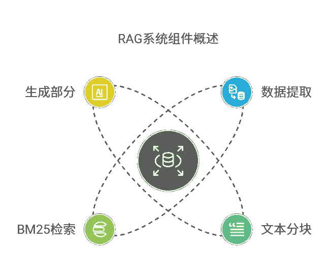

### 3.1 数据提取模块：支持多种格式，灵活应对不同需求

RAG系统的第一步是数据提取，我们支持PDF和TXT两种常见文件格式。特别是针对PDF文件，我们提供了三种不同的提取方式，满足不同场景的需求：

+   PyMuPDF：适用于常规PDF提取，速度快（超级快）。

+   PyMuPDF4LLM：专为大型语言模型优化，提取的文本更加结构化，便于后续处理。

+   MinerU：针对复杂PDF文件，能够更精准地提取文本和布局信息，缺点是速度慢，性能要求高，具体来说，如果使用cpu运行，10s大概是处理一个页面。

### 3.2 文本分块模块：Markdown分块，提升信息处理效率

上面已经提到过了，我们的系统目前只支持markdown格式的文本进行分块。主要是由于最终的内容都会转换成markdown格式，目前我们也没有复杂的分块需求，先简单实现一个，后续再采用类似“迟分”等等的高级分块模式。或者说使用小模型进行分块，但是由于那些操作比较高级了，我们暂时先不接触他们，先从基础的开始。虽然langchain等的一些框架也支持很多种分块的方式，但是为了我们说好的原则（不使用langchain这种框架构建一个极简的RAG系统），所以只能手动实现了。。。

后续我们也会慢慢引入其他的一些分块策略，但是这里先暂时这样吧。

至于为什么要进行分块，是由于大模型的对话上下文空间是有限制的，比如早期的模型，类似chatgpt，chatglm等模型，对话上下文只有4K、8K这些，虽然现在已经有类似128K、1M上下文的模型了，但是总的来说，还是有限制的，还有一点是，模型对话的上下文越长，模型输出内容的速度就会越慢，忠实度也会下降。所以我们给模型提供干净的对话上下文进行输出是有必要的。进行分块的目的就是让我们检索的时候能够检索回来与问题相关的文本块。

### 3.3 检索生成模块：基于BM25算法的文本块召回与大模型内容生成

上面我们说过RAG应用的核心其实在于检索，能否检索到相关文本直接决定了大模型生成内容的质量高低。

我们这里实现仅仅依赖BM25检索算法检索其实效果不会太好，因为我们的提问当中不一定能够包含对应内容的关键词，所以其实检索效果总体来说命中率会比较低，但是内容一旦命中有效率是很高的，相比向量检索而言。后续我们会实现两者结合的混合检索器，好奇的同学可以先自己探索下如何实现两者之间的混合排序哈！

生成模块主要是指使用大模型对检索会来的内容进行总结或者描述性质的回答。

这个阶段只需要结合提示词让模型参考检索回来的内容进行回答。具体的提示词可以参考如下内容：

```
&quot;&quot;&quot;
&lt;system&gt;
    [当前日期] {CURRENT_DATE}
    [角色] 您是一名专业的文档分析助理，擅长从技术文档中提取关键信息
    [背景] 
    {file_info}
    用户将会向你提问关于这些文档的问题，系统将会根据问题检索对应的文本块内容，并拼接成参考信息文档。
    [参考信息文档]
    【{retrieved_info}】
    [核心任务]
    1. 当用户提问时，优先从参考信息文档中寻找答案
    2. 对复杂问题进行分步骤思考
    3. 不要生成参考信息文档没有提供的信息
    4. 保持专业且易懂的语气
    5. 不确定时，可以请求用户提供更多信息
    [交互要求]
    - 保持专业且易懂的语气
    - 关键数据用**加粗**显示
    - 代码块使用```包裹
&lt;/system&gt;
&quot;&quot;&quot;
```

langchain默认提供给RAG使用的提示词也可以简单参考下，提示词如下：

```
You are an assistant for question-answering tasks. Use the following pieces of retrieved context to answer the question. If you don&#x27;t know the answer, just say that you don&#x27;t know. Use three sentences maximum and keep the answer concise.
Question: {question}
Context: {context}
Answer:
---
翻译版本：
你是一个用于回答问题的助手。请使用以下检索到的内容来回答问题。如果你不知道答案，只需说明你不知道。回答请保持简洁，不超过三句话。
问题：{问题}
上下文：{上下文}
答案：
```

应用内检索代码逻辑实现部分：

```
def retrieved_information(query=&quot;&quot;) -&gt; str | None:
    &quot;&quot;&quot;
    功能描述: 根据已处理的文件内容生成参考信息文档。

    参数:
        file_metadata: 文件元数据
        processed_content: 已处理的文件内容

    返回值:
        str: 生成的参考信息文档字符串
    &quot;&quot;&quot;
    uploaded_content = st.session_state.uploaded_content
    if not uploaded_content:
        return &quot;&quot;
    documents = []
    for u in uploaded_content:
        content = u.get(&quot;content&quot;)
        # metadata = u.get(&quot;metadata&quot;)
        initial_chunks = split_markdown_by_headers(content)
        if not initial_chunks:
            print(&quot;有未提取文件出现&quot;)
            continue
        # 测试自动检测语言
        merged_chunks_auto = merge_markdown_chunks(initial_chunks, 
                                                   chunk_size=1000, 
                                                   chunk_overlap=100)
        # {header:&quot;&quot;,content:&quot;&quot;,level:&quot;&quot;}
        # todo 给块上面都添加序号，方便后续进行同文件内容重排序
        for chunk_dict in merged_chunks_auto:
            # d = Document(content=chunk_dict.get(&quot;content&quot;),metadata=metadata)
            # documents.append(d)
            # todo 将document换成Document类
            documents.append(chunk_dict.get(&quot;content&quot;))

    
    results = bm25_search(corpus=documents,query=query,top_k=20)
    # 将去掉分数，提取序号
    relate_texts =[doc for doc_id, score,doc in results]
    retrieval_context_length = st.session_state.retrieval_context_length
    # 根据检索内容长度限制获取合适数量的文本
    selected_texts = []
    current_length = 0
    for text in relate_texts:
        content_length = len(text)
        if current_length + content_length &lt;= retrieval_context_length:
            selected_texts.append(text)
            current_length += content_length
        else:
            break
    
    # 将选中的文本内容拼接成字符串返回
    if selected_texts:
        print(&quot;检索到的文本内容：&quot;,selected_texts)
        return &quot;---&quot; * 5 +&quot;\n\n&quot;.join(text for text in selected_texts)
```

上面的检索处理还是比较粗糙的，比如我们直接将检索的结果按照文本块的得分排名拼接起来了，实际上将检索的内容按照文章逻辑顺序拼接起来效果会更好一些，但我们没有做，主要是留下给下一次去实现对应的优化逻辑，后续还有很大的优化的空间，优化RAG的部分我们在下面的一个部分讲解，也就是第四点的部分。

### 3.4 效果展示

#### 3.4.1 MinerU转换效果展示

（下面是完全基于MinerU转换后的效果，公式和表格都是以文本形式渲染出来的，除了里面有一张图片，其他的都是文本，已经相当逆天了😂）

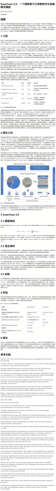

（论文是我用AI翻译了一下的结果）

#### 3.4.2 项目运行效果演示

刚进来的页面效果:

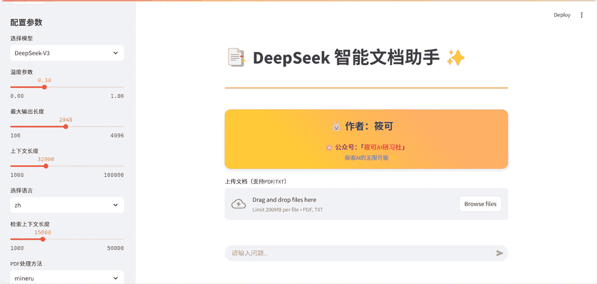

上面默认使用的是MinerU进行pdf解析，下面我们上传一篇论文试试效果，就试试我们之前解析的并转成中文版本的论文吧，我们将它重新转pdf，然后重新解析一遍。

解析成功之后会显示解析完成：

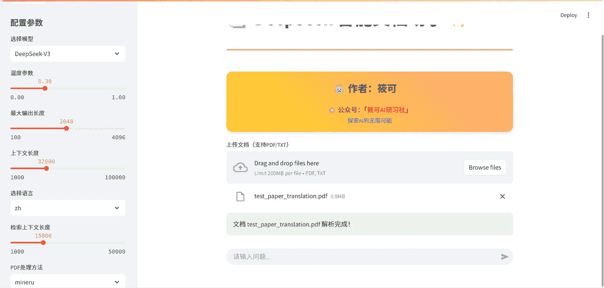

下面我们开始提问。

query：

文件里面说的结论是什么。

输出结果：

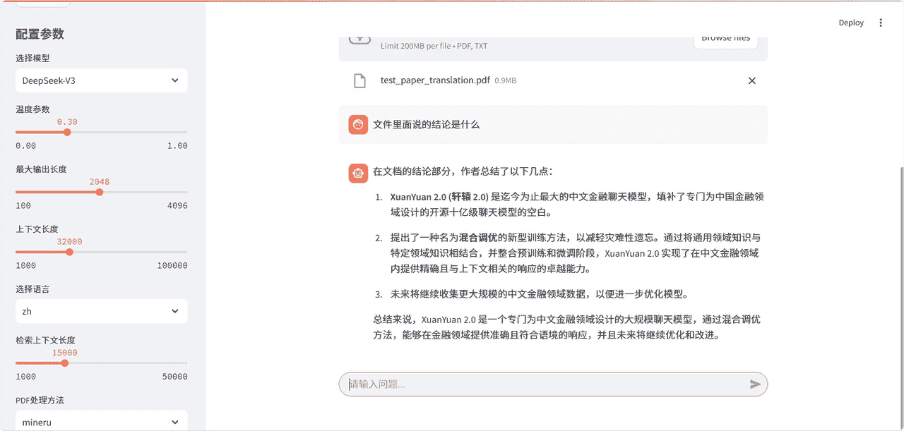

我们对比下原文：

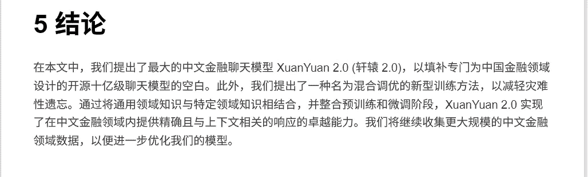

我们再看看检索到的内容：

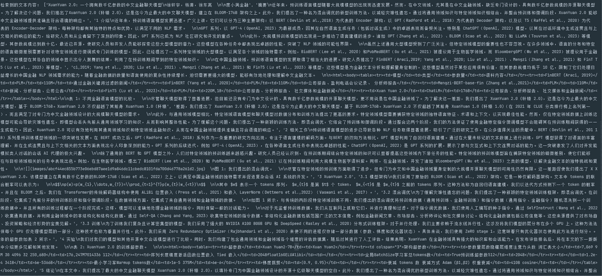

（这样看的效果不太好，下次我们优化检索内容的展示效果，比如直接在前端部分渲染检索到的内容。）

模型回答的效果还是不错的，说明我们的极简RAG系统算是构建完成了，实际上看似我们是使用检索的形式实现了无限上下文检索式对话，不过其实我们每次都是将文本块拼接起来，达到检索上下文长度限制之后就停止继续拼接了。所以其实还是无法避免上下文窗口限制的。

通过上面的方式进行对话，有没有同学发现和上次构建的智能文档助手有什么区别吗？

细心的同学可能会发现，上次的处理，我们是直接将整个pdf读取到的内容投入到模型的对话上下文内，而且是按照上下文检索长度进行截断处理的，这也就导致后面被截断的内容是无法被模型看见的，也就导致模型实际上无法访问后面被截断的部分内容。

对比我们这次的检索式处理，我们是预先进行了文本分块处理，然后通过检索的形式过滤内容，从而实现了基于一个信息库进行上下文对话。

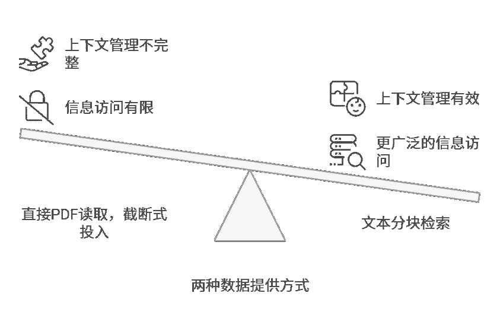

## 🐶四、如何优化 RAG 系统

我们的极简 RAG 系统已经跑起来了，但离“完美”还有不少距离。

优化 RAG 系统不仅能提升检索的准确性，还能让生成的内容更贴合用户需求。

以下是一些实操性强的优化方向，供大家参考和探索：

### 4.1 检索模块优化：让“R”更精准

混合检索（BM25 + 向量检索）

当前我们只用了 BM25，虽然它简单高效，但在语义相关性上不如向量检索。

优化方案可以引入向量模型（比如 Sentence-Transformers 或开源的嵌入模型），将文档嵌入向量空间，再结合 BM25 得分进行混合排序。

可以简单尝试加权融合：

final_score = α * BM25_score + (1-α) * vector_similarity，α 值可以调参测试（比如从 0.7 开始）。

注：也可换成分数不为0的文本块，或者是排名融合，而不是分数加权融合。我更倾向于排名融合，因为两者的评分体系也不一样，所以不太好使用分数加权融合的形式。

这样既保留关键词匹配的优势，又能捕捉语义相似性。

查询扩展（Query Expansion）

用户的问题可能不包含文档中的关键词，导致检索命中率低。我们可以在检索前对查询进行扩展，比如用同义词替换、词干提取（英文场景下），或者用大模型生成问题的“变体”。比如用户问“机器学习的结论是什么”，可以扩展为“machine learning 的结果是什么”或“深度学习的结论有哪些”，提高召回率。

**检索结果重排序**

当前我们直接按 BM25 得分拼接结果，但同一个文档的多个文本块可能分散排列，逻辑不够连贯。可以引入重排序逻辑：先按文档归组，再按原文顺序排列相关文本块，最后取满足上下文长度的部分。当然了，也不止这种重排序的方式，还有一种叫做rerank的模型，是专门进行重排序的，和上面的混合检索相比，重排序的效果会更加符合预期要求，但重排序需要消耗的时间也会更多，而且也会再引入一个模型，又会增加整个服务的成本和系统复杂性。

### 4.2 数据预处理优化：让输入更“干净”

**更智能的分块策略**

当前的 Markdown 分块基于标题和固定长度，但对于长段落或复杂文档，可能切得不够自然。可以尝试语义分块，比如用小模型（BERT 类）检测句子间的语义边界，或者基于主题聚类将相关内容聚合到一个块里。还可以用“迟分”（Late Chunking），先检索整段再动态切割，提升信息完整性。

还有就是，上面的分割处理部分其实没有特别关注表格和代码块的问题，其实也是需要优化处理的，代码块。但是由于有的表格或者代码块非常长，其实也是需要考虑到这种复杂情况的，我们这里统一分割了不是最优的方案，后续也会思考如何处理吧。

**噪声过滤**

检索回来的内容其实也不都一定能够和问题相关，我们可以使用大语言模型在这个部分进行过滤，排除掉不相关的文本，或者是使用其他的检测是否相关的模型进行检测过滤，不过其实向量检索的形式其实也已经算是一种过滤的方式了。这里是否需要加入一个过滤的部分还有待考虑吧。

### 4.3 生成模块优化：让答案更“聪明”

提示词工程工作流（Prompt Engineering）

当前提示词已经能让模型参考检索内容，但还可以更精细。比如使用工作流的形式处理整个问答流，比如可以让模型分段处理：先总结检索内容，再回答问题，增加可读性和透明度。RAGFlow就是在前端部分提供了工作流组装的形式给用户自由搭配他们想要的工作流程，相对而言也算是灵活度比较高的了。

**上下文压缩**

检索回来的文本块可能太长，我们上面的测试是使用一篇论文进行的，实际上总体字数也就1万字左右，不算多，但是类似一本书的长度塞进模型上下文会超限。那个时候可以试着用大模型对文本块做摘要（比如让 DeepSeek 生成 100 字总结），然后把摘要喂给生成模块，既节省空间又保留关键信息，但是因为进一步压缩了信息，肯定就会有信息损失，具体看场景使用吧。

**后处理与校验**

生成的答案可能不够简洁或有小错误。可以加个后处理步骤，比如用规则去掉冗余表达，或者让模型自我校验（“请检查回答是否与检索内容一致”）。这能提升用户体验，尤其是技术文档这种需要精确的场景。

#### 4.4 系统整体优化：效率与体验并重

**缓存机制**

每次提问都重新检索效率不高，可以加个缓存层（比如用 Redis），把热门查询和对应结果存起来，下次直接返回。特别适合重复性问题多的场景，比如客服系统。

**用户反馈循环**

加个反馈按钮（“这个回答有用吗？”），收集用户评价，然后用这些数据微调检索或生成模块。比如发现某个文档块老被点“没用”，就降低它的权重，甚至剔除出库。

……

其实还有很多策略可以用，相关的论文也很多，但是我们先不考虑那么多，下一次我们先构建评估模块。

再后面就开始加入向量检索的部分。

## 📒总结

### 🚀技术全景图

+   数据处理：从 PDF/TXT 到 Markdown，再到智能分块，构建干净的检索库。

+   检索核心：BM25 检索算法，支持中英文混合，提供快速关键词匹配。

+   生成赋能：大模型（DeepSeek 等）结合检索内容，生成准确自然的回答。

+   优化方向：混合检索、语义分块、提示词工程，全面提升系统能力。

### 📓学习汇总

+   RAG 是什么：检索 + 生成的组合，核心在于用外部知识库增强模型能力。

+   怎么实现：从数据提取到分块，再到检索和生成，闭环跑通一个极简系统。

+   优化的思路：从数据质量、检索精度到生成效果，多维度打磨系统。

### 🔥动手挑战

1.混合检索实验：试着引入一个轻量向量模型（比如beg-m3），跟 BM25 结合，看看检索效果提升多少。

2.分块优化：改改分块代码，支持按段落语义切分，观察对检索结果的影响。

### ♻️互动问题

1.你之前对RAG（检索增强生成）的理解与文章中的描述一致吗？

2.你认为RAG技术会如何提升或改进系统的性能？

3.你会考虑将RAG技术应用于其他领域吗？或者说，RAG技术在文本生成之外的领域有怎样的应用潜力？

4.在优化 RAG 时，你更看重速度还是准确性，怎么平衡这两者？

> 来一句名言：

>

> 就连太阳光到地球都需要8分钟，所以我们也需要时间，请耐心一些!

>

> ——筱可

**欢迎在留言区分享你的想法，每条留言我都会认**真看！你的反馈就是我创作的最大动力 ❤️

### 💗立即行动

1. 点赞、收藏、关注，顺手分享给可能感兴趣的朋友。

1.  为账号加个星标或特别关注，获取更多精彩内容。

1.  以这篇文章为灵感，整理一份属于自己的笔记。

### 🚗行动召唤

📢"与其等着AI改变世界，不如自己参与变革！在这儿，让AI成为你弯道超车的秘密武器。"

**（恭喜！您已掌握RAG核心知识，快快**使用RAG技术给你的AI小助手赋能吧！）

---

🙋♂️ 入群交流 & 资料领取

1️⃣ **入群方式**

+   👸号菜单点击「社群」，扫码直接入群

+

+   回复关键词「入群」「加群」等，添加作者🛰️人工邀请

+

2️⃣ **资料领取**

+   入群后查看群公告，获取学习资源

+

+   回复「资料」至👸号，自动发送网盘链接（定期更新）

+

+   👸号菜单点击「资料领取」

## 📓附录

### 往期文章

+   打造RAG应用必知：BM25算法实战解析，让你不落人后

+   手把手教程：用MinerU构建自动化文档转换流水线

+   [飞桨版面检测分析的命令看不懂？恭喜！您已获得 arg](http://mp.weixin.qq.com/s/5b8PqqViSpvgMjpfJqOxCQ?token=1077873472&lang=zh_CN)parse 入门手册一本，快快学起来吧！

+   [大模型应用极简开发快速入门](http://mp.weixin.qq.com/s/kHeVK6hManVUaci2p-42GQ)

+   基于Streamlit和DeepSeek的智能文档助手开发实战指南

+   告别低效沟通：提示词框架助你玩转deepseek

### 代码说明文档

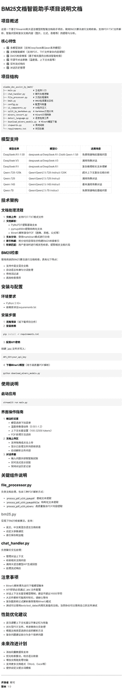