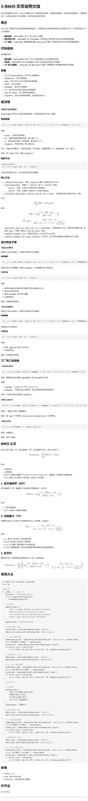

# 算法实战：RAG核心-BM25检索算法

> 来源：[https://datawhaler.feishu.cn/docx/K6vIdh1ZnopnQkxz5Wmc3lFJnBd](https://datawhaler.feishu.cn/docx/K6vIdh1ZnopnQkxz5Wmc3lFJnBd)

## 打造RAG应用必知：BM25算法实战解析，让你不落人后

✨你好，我是筱可，欢迎来到「筱可AI研习社」！

🚀 标签关键词：| AI实战派开发者 | 技术成长陪伴者 | RAG前沿探索者 |

**本次文章项目源码地址：**

[GitHub - li-xiu-qi/X-B](https://github.com/li-xiu-qi/X-BM25)M25: 简单的实现了中英文BM25算法

## 🚁前言

上一篇我们主要介绍了如何使用MinerU优化我们文档处理流水线中的pdf文档，主要是由于传统的pdf处理库（`pymupdf`或`pymupdf4llm`）无法处理pdf中的图片，公式等等，所以使用MinerU这种集成多个模型分工合作进行pdf转markdown的方式进行。

这一次我们学一下**BM25检索算法**，**后续构建第一个版本的RAG系统会用到，这部分的知识**主要是方便大家理解RAG部分的搜索算法是如何实现底层的原理的，你可以不完全理解这个公式，但是最起码要知道如何使用。

**本文目标介绍**

这篇文章主要给**没有BM25算法基础知识的同学**看的，目标是让大家能理解经典算法BM25是怎么实现检索的，目标的核心在于让大家能够使用BM25算法实现相关文本检索。

**小提示**

这篇文章讲到的知识点会在下次构建RAG系统的时候用到，所以还是**需要学会如何使用BM25算法哦**，核心实现的部分我已经封装好了。

## 📄主题

**本次的主题是**：

学会如何使用BM25算法进行文本检索。

**通过本文你将收获**：

+ 什么是BM25算法

+ BM25算法主要分成哪些模块

+ BM25算法能用来做什么

+ 如何使用BM25算法

+ BM25在RAG系统当中起到什么作用

**额外知识：**

+ `jieba`分词

+ `Stemmer`词干提取

+ `re`正则表达式

**下期预告**：

**《构建一个基于BM25检索算法的“无限上下文”RAG对话系统》**

## 🐱一、BM25检索算法

### 1.1 BM25简介

BM25算法（Best Matching 25）是一种广泛应用于信息检索领域的排序函数，用于评估查询与文档之间的相关性。它是基于概率检索模型发展而来的改进版本，结合了词频（TF）和逆文档频率（IDF）的思想，同时引入了文档长度归一化和参数调节机制，以更精准地衡量匹配程度。

### 1.2 BM25公式

BM25 基于词频（TF）和文档频率（DF）对文档进行评分。评分公式如下：

其中：

+ `d` 是文档，

+ `q` 是查询。

+ `IDF(t)` 是逆文档频率（Inverse Document Frequency），衡量词 `t` 在语料库中的稀有性。

+ `TF_{t, d}` 是词 `t` 在文档 `d` 中的词频，经过归一化处理。

#### 1. 逆文档频率（IDF）

逆文档频率（IDF）衡量词 `t` 在语料库中的稀有性，公式为：

其中：

+ `N` 是文档总数。

+ `DF(t)` 是词 `t` 出现的文档数。

#### 2. 词频部分（TF）

词频部分对词 `t` 在文档 `d` 中的频率进行归一化处理，公式如下：

其中：

+ `f_{t, d}` 是词 `t` 在文档 `d` 中的出现次数。

+ `len(d)` 是文档 `d` 的长度（即词数）。

+ `avg_len` 是整个语料库的平均文档长度。

+ `k1` 和 `b` 是调整参数，用于控制词频的饱和度和文档长度的影响。

#### 3. 总评分

最终的 BM25 分数是所有查询词的 `IDF` 和 `TF` 的加权和：

## 🪶二、使用代码实现BM25算法

下面我们使用代码实现完整的代码，并进行对应的代码讲解。

### 2.1 完整代码实现


```python
from abc import ABC, abstractmethod
from typing import List
import math
import jieba
import Stemmer  # PyStemmer 库，用于英文词干提取
import re  # 用于英文文本预处理
import json  # 用于保存和加载 JSON 格式
import pickle  # 用于保存和加载 Pickle 格式
from stopwords import (
    STOPWORDS_EN_PLUS,
    STOPWORDS_CHINESE,
)

# 抽象基类
class AbstractBM25(ABC):
    def __init__(self, corpus: List[str], k1: float = 1.5, b: float = 0.75, stopwords: tuple = ()):
        """
        抽象基类，定义BM25的核心功能
        
        Args:
            corpus: 文档集合，每个元素是一个文档字符串
            k1: 控制词频饱和度的参数
            b: 控制文档长度归一化的参数
            stopwords: 停用词元组
        Raises:
            ValueError: 如果corpus为空
        """
        if not corpus:
            raise ValueError("Corpus cannot be empty")
        self.corpus = corpus
        self.k1 = k1
        self.b = b
        self.stopwords = set(stopwords)  # 转换为set以提高查找效率
        self.doc_count = len(corpus)

        # 分词后的文档集合，由子类实现
        self.tokenized_corpus = self._tokenize_corpus()

        # 计算每个文档的长度（词数）
        self.doc_lengths = [len(tokens) for tokens in self.tokenized_corpus]

        # 计算平均文档长度
        self.avg_doc_length = sum(self.doc_lengths) / self.doc_count if self.doc_count > 0 else 0

        # 词频和文档频率
        self.df = {}  # 文档频率
        self.tf = []  # 词频矩阵
        self._build_index()

    @abstractmethod
    def _tokenize(self, text: str) -> List[str]:
        """抽象方法：对文本进行分词"""
        pass

    def _tokenize_corpus(self) -> List[List[str]]:
        """对整个文档集合进行分词"""
        return [self._tokenize(doc) for doc in self.corpus]

    def _build_index(self):
        """构建词频和文档频率索引"""
        for doc_id, tokens in enumerate(self.tokenized_corpus):
            term_freq = {}
            for term in tokens:
                term_freq[term] = term_freq.get(term, 0) + 1
            self.tf.append(term_freq)
            for term in set(tokens):
                self.df[term] = self.df.get(term, 0) + 1

    def _score(self, query_tokens: List[str], doc_id: int) -> float:
        """
        计算查询与文档的BM25得分
        """
        score = 0.0
        doc_len = self.doc_lengths[doc_id]

        for term in query_tokens:
            if term not in self.df:
                continue

            idf = math.log((self.doc_count - self.df[term] + 0.5) /
                          (self.df[term] + 0.5) + 1.0)

            term_freq = self.tf[doc_id].get(term, 0)
            tf_part = term_freq * (self.k1 + 1) / \
                     (term_freq + self.k1 * (1 - self.b + self.b * doc_len / self.avg_doc_length))

            score += idf * tf_part

        return score

    def search(self, query: str, top_k: int = 5) -> List[tuple]:
        """
        执行搜索并返回排序后的结果
        """
        if top_k < 1:
            raise ValueError("top_k must be at least 1")
        query_tokens = self._tokenize(query)
        scores = [(doc_id, self._score(query_tokens, doc_id))
                 for doc_id in range(self.doc_count)]
        scores.sort(key=lambda x: x[1], reverse=True)
        return scores[:top_k]

    def save(self, filepath: str):
        """
        将BM25索引保存到文件（支持 JSON 和 Pickle 格式）
        
        Args:
            filepath: 保存文件的路径（.json 或 .pkl）
        Raises:
            ValueError: 如果文件扩展名不支持
        """
        data = {
            'df': self.df,
            'tf': self.tf,
            'k1': self.k1,
            'b': self.b,
            'language': 'english' if isinstance(self, EnglishBM25) else 'chinese',
            'stopwords': list(self.stopwords)
        }
        if filepath.endswith('.json'):
            with open(filepath, 'w', encoding='utf-8') as f:
                json.dump(data, f, indent=4, ensure_ascii=False)
        elif filepath.endswith('.pkl'):
            with open(filepath, 'wb') as f:
                pickle.dump(data, f)
        else:
            raise ValueError("Unsupported file extension. Use .json or .pkl.")

    @classmethod
    def load(cls, filepath: str, corpus: List[str]):
        """
        从文件加载BM25索引（支持 JSON 和 Pickle 格式）
        
        Args:
            filepath: 索引文件的路径（.json 或 .pkl）
            corpus: 原始文档集合，用于初始化
        Returns:
            EnglishBM25 或 ChineseBM25 实例
        Raises:
            ValueError: 如果文件扩展名或语言不支持
        """
        if filepath.endswith('.json'):
            with open(filepath, 'r', encoding='utf-8') as f:
                data = json.load(f)
        elif filepath.endswith('.pkl'):
            with open(filepath, 'rb') as f:
                data = pickle.load(f)
        else:
            raise ValueError("Unsupported file extension. Use .json or .pkl.")

        language = data['language']
        if language == 'english':
            bm25_cls = EnglishBM25
        elif language == 'chinese':
            bm25_cls = ChineseBM25
        else:
            raise ValueError("Unsupported language in saved data.")

        stopwords = tuple(data['stopwords'])
        bm25 = bm25_cls(corpus, data['k1'], data['b'], stopwords)
        bm25.df = data['df']
        bm25.tf = data['tf']
        bm25.doc_lengths = [sum(tf_doc.values()) for tf_doc in bm25.tf]
        bm25.avg_doc_length = sum(bm25.doc_lengths) / len(bm25.doc_lengths) if bm25.doc_lengths else 0
        return bm25

# 英文BM25实现（使用 PyStemmer 和停用词）
class EnglishBM25(AbstractBM25):
    def __init__(self, corpus: List[str], k1: float = 1.5, b: float = 0.75, stopwords: tuple = STOPWORDS_EN_PLUS):
        """
        英文BM25实现，使用PyStemmer进行词干提取和停用词过滤
        """
        self.stemmer = Stemmer.Stemmer('english')  # 初始化英文词干提取器
        super().__init__(corpus, k1, b, stopwords)

    def _tokenize(self, text: str) -> List[str]:
        """英文分词：使用正则表达式预处理 + PyStemmer + 停用词过滤"""
        text = text.lower()
        text = re.sub(r'[^\u4e00-\u9fa5a-zA-Z0-9\s]', '', text)
        tokens = text.split()
        return [self.stemmer.stemWord(token) for token in tokens if token and token not in self.stopwords]

# 中文BM25实现
class ChineseBM25(AbstractBM25):
    def __init__(self, corpus: List[str], k1: float = 1.5, b: float = 0.75, stopwords: tuple = STOPWORDS_CHINESE):
        """
        中文BM25实现，使用jieba分词和停用词过滤
        """
        super().__init__(corpus, k1, b, stopwords)

    def _tokenize(self, text: str) -> List[str]:
        """中文分词：使用jieba并过滤停用词"""
        text = re.sub(r'[^\u4e00-\u9fa5a-zA-Z]', '', text)
        tokens = jieba.cut(text)
        return [token for token in tokens if token and token not in self.stopwords]

# 工厂函数
def create_bm25(corpus: List[str],
                language: str, 
                k1: float = 1.5,
                b: float = 0.75,
                stopwords: tuple = None):
    """
    创建BM25实例的工厂函数
    
    Args:
        corpus: 文档集合
        language: 语言类型 ('english' 或 'chinese')
        k1: 控制词频饱和度的参数
        b: 控制文档长度归一化的参数
        stopwords: 自定义停用词元组（可选）
    """
    language = language.lower()
    if language in ['english', 'en']:
        stopwords = stopwords if stopwords is not None else STOPWORDS_EN_PLUS
        return EnglishBM25(corpus, k1, b, stopwords)
    elif language in ['chinese', 'cn']:
        stopwords = stopwords if stopwords is not None else STOPWORDS_CHINESE
        return ChineseBM25(corpus, k1, b, stopwords)
    else:
        raise ValueError("Unsupported language. Please choose 'english/en' or 'chinese/cn'.")
    
def load_bm25(filepath: str, corpus: List[str]):
    """
    从文件加载BM25实例
    
    Args:
        filepath: 索引文件的路径（.json 或 .pkl）
        corpus: 原始文档集合，用于初始化
    Returns:
        BM25实例
    """
    return AbstractBM25.load(filepath, corpus)

# 通用的搜索函数
def bm25_search(corpus: List[str], query: str, language: str, top_k: int = 5, k1: float = 1.5, b: float = 0.75, stopwords: tuple = None):
    """
    执行BM25搜索
    """
    bm25 = create_bm25(corpus, language, k1, b, stopwords)
    results = bm25.search(query, top_k)
    return [(doc_id, score, corpus[doc_id]) for doc_id, score in results]
```


### 2.2 代码使用示例

```
from bm25 import load_bm25, create_bm25
import os


# 测试代码
if __name__ == "__main__":
    output_dir = 'test_index_outputs'
    if not os.path.exists(output_dir):
        os.makedirs(output_dir)
    
    # 英文测试
    english_corpus = [
        "this is a sample document about machine learning",
        "machine learning is fascinating and useful",
        "this document discusses deep learning techniques",
        "another sample about artificial intelligence"
    ]
    english_query = "machine learning"
    
    # 创建并保存为 JSON
    bm25_en_json = create_bm25(english_corpus, 'english')
    bm25_en_json.save(os.path.join(output_dir, 'bm25_en.json'))
    
    # 从 JSON 加载并搜索
    loaded_bm25_en_json = load_bm25(os.path.join(output_dir, 'bm25_en.json'), english_corpus)
    print("英文查询（JSON加载）:", english_query)
    results_json = loaded_bm25_en_json.search(english_query, top_k=3)
    for doc_id, score in results_json:
        print(f"文档ID: {doc_id}, 得分: {score:.4f}, 文本: {english_corpus[doc_id]}")
    
    # 创建并保存为 Pickle
    bm25_en_pkl = create_bm25(english_corpus, 'english')
    bm25_en_pkl.save(os.path.join(output_dir, 'bm25_en.pkl'))
    
    # 从 Pickle 加载并搜索
    loaded_bm25_en_pkl = load_bm25(os.path.join(output_dir, 'bm25_en.pkl'), english_corpus)
    print("\n英文查询（Pickle加载）:", english_query)
    results_pkl = loaded_bm25_en_pkl.search(english_query, top_k=3)
    for doc_id, score in results_pkl:
        print(f"文档ID: {doc_id}, 得分: {score:.4f}, 文本: {english_corpus[doc_id]}")
    
    print("\n")

    # 中文测试
    chinese_corpus = [
        "这是一个关于机器学习的样本文档",
        "机器学习既迷人又实用",
        "本文档讨论深度学习技术",
        "另一个关于人工智能的样本"
    ]
    chinese_query = "机器学习"

    # 创建并保存为 JSON
    bm25_cn_json = create_bm25(chinese_corpus, 'chinese')
    bm25_cn_json.save(os.path.join(output_dir, 'bm25_cn.json'))
    
    # 从 JSON 加载并搜索
    loaded_bm25_cn_json = load_bm25(os.path.join(output_dir, 'bm25_cn.json'), chinese_corpus)
    print("中文查询（JSON加载）:", chinese_query)
    results_json = loaded_bm25_cn_json.search(chinese_query, top_k=3)
    for doc_id, score in results_json:
        print(f"文档ID: {doc_id}, 得分: {score:.4f}, 文本: {chinese_corpus[doc_id]}")
    
    # 创建并保存为 Pickle
    bm25_cn_pkl = create_bm25(chinese_corpus, 'chinese')
    bm25_cn_pkl.save(os.path.join(output_dir, 'bm25_cn.pkl'))
    
    # 从 Pickle 加载并搜索
    loaded_bm25_cn_pkl = load_bm25(os.path.join(output_dir, 'bm25_cn.pkl'), chinese_corpus)
    print("\n中文查询（Pickle加载）:", chinese_query)
    results_pkl = loaded_bm25_cn_pkl.search(chinese_query, top_k=3)
    for doc_id, score in results_pkl:
        print(f"文档ID: {doc_id}, 得分: {score:.4f}, 文本: {chinese_corpus[doc_id]}")
```

**输出结果**

```
英文查询（JSON加载）: machine learning
文档ID: 0, 得分: 1.0784, 文本: this is a sample document about machine learning
文档ID: 1, 得分: 1.0784, 文本: machine learning is fascinating and useful
文档ID: 2, 得分: 0.3304, 文本: this document discusses deep learning techniques

英文查询（Pickle加载）: machine learning
文档ID: 0, 得分: 1.0784, 文本: this is a sample document about machine learning
文档ID: 1, 得分: 1.0784, 文本: machine learning is fascinating and useful
文档ID: 2, 得分: 0.3304, 文本: this document discusses deep learning techniques

中文查询（JSON加载）: 机器学习
文档ID: 1, 得分: 1.1051, 文本: 机器学习既迷人又实用
文档ID: 0, 得分: 0.9129, 文本: 这是一个关于机器学习的样本文档
文档ID: 2, 得分: 0.3397, 文本: 本文档讨论深度学习技术

中文查询（Pickle加载）: 机器学习
文档ID: 1, 得分: 1.1051, 文本: 机器学习既迷人又实用
文档ID: 0, 得分: 0.9129, 文本: 这是一个关于机器学习的样本文档
文档ID: 2, 得分: 0.3397, 文本: 本文档讨论深度学习技术
```

上面我们分别创建了一个英文和中文的`BM25`检索算法实例，并进行检索，也分别使用`json`和`pickle`进行保存索引和加载索引的方式进行检索。

通过上面的示例，我觉得你应该能够学会如何使用上面构建的`BM25`算法代码，进行构建属于你自己的`RAG`系统检索器了。

**快快行动起来试试吧！**

### 2.3 扩展知识

下面我们额外介绍下，一些第三方库在本次代码当中的作用。

#### 2.3.1 jieba分词

```
import jieba


sentence = "@xiaoke，hello！我来自北京清华大学"

# 全模式
seg_list = jieba.cut(sentence, cut_all=True)
print("Full Mode: " + "/ ".join(seg_list))  # 全模式

# 精确模式
seg_list = jieba.cut(sentence, cut_all=False)
print("Default Mode: " + "/ ".join(seg_list))  # 精确模式
```

**输出结果**

```
Full Mode: @/ xiaoke/ ，/ hello/ ！/ 我/ 来自/ 北京/ 清华/ 清华大学/ 华大/ 大学
Default Mode: @/ xiaoke/ ，/ hello/ ！/ 我/ 来自/ 北京/ 清华大学
```

因为中文和英文不一样，英文的每个词都是使用空格进行隔离出来的，但是中文的每个字都是连起来的，我们需要将一句话分割成多个部分这里就是需要用到`jieba`分词库进行实现，具体的实现我们这里不深究，感兴趣的同学可以自己去看看。

#### 2.3.2 Stemmer词干提取

```
import Stemmer

stemmer = Stemmer.Stemmer('english')
print(stemmer.stemWord('running'))
print(stemmer.stemWord('runs'))
print(stemmer.stemWord('run'))
print(stemmer.stemWord('ran'))
print(stemmer.stemWord('runner'))
print(stemmer.stemWord('studies'))
```

**输出结果**

```
run
run
run
ran
runner
studi
```

词干提取是通过去掉单词的词缀（比如时态、复数、-ing 等形式），将其还原为基本形式（词干）。比如上面运行的结果就是了。它不像词形还原（`Lemmatization`）那样追求语法上的完整性，而是更粗糙、快速地处理，适合需要高效率的场景。

##### 具体有什么优势?

1.  统一词汇，减少冗余

在检索或分析文本时，同一个词的不同形式（如 “run”、“running”、“ran”）可能会被当作不同的词处理。但它们本质上表达的是同一个概念。`Stemmer` 把这些变体统一成一个词根（如 “run”），这样可以提升检索准确性，比如搜索 “run”，也能找到包含 “running” 的文档，同时减少计算量，不必为每个变体单独计算频率或构建索引。

1.  提高检索的泛化能力

用户输入的查询和文档中的词往往形式不同。`Stemmer` 通过统一词形，让系统更“聪明”，能匹配更多相关内容。

1.  节省存储和计算资源

在构建索引（如 `BM25` 的词频表）时，如果不做词干提取，每个单词变体都会占用空间和计算资源。`Stemmer` 把变体归一化，减少了词汇表的大小。

比如：原来有 “run”、“runs”、“running” 三个词，提取后只剩 “run” 一个，索引更紧凑，搜索更快。

1.  适配统计模型（如 `BM25`）

`BM25` 这样的算法依赖词频（`TF`）和逆文档频率（`IDF`）。如果词形不统一，同一个意思的词被分散统计，会削弱它们的重要性。`Stemmer` 让统计更集中，结果更合理。

##### ⚠️ 注意事项

**不完美性**

`Stemmer` 有时会“砍过头”，比如 “studies” 变成 “studi”，不是完整的词。这是因为它只关注规则裁剪，不考虑语法完整性。如果需要更精确的还原（比如 “studies” → “study”），可以用词形还原（`Lemmatization`），不过我们这次不考虑这部分的问题。

**语言依赖**

`Stemmer` 对英文效果好，因为英文词形变化规则较简单。但对中文没用（中文没有词缀变化，分词更关键），所以代码里 `ChineseBM25` 用的是 `jieba` 分词。

#### 2.3.3 re正则表达式

```
import re

text = "@Your input text here!"
text = re.sub(r'[^a-zA-Z0-9\s]', '', text.lower())

print(text)  # your input text here
```

**输出结果**

```
your input text here
```

正则表达式（Regular Expression，简称 `regex`）是用来匹配、查找或替换文本中的特定模式。在 Python 中，`re` 模块提供了正则表达式的支持，常用于文本预处理、数据清洗等任务。在上面的代码片段中，`re.sub` 被用来清理文本，去掉不需要的字符。

主要是为了进行文本清洗、规范化输入，最终目的还是为了提高算法效率。

## 🦆三、来用实际的例子来理解上述的`BM25`算法实现

### 3.1用最简单的语言解释 `BM25` 是什么

想象一下，你有一个大图书馆，里面有很多书（文档）。现在有人问你：“帮我找几本跟‘太空旅行’最相关的书。” 你会怎么做呢？

你可能会先看看每本书里“太空”和“旅行”这两个词出现了多少次。但你不会只看这个，因为有些书很长，可能随便提到几次“太空”，但其实不重要；有些书很短，但全是“太空旅行”的内容。

你还会考虑这个词有多特别——如果“太空”在每本书里都出现，那它就不稀奇；但如果只有几本书提到，它就很关键。

`BM25` 就是这样一个“聪明图书管理员”。它是一个算法，用来给文档打分，找出跟你的问题（查询）最相关的那些。它考虑了词频、文档长度和词的稀有度。

### 3.2拆解 `BM25` 的三个核心部件

`BM25` 的计算有点像做菜，我们需要三种“原料”：词频、文档长度，逆文档频率

#### 3.2.1 词频（`TF`，Term Frequency）

这是问：“这个词在一本书里出现了多少次？” 但有个问题：如果一本书超长，词频高不一定说明它更相关。所以 `BM25` 会“调一下味”，让长文档的词频影响变小一点（用参数 `k1` 和 `b` 控制）。

`k1`：控制词频的“饱和度”

`k1` 决定了一个词在文档中出现的次数（词频）对评分的影响有多大。它就像一个“饱和调节器”——词频越高，评分会增加，但增加到一定程度就没那么明显了。

如果 `k1` 很小（比如接近 0），词频的影响就被压得很低，哪怕一个词在文档里出现 100 次，评分也不会比出现 1 次高太多。我们可以理解成控制经验值加成的“难度曲线”，就像得分有上限，分数越高的时候加的分就越少，举例子就是打游戏里面的人物等级越高经验需要的越多才能升级。

**实际影响**

通常 `k1` 设在 1.2 到 2.0 之间，这意味着词频有一定作用，但不会无限制地放大，避免过于偏向那些“啰嗦”的文档。

#### 3.2.2 文档长度调整

短文档和长文档不能一视同仁。如果一本 10 页的小册子提到 5 次“太空”，可能很专注；但一本 1000 页的书提到 5 次，可能只是随便带过。`BM25` 用文档长度和平均文档长度来调整分数，长文档会被“惩罚”一点。

##### `b`：控制文档长度的“惩罚力度”

`b` 决定了文档长度如何影响评分。它处理的是“长文档天然词频高”的问题，通过“标准化”让长文档和短文档更公平。

如果 `b` = 0，完全忽略文档长度的影响。就像评判一道菜，不管盘子是大是小，只看调料放了多少。

如果 `b` = 1，文档长度影响最大，长文档会被“惩罚”得更厉害。就像说：“你盘子大，调料多是应该的，我得扣点分，不然不公平。”

如果 `b` 在中间（比如 0.75，常用值），就是折中，长文档会有点劣势，但不至于完全被压下去。

**实际影响**

`b` 的值通常在 0 到 1 之间，调高 `b` 会让短文档更容易得分，调低 `b` 则更倾向于忽略长度差异。

两者的互动

`k1` 和 `b` 一起“调味”：`k1` 管词频的“上限”，`b` 管长度的“权重”。比如一篇超长文档里某个词出现了 50 次：

高 `k1` + 高 `b`：词频加分多，但长度惩罚也重，结果可能中庸。

低 `k1` + 低 `b`：词频加分少，长度惩罚也少，可能偏向词频本身。

现实例子：假设搜“苹果”，一篇短文提到 5 次“苹果”，一篇长文提到 50 次。如果 `k1` 低，50 次和 5 次差别不大；如果 `b` 高，长文的 50 次还会被“打折”，短文可能反而得分更高。

#### 3.2.3 逆文档频率（`IDF`，Inverse Document Frequency）

##### 想象你在图书馆找书

你在图书馆想找关于“太空”的书。你翻开书架，想快速判断哪些书是你要找的。有些词能迅速帮你判断，而有些词则没用。`IDF` 就像一个“特别度评分器”，告诉你哪些词值得关注。

**情景 1：常见词不特别**


假设“太空”这个词在每本书里都出现。那你一看“太空”，完全分不出哪些是科幻小说、物理教材或儿童读物。因为它太常见了，没法帮你挑出真正相关的书。这种词的 `IDF` 很低。

**情景 2：稀有词很特别**

假设“太空”只在几本书里出现，比如《星际航行指南》、《宇宙探秘》和《科幻经典》。这几本书立刻显得很特别——“太空”一出现，你就知道它们很可能跟你的需求强相关。这种稀有词的 `IDF` 就很高，能帮你快速锁定目标。

### IDF 的作用：放大稀有，压制常见

`IDF` 的核心任务是“衡量一个词有多特别”，然后在搜索或评分时调整它的影响力：

+   **常见词（低 `IDF`）**：像“太空”如果每本书都有，它的分数很低。因为它到处都是，不能告诉你哪本书更独特、更相关。就像图书馆里每本书封面上都写着“有趣”，你没法靠它挑书。

+   **稀有词（高 `IDF`）**：像“太空”如果只在几本书里出现，它的分数很高。因为它一出现，往往就直指文档的核心内容，能帮你找到“隐藏的宝藏书”。

### 怎么衡量“特别度”？

`IDF` 用一个简单的数学公式来算这个“特别度”：

$\text{IDF} = \log\left(\frac{\text{图书馆总书数}}{\text{含有这个词的书数}}\right)$

+   **总书数**：图书馆里一共有多少本书（比如 1000 本）。

+   **含有这个词的书数**：这个词出现在多少本书里（比如“太空”出现在 10 本里）。

**例子**：

+   “太空”出现在 500 本书里，`IDF` = $\log(1000 / 500) = \log(2) \approx 0.3$，很低，不特别。

+   “太空”出现在 10 本书里，`IDF` = $\log(1000 / 10) = \log(100) \approx 2.0$，很高，很特别。

> 为什么用 `log`（对数）？为了让分数平滑一点，不至于稀有词的分数高得离谱。

### 回到图书馆

你在找“太空的探险”的书：

+   “的”出现在 1000 本书里，`IDF` 几乎是 0，没用。

+   “探险”出现在 200 本书里，`IDF` 中等，能稍微缩小范围。

+   “太空”出现在 10 本书里，`IDF` 高，能直接帮你找到那几本最相关的书。

`IDF` 就像一个“筛选器”，把没用的常见词压下去，把稀有的、能指路的关键词抬起来。

### 总结

+   **`IDF` 的本质**：衡量一个词的“稀有度”或者“特别度”。

+   **作用**：给稀有词更高的分数（因为它们能帮你找到独特的书），给常见词低分数（因为它们没啥区分力）。

+   **比喻**：就像图书馆里的一张藏宝图，`IDF` 告诉你哪些词是“线索”，能带你找到真正相关的“宝藏书”。

### 3.3 代码里是怎么实现的？

现在我们看看代码怎么把这个“图书管理员”做出来：

#### 3.3.1 `AbstractBM25` 类：基础规则

这是一个基础类，告诉我们 BM25 需要什么：文档集合（`corpus`）、词频（`tf`）、文档频率（`df`）、文档长度（`doc_lengths`），还有平均长度（`avg_doc_length`）。它还定义了核心方法，比如 `_score`（算分数）和 `search`（找 Top K 结果）。

#### 3.3.2 分词（`_tokenize`）

在英语里（`EnglishBM25`），它把句子拆成单词，去掉标点、转小写、提取词干（比如“running”变成“run”），然后扔掉没用的词（像“the”“and”这样的停用词）。在中文里（`ChineseBM25`），它用 `jieba` 把句子切成词（比如“今天天气很好”变成“今天”“天气”“很好”），也去掉停用词。

#### 3.3.3 算分数（`_score`）

对查询（比如“太空旅行”），先分词成“太空”和“旅行”。对每本书，算这两个词的 `TF`（词频）和 `IDF`（稀有度），再调整一下文档长度的影响，最后加起来得出总分。

#### 3.3.4 搜索（`search`）

把每本书的分数算出来，排序，挑前几个（比如 Top 5）给你。

#### 3.3.5 保存和加载（`save` 和 `load`）

就像图书管理员把书架目录存起来，下次直接用。可以用 JSON 或 `Pickle` 格式保存索引，避免每次都重新算。

### 3.4 第四步：举个例子，让你感受一下

假设有 3 本书：

+   书 1（10 个词）：太空 太空 旅行 …… （短，专注）

+   书 2（100 个词）：太空 旅行 …… （长，分散）

+   书 3（50 个词）：旅行 旅行 旅行 ……（中等，没“太空”）

查询是“太空旅行”。

+   书 1：`TF` 高（“太空”2 次，“旅行”1 次），文档短，`IDF` 看词的稀有度，分数会很高。

+   书 2：`TF` 低（每个词才 1 次），文档长，分数被压低。

+   书 3：没“太空”，分数很低。

BM25 输出的结果：书 1 > 书 2 > 书 3。

**相信**经过上面的解释，你一定能够理解什么是 BM25 算法了，对于 BM25 算法如何实现也有了自己的思考和实现的方法。

## 🐶 四、BM25 在 RAG 中的应用

### 4.1 RAG 简介

RAG（Retrieval-Augmented Generation，检索增强生成）是一种结合检索和生成能力的 AI 模型框架。它通过从外部知识库中检索相关信息，再将这些信息交给生成模型（如大语言模型），来回答用户的问题或完成任务。简单来说，RAG 就像一个“有备而来”的助手，先查资料、再开口回答，而不是完全凭空生成。

在 RAG 系统中，检索部分是核心，它决定了能否快速、准确地找到与用户查询相关的知识。而 BM25 算法，就是其中的一种检索算法。

### 4.2 BM25 在 RAG 中的角色

BM25 在 RAG 中的主要任务是从大量文档中检索出与用户查询最相关的内容，然后将这些内容作为上下文（`context`）提供给生成模型。具体来说：

+   **输入处理**

用户输入一个查询（比如“什么是量子计算？”），RAG 系统会将这个查询交给检索模块。

+   **`BM25` 检索**

`BM25` 会对知识库中的所有文档进行评分，找出与“量子计算”最相关的文档。它通过计算查询词（如“量子”“计算”）在每个文档中的 `TF` 和 `IDF`，结合文档长度的影响，给出排序后的结果。

+   **上下文提供**

`BM25` 返回的 Top K 个文档（比如前 5 个）会被整合成一段上下文，交给生成模型。生成模型再根据这些上下文生成自然、准确的回答。

+   **优势体现**

+   **高效性**：`BM25` 计算简单，速度快，适合处理大规模文档集合。

+   **精准性**：它平衡了词频和稀有度，能有效找到与查询主题最相关的文档。

+   **无需训练**：不像深度学习模型需要大量标注数据，`BM25` 是基于统计的算法，开箱即用。

### 4.3 BM25 在 RAG 中的局限性与改进

+   **语义缺失**：`BM25` 只看词的统计信息，不理解语义。比如“苹果电脑”和“苹果水果”，它可能分不清。

+   **单一语言支持**：代码中的实现区分了中文和英文，但混合语言处理可能需要额外调整。

在实际 RAG 系统中，可以结合密集向量检索与 `BM25`，形成“稀疏+密集” `Retrieval` 的混合模式，提升检索的语义准确性。

## 📒 总结

**🚀 技术全景图**

+   `BM25` 算法：经典检索算法，基于 `TF`、`IDF` 和文档长度归一化。

+   `RAG` 系统：检索与生成的结合，`BM25` 是检索模块的关键组件。

+   工具支持：`jieba`（中文分词）、`PyStemmer`（英文词干提取）、`re`（文本预处理）。

**📓 学习汇总**

+   `BM25` 是什么：一个衡量查询与文档相关性的评分算法。

+   怎么用：通过代码实现分词、索引构建和检索功能。

+   在 `RAG` 中的作用：快速检索相关文档，作为生成模型的输入。

**🔥 动手挑战**

+   用提供的代码，对一个包含 5 篇短文的语料库运行 `BM25`，查询“AI技术”，返回 Top 3 结果。

+   修改代码中的 `k1` 和 `b` 参数，观察对检索结果的影响，记录短文档和长文档的得分变化。

**♻️ 互动问题**

+   你觉得 `BM25` 在处理多语言文档时会有什么挑战？

+   如果让你改进 `BM25` 来适应 `RAG`，你会从哪些方面入手？

+   在上面的例子中，如果知识库文档很长，`BM25` 的表现会如何？

> 来一句名言：
>
> 该走的路，一步也不能少，该解决的问题，一个逃不掉。
>
> ——筱可

**欢迎在留言区分享你的想法，每条留言我都会认真看！你的反馈就是我创作的最大动力 ❤️**

**💗 立即行动**

1. 点赞、收藏、关注，顺手分享给可能感兴趣的朋友。

2. 为账号加个星标或特别关注，获取更多精彩内容。

3. 以这篇文章为灵感，整理一份属于自己的笔记。

**🚗 行动召唤**

📢"与其等着 AI 改变世界，不如自己参与变革！在这儿，让 AI 成为你弯道超车的秘密武器。"

**“系统检测发现，您已掌握超强的检索算法基础，只需与本文稍作互动，便能得到额外助力！”**

## 📓 附录

### 参考论文

`https://ar5iv.labs.arxiv.org/html/2305.14087`

### 往期文章

1.手把手教程：用`MinerU`构建自动化文档转换流水线

[2.飞桨版面检测分析的命令看不懂？恭喜！您已获得 `argparse` 入门手册一本，快快学起来吧！](http://mp.weixin.qq.com/s/5b8PqqViSpvgMjpfJqOxCQ?token=1077873472&lang=zh_CN)

[3.大模型应用极简开发快速入门](http://mp.weixin.qq.com/s/kHeVK6hManVUaci2p-42GQ)

[4.基于 `Streamlit` 和 `DeepSeek` 的智能文档助手开发实战指南](https://mp.weixin.qq.com/s/38BcsiGF1WhKx4DaA-8l0A)

5.告别低效沟通：提示词框架助你玩转`deepseek`

### 代码说明文档



---

🙋♂️ 入群交流 & 资料领取

1️⃣ **入群方式**

+   👸号菜单点击「社群」，扫码直接入群

+   回复关键词「入群」「加群」等，添加作者🛰️人工邀请

2️⃣ **资料领取**

+   入群后查看群公告，获取学习资源

+   回复「资料」至👸号，自动发送网盘链接（定期更新）

+   👸号菜单点击「资料领取」
