# CherryStudio配置firecrawl MCP

> 来源：[https://datawhaler.feishu.cn/docx/HFEndq7jVofo42xeWI3cLT8LnNc](https://datawhaler.feishu.cn/docx/HFEndq7jVofo42xeWI3cLT8LnNc)

## 一、配置 MCP

先进行 MCP 的配置，打开 MCP 配置界面。

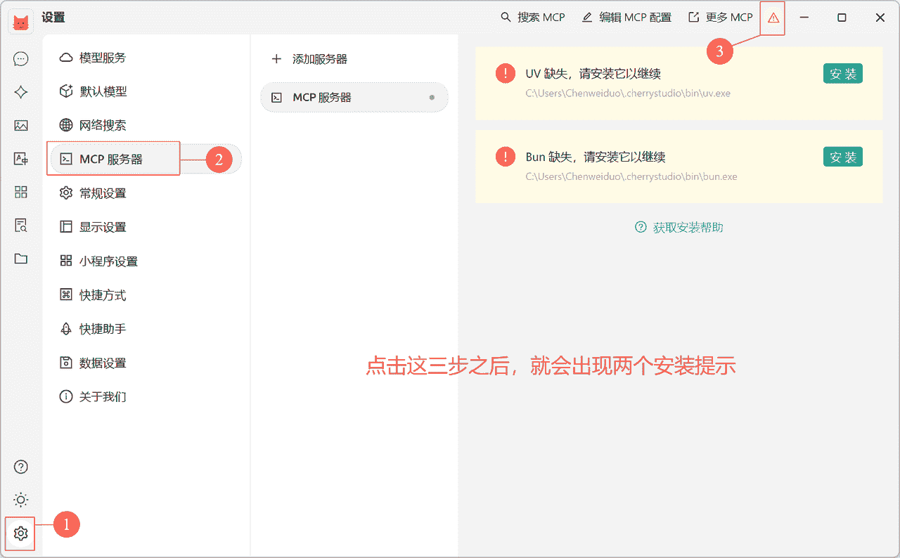

二、安装 UV Bun

由于直接点击安装可能会特别慢，所以选择手动安装。

**参考官网教程**：

+   Bun: [https://github.com/](https://github.com/oven-sh/bun/releases)oven-sh/bun/releases

+   UV: [https://github.com/a](https://github.com/astral-sh/uv/releases)stral-sh/uv/releases

**我的安装过程记录**：

我记录一下我的过程：

```
powershell -ExecutionPolicy Bypass -c &quot;irm &lt;https://github.com/astral-sh/uv/releases/download/0.6.11/uv-installer.ps1&gt; | iex&quot;
powershell -c &quot;irm bun.sh/install.ps1|iex&quot;
```

PowerShell

安装完成后，前往 C 盘用户名目录下找到.bun/bin中的 exe 文件以及.local/bin里面的 exe 文件全部复制到.cherrystudio/bin目录下。

接着在系统变量中添加.cherrystudio/bin的路径。

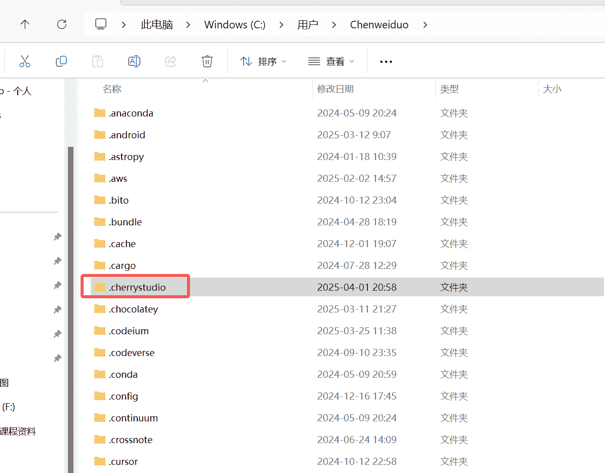

**检查安装是否成功**：

打开 powershell，依次输入bun回车，再输入uv回车。

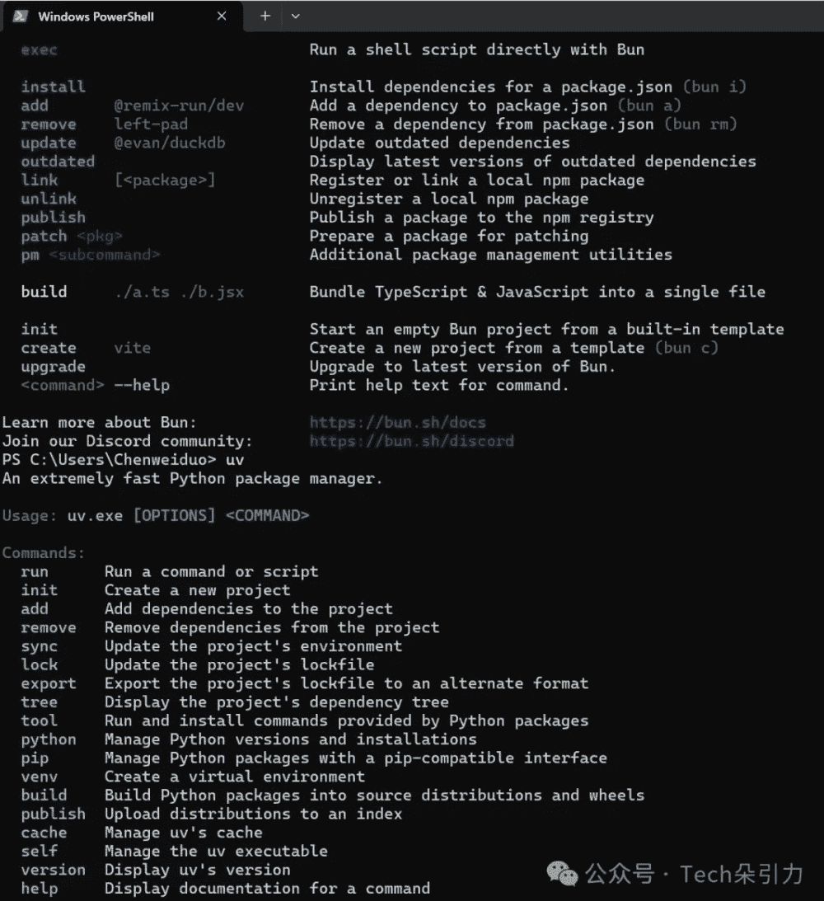

然后重新打开 CherryStudio，若安装成功会有相应提示。

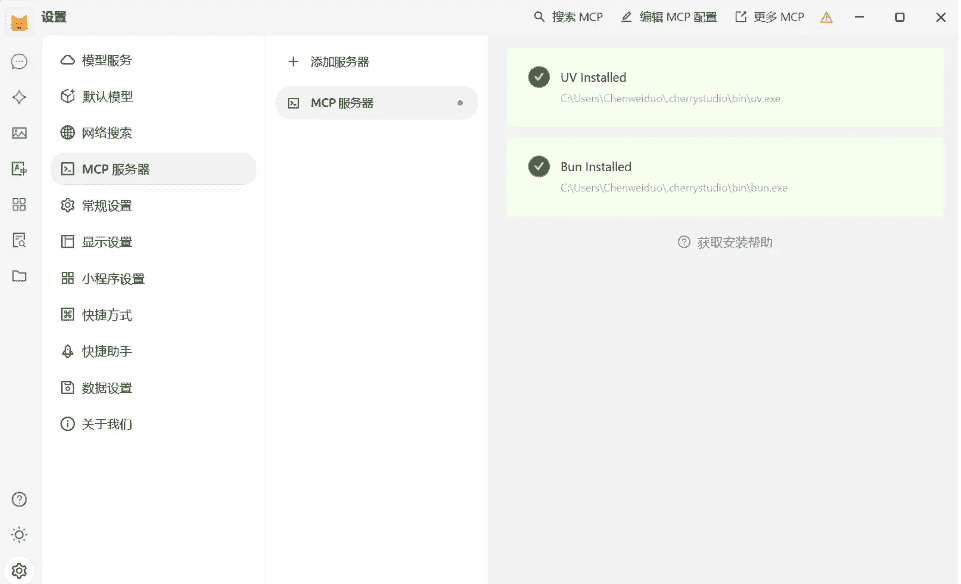

三、配置 FireCrawl

点击更多 MCP 会打开https://mcp.so/，搜索需要使用的 MCP 并点击进入

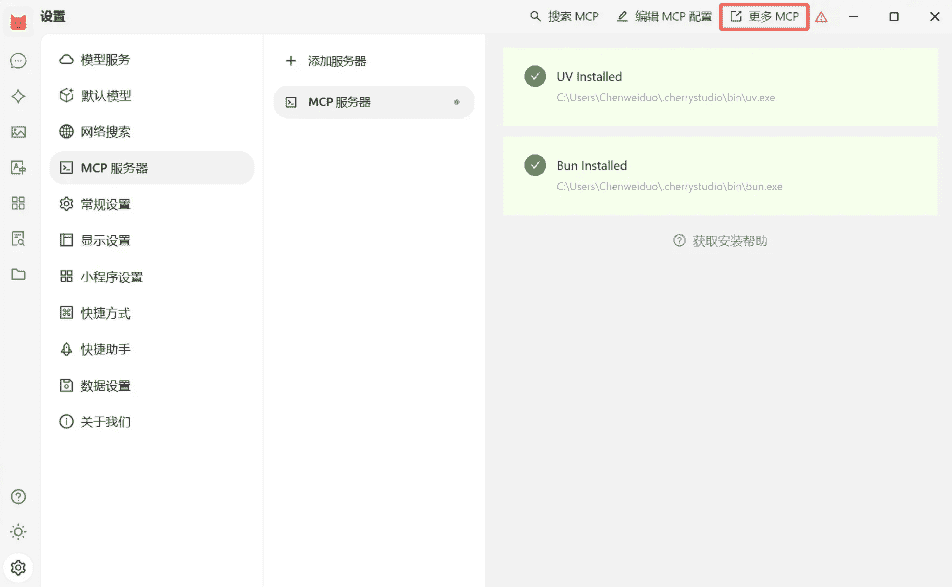

FireCrawl 需要 API 链接，可在官网注册获取免费试用次数，

官网链接：https://www.firecrawl.dev/


然后回到mcp来

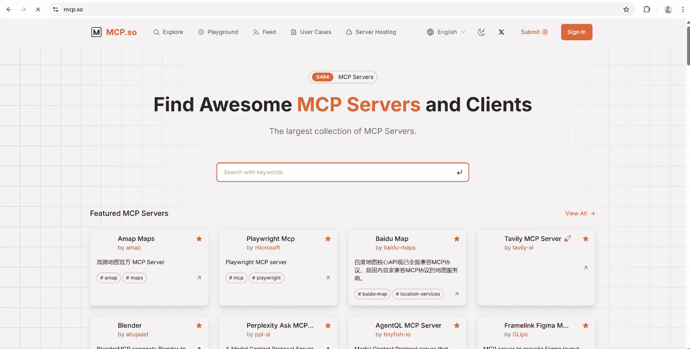

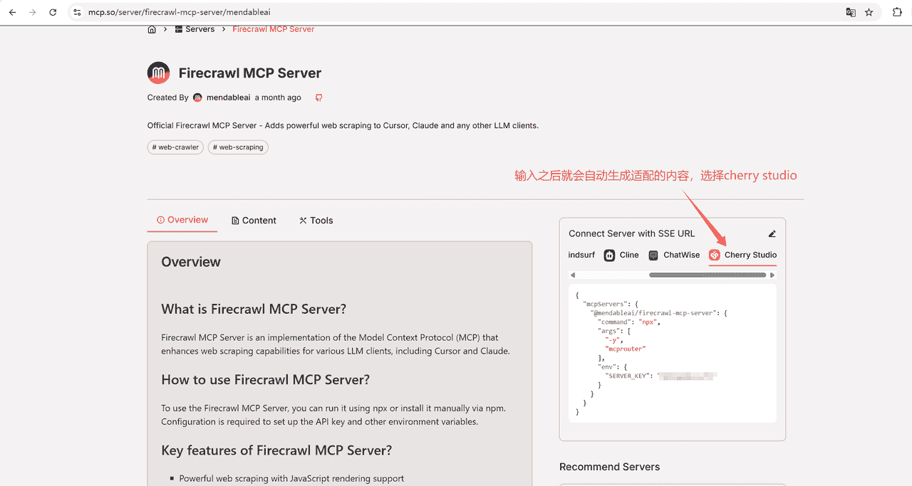

输入api，生成内容（这块可以先不管，因为我后面也没用🤣）

回到 CherryStudio 进行如下配置：

**环境变量**：

```
FIRECRAWL_API_KEY=xxxxxxxxxxxxxxxxxxx（输入自己的 firecrawl 的 api）
FIRECRAWL_RETRY_MAX_ATTEMPTS=5
FIRECRAWL_RETRY_INITIAL_DELAY=2000
FIRECRAWL_RETRY_MAX_DELAY=30000
FIRECRAWL_RETRY_BACKOFF_FACTOR=3
FIRECRAWL_CREDIT_WARNING_THRESHOLD=2000
FIRECRAWL_CREDIT_CRITICAL_THRESHOLD=500
```

配置成功后即可看到可用功能（如下）：

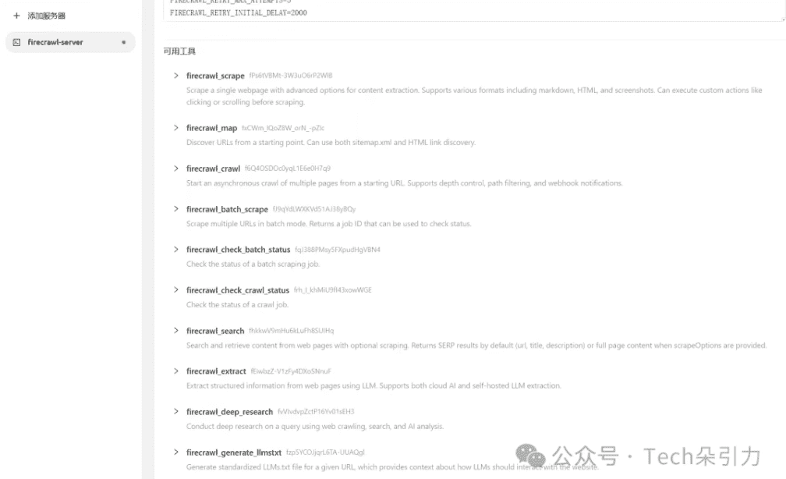

## 四、后续操作

回到聊天界面打开 MCP，需要注意确保对话的模型具备工具调用能力。

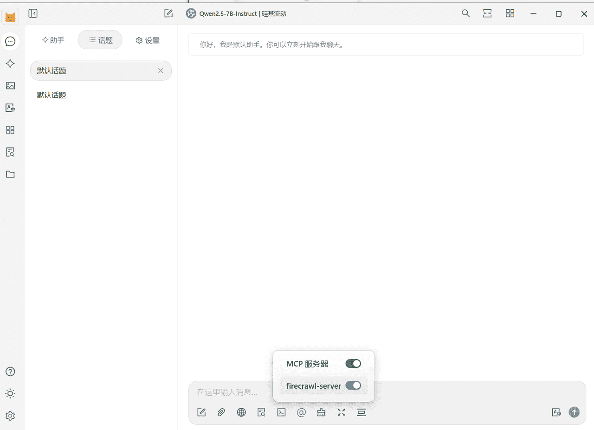

在设置的模型服务中进行查看是否有调用功能（工具图标就是）

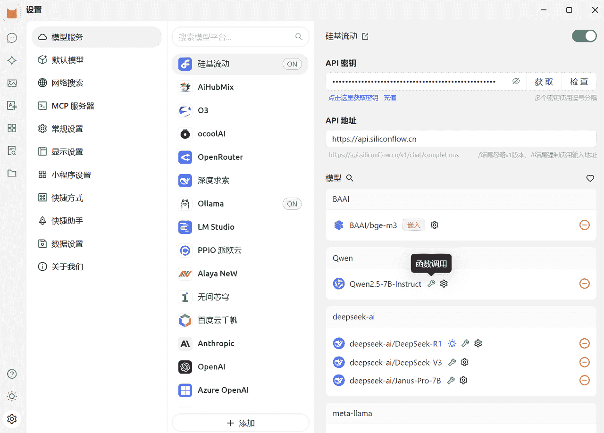

可以给出网站进行测试了

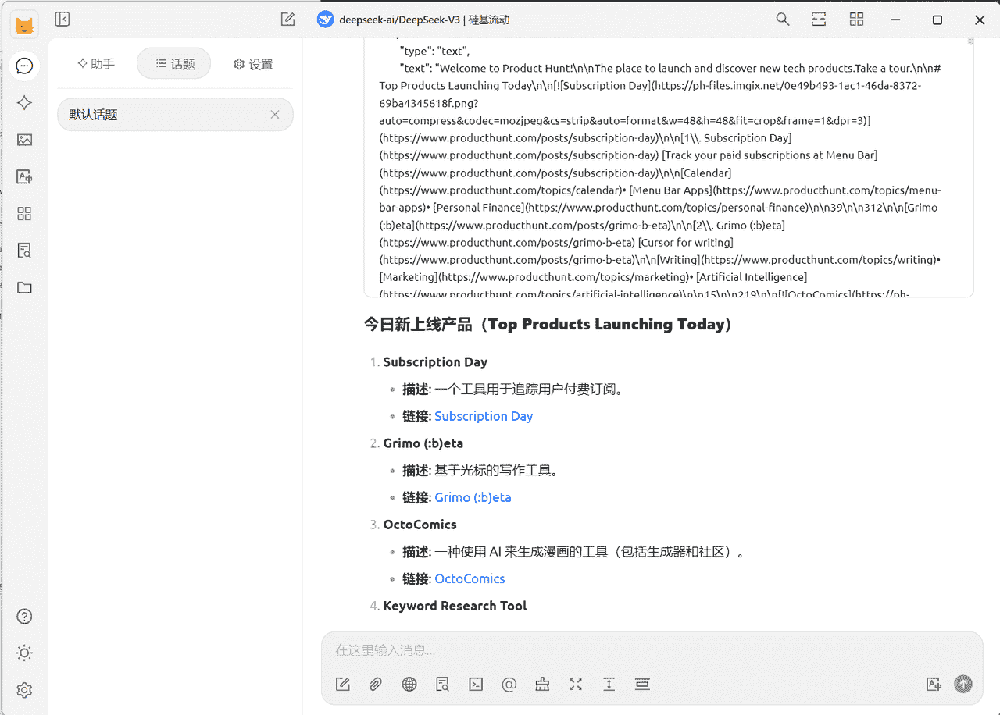