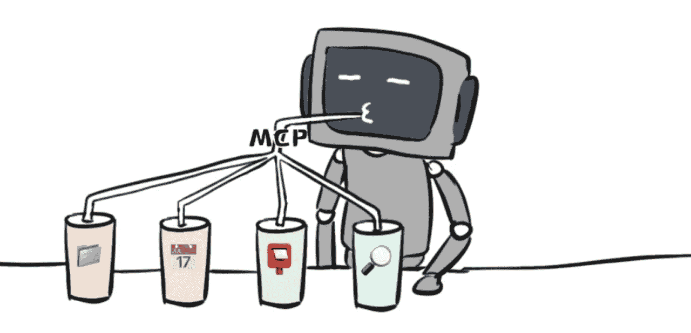
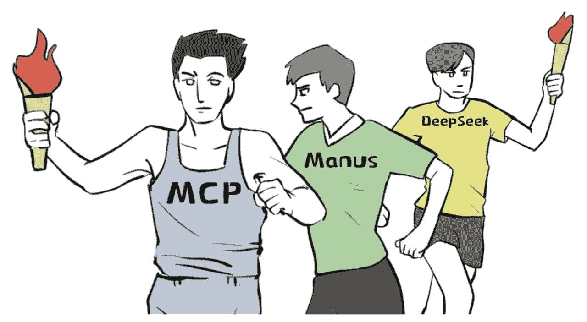
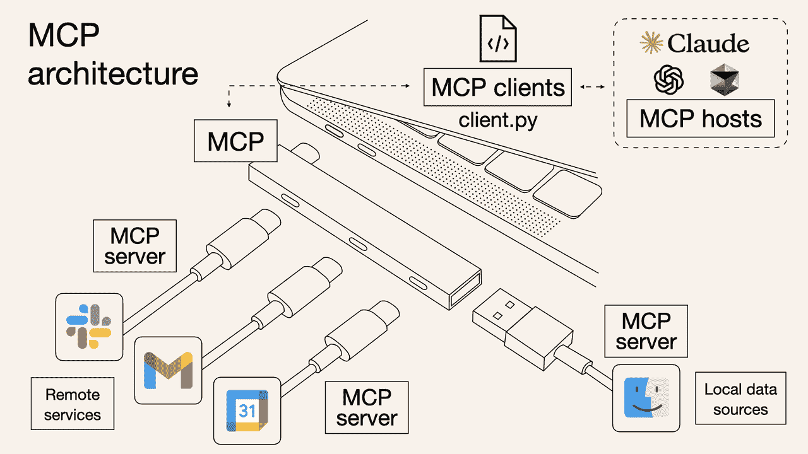

# 跟同济子豪兄一起学MCP

> 来源：[https://datawhaler.feishu.cn/docx/OjBUdp0UioaNLmxhmNhc695InGh](https://datawhaler.feishu.cn/docx/OjBUdp0UioaNLmxhmNhc695InGh)

> 同济子豪兄良心整理的MCP大模型协议知识库，包含基本原理、商业和学术机会，保姆级配置及使用教程，几个有趣案例

> https://zihao-ai.feishu.cn/wiki/space/7490516072630616068

本页是封面页，请点击左上角展开目录，依次学习~

MCP：大模型接入万物的通用协议，智能体时代的HTTP！

所有智能体都值得用MCP重新做一遍！

**但，当你不看教程be like**

