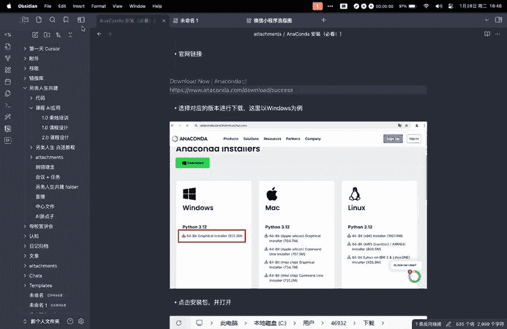
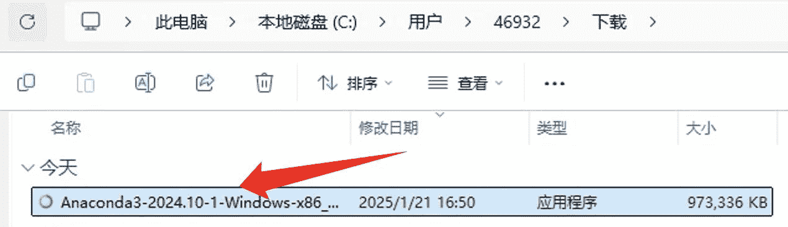
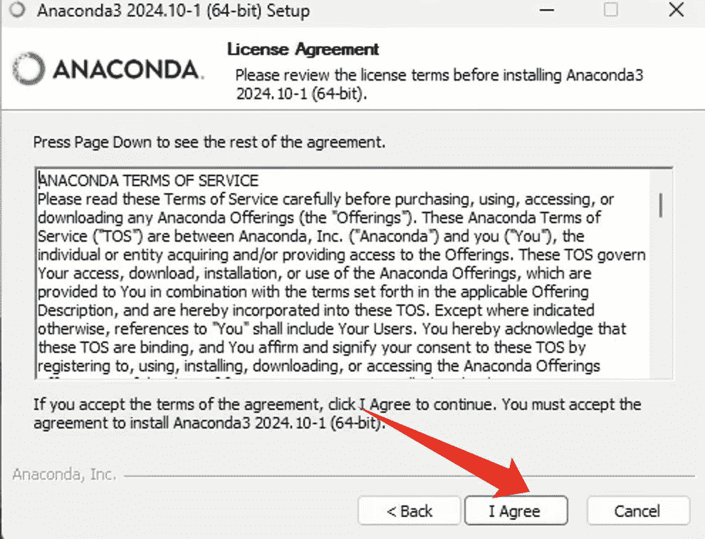
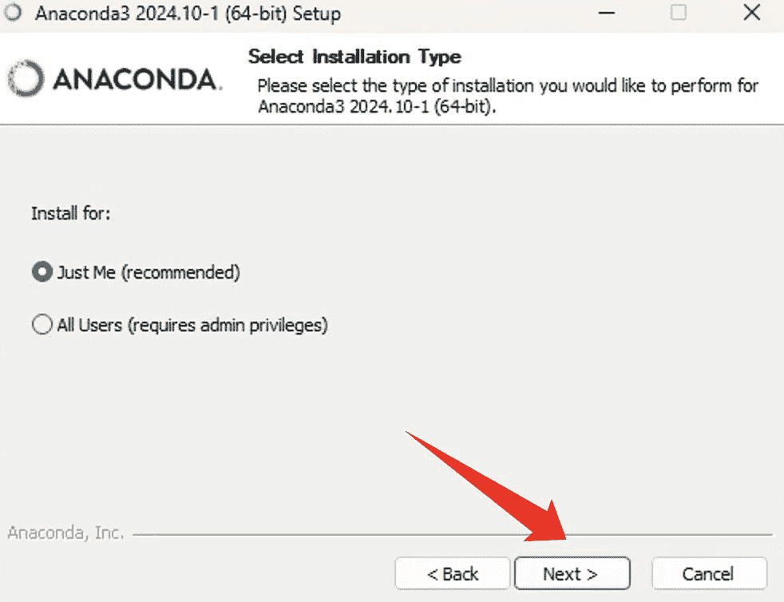
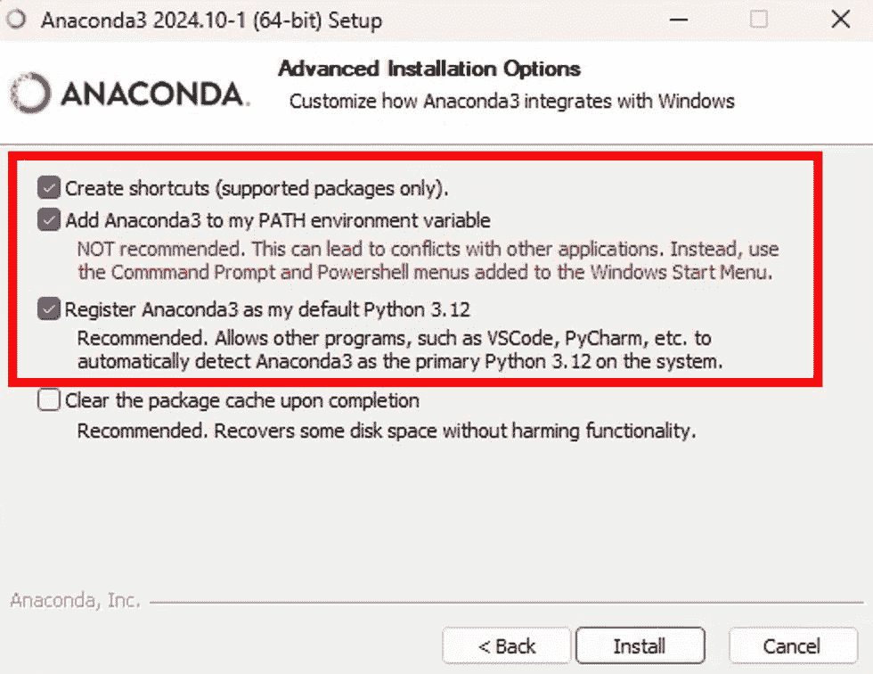
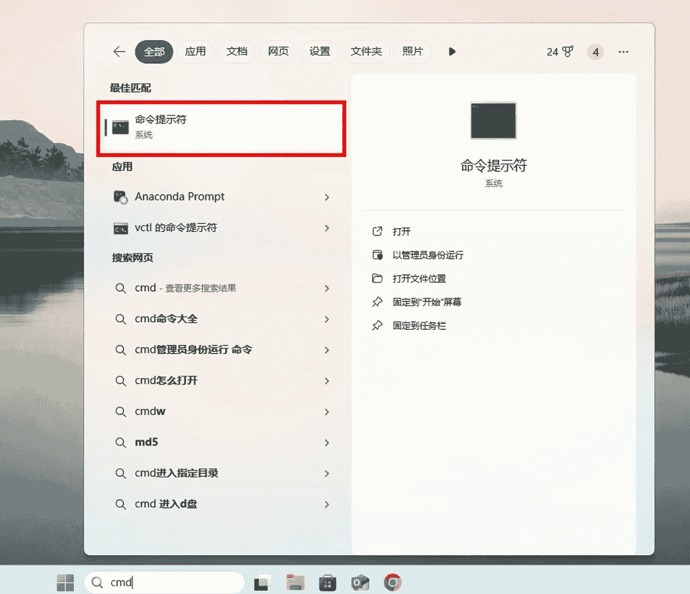
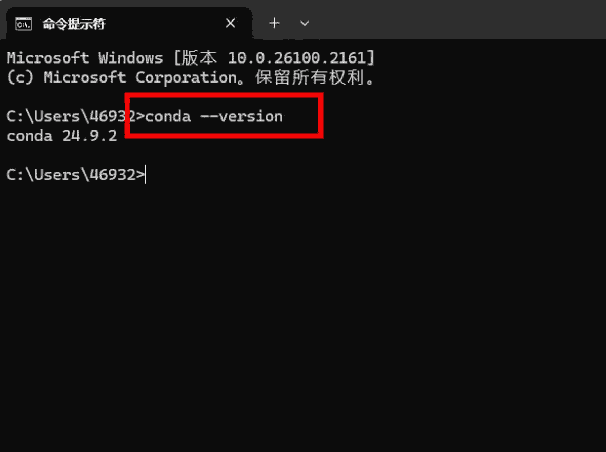
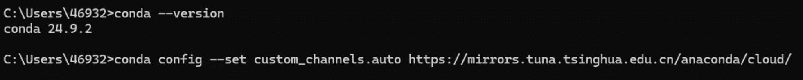

# Conda & Cursor安装视频

> 来源：[https://datawhaler.feishu.cn/docx/JUOPdGifRoYD4uxIgqMcbn2knYe](https://datawhaler.feishu.cn/docx/JUOPdGifRoYD4uxIgqMcbn2knYe)

# Conda & Cursor安装视频教程

[Screen-2025-01-28-191236.mp4](https://internal-api-drive-stream.feishu.cn/space/api/box/stream/download/all/C9hjbEJ5doEWJax6uy5cL57ynzd)

# Conda安装图文教程

+   Conda是一个包环境管理器，可以用于在同一个机器上安装不同版本的软件包及其依赖，并能够在不同的环境之间切换

+   官网链接

Download Now | Anaconda

+   选择对应的版本进行下载，这里以Windows为例

+   点击安装包，并打开

+   选择I agree

+   选择Just Me，然后Next

+   安装路径，直接默认不动就行，直接Next

这部分是重点，**前三个记得打钩**，然后选择Install，不然后续还得额外添加路径

这部分是重点，**前三个记得打钩**，然后选择Install，不然后续还得额外添加路径

这部分是重点，**前三个记得打钩**，然后选择Install，不然后续还得额外添加路径

+   取消勾选，然后Finish

+   此时conda就安装完毕了，在搜索框中输入cmd，打开命令提示符

+   输入conda --version，出现conda版本即安装完成

+   为后续安装方便需要配置清华源，在命令提示符输入以下内容（代码块右上角有一键复制按钮）

Plain Text conda config --set custom_channels.auto http://mirrors.tuna.tsinghua.edu.cn/anaconda/cloud/

---

> 本文作者：

<https://datawhaler.feishu.cn/sync/LfRzdAExlsoykRbUZymc0Jrfngh>

# 欢迎投稿参与共建、下次微学习就学你的内容！

<https://datawhaler.feishu.cn/sync/CPNrdTvwgshasbb2UjecLzVinPe>