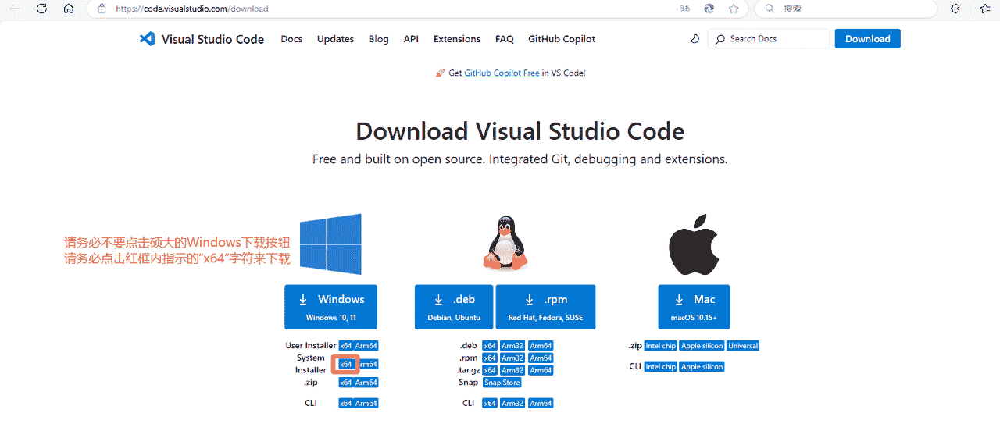
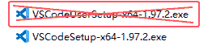
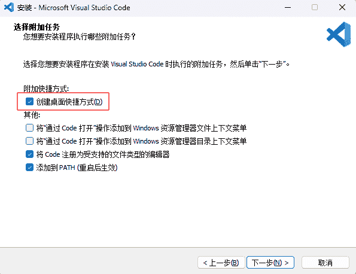
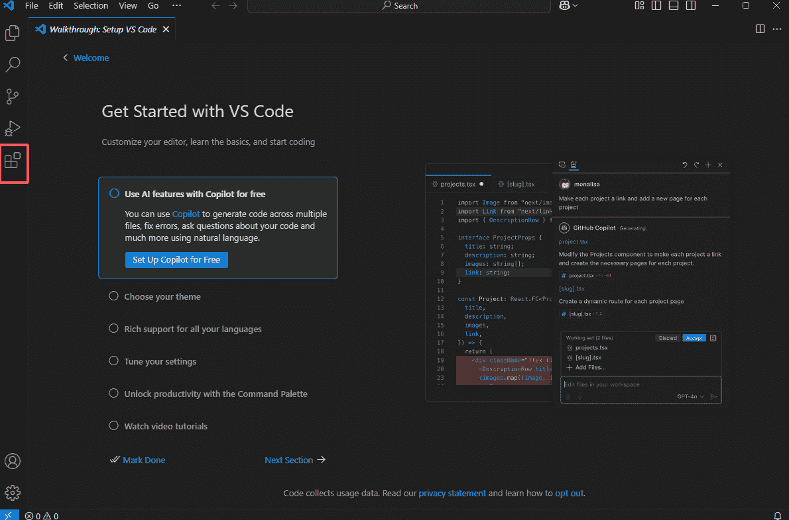
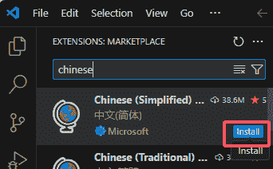
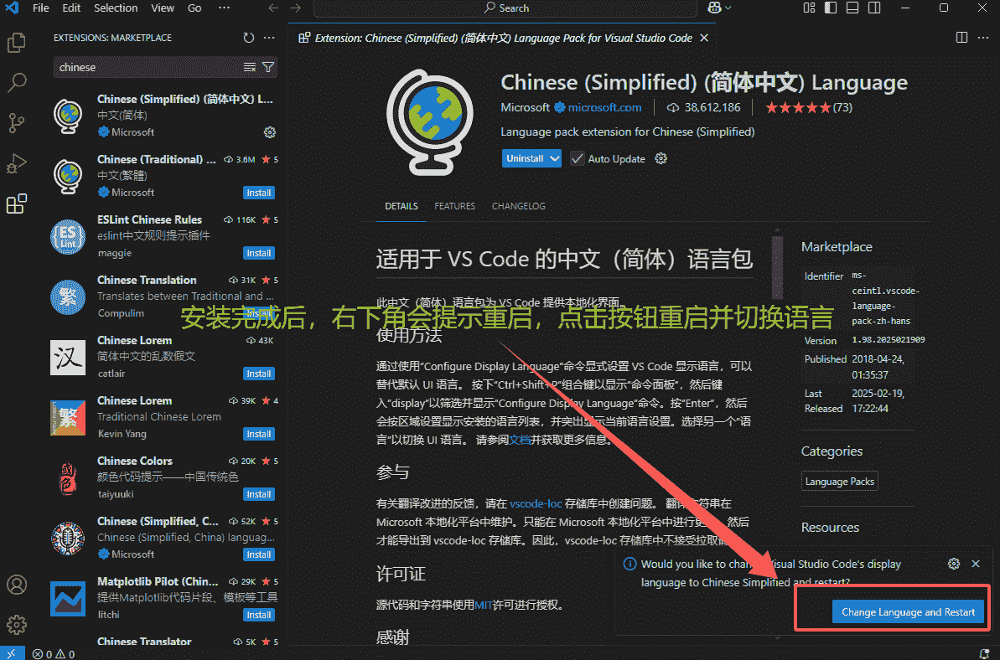

# 选看：VS Code安装教程

> 来源：[https://datawhaler.feishu.cn/docx/SFQ8dBiwNoKsBMx8NvQciCVOn5e](https://datawhaler.feishu.cn/docx/SFQ8dBiwNoKsBMx8NvQciCVOn5e)

首**先明确：Vis**ual Studio Code（一般称作VS Code） 和 Visual Studio 是两个完全不同的东西，只是图标长得像而已。

**前者是一个****可以通过安装**插件来实现跑起来各类程序项目代码的文本编辑器，而后者是转为Windows平台上的开发而打造的集成开发环境。

只是图标长得像而已，因为它们都是微软开发的。

可以在VSCode官网下载软件：

原因是默认下载按钮会下载一个用户权限的VSCode，有些功能会受限，而我们希望下载的是拥有管理员权限的VSCode。

如果下载很慢，也可以使用直接下载下方安装包：

[VSCodeSetup-x64-1.98.2.exe](https://internal-api-drive-stream.feishu.cn/space/api/box/stream/download/all/NKu8bbaUXoKzH7xHBG2crZywnAg)

下载好后，安装包名字应带有：**VSCodeSetup**，而非错误的：**VSCodeUserSetup**

双击安装时，除了下方界面建议勾选一下在桌面建立快捷方式，其它都默认即可：

安装完成后，如果你看到了下方界面，恭喜你安装成功！

这时，完全不必理会现在显示的这个欢迎界面，直接x掉都可以。现在我们的当务之急是：语言切到中文！

点击上图中画红圈的位置，那里是插件市场。在其中搜索chinese关键字，并下载安装中文语言包！

重启之后，满目中字，熟悉感立刻就回来了是不是？（英语基础好/计算机基础好的同学可以保留意见）

到现在，VSCode的安装流程就结束了。

如果你还想装其他插件，可以自己探索一下

但是初学者建议不要跟着VSCode的新手引导界面走，有些东西是坑，建议直接x掉就好