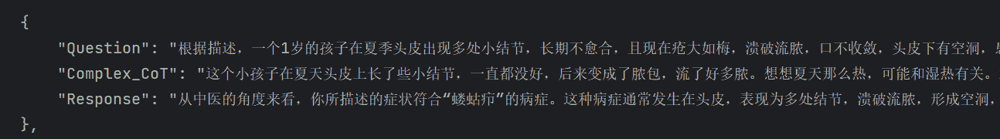
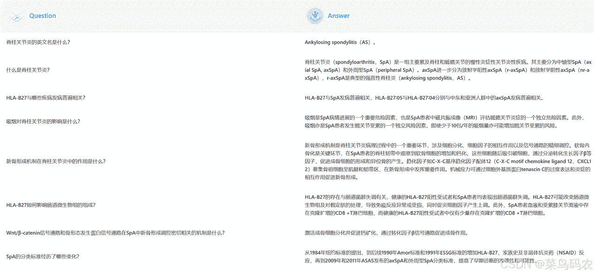
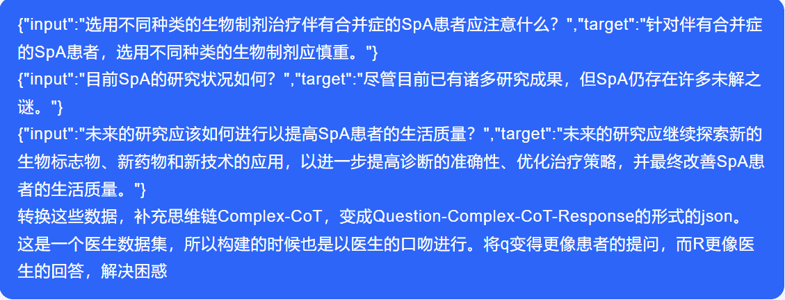
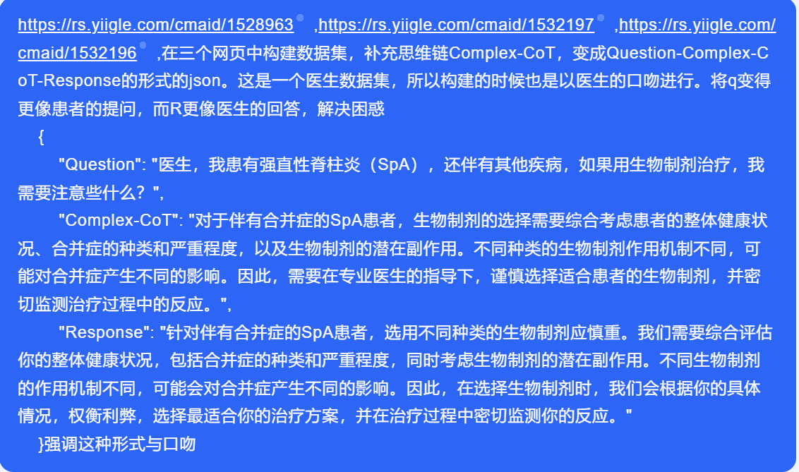

# 数据集构建系列一：微调篇

> 来源：[https://datawhaler.feishu.cn/docx/GVKRdI2Fgo7FhJxEkDuc96pUnlg](https://datawhaler.feishu.cn/docx/GVKRdI2Fgo7FhJxEkDuc96pUnlg)

前篇：[零基础入门：低显存玩转DeepSeek-R1蒸馏模型Lora微调](https://rcnv3xvuzwi1.feishu.cn/wiki/IifdwX7pmi4AEPk0nSXckmd5nCb?from=from_copylink)

[数据集构建系列一：微调篇](https://rcnv3xvuzwi1.feishu.cn/wiki/W8GhwaQFHiMvFXk0kC8ca0TCnEg?from=from_copylink)

[数据集构建系列二：RAG向量知识库篇](https://rcnv3xvuzwi1.feishu.cn/wiki/J3j7wxlU7izURdkMugBcZsT7nDc?from=from_copylink)

[数据集构建系列三：数据增强篇](https://rcnv3xvuzwi1.feishu.cn/wiki/OdYZwCSksiTrcTk1yjwcQZblnDd?from=from_copylink)

## 一、开源数据网站下载

Kaggle: https://www.kaggle.com/

ModelScope: https://modelscope.cn/datasets

hugging face：https://huggingface.co

百度飞桨：https://aistudio.baidu.com/datasetoverview

## 二、构建数据集（大致步骤说明）

### 1. 明确目标

+ 定义问题：确定你要解决的问题或任务。（比如，你需要构建医疗领域的数据集，那么你应该搜索相关医疗的资料~有的时候问题不是很明确，这个时候就需要实际探究本质上你需要什么。）

+ 确定数据类型：明确需要的数据类型（文本、图像、音频等）。

（ps:强调！！！以及非常需要关注构建的数据集是否符合你要后训练模型的数据格式~）

### 2. 数据收集（这一步就是收集所有你能收集到的相关的数据）

+ 内部数据：从现有数据库、日志等获取数据。【如果有条件】

+ 外部数据：通过公开数据集、相关网站配合ai抽取等方式获取。

+ 数据生成：如有必要，可通过模拟或合成数据。【非必须】

### 3. 数据标注

+ 手动标注：人工标注数据。

+ 自动标注：使用工具或预训练模型进行标注。

### 4. 数据清洗

+ 处理缺失值：填充或删除缺失数据。

+ 去重：删除重复数据。

+ 格式统一：确保数据格式一致。

+ 异常值处理：识别并处理异常值。

> 大批量数据处理步骤

> 第一步：依托传统大数据平台（如 Hive、HBase、Flink、MySQL 等），对数据进行初步清洗，剔除明显错误或异常的数据。

> 第二步：借助人工智能技术，对数据中的错别字、语法错误、逻辑问题等进行智能修复，并结合标准数据集进行校准，提升数据质量与准确性。

> 第三步：开展人工终审，通过随机抽查的方式，对经过前两级处理的数据进行最终审核，确保数据的完整性和可靠性。

### 5. 数据增强【非必须，具体看情况调节】

+ 图像：旋转、裁剪等。

#### （1）旋转

**细节**：旋转角度通常在一定范围内随机选择，如±30°或±45°，以模拟不同视角的图像。

**操作步骤**：使用图像处理库（如OpenCV或Albumentations）对图像进行旋转操作。如果图像有标注框（如目标检测任务），标注框也需要同步旋转。

```
import albumentations as A
transform = A.RandomRotate90(p=0.5)  # 随机旋转90度
augmented_image = transform(image=image)[&#x27;image&#x27;]
```

#### （2）裁剪

**细节**：随机裁剪图像的一部分，裁剪区域可以是固定大小或随机大小。裁剪时需要注意保留关键信息。

**操作步骤**：使用随机裁剪函数，如Albumentations的`RandomCrop`。

```
transform = A.RandomCrop(width=400, height=400, p=0.3)
augmented_image = transform(image=image)[&#x27;image&#x27;]
```

#### （3）其他增强

**亮度调整**：通过调整图像的亮度来模拟不同光照条件。

**噪声添加**：向图像添加随机噪声，增强模型的鲁棒性。

```
transform = A.Compose([
    A.RandomBrightnessContrast(p=0.3),
    A.GaussianBlur(blur_limit=3, p=0.2)
])
augmented_image = transform(image=image)[&#x27;image&#x27;]
```

+ 文本：同义词替换、回译等。（即增加噪声数据）

#### （1）同义词替换

**细节**：在句子中随机选择一些词语，用它们的同义词替换。注意替换后的句子语义应保持一致。

**操作步骤**：使用词典或词嵌入模型（如`Word2Vec`）找到同义词并替换

#### （2）回译（就是英翻中，中翻英，意......无限套娃中ing）

**细节**：将文本翻译成一种语言，再翻译回原语言，可能会引入一些语义变化。

**操作步骤**：使用机器翻译API（如Google Translate）进行翻译。

+ 音频：变速、加噪声等。

#### （1）变速

**细节**：调整音频的播放速度，但保持音调不变。

**操作步骤**：使用音频处理库（如`librosa`）对音频进行变速处理。

#### （2）加噪声

**细节**：向音频中添加背景噪声，增强模型对噪声的鲁棒性。

**操作步骤**：从噪声库中选择噪声并叠加到音频上。

#### 为什么添加噪声？（补充内容）

在数据集中添加噪声的主要目的是增强模型的鲁棒性。具体原因包括：

1. 模拟真实场景：真实世界中的图像通常包含噪声（如传感器噪声、压缩噪声等）。通过在训练数据中添加噪声，模型能够更好地适应实际应用中的噪声环境。

1. 防止过拟合：噪声可以作为一种正则化手段，防止模型过度依赖训练数据中的特定特征，从而提高泛化能力。

1. 数据增强：噪声添加是数据增强的一种方式，能够增加数据的多样性，帮助模型学习更广泛的特征。

#### 判断是否需要增加噪声

##### 不需要添加噪声数据集的情况

+ 数据质量高且任务明确：如果原始数据集已经足够丰富、多样且高质量，能够很好地覆盖模型需要学习的模式和特征，那么通常不需要额外添加噪声数据。

+ 模型过拟合风险低：当数据集规模较大、数据分布均匀且模型架构相对简单时，模型过拟合的风险较低，此时也不需要通过添加噪声数据来增强模型的泛化能力。

##### 需要添加噪声数据集的情况

+ 过拟合问题严重：当模型在训练集上表现优异，但在验证集或测试集上表现显著下降时，说明模型可能过拟合了训练数据中的噪声和特定模式。此时可以通过添加噪声数据来增强模型的鲁棒性。

+ 特定任务需求：在一些特定的任务中，如图像生成或语音识别，添加噪声数据可以帮助模型学习到更复杂的模式和特征，从而提升模型在实际应用中的表现。

#### 数据集构建中的注意事项

1. 平衡噪声与原始数据：

+ 在数据集中，噪声图像应与原始图像保持一定的比例，避免噪声数据过多导致模型过度依赖噪声特征。

1. 多样性：

+ 在添加噪声时，确保噪声类型和强度的多样性，以覆盖更多的实际场景。

1. 验证集和测试集：

+ 在验证集和测试集中也应包含适量的噪声数据，以评估模型在噪声环境下的表现。

1. 数据增强的组合：

+ 噪声添加可以与其他数据增强技术（如旋转、缩放、翻转等）结合使用，进一步提升模型的鲁棒性。

### 6. 数据划分

+ 训练集：用于模型训练。

+ 验证集：用于调参和模型选择。

+ 测试集：用于最终评估。

## 三、具体示例（以DeepSeek-R1蒸馏模型为微调模型，构建的医学数据集为例）

### 1. 明确目标——医生文本类数据集构建

1. 我需要让微调后的模型可以更擅长完成提供诊疗建议，为了增强可行度，它的口吻最好要更像是一位医生

1. 确定我要收集的数据类型是文本类，所以我应该搜集更多与医疗相关的文本，最后能找到直接就是模拟医生的文本，在此基础上进行扩展加强！

1. DeepSeek-R1蒸馏模型所需要的数据格式是：`Question-Complex-CoT-Response`。所以之后，在构建数据集的过程中我得注意到，一定要构建`Complex-CoT`。

### 2. 数据收集

1. 判断医学领域应该会有很多之前已经构建过的数据集，所以我先去开源网站modelscope进行寻找~



2. 通过优质的开源数据集确认规范，尽可能在后续的构建过程中，倾向于构建类似优质开源数据集的方向。

3. 各大公开网站的医学资料收集~此处，笔者收集的是中华医学期刊网等等网站上公开的论文与指南【保存链接或者是下载】

### 3. 数据标注

1. （1）利用一些数据标注辅助平台，帮助构建数据集。将抽取的文件，放入平台进行构建基础QA问答对。



（2）将构建的问答对放入大模型AI，让它帮忙补全`Complex_CoT`的部分。[问答对也可以是自己简单想的一些问答，根据自己的需求，通过提示词让大模型AI达到我们想要的效果。]



```
[
    {
        &quot;Question&quot;: &quot;医生，我患有强直性脊柱炎（SpA），还伴有其他疾病，如果用生物制剂治疗，我需要注意些什么？&quot;,
        &quot;Complex-CoT&quot;: &quot;对于伴有合并症的SpA患者，生物制剂的选择需要综合考虑患者的整体健康状况、合并症的种类和严重程度，以及生物制剂的潜在副作用。不同种类的生物制剂作用机制不同，可能对合并症产生不同的影响。因此，需要在专业医生的指导下，谨慎选择适合患者的生物制剂，并密切监测治疗过程中的反应。&quot;,
        &quot;Response&quot;: &quot;针对伴有合并症的SpA患者，选用不同种类的生物制剂应慎重。我们需要综合评估你的整体健康状况，包括合并症的种类和严重程度，同时考虑生物制剂的潜在副作用。不同生物制剂的作用机制不同，可能会对合并症产生不同的影响。因此，在选择生物制剂时，我们会根据你的具体情况，权衡利弊，选择最适合你的治疗方案，并在治疗过程中密切监测你的反应。&quot;
    },
    {
        &quot;Question&quot;: &quot;医生，目前对于强直性脊柱炎（SpA）的研究进展如何？&quot;,
        &quot;Complex-CoT&quot;: &quot;尽管目前在强直性脊柱炎（SpA）的研究中已经取得了一些成果，例如对疾病机制的初步了解、新的诊断方法和治疗方法的探索等，但仍然存在许多未解之谜。例如，SpA的发病机制尚未完全明确，部分患者对现有治疗的反应不佳，且疾病的长期预后仍需进一步研究。因此，SpA的研究仍在不断深入中。&quot;,
        &quot;Response&quot;: &quot;尽管目前已有诸多研究成果，但SpA仍存在许多未解之谜。虽然我们在疾病机制、诊断方法和治疗手段上取得了一些进展，但仍然有许多问题需要进一步研究。例如，SpA的发病机制尚未完全明确，部分患者对现有治疗的反应不佳，且疾病的长期预后仍需深入探索。所以，SpA的研究仍在不断进行中，以期为患者提供更好的帮助。&quot;
    },
    {
        &quot;Question&quot;: &quot;医生，未来的研究应该如何开展，才能更好地提高强直性脊柱炎（SpA）患者的生活质量呢？&quot;,
        &quot;Complex-CoT&quot;: &quot;未来的研究应该从多个方面入手，以提高SpA患者的生活质量。首先，探索新的生物标志物可以帮助我们更早、更准确地诊断疾病，实现个体化治疗。其次，开发新的药物和治疗方法可以为患者提供更多的选择，提高治疗效果。此外，新技术的应用可以优化治疗策略，减少治疗的副作用。通过这些综合措施，我们有望进一步改善SpA患者的生活质量。&quot;,
        &quot;Response&quot;: &quot;未来的研究应继续探索新的生物标志物、新药物和新技术的应用，以进一步提高诊断的准确性、优化治疗策略，并最终改善SpA患者的生活质量。我们会从多个方面入手，包括寻找更准确的生物标志物来实现早期诊断和个体化治疗，开发更有效的药物和治疗方法，以及利用新技术优化治疗方案，减少副作用。通过这些努力，我们希望能够为SpA患者带来更好的生活质量。&quot;
    }
]
```

2. 同时也可以利用收集的链接，放入大模型AI让它构建数据集。



```
[
    {
        &quot;Question&quot;: &quot;医生，我是女性，最近感觉心脏不太舒服，有点胸闷，这是心脏病发作的迹象吗？&quot;,
        &quot;Complex-CoT&quot;: &quot;女性心脏病发作的症状可能与男性不同，往往更不典型。除了胸闷，还可能伴有其他症状如呼吸急促、恶心、出汗等。在临床实践中，对于女性患者出现心脏相关症状，需要综合考虑多种因素，包括病史、体征以及辅助检查结果，以准确判断是否为心脏病发作，并及时采取相应的治疗措施。&quot;,
        &quot;Response&quot;: &quot;女性心脏病发作的症状可能不太典型，除了胸闷，还可能有呼吸急促、恶心、出汗等。我们需要综合你的病史、体征以及辅助检查结果来判断是否为心脏病发作。如果有这些症状，建议尽快就医，我们会根据具体情况采取相应的治疗措施。&quot;
    },
    {
        &quot;Question&quot;: &quot;医生，我有哮喘，最近咳嗽得很厉害，是不是病情加重了？&quot;,
        &quot;Complex-CoT&quot;: &quot;咳嗽是哮喘的常见症状之一，但咳嗽的严重程度并不一定直接反映哮喘的整体控制情况。在临床实践中，哮喘的评估需要综合考虑多个方面，包括症状频率、急性发作次数、肺功能检查结果等。对于咳嗽症状明显的患者，需要进一步评估是否存在其他诱因或合并症，并根据具体情况调整治疗方案。&quot;,
        &quot;Response&quot;: &quot;哮喘患者咳嗽加重不一定意味着病情加重。我们需要综合评估你的症状频率、急性发作次数以及肺功能检查结果等。如果咳嗽很厉害，建议进一步检查，看看是否存在其他诱因或合并症，我们会根据具体情况调整治疗方案。&quot;
    },
    {
        &quot;Question&quot;: &quot;医生，我已经被诊断为哮喘，但感觉病情控制得不太好，我需要做哪些检查来全面评估我的病情呢？&quot;,
        &quot;Complex-CoT&quot;: &quot;全面评估哮喘病情对于制定有效的治疗方案至关重要。通常需要进行肺功能检查，包括支气管激发试验和支气管舒张试验，以评估气道反应性和可逆性。此外，还需要评估患者的症状控制情况、急性发作频率、生活质量以及是否存在合并症等。通过这些综合评估，可以更准确地判断哮喘的控制水平，并调整治疗方案。&quot;,
        &quot;Response&quot;: &quot;为了全面评估你的哮喘病情，我们需要进行一些检查，比如肺功能检查，包括支气管激发试验和支气管舒张试验，来评估气道反应性和可逆性。同时，我们还会评估你的症状控制情况、急性发作频率、生活质量以及是否存在合并症等。这些综合评估有助于我们更准确地判断病情，调整治疗方案。&quot;
    }
]
```

> 此处数据集构建的时候也需要考虑到所构建的模型是哪家的~比如，通义千问系列的模型更适合找通义千文帮忙构建数据集，会更有利于模型微调训练哦~

### 4. 数据清洗

其实主要是数据格式确认，确保数据格式一致。在这次构建过程中，整体构建数据质量较高。


```
import json


def validate_json_format(json_file_path):
    """
    验证JSON文件是否符合指定格式。

    参数:
        json_file_path (str): JSON文件的路径。

    返回:
        bool: 如果符合格式返回True，否则返回False。
    """
    try:
        # 打开并加载JSON文件
        with open(json_file_path, 'r', encoding='utf-8') as file:
            data = json.load(file)

        # 验证数据是否为列表
        if not isinstance(data, list):
            print("JSON数据必须是一个列表。")
            return False

        # 验证每个条目
        for item in data:
            # 检查是否包含所有必需字段
            required_fields = ["Question", "Complex-CoT", "Response"]
            if not all(field in item for field in required_fields):
                print(f"缺少字段：{required_fields}")
                return False

            # 检查字段值是否为字符串
            for field in required_fields:
                if not isinstance(item[field], str):
                    print(f"字段'{field}'的值必须是字符串。")
                    return False

        print("JSON格式验证通过！")
        return True

    except json.JSONDecodeError:
        print("JSON文件格式错误。")
        return False
    except FileNotFoundError:
        print(f"文件未找到：{json_file_path}")
        return False
    except Exception as e:
        print(f"发生错误：{e}")
        return False


if __name__ == "__main__":
    # 替换为你的JSON文件路径
    json_file_path = "test.json"
    validate_json_format(json_file_path)
```

用于判断是否是`["Question", "Complex-CoT", "Response"]`的形式的json文件~

## 补充.测试数据集

在寻找优质数据集时，建议先抽取约1000条数据进行初步测试微调，以评估其效果是否符合需求。如果微调后的结果令人满意，再考虑将该数据集作为构建标准数据集的参考依据。

在后续构建自己的额外数据集时，应遵循循序渐进的原则。先构建少量数据并进行微调测试，观察效果。只有在确认效果达到预期后，才继续扩充数据集规模。

最后，将所有收集到的数据集整合在一起。在进行混合微调之前，先用其中的一部分数据进行测试微调。如果效果良好，则可以继续进行微调；若发现问题，则需要缩小数据集范围，仔细筛选可信数据，尽量避免脏数据对微调过程造成不良影响。

# 四、完结感言

非常感谢Deepseek官网满血版以及kimi在本章的代码修改、资料收集以及文章润色方面提供的宝贵帮助！

这是本系列的第一篇，中间还有很多需要完善的地方，我们非常期待各位小伙伴的宝贵建议和指正，让我们共同进步，一起在AI学习的道路上探索更多乐趣！
