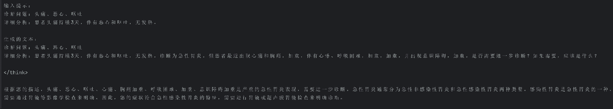
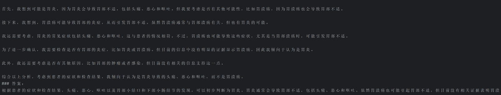
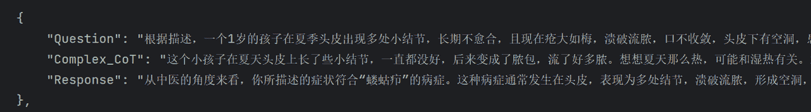
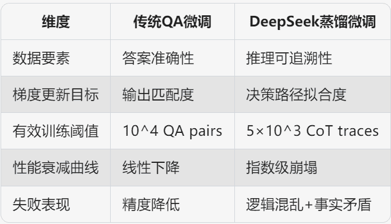

# 零基础入门：低显存玩转DeepSeek-R1蒸馏模型Lora微调

> 来源：[https://datawhaler.feishu.cn/docx/I5z3de5r5ouWHCxDhVRcpwobnZf](https://datawhaler.feishu.cn/docx/I5z3de5r5ouWHCxDhVRcpwobnZf)

开门见山，直接给大家展示微调前后的效果。

**   微调前：**



**  微调后：**



在此处可以看到很明显大模型进行微调后口吻已经发生了更改。据笔者使用下来的记录表示，微调后的大模型思考时间更加短暂。

接下来，让我们一起逐步完成微调实践，共同优化模型性能！

# **一、什么是大模型微调？**

微调就像给一个**“学霸”**补课，让它从**“通才”**变成某个领域的**“专家”**。

**  此**处以本文进行微调的医学**数据进行举**例**：

**  假设你有一个很聪明的朋友，他读过全世界的书（相当于大模型的预训练阶段），能和你聊历史、科学、文学等各种话题。

但如果你需要他帮你看医学报告，虽然他懂一些基础知识，但可能不够专业。这时候，你给他一堆医学书籍和病例，让他专门学习这方面的知识（这就是微调），他就会变得更擅长医疗领域的问题。

### 📖 故**事解释：**

想象你有一个会画小猫的机器人🤖（这就是预训练模型）。现在你想让它学会画戴帽子的小猫🎩🐱。不需要从头教它画画，只需要给它看很多"戴帽子小猫"的图片，然后说："保持原来的画画能力，但要学会加帽子哦！" 这就是微调！

### 📖 生**活案例解释：**

**案例1：智能音箱调方言**

+   基础版音箱只会普通话（预训练模型）

+   给它听100句四川话（微调数据）

+   现在能听懂"摆龙门阵"（方言理解能力↑）

**案例2：相机滤镜原理**

+   原始相机拍所有场景（通用模型）

+   加载"美食滤镜"参数（微调后的模型）

+   拍食物时自动增强饱和度（专业能力强化）

### 加强版**解释：乐高城堡改造成儿童医院**

#### 第一步：原有结构 —— 通用乐高城堡

[通**用城**堡]**

▸ 比**喻：就像网购的"标准款城堡积木套装"，有城墙、塔楼、尖顶，能当普通房子用。

▸ 对应技术：预训练模型（比如ChatGPT），已经学会通用语言能力，但不够专业。

---

#### 第二步：局部改造 —— 低成本改装

**① 拆尖顶 → 改圆顶**

[**尖顶**改圆**顶]

▸** 操作：把塔顶的尖积木换成圆积木，更温和可爱。

▸ 技术含义：微调模型顶层参数（比如修改分类头），让输出风格更适合儿童对话。

**② 加装旋转门**

[**旋转**门]**

▸ 操**作：在门口插入一个可旋转的积木模块，不破坏原有门结构。

▸ 技术含义：插入适配器模块（Adapter），让模型新增儿科医学术语理解能力，且不干扰原有知识。

**③ 涂装医院标志**

[**医院**标志**]

▸ **操作：在城堡外墙贴上"十字符号"和卡通动物贴纸。

▸ 技术含义：特征空间偏移（Feature Shift），调整模型内部表示，让它更关注医疗相关词汇和童趣表达。

---

#### 第三步：新功能 —— 变身儿童医院

[儿**童医**院]**

▸ 成**果：改装后的城堡能接待小患者，有玩具区、温和的医生（圆顶），还有专用医疗设备（旋转门）。

▸ 技术含义：通过轻量改造，通用模型变成"儿科医疗问答机器人"，专精儿童健康咨询。

# **二、当前尝试过的硬件配置**

显卡：NVIDIA GeForce RTX 4060

cpu：Intel Core i7-13700H

内存： 16G(因为家庭电脑所以日常状态是8.8/15.7GB)

# **三、微调工作**

## （1）数据集准备

本文数据集来源，魔搭社区的medical-o1-reasoning-SFT。

本文主要说明，数据集格式是：



在DeepSeek的蒸馏模型微调过程中，数据集中引入Complex_CoT（复杂思维链）是关键设计差异。若仅使用基础问答对进行训练，模型将难以充分习得深度推理能力，导致最终性能显著低于预期水平。这一特性与常规大模型微调的数据要求存在本质区别。



## （2）模型微调代码（此处是无框架纯手搓）——直接上了，后面会有细节讲解

```
需要引入的库：
pip install torch transformers peft datasets matplotlib accelerate safetensors
```

```
import torch
import matplotlib.pyplot as plt
from transformers import (
    AutoTokenizer,
    AutoModelForCausalLM,
    TrainingArguments,
    Trainer,
    TrainerCallback
)
from peft import LoraConfig, get_peft_model
from datasets import load_dataset
import os

# 配置路径（根据实际路径修改）
model_path = r&quot;D:\AItest\pythonProject4\deepseek-ai\DeepSeek-R1-Distill-Qwen-1___5B&quot;  # 模型路径
data_path = r&quot;D:\AItest\pythonProject4\medical_o1_sft_Chinese.json&quot;  # 数据集路径
output_path = r&quot;D:\AItest\pythonProject4\model-first&quot;  # 微调后模型保存路径

# 强制使用GPU
assert torch.cuda.is_available(), &quot;必须使用GPU进行训练！&quot;
device = torch.device(&quot;cuda&quot;)

# 自定义回调记录Loss
class LossCallback(TrainerCallback):
    def __init__(self):
        self.losses = []

    def on_log(self, args, state, control, logs=None, **kwargs):
        if &quot;loss&quot; in logs:
            self.losses.append(logs[&quot;loss&quot;])

# 数据预处理函数
def process_data(tokenizer):
    dataset = load_dataset(&quot;json&quot;, data_files=data_path, split=&quot;train[:1500]&quot;)

    def format_example(example):
        # 构建指令部分（模型输入）
        instruction = f&quot;诊断问题：{example[&#x27;Question&#x27;]}\n### 详细分析及答案：&quot;

        # 构建目标部分（模型需要生成的内容）
        target = f&quot;\n{example[&#x27;Complex_CoT&#x27;]}\n### 答案：{example[&#x27;Response&#x27;]}&lt;|endoftext|&gt;&quot;

        # 完整文本拼接
        full_text = instruction + target

        # 分词处理
        inputs = tokenizer(
            full_text,
            padding=&quot;max_length&quot;,
            truncation=True,
            max_length=512,
            return_tensors=&quot;pt&quot;
        )

        # 计算指令部分的token长度（不包含特殊token）
        instruction_encoded = tokenizer(
            instruction,
            add_special_tokens=False  # 禁用特殊token添加
        )[&quot;input_ids&quot;]
        instruction_length = len(instruction_encoded)

        # 创建labels（仅目标部分参与loss计算）
        labels = inputs[&quot;input_ids&quot;].clone().squeeze(0)
        # 将指令部分设为-100（忽略loss计算）
        labels[:instruction_length] = -100

        return {
            &quot;input_ids&quot;: inputs[&quot;input_ids&quot;].squeeze(0),
            &quot;attention_mask&quot;: inputs[&quot;attention_mask&quot;].squeeze(0),
            &quot;labels&quot;: labels
        }

    return dataset.map(format_example, remove_columns=dataset.column_names)

# LoRA配置
peft_config = LoraConfig(
    r=16,
    lora_alpha=32,
    target_modules=[&quot;q_proj&quot;, &quot;v_proj&quot;],
    lora_dropout=0.05,
    bias=&quot;none&quot;,
    task_type=&quot;CAUSAL_LM&quot;
)

# 训练参数配置
training_args = TrainingArguments(
    output_dir=output_path,
    per_device_train_batch_size=2,  # 显存优化设置
    gradient_accumulation_steps=4,  # 累计梯度相当于batch_size=8
    num_train_epochs=3,
    learning_rate=3e-4,
    fp16=True,  # 开启混合精度
    logging_steps=20,
    save_strategy=&quot;no&quot;,
    report_to=&quot;none&quot;,
    optim=&quot;adamw_torch&quot;,
    no_cuda=False,  # 强制使用CUDA
    dataloader_pin_memory=False,  # 加速数据加载
    remove_unused_columns=False  # 防止删除未使用的列
)

def main():
    # 创建输出目录
    os.makedirs(output_path, exist_ok=True)

    # 加载tokenizer
    tokenizer = AutoTokenizer.from_pretrained(model_path)
    tokenizer.pad_token = tokenizer.eos_token

    # 加载模型到GPU
    model = AutoModelForCausalLM.from_pretrained(
        model_path,
        torch_dtype=torch.float16,
        device_map={&quot;&quot;: device}  # 强制使用指定GPU
    )
    model = get_peft_model(model, peft_config)
    model.print_trainable_parameters()

    # 准备数据
    dataset = process_data(tokenizer)

    # 训练回调
    loss_callback = LossCallback()

    # 数据加载器
    def data_collator(data):
        batch = {
            &quot;input_ids&quot;: torch.stack([torch.tensor(d[&quot;input_ids&quot;]) for d in data]).to(device),
            &quot;attention_mask&quot;: torch.stack([torch.tensor(d[&quot;attention_mask&quot;]) for d in data]).to(device),
            &quot;labels&quot;: torch.stack([torch.tensor(d[&quot;input_ids&quot;]) for d in data]).to(device)  # 使用input_ids作为labels
        }
        return batch

    # 创建Trainer
    trainer = Trainer(
        model=model,
        args=training_args,
        train_dataset=dataset,
        data_collator=data_collator,
        callbacks=[loss_callback]
    )

    # 开始训练
    print(&quot;开始训练...&quot;)
    trainer.train()

    # 保存最终模型
    trainer.model.save_pretrained(output_path)
    print(f&quot;模型已保存至：{output_path}&quot;)

    # 绘制Loss曲线
    plt.figure(figsize=(10, 6))
    plt.plot(loss_callback.losses)
    plt.title(&quot;Training Loss Curve&quot;)
    plt.xlabel(&quot;Steps&quot;)
    plt.ylabel(&quot;Loss&quot;)
    plt.savefig(os.path.join(output_path, &quot;loss_curve.png&quot;))
    print(&quot;Loss曲线已保存&quot;)

if __name__ == &quot;__main__&quot;:
    main()
```

## （3）代码详细讲解

### 导入必要的库和模块

**功能总结**：导入项目依赖的第三方库，包括PyTorch基础库、HuggingFace工具库、可视化库等。

```
import torch
import matplotlib.pyplot as plt
from transformers import (  # HuggingFace Transformer模型工具
    AutoTokenizer,
    AutoModelForCausalLM,
    TrainingArguments,
    Trainer,
    TrainerCallback
)
from peft import LoraConfig, get_peft_model  # 参数高效微调库
from datasets import load_dataset  # 数据集加载工具
import os  # 系统路径操作
```

### **有关类库介绍：**

#### 1. torch **(PyTorch库的核心模块)**

+   **功能**：深度学习框架，提供张量计算和神经网络构建功能。

+   **代码中的作用**：

+   管理GPU设备 (torch.cuda.is_available() 检查GPU可用性)

+   定义模型训练时的张量操作

+   控制混合精度训练 (torch.float16)

---

#### 2. m**atplotlib.pyplo**t (Matplotlib绘图库)

+   **功能**：数据可视化工具库。

+   **代码中的作用**：

+   绘制训练损失曲线 (plt.plot(losses))

+   生成并保存训练过程的Loss变化图 (loss_curve.png)

---

#### 3. transformers (HuggingFace Transformers库)

+   **核心组件**：

+   AutoTokenizer：自动加载预训练模型对应的分词器

+   用于将文本转换为模型可理解的token ID序列

+   AutoModelForCausalLM：自动加载因果语言模型（如GPT系列）

+   提供基础的大语言模型结构

+   TrainingArguments：定义训练超参数

+   控制批次大小、学习率、日志频率等

+   Trainer：封装训练流程的类

+   自动处理训练循环、梯度下降、日志记录等

+   TrainerCallback：训练回调基类

+   用于实现自定义训练监控逻辑（如示例中的损失记录）

---

#### 4. peft (Parameter-Efficient Fine-Tuning)

+   **功能**：实现参数高效微调方法的库。

+   **核心组件**：

+   LoraConfig：LoRA（Low-Rank Adaptation）的配置类

+   定义秩(r)、目标模块(target_modules)等关键参数

+   get_peft_model：将基础模型转换为PEFT模型

+   仅需训练原模型约0.1%的参数即可实现有效微调

+   **代码中的作用**：

+   对LLaMA等大模型进行轻量化微调

+   显存占用量减少约60-70%，适合消费级GPU

---

#### 5. datasets (HuggingFace Datasets库)

+   **功能**：高效数据集加载与处理工具。

+   **核心方法**：

+   load_dataset：加载多种格式的数据

+   支持JSON/CSV/Parquet等格式（示例中使用JSON）

+   map：数据预处理流水线

+   应用自定义的格式化函数 (format_example)

+   **代码中的作用**：

+   从本地文件加载医疗问答数据集

+   将原始数据转换为模型需要的输入格式

---

#### 6. os **(操作系统接口)**

+   **功能**：提供操作系统相关功能。

+   **代码中的作用**：

+   创建输出目录 (os.makedirs)

+   处理文件路径相关操作

+   确保模型保存路径的有效性

### 配置路径和硬件检查

**功能总结**：配置模型/数据路径，**强制检查GPU可用性**

```
# 配置路径（根据实际路径修改）
model_path = r&quot;你的模型路径&quot;  # 预训练模型存放路径
data_path = r&quot;你的数据集路径&quot;  # 训练数据路径（JSON格式）
output_path = r&quot;你的保存微调后的模型路径&quot;  # 微调后模型保存位置

# 强制使用GPU（确保CUDA可用）
assert torch.cuda.is_available(), &quot;必须使用GPU进行训练！&quot;
device = torch.device(&quot;cuda&quot;)  # 指定使用CUDA设备
```

### 自定义训练回调类

**功能总结**：实现自定义回调，在模型训练过程中，实时记录损失值（Loss）的变化。损失值是用来衡量模型预测结果与真实结果之间的差距的，损失值越小，说明模型的表现越好。

```
class LossCallback(TrainerCallback):
    def __init__(self):
        self.losses = []  # 存储损失值的列表

    # 当训练过程中有日志输出时触发
    def on_log(self, args, state, control, logs=None, **kwargs):
        if &quot;loss&quot; in logs:  # 过滤并记录损失值
            self.losses.append(logs[&quot;loss&quot;])
```

### 数据预处理函数

**功能总结**：加载并格式化训练数据，将原始数据集转换为模型可以理解的格式。

```
def process_data(tokenizer):
    dataset = load_dataset(&quot;json&quot;, data_files=data_path, split=&quot;train[:1500]&quot;)

    def format_example(example):
        # 构建指令部分（模型输入）
        instruction = f&quot;诊断问题：{example[&#x27;Question&#x27;]}\n### 详细分析及答案：&quot;
        # 构建目标部分（模型需要生成的内容）
        target = f&quot;\n详细分析：{example[&#x27;Complex_CoT&#x27;]}\n### 答案：{example[&#x27;Response&#x27;]}&lt;|endoftext|&gt;&quot;
        # 完整文本拼接
        full_text = instruction + target
        # 分词处理
        inputs = tokenizer(
            full_text,
            padding=&quot;max_length&quot;,
            truncation=True,
            max_length=512,
            return_tensors=&quot;pt&quot;
        )

        # 计算指令部分的token长度（不包含特殊token）
        instruction_encoded = tokenizer(
            instruction,
            add_special_tokens=False  # 禁用特殊token添加
        )[&quot;input_ids&quot;]
        instruction_length = len(instruction_encoded)

        # 创建labels（仅目标部分参与loss计算）
        labels = inputs[&quot;input_ids&quot;].clone().squeeze(0)
        # 将指令部分设为-100（忽略loss计算）
        labels[:instruction_length] = -100

        return {
            &quot;input_ids&quot;: inputs[&quot;input_ids&quot;].squeeze(0),
            &quot;attention_mask&quot;: inputs[&quot;attention_mask&quot;].squeeze(0),
            &quot;labels&quot;: labels
        }

    return dataset.map(format_example, remove_columns=dataset.column_names)
```

### **关键代码**

#### 1.拼接指令和答案（这一部分是构建目标部分，即模型需要生成的部分）

+   **作用**：将答案（Response）和详细分析（Complex_CoT）拼接成一个指令。

+   **示例**：

+   输入：Question="发烧怎么办？"

+   输出："诊断问题：发烧怎么办？\n详细分析：可能是感冒引起的。\n### 答案：多喝水，休息。"

+   **类比**：就像学生在填写试卷时的作答规范：

1.  **试卷题目（输入部分）**
"诊断问题：发烧怎么办？"

1.  **作答区域（目标生成部分）**
学生需要在此区域：

+   先写出完整的解题步骤（对应Complex_CoT）

+   最后用方框标出最终答案（对应Response）

```
target = f&quot;\n详细分析：{example[&#x27;Complex_CoT&#x27;]}\n### 答案：{example[&#x27;Response&#x27;]}&lt;|endoftext|&gt;&quot;
```

---

#### 2.**使用分词器处理文本**

+   **作用**：将拼接后的文本转换为模型可以理解的格式。

+   **参数说明**：

+   padding="max_length"：将文本填充到固定长度（512）。

+   truncation=True：如果文本超过512个token，就截断。

+   max_length=512：最大长度为512。

+   return_tensors="pt"：返回PyTorch张量。

+   **示例**：

+   输入："诊断问题：发烧怎么办？\n详细分析：可能是感冒引起的。\n### 答案：\n多喝水，休息。"

+   输出：input_ids=[101, 234, 345, ..., 102], attention_mask=[1, 1, 1, ..., 1]

+   **类比**：就像把文字翻译成机器能懂的数字。

```
  inputs = tokenizer(
            full_text,
            padding=&quot;max_length&quot;,
            truncation=True,
            max_length=512,
            return_tensors=&quot;pt&quot;
        )
```

---

#### 3.计算指令部分的token长度

+   **作用**：计算指令部分的token长度，以便在后续步骤中忽略这部分内容的loss计算。

+   **参数说明**：

+   add_special_tokens=False：禁用特殊token（如[CLS]、[SEP]）的添加，仅对指令部分进行分词。

+   **类比**：就像在试卷上划出题目部分，告诉学生这部分不需要作答。

```
    # 计算指令部分的token长度（不包含特殊token）
        instruction_encoded = tokenizer(
            instruction,
            add_special_tokens=False  # 禁用特殊token添加
        )[&quot;input_ids&quot;]
        instruction_length = len(instruction_encoded)
```

---

#### 4.创建labels并忽略指令部分的loss计算

+   **作用**：创建labels，并设置指令部分的token为-100，表示在计算loss时忽略这部分内容。

+   **参数说明**：

+   labels：与input_ids相同，但指令部分的token被设置为-100。

+   -100：在PyTorch中，-100通常用于表示忽略loss计算的token。

+   **类比**：就像老师在批改试卷时，只关注学生的作答部分，而不关注题目本身。

```
labels = inputs[&quot;input_ids&quot;].clone().squeeze(0)
labels[:instruction_length] = -100
```

---

#### 5.应用格式化函数

+   **作用**：对整个数据集应用format_example函数，处理每一条数据，并移除原始列名。

+   **参数说明**：

+   format_example：处理每条数据的函数。

+   remove_columns=dataset.column_names：移除原始数据集中的列名，只保留处理后的数据。

+   **示例**：

+   输入：原始数据集dataset，包含多条数据。

+   输出：处理后的数据集，每条数据包含input_ids、attention_mask和labels。

+   **类比**：就像将整本试卷分发给所有学生，并告诉学生如何作答。

```
return dataset.map(format_example, remove_columns=dataset.column_names)
```

### LoRA微调配置

**功能总结**：配置LoRA参数，指定要适配的模型模块。

```
peft_config = LoraConfig(
    r=16,               # LoRA秩（矩阵分解维度）
    lora_alpha=32,      # 缩放系数（控制适配器影响强度）
    target_modules=[&quot;q_proj&quot;, &quot;v_proj&quot;],  # 要适配的注意力模块（查询/值投影）
    lora_dropout=0.05,  # 防止过拟合的Dropout率
    bias=&quot;none&quot;,        # 不训练偏置参数
    task_type=&quot;CAUSAL_LM&quot;  # 任务类型（因果语言模型）
)
```

#### 1. r=16**：LoRA 的秩**

+   **作用**：控制低秩矩阵的维度。秩越小，参数越少，计算量越小。

+   **解释**：

+   秩（r）是低秩矩阵的分解维度，决定了低秩矩阵的大小。

+   例如，r=16 表示低秩矩阵的维度是 16。

+   **影响**：

+   较小的 r 会减少参数量，但可能会降低模型的表现。

+   较大的 r 会增加参数量，但可能会提高模型的表现。

+   **比喻：**

"相当于给AI的‘学习笔记’设置16页的篇幅限制"

→ 页数少（r小）：学得快但可能漏细节

→ 页数多（r大）：学得细但速度慢

+   **默认值**：通常设置为 **8 或 16****。并非越大越好。LoRA秩的**选择需要平衡模型的**适应能力和计算**效率。**较大的秩可以提供更强**的表达能力，但**会增加**计算量**和显存占****用，同时**可能导致过拟合。对于简单任务，通常推荐使用较小的秩（如4或8），而对于复杂任务，可能需要更高的秩（如16或32）

---

#### 2. lora_alpha=32**：缩放系数**

+   **作用**：控制低秩矩阵对原始模型的影响强度。

+   **解释**：

+   lora_alpha 是一个缩放因子，用于调整低秩矩阵的输出。

+   具体来说，低秩矩阵的输出会乘以 lora_alpha / r。

+   **影响**：

+   较大的 lora_alpha 会让低秩矩阵的影响更强。

+   较小的 lora_alpha 会让低秩矩阵的影响更弱。

+   **比喻：**

就像是，音量旋钮的大小决定了声音的响亮程度。如果旋钮转得太大，声音可能会震耳欲聋，甚至让人难以忍受；如果旋钮转得太小，声音又可能太小，听不清楚。

**   ** 过大的 lora_a**lpha 可能会****导致模型的训练**变得不稳定**，就像**声音太大可能会让人感**到不适一样**。可能会导致过拟合，因为模型对训练数据的细节调整过于敏感。

较小的lora_alpha 会导致模型在训练过程中会更保守地调整权重，训练过程更稳定，但适应新任务的速度可能会较慢。

+   **默认值**：通常设置为 32。

---

#### 3. **targe**t_modules=["q_proj", "v_proj"]：目标模块

+   **作用**：指定需要插入低秩矩阵的模型模块。

+   **解释**：

+   q_proj 和 v_proj 是 Transformer 模型中的注意力机制模块：

+   q_proj：查询（Query）投影矩阵。

+   v_proj：值（Value）投影矩阵。

+   LoRA 会在这两个模块中插入低秩矩阵。

+   **影响**：

+   选择不同的模块会影响微调的效果。

+   通常选择 q_proj 和 v_proj 是因为它们对模型的表现影响较大。

---

#### 4. **lora_dropo**ut=0.05：Dropout 率

+   **作用**：防止过拟合。

+   **解释**：

+   Dropout 是一种正则化技术，随机丢弃一部分神经元，防止模型过度依赖某些特征。

+   lora_dropout=0.05 表示在训练过程中，有 5% 的低秩矩阵参数会被随机丢弃。

+   **影响**：

+   较大的 Dropout 率会增加模型的鲁棒性，但可能会降低训练效率。

+   较小的 Dropout 率会减少正则化效果，但可能会提高训练速度。

---

#### 5. bias="none"**：偏置参数**

+   **作用**：控制是否训练偏置参数。偏置参数的作用是为模型的输出提供一个基线偏移（baseline offset），使得模型能够更好地拟合数据。

+   **解释**：

+   bias="none" 表示不训练偏置参数。

+   其他选项包括 "all"（训练所有偏置参数）和 "lora_only"（只训练 LoRA 相关的偏置参数）。

+   **影响**：

+   不训练偏置参数可以减少参数量，但可能会影响模型的表现。

---

#### 6. **task_**type="CAUSAL_LM"：任务类型

+   **作用**：指定任务类型。

+   **解释**：

+   CAUSAL_LM 表示因果语言模型（Causal Language Model），即生成式任务（如 GPT）。

+   其他任务类型包括序列分类（SEQ_CLS）、序列到序列（SEQ_2_SEQ）等。

+   **影响**：

+   不同的任务类型会影响 LoRA 的实现方式。

### 训练参数配置

**功能总结**：设置训练超参数和硬件相关选项。

```
training_args = TrainingArguments(
    output_dir=output_path,        # 输出目录（模型/日志）
    per_device_train_batch_size=2, # 单GPU批次大小（显存优化）
    gradient_accumulation_steps=4, # 梯度累积步数（等效batch_size=8）
    num_train_epochs=3,            # 训练轮次
    learning_rate=3e-4,            # 初始学习率
    fp16=True,                     # 启用混合精度训练（节省显存）
    logging_steps=20,              # 每隔20步记录日志
    save_strategy=&quot;no&quot;,            # 不保存中间检查点
    report_to=&quot;none&quot;,              # 禁用第三方报告（如W&amp;B）
    optim=&quot;adamw_torch&quot;,           # 优化器类型
    no_cuda=False,                 # 强制使用CUDA
    dataloader_pin_memory=False,   # 禁用锁页内存（加速数据加载）
    remove_unused_columns=False    # 保留未使用的列（避免数据错误）
)
```

#### 1. **outpu**t_dir=output_path：输出目录

+   **作用**：指定训练过程中模型和日志的保存路径。此处的output_path之前已经写在了最前面的变量之中。

+   **解释**：

+   训练过程中生成的模型检查点、日志文件等都会保存到这个目录。

+   **示例**：

+   如果 output_path = "./output"，所有文件都会保存到 ./output 目录下。

---

#### 2. **per_devic**e_train_batch_size=2：单GPU批次大小

+   **作用**：设置每个GPU上的训练批次大小。

+   **解释**：

+   批次大小是指每次输入模型的样本数量。

+   较小的批次大小可以节省显存，但可能会降低训练速度。

+   **示例**：

+   如果使用1个GPU，每次训练会输入2条数据。

---

#### 3. **gradien**t_accumulation_steps=4：梯度累积步数

+   **作用**：通过累积梯度来模拟更大的批次大小。

+   **解释**：

+   梯度累积是指在多次前向传播和反向传播后，再更新一次模型参数。

+   这里设置为4，相当于将批次大小从2扩大到8（2 * 4 = 8）。

###### 1. 前向传播（Forward Propagation）（补充概念）

+   **定义**：前向传播是指数据从输入层经过神经网络的每一层，最终得到输出结果的过程。

+   **作用**：计算模型的预测值。

+   **步骤**：

1.  输入数据进入神经网络的第一层。

1.  每一层的神经元对输入数据进行加权求和，并通过激活函数（如ReLU、Sigmoid）进行非线性变换。

1.  数据依次通过每一层，直到输出层，得到最终的预测结果。

+   **类比**：

+   就像做一道数学题，从题目（输入）开始，一步一步推导，最终得到答案（输出）。

---

###### 2. 后向传播（Backward Propagation）（补充概念）

+   **定义**：后向传播是指根据模型的预测结果和真实结果之间的误差，从输出层反向计算每一层的参数梯度，并更新模型参数的过程。

+   **作用**：调整模型参数，使模型的预测结果更接近真实结果。

+   **步骤**：

1.  计算损失函数（如均方误差、交叉熵）的值，衡量预测结果与真实结果之间的差距。

1.  从输出层开始，利用链式法则（Chain Rule）计算每一层参数的梯度。

1.  根据梯度更新模型参数（如权重和偏置）。

+   **类比**：

+   就像检查数学题的答案，发现错误后，从最后一步开始，一步一步回溯，找出哪里出错了，并改正。

+   **示例**：

+   如果显存不足，无法直接使用较大的批次大小，可以通过梯度累积来间接实现。

---

#### 4. **num_t**rain_epochs=3：训练轮次

+   **作用**：设置模型在整个数据集上训练的轮次。

+   **解释**：

+   1个轮次（epoch）表示模型完整地遍历一次训练数据集。

+   这里设置为3，表示模型会训练3轮。

+   **示例**：

+   如果数据集有1000条数据，模型会遍历这1000条数据3次。

---

#### 5. **learni**ng_rate=3e-4：初始学习率

+   **作用**：控制模型参数更新的步长。

+   **解释**：

+   学习率决定了每次参数更新的幅度。

+   学习率太高可能导致训练过程不稳定，模型难以收敛；学习率太低则可能导致训练过程缓慢，甚至陷入局部最优解。通常需要根据具体问题调整学习率以获得最佳训练效果

###### 1. **什么是局部最优解？（补充解释）**

+   **定义**：局部最优解是指在一个局部区域内，模型的损失函数值最小，但在全局范围内并不是最小的点。

+   **类比**：

+   想象你在一个多山的区域寻找最低点（全局最优解）。如果你只在一个小范围内搜索，可能会找到一个山谷（局部最优解），但这个山谷并不是整个区域的最低点。

---

###### 2. 为什么学习率太低会导致局部最优解？（补充解释）

学习率决定了模型参数更新的步长。如果学习率太低，可能会导致以下问题：

####### （1）**更新步长太小**

+   **问题**：每次参数更新的幅度非常小，模型只能缓慢地向损失函数的最小值移动。

+   **结果**：模型可能会“卡”在某个局部最优解附近，无法跳出这个区域去寻找更好的解。

+   **类比**：

+   就像你在下山时，每一步都迈得很小，结果卡在一个小山谷里，无法走到更低的地方。

####### （2）**陷入平坦区域**

+   **问题**：损失函数的某些区域可能非常平坦（梯度接近零），如果学习率太低，模型的更新步长会非常小，导致模型在这些区域停滞不前。

+   **结果**：模型可能会在平坦区域停留很久，无法继续优化。

+   **类比**：

+   就像你在一个平坦的草原上行走，每一步都迈得很小，结果走了很久还在原地。

####### （3）**无法跳出局部最优**

+   **问题**：局部最优解通常被较高的损失值区域包围，如果学习率太低，模型没有足够的“能量”跳出这些区域。

+   **结果**：模型会一直停留在局部最优解附近，无法找到全局最优解。

+   **类比**：

+   就像你被困在一个小山谷里，没有足够的力气爬出去，去找更低的山谷。

+   **示例**：

+   3e-4 表示 0.0003，这是一个常用的初始学习率。

---

#### 6. fp16=True**：混合精度训练**

+   **作用**：启用混合精度训练，节省显存并加速训练。

+   **解释**：

+   混合精度训练是指同时使用16位（半精度）和32位（单精度）浮点数。

+   16位浮点数占用更少的显存，计算速度更快。

+   **示例**：

+   如果显存不足，启用 fp16 可以显著减少显存占用。

---

#### 7. **logging**_steps=20：日志记录频率

+   **作用**：设置每隔多少步记录一次日志。

+   **解释**：

+   日志包括损失值、学习率等信息。

+   这里设置为20，表示每隔20步记录一次日志。

+   **示例**：

+   如果总训练步数是1000，会记录50次日志（1000 / 20 = 50）。

---

#### 8. **save_**strategy="no"：保存策略

+   **作用**：设置是否保存中间检查点。

+   **解释**：

+   "no" 表示不保存中间检查点。

+   其他选项包括 "epoch"（每轮保存一次）和 "steps"（每隔一定步数保存一次）。

+   **示例**：

+   如果设置为 "epoch"，每轮训练结束后会保存一次模型。

---

#### 9. **report_t**o="none"：禁用第三方报告

+   **作用**：禁用第三方日志报告工具（如Weights & Biases）。

+   **解释**：

+   如果不需要使用第三方工具记录日志，可以设置为 "none"。

+   **示例**：

+   如果设置为 "wandb"，日志会同步到Weights & Biases平台。

---

#### 10. **optim=**"adamw_torch"：优化器类型

+   **作用**：指定优化器类型。

+   **解释**：

+   adamw_torch 是一种常用的优化器，结合了Adam和权重衰减（Weight Decay）。

+   适合大多数深度学习任务。

+   **示例**：

+   如果训练不稳定，可以尝试其他优化器，如 sgd[Stochastic Gradient Descent（随机梯度下降]。SGD 是一种用于优化模型参数的算法，通过计算损失函数的梯度并更新参数，使损失函数最小化。

---

#### 11. no_cuda=False**：强制使用CUDA**

+   **作用**：强制使用GPU进行训练。

+   **解释**：

+   no_cuda=False 表示使用GPU。

+   如果设置为 True，则会使用CPU（不推荐）。

+   **示例**：

+   如果GPU可用，模型会自动使用GPU进行训练。

---

#### 12. **dataloa**der_pin_memory=False：禁用锁页内存

+   **作用**：设置是否使用锁页内存（Pinned Memory）加速数据加载。

+   **解释**：

+   锁页内存可以提高数据加载速度，但会占用更多主机内存。

+   这里设置为 False，表示禁用锁页内存。

+   **示例**：

+   如果主机内存充足，可以设置为 True 以加速训练。

---

#### 13. **remove_u**nused_columns=False：保留未使用的列

+   **作用**：设置是否移除数据集中未使用的列。

+   **解释**：

+   如果设置为 True，会移除数据集中未被模型使用的列。

+   这里设置为 False，表示保留所有列。

+   **示例**：

+   如果数据集中包含一些额外的信息（如ID），可以保留这些列。

### 主函数（训练流程）

**功能总结**：整合所有组件，执行完整训练流程。

```
def main():
    # 创建输出目录（如果不存在）
    os.makedirs(output_path, exist_ok=True)

    # 加载Tokenizer并设置填充符
    tokenizer = AutoTokenizer.from_pretrained(model_path)
    tokenizer.pad_token = tokenizer.eos_token  # 使用EOS作为填充符

    # 加载预训练模型（半精度+指定GPU）
    model = AutoModelForCausalLM.from_pretrained(
        model_path,
        torch_dtype=torch.float16,       # 半精度加载（节省显存）
        device_map={&quot;&quot;: device}          # 指定使用的GPU设备
    )
    # 应用LoRA适配器
    model = get_peft_model(model, peft_config)
    model.print_trainable_parameters()   # 打印可训练参数量

    # 准备训练数据集
    dataset = process_data(tokenizer)

    # 初始化损失记录回调
    loss_callback = LossCallback()

    # 数据整理函数（构造批次）
    def data_collator(data):
        batch = {
            &quot;input_ids&quot;: torch.stack([torch.tensor(d[&quot;input_ids&quot;]) for d in data]).to(device),
            &quot;attention_mask&quot;: torch.stack([torch.tensor(d[&quot;attention_mask&quot;]) for d in data]).to(device),
            &quot;labels&quot;: torch.stack([torch.tensor(d[&quot;labels&quot;]) for d in data]).to(device)  # 标签=输入（因果LM任务）
        }
        return batch

    # 初始化Trainer
    trainer = Trainer(
        model=model,
        args=training_args,
        train_dataset=dataset,
        data_collator=data_collator,  # 自定义数据整理
        callbacks=[loss_callback]     # 添加回调
    )

    # 执行训练
    print(&quot;开始训练...&quot;)
    trainer.train()

    # 保存微调后的模型
    trainer.model.save_pretrained(output_path)
    print(f&quot;模型已保存至：{output_path}&quot;)

    # 绘制损失曲线
    plt.figure(figsize=(10, 6))
    plt.plot(loss_callback.losses)
    plt.title(&quot;Training Loss Curve&quot;)
    plt.xlabel(&quot;Steps&quot;)
    plt.ylabel(&quot;Loss&quot;)
    plt.savefig(os.path.join(output_path, &quot;loss_curve.png&quot;))  # 保存为PNG
    print(&quot;Loss曲线已保存&quot;)

if __name__ == &quot;__main__&quot;:
    main()
```

#### 关键代码：

##### 1. 加载Tokenizer并设置填充符

+   **作用**：加载预训练模型的分词器，并设置填充符。

+   **解释**：

+   AutoTokenizer.from_pretrained：自动加载与模型匹配的分词器。

+   tokenizer.pad_token = tokenizer.eos_token：将结束符（EOS）作为填充符（Pad Token）。

+   **示例**：

+   如果输入序列长度不足，会用 EOS 填充。

```
tokenizer = AutoTokenizer.from_pretrained(model_path)
tokenizer.pad_token = tokenizer.eos_token  # 使用EOS作为填充符
```

##### 2.**加载预训练模型**

+   **作用**：加载预训练的语言模型，并配置硬件相关设置。

+   **解释**：

+   AutoModelForCausalLM.from_pretrained：加载因果语言模型（如 GPT）。

+   torch_dtype=torch.float16：使用半精度（16位浮点数）加载模型，节省显存。

+   device_map={"": device}：将模型加载到指定的 GPU 设备上。

+   **示例**：

+   如果 device = "cuda:0"，模型会加载到第一个 GPU 上。

```
model = AutoModelForCausalLM.from_pretrained(
    model_path,
    torch_dtype=torch.float16,       # 半精度加载（节省显存）
    device_map={&quot;&quot;: device}          # 指定使用的GPU设备
)
```

##### 3.**数据整理函数**

+   **作用**：将多条数据整理成一个批次。

+   **解释**：

+   input_ids：输入序列的 token ID。

+   attention_mask：标记有效 token 的位置。

+   labels：因果语言模型的标签与输入相同（模型需要预测下一个 token）。

+   **示例**：

+   如果输入是 ["诊断问题：发烧怎么办？", "诊断问题：头痛怎么办？"]，会被整理成一个批次。

```
def data_collator(data):
    batch = {
        &quot;input_ids&quot;: torch.stack([torch.tensor(d[&quot;input_ids&quot;]) for d in data]).to(device),
        &quot;attention_mask&quot;: torch.stack([torch.tensor(d[&quot;attention_mask&quot;]) for d in data]).to(device),
        &quot;labels&quot;: torch.stack([torch.tensor(d[&quot;labels&quot;]) for d in data]).to(device)  # 标签=输入（因果LM任务）
    }
    return batch
```

##### 4.**初始化Trainer**

+   **作用**：创建训练器对象，管理训练过程。

+   **解释**：

+   model：要训练的模型。

+   args：训练参数（如批次大小、学习率等）。

+   train_dataset：训练数据集。

+   data_collator：自定义的数据整理函数。

+   callbacks：训练回调（如损失记录）。

```
trainer = Trainer(
    model=model,
    args=training_args,
    train_dataset=dataset,
    data_collator=data_collator,  # 自定义数据整理
    callbacks=[loss_callback]     # 添加回调
)
```

# 四、完结感言

非常感谢Deepseek官网满血版在本章的代码修改、资料收集以及文章润色方面提供的宝贵帮助！

本章的微调部分目前还较为基础，导致损失函数的收敛效果不够理想，仍有较大的优化空间。例如，数据集构建可以更加精细化，代码结构也有待进一步优化和调整。我们非常期待各位小伙伴的宝贵建议和指正，让我们共同进步，一起在AI学习的道路上探索更多乐趣！

笔者：吴锦凤

🛰️名：和乐（陌墨）fjwjf2003