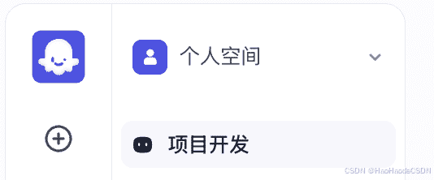
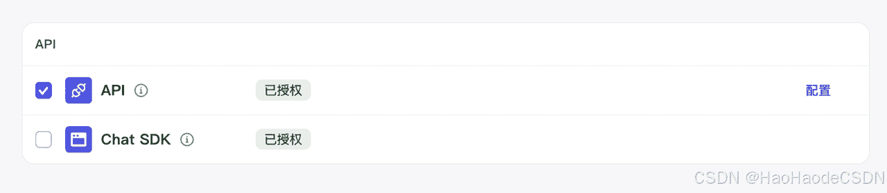
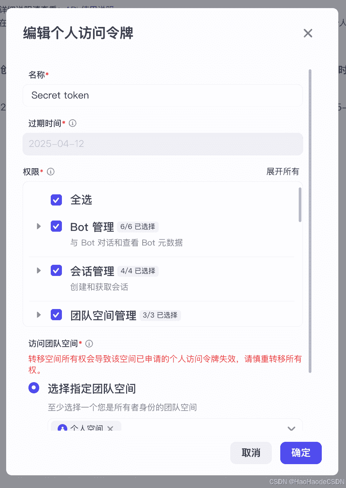
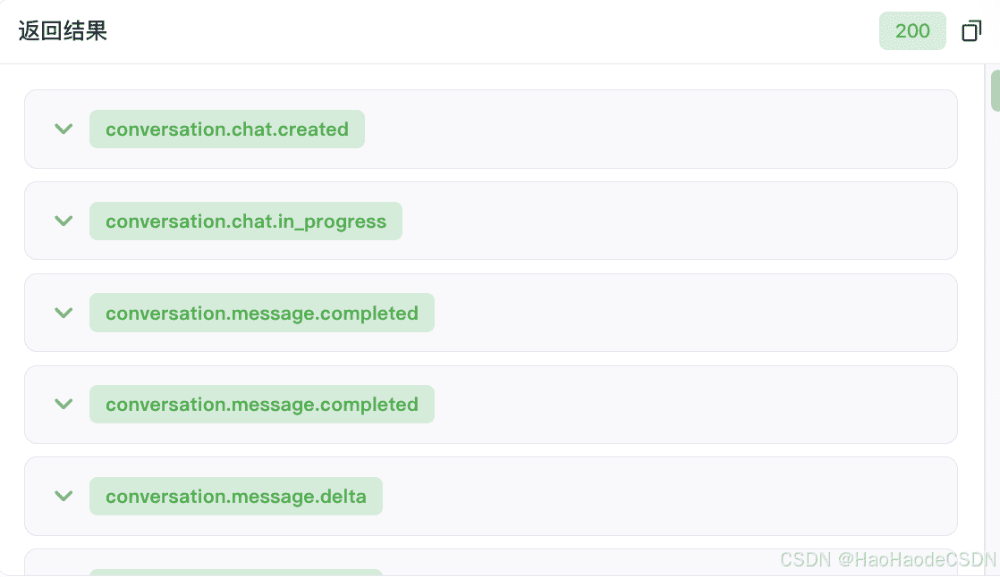
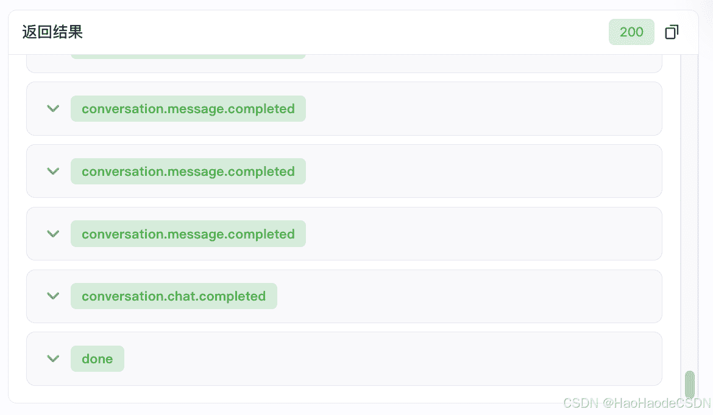
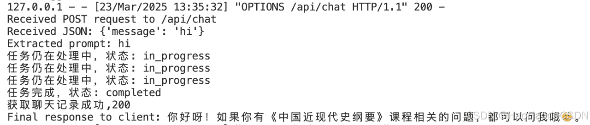

# 用Python调用 Coze Agent

> 来源：[https://datawhaler.feishu.cn/docx/SVVBdeMqSoVo1fxyjmzcJotxnSF](https://datawhaler.feishu.cn/docx/SVVBdeMqSoVo1fxyjmzcJotxnSF)

“我在Coze上搭建好了智能体，想要用Python调用，怎么做？！”

很多对智能体感兴趣的小伙伴准备或已经使用了Coze平台，在上面只需少量代码即可搭建专属的智能体。目前，对于一键使用智能体，Coze平台仅支持在该平台和🛰️👸号。然而，想要用Python调用自建的智能体并不是不可行。本文跳过智能体搭建过程，讲解从智能体发布到成功调用的过程。本文提到的智能体具备知识库。



## 前期准备

### 发布智能体

你已经创建好智能体，点击发布。

在发布页面，下拉，把API勾选上，如下图。



### 添加访问令牌

路径：扣子 API - 授权 - 添加新令牌。

要注意把所有权限都打开。



要注意妥善保管着一串字符，最好是存在某个安全的地方，记事本当然也可以。

## 正式开始

### 在编译器里操作

1.  打开你的编译器，我用的是VS Code。

1.  首先导入一些必要的库，如果还没有请安装。

```
import json
from flask import Flask, jsonify, request
import requests 
from flask_cors import CORS 
```

1.  你需要先定义好这些全局变量，接下来都会用到。

```
bot_id = &quot;your_bot_id&quot;
url = &quot;https://api.coze.cn/v3/chat&quot;
s_token = &quot;your_s_token&quot;  # ✅ 确保使用最新的 Personal Access Token
headers = {&quot;Authorization&quot;: f&quot;Bearer {s_token}&quot;,&quot;Content-Type&quot;: &quot;application/json&quot;
    }
```

1.  接着定义三个函数，

+   chat（）作为对话主函数，能够从前端获取用户输入以及处理一些意外问题；

+   chat_with_coze（prompt）用于对话智能体；

+   get_code_response（conversationID，chatID）用于接收智能体回复。

```
def chat():
    if request.method == &#x27;OPTIONS&#x27;:return &#x27;&#x27;, 200  # 处理预检请求，返回 200 状态码try:print(&quot;Received POST request to /api/chat&quot;)
# 获取 JSON 数据
        data = request.get_json(force=True)print(&quot;Received JSON:&quot;, data)
if not data:return &quot;请求失败: 没有收到数据&quot;, 400# 获取 message 字段
        prompt = data.get(&#x27;message&#x27;)print(&quot;Extracted prompt:&quot;, prompt)  # 确保 prompt 不是 Noneif not prompt:return jsonify({&quot;error&quot;: &quot;输入内容为空&quot;}), 400# 调用 API 生成内容
        chat_response = chat_with_coze(prompt)
# 确保 chat_response 是字符串if isinstance(chat_response, dict) and &quot;error&quot; in chat_response:return jsonify({&quot;error&quot;: chat_response[&quot;error&quot;]}), 500if not isinstance(chat_response, str):print(&quot;Error: chat_response did not return a string.&quot;)return jsonify({&quot;error&quot;: &quot;AI 响应格式错误&quot;}), 500print(&quot;Final response to client:&quot;, chat_response)return jsonify({&quot;message&quot;: chat_response})  # ✅ 确保返回 JSONexcept Exception as e:print(&quot;Error occurred:&quot;, str(e))return jsonify({&quot;error&quot;: str(e)}), 5
```

```
def chat_with_coze(prompt):
    bot_id = &quot;your_bot_id&quot;
    url = &quot;https://api.coze.cn/v3/chat&quot;
    s_token = &quot;your_s_token&quot;  # ✅ 使用你的访问令牌
    payload = {&quot;bot_id&quot;: bot_id,&quot;user_id&quot;: &quot;123&quot;,  # 随意设定&quot;stream&quot;: False,&quot;auto_save_history&quot;: True, # 必须打开&quot;additional_messages&quot;: [{&quot;content&quot;: prompt, # 自己定义的&quot;content_type&quot;: &quot;text&quot;,&quot;role&quot;: &quot;user&quot;,&quot;type&quot;: &quot;question&quot;
        }]
    }
print(&quot;Sending request to Coze:&quot;, url)print(&quot;Payload:&quot;, payload)
    response = requests.post(url, headers=headers, json=payload) # 自己定义的print(&quot;Coze API Response Status Code:&quot;, response.status_code)print(&quot;Coze API Response:&quot;, response.text)
if response.status_code == 200:
        response_json = response.json()
# 检查 API 是否返回错误if response_json.get(&quot;code&quot;) != 0:return f&quot;Coze API Error: {response_json.get(&#x27;msg&#x27;)}&quot;# 提取 AI 生成的回复
        conversation_status = response_json[&quot;data&quot;][&quot;status&quot;]
if not conversation_status == &quot;in_progress&quot;:return &quot;服务器不在线。&quot;  # ✅ 确保返回字符串# 这里添加获取 AI 回复的逻辑
        ai_reply = get_coze_response(response_json[&#x27;data&#x27;][&#x27;conversation_id&#x27;], response_json[&#x27;data&#x27;][&#x27;id&#x27;])
return ai_reply  # ✅ 返回 AI 生成的文本else:return f&quot;Failed to chat with Coze API. Status code: {response.status_code}
```

```
def get_coze_response(conversationID,chatID):import time;
    params = { &quot;bot_id&quot;: bot_id,&quot;task_id&quot;: chatID }
    getChatStatusUrl = url+f&#x27;/retrieve?conversation_id={conversationID}&amp;chat_id={chatID}&amp;&#x27;while True:
        response = requests.get(getChatStatusUrl, headers=headers, params=None)if response.status_code == 200:
            response_data = response.json()print(f&quot;response_data:\n{json.dumps(response_data,indent=4, ensure_ascii=False)}&quot;)
            status = response_data[&#x27;data&#x27;][&#x27;status&#x27;]if status == &#x27;completed&#x27;:print(f&quot;任务完成，状态: {status}&quot;)# 从响应中提取实际的应答内容
                getChatAnswerUrl = url+f&#x27;/message/list?chat_id={chatID}&amp;conversation_id={conversationID}&#x27;
                response = requests.get(getChatAnswerUrl, headers=headers, params=params)if response.status_code == 200:print(&quot;获取聊天记录成功,200&quot;)#print(response.text)
                    response_json = response.json()
                    data = response_json.get(&quot;data&quot;, [])
if not isinstance(data, list):return &quot;Error: AI 返回了错误的数据格式。&quot;# ✅ 遍历 messages，提取 `role: assistant` 且 `type: answer` 的 `content`for message in data:if isinstance(message,dict) and message.get(&quot;role&quot;) == &quot;assistant&quot; and message.get(&quot;type&quot;) == &quot;answer&quot;:return message.get(&quot;content&quot;, &quot;无返回内容&quot;)breakelse:print(f&quot;任务仍在处理中，状态: {status}&quot;)
                time.sleep(1)  # 等待5秒后再次检查else:print(f&quot;请求失败，状态码: {response.status_code}&quot;)breakreturn False
```

### 在playground里操作

值得注意的是，在获取回复函数中，我们采用的是轮询方式。因为在coze自带的playground里，我尝试了一下发送请求，返回结果不止一条。所以轮询有助于监控回复的状态，以便我们获取content。





同样的，在playground里，我们可以查看到数据返回格式。我看了一下，是层层嵌套，外层是列表，内层是字典。要注意get（）方法只能用在字典里，如果用给列表会报错。

```
模型返回数据:
 {&quot;code&quot;: 0,&quot;data&quot;: [
        {&quot;bot_id&quot;: &quot;748118200077X722802&quot;,&quot;chat_id&quot;: &quot;74848595948X5580596&quot;,&quot;content&quot;: &quot;{\&quot;msg_type\&quot;:\&quot;time_capsule_recall\&quot;,\&quot;data\&quot;:\&quot;{\\\&quot;wraped_text\\\&quot;:\\\&quot;\\\&quot;,\\\&quot;origin_search_results\\\&quot;:\\\&quot;[]\\\&quot;}\&quot;,\&quot;from_module\&quot;:null,\&quot;from_unit\&quot;:null}&quot;,&quot;content_type&quot;: &quot;text&quot;,&quot;conversation_id&quot;: &quot;748485959482X564212&quot;,&quot;created_at&quot;: 174270X680,&quot;id&quot;: &quot;748485959X825662516&quot;,&quot;role&quot;: &quot;assistant&quot;,&quot;type&quot;: &quot;verbose&quot;,&quot;updated_at&quot;: 174270X679
        },
        {&quot;bot_id&quot;: &quot;748118200077X722802&quot;,&quot;chat_id&quot;: &quot;74848595948X5580596&quot;,&quot;content&quot;: &quot;你好呀😊 如果你有《中国近现代史纲要》课程相关的问题，都可以问我哦。&quot;,&quot;content_type&quot;: &quot;text&quot;,&quot;conversation_id&quot;: &quot;748485959482X564212&quot;,&quot;created_at&quot;: 174270X681,&quot;id&quot;: &quot;748485959X825777204&quot;,&quot;reasoning_content&quot;: &quot;&quot;,&quot;role&quot;: &quot;assistant&quot;,&quot;type&quot;: &quot;answer&quot;,&quot;updated_at&quot;: 174270X681
        }
```

### 终端输出结果

我这里是结合了前端和路由，在终端里的输出结果十分简洁明快，可以看到轮询的过程和关键状态都被捕捉到了。



## 结语

讲解就到这里。本文主要说明了python调用coze智能体的一些内在逻辑，给出了绝大部分的后端代码，配合前端可以实现一个简易的网页对话。另外你可以做的事情包括但不限于：写一个前端，解决跨域问题，构建一个服务器，继续训练智能体以及优化代码。

---

> 本文作者：@好好

> 原链接：https://blog.csdn.net/HaoHaodeCSDN/article/details/146454665?spm=1011.2124.3001.6209

<https://datawhaler.feishu.cn/sync/LfRzdAExlsoykRbUZymc0Jrfngh>

# 欢迎投稿参与共建！

<https://datawhaler.feishu.cn/sync/CPNrdTvwgshasbb2UjecLzVinPe>