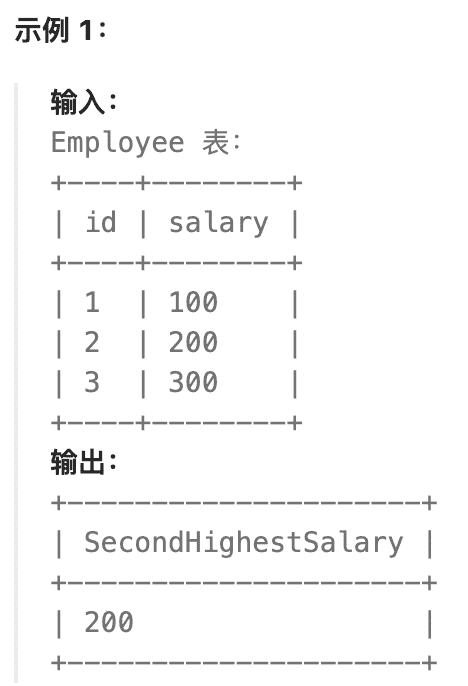
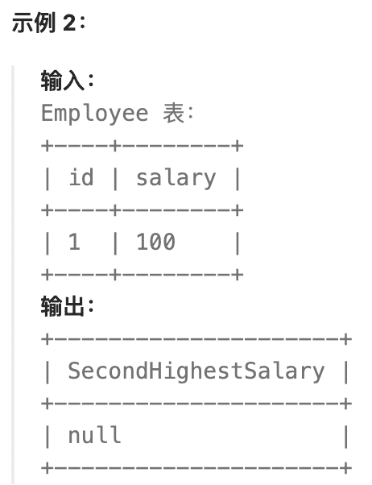
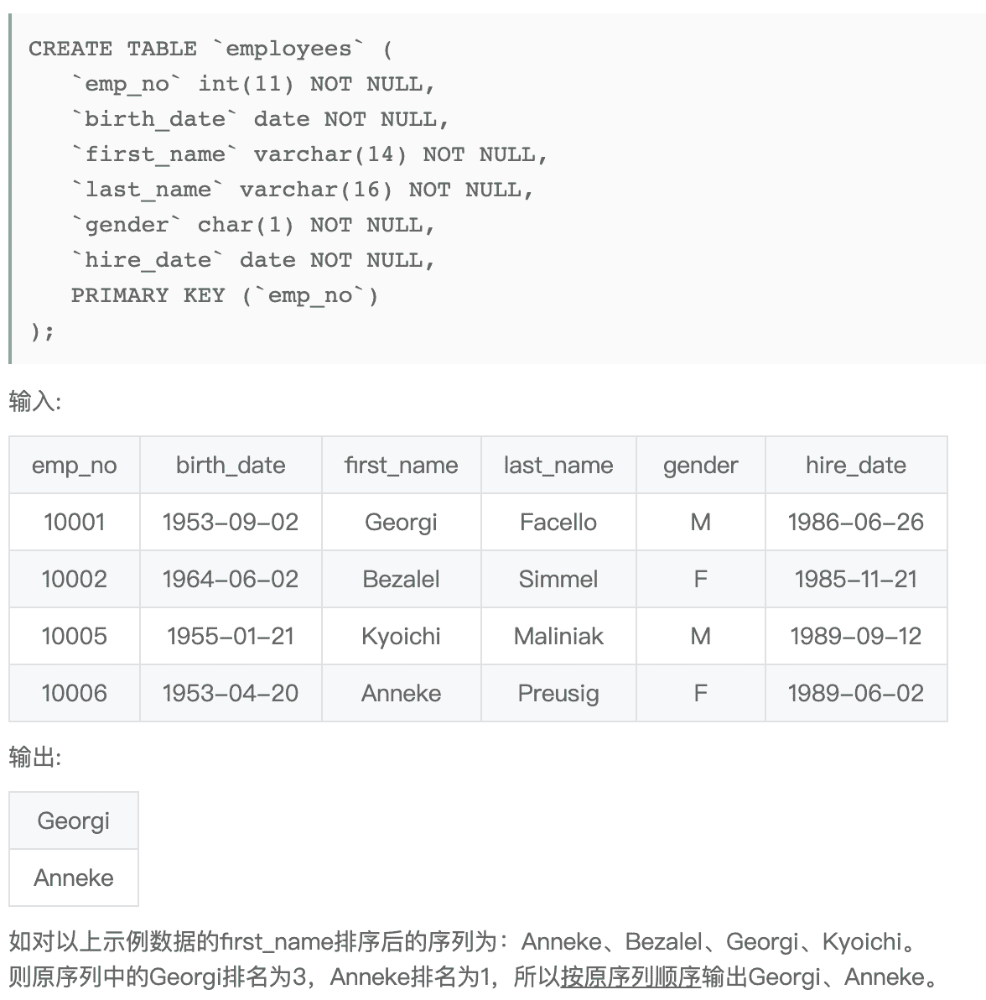

# SQL 食用指南

> 来源：[https://datawhaler.feishu.cn/docx/Bz3rdYj9yoJ74gxTGPkc63rmnkt](https://datawhaler.feishu.cn/docx/Bz3rdYj9yoJ74gxTGPkc63rmnkt)

# 一 子句

在标准的 SQL 查询中，子句的顺序通常是固定的，但当涉及到 LIMIT 或 OFFSET 时，情况会稍有不同。以下是更准确的顺序：

1.  **SELECT**：指定要返回的列。

1.  **FROM**：指定数据来源的表。

1.  **WHERE**：指定过滤条件。

1.  **GROUP BY**：对结果进行分组。

1.  **HAVING**：对分组后的结果进行过滤。

1.  **ORDER BY**：对结果进行排序。

1.  **LIMIT****/****OFFSET**：限制返回的行数或跳过行数。

## 1.1 SELECT子句

### 1.1.1 DISTINCT 关键词

+   查询某一列的不同值：SELECT DISTINCT ids FROM employees;

⚠️ DISTINCT关键字作用于所有的列，不仅仅是跟在其后的那一列。

例如，你指定SELECT DISTINCT ids, salary，除非指定的两列完全相同，否则所有的行都会被检索出来。

## 1.2 FROM子句

含义：指定查询的数据来源，也就是要从哪个表（或者多个表）中检索数据

### 1.2.1 单表查询

语法：

```
SELECT column_name(s)
FROM table_name;
```

### 1.2.2 多表查询

多表查询有三种查询方式：

+   连接查询：内连接，左外连接，右外连接，全外连接（相关介绍在第四节）

+   子查询作为数据源（相关介绍在第五节）

## 1.3 WHERE子句

WHERE子句用于过滤记录，只返回满足指定条件的结果集。在WHERE子句有一些常用的条件和关键词。

### 1.3.1 比较运算符

示例：

+   查询特定条件：SELECT name, salary FROM employees WHERE name = 'JOhn';

+   查询不匹配条件：SELECT name, salary FROM employees WHERE name <> 'JOhn';

### 1.3.2 逻辑运算符

逻辑运算符支持WHERE子句的组合，即以AND子句或OR子句的方式使用。

WHERE子句可以包含任意数目的AND和OR操作符。允许两者结合以进行复杂、高级的过滤。

示例：

+   满足某些特定条件：SELECT name, salary FROM employees WHERE name = 'Amy' AND salary <= 10;

+   满足某些特定条件之一：SELECT name, salary FROM employees WHERE name = 'Amy' OR salary <= 10;

+   筛选不含 John 的名字：SELECT name, salary FROM employees WHERE NOT name = 'John';

使用逻辑运算符需要注意的点：

1.  优先级：在 SQL 中，AND 运算符的优先级高于 OR 运算符。如果没有**适当使用括号**来明确指定运算的顺序，可能会导致逻辑错误

1.  括号要使用得当：不正确使用括号可能导致逻辑运算符的优先级被误解，从而得到错误的结果

1.  性能问题：复杂的 WHERE 子句可能导致查询性能下降，特别是当涉及到多个表的连接和大量的数据时

1.  逻辑短路：在某些数据库系统中，AND 和 OR 运算符可能表现出“短路”行为，即如果前面的条件足以确定整个表达式的结果，后面的条件可能不会被评估

### 1.3.3 范围运算符

示例：

+   范围值查询：SELECT name, salary FROM employees WHERE salary BETWEEN 5 AND 10;

+   范围值查询：SELECT name, salary FROM employees WHERE name IN （'John','Amy'）;

+   查询某列是否存在空值：SELECT name, salary FROM employees WHERE salary IS NULL;

### 1.3.4 模式匹配运算符

LIKE 操作符不是针对已知值进行过滤的

+   通配符（wildcard） ：用来匹配值的一部分的特殊字符。

+   搜索模式（search pattern） ：由字面值、通配符或两者组合构成的搜索条件。

通配符：

百分号（%）：任何字符出现任意次数

下划线（_）：它只匹配单个字符，而不是多个字符

方括号（[]）：指定一个字符集，它必须匹配指定位置（通配符的位置）的一个字符

+   找出所有以词 Fish 起头的名字：SELECT name FROM employees WHERE name LIKE 'FISH%';

+   找出所有名字含有 Fish 的名字：SELECT name FROM employees WHERE name LIKE '%FISH%';

+   找出所有名字以 Fish 结尾，长度为 6 的名字：SELECT name FROM employees WHERE name LIKE '__FISH';

+   找出所有名字以 J 或 M 起头的人：SELECT name FROM employees WHERE name LIKE '[JM]%';

+   找出所有名字不以 J 或 M 起头的人：SELECT name FROM employees WHERE name LIKE '[^JM]%';

⚠️ 子句WHERE prod_name LIKE '%'不会匹配产品名称为NULL的行。

### 1.3.5 正则表达式运算符

### 1.3.6 特殊运算符

#### 1.3.6.1 题目示例

使用含有关键字exists查找未分配具体部门的员工的所有信息。

```
CREATE TABLE `employees` (
   `emp_no` int(11) NOT NULL,
   `birth_date` date NOT NULL,
   `first_name` varchar(14) NOT NULL,
   `last_name` varchar(16) NOT NULL,
   `gender` char(1) NOT NULL,
   `hire_date` date NOT NULL,
   PRIMARY KEY (`emp_no`)
);
CREATE TABLE `dept_emp` (
   `emp_no` int(11) NOT NULL,
   `dept_no` char(4) NOT NULL,
   `from_date` date NOT NULL,
   `to_date` date NOT NULL,
   PRIMARY KEY (`emp_no`,`dept_no`)
);
```

```
SELECT *
FROM employees
WHERE NOT EXISTS
(SELECT emp_no FROM dept_emp WHERE employees.emp_no = dept_emp.emp_no);
/*
select *
from employees
where emp_no not in (select emp_no from dept_emp)
*/
```

> **EXISTS****和****IN****的区别：**

> EXISTS子句：执行 employees.length 次，指定一个子查询，检测行的存在。

> 执行流程：遍历循环外表，然后看外表中的记录有没有和内表的数据一样的。匹配上就将结果放入结果集中。

> IN 子句：执行 1 次，确定给定的值是否与子查询或列表中的值相匹配。

> 执行流程：在查询的时候，首先查询子查询的表，然后将内表和外表做一个笛卡尔积，然后按照条件进行筛选。所以相对内表比较小的时候，in的速度较快。

> 在大数据量时，比 IN 更高效

### 1.3.7 日期和时间运算符

日期和时间运算符通常用在与时间日期比较中

示例：

SELECT * FROM logs WHERE timestamp >= CURRENT_TIMESTAMP - INTERVAL 1 HOUR;

SELECT * FROM logs WHERE timestamp >= CURRENT_TIME;

## 1.4 GROUP BY子句

基本概念：它用于将数据按照一个或多个列的值分成不同的组，然后对每一组进行聚合计算

与GROUP BY配合使用的聚合函数（如SUM、AVG、COUNT、MAX、MIN等）可以对每个组进行计算，从而实现对数据的汇总和分析。

```
SELECT column1, column2, ..., aggregate_function(column3)
FROM table
WHERE condition
GROUP BY column1, column2, ...
HAVING condition
ORDER BY column;
```

### 1.4.1 GROUP BY 子句使用的重要规则和注意事项

1.  GROUP BY子句可以一个列或者多个列

```
SELECT column1, column2, COUNT(*)
FROM table_name
GROUP BY column1, column2;
```

1.  如果在GROUP BY子句中存在多个列，数据将在最后指定的分组上进行汇总

1.  GROUP BY子句中列出的每一列都必须是检索列或有效的表达式 （但不能是聚合函数）。如果在SELECT中使用表达式，**则必须在GR**OUP BY子句中指定相同的表达式。不能使用别名

```
SELECT column1, column2, (column1 + column2) AS expr, COUNT(*)
FROM table_name
GROUP BY column1, column2, (column1 + column2);
```

1.  在 SELECT 列表中，**除了聚合函数外的****所有列**都必须出现在 GROUP BY 子句中。如果某个列是聚合函数的一部分，则不需要出现在 GROUP BY 子句中

```
/*
！！正确写法！！
column1 出现在 SELECT 和 GROUP BY 子句中，
而 COUNT(*) 是聚合函数，不需要出现在 GROUP BY 子句中。
*/
SELECT column1, COUNT(*)
FROM table_name
GROUP BY column1;
/*
！！这种写法是错误的！！
column3 没有出现在 GROUP BY 子句中，但它也不是聚合函数的一部分。
根据标准 SQL 规则，这可能会导致问题，因为 column3 的值在每个由 column1 和 column2 定义的组内可能不是唯一的。
*/
SELECT column1, column3, COUNT(column2)
FROM table_name
GROUP BY column1, column2;
```

1.  如果分组列中包含具有NULL值的行，则NULL将作为一个分组返回。如果列中有多行NULL值，它们将分为一组

### 1.4.2 GROUP BY 子句常见用法

用法一：单列分组

```
SELECT department, COUNT(*) AS employee_count
FROM employees
GROUP BY department;
```

用法二：多列分组

```
SELECT department, job_title, COUNT(*) AS employee_count
FROM employees
GROUP BY department, job_title;
```

用法三：结合多子句

```
/* 按department列分组，统计每个部门的员工数量，并按员工数量降序排列 */
SELECT department, COUNT(*) AS employee_count
FROM employees
GROUP BY department
ORDER BY employee_count DESC;
```

## 1.5 HAVING子句

HAVING和WHERE子句的本质差别：

1.  WHERE在数据分组前进行过滤，HAVING在数据分组后进行过滤。

1.  性能优化：尽量在WHERE中过滤掉无关数据，减少GROUP BY处理的数据量

PS：GROUP BY子句：分组数据

HAVING 子句在SQL中用于筛选分组后的聚合结果。它通常与 GROUP BY 子句一起使用，用于过滤那些不满足特定条件的组。

```
SELECT column1, column2, ..., aggregate_function(column3)
FROM table
WHERE condition
GROUP BY column1, column2, ...
HAVING condition
ORDER BY column;
```

HAVING支持所有WHERE操作符

过滤COUNT(*) >= 2（两个以上订单）的那些分组：SELECT ids, COUNT(*) AS orders FROM Orders GROUP BY id HAVING COUNT(*) >= 2;

### 1.5.1 HAVING子句常见用法

HAVING 子句必须与 GROUP BY 子句一起使用。HAVING 子句用于在分组后筛选聚合结果，而 G**ROUP ****BY子句用于将数****据分成组****。如果没有 ****GROUP BY 子**句，HAVING 子句将没有任何意义，因为没有分组的聚合结果无法进行筛选。

用法一：基本用法

```
/*
按部门分组，并计算每个部门的平均薪资。
HAVING AVG(salary) &gt; 50000 筛选出平均薪资大于50000的部门
*/
SELECT department, AVG(salary) AS average_salary
FROM employees
GROUP BY department
HAVING AVG(salary) &gt; 50000;
```

用法二：结合 WHERE 子句

```
/*
WHERE hire_date &gt; &#x27;2020-01-01&#x27; 筛选出2020年1月1日之后入职的员工。
HAVING AVG(salary) &gt; 50000 筛选出这些员工中平均薪资大于50000的部门
*/
SELECT department, AVG(salary) AS average_salary
FROM employees
WHERE hire_date &gt; &#x27;2020-01-01&#x27;
GROUP BY department
HAVING AVG(salary) &gt; 50000;
```

用法三：多筛选条件并使用别名

```
/*
这个查询将员工按部门分组，并计算每个部门的员工数量和最高薪资
HAVING 子句筛选出员工数量大于10且最高薪资大于100000的部门
*/
SELECT department, COUNT(*) AS employee_count, MAX(salary) AS max_salary
FROM employees
GROUP BY department
HAVING employee_count &gt; 10 AND max_salary &gt; 100000;
```

用法四：结合子查询

```
/*
这个查询将员工按部门分组，并计算每个部门的平均薪资
HAVING 子句筛选出平均薪资大于公司整体平均薪资的部门
*/
SELECT department, AVG(salary) AS average_salary
FROM employees
GROUP BY department
HAVING AVG(salary) &gt; (SELECT AVG(salary) FROM employees);
```

### 1.5.2 HAVING 子句和窗口函数

**HAVING 子句的功能**

+   HAVING 子句用于在分组后筛选聚合结果

+   它通常与 GROUP BY 子句一起使用

+   HAVING 子句中的条件可以涉及聚合函数（如 SUM、AVG、COUNT 等）

窗口函数的功能

+   窗口函数用于在不隐藏原始数据的情况下进行复杂的计算和分析

+   可以在查询中进行排名、累计和、移动平均等操作

+   窗口函数可以结合 PARTITION BY 和 ORDER BY子句进行更灵活的计算

**转换的可能性**

1.  HAVING 子句转换为窗口函数

在某些情况下，HAVING 子句的功能可以通过窗口函数来实现，但通常需要更复杂的查询结构。例如，可以使用窗口函数计算聚合值，然后在外部查询中进行筛选。

1.  窗口函数转换为 HAVING 子句

窗口函数的功能通常无法直接用 HAVING 子句来实现，因为窗口函数可以在不隐藏原始数据的情况下进行更复杂的计算，而 HAVING 子句只能在分组后的聚合结果上进行筛选。

## 1.6 ORDER BY子句

ORDER BY 子句在SQL中用于对查询结果进行排序。它可以按照一个或多个列的值进行升序或降序排列。默认情况下，ORDER BY 按升序排列，如果需要降序排列，可以使用 DESC 关键字。

在多列排序中，允许你在第一列的值相同时，根据第二列（或更多列）进行进一步排序。

但是当第一列的值是唯一的（即没有重复值）时，那么第二列（或更多列）的排序规则不会生效，因为第一列已经完全决定了排序顺序。

> 升序排序（从A到Z）：默认的排序顺序，关键字是ASC

> 降序排序（从Z到A）：必须指定 DESC 关键字

> 如果想在多个列上进行降序排序，必须对每一列指定DESC关键字

基本语法如下：

```
SELECT column1, column2, ...
FROM table
WHERE condition
GROUP BY column
HAVING condition
ORDER BY column1 [ASC|DESC], column2 [ASC|DESC], ...;
```

### 1.6.1 ORDER BY子句常见用法

```
SELECT first_name, salary
FROM employees
ORDER BY salary ASC;
```

```
SELECT first_name, salary
FROM employees
ORDER BY salary DESC;
```

```
/* 按部门分组，计算每个部门的平均薪资，筛选出平均薪资大于50000的部门，并按平均薪资降序排列 */
SELECT department, AVG(salary) AS average_salary
FROM employees
GROUP BY department
HAVING AVG(salary) &gt; 50000
ORDER BY average_salary DESC;
```

### 1.6.3 ORDER BY子句和GROUP BY子句区别

ORDER BY子句和GROUP BY子句的主要区别和用法：

⚠️ 一般在使用GROUP BY子句时，应该也给出ORDER BY子句。这是保证数据正确排序的唯一方法。千万不要仅依赖GROUP BY排序数据。

## 1.7 LIMIT 子句

查询前 5 行数据：SELECT salary FROM employees LIMIT 5;

**OFFSET****关键词**

跳过查询结果中的前 10 行，返回接下来的 5 行：SELECT salary FROM employees LIMIT 5 OFFSET10;

> LIMIT关键词使用场景：分页查询（和 ORDER BY 连用）

> 语法：LIMIT n*(i-1),n：它表示每页显示 n 条记录，要显示第 i 页数据。

> 例如：分页查询 employees 表，每 5 行一页，返回第 2 页的数据

> 那么 SQL 为：SELECT * FROM employees ORDER BY emp_no LIMIT 5,5;

# 二 计算字段

计算字段是在 SELECT 语句执行时动态生成的，它们不实际存储在数据库表中，而是通过 SQL 表达式在查询时计算得出。场景示例：

1.  合并两个不同列的数据

1.  格式化地址字段：城市、州和邮政编码存储在不同的列中，需要将它们格式化为一个字段

1.  ...

## 2.1 算数计算

算数计算运算符：+、-、*、/、%（取模）

## 2.2 文本处理函数

文本处理函数主要用于处理和操作字符串

注意：这里的函数不仅可以用于字符串，也可以用于字段！

GROUP_CONCAT()函数：将group by产生的同一个分组中的值连接起来，返回一个字符串结果

公式：GROUP_CONCAT([DISTINCT] 要连接的字段 [ORDER BY 排序字段 ASC/DESC] [SEPARATOR '分隔符']

+   DISTINCT：排除重复值

+   ORDER BY：对结果中的值进行排序

+   SEPARATOR：是一个字符串值，缺省为一个逗号

### 1.2.1 题目示例

请基于以上表格 employees，回答以下问题：

1.  统计 string 字段中每个 id 拥有多少逗号

1.  拼接 first_name 和 last_name 字段合并成 name 列，并用逗号分隔

1.  对 first_name 字段，根据其后两位进行排序

1.  按照 dept_no 进行汇总，并按照同一个部门的 emp_no 按照逗号进行连接，如下表：

```
/* 1. 利用 LENGTH 函数计算完整的字段长度和去掉逗号的字段长度，以此得到逗号数*/
SELECT id, LENGTH(string)-LENGTH(REPLACE(string,&#x27;,&#x27;,&#x27;&#x27;)) AS cnt
FROM employees;
/* 2. liyong CONCAT 函数拼接字符串*/
SELECT CONCAT(last_name,&quot;&#x27;&quot;,first_name )
FROM employees;
/* 3. 利用 RIGHT 函数，找到最后两位并进行排序 */
SELECT first_name
FROM employees
ORDER BY RIGHT(first_name,2);
/* 4. 利用 GROUP_CONCAT 函数*/
SELECT dept_no, GROUP_CONCAT(emp_no) as employee
FROM employees
GROUP BY dept_no;
```

## 2.3 数值处理函数

数值转换函数主要用于处理和操作数值数据。

## 2.4 日期处理函数

## 2.5 聚合函数

聚合函数（aggregate function）： 对某些行运行的函数，计算并返回一个值。

+   计算表中所有产品的平均价格：SELECT AVG(price) AS avg_price FROM Products;

+   计算表中特定列或行的平均值：SELECT AVG(price) AS avg_price FROM Products WHERE ids = 'DLL01';

+   计算表中所有行的数量：SELECT COUNT(*) AS num_cust FROM Customers;

+   计算表中特定行的数量：SELECT COUNT(email) AS num_cust FROM Customers;

+   计算物品总数：SELECT SUM(quantity) AS order FROM OrderItems WHERE order_num = 201;

+   计算总订单数额：SELECT SUM(price*quantity) AS total_price FROM OrderItems WHERE order_num = 201;

+   将将NULL转为0计算平均值：SELECT AVG(COALESCE(salary, 0)) FROM employees;

### 2.5.1 聚合不同值

ALL参数：默认，对所有行执行计算

DISTINCT参数：只包含不同的值

+   计算不同价格的平均值：SELECT AVG(DISTINCT price) AS avg_price FROM Products WHERE vend_id = 'DLL01';

⚠️ DISTINCT必须用于指定列名，因此不能用于COUNT(*)，但可以用于COUNT(列)

### 2.5.2 题目示例

```
CREATE TABLE 
salaries
 ( 
emp_no
 int(11) NOT NULL,
   
salary
 int(11) NOT NULL,
   
from_date
 date NOT NULL,
   
to_date
 date NOT NULL,
PRIMARY KEY (emp_no,from_date));
```

1.  查找排除在职(to_date = '9999-01-01' )员工的最大、最小salary之后，其他的9999-01-01在职员工的平均工资avg_salary

```
SELECT AVG(salary) AS avg_salary 
FROM salaries
WHERE to_date = &#x27;9999-01-01&#x27;
AND salary &lt; (SELECT MAX(salary) FROM salaries WHERE to_date = &#x27;9999-01-01&#x27;)
AND salary &gt; (SELECT MIN(salary) FROM salaries WHERE to_date = &#x27;9999-01-01&#x27;);
```

## 2.6 逻辑函数

### 2.6.1 CASE-WHEN 语句

在SQL中，CASE-WHEN 是一个非常强大的条件表达式，用于在查询中进行条件判断和逻辑处理。它能够在 SELECT、UPDATE、INSERT 和 DELETE 语句中根据不同的条件返回不同的值。其表达式如下：

```
CASE
    WHEN condition1 THEN result1
    WHEN condition2 THEN result2
    ...
    ELSE default_result
END
```

+   condition1, condition2... ：条件表达式

+   result1,result2 ... ：当条件满足时返回的结果

+   ELSE ：可选，指定当所有条件都不满足时的默认结果

该函数常用的场景：

1.  SELECT 子句中简单的条件判断

1.  WHERE 子句中通过条件判断筛选条件

1.  UPDATE 子句中 SET 关键词中根据条件更新不同值

1.  ORDER BY 子句中根据筛选条件进行排序

#### 2.6.1.1 常用场景

场景一： SELECT 子句中简单的条件判断

```
/* 将员工的薪资分为三个等级：高（High）、中（Medium）和低（Low）*/
SELECT
    emp_no,
    salary,
    CASE
        WHEN salary &gt; 100000 THEN &#x27;High&#x27;
        WHEN salary BETWEEN 50000 AND 100000 THEN &#x27;Medium&#x27;
        ELSE &#x27;Low&#x27;
    END AS salary_level
FROM
    employees;
```

场景二：WHERE 子句中通过条件判断筛选条件

```
/* 根据不同的部门设置不同的薪资门槛，只返回满足条件的员工 */
SELECT
    emp_no,
    salary
FROM
    employees
WHERE
    CASE
        WHEN department = &#x27;Sales&#x27; THEN salary &gt; 50000
        WHEN department = &#x27;Marketing&#x27; THEN salary &gt; 60000
        ELSE salary &gt; 40000
    END;
```

场景三：UPDATE 子句中 SET 关键词中根据条件更新不同值

```
/* 根据员工的绩效评级设置不同的奖金比例 */
UPDATE
    employees
SET
    bonus = CASE
        WHEN performance_rating = &#x27;Excellent&#x27; THEN salary * 0.2
        WHEN performance_rating = &#x27;Good&#x27; THEN salary * 0.1
        ELSE salary * 0.05
    END;
```

场景四：ORDER BY 子句中根据筛选条件进行排序

```
/* 根据部门对结果进行排序，Sales 部门排在最前，Marketing 部门排在其次，其他部门排在最后 */
SELECT
    emp_no,
    salary,
    department
FROM
    employees
ORDER BY
    CASE
        WHEN department = &#x27;Sales&#x27; THEN 1
        WHEN department = &#x27;Marketing&#x27; THEN 2
        ELSE 3
    END;
```

#### 2.6.1.2 题目示例

有上述的三张表格，其中bonus类型btype为1其奖金为薪水salary的10%，btype为2其奖金为薪水的20%，其他类型均为薪水的30%。 to_date='9999-01-01'表示当前薪水。

+   请你给出emp_no、first_name、last_name、奖金类型btype、对应的当前薪水情况salary以及奖金金额bonus,注意只统计有奖金的员工的数据。

+   bonus结果保留一位小数，输出结果按emp_no升序排序。

```
SELECT
    em.emp_no,
    em.first_name,
    em.last_name,
    eb.btype,
    sa.salary,
    CASE
        WHEN eb.btype = 1 THEN ROUND(sa.salary * 0.1, 1)
        WHEN eb.btype = 2 THEN ROUND(sa.salary * 0.2, 1)
        ELSE ROUND(sa.salary * 0.3, 1)
        END AS bonus
FROM
    salaries AS sa
    INNER JOIN employees AS em ON sa.emp_no = em.emp_no
    INNER JOIN emp_bonus AS eb ON eb.emp_no = em.emp_no
WHERE
    to_date = &#x27;9999-01-01&#x27;
ORDER BY em.emp_no ASC;
```

### 2.6.2 IF 语句和 IFNULL 语句

在SQL中，IF 和 IFNULL 是两个常用的函数，用于处理条件判断和空值处理。

IF函数：用于根据条件返回不同的值

语法：IF(condition, value_if_true, value_if_false)

+   condition：要评估的条件

+   value_if_true：当条件为真时返回的值

+   value_if_false：当条件为假时返回的值

```
SELECT
    name,
    salary,
    IF(salary &gt; 80000, &#x27;High&#x27;, &#x27;Low&#x27;) AS salary_level
FROM employees;
```

IFNULL 函数：用于处理空值

语法：IFNULL(expression, value_if_null)

+   expression：要评估的表达式

+   value_if_null：当表达式为 NULL 时返回的值

```
SELECT
    user_id,
    IFNULL(date, &#x27;Unknown&#x27;) AS login_date
FROM login;
```

|  |  |
| --- | --- |
|  |  |

**IFNULL**** 函数**：用于处理空值，适用于需要替换空值的场景

示例：





查询并返回 Employee 表中第二高的 不同 薪水 。如果不存在第二高的薪水，查询应该返回 null(Pandas 则返回 None) 。

本题要求点：

1.  返回第二高的薪水

1.  薪水不同于第一个

1.  如果只有一个同样的薪水，也就是不存在第二大的薪水，需要返回 NULL

```
SELECT IFNULL(
    (SELECT DISTINCT salary
    FROM Employee
    ORDER BY salary DESC
    LIMIT 1 OFFSET 1),
    NULL)
AS SecondHighestSalary;
```

## 2.7 转换函数

## 2.8 加密和哈希函数

## 2.9 其他函数

# 三 分析函数

在SQL中，分析函数（Analytic Functions）是一个广泛的概念，它包括了所有用于数据分析和计算的函数。分析函数主要用于在查询中进行复杂的计算和统计，它们可以在不隐藏原始数据的情况下对数据进行操作。

## 3.1 窗口函数

窗口函数是在一个特定的窗口（即一组相关行）上进行计算的函数。它们允许你在查询中进行复杂的分析，例如排名、累计和、移动平均等。

窗口函数的特点是它不会减少行数，而是在每行上计算一个值。

常见的窗口函数包括：

**窗口函数基本表达式：**

```
window_function_name ( [ expression ] )
OVER (
    [ PARTITION BY partition_expression [, ...] ]
    [ ORDER BY order_expression [ ASC | DESC ] [, ...] ]
    [ window_frame_clause ]
)
```

+   window_function_name：指定要使用的窗口函数，例如 SUM、AVG、RANK 等

+   OVER 子句：定义窗口的范围和分区

+   PARTITION BY：【可选】用于将数据集分成多个分区，每个分区独立进行计算

+   ORDER BY：【可选】用于在每个分区内对数据进行排序

+   window_frame_clause：【可选】用于定义计算时考虑的行范围，如 ROWS BETWEEN 或 RANGE BETWEEN

### 3.1.1 窗口函数示例

**示例一：没有 ****PARTITION BY****，只有****ORDER BY**

```
SELECT
    emp_no,
    salary,
    SUM(salary) OVER (PARTITION BY salary ORDER BY emp_no) AS running_total
FROM
    salaries
WHERE
    to_date = &#x27;9999-01-01&#x27;;
```

假设salaries表中有以下数据：

那么查询结果如下：

**示例二：有 ****PARTITION BY****，只有****ORDER BY**

```
SELECT
    emp_no,
    salary,
    SUM(salary) OVER (PARTITION BY salary ORDER BY emp_no) AS running_total
FROM
    salaries
WHERE
    to_date = &#x27;9999-01-01&#x27;;
```

假设salaries表中有以下数据：

那么查询结果如下：

### 3.1.2 题目示例

关键：按 emp_no 排序后，计算每个员工薪资的累积和

```
SELECT
    emp_no,
    salary,
    SUM(salary) OVER (ORDER BY emp_no) AS running_total
FROM
    salaries
WHERE
    to_date = &#x27;9999-01-01&#x27;;
```



关键：使用窗口函数ROW_NUMBER()为每个名字按字母顺序分配一个行号

```
SELECT
    em.first_name
FROM
    (SELECT
        emp_no,
        first_name,
        ROW_NUMBER() OVER(ORDER BY  first_name) AS row_num
    FROM
        employees
    ) AS em
WHERE row_num % 2 = 1
ORDER BY emp_no;
```

## 3.2 聚合函数

聚合函数用于对一组值进行计算并返回单个值。虽然它们通常用于分组统计，但在分析函数中也可以结合窗口函数使用。常见的聚合函数包括：

+   SUM()：计算总和

+   AVG()：计算平均值

+   COUNT()：计算非空值的数量

+   MIN()：计算最小值

+   MAX()：计算最大值

具体详见[2.5 聚合函数](https://www.yuque.com/weijunfei-lwwzl/df78zu/yhmk028dl7dh7ug0#AH1aF)

# 四 联结函数

**叉联结（cross join）**：返回笛卡儿积的联结

笛卡儿积（cartesian product）：由没有联结条件的表关系返回的结果为笛卡儿积。检索出的行的数目将是第一个表中的行数乘以第二个表中的行数。

联结函数通常指的是用于将多个表连接起来进行查询的操作

1.  **明确性**：清楚地表明了连接的类型（内连接）。

1.  **可读性**：提高了查询的可读性，使得其他开发者更容易理解查询的意图。

1.  **扩展性**：更容易扩展到更复杂的连接类型，如左连接、右连接等。

因此，推荐使用 INNER JOIN 语法，因为它更符合现代 SQL 标准，更易于维护和扩展。

**联结多个表**

**⚠️** SQL不限制一条SELECT语句中可以联结的表的数目

```
/* 前面采用子查询 */
SELECT cust_name, cust_contact
FROM Customers
WHERE cust_id IN (SELECT cust_id
                  FROM Orders
                  WHERE order_num IN (SELECT order_num
                                      FROM OrderItems
                                      WHERE prod_id = &#x27;RGAN01&#x27;));
/* 等价于子查询的联结查询（叉联结） */
SELECT cust_name, cust_contact
FROM Customers, Orders, OrderItems
WHERE Customers.cust_id = Orders.cust_id
AND OrderItems.order_num = Orders.order_num
AND prod_id = &#x27;RGAN01&#x27;;
```

⚠️ 性能警告：DBMS在运行时关联指定的每个表，以处理联结。这种处理可能非常耗费资源，因此应该注意，不要联结不必要的表。联结的表越多，性能下降越厉害。

SQL除了可以对列名和计算字段使用别名，还允许给表名起别名。这样做有两个主要理由：

1.  缩短SQL语句；

1.  允许在一条SELECT语句中多次使用相同的表。

**不同类型的联结：**

**内连接（INNER JOIN）**：根据指定的条件从两个或多个表中选择数据，只返回匹配的行

**自联结（self-join）：**它将同一个表视为两个不同的表进行联结，基于表中某个列的值来匹配行

自然联结（natural join）：自动基于两个表中具有相同列名的字段来进行联接，而无需显式指定连接条件

外联结 （outer join）：会返回左表、右表或两个表中的所有行，即使在另一个表中没有匹配的行。

左外联结（LEFT OUTER JOIN）：

+   返回左表（指定的表）的所有行。

+   如果左表中的行在右表中有匹配的行，则返回匹配的行；否则，返回 NULL 值。

右外联结（RIGHT OUTER JOIN）：

+   返回右表的所有行。

+   如果右表中的行在左表中有匹配的行，则返回匹配的行；否则，返回 NULL 值

全外联结FULL OUTER JOIN）：

+   返回左表和右表中的所有行。

+   如果某个表中的行在另一个表中有匹配的行，则返回匹配的行；否则，返回 NULL 值。

## 4.1 内连接

**（INNER JOIN）**：根据指定的条件从两个或多个表中选择数据，只返回匹配的行

```
SELECT column_name(s)
FROM table1
INNER JOIN table2
ON table1.column_name = table2.column_name;
```

应用场景：在一个电商系统中，内连接可以用于获取所有有订单记录的客户信息以及他们的订单详情。这有助于生成销售报告或客户购买行为分析。

## 4.2 外联结

### 4.2.1 左外连接

含义：返回左表中的所有记录，以及右表中匹配的记录。如果右表中没有匹配的记录，则结果为NULL

左外连接语法：

```
SELECT column_name(s)
FROM table1
LEFT JOIN table2
ON table1.column_name = table2.column_name;
```

应用场景：在数据分析中，左连接可以用于获取所有订单信息，即使某些订单没有对应的客户信息（例如客户信息被删除或未注册）。这有助于完整地分析订单数据，即使部分客户信息缺失。

### 4.2.2 右外连接

含义：返回右表中的所有记录，以及左表中匹配的记录。如果左表中没有匹配的记录，则结果为NULL

右外连接语法：

```
SELECT column_name(s)
FROM table1
RIGHT JOIN table2
ON table1.column_name = table2.column_name;
```

应用场景：在客户关系管理系统（CRM）中，右连接可以用于获取所有客户信息以及他们的订单详情。即使某些客户没有下过订单，也能在结果中看到这些客户的信息，方便进行市场推广或客户跟进。

### 4.2.3 全外连接

含义：返回两个表中的所有记录，无论是否匹配。如果在某个表中没有匹配的记录，则结果为NULL

全外连接语法：

```
SELECT column_name(s)
FROM table1
FULL JOIN table2
ON table1.column_name = table2.column_name;
```

应用场景：在数据整合过程中，全连接可以用于获取所有订单和所有客户的信息，无论它们是否匹配。这有助于全面分析数据，确保没有遗漏任何信息。

### 4.2.4 自连接

含义：一个表与自身进行连接。这在需要比较同一表中的不同行时非常有用

```
SELECT column_name(s)
FROM table1 T1
INNER JOIN table1 T2
ON T1.column_name = T2.column_name;
```

应用场景：在企业组织结构分析中，自连接可以用于获取每个员工及其直接经理的姓名。这有助于清晰地展示公司的层级结构和汇报关系。

### 4.2.5 自然联结

含义：自动匹配两个表中具有相同名称的列，并将它们作为连接条件

```
SELECT column_name(s)
FROM table1
NATURAL JOIN table2;
```

应用场景：在数据整合过程中，自然连接可以用于自动匹配具有相同列名的表。这在某些情况下可以简化查询语句，但需要注意可能的列名冲突问题。

### 4.2.6 交叉连接

含义：会返回两个表的笛卡尔积，即第一个表中的每一行与第二个表中的每一行组合

```
SELECT column_name(s)
FROM table1
CROSS JOIN table2;
```

应用场景：在库存管理中，交叉连接可以用于生成所有产品在所有商店的组合列表。这有助于初始化库存数据或进行库存分配规划。

# 五 子查询

含义：在一个SQL查询内部嵌套的另一个查询。子查询的结果可以作为外部查询的条件或数据源，用于更灵活地检索和操作数据

作用：

1.  **数据筛选**：子查询可以用于在WHERE子句中提供条件，根据子查询的结果筛选外部查询的数据。

1.  **动态数据源**：在FROM子句中，子查询可以作为动态的数据源，生成临时表供外部查询使用。

1.  **多步计算**：子查询允许在单个SQL语句中进行多步计算，先通过子查询获取中间结果，再在外部查询中进一步处理。

1.  **关联查询**：子查询可以用于关联两个或多个表，通过子查询的结果集与另一个表进行连接操作。