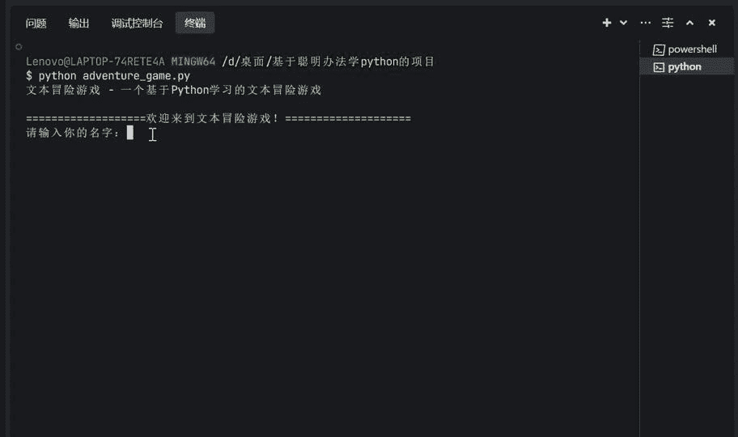
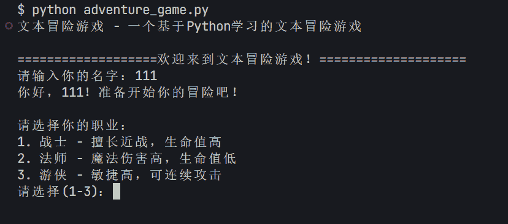

# Python冒险岛：从零搭建游戏化编程世界

> 来源：https://datawhaler.feishu.cn/docx/BPkTduxxZoBkDUxVS2TcoYu1nrd

## 0. 前言

在完成聪明办法学习后一直在思考怎么把聪明办法学Python巩固呢？

当然在项目中学习就是一个超级好的方法

于是把聪明办法学Python中的知识点同时结合DeepSeek一起创立了我们这个项目

## 一、正文：Python冒险岛：从零搭建游戏化编程世界

基于Datawhale《聪明办法学Python》课程体系

> 聪明办法学Python项目链接：https://datawhalechina.github.io/learn-python-the-smart-way-v2/

大家可以和它一起同步食用哦~

"Python冒险岛：从零搭建游戏化编程世界"的综合性项目

效果展示：



[屏幕录制 2025-03-09 202702.mp4](https://internal-api-drive-stream.feishu.cn/space/api/box/stream/download/all/LBXXbgwi7oC0S7x0qvecM88fnMh)

通过这个项目你也可以做出这样的小游戏~

那我们开始吧

### 1.1 简介

该项目通过构建一个文字冒险游戏引擎，系统覆盖Python全语法体系，并融入游戏化学习机制

### 1.2 项目架构设计

核心目标：提高“聪明办法学Python”这个项目孵化出的“Python冒险岛：从零搭建游戏化编程世界”目标帮助大家一起巩固学到的语法点。同时立刻获得正反馈。

学习路径：分四个阶段递进式开发，每个阶段对应特定语法模块 技术栈：纯Python实现 + JSON数据存储 + 控制台交互（后期还可以继续拓展欢迎大家一起继续填充哦~）

**学习方法推荐**：在一个案例开始前先会把这个阶段需要的语法点先列出来，然后大家可以先到“聪明办法学Python”项目中粗粗的了解一下这个语法点（这里推荐可以看优秀笔记）。

然后接下来结合案例看看是不是可以弄明白语法点呢？

（然后这个没有问题可以直接跳转到下一个阶段）不懂也没有关系哦，可以看看结合案例后面的解析，然后尝试着自己来试试看写一写，在实践中学习是一种很棒的学习方法。慢慢的我们就学会了Python啦~

加油哦~我们一起一步一步从AI小白打怪升级成为知道AI底层原理的，学会AI的“大BOSS”哦~

### 1.3 阶段设计与语法覆盖

#### 1.3.1 阶段1：新手村 - 基础语法训练

欢迎来到Python冒险岛！在开始冒险之前，我们先来熟悉一下几个基本的Python语法，这样你才能顺利完成即将面对的挑战！

覆盖语法：

- 变量与数据类型（字符串/数值/布尔）
- 输入输出（`input`/`print`格式化）
- 条件判断（`if`、`elif`、`else`嵌套）
- 循环结构（`while`/`for`实现属性点分配）

结合实例：角色属性生成器

```
# 阶段1：新手村 - 基础语法训练

# 变量与数据类型（字符串/数值/布尔）
def show_basic_types():
    game_name = "文本冒险游戏"
    player_hp = 100
    game_over = False
    return game_name, player_hp, game_over

# 输入输出（input/print格式化）
def welcome_player():
    print("欢迎来到文本冒险游戏！".center(50, "="))
    player_name = input("请输入你的名字：")
    print(f"你好，{player_name}！准备开始你的冒险吧！")
    return player_name

# 条件判断（if-elif-else嵌套）
def choose_job():
    print("\n请选择你的职业：")
    print("1. 战士 - 擅长近战，生命值高")
    print("2. 法师 - 魔法伤害高，生命值低")
    print("3. 游侠 - 敏捷高，可连续攻击")
    
    choice = input("请选择(1-3)：")
    
    if choice == "1":
        job = "战士"
    elif choice == "2":
        job = "法师"
    elif choice == "3":
        job = "游侠"
    else:
        job = "平民"
    
    print(f"你选择了：{job}")
    return job

# 循环结构（while/for实现属性点分配）
def allocate_attributes():
    base_points = 10
    attributes = {"力量": 0, "敏捷": 0, "智力": 0}
    
    print(f"\n你有{base_points}点属性点可以分配")
    
    while base_points > 0:
        print(f"剩余点数：{base_points}")
        for attr in attributes:
            try:
                add = int(input(f"分配给{attr}的点数："))
                if 0 <= add <= base_points:
                    attributes[attr] += add
                    base_points -= add
                else:
                    print("无效分配！")
            except ValueError:
                print("请输入数字！")
    
    print("\n最终属性：", attributes)
    return attributes

```

在这里我们一起来学习一下刚刚输入的语法看看他们是什么意思有什么作用吧~

1. 变量与数据类型

在Python里，“变量”就像游戏中的背包，可以装各种类型的物品。

- 字符串（`string`）：文字类内容，必须用引号包起来。
- 数值（`number`）：分整数（`int`）和小数（`float`），例如角色等级或金币数量。
- 布尔类型（`boolean`）：表示逻辑状态，只有两个值：`True`（真）或`False`（假）。

2. 输入输出（`input`与`print`格式化）

- `input` 用于接收玩家输入。
- `print` 用于输出信息，且能结合f格式化字符串，更便捷地插入变量。

3. 条件判断（`if`、`elif`、`else`嵌套）

条件判断能根据情况执行不同的操作。

4. 循环结构（`while`/`for`实现属性点分配）

- `while`循环：条件满足时持续重复。
- `for`循环：遍历元素，例如为每位玩家发放初始金币。

现在你已经掌握了Python冒险的基础技能，让我们继续踏上精彩的冒险之旅吧！

时间久没有关系哦~迈出第一步已经超级棒啦~准备好一起进入到迷雾森林了吗

那我们准备出发咯~

#### 1.3.2 阶段2：迷雾森林 - 函数与文件操作

欢迎来到迷雾森林，这一关我们难度要上升一点点啦，但是相信各位勇士，一定可以在迷雾森林“杀”出来的

覆盖语法：

- 函数定义与参数传递
- 文件读写（JSON剧情配置）
- 异常处理（`try`、`except`文件加载）
- 模块化编程

结合实例：剧情加载器

```
# 阶段2：迷雾森林 - 函数与文件操作
import json

def calculate_stats(job, attributes):
    base_hp = 100
    base_attack = 10
    strength, agility, intelligence = attributes["力量"], attributes["敏捷"], attributes["智力"]
    
    if job == "战士":
        hp = base_hp + strength * 5
        attack = base_attack + strength * 2
    elif job == "法师":
        hp = base_hp + intelligence * 3
        attack = base_attack + intelligence * 2.5
    elif job == "游侠":
        hp = base_hp + agility * 3 + strength * 2
        attack = base_attack + agility * 1.5
    else:
        hp = base_hp + strength * 3
        attack = base_attack + (strength + agility + intelligence) * 0.7
    
    return int(hp), int(attack)

# 文件读写（JSON剧情配置）
def load_story(story_file):
    try:
        with open(f"{story_file}.json", encoding='utf-8') as f:
            return json.load(f)
    except FileNotFoundError:
        print(f"警告：找不到 {story_file}.json，使用默认剧情。")
        return {"start": {"text": "默认剧情开始", "options": []}}
    except json.JSONDecodeError:
        print(f"错误：文件格式错误，使用默认剧情。")
        return {"start": {"text": "默认剧情开始", "options": []}}

```

##### 实例解析

###### 函数定义与参数传递

在 Python 中，函数通过 `def` 关键字进行定义，参数在括号 `()` 内传递。

函数参数

- 位置参数：函数定义时，按顺序接收传入的参数。
- 关键字参数：调用函数时，使用 `参数名=值` 形式传递参数。
- 默认参数：在函数定义时为参数提供默认值，调用时可选择性传入。
- 可变参数：使用 `*args`（元组形式）或 `**kwargs`（字典形式）接收不定数量的参数。

###### 文件读写（JSON 剧情配置）

在 Python 中，文件操作主要使用 `open()` 进行打开，`read()` 进行读取，`write()` 进行写入。

- `open(文件名, 模式, encoding='utf-8')` 用于打开文件。
- `json.load(文件对象)` 解析 JSON 文件内容，转换为 Python 数据结构。
- `json.dump(数据, 文件对象)` 将 Python 数据结构写入 JSON 文件。
- `with open(...)` 结构可以确保文件使用完后自动关闭，避免资源泄露。

###### 异常处理（`try`、`except` 文件加载）

异常处理用于捕获和处理代码运行过程中可能发生的错误，避免程序崩溃。

- `try:` 代码块内放置可能出错的代码。
- `except 异常类型:` 用于捕获特定异常，并执行相应的处理逻辑。
- `FileNotFoundError` 用于捕获文件不存在的情况。
- `return` 语句可以在异常处理后提供默认返回值，防止程序终止。

###### 模块化编程

模块化编程指的是将代码拆分为多个独立的模块，提高复用性和可维护性。

- 函数封装：将特定功能写成独立函数，便于复用。
- 文件拆分：根据功能划分不同 Python 文件，例如 `story_loader.py` 负责剧情加载，`user_interaction.py` 负责用户交互。
- 导入模块：使用 `import` 模块名 或 `from` 模块 `import` 函数 进行模块调用。
- 提高可维护性：模块化代码结构清晰，便于后续扩展和修改。

通过模块化和异常处理，可以让代码更稳健、更易扩展。

编程就像搭建乐高积木，模块化让你的代码更易管理、扩展，一步步构建你的专属项目！

继续前进吧，每一个挑战都是提升自己的机会，你已经在变得更优秀！加油！🚀

#### 1.3.3 阶段3：龙之塔 - 面向对象编程（3周）

每一行代码都是向更高水平迈进的一步，坚持下去，你会发现自己的成长超乎想象！

我们一起进入龙之塔吧~

覆盖语法：

- 类与对象
- 继承（角色/怪物父类）
- 多态（不同职业技能）
- 魔法方法（`__str__`显示状态）

实践案例：

```
# 阶段3：龙之塔 - 面向对象编程
import random

class Character:
    def __init__(self, name, hp, attack):
        self.name = name
        self.hp = hp
        self.attack = attack
    
    def take_damage(self, damage):
        self.hp = max(0, self.hp - damage)
        return self.hp == 0
    
    def __str__(self):
        return f"{self.name} HP:{self.hp} 攻击:{self.attack}"

class Player(Character):
    def __init__(self, name, job, attributes):
        hp, attack = calculate_stats(job, attributes)
        super().__init__(name, hp, attack)
        self.job = job
        self.attributes = attributes
    
    def special_skill(self):
        if self.job == "战士":
            return "猛力一击", int(self.attack * 1.5)
        elif self.job == "法师":
            return "火球术", int(self.attack * 2.0)
        elif self.job == "游侠":
            return "连环箭", int(self.attack * 1.2 * 2)
        return "普通攻击", int(self.attack * 1.2)

class Enemy(Character):
    def __init__(self, name, hp, attack, difficulty):
        super().__init__(name, hp, attack)
        self.difficulty = difficulty

```

##### 实例解析

###### 类与对象

- 类（`Class`）是创建对象的模板，定义了对象的属性和方法。
- 对象（`Object`）是类的实例，每个对象都有自己的数据。

在 `Character` 类中：

- `__init__` 方法用于初始化角色的 `name`、`hp` 和 `attack`。
- `take_damage` 方法减少角色的 `hp`。
- `__str__` 方法定义对象的字符串表示。

###### 继承（角色/怪物父类）

- 继承 允许新类（子类）复用已有类（父类）的属性和方法。
- `Warrior(Character)` 继承了 `Character`，可以直接使用 `Character` 的 `__init__`、`take_damage` 方法。
- 继承让代码更简洁，避免重复定义相同功能。


> 编程的世界里，复用是智慧的体现，继承让你的代码更简洁、灵活，一步步打造属于你的高效代码！

## 多态（不同职业技能）

多态 指的是不同类的对象可以调用相同的方法，表现出不同的行为。

在 `Warrior` 类中，我们定义了 `special_skill()` 方法，它返回 `attack * 1.5`。

如果有 `Mage(Character)` 类，它可以实现不同的 `special_skill()`（例如 `attack * 2`）。

## 魔法方法（`str` 显示状态）

`str` 是 Python 的 魔法方法，用于定义对象的字符串表示。

在 `Character` 类中，`str` 方法返回角色的 `name` 和 `hp`。

这样，`print(角色对象)` 时，会自动调用 `str`，显示角色信息。

> 魔法方法让代码更智能，学会运用它们，让你的类变得更直观、易用！

## 异常处理（`try-except` 文件加载）

异常处理用于捕获和处理代码运行过程中可能发生的错误，避免程序崩溃。

`try:` 代码块内放置可能出错的代码。

`except 异常类型:` 用于捕获特定异常，并执行相应的处理逻辑。

`FileNotFoundError` 用于捕获文件不存在的情况。

`return` 语句可以在异常处理后提供默认返回值，防止程序终止。

## 模块化编程

模块化编程指的是将代码拆分为多个独立的模块，提高复用性和可维护性。

函数封装：将特定功能写成独立函数，便于复用。

文件拆分：根据功能划分不同 Python 文件，例如 `story_loader.py` 负责剧情加载，`user_interaction.py` 负责用户交互。

导入模块：使用 `import 模块名` 或 `from 模块 import 函数` 进行模块调用。

提高可维护性：模块化代码结构清晰，便于后续扩展和修改。

> 通过模块化、继承、多态和异常处理，可以让代码更稳健、更易扩展。

### 总结

编程就像角色扮演游戏，每种技能都有其独特价值，善用多态，让你的代码更具灵活性和表现力！

继续加油哦马上就要到最后一关啦~坚持就是胜利！！！

## 1.3.4 阶段4：天空之城 - 综合应用

> 共享挑战者你来到了“天空之城”马上我们就要通关啦

### 覆盖语法

- 列表推导式（道具筛选）
- 字典操作（成就系统）
- 装饰器（成就触发）
- 生成器（随机事件）

### 实践案例

```
# 阶段4：天空之城 - 综合应用
import random

def filter_items_by_price(items, max_price):
    return [item for item in items if item.price <= max_price]

def update_achievements(player, achievement_name, achievement_desc):
    if achievement_name not in player.achievements:
        player.achievements[achievement_name] = achievement_desc
        print(f"🏆 解锁成就：【{achievement_name}】 - {achievement_desc}")

def achievement_tracker(func):
    def wrapper(player, *args, **kwargs):
        result = func(player, *args, **kwargs)
        if player.gold >= 500:
            update_achievements(player, "富甲一方", "累积获得500金币")
        return result
    return wrapper

def random_events_generator():
    events = [
        {"type": "treasure", "description": "你发现了一个宝箱！", "gold": lambda: random.randint(10, 50)},
        {"type": "trap", "description": "你触发了一个陷阱！", "damage": lambda: random.randint(5, 15)},
        {"type": "nothing", "description": "一切平静..."}
    ]
    while True:
        event = random.choice(events)
        yield event
```

### 实例解析

#### 列表推导式（道具筛选）

列表推导式是一种简洁的列表创建方式，可以高效地筛选符合条件的道具。

语法格式：`[表达式 for 变量 in 可迭代对象 if 条件]`。

> 高效的代码让你的程序运行得更流畅，掌握列表推导式，提升你的代码质量！

#### 字典操作（成就系统）

字典存储键值对，可用于管理游戏内的成就系统。

访问、更新和遍历字典能够有效管理游戏数据。

> 成就系统就像编程路上的里程碑，每一个解锁的成就，都是你的成长证明！

#### 装饰器（成就触发）

装饰器是一种用于修改函数行为的高级功能。

通过在函数执行前后添加逻辑，可以实现自动触发成就的功能。

> 装饰器让你的代码更简洁、灵活，掌握它，你的代码将更加优雅！

#### 生成器（随机事件）

生成器使用 `yield` 关键字生成数据，每次调用 `next()` 返回一个值。

适用于大数据处理和流式计算，减少内存占用。

> 游戏中的随机事件让冒险充满惊喜，生成器让代码更加高效灵活，掌握它，让你的代码更智能！

### 总结

接下来加入这个JSON文件


[`story.json`](https://internal-api-drive-stream.feishu.cn/space/api/box/stream/download/all/UgmIb7K1Uo3VyoxZU6tcypHpnfd)

就可以开始文本冒险游戏啦！快快快一起玩一玩吧~~~



这里是全部代码：


[`adventure_game.py`](https://internal-api-drive-stream.feishu.cn/space/api/box/stream/download/all/EG4SbinsHodtvMx0Vn9cS72xnYe)

# 二.后记

本项目主要和大模型一起合作完成。主要目的是帮助刚刚入门AI的学习者一起学习`python`基础语言

基于聪明办法`python`项目一个小小填充

感谢聪明办法学`python`团队的指导

感谢amy姐的`open1+x`项目

感谢红星哥的指导

第一次编程教程难免会出现一点点问题

欢迎大家批评指正！
