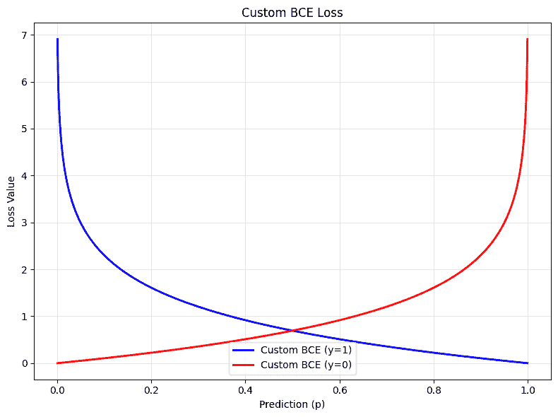
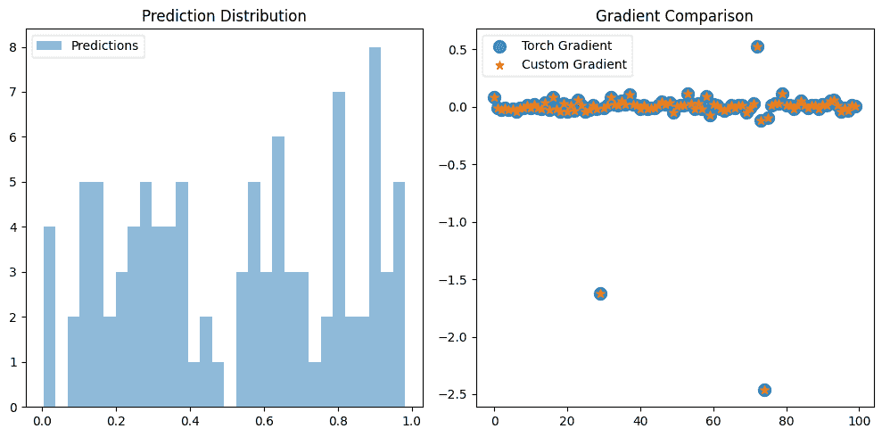
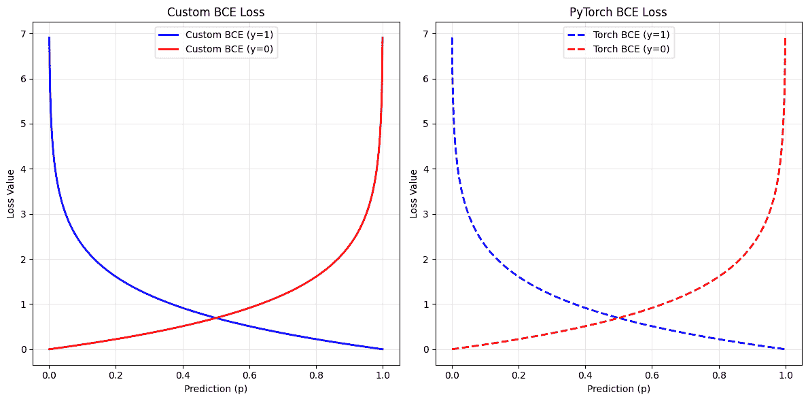
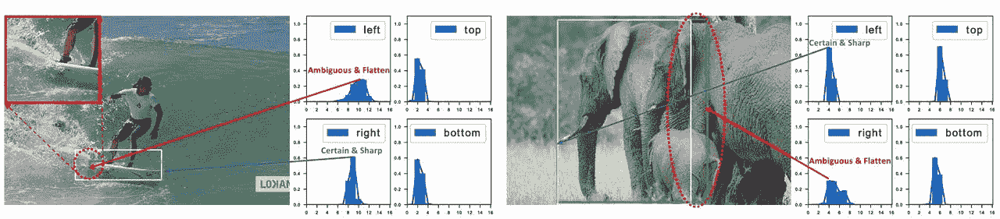
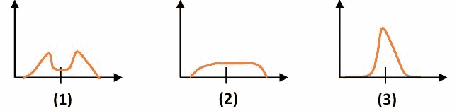

# YOLO系列模型算法中的LOSS @谭斐然 @程宏

> 来源：[https://datawhaler.feishu.cn/docx/TGrYd5ttHonbzFxs1dgckacHnpb](https://datawhaler.feishu.cn/docx/TGrYd5ttHonbzFxs1dgckacHnpb)

> **YoLo Master项目**

+   白皮书链接 [YOLO Master白皮书规划](https://sxwqtaijh4.feishu.cn/docx/WNLJdo0wxoFPuExt6rbcvB8MnPg?from=from_copylink)

+   github链接  https://github.com/datawhalechina/yolo-master

>

> 本文旨在整理YOLO系列模型算法中的LOSS，来帮助读者根据自己数据集和模型特点，尝试使用，修改和设计自己的LOSS函数。

>

> 参考资料：

+   https://github.com/ultralytics/ultralytics/blob/main/ultralytics/utils/loss.py

+   https://github.com/PaddlePaddle/PaddleDetection/tree/release/2.8.1/ppdet/modeling/losses

+   https://github.com/open-mmlab/mmyolo/tree/main/mmyolo/models/losses

## BCE Loss （Binary Cross Entropy Loss）

**Binary Cross Entropy Los**s（BCE Loss, 二元交叉熵损失）：

公式为：

L_{BCE} = - \sum_{i = 1}^{N} [y_{i} \log(\hat{y}_{i}) + (1 - y_{i}) \log(1 - \hat{y}_{i})]

其中：

N是类别数量。

y_{i}是第 个类别的真实标签（0或1），如果样本属于第 类，则 ，否则 。

\hat{y}_{i}是模型预测样本属于第 个类别的概率值（取值范围在0到1之间）。

我们能够发现，当y_{i}时，\hat{y}_{i}越接近0，y_{i}就越接近0；\hat{y}_{i}越接近1，y_{i}就越接近无穷大。同理，当y_{i}时，\hat{y}_{i}越接近1，y_{i}就越接近0；\hat{y}_{i}越接近0，y_{i}就越接近无穷大。

#### **CustomBCELoss****简单实现与测试**

```
import torch
import torch.nn as nn
import numpy as np
import matplotlib.pyplot as plt

class CustomBCELoss:
    def __init__(self, reduction=&#x27;mean&#x27;, eps=1e-7):
        self.reduction = reduction
        self.eps = eps
    
    def __call__(self, pred, target):
        # 确保输入在有效范围内
        pred = torch.clamp(pred, self.eps, 1 - self.eps)
        
        # 计算二元交叉熵损失
        # BCE = -[y * log(p) + (1-y) * log(1-p)]
        loss = -target * torch.log(pred) - (1 - target) * torch.log(1 - pred)
        
        if self.reduction == &#x27;mean&#x27;:
            return torch.mean(loss)
        elif self.reduction == &#x27;sum&#x27;:
            return torch.sum(loss)
        else:  # &#x27;none&#x27;
            return loss

def plot_bce_curves_simple():
    # 生成预测值范围
    pred = torch.linspace(0.001, 0.999, 1000, requires_grad=True)
    
    # 创建两个类别的目标值
    target_pos = torch.ones_like(pred)  # 正类 (y=1)
    target_neg = torch.zeros_like(pred)  # 负类 (y=0)
    
    # 实例化损失函数
    custom_bce = CustomBCELoss(reduction=&#x27;none&#x27;)
    
    # 计算损失值
    custom_loss_pos = custom_bce(pred, target_pos)
    custom_loss_neg = custom_bce(pred, target_neg)
    
    # 创建图像
    plt.figure(figsize=(6, 6))
    
    # 绘制自定义BCE Loss曲线
    plt.plot(pred.detach().numpy(), custom_loss_pos.detach().numpy(), 
             &#x27;b-&#x27;, label=&#x27;Custom BCE (y=1)&#x27;, linewidth=2)
    plt.plot(pred.detach().numpy(), custom_loss_neg.detach().numpy(), 
             &#x27;r-&#x27;, label=&#x27;Custom BCE (y=0)&#x27;, linewidth=2)
    plt.grid(True, alpha=0.3)
    plt.xlabel(&#x27;Prediction (p)&#x27;)
    plt.ylabel(&#x27;Loss Value&#x27;)
    plt.title(&#x27;Custom BCE Loss&#x27;)
    plt.legend()
    
    plt.tight_layout()
    plt.savefig(&#x27;bce_curves.png&#x27;, dpi=300, bbox_inches=&#x27;tight&#x27;)
    plt.show()
    plt.close()

if __name__ == &quot;__main__&quot;:
    plot_bce_curves_simple()
```



#### **CustomBCELoss****和****nn.BCELoss****效果对比测试**

在torch.nn中其实有一个BCELoss的实现，还有一个BCEWithLogitsLoss，在下面的代码里，我们可视化了CustomBCELoss和nn.BCELoss的Prediction值的分布和并进行了Gradient值的比较，测试结果显示CustomBCELoss和官方实现的nn.BCELoss效果基本相同。

> 需要注意的是，BCELoss 的输入必须是经过 Sigmoid 激活函数处理后的概率值，而 BCEWithLogitsLoss 则可以直接接受未经过 Sigmoid 处理的 logits 值，并在内部进行 Sigmoid 操作，从而提高数值稳定。

> 这里我们没有对BCEWithLogitsLoss 测试和使用，读者可以自行探索

```
import torch
import torch.nn as nn
import numpy as np
import matplotlib.pyplot as plt

def test_bce_loss():
    # 设置随机种子以确保可重复性
    torch.manual_seed(42)
    
    # 生成测试数据
    pred = torch.rand(100, requires_grad=True)
    target = torch.randint(0, 2, (100,)).float()
    
    # 实例化损失函数
    custom_bce = CustomBCELoss(reduction=&#x27;mean&#x27;)
    torch_bce = nn.BCELoss(reduction=&#x27;mean&#x27;)
    
    # 计算损失
    custom_loss = custom_bce(pred, target)
    torch_loss = torch_bce(pred, target)
    
    # 计算梯度
    custom_loss.backward()
    custom_grad = pred.grad.clone()
    pred.grad.zero_()
    
    torch_loss.backward()
    torch_grad = pred.grad.clone()
    
    # 可视化比较
    plt.figure(figsize=(10, 5))
    
    # 预测值分布
    plt.subplot(121)
    plt.hist(pred.detach().numpy(), bins=30, alpha=0.5, label=&#x27;Predictions&#x27;)
    plt.title(&#x27;Prediction Distribution&#x27;)
    plt.legend()
    
    # 梯度比较
    plt.subplot(122)
    plt.scatter(range(len(torch_grad)), torch_grad, label=&#x27;Torch Gradient&#x27;, alpha=0.8, s=100, marker=&#x27;o&#x27;)
    plt.scatter(range(len(custom_grad)), custom_grad, label=&#x27;Custom Gradient&#x27;, alpha=0.8, s=50, marker=&#x27;*&#x27;)
    plt.title(&#x27;Gradient Comparison&#x27;)
    plt.legend()
    
    plt.tight_layout()
    plt.savefig(&#x27;bce_comparison.png&#x27;)
    plt.show()
    plt.close()
    
    # 打印数值比较
    print(f&quot;Custom BCE Loss: {custom_loss.item():.6f}&quot;)
    print(f&quot;Torch BCE Loss: {torch_loss.item():.6f}&quot;)
    print(f&quot;Maximum gradient difference: {torch.max(torch.abs(custom_grad - torch_grad)).item():.6f}&quot;)

if __name__ == &quot;__main__&quot;:
    test_bce_loss()
    
# Custom BCE Loss: 0.939380
# Torch BCE Loss: 0.939380
# Maximum gradient difference: 0.000000
```



测试BCE Loss的激活曲线值

```
import torch
import torch.nn as nn
import numpy as np
import matplotlib.pyplot as plt
# from custom_bce import CustomBCELoss

def plot_bce_curves():
    # 生成预测值范围
    pred = torch.linspace(0.001, 0.999, 1000, requires_grad=True)
    
    # 创建两个类别的目标值
    target_pos = torch.ones_like(pred)  # 正类 (y=1)
    target_neg = torch.zeros_like(pred)  # 负类 (y=0)
    
    # 实例化损失函数
    custom_bce = CustomBCELoss(reduction=&#x27;none&#x27;)
    torch_bce = nn.BCELoss(reduction=&#x27;none&#x27;)
    
    # 计算损失值
    custom_loss_pos = custom_bce(pred, target_pos)
    custom_loss_neg = custom_bce(pred, target_neg)
    torch_loss_pos = torch_bce(pred, target_pos)
    torch_loss_neg = torch_bce(pred, target_neg)
    
    # 创建图像
    plt.figure(figsize=(12, 6))
    
    # 绘制自定义BCE Loss曲线
    plt.subplot(121)
    plt.plot(pred.detach().numpy(), custom_loss_pos.detach().numpy(), 
             &#x27;b-&#x27;, label=&#x27;Custom BCE (y=1)&#x27;, linewidth=2)
    plt.plot(pred.detach().numpy(), custom_loss_neg.detach().numpy(), 
             &#x27;r-&#x27;, label=&#x27;Custom BCE (y=0)&#x27;, linewidth=2)
    plt.grid(True, alpha=0.3)
    plt.xlabel(&#x27;Prediction (p)&#x27;)
    plt.ylabel(&#x27;Loss Value&#x27;)
    plt.title(&#x27;Custom BCE Loss&#x27;)
    plt.legend()
    
    # 绘制PyTorch BCE Loss曲线
    plt.subplot(122)
    plt.plot(pred.detach().numpy(), torch_loss_pos.detach().numpy(), 
             &#x27;b--&#x27;, label=&#x27;Torch BCE (y=1)&#x27;, linewidth=2)
    plt.plot(pred.detach().numpy(), torch_loss_neg.detach().numpy(), 
             &#x27;r--&#x27;, label=&#x27;Torch BCE (y=0)&#x27;, linewidth=2)
    plt.grid(True, alpha=0.3)
    plt.xlabel(&#x27;Prediction (p)&#x27;)
    plt.ylabel(&#x27;Loss Value&#x27;)
    plt.title(&#x27;PyTorch BCE Loss&#x27;)
    plt.legend()
    
    plt.tight_layout()
    plt.savefig(&#x27;bce_curves.png&#x27;, dpi=300, bbox_inches=&#x27;tight&#x27;)
    plt.show()
    plt.close()
    
    # 计算两种实现的最大误差
    max_diff_pos = torch.max(torch.abs(custom_loss_pos - torch_loss_pos)).item()
    max_diff_neg = torch.max(torch.abs(custom_loss_neg - torch_loss_neg)).item()
    print(f&quot;Maximum difference for positive class (y=1): {max_diff_pos:.8f}&quot;)
    print(f&quot;Maximum difference for negative class (y=0): {max_diff_neg:.8f}&quot;)

if __name__ == &quot;__main__&quot;:
    plot_bce_curves()
    
# Maximum difference for positive class (y=1): 0.00000024
# Maximum difference for negative class (y=0): 0.00000024
```



这里可以看到，CustomBCELoss和官方实现的nn.BCELoss的Loss Value对Predition值的响应效果也基本相同。

## DFL（Distribution Focal Loss）

Distribution Focal L**oss(**DF**L)，是**2020年提出的一种损失函数，这种损失被设计用来解决目标检测中常常会出现目标边界模糊的问题，例如，这里在检测冲浪板时，由于目标的左边缘被海水遮挡，所以不能够直接得到一个明确的左边界；而检测大象的过程中，出现了目标重叠，导致边界难以界定。对于边界模糊的问题，我们能够得到目标边界的概率分布，而不是一个确定的边界。



但是我们希望，目标边界的分布最好能够满足真实值附近的概率较大，这样可以快速收敛于理想值，因此，我们使用DFL作为损失函数，得到一个理想的边界分布。从形状来看，更尖锐的分布更为理想，例如下面的三种分布，第三种分布就优于前两种。



由于是概率分布，因此这些目标边界的分布都满足如下的表达式：

而对于真实标签y_{i}，有

我们将其离散化，令概率分布为y_{i},则有

其中y_{i}是被量化的份数，y_{i}是预测值。而理想的概率分布是尖锐的，这就要求y_{i}和y_{i}（其中y_{i}）的概率值要尽可能大。因此，设计出DFL函数，表达式如下：

其中为了简单表示，我们用y_{i}代替y_{i}。当y_{i}取得最小值时，有y_{i},y_{i}。此时利用 进行计算，能够直接得出y_{i}。

### 用于training的DFL

[ultralytics/ultralytics/util](https://github.com/ultralytics/ultralytics/blob/1e908e4374699587f80b602e662a26ce07bde946/ultralytics/utils/loss.py#L65-L88C33)s/loss.py#L65-L88C33

```
class DFLoss(nn.Module):
    &quot;&quot;&quot;Criterion class for computing DFL losses during training.&quot;&quot;&quot;

    def __init__(self, reg_max=16) -&gt; None:
        &quot;&quot;&quot;Initialize the DFL module.&quot;&quot;&quot;
        super().__init__()
        self.reg_max = reg_max

    def __call__(self, pred_dist, target):
        &quot;&quot;&quot;
        Return sum of left and right DFL losses.

        Distribution Focal Loss (DFL) proposed in Generalized Focal Loss
        https://ieeexplore.ieee.org/document/9792391
        &quot;&quot;&quot;
        target = target.clamp_(0, self.reg_max - 1 - 0.01)
        tl = target.long()  # target left
        tr = tl + 1  # target right
        wl = tr - target  # weight left
        wr = 1 - wl  # weight right
        return (
            F.cross_entropy(pred_dist, tl.view(-1), reduction=&quot;none&quot;).view(tl.shape) * wl
            + F.cross_entropy(pred_dist, tr.view(-1), reduction=&quot;none&quot;).view(tl.shape) * wr
        ).mean(-1, keepdim=True)
```

# 各章节版本中的LOSS 演变

## YOLOv1

**YOLO****v1采用的**loss函数是均方误差（Mean Squared Error，MSE），采用这种函数的好处是便于优化。

但是，不能仅仅采用简单的直接相加，因为这样会导致两个问题：

+   定位误差（localization error）和分类误差（classification error）具有相同权重

+   由于大多数的网格（grid cell）并不包含目标，所以它们的置信度值（confidence score）为0，这样会导致整体的置信度值趋于0，从而使得模型鲁棒性变差并使得模型过早发散。

因此，定义了两个参数y_{i}和y_{i}。

+   y_{i}用来增加定位误差的权重，一般取y_{i}；

+   y_{i}用来减少那些不含有目标的网格的置信度权重，一般取y_{i}。

另外，图像的尺寸也会对于loss产生影响，尺寸较大的图像中目标也大，尺寸较小的**图像中目标也小，因**此应该降低尺寸对于loss的影响。因此，在计算loss时，采用宽度和高度的平方根来减少图像尺寸带来的影响。

具体的loss计算公式如下所示：

其中前两项属于定位误差，

第三项和第四项属于分类误差，

最后一项属于置信度误差。

## YOLOv2

**在YO**LOv1的基础上，v2专门**增加了一项关于无目标的**loss，以及训练过程中预测框与Anchor框的坐标loss。

+   无目标loss

这一项表示在没有检测到目标的情况下产生的loss。具体来说，y_{i}是指当y_{i}小于y_{i}时，这一项为1，否则为0，这意味着当检测框与真实框的IOU值小于Thresh时，会被认为是没有检测到目标，这一项loss有效。y_{i}与v1一样，代表权重， 则代表目标的预测置信度。没有目标，意味着真实置信度为0，所以本质上，还是预测值和真实值的平方误差。

+   预测框和Anchor框的坐标loss

这一项表示在训练过程中预测框和Anchor框的loss，这一项的设置是为了更好地促进学习，使得预测框能够更快地收敛到Anchor框。其中 代表这一步只需要在前12800步迭代中进行计算，在之后的迭代中视为效果已经稳定。而这里也是采取了平方误差的形式，计算了Anchor框和预测框的坐标和大小的误差。

其它部分与v1类似，也是包含了定位误差、分类误差和置信度误差，这里不再赘述。

具体的loss计算公式如下所示：

其中 代表grid cell， 代表Anchor。

## YOLOv3

YOLOv3的loss函数与v1和v2的基本类似，还是分为目标框回归（bounding box regression，bbox ）误差、分类误差和置信度误差，

**不同之处在于，**对于分类误差和置信度误差采取了二元交叉熵损失进行定义，具体如下所示：

其中，第一项和第二项表示目标框回归误差，包括 等参数；

第三项和第四项表示分类误差，

其中的第四项的 是那些不含有目标的预测框的权重，由于一幅图象中多数内容并不包含有待检测的目标，因此需要降低其所占的权重(0-1之间)，否则会使识别网络更倾向于预测单元格中不含有目标；

第五项代表置信度误**差。其中，**在定位误差那里分别乘以 ,这样能够更好地识别小目标。

## YOLOv4

Yolov4的loss函数比起v3来说，最大的**变化是将目标**框回归误差的形式由MSE变为CIOU误差形式。

> 如果[大家想要](https://zhuanlan.zhihu.com/p/159209199)了解什么是CIOU，可以查看知乎链接，这里非常详细地解释了IOU、DIOU、GIOU、CIOU等概念。

> YOLO Master的[YOLO系列算法的基本原理与网络结构 @彭彩平 @程宏 @胡博毓](https://wvet00aj34c.feishu.cn/docx/MKUhdQ9CmoIcR2x2TXrcBfY5ndh?from=from_copylink)文档中的**IOU部分**也有更多深入的总结

具体来说，其定义如下所示：

可以看到，原本对于 等参数的MSE损失，变为了一个关于 的表达式，其它的部分没有发生变化。

## YOLOv5

Yolov5的loss函数与v4的形式基本一致，

**区别就在于在置信度损失方面，v**5对于不同大小目标设置了不同的权重：

+   预测小目标（下采样8倍）时，权重为4.0；

+   预测中等目标（下采样16倍）时，权重为1.0；

+   预测大目标（下采样32倍）时，权重为0.4，

这样做能够更好地**平衡不同尺寸目标的损失权重**。具体来说，公式如下：

## YOLOv6

YOLOv6比起之前版本的YOLO来说，loss的形式有了较大的变化，具体如下所示：

### 分类损失（**VFL取代BCE**）

在YOLOv6中，采用了**VFL**（VariFocal Loss）作为分类损失。VFL的定义如下所示：

其中，y_{i}代表被预测得到的IOU-aware classification score，而y_{i}代表target score。

不难看出，当 时，比起BCE，VFL多乘了一个系数，

这样做的好处在于，当IOU很大（1）或很小（0）时，分类损失不会像BCE那样极端的小（0）或大（1），而只是接近这些极端值。另外，当y_{i}时，代表负样本的损失，为了减小负样本的损失带来的影响，VFL采用了y_{i}和y_{i}等因子来抑制负样本的损失。

### 目标框回归损失（bbox regression loss）

YOLOv6将bbox regression loss又分为IOU-series loss以及probability loss两部分。

1.  **IOU-series loss**（SIoU/GIoU取代CIoU）

IO**U-se**ries loss和YOLO**之前版本**的bbox regression loss意义相近，都是在刻画bbox的 等参量的损失。在YOLOv6-N和YOLOv6-T中，这部分损失采用SIoU，而其它YOLOv6模型采用GIoU。

> 关于[SIoU](https://arxiv.org/abs/2205.12740)和[GIoU](https://arxiv.org/abs/1911.08287)的概念，可以参考它们的论文, 点击超链接即可。

1.  Probability loss

**这个loss是v6版本**提出的全新概念，主要是**考虑到目**标边界的模糊性或不确定性，从而将目标边界建模为概率分布。

在YOLOv6-M和YOLOv6-L中，这部分损失采用Distribution Focal Loss(DFL)，具体的介绍在上面的概念部分，这里不再赘述。

## YOLOv7

YOLOv7的loss**与YOLOv5基本一致**，都是保持了bbox误差使用CIoU损失，分类误差和置信度误差使用了BCE，没有过多的特别之处。

## YOLOv8

**YOL**Ov8的loss由**类别损失**和**定位损**失两部分构成，其中类别损失采用BCE，而定位损失采用了CIoU和DFL，这些概念前文均有所提及，不再赘述。其表达式如下：

其中 代表类别损失， 是其权重，默认取 ； 代表IoU损失， 是其权重，默认取 ； 代表DFL损失， 是其权重，默认取 。

## YOLOv9

由于YOLOv9在设计上更加注重网络**结构方面的创新，因**此在损失函数的设计方面与v7基本保持一致，具体来说，还是bbox误差使用CIoU损失，分类误差和置信度误差使用了BCE。（和v7保持一致而不是v8可能因为v9的作者同时也是v7的作者吧）

## YOLOv10

**YOL**Ov10的loss**设计整体**与**v8较**为相似，都是类别损失采用BCE，而定位损失采用了CIoU和DFL，不过有一些细微的差别，具体来说

+   函数形式相同，但是有一些**超参数存在差异**

究其原因，是v8和v10结构的区别。YOLOv8只有一个耦合头，目标检测中的回归任务（bbox regression loss）和分类任务（classfication loss）共享同一个特征提取网络；而YOLOv10有两个解耦头，将分类和回归两个任务分开进行。

+   TaskAlignedAssigner的影响

之前的版本在确定正负样本时，主要依据是预测框和真实框的IoU；而v10设计了一个任务对齐分数，其综合考虑了分类得分和回归得分，这样做能够选择置信度高同时与真实框IoU大的样本作为正样本。因此，TaskAlignedAssigner对于loss也存在一定的影响。

## YOLO11

**YOL**Ov11与Y**OLOv10没有**太大差别，分类损失使用BCE，回归损失用CIoU+DFL，加权相加即可。

## YOLO12

YOLOv12由于开源时间不长，难以找到参考资料。从论文中能看到，损失由Box loss、Class loss、DFL等构成。

# References

[[](https://www.cv-foundation.org/openaccess/content_cvpr_2016/papers/Redmon_You_Only_Look_CVPR_2016_paper.pdf)1] You Only Look Once:  Unified, Real-Time Object Detection

[[2] YOLO9000:  Bett](https://openaccess.thecvf.com/content_cvpr_2017/papers/Redmon_YOLO9000_Better_Faster_CVPR_2017_paper.pdf)er, Faster, Stronger

[[3] YOLOv2损失函数](https://blog.csdn.net/qq_37619128/article/details/122393695?spm=1001.2014.3001.5506)

[4] 目标检测算法之YOLOv2损失函数详解

[5] darknet源码解读-yolov2损失计算

[[6] YOLOv3:An Inc](https://arxiv.org/abs/1804.02767)remental Improvement

[[7] YOLOv9(4): DFL（Dist](https://blog.csdn.net/tecsai/article/details/139329699)ribution Focal Loss）

[[8](https://proceedings.neurips.cc/paper/2020/hash/f0bda020d2470f2e74990a07a607ebd9-Abstract.html)] Generalized Focal Loss: Learning Qualified and  Distributed Bounding Boxes for  Dense Object Detection

[[9] YOLOv4损失函数](https://blog.csdn.net/qq_37619128/article/details/122448101)

[10] YOLO V4 — 损失函数解析（特详细！）

[[11] YOLOV3损失函数](https://blog.csdn.net/qq_34795071/article/details/92803741?spm=1001.2101.3001.6650.2&utm_medium=distribute.pc_relevant.none-task-blog-2%7Edefault%7EBlogCommendFromBaidu%7ECtr-2-92803741-blog-100986249.235%5Ev43%5Epc_blog_bottom_relevance_base1&depth_1-utm_source=distribute.pc_relevant.none-task-blog-2%7Edefault%7EBlogCommendFromBaidu%7ECtr-2-92803741-blog-100986249.235%5Ev43%5Epc_blog_bottom_relevance_base1&utm_relevant_index=5)

[12] 你对YOLOV3损失函数真的理解正确了吗？

[[](https://arxiv.org/pdf/2004.10934)13] YOLOv4: Optimal Speed and Accuracy of Object Detection

[14] 【YOLOv5】损失函数源码解析

[[15] YOLOv6: ASingle-Stage Object Detectio](http://arxiv.org/pdf/2209.02976)n Framework for Industrial  Applications

[16] varifocal loss（VFL）介绍

[[](https://arxiv.org/pdf/2008.13367)17] VarifocalNet: An IoU-aware Dense Object Detector

[18] Yolov7学习笔记（六）损失函数计算

[[1](https://openaccess.thecvf.com/content/CVPR2023/papers/Wang_YOLOv7_Trainable_Bag-of-Freebies_Sets_New_State-of-the-Art_for_Real-Time_Object_Detectors_CVPR_2023_paper.pdf)9] YOLOv7: Trainable bag-of-freebies sets new state-of-the-art for real-time object detectors

[20] 【YOLOv8】损失函数

[[21] YOLOv9: Learning What You Want to Learn ](https://islab.ulsan.ac.kr/files/announcement/851/yolov9.pdf) Using Programmable Gradient Information

[22] YOLOv9理性解读 | 网络结构&损失函数&耗时评估

[[23] YOLOv10: Real-Time End-to-](https://proceedings.neurips.cc/paper_files/paper/2024/file/c34ddd05eb089991f06f3c5dc36836e0-Paper-Conference.pdf)End Object Detection

[24] yolov10/v8 loss详解

[[](https://arxiv.org/pdf/2410.17725)25] YOLOV11: AN OVERVIEW OF THE KEY ARCHITECTURAL  ENHANCEMENTS

[26] 目标检测算法——YOLOV11——算法详解

[[](https://arxiv.org/pdf/2502.12524)27] YOLOv12: Attention-Centric Real-Time Object Detectors