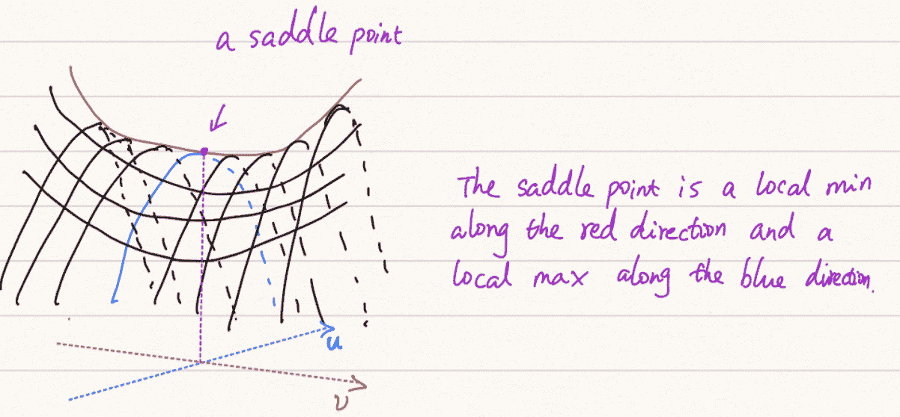
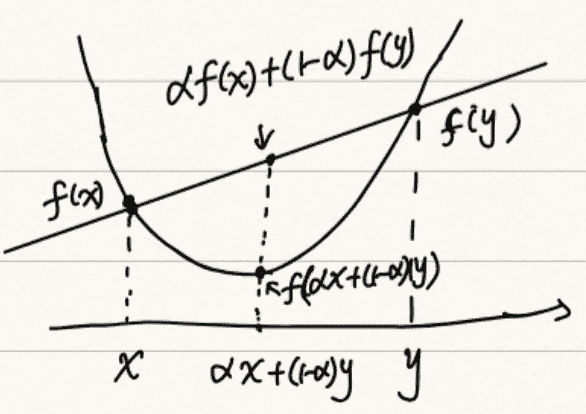
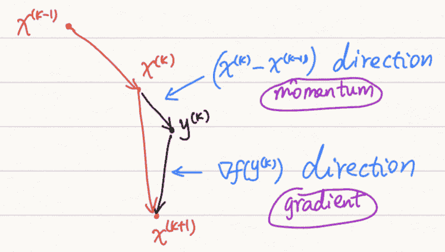
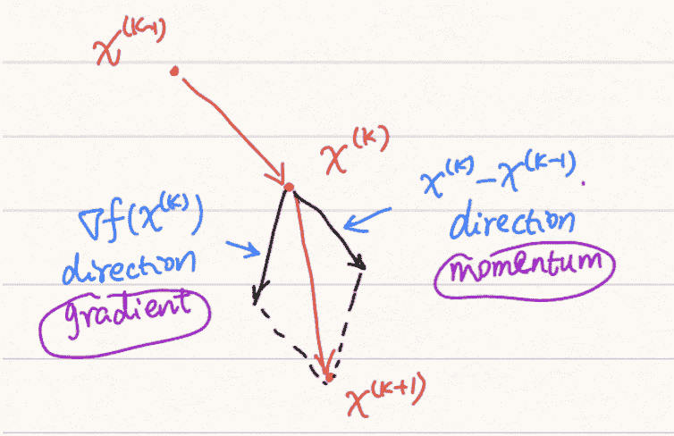

# 【优化基础】梯度下降的来历和典型数值算法

> 来源：[https://datawhaler.feishu.cn/docx/GU1XdyjwLookwIxZoZ1codk7ngP](https://datawhaler.feishu.cn/docx/GU1XdyjwLookwIxZoZ1codk7ngP)

> 本笔记来自香港科技大学蔡剑锋老师的 Matrix Computation and Optimization 课程

**带噪线性回归**

实际问题中的数据点往往带有噪声：

（  为参数，  为噪声项），而这往往使得直接解线性方程组 a_i^{\top}x = b_{i} 不合实际也不明智。替代方案是最小化下面的损失：

其中的 \ell(\cdot) 就是**损失函数**，它度量预测和标签值之**间的距离。当**损失函数是平方损失，即 \ell(a_{i}^{\top}x, b_{i}) = (a_{i}^{\top}x - b_{i})^{2} 时，问题 P 称为最小二乘问题。在二分类问题中，我们将损失定义为

此时 P 称为**Logistic回归**。本章研究如何解决形如 P 的无约束优化问题。

## 3.1 光滑无约束优化的基础

### 3.1.1 优化的若干基本概念

优化问题的长相往往如下

+   最大化 -f(x) 相当于最小化 f(x)

+   **（零阶最优条件）** 优化问题的解 x^{*} 满足对任意其他 $x \in \mathbb{R}^{n}$，都有 f(x^{*}) \leqslant f(x)

+   我们常常将最优解写为  ，我们也称它为 f 在 \mathbb{R}^{n} 上的 全局最优解（global minimizer）

+   对于某些函数，全局最优解不一定存在（$f(x) = x$），若存在，也不一定唯一（ ）。

+   使得函数在某一邻域最小的那个 x_{*} 称为函数的局部最优解（local minimizers）。形式上地写就是对某正数  ，满足：  ，\forall x, \text{s.t. } \|x - x_{*}\| \leqslant \varepsilon

+   全局最优解一定是局部最优解，反之不一定

### 3.1.2 一阶最优条件

> 定理（一阶最优条件）

> 如果函数 f: \mathbb{R}^{n} \rightarrow \mathbb{R} 在 x^{*}\in \mathbb{R}^{n} 处可微，则  .

> **证明**

> 将 f 在 x^{*} 附近展开，有   其中 R(\cdot, \cdot) 是关于 \|x - x^{*}\|_{2} 的高阶项，也即  \|x - x^{*}\|_{2}  。接下来我们用反证法。假设 x^{*} 是全局最优解，但梯度不为零，我们就能构造出一个对应函数值比它更低的 \tilde{x} ，以达到矛盾。我们取一个小数 \|x - x^{*}\|_{2} ，构造 \|x - x^{*}\|_{2}。 \|x - x^{*}\|_{2} 的展开告诉我们 \|x - x^{*}\|_{2}其中翻译第二个式子我们得到：  \|x - x^{*}\|_{2}，使得 \|x - x^{*}\|_{2}。我们取 \|x - x^{*}\|_{2}，就得到 \|x - x^{*}\|_{2} ，这导致了矛盾。因此原命题正确。

+   一阶条件（梯度为零）是**必要条件****，反推不一**定成**立。**梯度为零的点还可能是局部最大值或是鞍点

+   沿着某个方向，函数的鞍点是局部最小值，而沿着另一个方向，同一鞍点却是局部最大值

### 3.1.3 临界点（critical points）

现在对函数满足一阶最优性条件的点做专门的讨论。

+   全局、局部最小值点满足一阶最优性条件，但反之不正确

+   如果梯度为零，而 Hessian 矩阵正定（所有特征值都大于零）；则这是一个局部最小值点

+   如果梯度为零，而 Hessian 矩阵负定（所有特征值都小于零）；则这是一个局部最大值点

+   如果梯度为零，而 Hessian 矩阵的特征值有正有负；则这是一个鞍点

+   **如果梯度为**零，而 Hessian 矩阵有零特征值，那就麻烦咯（例如 $f(x) = x^{3}$，$x = 0$ 不是局部最值，也不是鞍点）

对于大多数算法，我们只能找到临界点。 那么什么情况下临界点就是全局最小值点？

### 3.1.4 凸性（convexity）

> **定义（凸性）**

> 某函数 f 是凸函数，当且仅当对任意的 x,y 和  ，有 f(\alpha x + (1-\alpha) y) \leqslant \alpha f(x) + (1- \alpha) f(y)

形象的理解是，在函数曲线上取两个点画一条线段，两点对应的自变量直线连接对应的函数曲线总是落在这条线段的下方。

> **示例（凸函数的若干例子）**

1.  f(x) = \|x\|_{2}^{2}

1.  f(x) = \|x\|^{2}

1.  任意的仿射函数

1.  凸函数的线性组合（权重为正时）

1.  （反例）凸函数的一般线性组合

1.  凸函数 f 和仿射函数 g 的复合 g \circ f

1.  （反例）凸函数 f 和凸函数 g 的复合 f \circ g

### 3.1.5 凸性的若干等价定义

+   零阶条件：f(\alpha x + (1-\alpha) y) \leqslant \alpha f(x) + (1- \alpha) f(y); \forall x,y,a\in[0,1]

+   一阶条件：f(y) \geqslant f(x) + \left\langle \nabla f(x), y - x \right\rangle; \forall x,y, f \in \mathscr{C}^{1}

+   二姐条件： ，且 \nabla^{2}f(x) 总是对称、半正定矩阵

> **定理（凸性的一阶条件）**

> 如果 f 可微，则其为凸函数当且仅当对任意 x,y ，有 f(y) \geqslant f(x) + \left\langle \nabla f(x), y - x \right\rangle.

> **证明**

> 一方面（假设是凸函数），首先考虑单变量的情形。假设 f: \mathbb{R} \rightarrow \mathbb{R} 是凸函数，根据凸函数性质有  于是

> \end{align*} 令  ，我们就得到  。现在再考虑函数  ，由于 f 是凸函数可以推出 g 也是凸函数： g 我们分别将 0 和 1 代入，得到  g此时  g， g.  g所以有 g。

> 另一方面（假设函数可微，条件成立）

> 如果 x = y 显然有 g。

> 如果 g，构造 g，我们有 g考虑 \alpha \times (1) + (1-\alpha) \times (2) ，得到  g 代入 g，得到 \begin{align*}

> **定理（凸性的二阶条件）**

> 如果 \nabla^{2} f 存在，则其为凸函数当且仅当 \nabla^{2}f 总是对称、半正定矩阵

> **证明**

> 我们想要证明凸性和 Hessian 矩阵之间的联系，就需要让 Hessian 矩阵出现。也即我们要考虑函数的二阶展开 \nabla^{2}f 其中余项满足对应的条件，可以舍去，这里不再说明。由于一阶条件我们已经证明过，也即可微凸函数当且仅当 \nabla^{2}f，对比上面的展开，只需证明展开中的二阶项总是非负。这一点由 Hessian 矩阵的对称半正定性质不难得到。

> **定理（凸函数的全局最优性）**

> 凸函数的临界点必定是全局最小值点

> **证明**

> 设 x \in \mathbb{R}^{n} 是凸函数函数 f 的临界点。由于 f 是凸函数，根据一阶条件，对任意  ，有 f(y) \geqslant f(x) + \left\langle \nabla f(x), y - x \right\rangle. 而由于 x 是临界点，所以 \nabla^{2}f。因此有对任意 \nabla^{2}f，都有 \nabla^{2}f ，也即 x 是全局最小值点。

因此对于可微的凸函数 f 而言，解优化问题 P 相当于找梯度为零的点。因此该情况下的数值算法能保证找到全局最优解

## 3.2 梯度下降

### 3.2.1 梯度下降算法的导出

由于有些函数 f 可能太过复杂，我们考虑下面的简单的迭代算法。给定一个对最优解的粗略估计  ，用该算法迭代地得出一个更好的估计  ：

1.  第一步：找 x^{(k)} 的一个邻域，然后取邻域中使得函数值最低的点作为下一个迭代**结果 \**nabla^{2}f 其中 \alpha_{k} > 0 是控制邻域大小的一个（超）参数。这样的算法称为 近端算法，它看起来并不实际，因为每次迭代所解的子优化问题并不比原问题（寻找全局最小值）简单。

1.  第二步：使用 Taylor 展开做 Sub-Prox 中邻域内 f(x) 的线性近似： \nabla^{2}f 这样就得到了相比于上面更简单的迭代： f为使得上面的迭代切实可行，我们需要给出一个 Sub-GD 问题的显式解，这等价于解下面的问题： f

1.  现在考虑**这个优化**问题的目标函数： f 现在讨论我们这两部放缩的去等条件。第一个的条件是f 要和梯度向量共线，第二个的条件是 f 要正好卡在邻域的边缘。同时达到这两个取等条件时，我们就有f。代入 Sub-GD 中，就得到著名的 梯度下降 算法：

f

换个思路，我们也可以这样推出梯度下降算法。线性近似的子问题 LinApprox 仅仅在 x 与 x^{(k)} 接近时才是准确的，如果我们选择同时最小化 LinApprox 以及 x 与 x^{(k)} 的距离，就得到

其中 \alpha_{k} > 0 是平衡这两项重要性的参数。我们对 F(x) 分别求一阶导和二阶导，得到 f \begin{align*} \nabla F(x) &= \nabla f(x^{(k)}) + \frac{1}{\alpha_{k}} (x - x^{(k)}),\\ \nabla^{2}F(x) &= \frac{1}{\alpha_{k}} I,&\text{满足二阶条件} \end{align*}$$可见 f F(x)$$ 是凸函数（从原本的形式来看， f F$ 是光滑函数），由之前得到的凸函数的最优性，可以得到上面的优化问题的解是梯度为零的解，也就是 f \boxed{x = x^{(k)} - \alpha_{k}\nabla f(x^{(k)})}$$

### 3.2.2 不同距离度量下的梯度下降

除了 Euclid 距离，我们也可以使用其他距离来构造对应的梯度下降算法。

+   如果换为加权 Euc**lid 距离**，即 f，其**中 W 是一个半正**定矩阵**，得到的算法是 f这就**是加权梯度下降，但其中 W 的选择很伤脑筋。这一族算法中包含著名的 Newton 算法 和 半 Newton 算法。

+   如果将其**换为类距离的函数，例如 Bregma**n 散度 D_{\varphi}(x, x^{(k)}) = \varphi(x) - \varphi(x^{(k)}) - \left\langle \nabla \varphi(x^{(k)}), x - x^{(k)} \right\rangle (这是个严格凸函数)，我们就得到了镜像梯度下降（mirror gradient descent）、指数梯度下降（exponentiated gradient descent）、熵下降（entropic descent）、自然梯度下降（natural gradient descent）。

+   **如果将其换为用于约束优化的合适函**数，我们就得到**了条件梯度下降(condit**ional gradient descent)，也就是所谓的Frank-Wolfe 算法，我们将在后文中介绍。

### 3.2.3 步长 \alpha_{t} 的选取

上文中梯度下降算法中的超参数 \alpha_{t} 叫做 **步长****，炼丹**（做深度学习）的朋友称其为 学习率。我们应该如何选取它？本节将对此进行讨论。

#### 3.2.3.1 常数

当我们决定将 \alpha_{k} 设置为一个常数时其取值仅通过一阶展开无法看出。于是我们考虑二阶展开：  让我们来分析二阶项。根据 Cauchy-Schwartz 不等式，我们可以得到上界   可以看到二阶项的值和 Hessian 矩阵的谱范数相关。我们假设谱范数有界，即  ，原来的二阶展开就有下面的上界

我们为了保证每次更新都使得函数值更低，就要要求  ，也就是  。

#### 3.2.3.3 回溯线性搜索 (backtracking line search)

本方法的主要思路是每次尝试合适的步长。如果步长太大，就乘一个缩小因子  。我们取一个较大的  ，然后执行下面的算法

+   若每一次更新的步长可以恰当选取，梯度下降算法总会收敛至目标函数的临界点。进一步地，如果目标函数是凸的，梯度下降总会收敛到全局最小值

### 3.2.4 梯度下降的动量加速

#### 3.2.4.1 Nestrov 梯度下降

一言以蔽之，Nestrov 梯度下降是动量和梯度方向向量的线性组合。

+   Nestrov 梯度下降算法的速度大致是经典梯度下降的两倍

#### 3.2.4.2 经典动量梯度下降

经典的动量梯度下降算法取上一次的更新方向和本次梯度的线性组合得到更新后的参数。

+   关于 \beta_{k} 的选取还有其他方法，如非线性共轭梯度法（nonlinear conjugate gradient method）

+   对于某些目标函数，该算法收敛速度很快

#### 3.2.4.3 Nestrov 算法和共轭梯度法的对比

+   都是用了动量

+   Nestrov 算法用的是加动量之后的梯度，共轭梯度法用的是加动量之前的梯度（Nestrov 算法看起来更好一些）

+   共轭梯度法每次更新都包含一个子优化问题（用于求解部分参数），Nestrov 算法使用的是预先定义好的参数