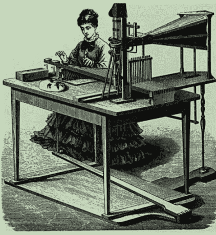
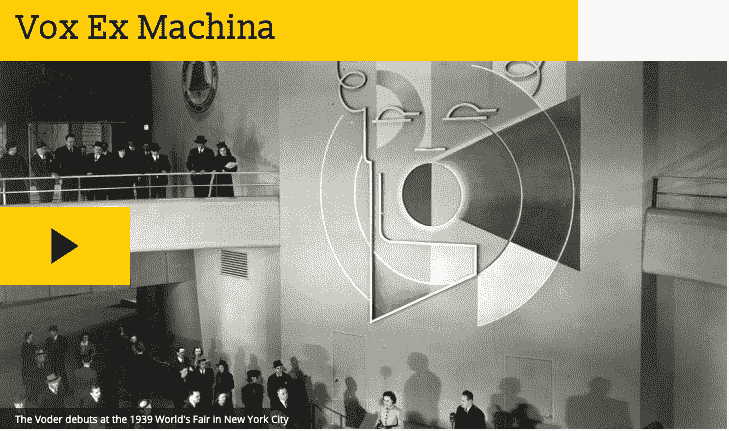
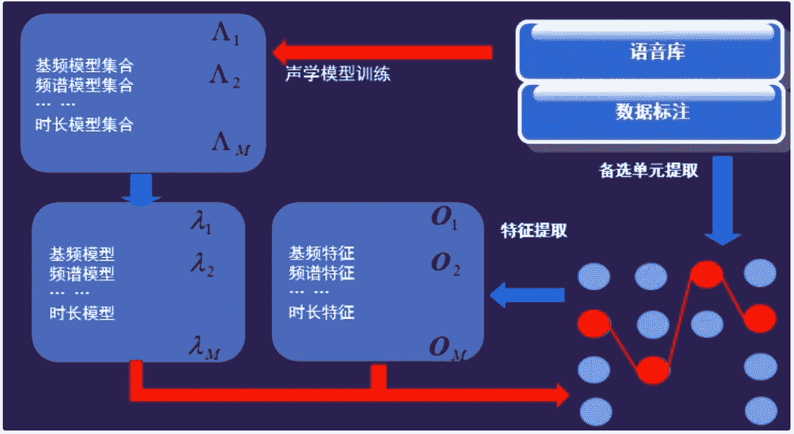
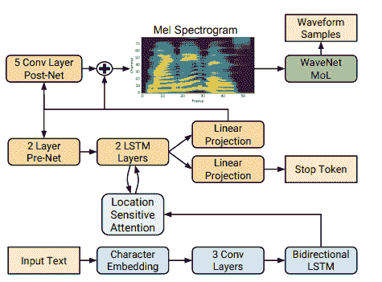
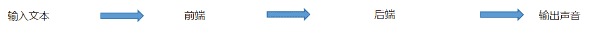
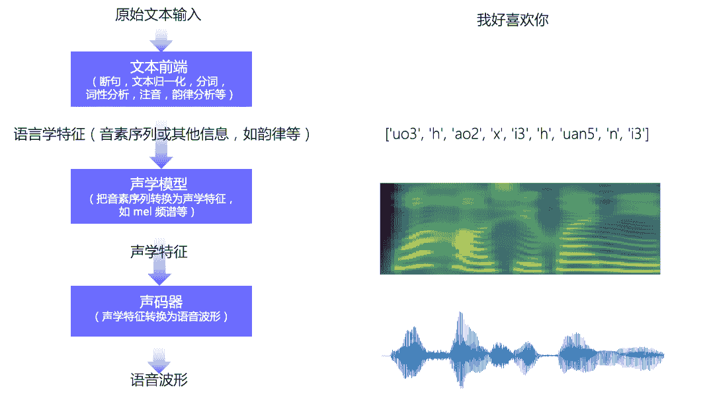

# 1、AI语音概述

> 来源：[https://datawhaler.feishu.cn/docx/DwGFdBA55o3Y08xPN1hclTRDnuh](https://datawhaler.feishu.cn/docx/DwGFdBA55o3Y08xPN1hclTRDnuh)

# 1.1语音技术发展简史

+   **机械式语音合成（1784-）**

**图一**

机械式语音合成代表了早期尝试创建机器生成语音的技术。这类技术主要依赖于物理装置模仿人类声道的声音产生机制。最早期的机械式语音合成设备可以追溯到18世纪，Wolfgang von Kempelen在1770年左右发明了一种名为“会说话的机器”的装置，该装置通过操纵一系列模拟人类声道和声带功能的组件来生成可理解的语音。

+   **电子语音合成 (1939-)**

**图二**

电子语音合成时代自1939年开始，标志着从机械装置向使用电子元件生成语音的重大转变。这一时代的开端可以追溯到贝尔实验室的Vocoder（声码器），这是一种能够分析和合成人类语音的设备。然而，真正将电子语音合成技术推向公众视野的是1939年的世博会，当时展示了一种能够通过电子方式产生语音的技术。

+   **计算机语音合成****（****1980****-）**

+   早期方法：formant synthesis...

+   统计参数语音合成

+   HMM

+   DNN

+   波形拼接语音合成

+   混合方法

+   参数轨迹指导的波形拼接

+   端到端神经网络语音合成

+   声学模型+声码器

+   “完全”端到端方法

**图三**

这一时期见证了语音合成技术的显著进步，包括单元选择合成技术的发展，这种方法通过预先录制的语音数据库中挑选最佳语音片段拼接成完整的句子，大大提升了合成语音的自然度。同时，统计参数语音合成也开始崭露头角，这种方法使用统计模型生成语音信号的参数。

+   **语音合成的深度学习时代****（****2010****-）**

+   参数合成+帧数对齐+信号声码器

+   序列到序列+神经声码器

+   “完全”端到端

**图四**

语音合成的深度学习时代标志着语音合成技术从传统的基于规则和统计模型的方法向使用深度神经网络进行端到端语音生成的重大转变。这一时代的开端可以追溯到2010年代中期，随着计算能力的增强以及大规模数据集的可用性增加，深度学习开始在语音合成领域取得突破性进展。

# 1.2 核心原理解析

## 语音识别（ASR）流程：

语音识别本质是让机器学会"听懂人话"，就像教婴儿学语言的过程：

1.  **耳朵接收声音** → 麦克风捕捉声波转为数字信号

1.  **理解发音规律** → 分析声音特征建立发音模型

1.  **联系语言规则** → 结合语法习惯组合成完整句子

**工作流程:**

1.  **录音与清理（预处理）**

+   **录音过程**：手机/麦克风像录音笔一样捕捉声音，把声波变成电脑能读懂的波形图

+   **降噪处理**：类似美颜相机的"降噪滤镜"，自动过滤背景杂音（如键盘声、风声）

+   **切分声音**：将连续说话切成25毫秒的小片段（类似电影每秒24帧），每段保留10毫秒重叠防止漏字

1.  **特征提取（找特点）**

+   **模仿人耳听觉**：通过特殊滤波器提取类似人耳敏感的中低频特征（类似区分男声女声的关键频率）

+   **制作声音指纹**：把每段声音转化为40个左右的数字密码（MFCC特征），这些密码能代表发音特点

1.  **建立发音模型（声学建模）**

+   **传统方法**：像教拼音一样建立发音规则库，通过统计不同发音的概率组合（比如"sh"后面接"i"的概率比"q"高）

+   **深度学习方法**：用多层神经网络自动学习声音规律，类似婴儿反复听大人说话后自己总结发音规律

+   **端到端技术**：直接把声音对应文字，省去中间步骤（像学霸不用记笔记直接理解讲课内容）

1.  **语言理解（语义优化）**

+   **语法检查**：结合常用词搭配规则（比如"吃"后面接"饭"的概率比"吃汽车"高），修正可能的识别错误

+   **智能联想**：像输入法预测功能，根据前半句猜测后续内容（例如"今天天气..."后面大概率是"晴朗"）

1.  **输出结果（解码）**

+   **多方案打分**：生成多个可能的文本候选（如"我要吃苹果"和"我要评个过"），选择综合得分最高的结果

+   **实时优化**：根据上下文动态调整，类似人类对话时会结合前文理解模糊发音

## 语音合成（TTS）流程：

### 前端

文本前端模块将原始文本转换为字符/音素

#### 文本归一化

+   将输入的文本转换为标准格式，包括处理缩写、数字、日期等。 根据上下文消除一些词的读法，常见有数字的读法，”In 1950, he went to” -> “nineteen fifty”, “There are 1950 sheep.” => “one thousand and fifty”, “The code number is 1950” -> “one nine five zero”.

#### 分词

+   将连续的文本分割成一个个单独的词语或短语，这对于后续的特征提取尤为重要。对于中文这种没有空格作为天然分隔符的语言是需要分词单元的。

#### 词性预测

+   将分好的词中的每个词进行标注，”动词，名词，形容词，…”

#### 韵律预测

+   （韵律词#1，韵律短语#2，语调短语#3）通过对输入文本进行分析，为后续的语音合成提供重音位置和韵律信息。

#### 音素标注

+   将词语转换为相应的音素序列，以便声码器模块进行语音合成。Grapheme to phoneme（G2P）也就是文本转音素，解决多音字、儿化音、变调问题。

具体例子如下：

### 后端

#### 声学模型

声学模型将字符/音素转换为声学特征，如线性频谱图、mel 频谱图、LPC 特征等。声学特征以 “帧” 为单位，一般一帧是 10ms 左右，一个音素一般对应 5~20 帧左右。

主流声学模型:

+   自回归模型： Tacotron、Tacotron2 和 Transformer TTS 等

+   非自回归模型： FastSpeech、SpeedySpeech、FastPitch 和 FastSpeech2 等

#### 声码器

声码器将声学特征转换为波形.

主流声码器模型：

+   自回归模型：WaveNet、WaveRNN 和 LPCNet 等

+   非自回归模型：Parallel WaveGAN、Multi Band MelGAN、Style MelGAN 和 HiFiGAN 等

语音合成的基本流程图：

**图五**

# 1.3 应用概述

## 数字人

AI语音技术是数字人实现拟人化交互的核心模块，主要通过以下技术实现：

（1）语音合成（TTS）**​**将文本转换为自然语音，赋予数字人“说话”能力。例如：高仿真语音生成，利用音色复刻，仅需几十秒的音频即可克隆音色，并实现多语种、多情感语音输出；情感与韵律控制，通过深度学习模型，提升语音的情感表达一致性，如模拟儿童俏皮声或老年人沉稳语调。

（2）自然语言处理（NLP）**​，**结合语义理解和对话管理技术，使数字人能够解析用户意图并生成连贯回应。

关键应用场景包括：

（1）虚拟客服与直播：AI语音驱动的数字人可提供24/7在线服务，能大大降低成本。

（2）教育培训：数字人通过语音合成与知识库结合，化身虚拟教师，提供个性化教学，可定制教育内容等。

（3）娱乐与社交媒体：基于Wav2Lip等开源项目，AI语音可精准匹配数字人口型，生成逼真动画，应用于虚拟偶像、短视频创作等。

## 影视配音

AI语音技术通过“TTS”（Text-to-Speech）系统，可模拟不同音色、语调和情感波动，为影视角色生成高度拟人化的声音。例如，在动画或科幻电影中，AI可快速生成符合角色设定的独特声线（如机器人、奇幻生物），并通过调整语速、停连和音高增强情感表现力。相较于传统配音演员的录制流程，AI可大幅缩短制作周期，尤其在需要多语言版本或紧急修改的场景中优势显著。基于深度学习的语音合成技术，AI可实现“一键式”多语言配音转换。例如，某部国际发行的电影可通过AI生成英语、中文、西班牙语等不同版本配音，同时保留角色音色一致性。此外，方言配音（如粤语、四川话）的生成也因AI的数据学习能力而更加精准。

AI配音具有以下优点：

（1）效率与成本优化，传统配音需数周完成的角色声线设计，AI可在数小时内生成多个备选方案；自动化流程减少了录音棚租赁、配音演员档期协调等环节的费用；AI不受环境噪音、设备操作失误等外界因素影响，保障制作流程稳定性。

（2）精准度与多样性，通过分析剧本情感关键词（如“悲伤”“紧张”），AI可自动调整语音的颤抖幅度、呼吸频率等细节；AI能对海量音频素材进行智能分类（如人声、音乐、音效），并实现自动降噪、混响调节等后期处理。

AI配音目前还存在不足：

（1）情感深度不足：AI对复杂情感（如悲喜交加）的演绎仍逊色于人类演员；

（2）版权争议：AI生成声音的版权归属（如模仿已故演员声线）尚未形成行业规范。

## 有声电台

随着人工智能技术的快速发展，AI语音技术已成为有声电台行业变革的核心驱动力。从内容生产到用户体验，AI语音不仅提升了效率，还开创了全新的互动场景。

（1）语音识别与快速转录：通过语音识别技术（ASR），电台可将音频内容实时转换为文本，用于节目稿生成、内容归档和快速校对。

（2）AI虚拟主播与全天候播报：结合自然语言生成（NLG）和语音合成（TTS）技术，电台可创建虚拟主播。例如，通过深度学习主持人声线和朗读习惯，实现秒级音频合成，应用于新闻资讯全天候播报，降低人力成本的同时保证内容质量。

（3）批量内容生成与动态编排：AI技术可通过扫描社交媒体热点，自动生成本地化新闻脚本并转换为音频，实现电台内容的实时更新，可以覆盖新闻、音乐、天气等场景。

(4)  喜马拉雅等平台的音频生成：应用先进的语音合成技术将文本转化为自然流畅的语音，并结合情感分析技术优化表达。例如，AI能识别文本的情感特征（如悲伤、欢快），调整语音的语调、节奏和停顿，增强用户沉浸感。此外，还可以通过TTS技术复现已故评书大师单田芳等前辈的优质声音，生成多情感、多风格的有声内容，甚至支持跨语种和方言合成。

# 附录

图一：[Faber's speech synthesizer "Euphonia"](https://history-computer.com/technology/joseph-faber-and-the-euphonia-talking-device-complete-history/) with  a female operator at the keyboard

图二：https://www.historyofinformation.com/detail.php?entryid=738

图三：https://cloud.tencent.com/developer/article/2104364

图四：https://arxiv.org/pdf/1712.05884

图五：https://aistudio.baidu.com/projectdetail/5039238?channelType=0&channel=0

##