# Un-AI上海3.15线下活动过程

> 来源：[https://datawhaler.feishu.cn/docx/LE9MdOxmJoxPGnxY49Nc5PbBnnd](https://datawhaler.feishu.cn/docx/LE9MdOxmJoxPGnxY49Nc5PbBnnd)

> **本次活动主要面向****小白****、****非技术背景****的企业人员、学生等**

## 一、通俗比喻分享AI大模型原理（星星分享part）

**分享简介：**

1.  **AI原理：**大白话+比喻讲清楚大模型的原理，普通人如何用好AI；

1.  **Deepseek介绍：**人话分享为啥它那么火？究竟好在哪里？

1.  **Manus介绍：**一句话解决生产力，体验一下多Agent系统的魅力；

（全程比喻介绍，小白可听。不讲技术，只讲人话！）

没法到现场的朋友，可以观看视频：

<https://player.bilibili.com/player.html?bvid=1SbQ4YbEHq&spm_id_from=333.1387.homepage.video_card.click&vd_source=f2d2b12ab51b62f699fd416f0e4150b8>

**PPT有助于复习：**

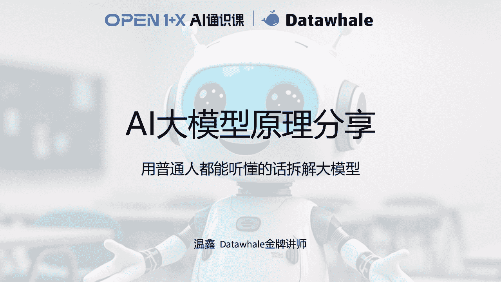

[通俗语言分享大模型原理3.0.pdf](https://internal-api-drive-stream.feishu.cn/space/api/box/stream/download/all/JZYfb3TPvoaUfXxWgonczSbWnIe)

## 二、活动主题：3小时从“打工牛马”变身“AI指挥官”

本次活动地址在：上交大工研院（徐汇区番禺路868号2号楼）

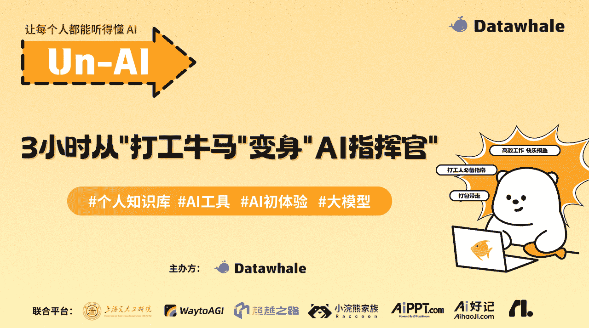

四位分享嘉宾各自从自身经历、具体实操、实践经验以及原理层面做分享：

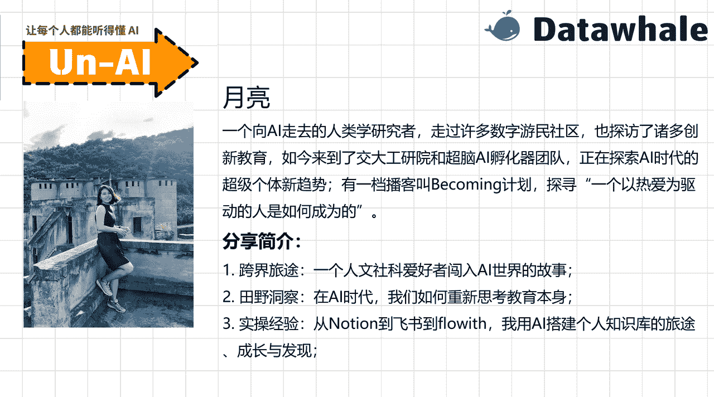

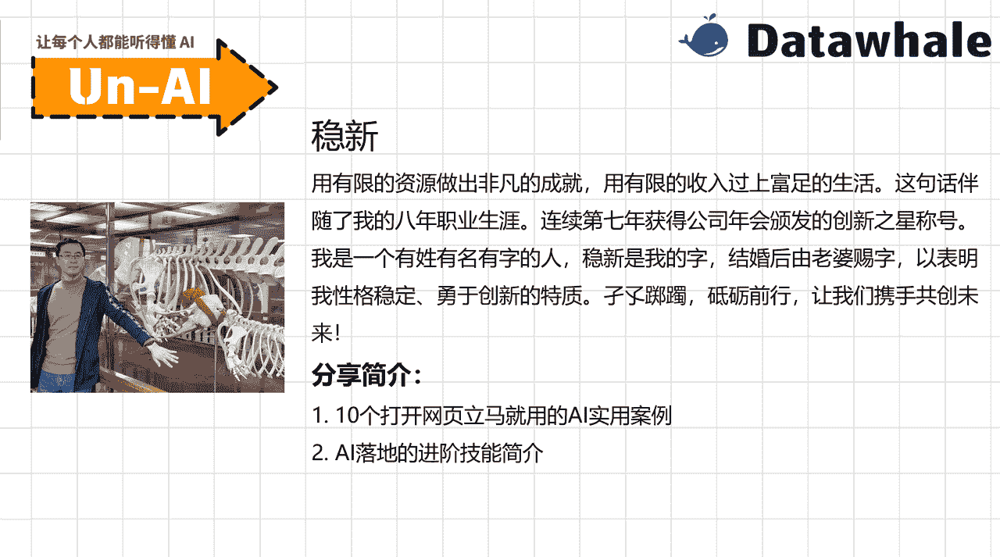

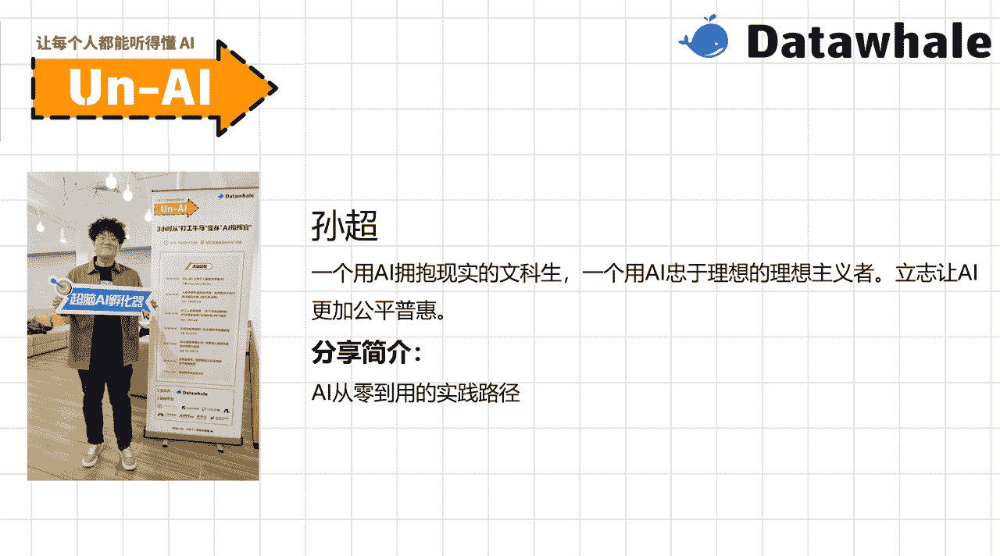

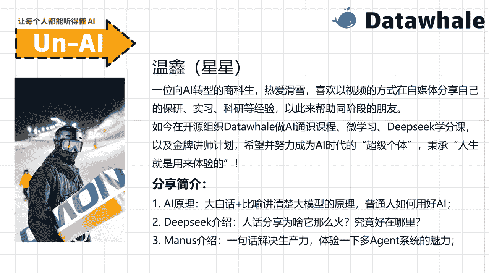

现场照片：

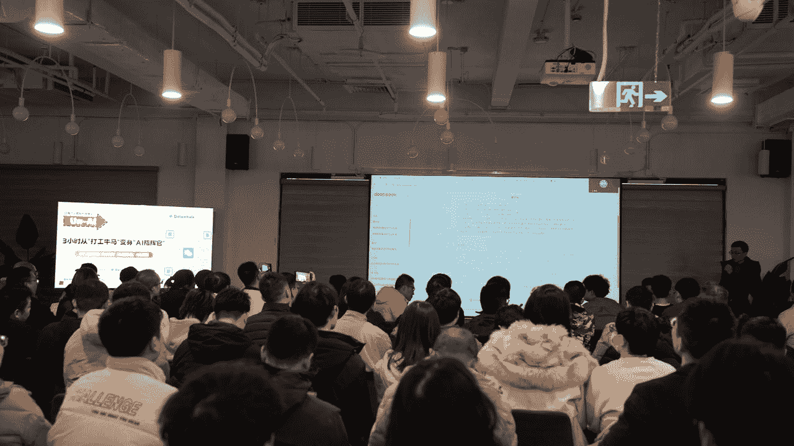

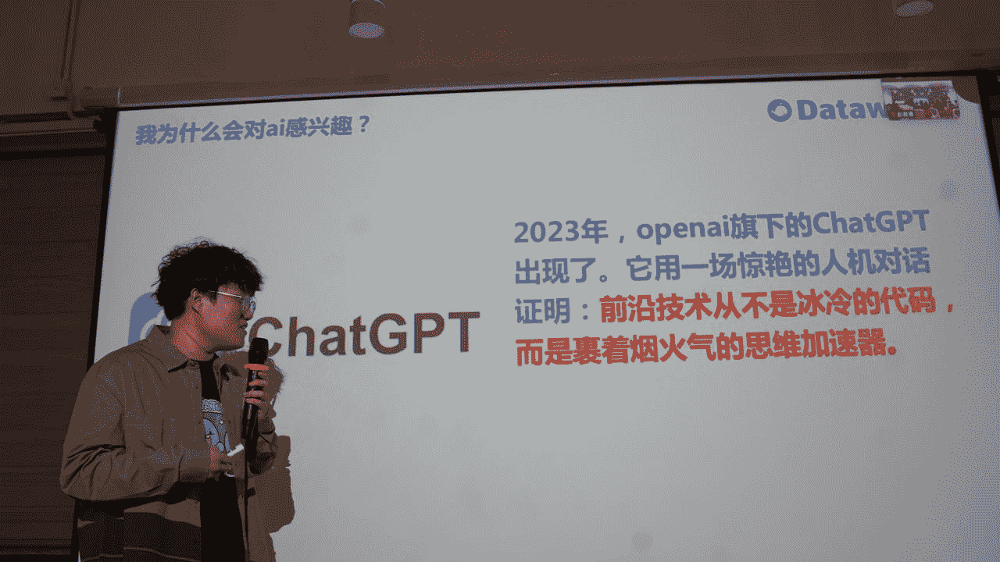

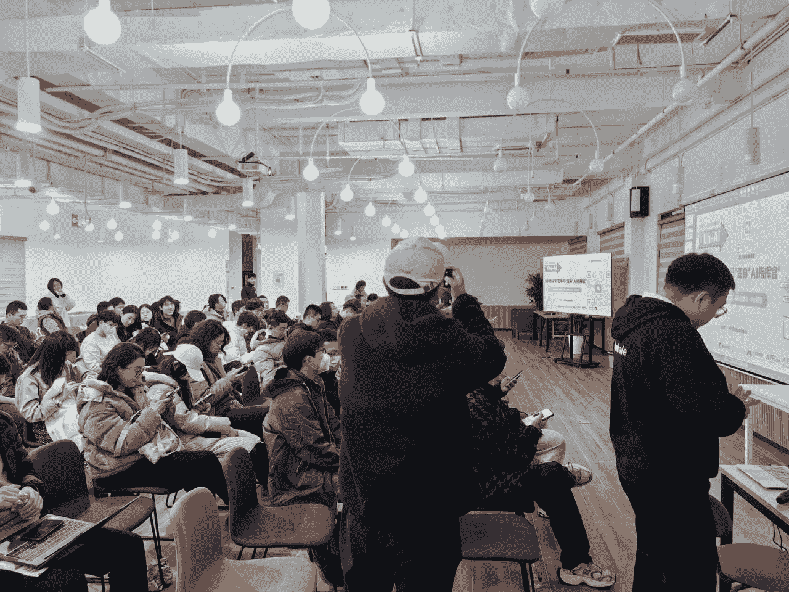

## 三、收获与感悟

第一次参加线下的分享活动，其实还是有点点紧张的，不过这些锻炼对之后是很有帮助的，分享的过程也是对自己知识的一种重塑！听到大家对于本次分享的内容很感兴趣并且有较好的反馈，突然心里面很欣慰，也感觉很值得，原来大家也都是需要这种通识的分享的。

**知识，或者说AI，并不是只能局限在“精英”里面，并不是只有名校背景、大厂title、技术背景的人才能学习AI**、学会AI、学懂AI。AI应该更多是让普通人、非科班的人也接触到，感受AI、使用AI，使之为我们的生活、工作、学习提效。这个可能是我参加此次线下活动最真实的感受，并且和许多听众交流过后，原来他们也很需要，也许就是AI走向普惠教育的过程吧！

其次，线下的活动有个好处是：这种人与人之间的链接会更为紧密且亲切。现在的互联网上不缺信息，不缺知识，更不缺AI这方面的讲解和实操。但是却没有足够的时间和空间能参与讨论、交流，线下交流过程中让思维在一次次的交流中碰撞出来，也会因此衍生出一些机会、合作等等，也更能贴近用户把握真实、准确的需求。

最后，一些**反馈评价**，以及机会碰撞：

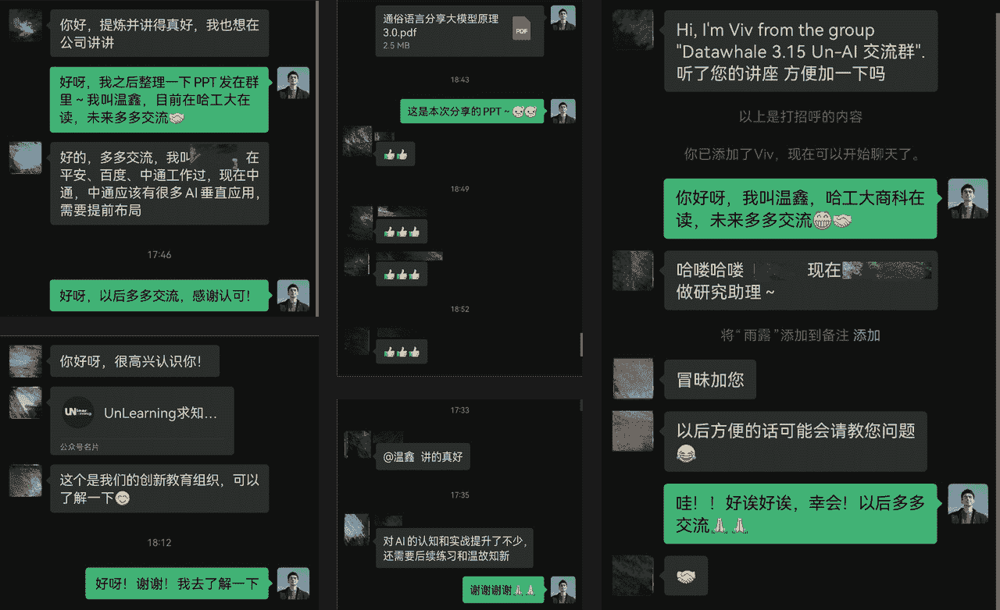

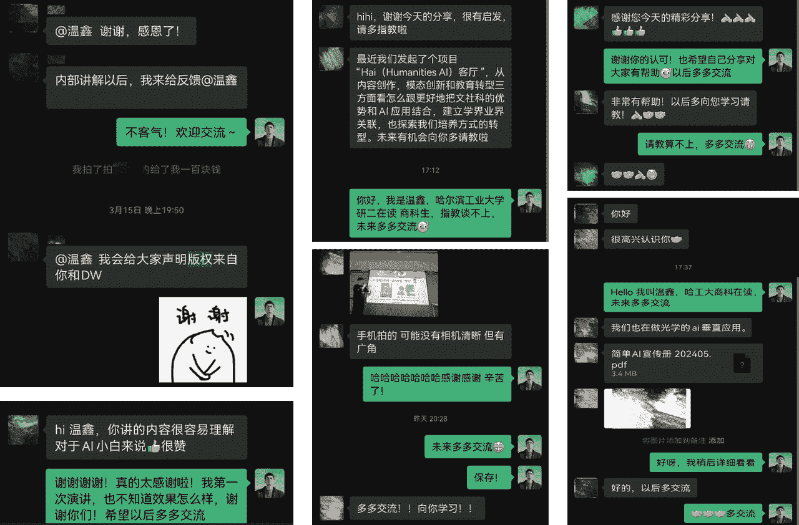

Un-AI：让每个人都能听得懂AI！🤗

下次活动再见！🌈