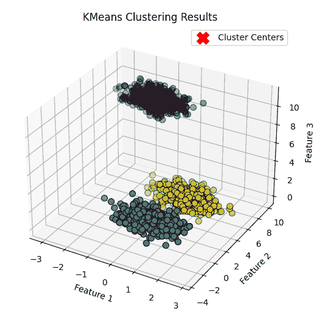

# 机器学习十日谈：第七日

> 来源：[https://datawhaler.feishu.cn/docx/CvYUdPlvfo39dYxFHJbcl0vRnLg](https://datawhaler.feishu.cn/docx/CvYUdPlvfo39dYxFHJbcl0vRnLg)

本节目由，观众的素质三连，赞助播出

> **写作原因**：最近一段时间已经是考研高峰期了。有不少非科班跨考人工智能专业的同学表示复试要考模式识别（因为有些学校的人工智能专业在自动化学院）和机器学习，问我看点什么才能准备。我说，你要不看看上海交大俞勇老师和张伟楠老师他们写的《动手学机器学习》呢？他们说：非科班代码能力跟不上；然后我又推荐说，要不看看西瓜书+南瓜书配套呢？他们说：数学公式看不懂；然后我又推荐了《深度学习详解》，他们说：复试时间不多了看不完；我寻思，准备面试的话，我推荐一下《百面机器学习》吧，但他们又说：没有知识背景题目背了又忘。于是，我写一个机器学习十日谈系列，用十天时间尽可能快速地带着大家过一过重点，然后迅速先把sklearn的代码用起来就先别手搓了。

> 请以下有基础的同学移步到其他机器学习教程：

1.  **有比较好的代码功底**、学习过Python+Numpy的同学，请移步《动手学机器学习》

1.  **数学基础尚可，**希望了解更多底层原理和理论推导的同学，请移步西瓜书+南瓜书

1.  **对机器学习已有一**定基础，想在此基础上做延伸扩展的同学，请移步《深度学习详解》

1.  **已经学习过机器学**习基础知识，目的明确就是准备面试的同学，请移步《百面机器学习》

> **本教程面向压根没学过Python、**仅限于听过机器学习这四个字的同学速通使用。

> 本教程需要使用Python进行一点非常、非常、非常简单的编程。我不知道你们非科班跨考或者自学的同学，除了把王道408刷烂了之外配置一个miniconda或者Pycharm或者VSCode有没有问题。网络上有很多在线的编程环境例如autodl、阿里云天池、百度飞桨、kaggle、colab等，有一些资源是免费的。但如果你们甚至不愿意搜一下它们的网址，从www.python.org上下一个最原始的python也不是不行。下载安装的过程中，注意勾选“将Python添加到系统路径PATH”，如果是英文界面看不懂请自行打开翻译软件翻译。建议选择3.x以上的Python版本，3.8以上会更稳定一些。另外，下载完成后，如果添加系统路径成功，请打开windows的cmd或者MacOS的命令行，输入一行命令：pip install numpy scipy matplotlib pandas scikit-learn，这时可以泡一壶茶等它跑好

# 第七日：聚类分析

## 7.1 K近邻聚类

### 备注

> 另外有学习者反馈为啥没作业，我这里统一回复一下：因为我本身不喜欢作业所以我通常也是不咋留作业的哈哈哈。如果你们真想要作业，我不介意给你们出一套机器学习期末考试题来拷打一下。

>

>

>

>

>

>

>

>

>

>

>

>

>

>

>

>

>

>

>

>

>

>

>

>

>

>

>

> 根据质心的定义不同，它还有模糊K均值、Kmeans++、K-Centroid等改进版本。

>

>

>

>

>

>

>

>

>

>

>

>

>

>

>

>

>

>

>

>

>

>

>

>

>

>

>

>

>

>

>

>

>

>

>

>

> 这是一个三维图

>

>

>

>

>

>

>

>

>

>

>

### 笔记栏

> 第七日的内容我们学一学聚类。距离你们复试也快了，我得加紧一点更新这玩意。

> 那今天就来讲讲分类和聚类的区别。很多同学可能对这两个概念傻傻分不清，那我今天就用一个通俗易懂的例子来给大家讲讲。

> 假设我们有一堆水果，里面有苹果、香蕉、橙子等等。

> 如果我们进行分类，那就是说我们已经知道有哪些种类的水果，比如我们知道有苹果、香蕉、橙子这三类。那我们的任务就是把这堆水果按照已知的类别进行划分，把苹果放到苹果的篮子里，香蕉放到香蕉的篮子里，橙子放到橙子的篮子里。分类是有监督的学习，也就是说我们事先已经知道了有哪些类别，然后根据已知的标准去划分。

> 那如果我们进行聚类呢？那就是说我们不知道有哪些种类的水果，我们只是通过观察这些水果的特征，比如形状、颜色、大小等等，把相似的水果放到一起。比如我们可能会把圆形的、红色的水果放到一堆（这可能就是苹果），把长条形的、黄色的水果放到一堆（这可能就是香蕉），把圆球形的、橙色的水果放到一堆（这可能就是橙子）。聚类是无监督的学习，我们事先不知道有哪些类别，是通过数据的相似性来自动形成类别的。

> 在电商平台，分类可能用于根据商品的类别（如服装、电子产品、家居用品等）来划分商品，方便用户查找；而聚类可能用于根据用户的购买行为来将用户分成不同的群体，比如经常购买电子产品的用户、经常购买母婴产品的用户等，然后针对不同群体制定不同的营销策略。

> K-means算法，也称为K平均或者K均值，一般作为掌握聚类算法的第一个算法。这里的K为常数，需事先设定，通俗地说该算法是将没有标注的 M 个样本通过迭代的方式聚集成K个簇。在对样本进行聚集的过程往往是以样本之间的距离作为指标来划分。

> 它和KNN有很多共同之处，同样需要计算距离，同样会进行近邻寻找，但它的过程没有标签指导，所以具体流程也就有所不同。通俗一点来说，聚类如果希望我们把数据分成K堆，那么首先会随机抽K个幸运儿作为样本的中心点，然后对于数据中每个样本，找到它最近的那个中心点作为“大哥”，然后加入他的帮派；每个小弟都找到自己大哥以后帮派内会“比武”选出新的“大哥”，这个“比武”就是比帮派内谁与这个帮派的中心点最近；然后所有的小弟集中起来，再去给他们重新选择自己想加入的堂口的机会，于是诞生了一批二五仔换到其他的帮派里面去……当这个数据集里面不再存在二五仔的时候聚类就结束了，每个堂口的老大也确定了（举这个例子是因为比较喜欢看古惑仔谢谢）。

> K-Means算法的基本流程如下：

+   选择K值：需要确定要将数据集分成多少个类别，即簇的数量K。这一参数往往在最开始就需要设定好。

+   初始化质心：随机从数据集中选择K个点作为初始的簇中心。这些点通常是数据集中的任意点，但最常见的是选择K个数据点的均值作为初始质心。

+   分配数据点：接下来，算法会遍历数据集中的每个点，并根据这些点与簇中心的距离，将其分配给最近的簇中心。这个过程叫做“分配”。计算每个数据点到每个质心的距离时，通常使用欧几里得距离或余弦相似度等度量方法。

+   重新计算质心：一旦数据点被分配给了各自的簇，算法会重新计算每个簇的质心。这是通过取每个簇中所有点的坐标的平均值来完成的。新的质心将被设置为每个簇所有点的平均位置。

+   迭代优化：然后，算法回到步骤3，再次分配数据点，并重新计算质心。这个过程会重复进行多次，直到达到预设的迭代次数或质心位置的变化小于某个预设的阈值。这个阈值用于判断质心是否已经稳定，即是否已经收敛。

+   输出结果：最后，算法会输出K个簇和每个数据点的归属。每个数据点将属于与其最近的质心所在的簇。同时，还会输出每个簇的质心位置，这些质心表示了每个簇的中心点或平均形态。

```
# 导入必要的库
import numpy as np
import matplotlib.pyplot as plt
from sklearn.cluster import KMeans
from sklearn.datasets import make_blobs

# 生成模拟数据
X, y = make_blobs(n_samples=1500, centers=3, n_features=3, cluster_std=0.60, random_state=0)

# 创建KMeans模型实例，指定聚类的簇数为3
kmeans = KMeans(n_clusters=3, init=&#x27;k-means++&#x27;, max_iter=300, n_init=10, random_state=0)

# 使用数据拟合模型
kmeans.fit(X)

# 获取聚类结果
labels = kmeans.labels_  # 每个样本所属的簇标签
cluster_centers = kmeans.cluster_centers_  # 簇中心的坐标

# 可视化聚类结果
fig = plt.figure(figsize=(8, 6))
ax = fig.add_subplot(111, projection=&#x27;3d&#x27;)

# 绘制数据点，按聚类标签分配不同颜色
scatter = ax.scatter(X[:, 0], X[:, 1], X[:, 2], c=labels, cmap=&#x27;viridis&#x27;, s=50, edgecolor=&#x27;k&#x27;)

# 绘制簇中心
ax.scatter(cluster_centers[:, 0], cluster_centers[:, 1], cluster_centers[:, 2], s=200, c=&#x27;red&#x27;, marker=&#x27;X&#x27;, label=&#x27;Cluster Centers&#x27;)

ax.set_xlabel(&#x27;Feature 1&#x27;)
ax.set_ylabel(&#x27;Feature 2&#x27;)
ax.set_zlabel(&#x27;Feature 3&#x27;)
ax.set_title(&#x27;KMeans Clustering Results&#x27;)
ax.legend()

plt.show()
```



## 7.2 DBSCAN聚类

### 备注

>

>

>

>

>

>

>

>

>

>

>

>

>

>

> DBSCAN和kmeans都是聚类算法，可以对比看看你更喜欢谁的聚类效果。

>

>

>

>

>

>

>

>

>

>

>

>

>

>

>

>

>

>

>

>

>

>

>

>

>

>

>

>

>

>

>

>

>

>

>

>

### 笔记栏

> 假设我们有一个游乐场，里面有很多小朋友在玩。我们想把这些小朋友分成几个小组，但是我们不知道应该分成多少组，也不知道每个小组应该是什么样的。这个时候，DBSCAN算法就像是一个超级聪明的观察员，它会根据小朋友们的分布情况，自动地把他们分成合理的小组，同时还能把那些独自玩耍、不怎么和别人一起玩的小朋友标记出来。

> 那DBSCAN是怎么做到的呢？它主要关注两个因素：一个是“邻居范围”，另一个是“邻居密度”。

> “邻居范围”就好比我们在游乐场里划定一个圆圈，圆圈的大小由一个参数ε（读作“epsilon”）来决定。在这个圆圈内的小朋友，我们就认为他们是互相靠近的，是邻居关系。

> 然后是“邻居密度”，这个由另一个参数minPts（最小点数）来决定。它表示在一个圆圈内至少要有多少个小朋友，我们才能认为这个地方是一个热闹的小群体的核心区域。比如，我们规定minPts是5，那如果一个圆圈内有5个或者更多小朋友，那这个地方就是一个热闹的核心区域；如果不足5个，那可能就是一个比较冷清的地方。

> 接下来，DBSCAN就开始工作啦。它会先找出所有的核心区域，然后把相邻的核心区域连成一片，形成一个个的小组（也就是簇）。在这个过程中，那些位于核心区域的小朋友就是小组的主力成员；那些在核心区域边缘、虽然不算核心但还在小组范围内的小朋友就是小组的普通成员；而那些既不在核心区域也不在任何小组范围内的小朋友，就被标记为噪声点，也就是独自玩耍的“小孤独”。

> 举个例子，游乐场里有一群小朋友在滑滑梯周围玩，滑滑梯周围就是一个核心区域，因为在这个区域内的小朋友很多，达到了minPts的要求。然后，如果秋千旁边也有不少小朋友在玩，而且和滑滑梯区域的小朋友比较近，DBSCAN就会把这两个地方的小朋友连成一个小组。而如果有一个小朋友在沙坑里独自堆沙堡，离其他小朋友都比较远，那他就会被标记为噪声点。

> DBSCAN算法的优点是，它不需要我们事先指定要分成多少个小组，它会根据数据的实际分布自动确定。而且，它对于形状不规则的小组也能很好地识别，不像一些其他算法只能找出圆形或者椭圆形的小组。不过，DBSCAN也有它的局限性，比如在数据密度差异很大的情况下，可能就不太好用了。

> 有同学问：那kmeans和dbscan谁更好？我怎么知道什么时候用谁？其实差不多，都是可以通用的。你就看他的效果你更喜欢哪个就行。

```
# 导入必要的库
import numpy as np
import matplotlib.pyplot as plt
from sklearn.cluster import DBSCAN
from sklearn.datasets import make_blobs
from sklearn.preprocessing import StandardScaler

# 生成模拟数据
X, _ = make_blobs(n_samples=300, centers=4, cluster_std=0.6, random_state=0)

# 数据标准化
X = StandardScaler().fit_transform(X)

# 创建DBSCAN模型实例，设置参数eps和min_samples
dbscan = DBSCAN(eps=0.1, min_samples=5)

# 使用数据拟合模型
dbscan.fit(X)

# 获取聚类结果标签
labels = dbscan.labels_

# 可视化聚类结果
plt.figure(figsize=(8, 6))
# 绘制数据点，按聚类标签分配不同颜色
scatter = plt.scatter(X[:, 0], X[:, 1], c=labels, cmap=&#x27;viridis&#x27;, s=50, edgecolor=&#x27;k&#x27;)

# 标记噪声点（标签为-1的点）
noise_points = X[labels == -1]
plt.scatter(noise_points[:, 0], noise_points[:, 1], c=&#x27;red&#x27;, marker=&#x27;x&#x27;, label=&#x27;Noise&#x27;)

plt.xlabel(&#x27;Feature 1&#x27;)
plt.ylabel(&#x27;Feature 2&#x27;)
plt.title(&#x27;DBSCAN Clustering Results&#x27;)
plt.legend()
plt.show()
```

## 7.3 层次聚类

### 备注

>

>

>

>

>

>

>

>

>

>

>

>

>

>

>

>

>

>

>

>

>

>

>

>

>

>

>

>

>

>

### 笔记栏

> 层次聚类法是一种基于距离的聚类算法，它将数据点按照距离的远近进行层次式的分组，使得同一组内的数据点尽可能相似或接近，不同组之间的数据点尽可能不同或远离。为什么需要引入层次聚类法：在许多实际应用中，我们可能需要对数据进行更细致的分类或者处理具有层次结构的数据。例如，在市场细分中，我们可能希望将消费者按照购买行为、偏好和特征进行更精细的分类；在社交网络分析中，我们可能希望找到具有相似兴趣或行为的用户群体。层次聚类法可以帮助我们实现这些目标，因为它能够揭示数据的层次结构和细微差别，并提供更为精确和细致的聚类结果。

> 层次聚类法按照聚类的顺序可以分为自底向上和自顶向下两种类型。

+   自底向上的层次聚类（凝聚层次聚类）：先单独考虑每个对象，然后逐渐合并这些原子簇，直到所有对象都在一个簇中或满足终止条件。这种方法的优点是不需要预先设定簇的数量，适合发现任意形状的簇，并且对异常值不敏感。缺点是计算量大，容易受到初始值的影响，可能陷入局部最优解。

+   自顶向下的层次聚类（分裂层次聚类）：开始时将所有对象视作一个簇，然后逐渐分裂这个簇，直到每个对象都是一个簇或满足终止条件。优点是可以发现任意形状的簇，能够处理大规模数据集。缺点是需要预先设定簇的数量，容易受到初始值的影响，可能陷入局部最优解。

> 这两种方法没有孰优孰劣之分，只是在实际应用的时候要根据数据特点以及你想要的“类”的个数，来考虑是自上而下更快还是自下而上更快。判断”类”的方法就是：最短距离法、最长距离法、中间距离法、类平均法等，其中类平均法往往被认为是最常用也最好用的方法，一方面因为其良好的单调性，另一方面因为其空间扩张/浓缩的程度适中。

> 自顶而下的层次聚类输入样本数据和聚类数量后进行以下操作。

> （1）将样本归为一类。

> （2）在一个类中计算样本的距离，找到距离最远的a和b。

> （3）将a和b分到两个不同的簇中。

> （4）剩下样本到a和到b哪个距离更小就去哪个簇。

> （5）递归生成聚类树。

> 自底而上的层次聚类则按照以下顺序进行。

> （1）一个样本作为一个类。

> （2）计算两两之间的距离，最小的两个点合并为一个类别。

> （3）重复上一个操作，直到所有数据被归为一类。