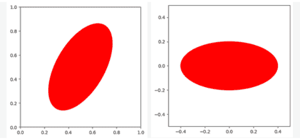
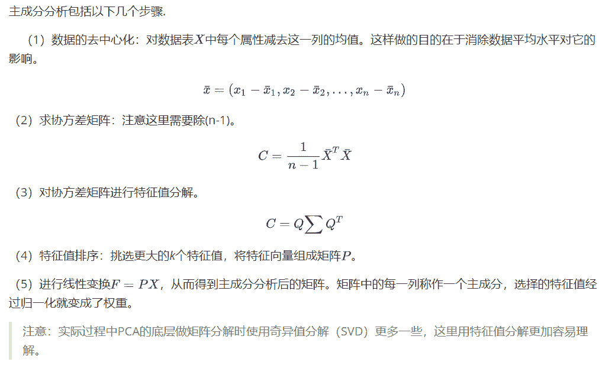

# 机器学习十日谈：第八日

> 来源：[https://datawhaler.feishu.cn/docx/XVNlduKjkodEzMx0qD3c6WP7nJh](https://datawhaler.feishu.cn/docx/XVNlduKjkodEzMx0qD3c6WP7nJh)

本节目由，观众的素质三连，赞助播出

> **写作原因**：最近一段时间已经是考研高峰期了。有不少非科班跨考人工智能专业的同学表示复试要考模式识别（因为有些学校的人工智能专业在自动化学院）和机器学习，问我看点什么才能准备。我说，你要不看看上海交大俞勇老师和张伟楠老师他们写的《动手学机器学习》呢？他们说：非科班代码能力跟不上；然后我又推荐说，要不看看西瓜书+南瓜书配套呢？他们说：数学公式看不懂；然后我又推荐了《深度学习详解》，他们说：复试时间不多了看不完；我寻思，准备面试的话，我推荐一下《百面机器学习》吧，但他们又说：没有知识背景题目背了又忘。于是，我写一个机器学习十日谈系列，用十天时间尽可能快速地带着大家过一过重点，然后迅速先把sklearn的代码用起来就先别手搓了。

> 请以下有基础的同学移步到其他机器学习教程：

1.  **有比较好的代码功底**、学习过Python+Numpy的同学，请移步《动手学机器学习》

1.  **数学基础尚可，**希望了解更多底层原理和理论推导的同学，请移步西瓜书+南瓜书

1.  **对机器学习已有一**定基础，想在此基础上做延伸扩展的同学，请移步《深度学习详解》

1.  **已经学习过机器学**习基础知识，目的明确就是准备面试的同学，请移步《百面机器学习》

> **本教程面向压根没学过Python、**仅限于听过机器学习这四个字的同学速通使用。

> 本教程需要使用Python进行一点非常、非常、非常简单的编程。我不知道你们非科班跨考或者自学的同学，除了把王道408刷烂了之外配置一个miniconda或者Pycharm或者VSCode有没有问题。网络上有很多在线的编程环境例如autodl、阿里云天池、百度飞桨、kaggle、colab等，有一些资源是免费的。但如果你们甚至不愿意搜一下它们的网址，从www.python.org上下一个最原始的python也不是不行。下载安装的过程中，注意勾选“将Python添加到系统路径PATH”，如果是英文界面看不懂请自行打开翻译软件翻译。建议选择3.x以上的Python版本，3.8以上会更稳定一些。另外，下载完成后，如果添加系统路径成功，请打开windows的cmd或者MacOS的命令行，输入一行命令：pip install numpy scipy matplotlib pandas scikit-learn，这时可以泡一壶茶等它跑好

# 第八日：降维与特征提取

## 8.1 主成分分析

### 备注

>

>

>

>

>

>

>

>

>

>

>

>

>

>

>

>

>

>

>

>

>

>

>

>

>

>

>

>

>

>

>

>

>

>

>

>

>

> decomposition里面还有其他一些降维方法，适合做数据可视化。

>

>

>

>

>

>

>

>

>

>

>

>

>

>

>

>

>

>

>

### 笔记栏

> 数据列之间是存在关联的。例如，在分析数据时，有一列数据是用kg表示的重量，一列数据是用g表示的重量，两列数据的信息是一样的，所以完全可以去掉其中一列。这是个极限情况，但是事实上数据中确实可能存在相关性很高的几列，原本10列的数据集，实际上用3列就有可能表示了。如果能够通过删减或变换的方式减少列数，那么处理的难度可就大大减小了。这种操作被称为降维。

> 另外，即使不去减少列数，削弱相关性也是很重要的操作。例如，我们看下面这张图：



> 通过变换将其修正到正交基下的椭圆，后续的处理就比斜着的椭圆更好处理了。所以，哪怕变量个数不会减少，削弱相关性的操作仍然是很重要的。

> 主成分分析的主要目的是希望用较少的变量去解释原来资料中的大部分变异，将原始数据中许多相关性较高的变量转化成彼此相互独立或不相关的变量。通常是选出比原始变量个数少，能解释大部分资料中的变异的几个新变量（也就是主成分）。因此，我们可以知道主成分分析的一般目的是：(1)数据的降维；(2)主成分的解释。



```
# 导入必要的库
import numpy as np
import matplotlib.pyplot as plt
from sklearn.decomposition import PCA
from sklearn.datasets import load_iris
from sklearn.preprocessing import StandardScaler

# 加载数据集
iris = load_iris()
X = iris.data
y = iris.target

# 数据标准化
X = StandardScaler().fit_transform(X)

# 创建PCA模型实例，指定降维后的维度为2
pca = PCA(n_components=2)

# 使用PCA模型对数据进行降维
X_pca = pca.fit_transform(X)

# 可视化降维后的结果
plt.figure(figsize=(8, 6))
scatter = plt.scatter(X_pca[:, 0], X_pca[:, 1], c=y, cmap=&#x27;viridis&#x27;, edgecolor=&#x27;k&#x27;)

# 添加图例
legend1 = plt.legend(*scatter.legend_elements(), title=&quot;Classes&quot;)
plt.gca().add_artist(legend1)

plt.xlabel(&#x27;Principal Component 1&#x27;)
plt.ylabel(&#x27;Principal Component 2&#x27;)
plt.title(&#x27;PCA of Iris Dataset&#x27;)
plt.show()

# 输出解释方差比例
print(&quot;Explained variance ratio:&quot;, pca.explained_variance_ratio_)
```

## 8.2 特征选择与特征工程

### 备注

>

>

>

>

>

>

>

>

>

>

>

>

>

>

>

>

>

>

>

>

>

>

>

>

>

>

>

>

>

>

>

>

>

> 往往这两个东西不是对立的。

>

>

>

>

>

>

>

>

>

>

>

>

>

>

>

>

>

>

>

### 笔记栏

> 在机器学习的领域中，特征选择和特征工程是两个至关重要的概念。它们就像是建造一座高楼大厦的基石，基石打得牢不牢，直接决定了大厦能盖多高、多稳固。

## 特征选择：挑出最有用的“宝贝”

> 特征选择，简单来说，就是从众多的特征中挑选出那些对模型最有价值的特征，把那些无关紧要、甚至会拖后腿的特征统统“请”出去。这就好比你在整理房间，把那些有用的书、笔记、工具好好收起来，而把那些过期的杂志、破旧的玩具、永远用不到的小玩意儿扔进垃圾桶。

### 为啥要搞特征选择？

+   **提升模型性能** ：想象一下，你的模型要处理成千上万的特征，其中很多特征可能和目标一点关系都没有。这就好比让一个学生背诵一本全是废话的书，不仅浪费时间，还会让他在考试时被那些无用的信息干扰，答不对重点。通过特征选择，把那些无关特征剔除，模型就能更专注于真正有用的信息，从而提高预测的准确性和效率。

+   **简化模型复杂度** ：特征少了，模型的结构也会相对简单一些。这就像是搭积木，积木块少了，搭出来的模型自然不会太复杂，这样不仅训练起来更快，而且在应用时也不容易出错。

### 常见的特征选择方法

+   过滤式（Filter Methods） ：这类方法就像是给特征们来一场 “初试”，通过一些统计指标，比如方差、相关系数等，先筛掉那些明显没啥用的特征。比如，如果一个特征的所有样本取值都一样，那它肯定对区分不同样本没任何帮助，直接淘汰就好。

+   包装式（Wrapper Methods） ：包装式方法更像是 “复试”，它会结合具体的机器学习模型，通过不断地尝试不同的特征子集，来找到让模型性能最好的那个组合。比如，递归特征消除（RFE）算法，它会一次次地训练模型，每次去掉一些对模型性能提升帮助最小的特征，直到剩下最优的特征组合。

+   嵌入式（Embedded Methods） ：嵌入式方法就比较 “聪明” 了，它把特征选择的过程直接嵌入到模型的训练过程中，让模型自己在学习的过程中决定哪些特征是 “好朋友”，值得深交，哪些是 “酒肉朋友”，可以忽略。比如，Lasso 回归（L1 正则化回归）在拟合模型的时候，会自动把一些不重要的特征的系数缩到 0，这就相当于帮我们完成了特征选择。

## 特征工程：把 “铜块” 变成 “金条”

> 如果说特征选择是从现有的 “宝贝” 中挑出精品，那特征工程就是在把那些普通的 “铜块” 打磨、加工，变成价值更高的 “金条”。它包括了对原始数据的各种加工处理，让数据更适合机器学习模型的 “胃口”。

### 特征工程都干些啥？

+   **数据清洗** ：这一步就像是给数据 “洗澡”。数据在收集过程中难免会沾上一些 “脏东西”，比如缺失值、错误值、重复值等。我们需要把这些 “脏东西” 清理干净。对于缺失值，可以选择用均值、中位数、众数来填充，或者直接把对应的样本扔掉；对于错误值，要仔细检查数据的来源和生成过程，修正错误或者直接剔除有问题的数据。

+   **特征构造** ：有时候，原始数据中的特征并不能很好地表达数据的本质。这就需要我们发挥创造力，构造出一些新的特征。比如，在处理时间数据时，我们可以从一个完整的时间戳中提取出年份、月份、星期几、小时等不同的时间特征，让模型能更好地捕捉时间相关的信息。

+   **特征变换** ：对特征进行一些数学变换，让它更符合模型的假设或者更好地展现数据的分布规律。常见的变换有标准化（把数据缩放到均值为 0，方差为 1 的范围内）、归一化（把数据缩放到 [0,1] 或 [-1,1] 的区间内）、对数变换（对于一些偏态分布的数据，取对数后可能更接近正态分布）等。

## 特征选择与特征工程，谁更重要？

> 这其实就像是在问 “刀锋和刀柄谁更重要”。在实际的机器学习项目中，它们是相辅相成的。好的特征工程能让特征更有价值，而科学的特征选择则能确保我们把最有价值的特征用在模型中。只有把两者结合起来，才能打造出一个高效、精准、稳定的机器学习模型。

> 总之，特征选择和特征工程是机器学习中不可或缺的两大基石。无论是初学者还是资深的数据科学家，都得在这两方面下足功夫，才能在机器学习的世界里披荆斩棘，收获一个又一个优秀的模型成果。