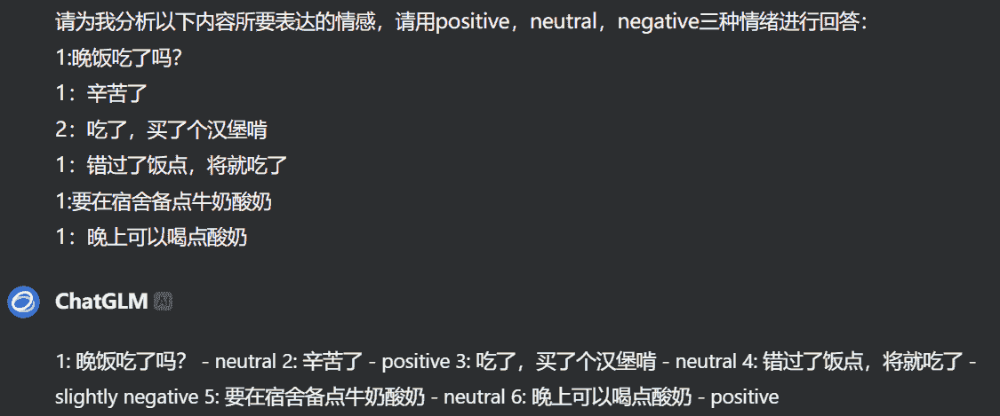
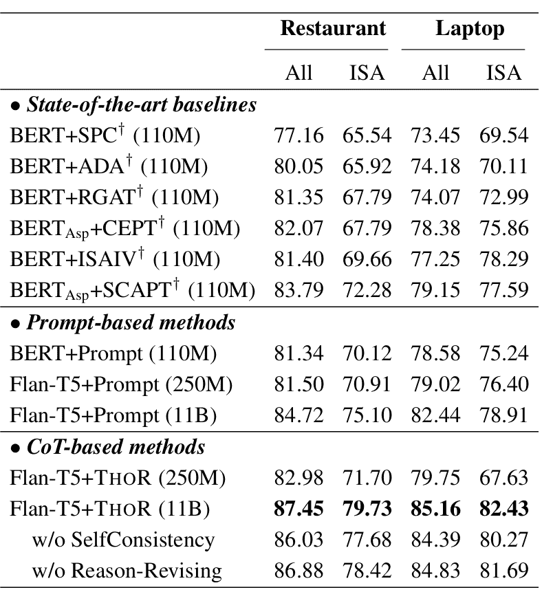
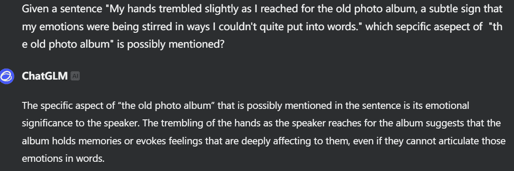
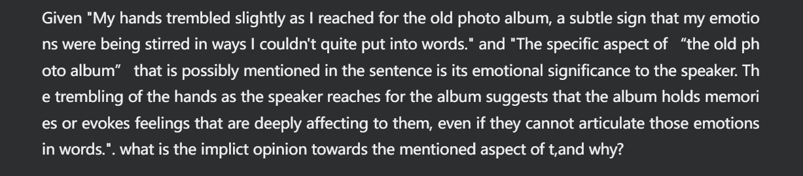
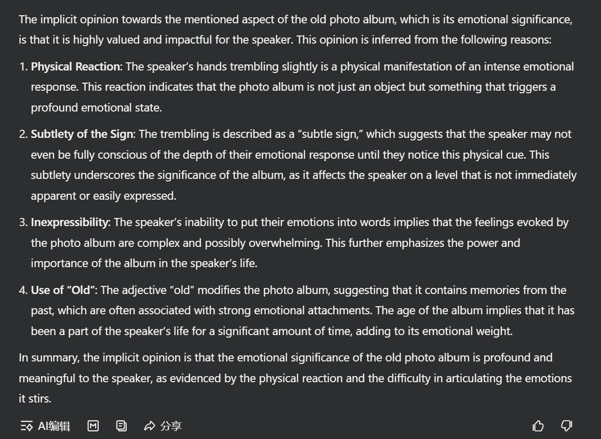
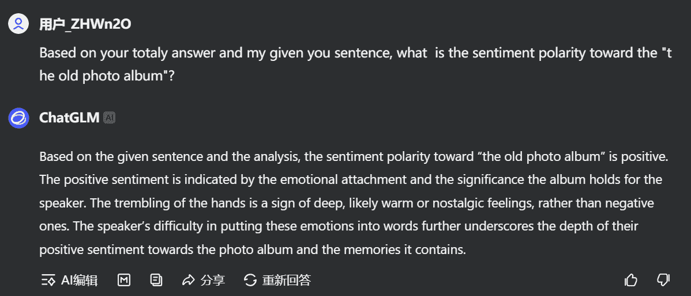
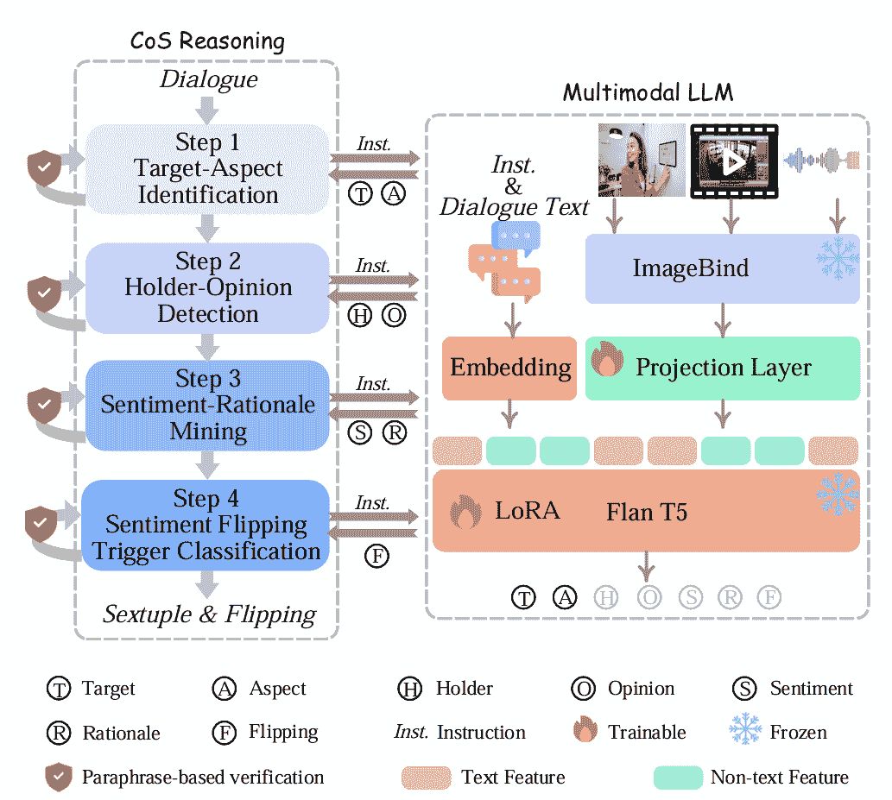

# 情感分析学习笔记

> 来源：[https://datawhaler.feishu.cn/docx/FLE3dJFfcohYQ9xP6qdcZUxPnpc](https://datawhaler.feishu.cn/docx/FLE3dJFfcohYQ9xP6qdcZUxPnpc)

### 前言

Ok，很多人看完题目就要开始问了：“这明明是一个传统的NLP（自然语言）任务，为什么还拿出来‘炒冷饭’嘞？那肯定是有翻新的必要嘛~

此篇文章作为一个铺垫，旨在介绍并解读近年来SA的相关创新工作论文，同时为后续埋下伏笔。本篇文章将围绕着大模型范式下的情感分析展开，同时研究近期提出的Chain-of-sentiment。

### 什么是SA？

Sentiment Anlysis，又称为情感分析。相信大家都看过不少AI与人类的美好爱情，研究人员也希望人工智能够理解人类在语言中的情感表达，从而引发更进一步的交流。随着算力水平的不断提高，许多传统的研究方向都在慢慢迁移至深度学习下，借助大模型完成小任务，科学家希望借助强大的神经网络继续深挖，从而取得更好的准确度。而SA就是被平移的其中一项任务之一。

对于大模型来说，检测 [I Love pineapple] 所反映出的情感并不复杂，只需要找到修饰“pineapple”的词语就可以了，但是对于非直接性的（例如：这是我第二次来这家餐馆吃饭，感觉比上次的好吃太多了，能感觉老板加了很多调料，在饭里都能看到好大的盐结晶，下次还来。）情感表达，由于产生了较长的维度跨越和情感产生，大模型便很难捕捉到用户所要表达出的具体情绪。

以智谱轻言的Chatglm4网页版本进行简单的短轮次对话，可以发现chatglm4很难准确分析语句中所要表达的情感，例如“晚上可以喝点酸奶”是中性（neutral）的表达，而大模型就错误识别成 positive（积极）的情感表达。



2022年，Google在一篇新论文中提出了一种新的技术，即思维链（Chain-of-Thought）。

> 简单解释一下，就是先给定一个回答模板，再让大模型根据这个回答模板进行推理。例如：我有五个苹果，吃掉两个以后还剩三个；那么现在我有11个苹果，吃掉4个以后还剩几个？）。

由此，一篇来自新加坡国立大学以及武汉大学的联合论文中首次提出了“THOR（Three-hop Reasoning COT framework ）”这个概念。

### 什么是THOR？

THOR是一个三段式的提问框架，可以看作是COT的衍生产物。论文中是这么定义的：SA （ESA或ISA）的任务定义为：给定一个句子X，目标词 ，一个模型确定对t的情感极性y，有积极、中性或消极三种极性。在LLM中的输入为：

Given the sentence X, what is the sentiment polarity towards t?

LLM的回答为： 。

### THOR三部曲

**step1**：首先我们需要明确句子中的目标词汇t。确认后，对t可能在句子中提及到的信息进行提问，逻辑如下：

Given a sentence "X",which sepcific asepect of t is possibly mentioned?

**step2：**将模型的输出结果记作A，结合t，X与A对大模型继续提问，挖掘句子中所隐含的情感信息，逻辑如下：

Given "X","A". Based on the common sence, what is the implict opinion towards the mentioned aspect of t,and why?

**step3：**将模型第二问的输出结果记作O，结合所有信息对大模型继续提问，要求输出对应的情感极性。逻辑如下：Given "X","A","O". Based on such opinion, what is the sentiment polarity towards the t?

此时，大模型就会输出答案。论文中给定了一些测试结果，可以看出准确率相较于没有处理过的模型来说还是非常不错的。



**THOR的核心代码如下：**

```
def prompt_for_inferring(context, target):
    new_context = f&#x27;Given the sentence &quot;{context}&quot;,&#x27;
    prompt = new_context + f &#x27;which sepcific aspect of {target} is possibly mentioned?&#x27;
   return new_context, prompt
   
def prompt_for_opinion_inferring(context, target, aspect_expr):
    new_contxt = context + &#x27;The mentioned asepect is about&#x27; + aspect_expr + &#x27;.&#x27;
    prompt = new_context + f &#x27;Based on the common sense, what is the implict opinion towards the mentioned asepect of {target}, and why?&#x27;
    return new_ context, prompt
    
def prompt_for_polarity_inferring(context, target, opinion_expr):
    new_context = context + f &#x27;The opinion towards the mentioned asepect of {target} is&#x27; + opinion_expr + &#x27;.&#x27;
    prompt = new_context + f &#x27; Based on such opinion, what is the sentiment polarity towards {target}?&#x27;
    return new_context, prompt
```

了解了THOR的概念后，我们不妨再以chatglm4（Uh，Deepseek也是可以的，但是为了遵循上文使用的测试，此处不再进行更换）进行测试。

我们需要测试的句子为：My hands trembled slightly as I reached for the old photo album, a subtle sign that my emotions were being stirred in ways I couldn't quite put into words.（当我伸手去拿那本旧相册时，我的手微微颤抖着，这是一种微妙的迹象，表明我的情绪被某种我无法用语言表达的方式激起了。）大家也可以先想想，这句话的情感极性应该是什么呢？

目标词为“the old photo album”，使用THOR的方法进行提问：



当然，此处可以事先指定X为我们要提问的句子，t为目标词汇直接告诉LLM，这样后续就不需要一次一次的将长内容作为prompt再次输入了。

大模型给出回答 “这句话可能提到的“旧相册”的具体方面是它对说话人的情感意义。

当说话者伸手去拿专辑时，手的颤抖表明这张专辑包含了对他们深刻影响的记忆或唤起了感情，即使他们无法用语言表达这些情感。”结合答案还有第二步的逻辑继续提问：



LLM的回答如下，可以看出回答的非常具体：



最后一步，结合以上的所有信息对LLM发动最终进攻，让它告诉我们这句话的情感极性是什么：



当当，positive，不知道你有没有答对呢？相较于传统Prompt式的直接提问，THOR采用了COT（Chain-of-Thought）的思想，通过循循善诱的方式引导大模型进行输出，这样大大的提高了模型的准确率；同时，又因为在Prompt中做出了上下文提示（类似于COT-few shot），降低了大模型幻觉的产生。

### 总结

THOR与chain-of-sentiment都是SA领域迁移到深度学习框架下的一次非常早的尝试。2024年，一篇论文《PanoSent: A Panoptic Sextuple Extraction Benchmark for  Multimodal Conversational Aspect-based Sentiment Analysis》[4] 提出了更细粒度、更多场景（多模态）下的情感分析，并且取得了非常好的结果。



这一项项研究都标志着从最初的Encoder-only朝着Decoder-only结构（作者注：不拉踩哈，Encoder-only对于NLP领域的帮助与意义仍然十分重大，这里只是阐述了一下客观事实）转化。并且，随着因果模型的不断演变，人们开始注意到因果与客观事实逻辑对于提高大模型准确率的帮助，因果情感链也随之被提出[3]，通过更多的情感标注与RAG技术，让大模型能够更精准的识别多轮次对话下的情感分析。

相信在未来的某一天，地球上会出现一群同样有着七情六欲，为了爱而高喊热血的无机生命。


**参考文献：**

[1] https://blog.csdn.net/HapHapYear/article/details/101102870

[2] https://github.com/PanoSent/PanoSent.github.io

[3] https://github.com/zRzRzRzRzRzRzR/CauseMotion2

[4] https://arxiv.org/pdf/2408.09481

[5] https://cloud.tencent.com/developer/article/2303635