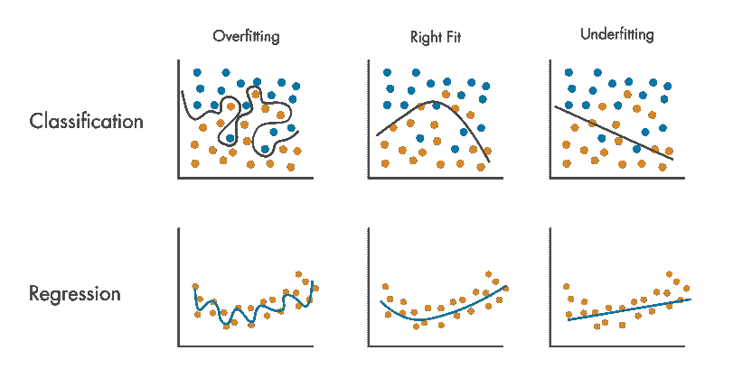
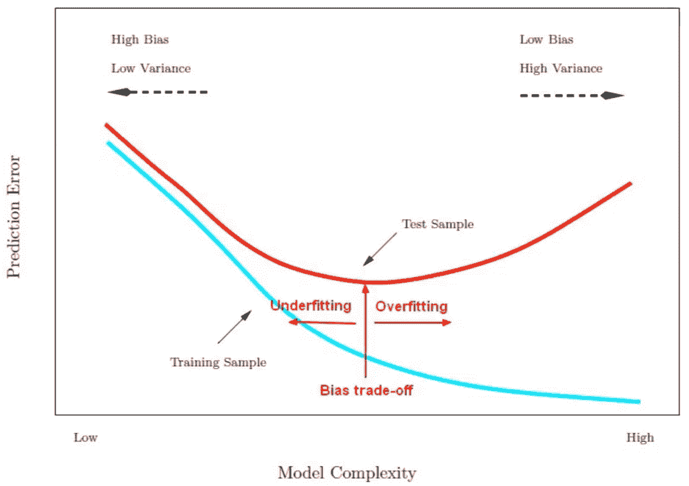

# 微学习3 | 机器学习正则化详解

> 来源：[https://datawhaler.feishu.cn/docx/Fmvzdnq4PontMmxzqJyccZYEnue](https://datawhaler.feishu.cn/docx/Fmvzdnq4PontMmxzqJyccZYEnue)

> 在前面的章节中，我们已经系统地了解了机器学习的原理、损失函数的公式，以及模型训练中的优化过程。从解析解到梯度下降，再到一系列先进的优化算法，我们知道了模型是如何通过最小化损失函数来逐步“自我提升”的。看起来，只要损失越小，模型就学得越好，准确率就越高 —— 那这是不是就意味着“损失越小越好”呢？

+ [微学习 | 机器学习理念和损失函数详解](https://biyxvja3li.feishu.cn/docx/W8U8dlDoZoUP7vxmsWocwkrtnHb)
+ [微学习2 | 机器学习优化方法详解](https://biyxvja3li.feishu.cn/docx/TMRgdKL4FobwSAxRBEXcry5Uned)

## 欠拟合与过拟合

### 欠拟合与过拟合的理解

真实世界的任务并不如此简单，我们真正关心的，并不是“模型在训练集上的分数”，而是“模型在未知数据上的表现”，即泛化能力。这就像学生备考，如果只盯着背诵标准答案，考试时可能对训练题应付自如，却对真正的考题（验证集或测试集）一筹莫展—— 这种现象，就叫过拟合（`Overfitting`）。而相反，如果模型学习过于粗糙，连训练集都掌握不住，那就是欠拟合（`Underfitting`）

+ 欠拟合（`Underfitting`）：模型过于简单，无法学习数据中的关键模式
+ 过拟合（`Overfitting`）：模型过于复杂，甚至将数据中的噪声也视作模式，从而影响泛化能力

因此，训练的目标并不是损失最小化本身，而是让模型学会“恰到好处”的知识——既能充分吸收训练数据的模式，又不会过分记忆训练数据的细节。这种对“恰到好处”的追求，就引出了本章的核心主题：如何平衡欠拟合和过拟合，并通过一系列技术，让模型具备更好的泛化能力

### 欠拟合与过拟合的案例

> 为了更好的理解过拟合与欠拟合，我们可以把模型的学习过程类比为拼拼图。欠拟合模型就像只用几块拼图拼出了一个非常粗糙的轮廓，它连最基本的形状都对不上。而过拟合模型，则像是用错的拼图硬拼在了一起，看起来细节很多，但拼出来的图案完全不对

我们也可以用下面这张图来说明欠拟合、泛化良好、过拟合的区别：

欠拟合（`Underfitting`）：当模型过于简单（例如用线性模型去拟合一个复杂的非线性数据集），它根本抓不住数据的规律。结果就是，训练误差和测试误差都很高，如上图最右边，对于`Classification`和`Regression`都保持直线，无法拟合模型

过拟合（`Overfitting`）：如果模型太复杂了，它会试图记住所有训练数据，甚至包括数据中的噪声。这种情况下，模型在训练集上表现完美，但在测试数据上表现很差，无法泛化，如上图的最左边，对于`Classification`和`Regression`都过度拟合

泛化（`Generalisation`）：这是我们希望模型做到的——不仅能在训练数据上表现良好，还能在完全没见过的测试数据上取得不错的效果，如上图的中间

### 欠拟合与过拟合的影响因素与判断依据

在理解和案例部分，我们已经知道了过拟合与欠拟合是什么，整合一下上面的内容，我们会发现其与两个因素相关：训练数据的数量与质量，以及模型的结构与参数数量

1. **训练数据的质量和数量**：如果数据本身存在噪声，模型可能会被误导；而数据量不足时，模型可能会因为依赖有限的训练数据而过拟合；数据越多越干净，模型越容易学到真正的规律；数据越少越脏，模型越容易被带偏
1. **模型结构/参数数量**：模型越复杂，参数越多，模型越有能力“记住”训练数据，但也更容易陷入过拟合的陷阱

而或许有的小伙伴会好奇，我们已经知道了过拟合和欠拟合的定义，也知道了影响因素，但具体一点，通过什么信号，我们能够判断模型陷入了过拟合或者欠拟合呢？

在之前的章节，我们提到过误差（`Error`）这个词：它是模型预测和真实标签之间的差距。但其实，这个“误差”并不是一个单一的概念，而是可以进一步拆分为偏差（`Bias`）和方差（`Variance`）

+ **偏差（`Bias`）**：描述模型对真实规律的“刻画能力”——偏差越大，说明模型理解问题的角度和真实情况相差越远，属于“硬件条件不够好”，典型表现为欠拟合
+ **方差（`Variance`）**：描述模型对训练数据的“记忆程度”——方差越大，说明模型太过依赖训练集中的细节，而忽略了潜在的普遍规律，属于“记忆力太好，理解力太差”，典型表现为过拟合

而当我们正式训练模型时，往往会同时记录训练损失（`Training Loss`）和验证损失（`Validation Loss`）。这两条曲线，其实正是偏差-方差的直观反映

### 偏差-方差数学推导

假设我们有一个随机变量作为输入，输出服从某个真实但未知的分布：

+ 是真实函数，即理想情况下能够完全描述和之间关系的函数
+ 是噪声，满足且方差，噪声代表数据中无法消除的随机误差，例如测量误差或未观测因素

---

在一个新的数据点处，我们关心模型的均方误差（`MSE`）

这个期望是在所有可能的训练数据集合上取期望，表示在处的平均误差。

将代入

展开平方：

由于噪声独立于模型，且满足，所以中间项：

因此，均方误差化简为：

由于噪声的方差为，即，所以：

所以通过均方误差，我们能得到模型误差和噪声。而在接下来，我们试试能否继续拆解

---

现在，我们对学习得到的模型进行分解。定义模型的期望预测值：

这是在不同训练数据集上训练得到的模型的期望预测值，而我们可以先对模型误差部分进行拆解

我们对误差项进行变换：

加上并减去`E[\hat{f}(X)]`：

展开平方：

由于：

（因为是一个常数，对训练数据集的变动无关）

所以我们在这里也可以代入`Variance`和`Bias`

引入偏差（`Bias`）：

表示模型的平均预测值与真实值之间的偏离程度

引入方差（`Variance`）：

表示模型预测值相对于其均值的波动性，即模型对数据集的敏感程度

最终也就是

### 偏差-方差影响

通过上图我们可以发现，训练损失和验证损失的高低组合，其实对应着不同的模型状态，并且可以帮助我们判断当前模型是欠拟合还是过拟合：

+ **如果训练损失和验证损失都比较高**，说明模型连训练集都没有学明白，更不必说泛化到验证集了。这种情况往往是因为模型本身过于简单，或者特征本身的表达能力不足，导致模型“看不懂”数据中的规律，自然学不会。这就是欠拟合
+ 如果训练损失已经非常低了，但验证损失依然很高，说明模型在训练集上表现很好，甚至几乎“背下来了”训练集的细节，但这种记忆化的策略并没有帮助它掌握真正的规律，反而在验证集上“水土不服”，表现明显变差。这种情况往往是模型复杂度过高，参数太多、自由度太大，加上训练数据本身不足或者有噪声，导致模型过度“记忆”训练集中的细节甚至噪声，从而出现过拟合
+ **最理想的状态**，是训练损失和验证损失都比较低，并且两者的差距不大，说明模型在训练集和验证集上表现都不错，既能学会训练数据中的关键模式，又不会对训练集“过度记忆”，而是提炼出了更本质的规律。这种状态就是我们追求的泛化良好的模型

## Regularisation

通过前面的介绍，我们已经知道了：

+ 模型过于复杂（高方差）→ 过拟合（`Overfitting`）
+ 模型过于简单（高偏差）→ 欠拟合（`Underfitting`）

对于欠拟合，我们或许已经知道一些补救措施：比如增加数据的数量和质量，让模型有更多、更丰富的信息可学；又或者增强模型的容量，增加参数数量和结构复杂度，让模型拥有更强的表达能力去捕捉数据中的深层规律

但对于过拟合，情况就不一样了。单纯让模型变复杂往往适得其反，这时候，我们的目标反而是“给模型降降温”，让它别那么自由发挥，从而减少对训练集的过度记忆，提升对未知数据的泛化能力。正则化（`Regularisation`）则是解决过拟合问题的一种重要的解决方案，正则化主要可以分为数据级别（`Data Level`），参数级别（`Parameter Level`），结构级别（`Structure-Level`）以及训练策略级别（`Training Strategy-Level`）。其核心思想为：通过在优化过程中对模型施加约束，减少模型的自由度，从而降低过拟合的风险。我们将会一步一步探索，从参数级别的正则化逐渐过渡到数据级别的正则化

## Regularisation - Data Level

> 数据级别的正则化（`Data-Level Regularisation`）方法的核心思想在于：通过对数据本身施加变化，降低模型对特定数据细节或噪声的过度记忆，迫使模型更好地捕捉真正有用的模式，提高泛化能力。具体而言，这一类正则化手法包括两个主要的类别：数据增强（`Data Augmentation`）与降维（`Dimension Reduction`）

+ **数据增强（`Data Augmentation`）**：人为创建新的样本，增加数据多样性，减少模型对训练数据的过度依赖
+ **降维（`Dimensionality Reduction`）**：减少数据维度，去除冗余特征，提高模型学习效率（本部分将在后续章节结合具体模型一起讲解）

### Data Agmentation

数据增强的目标是通过人为地创建新的样本，增加训练数据的多样性，让模型学习到更加泛化的特征，从而降低过拟合风险。特别是在深度学习领域（如计算机视觉、语音识别、`NLP`），数据增强是提升模型性能的关键技术之一

**常见的数据增强方法**：

+ 图像数据：随机翻转、裁剪、旋转、色彩变化、调整亮度/对比度、添加噪声等
+ 文本数据：同义词替换、随机删除、/插入词语、回译（翻译后再译回）
+ 音频数据：变速、加背景噪声、改变音高
+ 时间序列数据：噪声注入、时间缩放、平移等

### Dimensionality Reduction

在高维数据中，数据点往往稀疏，模型容易过拟合。降维的目标是：

1. 减少数据维度，降低计算复杂度
1. 去除冗余特征，保留最重要的信息
1. 提升可视化能力，帮助数据分析

降维方法可以分为线性降维和非线性降维：

+ 线性降维
+ 主成分分析（`PCA`）：通过线性变换找到数据的主要成分
+ 线性判别分析（`LDA`）：用于分类任务，找到最佳投影方向
+ 非线性降维
+ `t-SNE` / `UMAP`：用于高维数据的可视化与降维
+ `AutoEncoder`：使用神经网络来进行降维

通过这些正则化方法，我们可以有效地减少过拟合，提高模型的泛化能力，使其在真实数据上表现更稳定。关于`PCA`/`LDA`等方法的详细数学原理与实现，将在后续讲解不同模型（如回归、分类、深度学习）时再做详细讨论

## Regularisation - Parameter Level

> 参数级别的正则化主要针对模型的参数进行约束，以降低模型复杂性，减少模型过度拟合训练数据的风险。从直观的角度来看，参数越多，模型就越有可能“记住”训练数据中的细节甚至噪声，从而降低泛化能力。因此，通过在损失函数中引入额外的约束或惩罚项，我们可以有效控制参数的大小与数量，提升模型泛化性能。参数级别的正则化方法最常见的包括`L2`正则化、`L1`正则化及它们的组合形式（`Elastic Net`）

### L2 Regularisation

模型参数过大，是过拟合问题产生的直接原因之一。当某些参数过于极端时，模型对数据中特定细节的变化变得非常敏感，导致泛化能力下降。因此，最直观的正则化方法之一就是让参数“小一点”

`L2`正则化（也称为岭回归，`Ridge Regression`）的数学形式是在原损失函数的基础上，额外增加参数平方项的惩罚项：

**为什么`L2`正则化有效？**

+ `L2`正则化限制了参数的大小，使得参数的取值更加平滑与稳定
+ 参数整体趋于较小的取值，模型对单个特征的变化敏感度降低，防止对数据中特定细节的过拟合
+ 数学性质良好、计算简单，是深度学习中最基础且广泛使用的正则化方法

### L1 Regularisation

虽然`L2`很好，但其并不是万能的。它虽然能有效约束参数大小，但不会直接将参数减少到0，因此无法做到“特征选择”的效果。这也意味着模型仍然会考虑所有特征，甚至一些冗余的特征依然存在，只是冗余特征的作用变弱了而已。如果我希望模型不只是让参数变小，而是直接把不重要的参数彻底消除呢？—— `L1 Regularisation`

与`L2`正则化相比，`L1`正则化（也称为`Lasso`，`Least Absolute Shrinkage and Selection Operator`）的惩罚项变成了参数绝对值的和。而通过在损失函数中增加参数的`L1`范数（即参数的绝对值之和），其促使部分参数趋向于0，从而也算是自动进行了特征选择（`Feature Selection`）

这一微小的变化带来了重大的不同：

+ `L1`惩罚项的数学特性会迫使一部分参数直接变为0（稀疏性 - 指模型或数据中存在的大量零值或接近于零的系数），从而达到自动的特征选择效果
+ 参数稀疏化意味着模型不再关注所有特征，而是明确地只选取最重要的特征
+ `L1`正则化的优势显而易见，尤其在高维数据中（特征数大于样本数量的时候），它能有效降低模型复杂度和参数数量，避免过拟合

然而，`L1`也并非完美：

+ 当多个特征高度相关时，`L1`正则化倾向于随机选择其中一个特征而忽略其他相关特征；同时，由于惩罚的稀疏性过强，有时可能忽略了一些仍然重要但权重较小的特征，这就表现出了`L1`的不稳定性；
+ 由于`L1`范数在0处不可微，不能直接使用梯度下降，需要使用次梯度下降（`Subgradient Descent`）或坐标下降（`Coordinate Descent`）

### Elastic Net Regularisation

前面我们了解到：`L2`正则化方法虽然能有效地约束参数大小，但并不能主动地剔除冗余特征；而`L1`正则化虽然实现了特征的自动选择，但在特征高度相关时又容易表现出不稳定性——仅随机选择其中一个特征并忽略其他相关特征。那么，我们是否能够结合`L1`和`L2`的优点，创造出一种既能实现特征选择又能稳定参数估计的正则化方法呢？

`Elastic Net`的核心思想就是在损失函数中同时引入`L1`与`L2`正则项，这样既具备`L1`正则化的特征选择功能，也拥有`L2`正则化的参数平滑性。它的数学表达形式如下：

其中，控制`L1`正则化的权重，而控制`L2`正则化的权重。当为0的时候，`Elastic Net`将会退化为`L2`正则化，而当为0的时候，`Elastic Net`将会退化成`L1`正则化

通过这种灵活的组合方式，`Elastic Net`具有明显的优势：

+ **特征选择与稀疏性**：由于含有`L1`范数，它会自动剔除冗余或无关的特征，降低特征维数
+ **参数估计的稳定性**：由于含有`L2`范数，它使模型对高度相关特征不再敏感，避免随机选择特征的不稳定性
+ **适合高维数据**：在特征数远远超过样本数（高维稀疏数据）的情况下表现更佳，常应用于生物信息学、文本分析等领域

然而，`Elastic Net`同样也有自己的代价：

+ 需要同时对与两个参数进行调整，这带来了额外的超参数优化的负担

## Regularisation - Structure Level

在前面的内容中，我们已经系统地探讨了数据级别的正则化方法（如数据增强和降维）以及参数级别的正则化方法（如`L1`、`L2`与`Elastic Net`），这些方法通过直接对数据和模型参数进行约束，成功降低了模型的复杂度。但我们也发现：仅仅对参数做文章，依然存在一定的局限性。毕竟，模型的泛化能力不仅取决于数据以及参数的多少和大小，还与模型本身的结构设计有密切的关系。例如，当我们使用深度神经网络时，即使对参数施加了约束，但若网络结构设计不当，依然可能存在『神经元共适应』现象（即部分神经元过于依赖特定特征，模型泛化性能变差）。因此，我们还可以在模型结构本身上做一些文章，以进一步降低模型的自由度，防止过拟合

接下来，我们将逐一探讨三个广泛使用且效果显著的结构正则化方法：`Dropout`、`Batch Normalisation` 和 `Residual Connection`，进一步完善我们的正则化工具箱。

### Dropout

`Dropout` 是一种简单而高效的正则化方法，最初由Hinton等人于2012年提出，它已经成为深度学习中防止过拟合的标准做法之一。`Dropout`的核心思想非常直观：在神经网络训练时，以一定概率`p`随机“失活”（关闭）部分神经元，这些被关闭的神经元在本次训练的前向传播和反向传播过程中不参与计算，而网络的输出仅依赖剩余的神经元。这种机制迫使网络不再过度依赖于某些特定的节点（可以看成每次训练时模型实际上是在不同的“子网络”上进行优化），从而降低神经元之间的共适应（`co-adaptation`）现象，使网络更加鲁棒

假设我们有一个输入`X`，输出为`Y`，

在`Dropout`的过程中，我们会引入一个`Bernoulli`分布的随机向量（取值0或者1），然后将其用于丢弃输入

其中：

+ 表示保留神经元的概率，通常取值在之间
+ 是经过`Dropout`处理的输入，即部分神经元的输入设为0
+ 表示按元素相乘（`Hadamard`乘积）

---

**Dropout在不同阶段的应用**

+ **训练阶段**：每次输入样本时，以一定概率（通常0.2-0.5）随机“关闭”部分神经元，剩余神经元构成临时子网络进行训练

# 深度学习正则化方法

## Dropout

### 推理阶段（预测阶段）

所有神经元均参与运算，但要对输出结果进行适当缩放（一般是按Dropout概率缩放），以保证训练和推理阶段激活的均值一致

### 为什么Dropout会有效降低过拟合？

+ 通过随机关闭部分神经元，迫使模型学习到更加稳健、更具有泛化能力的特征；

+ 训练过程中的随机性相当于在结构层面增加了噪声（Noise Injection），降低了模型对特定神经元或数据细节的过度依赖；

+ 相当于多个不同子网络模型之间的集成（Implicit Model Averaging），进一步提升模型稳定性和泛化性能

## 结构层面正则化

### Batch Normalisation

Dropout虽然有效，但它本质上只是一种结构上的随机性扰动，并没有完全解决网络训练过程中的所有问题，比如深层网络中的数据分布不稳定性问题（Internal Covariate Shift）。具体而言，随着网络层数的加深，每一层神经网络的参数在更新后都会导致下一层输入的数据分布发生变化。这种持续变化的数据分布，不仅导致模型训练变慢，而且更容易导致网络陷入局部最优点，泛化能力下降。因此，我们会好奇，除了随机失活神经元，还有没有其他结构上的技巧，能够更全面地稳定网络训练过程？

Batch Normalisation（批标准化）正是为了解决上述问题而提出的一种结构级别正则化方法。最初由Sergey Ioffe 和 Christian Szegedy 于2015年提出，现已成为深度学习模型设计中的标准组件之一。Batch Normalisation的核心思想非常直观：在网络的每一层（通常在激活函数之前），对每个mini-batch数据的特征进行标准化处理，使之保持零均值、单位方差，从而稳定数据在网络中各层的分布，减少数据分布变化所带来的负面影响

具体地说，对于某一层的输入特征   （假设有   个样本）

1. 首先，计算每个特征维度在mini-batch上的均值   和方差  ；

1. 接下来，通过下面的公式对输入数据进行归一化；

1. 最后，引入可学习的参数   和   对归一化后的数据进行线性变换，以增强网络表达能力

其中：

+   为一个极小的正数，用于防止除零

+   和   是网络可学习的参数，分别控制数据的缩放与偏移，使模型能够灵活地调整标准化的结果

### 为什么 Batch Normalisation 有效？

+   稳定数据分布：降低了内部协变量偏移，使深度神经网络的训练更稳定、更快速

+   隐式正则化效果：每个mini-batch数据分布存在差异，训练过程中增加了数据的随机扰动，起到了一定的效果

+   允许更高的学习率：稳定的网络训练允许使用更大的学习率，从而加快了模型训练速度

Batch Normalisation的局限性：虽然Batch Normalisation极大提升了网络训练的稳定性与效率，但也存在局限

+   批次大小敏感：需要足够大的mini-batch，太小的batch size可能导致性能下降

+   训练与推理阶段表现不同：训练时使用mini-batch统计量，推理时使用训练集的全局统计量，可能会带来一定的不一致性

+   在深度学习模型等结构中，Batch Normalisation效果通常不如Layer Normalisation稳定

### Layer Normalisation

在Batch Normalisation提出并获得广泛成功之后，人们也发现了它的一些局限，比如对批大小敏感，尤其是在小batch训练或动态结构（如深度学习模型）中性能并不理想；训练和推理阶段的不一致性，训练时使用mini-batch统计量，推理时使用训练集的全局统计量，可能会带来一定的不一致性；对变长输入或动态结构的模型效果不佳，序列模型中，每个时刻的输入长度可能变化，或者batch内各样本长度不同，导致统计信息难以稳定估计，BN难以有效使用。那是否存在一种不依赖batch大小，且训练推理一致，更适合变长序列或动态结构的归一化方法呢？

Layer Normalisation（LN，层归一化）正是为了解决Batch Normalisation的上述问题而提出的一种结构级别的方法。由Jimmy Lei Ba等人于2016年提出，最初广泛用于RNN与Transformer模型中，随后也逐渐扩展到各类模型中。Layer Normalisation 的核心思想是：与BN对batch维度的归一化不同，LN是在每个单独样本内部进行归一化，即对每个样本的所有特征维度进行标准化处理。因此，Layer Normalisation 的统计信息只依赖于当前样本自身，而与batch大小完全无关

具体地，对于单个样本的输入特征向量

1.  首先，计算该样本所有特征维度的均值   和方差  ；

1.  接下来，通过下面的公式对输入数据进行归一化；

1.  最后，引入可学习的参数   和   对归一化后的数据进行线性变换，以增强网络表达能力

其中：

+     为单个样本的特征维度数量；

+   归一化后的结果再进行线性变换：

### Layer Normalisation 相比 Batch Normalisation 的优势：

+   对batch大小不敏感：每个样本独立归一化，无需batch统计量，训练过程更加灵活，更适合小batch或变长序列

+   训练与推理阶段完全一致：LN使用每个样本自身的统计信息，训练与推理阶段没有区别，避免了BN的统计信息不一致问题

+   特别适合动态结构网络：在Transformer、RNN等网络中表现更佳，成为序列建模场景的标配组件

### Residual Connections

Batch Normalisation 和 Layer Normalisation，通过结构上的归一化技巧，这些方法有效解决了神经网络训练过程中的数据分布不稳定（内部协变量偏移）问题。但随着神经网络层数的进一步加深，即使归一化技巧能够稳定数据分布，我们仍然会遇到一个更深层次的问题：

梯度消失（Vanishing Gradient）与网络退化（Degradation）问题

具体而言，当神经网络层数不断增加时，我们可能会观察到模型的训练效果反而逐渐变差，甚至出现更深层的网络性能不如浅层网络的现象。这种现象并不是简单的过拟合或训练不足造成的，而是由于在网络变得非常深的时候，反向传播过程中的梯度信息逐渐减弱甚至消失，使得较浅层的参数几乎无法更新，模型难以有效学习

为了解决这个问题，残差连接（Residual Connection）应运而生。这一方法最初由 Kaiming He 等人在 2015 年提出，并在著名的 ResNet（Residual Network） 中被成功应用，使得训练数十甚至数百层的神经网络成为可能

残差连接的核心思想十分直观，它直接引入了一条从输入到输出的"捷径连接（Shortcut Connection）或称为"恒等映射（Identity Mapping）"，允许输入数据绕过一些隐藏层，直接传递到更深的层，从而确保信息不会在网络中逐渐消失

其中：

+     为输入特征

+     表示网络需要学习的残差（特征的变化）

+     为网络最终的输出

通过这种残差结构，网络可以自然地退化成恒等映射（即 ），使模型的训练更加灵活。如果某些层暂时没有有效学习特征，网络也不会因此而变得更差，因为它总能通过残差连接退化成更浅的网络结构。在实际使用中，我们通常会将Batch Normalisation与Residual Connection结合使用，以进一步增强网络训练稳定性和泛化性能

### Residual Connection 的局限性与发展

尽管 Residual Connection 使得训练更深的网络成为可能，但它并非万能：

+   随着网络变得极其深，训练依然会变得困难，梯度问题虽缓解但并未完全消除；

+   残差结构增加了网络的复杂性，网络的设计需要更多的人工干预与调整。

因此，在后续的发展中，人们提出了更多的变体（如DenseNet、ResNeXt等）以进一步优化残差结构

### Structure Level Summarisation

## Regularisation - Training Strategy Level

然而，即使我们优化了数据处理、参数约束和模型结构，过拟合问题依然可能存在。这是因为模型在训练过程中，随着迭代次数的增加，会逐渐对训练数据的细节产生过度拟合，即模型『训练过头』。因此，我们需要在更高层次上进行控制——从训练策略层面（Training Strategy Level）入手，通过调整训练过程中的策略，主动防止模型陷入过拟合的状态。本节我们将介绍两个广泛使用且效果显著的训练策略级别正则化方法：提前停止（Early Stopping） 和 标签平滑（Label Smoothing），进一步完善我们的正则化策略

### Early Stopping

早停法（Early Stopping）是一种基于验证集性能来动态决定训练何时停止的方法，核心思想是：当模型在训练集上的误差不断减少，而在验证集上的误差开始上升时，停止训练，防止模型继续学习训练数据中的噪声，从而导致过拟合。换句话说，我们希望在模型的最佳泛化能力达到时就停止训练，而不是等到训练误差降到最低（因为此时可能已经过拟合了）

我们也可以回顾一下我们在最开始讨论的误差曲线：

+   初始阶段：模型在训练集和验证集上的误差都在下降，表示模型正在有效学习数据的特征

+   最佳阶段：训练误差继续下降，验证误差到达最小值（即泛化能力最佳

+   过拟合阶段：训练误差仍然下降，但验证误差开始上升，说明模型开始记住训练数据中的噪声

早停法的实现方式一般如下：

1.  划分验证集：通常使用训练数据的 10% - 20% 作为验证集，确保模型可以在验证集上进行评估。

1.  监测验证集上的损失（`Loss`）或指标（如 `Accuracy`）：每个 epoch 训练完成后，计算验证集上的误差或准确率。记录当前的最佳验证误差（即最小的验证损失）

1.  设定“容忍度”（`Patience`）：如果在连续   个 epoch 内验证误差没有改善（即没有变小），则停止训练。例如，设定  ，如果连续 5 轮训练后，验证误差仍然没有降低，则停止训练

1.  恢复最佳模型：最佳模型可能出现在训练结束前，通常会保存最好的模型参数，并在训练结束后恢复这些参数

### Label Smoothing

Early Stopping 这一训练策略级别的正则化方法，它通过监控验证集的性能及时停止训练，有效防止了模型对训练数据中过多细节的过度拟合。然而，过拟合问题不仅仅源于『训练时间过长』，还可能来自于模型对训练数据标签的过度自信。具体来说，在分类任务中，我们通常会使用『one-hot』编码表示标签，例如，在一个3分类问题中：

+   样本属于类别1时的one-hot标签为：`[1, 0, 0]`；

+   样本属于类别2时为：`[0, 1, 0]`；

+   样本属于类别3时则为：`[0, 0, 1]`

这种one-hot标签明确地告诉模型：真实标签类别的概率为100%，其他类别概率为0%。然而，真实世界中的数据往往存在一些"不确定性"或"标注噪声"。如果我们过于确信一个类别，模型就会试图把训练数据的预测概率推向极端，从而对训练样本中的细节过度记忆，导致泛化性能下降。为了缓解这一问题，标签平滑（Label Smoothing）应运而生，它最早由Christian Szegedy等人在2016年的Inception v3论文中提出，目前已广泛应用于各类深度学习分类任务中（尤其是Transformer模型中）

Label Smoothing的核心思想是：不再给定绝对确定（100%）的类别标签，而是对标签稍作『平滑』，在一定程度上降低模型对单个类别的过度自信。具体而言，假设共有   个类别，原本的one-hot标签向量为：

而在引入Label Smoothing之后，我们则对标签进行调整，使得真实类别标签不再为绝对的1，而是变成一个略小于1的值，同时为其他类别分配少量的概率。数学表达如下：

其中：

+     为原始的one-hot标签（0或1）

+     为平滑系数，通常取值较小（比如0.05~0.1）

+     为类别总数

### 为什么 Label Smoothing 有效？

+   减少过拟合：模型不再追求将单个样本的预测概率推到极致，避免模型过度专注于样本的细微特征差异

+   增强泛化能力：标签的轻微不确定性，让模型输出概率更加柔和，防止对特定样本或类别的极端预测

+   更适合真实的数据场景：真实数据往往存在标注误差或歧义，标签平滑更符合实际场景

Label Smoothing 的局限性：但Label Smoothing也并非完美：

+   平滑程度难以选择： 参数需要仔细调整，太大可能会导致模型混淆类别边界，泛化能力反而下降

+   可能会降低模型对真实类别的区分能力：如果过度平滑，模型可能对样本所属真实类别的信心不足，从而降低分类的准确率

### Training Strategy Level Summarisation

## Regularisation - Summarisation
