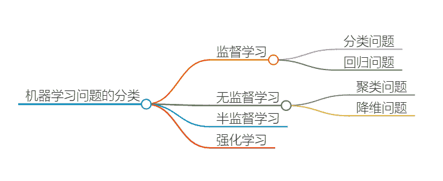
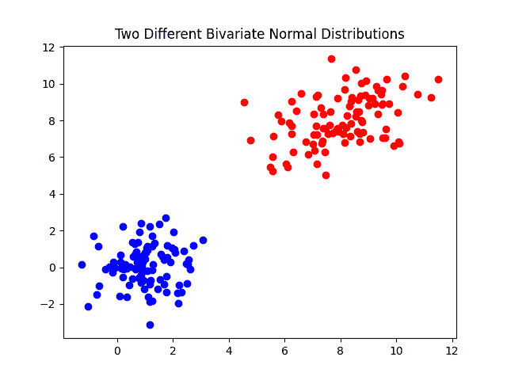
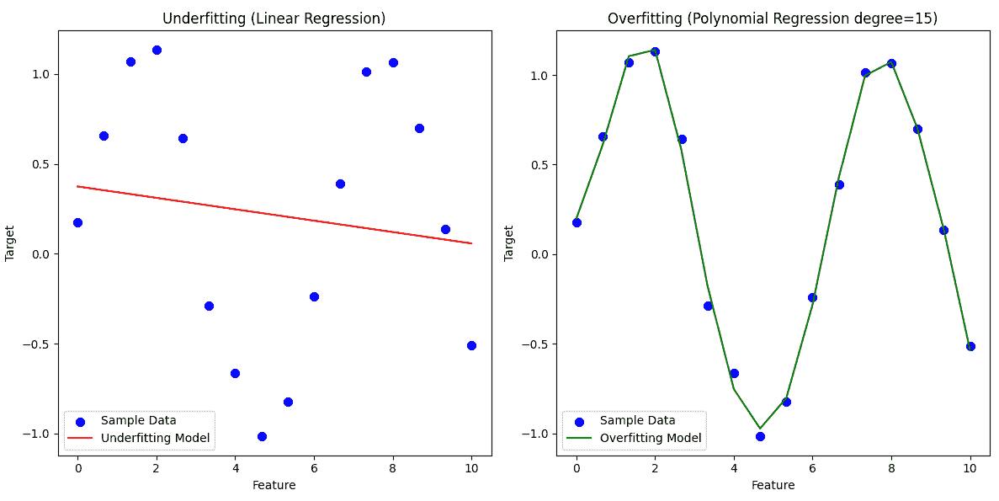
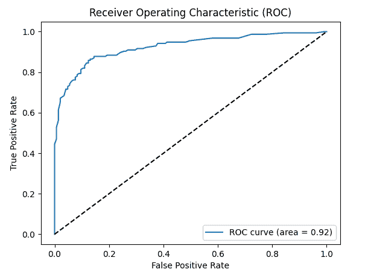

# 机器学习十日谈：第一日

> 来源：[https://datawhaler.feishu.cn/docx/LGx3dnJoOody0yxcxLfcfxmKnDd](https://datawhaler.feishu.cn/docx/LGx3dnJoOody0yxcxLfcfxmKnDd)

本节目由，观众的素质三连，赞助播出

> **写作原因**：最近一段时间已经是考研高峰期了。有不少非科班跨考人工智能专业的同学表示复试要考模式识别（因为有些学校的人工智能专业在自动化学院）和机器学习，问我看点什么才能准备。我说，你要不看看上海交大俞勇老师和张伟楠老师他们写的《动手学机器学习》呢？他们说：非科班代码能力跟不上；然后我又推荐说，要不看看西瓜书+南瓜书配套呢？他们说：数学公式看不懂；然后我又推荐了《深度学习详解》，他们说：复试时间不多了看不完；我寻思，准备面试的话，我推荐一下《百面机器学习》吧，但他们又说：没有知识背景题目背了又忘。于是，我写一个机器学习十日谈系列，用十天时间尽可能快速地带着大家过一过重点，然后迅速先把sklearn的代码用起来就先别手搓了。

> 请以下有基础的同学移步到其他机器学习教程：

1.  **有比较好的代码功底**、学习过Python+Numpy的同学，请移步《动手学机器学习》

1.  **数学基础尚可，**希望了解更多底层原理和理论推导的同学，请移步西瓜书+南瓜书

1.  **对机器学习已有一**定基础，想在此基础上做延伸扩展的同学，请移步《深度学习详解》

1.  **已经学习过机器学**习基础知识，目的明确就是准备面试的同学，请移步《百面机器学习》

> **本教程面向压根没学过Python、**仅限于听过机器学习这四个字的同学速通使用。

> 本教程需要使用Python进行一点非常、非常、非常简单的编程。我不知道你们非科班跨考或者自学的同学，除了把王道408刷烂了之外配置一个miniconda或者Pycharm或者VSCode有没有问题。网络上有很多在线的编程环境例如autodl、阿里云天池、百度飞桨、kaggle、colab等，有一些资源是免费的。但如果你们甚至不愿意搜一下它们的网址，从www.python.org上下一个最原始的python也不是不行。下载安装的过程中，注意勾选“将Python添加到系统路径PATH”，如果是英文界面看不懂请自行打开翻译软件翻译。建议选择3.x以上的Python版本，3.8以上会更稳定一些。另外，下载完成后，如果添加系统路径成功，请打开windows的cmd或者MacOS的命令行，输入一行命令：pip install numpy scipy matplotlib pandas scikit-learn，这时可以泡一壶茶等它跑好？

# 第一日：机器学习的定义与任务

## 1.1 机器学习解决什么问题

### 备注

+   先有人工智能

+   后来又分出三大学派

+   再给了机器学习这个提法

+   然后有了深度学习

+   后来学科交叉出来的计算机视觉、自然语言处理、语音分析、机器人学

+   然后才有的大模型

>

>

>

>

>

>

>

>

>

>

>

>

>

>

>

>

>

>

+   分类变量，也可以叫做类别型变量、离散变量等多个名字；数值变量也可以被称作连续变量。

+   你可以把这个就诊的过程抽象为一个“函数”：

> **就诊结果=f(血常规指标数据)**

+   这里的就诊结果对你来说就是所谓的目标(target),而血常规指标数据就是你的“自变量”也就是特征features。

>

>

>

> 通俗理解：

+   分类：选择题或判断题，**有标准参考答案**

+   回归：计算题，**有标准参考答案**，但可以通过误差给过程分

+   聚类和降维：简答题（**无标准参考答案**，但能评估优劣）

>

>

>

>

>

> **注**：本文档主要探究监督学习和无监督学习的几个典型方法，半监督学习与强化学习在此不做讨论**（因为具体的算法基本**不会考，要单开一门课）。如有对强化学习感兴趣的同学请自行阅读easy-rl蘑菇书，京东可购买。

>

>

>

>

>

>

>

>

>

>

>

>

> 实际上，这也是个简化的例子。因为直线、曲线、平面、曲面只有在直角坐标系下才能可**视化地看到**，但特征数量超过3的时候很难绘图。但这个分割线或面是存在的，我们把它叫分割超平面。另外，样本在存在多个特征（多维变量）的时候，也未必一定服从一个正态分布，可能是其他的分布形式。但是考虑到大家的数学基础，我举了一个比较简单的例子。

### 笔记栏

> 关于**人工智能**的**发展历程**，我就迅速给你们过一下就好。自从上**个世纪六**十**年代开达**特茅斯会议以后，就有了人工智能这个术语。早期的人工智能主要是一些符号逻辑（你们学过离散数学的知道所谓的析取范式、合取范式之类的哈？），后来开始搞点专家系统（其实有点像早期知识图谱的味道在里面，说白了就是人工整理有关知识并组织成图进行存储和简单的推理），但是那都比较古早。后来就有人给了机器学习这个提法，旨在通过大量的数据，让机器学习其中的模式也就是规律，然后应用规律去做预测等实际问题。

> **现在**我**们一**般**认为**，机器学习的三个核心要素是数据、算法与算力

> **然后从机**器学习里面又演化出来一个二级学科叫深度学习（类似于计算机科学与技术和计算机系统结构两个专业之**间的关系，****能理解不？学**科**大类和**二级学科），深度学习又被应用到图像数据（以前有数字图像处理、音视频处理与分析等学科）上诞生了计算机视觉，应用到文本数据上（以前有计算语言学）结果诞生了自然语言处理，等等等等。然后大家发现，不断砸钱不断把模型做复杂数据做大效果就可以垒上去，于是当模型膨胀到一定程度的时候就诞生了大模型，加点对话的成分就有了ChatGPT，然后国内开始追，就有了kimi、豆包、DeepSeek。

> 当然这些不是我们今天的重点，因为人家研究生面试不会让你讲历史讲故事。但是如果和老师聊起有关问题，你却不知道这几个学科、概念之间是什么关系，还是蛮尴尬的。我觉得我们今天的重点可以速度切入一下：机器学习究竟想解决什么问题？（我尽量保证举的例子容易懂一点，并且恰当）

> 我以一个虚拟的数据集为例为大家展示这个过程。我就不举吃西瓜这个娱乐性的例子了，就来个实用性比较强一点的。好，假设大家现在是个医生，让患者去做了血常规。今天下班的时候，你的科室这个月已经有了100个患者。这100个患者的数据表格，我给你们看几行（反正是模拟数据集不要紧）

> **请看这个****地方，性**别只有**两种**取值{男，女}，我们把它叫做分类变量；而其他几列都是取值可以为小数的浮点实数，我们把它们叫做数值变量。抛开患者的就诊序号不谈（因为姓名、序号、身份证号在分析过程中不能提供有效信息，你能通过一个人的身份证号码判断他是否患癌吗？不可能吧？），剩下的十列数据对我们来说是有效的信息，我们可以根据这些信息来对患者结果进行进一步诊断。而这些可以利用的信息被称作特征。

> 想一想，医生可以拿这些数据干什么呢？

+   如果医生想拿这些数据判断患者是否感染某种传染病（当然我是举个**例子），**诊断结果只有**是/否**两种。这是一个分类问题，严格来说**叫二分**类。还有一种是诊断患者感染的是病毒ABCD当中的哪一种，这也是分类，是一个多分类。

+   如果医生想拿这些数据判断患者的寿命还剩下多少天，患者寿命的天数可**能是18**0天，可能是360天，**可能是更**多的连续数值，这种连续数值的预测被称作一个回归问题。分类与回归，可以统称预测问题。

+   如果现在**医生也不**知道是什么状况，只知道是突然爆发了传染病，但不知道有哪几种病毒、也不知道具体的病理特征，只能对这些患者迅速进行抢救。这个时候，医生就会把相似的患者放到一起（比如有的人血压降低的同时血氧也降低，表现为闹肚子；另一波人血压升高但血糖降低，表现为休克；还有的人怎么怎么怎么回事）。那怎么判断哪些人群比较相似，使用的是聚类分析。

+   好巧不巧，医院的信息管理系统存储空间不够用了（虽然这在现实生活中基本不可能但是我们举个例子）。这个患者的信息表要超出硬盘容量啦！怎么救**急？**这**时候**你想到是否能够压缩一下，或者仅保留一些重要的指标把一些无关指标去除掉（至于哪些指标重要那是医学生的事，我没学过临床，就打个比喻）。这就需要涉及到特征的降维与选择。

+   有一个好消息是，省疾控中心已经对十名典型患者的指标进行了分析并给出了诊断材料。但是你手里有100名还没诊断出具体类型的**患者，数量**远远多于十个小样本。现在你就需要用这些没全部诊断完的110个患者数据去辅助诊断未来几天内被送往医院的患者，这叫半监督学习。

+   最后传染病得到了控制，你意识到把所有工作都交给人来做会使得人手不够，于是你开始训练一个机器人帮你诊断。这个机器人收到数据以后对每个患者**反正就是**直接开始回答，但回答不一定对，而你只需要反复告诉它：你答对了/你答错了，一个小时以后，它成功通过你给的反馈学会了如何诊断这种疾病。我们把这种学习方式叫做强化学习。

> 这些是机器学习的几类基本问题，它们之间的关系是这样的：



> OK，现在你已经初步理解了这些问题都是什么问题了。除此以外，机器学习的模型还可以分为判别式模型和生成式模型，这一点可能对很多同学来讲比较难以理解。但要提这一点，你就不得不讲到数据的分布，这就又需要一些数学知识作支撑。我尽可能讲得通俗一点点吧，但是我相信大家经历过考研数学的拷打，不会不知道概率论与数理统计吧？（你要是考数二那当我没说）考数一，应该知道正态分布有二元的版本吧？好，那我还是以患者是否患病这个二分类为例，本质就是建模：

> **z=f(x,y)**，x,y为特征，z取0/1两种取值。而f就是我们的机器学习模型。

> 数据的散点图样本如下图所示：



> 比如说蓝色的是普通患者，红色的是感染患者。现在已经在坐标系里面画出来了。那如果我今天又接诊了一个患者，它在(8,0)这个位置，它应该是普通患者还是感染患者呢？

+   如果是一个判别式模型，模型f的任务是使用一条直线或曲线分割开红蓝区域，使得对后续就诊患者的诊断尽可能精确。

+   如果是一个生成式模型，模型f将拟合（近似）出普通患者和感染患者究竟服从哪两个正态分布（把均值和方差解出来），然后判断新患者属于正常分布的概率大一点还是服从感染者分布的概率大一点，实现判断。

### 总结栏

> 省流小助手：

1.  探讨了机器学习和人工智能、深度学习、计算机视觉、自然语言处理、大模型的关系

1.  机器学习的核心是数据、算法与算力

1.  机器学习分监督学习、无监督学习、半监督学习、强化学习，其中监督学习分回归与分类，无监督学习分聚类与降维

1.  机器学习还可以分成生成式模型和判别式模型

同学们还能跟得上节奏不？跟得上我们就继续讲。

## 1.2 机器学习中的基本概念

### 备注

> 机器学习的内容一般探讨结构化数据比较多，非结构化数据可以通过特征提取的方式解析出一些结构化信息。

>

> 有人问学生听课学知识的环节哪去了？传统的机器学习是一个data-driven的小镇做**题家，掌**握规律基本靠无脑刷题从而得到三长一短选最短，而能引入知识信息的就需要通过知识工程以及现在的一些高级技术（例如大模型）来引导。

>

>

>

>

>

>

>

>

>

> 这种方法操作起来很方便，但如果数据集本身比较小，划分的时候可能就会比较敏感。比如说，数据集里一共就 100 个样本，训练集 70 个，测试集 30 个，万一这 30 个测试集里的样本比较特殊，不能很好地代表整体数据分布，那测试结果可能就不够准确。

>

>

> 有放回抽样的内容我们在概率论与数理统计里面学过哈？

>

>

> 比如说，我们把数据集分成 5 份，第一次用第一份作为测试集，训练集是剩下的四份；第二次用第二份作为测试集，训练集是剩下的四份；以此类推，直到第五次用第五份作为测试集，训练集是剩下的四份。这样，每个样本都有机会成为测试集的一部分，同时也都在训练集中出现过，这样就能更充分地利用数据，评估结果也更可靠。

>

>

>

>

>

> 注意，请点击file，找到新建一个.py文件的选项，点进去，进入文本编辑（代码编辑）的界面去打。如果看到有>>>，这是命令行界面，你的代码会逐行执行。写好代码以后，保存，需要跑的时候点击Run按钮。

>

> 这里from xx import xxx的写法是使用Python的一些库（工具箱）里面的函数（工具指令），可能有人没学过编程压根分不清数学里面的函数和编程里面的函数，我只能说这也是工具指令。

>

>

>

> 原话是Andrew.Ng吴恩达老师说的。

>

>

>

>

>

>

>

>

>

>

>

>

>

>

>

>

>

>

>

>

>

>

>

>

>

>

>

>

>

>

>

>

>

>

>

>

>

>

>

>

>

>

>

> 异常值处理的代码有个更直观的表征，如果你不懂什么分位数什么分布什么IQR没关系，有一种图可以帮助你速速找到异常值，就是箱线图。具体你们自己下来看看吧，这不是这门课的重点。

>

>

>

>

>

>

>

>

> 你也可以手动替换内容。

>

>

>

>

>

>

>

>

>

>

>

>

> 事实上，这一点还可以从**偏差-方差分解**的角度来讲述，不过这是下一日的内容啦。

>

>

>

>

>

> 用举例子的通俗方式理解内容，是个好的学习方法。

>

>

>

>

>

>

> 左图是一个欠拟合示意图，你看散点到直线的距离还是很大的。右边的图看着挺好，但是你要知道16个数据点用了一个15次函数，接下来这个函数就该迅速上升了，但看趋势这应该是一个三角函数。

### 笔记栏

> 学校**里**面机器学习课程的重点，主要是放在监督**学习和无监****督学习的四个****大类问题**上。对于这些问题，我们是有方法可循的。但无论如何，同学们应该不会否认：这四类问题的核心归根结底需要一个东西——数据，做支撑。当然，数据不等于表格，像表格这种有明确表头、字段和结构信息的数据叫结构化数据；反之，像图像、文本、视频、音频这种没有明确结构信息的叫非结构化数据。有监督学习的两类方法存在参考答案，我们把它叫标签信息，至于什么叫“参考答案”，我后面要讲。

> 怎么理解“参考答案”这件事？这就要提到模型的所谓训练、验证和测试。这些事是为了干嘛？想象一下，既然这门课叫《机器学习》，字面意义上机器模型是可以学习的，你把它当个学生。好，学生的学习过程由哪**些步骤组成？****作业**，模拟考，期末考试。当然，有些学校没有模拟考，搞完作业直接期末。这也就是说**，如果一个老师手里有题**库，这个题库会被分成好几份。大部分用来作业，少部分用来模拟考，少部分用来期末考试。这就是数据集的划分，将大部分数据（例如70%）用于训练模型参数；将一小部分数据（例如10%）用于验证模型的效果以便进一步调整和针对性训练；剩下的一小部分（例如20%）用于测试模型的性能得到最终的评测。这三个部分被称作训练集，验证集和测试集。

> 所谓模型的参数，其实就是模型掌握规律的一些策略和方法，可以理解为学生该用什么节奏学习、每天的刷题量多少等等。如果学理化一点，这就是一个复杂函数模型里面抛开自变量（特征）和因变量（标签）之外其他未知但可以人为控制的数。

> 接下来，咱们就聊聊数据集的划分策略，以及一个很重要的概念——交叉验证。刚才咱们提到，数据集一般会被分成训练集、验证集和测试集。但怎么划分呢？这里面其实也有一些讲究，常见的方法有以下几种：

#### 1. 乱序（Shuffling）

> 在划分数据集之前，通常会先对数据进行乱序处理。为啥要这么做呢？想象一下，如果数据本身是有顺序的，比如先是一批猫的图片，然后是一批狗的图片（假设我们在做一个图像分类任务），直接按顺序划分的话，训练集可能全是猫，验证集全是狗，模型在训练的时候只见过猫，突然在验证集上看到狗，那肯定懵圈啊！乱序就是为了避免这种情况，把数据打乱，让训练集、验证集和测试集里的数据分布更均匀、更随机。

#### 2. 留出法（Hold - Out）

> 这是最简单直接的一种划分方法。就是按照一定的比例，直接把数据集分成训练集和测试集（有时候还会再分出一个验证集）。比如说，常见的比例有 7:3（训练集 70%，测试集 30%），或者 8:2。

#### 3. 自助法（Bootstrap）

> 自助法的思路有点意思。它是一种有放回的抽样方法。比如说，我们有一个数据集，大小是 N，我们想生成一个训练集，也是大小 N。那我们就从原始数据集中随机抽取样本，抽完一个样本后，把这个样本放回去，然后再抽下一个。这样重复 N 次，就得到了一个训练集。因为是有放回抽样，所以有些样本可能会被抽到好几次，有些样本可能一次都抽不到。那些没被抽到的样本，就可以作为测试集。这种方法在数据集比较小的时候比较有用，因为它可以通过这种方式生成多个不同的训练集和测试集，从而更好地评估模型的性能。

> 刚才提到的留出法和自助法，都是只划分一次数据集，然后用划分出来的训练集和测试集来评估模型。**但有时候**，我们希望更充分地利用数据，同时更准确地评估模型的性能，这时候就可以用到交叉验证。

> 简单来说，交叉验证就是把数据集分成 K 份（比如说 K = 5 或 K = 10），每次拿出其中一份作为测试集，剩下的 K - 1 份作为训练集，然后训练模型并在测试集上评估模型的性能。这样重复 K 次，每次用不同的那一份作为测试集，最后把这 K 次的评估结果取平均值，作为模型的最终评估结果。

> Q：为什么需要交叉验证？

> A：主要是因为数据集划分的方式会对模型的评估结果产生影响。比如说，用留出法划分数据集的时候，如果测试集里的样本比较特殊，评估结果可能就不够准确。而交叉验证通过多次划分数据集，每次用不同的部分作为测试集，可以减少这种偶然性带来的影响，得到更稳定的评估结果。而且，对于数据集比较小的情况，交叉验证也能更好地利用数据。比如说，数据集里只有 100 个样本，如果用留出法划分成训练集 70 个，测试集 30 个，那这 30 个测试集样本就只能用一次。但如果用 5 折交叉验证，每个样本都有机会成为测试集的一部分，而且会在不同的训练集里出现，这样就能更充分地利用数据来评估模型。

> 数据集的划分策略和交叉验证，都是为了让模型的评估结果更准确、更可靠。就像学生考试一样，如果只考一次模拟考，可能成绩会有偶然性；但如果多考几次，取平均分，就能更真实地反映学生的学习水平。

> 使用sklearn进行数据集切分和交叉验证是一个比较方便的选择。可以这样写代码：

```
from sklearn.datasets import load_iris
from sklearn.model_selection import train_test_split, KFold, cross_val_score
# 加载数据集，这里是一个案例
data = load_iris()
X = data.data
y = data.target

# 数据集划分（训练集和测试集）
X_train, X_test, y_train, y_test = train_test_split(
    X, y, test_size=0.2, random_state=42) 
    
# 交叉验证
kf = KFold(n_splits=5, shuffle=True, random_state=42)# 手动进行交叉验证
fold_scores = []for train_index, test_index in kf.split(X):
    X_train, X_test = X[train_index], X[test_index]
    y_train, y_test = y[train_index], y[test_index]
    &#x27;&#x27;&#x27;
    下面是模型训练与测试的过程
    &#x27;&#x27;&#x27;

# 使用 cross_val_score 进行交叉验证，就比手动要高效一点
scores = cross_val_score(
    model, 
    scaler.fit_transform(X),
    y,
    cv=kf,
    scoring=&#x27;accuracy&#x27;)
print(f&quot;K折交叉验证得分 (cross_val_score): {scores}&quot;)
```

> 有道是得数据者得天下。数据源头难获取，处理起来也是一门学问。所谓“数据决定上限，模型逼近上限”的言论，在今天看来已经成为一条可以入典的方法论。常见的数据处理包括去重、填充、规约、异常剔除、离散特征编码等多个步骤。假如前面你获得的患者样本已经拖出来了一个数据表healthcare.xlsx，在Python当中你可以使用pandas来进行表格数据的处理，它就是代码版本的excel处理器啊。

> 接下来，我们将使用 pandas 来处理一个医疗数据文件 healthcare.xlsx，这个文件包含患者的健康数据。以下是逐步处理的过程：

> **1. 数据加载**

> 首先，我们需要将 Excel 文件加载到 pandas 的 DataFrame 中。

```
import pandas as pd

# 加载数据
file_path = &quot;healthcare.xlsx&quot;
df = pd.read_excel(file_path)

# 查看数据前 5 行
print(df.head())
```

> **2. 去重**

> 医疗数据可能存在重复记录，我们需要清除这些重复数据。

```
# 检查是否有重复行
print(&quot;重复行数量:&quot;, df.duplicated().sum())

# 去重
df_cleaned = df.drop_duplicates()
print(&quot;去重后行数:&quot;, len(df_cleaned))
```

> **3. 缺失值处理**

> 医疗数据可能有缺失值，例如某些患者的某些检测指标未记录。

```
# 检查缺失值
print(df_cleaned.isnull().sum())

# 填充缺失值
# 对于数值型数据，可以使用均值或中位数填充
df_cleaned[&quot;血糖&quot;].fillna(df_cleaned[&quot;血糖&quot;].mean(), inplace=True)
df_cleaned[&quot;脉搏&quot;].fillna(df_cleaned[&quot;脉搏&quot;].median(), inplace=True)

# 对于分类数据，可以使用众数填充
df_cleaned[&quot;性别&quot;].fillna(df_cleaned[&quot;性别&quot;].mode()[0], inplace=True)
```

> **4. 数据规约**

> 数据规约可以把数据的范围统一，避免范围不一致、单位不一致造成影响。也可以去除一些冗余列。

>

```
# 删除不必要的列
columns_to_drop = [&quot;转氨酶浓度&quot;]  # 假设这个指标与血糖高度相关，可以选择删除
df_reduced = df_cleaned.drop(columns=columns_to_drop)
df_n = (df_cleaned-df_cleaned.min())/(df_cleaned.max()-df_cleaned.min())
```

> **5. 异常值处理**

> 异常值可能会对模型产生误导，需要进行处理。

```
# 检查异常值
print(&quot;血糖的五数概括:\n&quot;, df_reduced[&quot;血糖&quot;].describe())

# 使用箱线图方法处理异常值
Q1 = df_reduced[&quot;血糖&quot;].quantile(0.25)
Q3 = df_reduced[&quot;血糖&quot;].quantile(0.75)
IQR = Q3 - Q1

# 定义异常值范围
lower_bound = Q1 - 1.5 * IQR
upper_bound = Q3 + 1.5 * IQR

# 过滤异常值
df_filtered = df_reduced[(df_reduced[&quot;血糖&quot;] &gt;= lower_bound) &amp; (df_reduced[&quot;血糖&quot;] &lt;= upper_bound)]
```

> **6. 离散特征编码**

> 如果数据中有分类变量，需要将其编码为数值特征。

```
from sklearn.preprocessing import LabelEncoder

# 编码性别
le = LabelEncoder()
df_filtered[&quot;性别&quot;] = le.fit_transform(df_filtered[&quot;性别&quot;])
```

> **7. 保存处理后的数据**

> 最后，将处理后的数据保存为新的文件。

```
# 保存为新的 Excel 文件
df_filtered.to_excel(&quot;healthcare_processed.xlsx&quot;, index=False)
print(&quot;数据处理完成，已保存为 healthcare_processed.xlsx&quot;)
```

> 数据决定了机器学习模型的上限，而这些初步的处理工作是接近“上限”的第一步。

> 那怎么判断一个模型的学习效果好坏呢？具体的指标，我们下一小节会讲到。这里我们想讲两个新东西：欠拟合与过拟合。你们知道，恰到好处的学霸就是不管什么样的题目都能做**对，哪**怕题目变一下形或者出一些新的场景，他也能回答。这样的我们称之为学霸。而一些学的不太好的人，作业做的很烂，考试也考的差，**这种学**生就属于没学进去的，我们把它叫欠拟合。但还有一类人我不知道你们有没有发现啊，平常作业也不抄，做的都很工整漂亮准确率高，但一到了大考的时候题目但凡换一点点迅速打回原形考的稀烂。我们说这种学生属于题海战术下的刷题机器，只要是他见过的原题都能做对，但就是不会举一反三，我们把这种叫过拟合。

> 面试老师问你的时候，你总不能像我一样举这种例子去跟他讲，得有个规范一点的表达。

+   **欠拟合**：模型在训练数据上的拟合程度不足，无法有效捕捉数据中的潜在规律，通常表现为训练误差和泛化误差均较大。

+   **过拟合**：模型在训练数据上拟合过度，不仅学习了数据中的潜在规律，还学习了噪声和异常点，通常表现为训练误差较小但泛化误差较大。

> 欠拟合，就需要进一步调整参数调优进行优化。而过拟合，就麻烦一些，需要采用正则化的方式来改进。关于正则化，我们会在第二日的内容里面聊一聊。



### 总结栏

> 省流小助手：

1.  探讨了数据集的划分与交叉验证

1.  探讨了数据的基本处理，例如去重、填充、异常值、数据规约等内容

1.  简介了欠拟合与过拟合现象。

这里开始可能就有同学要慢慢跟不上节奏了。同学们跟上马叔的节奏。

## 1.3 评估机器学习的效果

### 备注

>

>

>

> 准确率要注意样本平衡问题。例如如果100个病人里面只有10个患病，我的机器哪怕全部诊断为正常人准确率都有90%，请问这有意义吗？

>

> 准确率、F1分数和AUC值都是越接近1越好

>

>

> 这里MSE MAE RMSE越小越好，R2越接近1越好。

>

>

>

> 聚类的指标我们会在第七日的时间来详细聊聊，回头我再给你们说聚类的指标代码。

>

>

>

>

>

>

>

>

> **TP**:预测是病人结果真的是病人

> **TN**:预测是正常人结果也确实是正常人

> **FP**:预测是病人结果发现是正常人

> **FN**:预测是正常人结果发现他身上有病毒

>

>

>

>

>

>

>

>

>

>

>

>

>

>

>

>

>

>

>

>

>

>

>

>

>

>

>

> 大家可以问问D老师为什么要采用调和平均数而不是简单取平均，有理由的。

> 因为往往对一个分类器而言，P大R就可能小，而R大P就可能小。二者衡量的是不同的东西，直接算术平均不可取。

>

>

>

>

>

>

>

>

>

>

>

> 请大家注意，这就是一个机器学习做分类或回归代码的模板。核心的东西就是五行代码，第2, 8, 10, 11, 13行。

+   首先from sklearn.xx import XXX，导入算法

+   然后X_train, X_test, y_train, y_test=train_test_split(X,y,test_size=0.3,random_state=42)划分数据集

+   再model=XXX()创建一个实例

+   model.fit(X_train,y_train)训练数据

+   y_pred=model.predict(X_test)获得测试结果。如果加proba，输出的是概率值。

+   最后就可以调用不同的指标命令来输出评估结果了。除了xx和XXX，其他代码我都不带换的。

>

>

>

>

>

>

>

>

>

>

>

>

>

>

>

>

>

>

>

>

>

>

>

>

>

>

>

>

> 这里的R2和中学的时候学的相关系数还不是同一回事。虽然都是越接近1拟合效果越好啦。

>

>

>

>

>

>

>

>

>

>

>

>

>

>

>

>

>

>

>

>

>

> 这个公式理解起来有点小困难，回头我在第七日讲。

>

>

>

> 请大家注意，这就是使用sklearn进行聚类的一个模板。

+   首先从from sklearn.cluster import XXX里面找到聚类算法

+   实例化对象model=XXX()

+   实现聚类：labels=model.fit_predict(X)

>

>

>

>

>

>

>

>

>

>

> 喏，真给公式你又不乐意了。其实这个公式吧，并不是主要，因为兰迪指数现在用的也比较少了，轮廓系数是用的最多的。看不懂公式没关系，知道有这回事就行了。

>

>

>

>

>

>

>

>

>

>

>

>

>

>

>

### 笔记栏

> 对于不同机器学习任务，有一些评价指标可以衡量。一些常见的任务及其对应指标包括：

+   分类任务

+   准确率：正确预测的样本数占总样本数的比例

+   精确率（查准率）：正确预测为正类的样本数占预测为正类的样本总数的比例，TP/(TP+FP)

+   召回率：正确预测为正类的样本数占实际正类样本总数的比例。TP/(TP+FN)

+   F1分数：精确率和召回率的调和平均值，2PR/(P+R)

+   ROC曲线与AUC值： ROC 曲线以真正率（TPR）为纵轴、假正率（FPR）为横轴绘制的曲线，AUC 是曲线下的面积。

+   回归任务

+   均方误差MSE：用于衡量预测值与真实值之间的平均差异。对误差平方敏感，较大的误差会被放大。

+   平均绝对误差MAE：能更好地反映误差的分布情况，因为它不会过度放大较大的误差。对异常值的鲁棒性较好。

+   R2分数：值为1表示模型完全拟合数据，值为0表示模型的性能不比使用均值预测时好。用于衡量模型解释数据变异的能力。

+   均方根误差RMSE：MSE开根号

+   聚类任务

+   轮廓系数：衡量样本与其所在的簇的相似度，以及与其他簇的不相似度。计算公式较为复杂。取值范围介于 -1 到 1 之间。轮廓系数越高表示聚类结果越好。

+   DB指数：用于衡量簇的紧密程度和分离程度。计算公式为各簇最大半径之和的平均值。值越小，簇的质量越高。

+   兰迪指数：比较两个数据划分的一致性，特别是在数据标签未知的情况下。取值范围从 -1 到 1。值接近1表示两个划分非常一致。

+   独立性分数：一种基于信息论的概念，用于衡量两个数据划分之间的相关性。值越高，说明两个划分之间越相关。

**分类任务**

1. 准确率（Accuracy）

**公式**：

其中，TP为真阳性（True Positive），TN为真阴性（True Negative），FP为假阳性（False Positive），FN为假阴性（False Negative）。

**sklearn接口**：

```
from sklearn.metrics import accuracy_score
```

**调用示例**：

```
y_true = [0, 1, 0, 1, 1]
y_pred = [0, 1, 1, 1, 0]
accuracy = accuracy_score(y_true, y_pred)
print(&quot;Accuracy:&quot;, accuracy)
```

2. 精确率（Precision）

**公式**：

**sklearn接口**：

```
from sklearn.metrics import precision_score
```

**调用示例**：

```
precision = precision_score(y_true, y_pred)
print(&quot;Precision:&quot;, precision)
```

**3. 召回率（Recall）**

**公式**：

**sklearn接口**：

```
from sklearn.metrics import recall_score
```

**调用示例**：

```
recall = recall_score(y_true, y_pred)
print(&quot;Recall:&quot;, recall)
```

4. F1 分数（F1 - Score）

**公式**：

**sklearn接口**：

```
from sklearn.metrics import f1_score
```

**调用示例**：

```
f1 = f1_score(y_true, y_pred)
print(&quot;F1 Score:&quot;, f1)
```

**5. ROC曲线与AUC值**

无公式，是根据正类概率预测值生成的曲线。

**sklearn接口**：

```
from sklearn.metrics import roc_curve, auc
```

**调用示例**：

```
from sklearn import datasets
from sklearn.ensemble import RandomForestClassifier
import matplotlib.pyplot as plt
from sklearn.metrics import roc_curve, auc
from sklearn.model_selection import train_test_split

X, y = datasets.make_classification(n_samples=1000, n_features=20, n_classes=2, random_state=42)
X_train, X_test, y_train, y_test = train_test_split(X, y, test_size=0.3, random_state=42)

model = RandomForestClassifier(random_state=42)
model.fit(X_train, y_train)

y_pred_prob = model.predict_proba(X_test)[:, 1]

fpr, tpr, thresholds = roc_curve(y_test, y_pred_prob)
roc_auc = auc(fpr, tpr)

plt.plot(fpr, tpr, label=&#x27;ROC curve (area = %0.2f)&#x27; % roc_auc)
plt.plot([0, 1], [0, 1], &#x27;k--&#x27;)
plt.xlabel(&#x27;False Positive Rate&#x27;)
plt.ylabel(&#x27;True Positive Rate&#x27;)
plt.title(&#x27;Receiver Operating Characteristic (ROC)&#x27;)
plt.legend(loc=&#x27;lower right&#x27;)
plt.show()
```



**回归任务**

**1. 均方误差（MSE）**

**公式**：

**sklearn接口**：

```
from sklearn.metrics import mean_squared_error
```

**调用示例**：

```
y_true = [3, -0.5, 2, 7]
y_pred = [2.5, 0.0, 2, 8]
mse = mean_squared_error(y_true, y_pred)
print(&quot;MSE:&quot;, mse)
```

**2. 平均绝对误差（MAE）**

**公式**：

**sklearn接口**：

```
from sklearn.metrics import mean_absolute_error
```

**调用示例**：

```
mae = mean_absolute_error(y_true, y_pred)
print(&quot;MAE:&quot;, mae)
```

3. R² 得分（R - Squared）

**公式**：

**sklearn接口**：

```
from sklearn.metrics import r2_score
```

**调用示例**：

```
r2 = r2_score(y_true, y_pred)
print(&quot;R² Score:&quot;, r2)
```

**4. 均方根误差（RMSE）**

**公式**：

**sklearn接口**：

```
from sklearn.metrics import mean_squared_error
```

**调用示例**：

```
rmse = mean_squared_error(y_true, y_pred, squared=False)
print(&quot;RMSE:&quot;, rmse)
```

**聚类任务**

1. 轮廓系数（Silhouette Score）

综合衡量样本与其所属簇的紧密程度以及与其他簇的分离程度的指标。

**sklearn接口**：

```
from sklearn.metrics import silhouette_score
```

**调用示例**：

```
from sklearn.cluster import KMeans

X, _ = datasets.make_blobs(n_samples=300, centers=4, random_state=0, cluster_std=0.6)

kmeans = KMeans(n_clusters=4, random_state=0)
labels = kmeans.fit_predict(X)

score = silhouette_score(X, labels)
print(&quot;Silhouette Score:&quot;, score)
```

2. DB指数（Davies - Bouldin Index）

无公式，用于衡量簇的紧密程度和分离程度。

**sklearn接口**：

```
from sklearn.metrics import davies_bouldin_score
```

**调用示例**：

```
db_index = davies_bouldin_score(X, labels)
print(&quot;Davies-Bouldin Index:&quot;, db_index)
```

3. 兰迪指数（Adjusted Rand Index）

**公式**：

**sklearn接口**：

```
from sklearn.metrics import adjusted_rand_score
```

**调用示例**：

```
true_labels = [0, 0, 1, 1, 2, 2]
predicted_labels = [0, 0, 1, 1, 1, 1]
ari = adjusted_rand_score(true_labels, predicted_labels)
print(&quot;Adjusted Rand Index:&quot;, ari)
```

4. 独立性分数（Mutual Information）

无公式，是基于信息论的概念，用于衡量两个数据划分之间的相关性。

**sklearn接口**：

```
from sklearn.metrics import mutual_info_score
```

**调用示例**：

```
mi = mutual_info_score(true_labels, predicted_labels)
print(&quot;Mutual Information:&quot;, mi)
```

大概就是这些。

### 总结栏

> 总结了一些常见的指标：

+   分类问题：准确率、F1、查准、召回、ROC

+   回归问题：MSE MAE RMSE R2分数

+   聚类问题：轮廓系数、DB指数、兰迪指数、独立性分数

第一日的学习工作就到此为止了。到现在还没有被劝退的，说明你还适合学习机器学习，要对自己有信心。但不要以为后续的学习强度：就这？要知道，作者一般不会把最难的东西放在最开始。