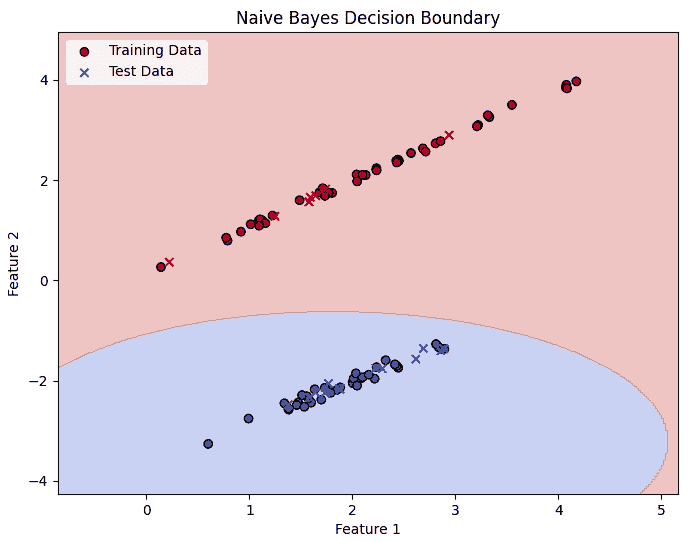

# 机器学习十日谈：第四日

> 来源：[https://datawhaler.feishu.cn/docx/AtZRdLD5VoGa1sxMxVLcpioNngg](https://datawhaler.feishu.cn/docx/AtZRdLD5VoGa1sxMxVLcpioNngg)

本节目由，观众的素质三连，赞助播出

> **写作原因**：最近一段时间已经是考研高峰期了。有不少非科班跨考人工智能专业的同学表示复试要考模式识别（因为有些学校的人工智能专业在自动化学院）和机器学习，问我看点什么才能准备。我说，你要不看看上海交大俞勇老师和张伟楠老师他们写的《动手学机器学习》呢？他们说：非科班代码能力跟不上；然后我又推荐说，要不看看西瓜书+南瓜书配套呢？他们说：数学公式看不懂；然后我又推荐了《深度学习详解》，他们说：复试时间不多了看不完；我寻思，准备面试的话，我推荐一下《百面机器学习》吧，但他们又说：没有知识背景题目背了又忘。于是，我写一个机器学习十日谈系列，用十天时间尽可能快速地带着大家过一过重点，然后迅速先把sklearn的代码用起来就先别手搓了。

> 请以下有基础的同学移步到其他机器学习教程：

1.  **有比较好的代码功底**、学习过Python+Numpy的同学，请移步《动手学机器学习》

1.  **数学基础尚可，**希望了解更多底层原理和理论推导的同学，请移步西瓜书+南瓜书

1.  **对机器学习已有一**定基础，想在此基础上做延伸扩展的同学，请移步《深度学习详解》

1.  **已经学习过机器学**习基础知识，目的明确就是准备面试的同学，请移步《百面机器学习》

> **本教程面向压根没学过Python、**仅限于听过机器学习这四个字的同学速通使用。

> 本教程需要使用Python进行一点非常、非常、非常简单的编程。我不知道你们非科班跨考或者自学的同学，除了把王道408刷烂了之外配置一个miniconda或者Pycharm或者VSCode有没有问题。网络上有很多在线的编程环境例如autodl、阿里云天池、百度飞桨、kaggle、colab等，有一些资源是免费的。但如果你们甚至不愿意搜一下它们的网址，从www.python.org上下一个最原始的python也不是不行。下载安装的过程中，注意勾选“将Python添加到系统路径PATH”，如果是英文界面看不懂请自行打开翻译软件翻译。建议选择3.x以上的Python版本，3.8以上会更稳定一些。另外，下载完成后，如果添加系统路径成功，请打开windows的cmd或者MacOS的命令行，输入一行命令：pip install numpy scipy matplotlib pandas scikit-learn，这时可以泡一壶茶等它跑好

# 第四日：概率与贝叶斯分类

## 4.1 条件概率与贝叶斯公式

### 备注

>

>

>

>

>

>

>

>

>

>

>

>

>

>

> 这几个概念后面会提到

>

>

>

>

>

>

>

>

>

>

### 笔记栏

> 你们考完研究生应该不至于这么快把条件概率忘完了吧。条件概率和贝叶斯公式是在研究生考试的时候必考内容，但为了防止有考数二的同学（冷知识，数二不考概率论与数理统计），我还是应该补充一点。

> 条件概率，指的是在A发生的条件下AB同时发生的概率（即A发生的条件下B也发生）

> 聪明的你，或许已经发现一个盲点：

> P(AB)=P(B|A)P(A)=P(A|B)P(B)

> 没错，就这样，我们有了贝叶斯公式：

### 关键概念

1.  **先验概率**（Prior Probability）：

+   P(A)：在考虑任何特定证据之前，对事件 A 发生的概率的初始信念。

1.  **后验概率**（Posterior Probability）：

+   P(A∣B)：在考虑了特定证据或数据 B 之后，对事件 A 发生概率的更新后的信念。

1.  **似然函数**（Likelihood Function）：

+   P(B∣A)：在事件 A 发生的条件下，观察到证据 B 的概率。

1.  **边缘概率**（Marginal Probability）：

+   P(B)：观察到证据 B 的总体概率，与事件 A 无关。\

> 贝叶斯公式通过似然函数 P(B∣A) 和先验概率 P(A) 的乘积，再除以证据 P(B) 的概率，来计算后验概率 P(A∣B)。

### 总结栏

> 省流小助手：

1.  回顾了条件概率与贝叶斯公式

1.  介绍了一些基本概念

## 4.2 朴素贝叶斯模型

### 备注

>

>

> 特征之间相互独立的假设，正是这个模型为什么叫朴素贝叶斯。

>

>

> 独立事件是可以具备乘法法则的。

>

>

>

>

>

>

>

>

>

>

>

>

>

> 为什么说朴素贝叶斯是一种生成式模型？

+   **生成式模型**试图学习数据的联合概率分布P(X,Y)，其中X是特征，Y是标签。这意味着生成式模型不仅要学习如何对已有的数据进行分类，还要理解数据是如何生成的。例如，如果数据是关于天气和人的活动的，生成式模型会尝试理解天气的分布以及这种天气下人们会进行何种活动的联合分布。

+   **朴素贝叶斯**明确地学习了特征和标签的联合概率分布P(X,Y)，这正是生成式模型的定义。它基于贝叶斯定理来计算后验概率P(Y∣X)，而为了应用贝叶斯定理，需要知道先验概率P(Y)和似然P(X∣Y)。通过构建这些概率分布，朴素贝叶斯可以生成新的数据样本，这也是生成式模型的一个重要特性。

>

>

>

>

>

>

>

>

>

>

>

>

>

>

>

>

>

>

>

>

>

>

>

### 笔记栏

> 这个 贝叶斯公式怎么被用于分类器呢？你且听我举个例子：

> 医生通过发烧、咳嗽、打喷嚏三个特征判断你是否流感。假设发烧、咳嗽、打喷嚏这三个特征是相互独立的（实际情况中往往并不独立，这里是一个模型假设，懂吗？模型假设，上过我的数学建模课的同学应该要知道啊）

> 那么P(y=流感|x1=发烧,x2=咳嗽,x3=打喷嚏)等于什么？用贝叶斯公式分析：

> 那很好了，剩下的这些概率我在数据集里面做统计就好了。

> 如果这个特征是连续数值，就利用正态分布对特征进行建模，得到概率密度值来代替，也是可以用的。

> 朴素贝叶斯算法在计算条件概率时，可能会遇到某些特征值在训练集中从未与某个类别同时出现的情况。这会导致条件概率为零，从而影响模型的准确性和泛化能力。为了避免这种情况，需要对概率估计进行平滑处理。

> 常见的平滑方法包括：

+   拉普拉斯平滑

+   加法平滑

+   beta分布平滑

+   Katz平滑

> 假设我们正在构建一个垃圾邮件分类模型。在训练数据中，“量子计算”这个词从未出现在垃圾邮件中。如果不进行平滑处理，当一封新邮件包含“量子计算”这个词时，它被判定为垃圾邮件的概率就会是零。通过拉普拉斯平滑，我们可以将每个特征的计数加上1，从而避免零概率问题。

> 朴素贝叶斯的实现如下：



```
import numpy as np
import matplotlib.pyplot as plt
from sklearn.datasets import make_classification
from sklearn.model_selection import train_test_split
from sklearn.naive_bayes import GaussianNB
from sklearn.metrics import accuracy_score, confusion_matrix, ConfusionMatrixDisplay

# 1. 生成模拟数据
# 创建一个具有两个特征的线性可分数据集
X, y = make_classification(n_samples=100, n_features=2, n_informative=2, n_redundant=0, 
                           n_clusters_per_class=1, random_state=42, class_sep=2.0)

# 2. 数据集划分
# 将数据集分为训练集和测试集
X_train, X_test, y_train, y_test = train_test_split(X, y, test_size=0.2, random_state=42)

# 3. 创建并训练朴素贝叶斯分类器
# 使用高斯朴素贝叶斯分类器（适用于连续型数据）
clf = GaussianNB()
clf.fit(X_train, y_train)

# 4. 预测
y_pred = clf.predict(X_test)

# 5. 评估模型
accuracy = accuracy_score(y_test, y_pred)
print(f&quot;Model Accuracy: {accuracy:.2f}&quot;)

# 6. 绘制决策边界
# 创建一个网格以绘制决策边界
h = 0.02  # 网格步长
x_min, x_max = X[:, 0].min() - 1, X[:, 0].max() + 1
y_min, y_max = X[:, 1].min() - 1, X[:, 1].max() + 1
xx, yy = np.meshgrid(np.arange(x_min, x_max, h), np.arange(y_min, y_max, h))

# 预测网格中的每个点
Z = clf.predict(np.c_[xx.ravel(), yy.ravel()])
Z = Z.reshape(xx.shape)

# 绘制决策边界
plt.figure(figsize=(8, 6))
plt.contourf(xx, yy, Z, alpha=0.3, cmap=plt.cm.coolwarm)
plt.scatter(X_train[:, 0], X_train[:, 1], c=y_train, cmap=plt.cm.coolwarm, edgecolors=&#x27;k&#x27;, label=&#x27;Training Data&#x27;)
plt.scatter(X_test[:, 0], X_test[:, 1], c=y_test, cmap=plt.cm.coolwarm, edgecolors=&#x27;k&#x27;, marker=&#x27;x&#x27;, label=&#x27;Test Data&#x27;)
plt.title(&quot;Naive Bayes Decision Boundary&quot;)
plt.xlabel(&quot;Feature 1&quot;)
plt.ylabel(&quot;Feature 2&quot;)
plt.legend()
plt.show()

# 7. 绘制混淆矩阵
# 计算混淆矩阵
cm = confusion_matrix(y_test, y_pred)
disp = ConfusionMatrixDisplay(confusion_matrix=cm, display_labels=clf.classes_)
disp.plot(cmap=plt.cm.Blues)
plt.title(&quot;Confusion Matrix&quot;)
plt.show()
```

### 总结栏

> 省流小助手：

1.  介绍了朴素贝叶斯的一些思想

1.  介绍朴素贝叶斯过程中的平滑

1.  给出朴素贝叶斯的实现

## 4.3 从概率与分布看机器学习

### 备注

> 康奈尔大学的机器学习教材《Machine Learning: A Probablistic Perspective》就是按概率的视角看机器学习。它试图把所有的机器学习算法都用概率和贝叶斯公式的视角来解释。

> 这是一本很好的教材，但很考验人的功底。不仅考验读者的功底，还考验老师的功底。如果对贝叶斯学派的这一套思想理解不够深入，可能讲着讲着学生就听不下去了哈哈哈。

>

>

>

>

>

>

+   **频率学派**：认为概率是事件在长期重复实验中发生的相对频率，侧重于通过数据本身来推断规律。

+   **贝叶斯学派**：认为概率是主观的信念或对事件发生的确信程度，结合先验知识和数据来更新对事件的判断。

>

### 笔记栏

> 机器学习本质上是让计算机从数据中学习规律，并用这些规律来预测或决策。而概率和分布是理解数据规律的重要工具。

#### 1. 概率的作用

+   **处理不确定性**：现实世界的数据往往有噪声或不确定性，概率可以帮助我们量化这种不确定性。比如，天气预报说“明天有 70% 的概率下雨”，这就是用概率来描述不确定性。

+   **建模数据规律**：通过概率，我们可以描述数据的生成规律。比如，学生的考试成绩可能服从正态分布（钟形曲线），这帮助我们理解大多数学生的成绩集中在哪个范围。

#### 2. 常见的概率分布

+   **正态分布（高斯分布）**：很多自然现象（如身高、体重、考试成绩）都服从正态分布。在机器学习中，很多算法假设数据是正态分布的，比如线性回归。

+   **伯努利分布**：用于描述只有两种可能结果的事件，比如抛硬币（正面或反面）、垃圾邮件分类（是垃圾邮件或不是垃圾邮件）。

+   **多项式分布**：用于描述有多种可能结果的事件，比如掷骰子（1到6点）、文本分类（新闻类别有多种）。

#### 3. 模型训练与优化

+   **最大似然估计（MLE）**：这是一种常用的参数估计方法，目标是找到最能解释观测数据的模型参数。比如，我们有一组学生的考试成绩，想找到最适合这组数据的正态分布参数（均值和方差）。

+   **贝叶斯推断**：这是一种结合先验知识和数据来估计模型参数的方法。比如，医生根据病人症状和经验（先验知识）来判断病情，同时结合检查结果（数据）来更新诊断。

#### 4. 决策与风险

+   **期望风险最小化**：机器学习的目标是让模型在未知数据上的表现最好。通过最小化模型在训练数据上的平均损失，我们可以间接优化模型在未知数据上的表现。

+   **贝叶斯风险最小化**：考虑模型参数的不确定性，通过综合多个可能的模型来降低风险。比如，医生可能会综合多个专家的意见来制定治疗方案。

#### 5. 生成式模型 vs. 判别式模型

+   **生成式模型**：学习数据的生成规律，比如朴素贝叶斯分类器。它不仅能分类，还能生成新的数据样本。

+   **判别式模型**：直接学习如何分类或预测，比如逻辑回归和支持向量机。它更关注如何区分不同类别，而不是数据的生成过程。

### 总结栏

> 省流小助手：

+   **概率与分布**是机器学习的基础工具，帮助我们理解和建模数据的规律。

+   **生成式模型**关注数据的生成过程，**判别式模型**关注如何分类或预测。

+   **概率**帮助我们处理不确定性，**分布**帮助我们理解数据的规律。