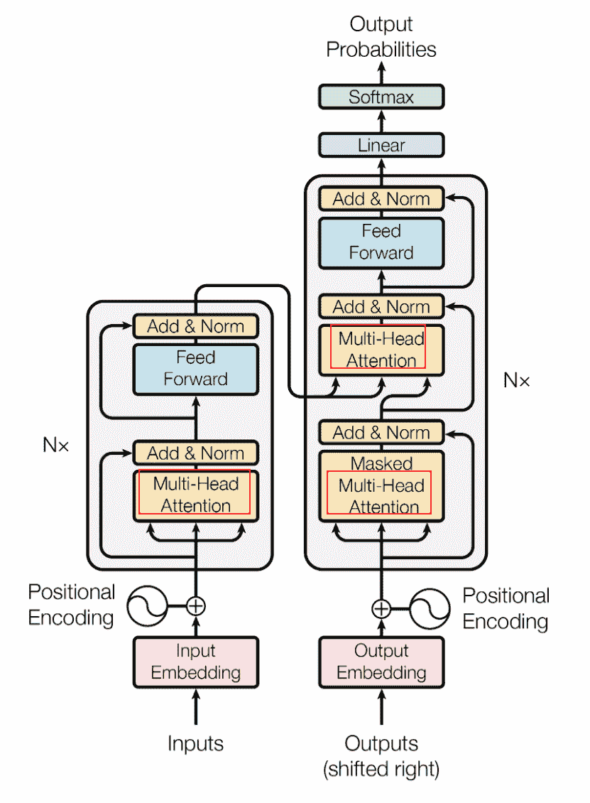
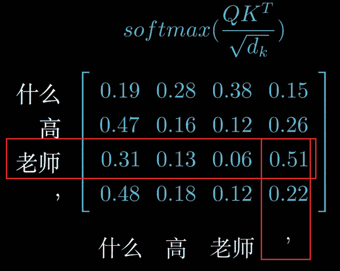

# 动画大模型推理过程和加速方法（残篇）

> 来源：[https://datawhaler.feishu.cn/docx/TXx1dSEsFoyFOSxzYwKccYkvnRd](https://datawhaler.feishu.cn/docx/TXx1dSEsFoyFOSxzYwKccYkvnRd)

## 注意力计算篇

当今知名的大模型如DeepSeek-R1，几乎无一不基于Transformer架构，其核心自注意力机制更是至关重要。

自注意力机制的核心思想是让模型在处理序列数据（如文本中的单词序列）时，能够根据输入序列中各个位置之间的关联关系，动态地为每个位置生成上下文表示。简单来说，就是让模型自己决定在生成某个位置的输出时，应该重点关注输入序列中的哪些部分。

比如在下图中，模型在处理token“老师”时，会重点关注输入序列中的“，”

### 计算步骤

1.  生成查询（Query）、键（Key）、值（Value）向量

在Transformer中，对于输入向量序列  （大小为 ，其中 为序列长度， 为嵌入维度），每个输入元素都会通过一个线性变换生成三个向量：查询向量 、键向量 和值向量 。具体来说，通过可训练的权重矩阵 、 、 将输入向量映射为不同的查询、键和值向量，即 ， ， 。

1.  **计算注意力分数**

自注意力的关键步骤是计算 与 之间的相似度，以此确定每个位置在关注其他位置时的权重。

具体做法是将 和 进行点积，并通过一个缩放因子 （其中 是键向量的维度）归一化。

公式表示为： 。

这里的 表示查询与键的点积，其结果表示查询与键的相似度。通过除以 ，避免内积值过大导致softmax输出的梯度过小，影响模型训练。

1.  **计算注意力权重**

注意力分数通过softmax函数进行归一化，得到每个位置的注意力权重。经过softmax处理后，权重和为1，这使得输出更加稳定，并且可以看作是序列中每个位置对其他位置的依赖程度。

### 动画演示

[KVCache2.mp4](https://internal-api-drive-stream.feishu.cn/space/api/box/stream/download/all/K3gjbg4emoY3PyxiIOpcvUALnPg)

## KV Cache

前面介绍的注意力机制效果好，但若按这种方式实际计算，会有个致命的问题，即重复计算。

大模型在生成过程中，会不断的在输入序列的最后插入新生成的token，而序列前面的自注意力计算结果在之前就已经计算过了，所以可以将之前的计算结果保留下来，留着这次使用

### 动画演示

[KVCache.mp4](https://internal-api-drive-stream.feishu.cn/space/api/box/stream/download/all/QZxXbSNMpowEBtx0ZWwc5L8knge)