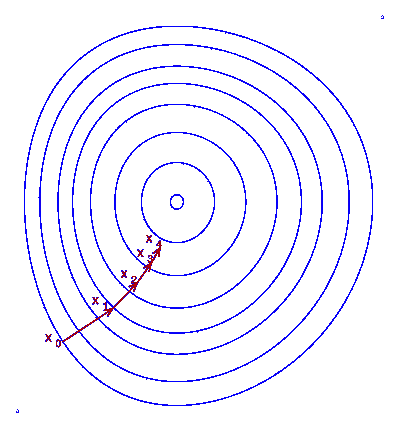
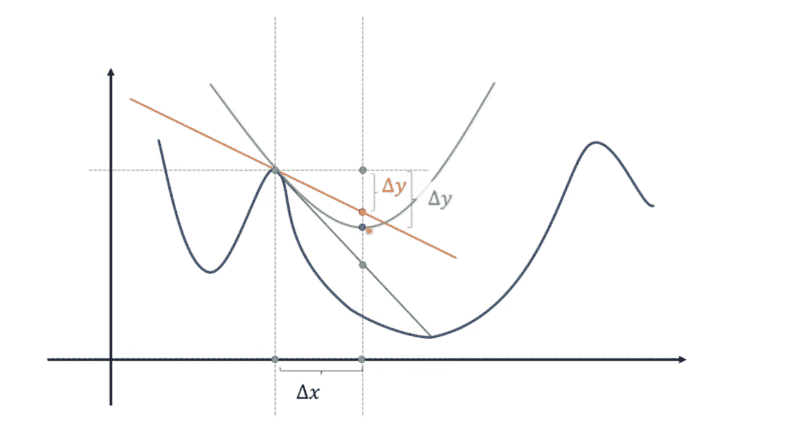
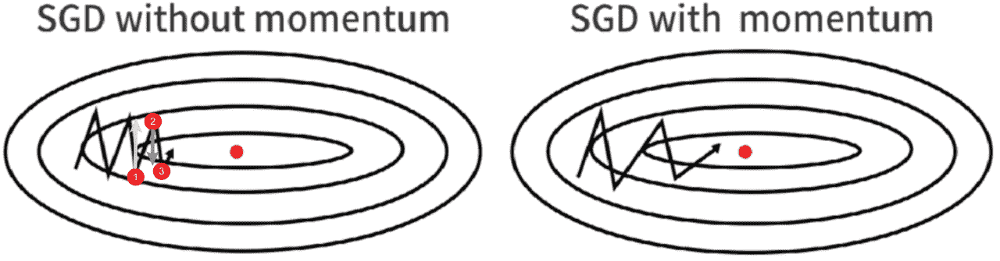
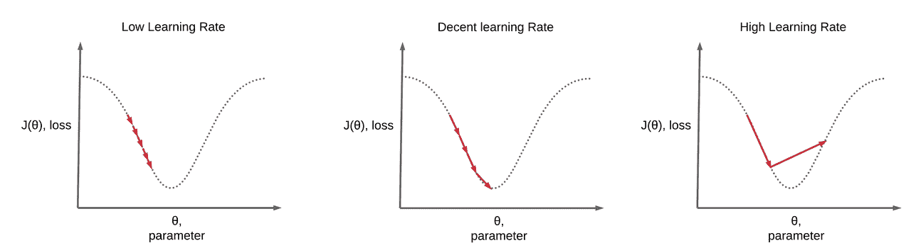

# 微学习2 | 机器学习优化方法详解

> 来源：[https://datawhaler.feishu.cn/docx/TMRgdKL4FobwSAxRBEXcry5Uned](https://datawhaler.feishu.cn/docx/TMRgdKL4FobwSAxRBEXcry5Uned)

> **前情提要**：在前几章中，我们探讨了机器如何通过学习数据来提高自身的表现。而在本章，我们进一步引**入了"考**试"这一比喻，来形象化描述机器学习过程中模型的评估与优化。我们详细介绍了损失函数的概念，它在训练过程中起到了至关重要的作用——衡量模型预测值与真实值之间的偏差

+   [微学习 | 机器学习理念和损失函数详解](https://biyxvja3li.feishu.cn/docx/W8U8dlDoZoUP7vxmsWocwkrtnHb?from=from_copylink)

## 机器学习优化方法

而现在，对于机器学习，我们已经知道了可以通过损失函数来衡量"考试成绩"，也知道了“分数不够高就要基于错误的**题目继续优化认知”。但模型（学生）要如**何不断学习，从而提高自己的考试成绩（最小化损失函数）呢？这一过程在机器学习中被称为优化（optimisation）或参数更新（parameter update）

**注意**：**优化的目标**是让模型的预测结果   尽可能接近真实值 y：

+   回归问题的目标 -> 最小化均方误差（MSE）

+   分类问题的目标 -> 最小化交叉熵损失（CE）

## 解析解（Analytic Optimisation）

在某些简单场景下（例如**线性回归**），我们可以通过**解析解（Analytic Solution）一次性**求出最优参数。回想我们在高中**学过的解方程**场景：如果方程结构简单，比如一元二次方程，我们可以用代数方法，直接求导并将结果设为 0，从而求解最优值，而不需要迭代计算

而在理论上，即使是**高维情况**，如果满足某些条件（如凸性、可逆性），我们仍然可以用解析方法求解。不过，这种方法在高维度下可能存在数值稳定性（如矩阵求逆的精度问题）、计算代价（时间和空间复杂度较高）、以及过拟合（当特征数 d 远大于样本数 m 时）等风险

然而，在大多数实际问题中，模型是非线性的**，或者解析解**难以计算。这时，我们需要**使用数值优**化方法来求解，其中梯度下降（Gradient Descent）是最常见的策略之一，特别适用于梯度可计算的优化问题

## 梯度下降（Gradient Descent）

### Theory of Gradient Descent

想象我们站在一座高山之巅，脚下崎岖陡峭，周围云雾缭绕，让人难以看清山谷的位置。但可以确定的是，山顶并不安全，我们需要找到下山的最佳路线，最终抵达最低点。虽然看不见终点，但我们能感受到坡度的方向（即梯度），它告诉我们当前的下坡趋势。一个简单的策略是：顺着坡度的反方向前进，因为坡度指示了局部地形的走向，我们只需要沿着最陡峭的下降方向前进，就能逐步接近目标

梯**度下**降法就是利用了这样的思想 —— 大多数时候（尤其是神经网络、非线性模型），我们无法直接一次求得最优参数，而需要依靠迭代，而梯度下降法就能告诉我们每一步该往哪个方向移动

**在梯度下降中**，我们每一步的更新受两个关键因素影响：

+   **梯度（坡度）**：决定了下降的方向和速率。陡峭的坡度（梯度较大）会加速下降，而坡度较缓（梯度较小）会减缓下降速度

+   **步长（学习率）**：控制每次移动的幅度。如果步长过小，下降速度缓慢，收敛时间长；如果步长过大，可能会越过最优解，甚至导致震荡或发散

梯度下降的核心思想是**沿着损失函数梯度的负方向移动**，因为梯度指示了损失函数上升最快的方向，而我们希望最小化损失。因此，我们每一步的更新遵循

而如果回到老师和学生的例子，我们也可以理解成：位置代表学生的"认知"，"认知"与学生的成绩息息相关；步长代表学生的固定学习速度；而坡度代表了老师的纠错反馈，如果学生错的很多，老师的纠错就越强烈，错的少，纠错就相对少一些，而如果能到0，就代表学生掌握了知识，也就是达到了最优"认知"

如果用 代表学生的认知， 代表学生的学习速率，以及用 代表老师的反馈强度，则

### Variation of Gradient Descent

不同的学生会有不同的学习方式，机器学习中梯度下降也有不同的策略，主要包括

1.  批量梯度下降（Batch Gradient Descent）

+   学生每次复习整本书，确保全面理解，稳定但耗时。每次更新时，使用整个数据集来计算梯度

+   优点：梯度方向精准；缺点：数据规模大时效率低

1.  **随机梯度下降（Stochastic Gr**adient Descent, SGD）

+   每做一道题就立刻调整学习策略，快速但容易摇摆不定

+   优点：迭代速度快，适合大规模数据；缺点：波动较大，收敛路径不稳定

1.  **小批量梯度下降（Mini-bat**ch Gradient Descent）

+   每次学习一部分内容，折中高效，实际应用最广泛

+   优点：兼顾速度和稳定性，是目前最常用的方法

## 优化算法（Optimised Algorithm）

那到目前为止，一切看起来都很完美——只要我们按照梯度下降的方向前进，就能一路抵达最优解！但仅仅按照梯度往下走，这样的路径是最适合的吗？

如果我们**回顾自己走过的路径**，并**将其绘制成一张俯视图****（从山顶俯瞰山谷）****，我们可能会发现某些路径“太硬**了”（例如**从x****1到 x**4），虽然最终抵达了目标，但过程显得生硬、不流畅。那有没有更平滑、更高效的路径呢？ 例如一条曲线，能在更短的时间内稳定地到达最低点？ —— 这就是优化算法该起作用的地方了，而在接下来，我们也会讲述最经典的一些优化算法，牛顿法 / Nesterov / Momentum / RMSProp / AdaGrad / Adam

### 牛顿法（Newton）

> 传统梯度下降只利用一阶导数（梯度）来决定更新方向和步长。但如果我们能利用二阶信息（Hessian矩阵），是否可以找到更优的下降路径？这就是牛顿法（Newton’s Method）的核心思想

想象我们还在损失函数的山上，我们希望达到最低点；站在这个位置上，我们可以对的整体情况进行一个分析

1.  橙色线段是我们当前位置的切线，代表梯度

1.  灰色线段代表的是我们当前位置距离最优位置的直线

1.  绿色线段代表的是我们当前位置的二阶导数，代表函数凹凸性

对比这三个线段，我们能够发现，在 Δx 内，二阶导数距离终点更近

在数学上，我们可以用 **泰勒展开式** 来近似损失函数，并利用二阶导数信息来找到更好的下降路径

学过高数的小伙伴们应该了解过"泰勒展开式" —— 一个拥有无限复杂的多项式函数可以对任意一个给定的函数进行近似拟合。而我们可以试着利用一下泰勒展开式，将函数展开到二次项

现在，假设我们现在还在损失函数的山上，我们希望达到最低点；灰色线段代表的是我们当前位置距离最优位置的直线；橙色线段是我们当前位置的切线，代表梯度；绿色线段代表的是我们当前位置的二阶导数，代表函数凹凸性。我们能够发现，在 内，二阶导数距离终点更近。

想想之前解析解的时候，我们知道，当一阶导数为0的时候，我们就能得到最优解，而在这里也一样的

我们对上面的泰勒展开式进行一阶求导，并将其设为0，得到

配上我们最开始的例子就是

整合一下就是：

在实际计算中，二阶导数有一个特殊的名词：Hessian Matrix

注**意：当我们的参数很多的**时候（e.g. 高维数**据），我们需要对每一个****参数都求偏导，****并最终整合成Hessian矩阵，但**这样的计算量太大了；且我们有些时候需要注意矩阵是否有不可逆的问题（奇异，可能还需要加入正则化），整体复杂度太高，通常我们会使用拟牛顿法或其他优化策略。但这些替代的方法的储存开销和计算开销也不小，所以我们可能还得探索其他方法。

### 动量法（Momentum）

> **在牛顿法**中，我们尝试将所有下降路径的维度统一考虑，以找到更优的优化路径。然而，这种方法在计算上代价较高，尤其在高维深度学习场景下难以执行。那么，是否可以换个思路，把下降路径拆分来看呢？

如果我们将优化过程拆解为**横轴与纵轴**两个角度（如下图所示），可以发现：

+   SGD 在陡峭的方向（纵轴）上存在较大的震荡，导致训练效率降低。

+   **而在缓慢的方向（横轴），SGD收**敛速度较慢，需要多次迭代才能逼近最优点。

若我们能在纵轴方向**上减缓波动，使其更加平****滑，减少不必要的振荡，同时在横**轴方向上加快收敛速度，则可以更快、更稳定地达到最优解。那应该如何做到呢？答案在于利用历史信息来指导更新

**我们从图中两个点（**点1**和点2）开**始回顾优化过程：纵轴方向（左图）：前一步（点1）的梯度方向是向上的（粉色箭头），这一步（点2）的梯度方向是向下的（紫色箭头），而参数在这一来一回中浪费了时间。如果我们能将两个方向的历史信息“叠加”，是不是就就可以平滑这些无效的振荡。而回到纵轴，我们能看出梯度肯定一直朝右，这也着我们在这一方向上应该持续加速。若能将历史的更新累积起来，参数将以更快的速度靠近最优点 —— 右图

从上述分析中，我们能知道，**历史信息的核心价值就是：**

+   **减少震荡：** 平滑掉不必要的来回波动。

+   **加速前进：** 在一致的方向上累积动量，推动更快的收敛。

那用数学如何表述呢？

让我们先回到SGD，我们曾经推出来过

SGD 的更新依赖于**当前位置的梯度信息**，但忽略了之前更新的历史。如果我们想利用**历史信息，可以引入一个“动**量变量 ”，将过去的更新趋势和现在的梯度累积起来。这个时候我们就可以不看梯度，而是看动量了（考虑了当前的梯度和之前的动量）

注意：并非所有的历史更新都需要等比例考虑。如果我们还按第一步的梯度对第 n 步更新产生强影响，很容易使得整体优化路径变乱。因此，我们引入一个动量系数  ，控制历史更新的重要性。对于下一步的动量，我们选择参考 的历史动量以及 的当前梯度，整合一下就是

### Nesterov

> 在前面的 **Momentum** 方法中，我们通过引入动量（Momentum）减**少了梯度下降中的**震荡，并加速了收敛。但 Momentum 仍然存在一个问题：它仅仅是利用了过去的梯度信息，但并没有考虑当前加速的方向是否最优，这可能会导致 过冲（overshooting） —— 想象我们在骑自行车下坡，Momentum方法可以帮助我们避免左右摇摆和不断往前加速，但若是前方有一个弯道的话，我们有可能会冲出这个道路，这就太危险了。但若我们能提前预判未来的方向，能心里有个底在必要的时候转弯呢？

**Nes**ter**ov Accelerat**ed Gradient（简称 NAG 或 Nesterov 动量法）就是一个能够预知未来的方法，在Momentum的基础上做了进一步优化——它试图在更新参数之前“预判”梯度的方向，从而让参数更新更加精准

我们回顾一下，在 Momentum 方法中，我们的更新方式是

,

通过公式我们能看出，Momentum 只是基于历史持续更新，但没有考虑当前加速的方向是否最优。而为了改进这一点，Nesterov 试图提前感知梯度的变化趋势 —— 既然我们已经知道动量会让我们往   方向走，为什么不提前看看 "如果真的走过去了"，梯度会是什么样？

**具体的步骤涵盖**：

1.  **预判未来的位置****：由于****动量**的存在，我们知道参数会**在下一步继续往动量方向前进**。因此，我们可以提前计算一个“预计位置” —— 注意：这里的 \tilde{\theta_t} 不是当前的位置，而是考虑动量后预测的下一个位置

1.  **在预判位置计算梯度****：传**统 Momentu**m 直接使用 当**前 位置的**梯度，而 Ne**sterov 则使用 预判位置的梯度：

1.  **更新参数**：最后我们再用这个新的动量来更新参数

### AdaGrad

> **动量法和**N**estero**v法在一定程度上解决了 S**GD 中的震荡问题和加速**收敛问题，但它仍有一个关键的缺陷：所有参数共享相同的学习率。在深度学习中，不同参数的梯度可能有不同的尺度，有些梯度变化剧烈，有些梯度却很微小。如果我们对所有参数都使用相同的学习率，就可能出现以下问题：

1.  **剧烈变化的梯度：** 大梯度可能导致参数更新幅度过大，最终错过最优解（第三张图）

1.  **微小变化的梯度：** 小梯度可能导致更新幅度太小，训练停滞在次优解（第一张图）

**这种共享学习率的问题使得训练过程难以兼顾不**同参数的特性。那么，有没有办法让每个参数拥有独立的学习率，并根据梯度的变化动态调整这些学习率呢？

为了解决上述问题，AdaGrad（Adaptive Gradient Algorithm）被提出。它的核心思路是：为每个参数分配一个独立的学习率，并根据梯度的大小动态调整这些学习率。

1.  对于梯度变化剧烈的参数，降低它的学习率，避免过大的更新幅度

1.  对于梯度变化较小的参数，提高它的学习率，加快收敛速度

Momentum方法告诉我们历史信息也有影响，那对于梯度，我们也可以设计一个累计量

假设我们有一个梯度累计值 ，根据Adagrad的原始思想，我们希望其能够控制**学习率的强**弱，梯度越大，当前学习率越小（反比例关系）。整合我们之前的参数更新的例子，我们可以融入梯度累计值，得到

**注意**：虽然比较不可能，但若是有一天梯度为0呢？为了避免这种情况，我们可以添加一个特别小的值ϵ，其可以被用于保证分母始终大于零，避免数值不稳定

除了分母为零的情况，还需要考虑**梯度的正负性**。在Adagrad中，我们关心的是参数梯度的“整体变化强度”，而不是单次更新的方向。如果直接累加梯度，正负梯度的相互抵消会掩盖参数变化的真实情况，从而无法正确反映参数的整体变化趋势。比如我们有历史数据[+5,−5,+5,−5]，如果直接累加，我们的累计值结果为零，这可能说明这个参数“好像”没有变化。但实际上，这个参数的变化幅度很大，我们应当要减小学习率以抑制这种剧烈的更新。所以我们要找办法来避免正负梯度的累加。所幸，与MSE的思路类似，我们可以选择平方来解决问题

但我们还需要注意一下，现在的累计度累计的是梯度的平方。如果直接使用梯度的平方和来调整学习率，可能会导致学习率下降得太快（因为累积值增长较快）。开根号可以让调整幅度更平滑，避免学习率过快减小。最终为

**Adagrad的优势**

Adagrad被设计出来就是为了动态的调整学习率的，但实际上Adagrad还有另外一个潜在的优势 —— 适合稀疏数据

稀疏数据（Sparse Data）指的是数据集中大部分值为零或接近零的情况，在机器学习和深度学习中，稀疏数据广泛存在于以下场景：

+   **文本处理：** 如 TF-IDF 特征向量，表示文本的单词分布时，每个文档可能只包含少量的单词，其他单词对应的频率为零

+   **推荐系统：** 用户对物品的评分矩阵中，大部分用户没有评分（值为零）

+   **图像处理：** 在某些场景下，图像的像素值分布可能很稀疏（例如黑白图像背景中大部分像素值为零）

+   **大规模分类任务：** 如使用 One-Hot 编码处理类别型变量，每个特征向量可能只有一个位置为 1，其他全为 0

**稀疏数据也有一些特点**

+   **高维度：**稀疏数据往往是高维的，例如文本的词袋模型可能包含数十万或更多特征

+   **大部分值为零：**只有少量特征的值为非零，因此在实际训练中，只有一小部分特征会真正影响模型

+   **梯度稀疏：**在训练过程中，梯度的更新往往只发生在非零的特征上，而大部分特征梯度为零

为什么 AdaGrad 适合稀疏数据？

AdaGrad 的核心优势是，在梯度分布不均衡或稀疏特征的场景中，它能够很好地捕捉特征的不同重要性。因为

1.  **为每个特征分配独立的学习率：**AdaGrad 可以为每个参数（特征）分配独立的学习率，并根据历史梯度平方和动态调整。在稀疏数据中，很多特征的梯度可能一直为零，而少量非零特征的梯度会有显著的变化。
AdaGrad 能够自动降低梯度变化较大特征的学习率，同时提高梯度变化较小（或者更新不频繁）的特征学习率，从而更好地适应稀疏数据的特性

1.  **对稀疏梯度的自适应更新：**假设某个特征的梯度非常稀疏（大部分时间为零，偶尔有非零值），AdaGrad 会大幅度增加学习率，使其特质在参与更新时能更快学习。对于频繁更新的特征（如稠密特征），AdaGrad 会动态降低学习率，避免过大的更新幅度

1.  历史梯度累积对稀疏特征的放大作用：在稀疏特征中，某些特征可能在某次迭代中突然出现一个非零梯度。由于 AdaGrad 的学习率公式中有梯度平方的累积值（ ），这个非零梯度的历史信息会被显著记录，从而在后续迭代中有效调整学习率。由于稀疏特征的累积梯度值小，因此其学习率相对更高，而频繁更新的稠密特征梯度累积值大，其学习率则被减小

1.  **适合高维特征的自动归一化：**高维稀疏数据的特征尺度可能不一致（例如某些特征值范围大、更新频繁，而其他特征值很小、更新稀疏）。AdaGrad 的归一化效应（通过梯度平方和调整学习率）可以自动平衡特征之间的差异，使得训练更加高效和稳定

### RMSprop

> 虽然 AdaGrad 在动态调整学习率**方面表现优异，但它存在一个明显的问题：累积梯度平**方和的增长过快，导致学习率下降得过早、过快。这在深度学习任务中尤其明显，尤其是面对深层神经网络或长时间训练时，学习率可能下降到几乎无法更新的程度，使得模型难以继续优化。有没有办法既保留 AdaGrad 动态调整学习率的优点，又能避免学习率下降过快的问题呢？

RMSProp（Root Mean Square Propagation）是对 AdaGrad 的改进算法，其核心思路是

+   **引入梯度平方的滑动平均：**与 AdaGrad 中直接累加梯度平方不同，RMSProp 使用一个“滑动平均”的方式记录梯度平方的历史信息，只关注最近一段时间的变化，而不是全部历史。滑动平均的好处是可以平滑梯度变化，避免历史梯度对当前更新产生过大影响。同时，这也有效抑制了学习率下降过快的问题

+   **动态调整学习率：**根据滑动平均的梯度平方值调整每个参数的学习率，与 AdaGrad 类似，梯度变化较大的参数学习率会降低，而梯度变化较小的参数学习率会提高

具体怎么表示呢？

这个"滑动平均"我们可以理解为，对过往的理解逐渐在衰退 - 对于昨天的知识我们可能还记得，但随着时间的长度越来越远，我们可能对几年前的印象就越来越浅（除非影响特别大）。回想一下Momentum，我们可以使用类似的方法，使用衰退因子 来参考历史，用 来整合当前梯度（平方）

在把这个代替之前的Adagrad，就是

### Adam

> 在之前的优化算法中，我们介绍了 Momentum、AdaGrad 和 RMSProp，这些方法分别从不同角度优化了梯度下降算法。然而，它们各有局限：

+   **Momentum** 通过动量平滑了梯度的震荡，但无法动态调整学习率

+   **AdaGrad** 动态调整了学习率，但累积梯度平方和过快增长导致学习率下降得太快

+   **RMSProp** 改进了 AdaGrad，使用滑动平均来解决学习率过快下降的问题，但仅考虑了梯度平方的变化，忽略了梯度的方向性

> **那么，有没有一种算法能同时结**合 Momentum 的动量更新 和 RMSProp 的动态学习率调整 的优点呢？答案就是 Adam（Adaptive Moment Estimation）

Adam 通过同时维护 **一阶动量（梯度的平均值）** 和 **二阶动量（梯度平方的平均值）** 来动态调整：

对于**一阶动量（平均梯度，方向）：**Adam 会记录梯度的滑动平均，用以表示历史梯度的“总体方向”

对于二阶动量（平均梯度平方，尺度）：Adam 会记录梯度平方的滑动平均，用以动态调整学习率

而有了这两个之后，我们就可以组合起来，从而构成

但需要注意**，Ada**m 在计算滑动平均时，由于初始化时   和   都为零，会导致早期的滑动平均值偏小。因此，我们需要对两个动量进行 偏差校正，修正初始阶段的偏差

### AdamW

> 虽然 **Adam**** **是深**度学习中**最常用的优化算法之一，但它也存在一个问题：权重衰减（Weight Decay） 的实现方式。在训练深度学习模型时，我们常通过在目标函数中加入正则化项（如 L2 正则化）来防止过拟合 —— （后面的文章会详细讲述过拟合 - 简单来说就是模型太遵从训练的数据集，从而失去了泛化能力，而这个时候我们就可以通过减少每一个参数的权重，使得单个参数的变化对整体的影响没有很大），这就涉及 权重衰减。而 Adam 对权重衰减的处理方式可能导致不理想的优化效果

Adam 通过动量（ ）和梯度平方平均（ ）动态调整学习率，这种机制虽然提升了优化效率，但也改变了正则化对参数更新的影响（同时影响梯度的方向和大小），比如

+   权重衰减也会被“动态学习率”缩放： Adam 会对每次的梯度（包括正则化部分的梯度）进行缩放，而这个缩放比例和梯度的历史值（即  ）有关，这就导致权重衰减的作用被放大或缩小了

+   **影响优化路径**： 正常来说，权重衰减是直接作用在权重上的（让权重“慢慢变小”）。但 Adam 的这种调整会让正则化变得不稳定，比如正则化太强，导致模型无法收敛到最优解，或者正则化太弱，达不到预期效果

简单来说，Adam 的动态学习率机制与权重衰减的相互作用可能导致：正则化项对参数更新的影响被过度放大或缩小 以及 收敛到次优解，无法充分实现正则化的作用

为了解决这个问题，**AdamW**（Adam with Weight Decay）对权重衰减的处理方式进行了改进，从而不影响梯度

1.  将权重衰减从梯度更新中分离开来，直接作用于参数，而不是梯度

1.  具体实现为在每次参数更新时，额外减去一项与参数值成比例的正则化项：

**AdamW的优势**

+   **正则化效果更准确：**权重衰减与梯度更新解耦，不再受梯度动态缩放的影响，从而能正确地施加正则化作用

+   **避免次优解：**在深度学习任务中，AdamW 通常比 Adam 更容易收敛到全局最优或更好的局部最优解

+   **更适合现代深度学习任务：**AdamW 被证明在大规模模型（如 Transformer、GPT 系列）训练中效果更好，已成为许多深度学习框架中的默认优化器

## 启发式算法（Heuristic Algorithm）

在前面，我们介绍了 **解析解、梯度下降、优化算法（如 Mo**mentum、RMSPro**p、Ad**am） 这些方法，它们主要依赖 梯度信息 进行优化。然而，在某些情况下我们也会遇到各种各样的问题，比如：

+   目标函数复杂，梯度难以计算（如非凸函数、多模态函数）

+   传统优化方法容易陷入局部最优（Local Optimum）

+   搜索空间巨大（如组合优化问题），梯度方法难以高效搜索整个空间

这时，我们可以考虑使用 **启发式算法（Heu**ristic Algorith**m），它们不**需要明确的梯度信息，而是通**过随机性、**启发式策略进行优化。这类算**法通常应用于**：非凸优化问题（如复杂的工程优化问题）/超参数优化（如神经网络的架构搜索）/组合优化问题（如旅行商问题 TSP）

启发式优化方法可以分为以下五大类：

1.  进化算法（Evolutionary Algorithms, EA） —— 模仿生物进化

1.  **群体智能算法（Swarm Inte**lligence Algorithms） —— 模仿动物群体行为

1.  **基于物理过程的优化（Physics**-based Optimization） —— 模仿自然物理现象

1.  **基于数学优化的启发式方法（Mathematic**al-based Heuristics） —— 结合数学规则进行搜索

1.  混合优化方法（Hybrid Optimization） —— 结合多种策略

但启发式算法的种类和应用比较广泛，涉及进化计算、群体智能、物理启发等多个方向。为了避免信息过载，我们可以将会继续理解整体机器学习框架，之后有机会再分别深入每个方法