# 扩散模型DDPM学习笔记

> 来源：[https://datawhaler.feishu.cn/docx/HYd8d3313oH1w4xxdgccPCmxn8b](https://datawhaler.feishu.cn/docx/HYd8d3313oH1w4xxdgccPCmxn8b)

## 0. 课程介绍：

《大模型白盒子构建指南》是一个从原理出发、以“白盒”为导向、围绕大模型全链路的“手搓”大模型指南，旨在帮助有传统深度学习基础的读者从底层原理出发，“纯手搓”搭建一个清晰、可用的大模型系统，包括大模型本身、RAG 框架、Agent 系统及大模型评估体系。教程将从基础原理出发，深入剖析每一个技术点并附以完整的代码实现，以细致讲解和代码注释帮助读者独立复现大模型核心部分，并在复现中实现对大模型的深入理解与掌握。

**本学习笔记是在dataw**hale出品的《大模型白盒子构建指南》的基础上进行的，融入笔者的思考、大白话、比喻**、实操等过程。原**始的课程内容需要具备一定的基础，对初学者来说还是有一定的门槛，本笔记将其通俗化。如有余力，想要更细致的了解其内在过程，可自行学习原始课程（https://github.com/datawhalechina/tiny-universe）

## 概念介绍

### 1.1 什么是DDPM?

DDPM（Denoising Diffusion Probabilistic Models，去噪扩散概率模型）是一种基于马尔可夫链的生成模型，其核心思想是：

+   把一张清晰的图片通过马尔可夫链逐步加入高斯噪声，直到完全变成噪点

+   然后学习如何从噪点中一步步还原出原始图片

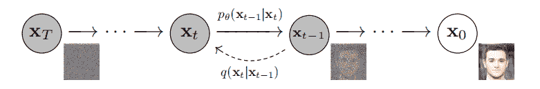

**打个比方说:**

就像是把一张照片慢慢**弄脏**，最后变成一团乱七八糟的墨迹。然后训练一个AI，让**它学**会如何从这团墨迹中一点点把原来的照片还原出来。

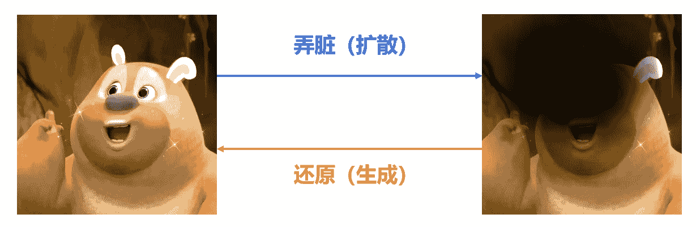

**再举个生活中的例子:**

**想象你****在玩**一个拼图游戏，但是是反着来玩：先把完整的拼图打乱成一堆散片（加噪声），然后学习如何把这些散片重新拼回原来的样子（去噪）。DDPM就是在做类似的事情,只不过它处理的是图片像素，而不是拼图块。

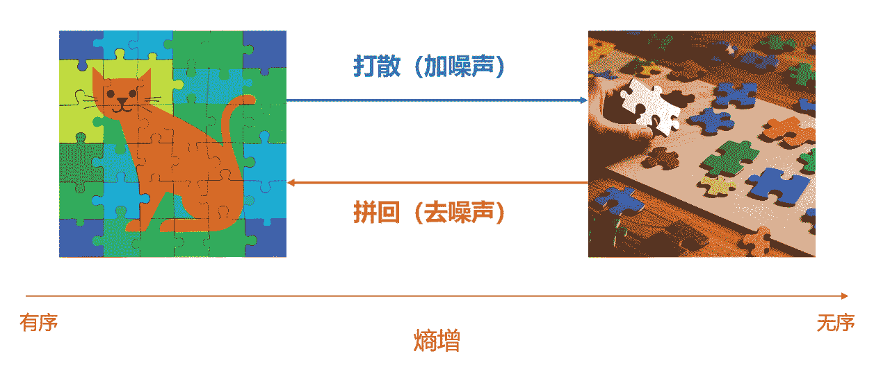

### 1.2 DDPM的两个重要过程

#### 1.2.1 前向过程(Forward Process)

想象你在玩一个"弄脏照片"的游戏:

+   第一步，拿一张干净的照片

+   然后每隔一会儿往上面撒一点点灰尘(噪声)

+   重复这个过程很多次，最后照片就完全被灰尘覆盖看不见了

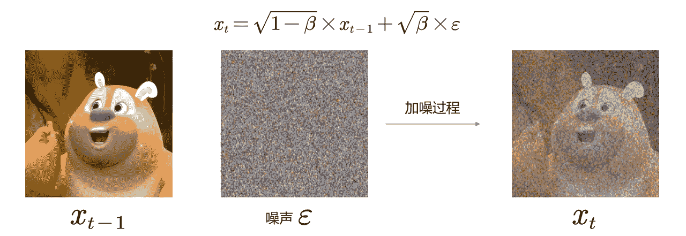

#### 1.2.2 反向过程(Reverse Process)

这就像是在玩"清理照片"的游戏:

+   从一张完全被灰尘覆盖的照片开始

+   用特殊的清洁工具(神经网络)一点点把灰尘清理掉

+   每清理一次，照片就会变得更清晰一些

+   最后终于能看到原来的图像了

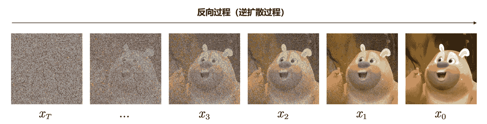

## 模型介绍

### 2.1 整体架构

DDPM的整体架构可以分为三个关键部分：

1.  **数据流动过程**

+   前向过程(Forward Process)：将原始图片逐步加噪

+   反向过程(Reverse Process)：从噪声中逐步恢复图片

+   采样过程(Sampling)：生成新的图片

1.  **核心网络结构**

+   主干网络：**U-Net架构**(像一个"U"形状的网络)

+   **下采样路径：**就像给照片做缩小,一步步把图片变小,这样可以看出照片里有什么大概的东西(比如是人还是风景)

+   **上采样路径：**再把缩小的照片一步步放大回来,把细节都补充回去(比如人脸上的五官、风景中的树叶)

+   **跳跃连接：**在放大的时候,还可以参考之前缩小时的样子,这样可以更好地还原细节(就像拼图时可以看着原图来拼)

+   时间编码：位置嵌入(Positional Embedding)（和transformer位置编码一样哦~）

+   注意力机制：自注意力层用于捕捉长程依赖

1.  **损失函数设计**

+   主要使用简单的MSE损失和KL散度损失

+   KL散度用于衡量前向过程和反向过程分布的差异（KL散度越小，说明模型学得越好）

+   预测加入的噪声而不是直接预测图片

+   损失计算在噪声空间进行

+   最终的目标是最小化变分下界(ELBO)

### 2.2 优缺点分析

#### 2.2.1 优点

+   **生成质量**：样本多样性好，质量高

+   **训练稳定**：不像GAN容易模式崩溃

+   **理论基础**：有严格的数学推导支持

+   **通用性强**：可用于多种生成任务

+   **可控性好**：生成过程更可控可解释

#### 2.2.2 缺点

+   **推理速度**：需要多步迭代，采样慢

+   **计算资源**：训练和推理都需要大量算力

+   **训练时间**：收敛需要较长时间

+   **模型大小**：参数量较大，存储开销大

## 代码实践

### 3.1 数据载入（dataloader）

```
import numpy as np
import torch
import torchvision
from torchvision import transforms
from torch.utils.data import DataLoader
import matplotlib.pyplot as plt


def load_transformed_dataset(img_size=32, batch_size=128) -&gt; DataLoader:
    &quot;&quot;&quot;加载并转换CIFAR10数据集&quot;&quot;&quot;
    train_data_transform = transforms.Compose([
        transforms.Resize((img_size, img_size)),
        transforms.RandomHorizontalFlip(),  # 随机水平翻转
        transforms.ToTensor(),  # 将数据缩放到[0, 1]范围
        transforms.Normalize((0.5, 0.5, 0.5), (0.5, 0.5, 0.5)),  # 将数据缩放到[-1, 1]范围
    ])
    test_data_transform = transforms.Compose([
        transforms.Resize((img_size, img_size)),
        transforms.ToTensor(),
        transforms.Normalize((0.5, 0.5, 0.5), (0.5, 0.5, 0.5)),
    ])

    # 加载训练集和测试集
    train_dataset = torchvision.datasets.CIFAR10(root=&quot;./datasets&quot;, 
                                                train=True,
                                                download=False,
                                                transform=train_data_transform)
    
    test_dataset = torchvision.datasets.CIFAR10(root=&quot;./datasets&quot;,
                                               train=False, 
                                               download=False,
                                               transform=test_data_transform)

    # 创建 DataLoader
    train_loader = DataLoader(train_dataset,
                            batch_size=batch_size,
                            shuffle=True,
                            drop_last=True)
    
    test_loader = DataLoader(test_dataset,
                           batch_size=batch_size,
                           shuffle=False,
                           drop_last=True)
    
    return train_loader, test_loader


def show_tensor_image(image):
    reverse_transforms = transforms.Compose([
        transforms.Lambda(lambda t: (t + 1) / 2),  # 将数据从[-1, 1]缩放到[0, 1]范围
        transforms.Lambda(lambda t: t.permute(1, 2, 0)),  # 将通道顺序从CHW改为HWC
        transforms.Lambda(lambda t: t * 255.),  # 将数据缩放到[0, 255]范围
        transforms.Lambda(lambda t: t.numpy().astype(np.uint8)),  # 将数据转换为uint8类型
        transforms.ToPILImage(),  # 将数据转换为PIL图像格式
    ])

    # 如果图像是批次数据,则取第一个图像
    if len(image.shape) == 4:
        image = image[0, :, :, :]
    return reverse_transforms(image)


if __name__ == &quot;__main__&quot;:
    train_loader, test_loader = load_transformed_dataset()
    image, _ = next(iter(train_loader))
    img_to_show = show_tensor_image(image)
    plt.imshow(img_to_show)
    plt.savefig(&#x27;/mnt/workspace/tiny-universe-main/content/TinyDiffusion/ddpm/dataloader_image.png&#x27;)  # 修改路径以适应您的环境
```

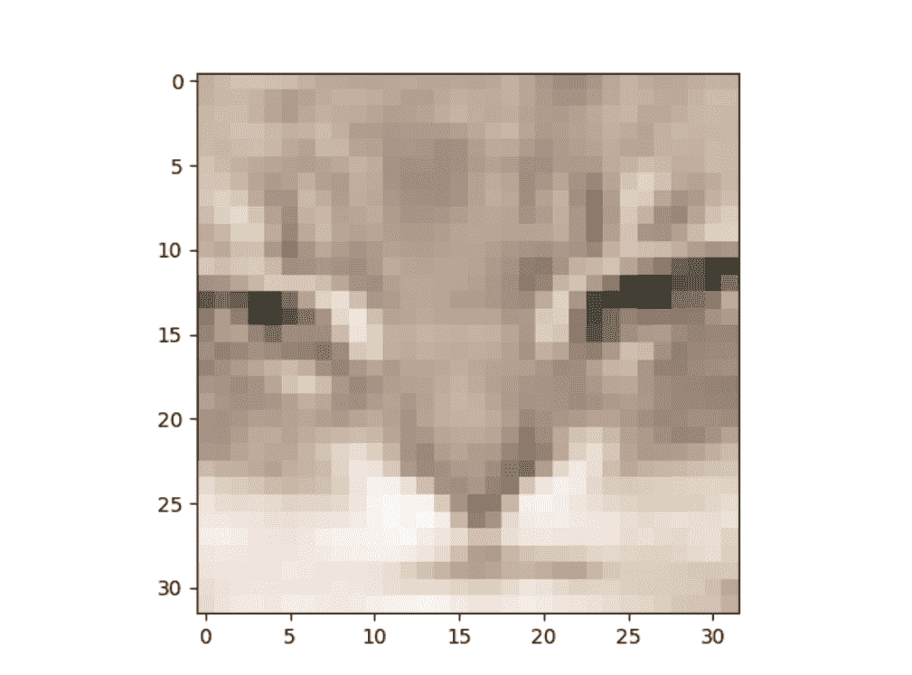

> wow乍一看是小猫表情包，是不是很可爱hhhh

### 3.2 U-Net模型（unet）

```
import torch
from torch import nn
import math


class Block(nn.Module):
    def __init__(self, in_channels, out_channels, time_emb_dim, up=False):
        &quot;&quot;&quot;UNet中的基本Block模块,包含时间嵌入和上/下采样功能&quot;&quot;&quot;
        super().__init__()
        self.time_mlp = nn.Linear(time_emb_dim, out_channels)
        if up:
            self.conv1 = nn.Conv2d(2 * in_channels, out_channels, kernel_size=3, padding=1)
            self.transform = nn.ConvTranspose2d(out_channels, out_channels, kernel_size=4, stride=2, padding=1)
        else:
            self.conv1 = nn.Conv2d(in_channels, out_channels, kernel_size=3, padding=1)
            self.transform = nn.Conv2d(out_channels, out_channels, kernel_size=4, stride=2, padding=1)

        self.conv2 = nn.Conv2d(out_channels, out_channels, kernel_size=3, padding=1)
        self.bnorm1 = nn.BatchNorm2d(out_channels)
        self.bnorm2 = nn.BatchNorm2d(out_channels)
        self.relu = nn.ReLU()

    def forward(self, x, t):
        # 第一次卷积
        h = self.bnorm1(self.relu(self.conv1(x)))
        # 时间嵌入
        time_emb = self.relu(self.time_mlp(t))
        # 将时间信息注入特征图
        h = h + time_emb[..., None, None]
        # 第二次卷积
        h = self.bnorm2(self.relu(self.conv2(h)))
        # 上采样或下采样
        return self.transform(h)


class SinusoidalPositionEmbeddings(nn.Module):
    &quot;&quot;&quot;使用正弦位置编码实现时间步的嵌入,参考Transformer中的位置编码方法,使用正余弦函数将时间步映射到高维空间&quot;&quot;&quot;
    def __init__(self, dim):
        super().__init__()
        self.dim = dim

    def forward(self, time):
        device = time.device
        # 将维度分成两半,分别用于sin和cos
        half_dim = self.dim // 2
        # 计算不同频率的指数衰减
        embeddings = math.log(10000) / (half_dim - 1)
        # 生成频率序列
        embeddings = torch.exp(torch.arange(half_dim, device=device) * -embeddings)
        # 将时间步与频率序列相乘
        embeddings = time[:, None] * embeddings[None, :]
        # 拼接sin和cos得到最终的嵌入向量
        embeddings = torch.cat((embeddings.sin(), embeddings.cos()), dim=-1)
        return embeddings


class SimpleUnet(nn.Module):
    &quot;&quot;&quot;简单的UNet模型,用于扩散模型的噪声预测&quot;&quot;&quot;
    def __init__(self):
        super().__init__()
        image_channels = 3
        down_channels = (64, 128, 256, 512, 1024)
        up_channels = (1024, 512, 256, 128, 64)
        out_dim = 3
        time_emb_dim = 32

        # 时间嵌入层
        self.time_embed = nn.Sequential(
            SinusoidalPositionEmbeddings(time_emb_dim),
            nn.Linear(time_emb_dim, time_emb_dim),
        )

        # 输入层、下采样层、上采样层和输出层
        self.input = nn.Conv2d(image_channels, down_channels[0], kernel_size=3, padding=1)
        self.downs = nn.ModuleList([Block(down_channels[i], down_channels[i + 1], time_emb_dim) for i in range(len(down_channels) - 1)])
        self.ups = nn.ModuleList([Block(up_channels[i], up_channels[i + 1], time_emb_dim, up=True) for i in range(len(up_channels) - 1)])
        self.output = nn.Conv2d(up_channels[-1], out_dim, kernel_size=3, padding=1)

    def forward(self, x, time_step):
        # 时间步嵌入
        t = self.time_embed(time_step)
        # 初始卷积
        x = self.input(x)
        # UNet前向传播:先下采样收集特征,再上采样恢复分辨率
        residual_stack = []
        for down in self.downs:
            x = down(x, t)
            residual_stack.append(x)
        for up in self.ups:
            residual_x = residual_stack.pop()
            x = torch.cat((x, residual_x), dim=1)
            x = up(x, t)
        return self.output(x)


def print_shapes(model, x, time_step):
    print(&quot;Input shape:&quot;, x.shape)
    
    # 时间步嵌入
    t = model.time_embed(time_step)
    print(&quot;Time embedding shape:&quot;, t.shape)
    
    # 初始卷积
    x = model.input(x)
    print(&quot;After input conv shape:&quot;, x.shape)
    
    #下采样过程
    residual_stack = []
    print(&quot;\nDownsampling process:&quot;)
    for i, down in enumerate(model.downs):
        x = down(x, t)
        residual_stack.append(x)
        print(f&quot;Down block {i+1} output shape:&quot;, x.shape)
    
    # 上采样过程
    print(&quot;\nUpsampling process:&quot;)
    for i, up in enumerate(model.ups):
        residual_x = residual_stack.pop()
        x = torch.cat((x, residual_x), dim=1)
        print(f&quot;Concatenated input shape before up block {i+1}:&quot;, x.shape)
        x = up(x, t)
        print(f&quot;Up block {i+1} output shape:&quot;, x.shape)
    
    # 最终输出
    output = model.output(x)
    print(&quot;\nFinal output shape:&quot;, output.shape)
    return output


if __name__ == &quot;__main__&quot;:
    model = SimpleUnet()
    x = torch.randn(1, 3, 32, 32)
    time_step = torch.tensor([10])
    print_shapes(model, x, time_step)
```

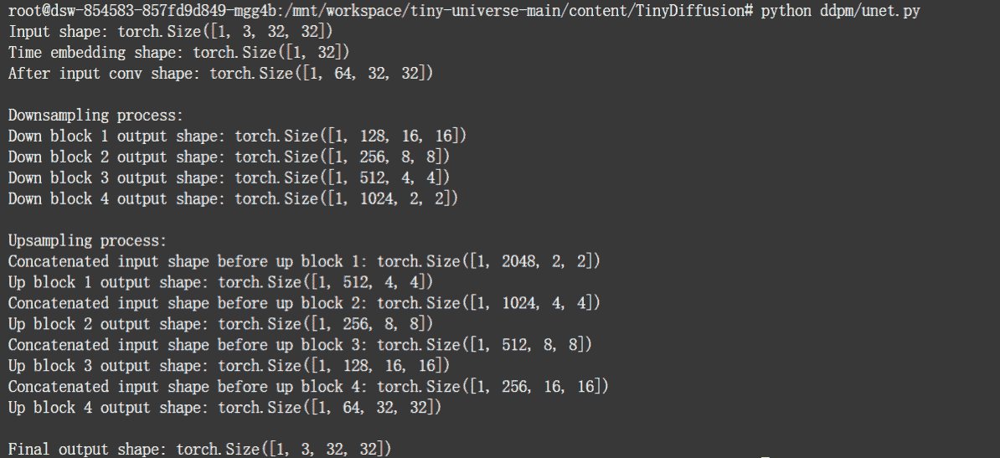

### 3.3 扩散过程（Diffusion）

```
import torch
import torch.nn as nn


class NoiseScheduler(nn.Module):
    def __init__(self, beta_start=0.0001, beta_end=0.02, num_steps=1000):
        &quot;&quot;&quot;初始化噪声调度器
        Args:
            beta_start: β1,初始噪声水平
            beta_end: βT,最终噪声水平  
            num_steps: T,扩散步数
            device: 运行设备
        &quot;&quot;&quot;
        super().__init__()
        self.beta_start = beta_start
        self.beta_end = beta_end
        self.num_steps = num_steps

        # β_t: 线性噪声调度
        self.register_buffer(&#x27;betas&#x27;, torch.linspace(beta_start, beta_end, num_steps))
        # α_t = 1 - β_t 
        self.register_buffer(&#x27;alphas&#x27;, 1.0 - self.betas)
        # α_bar_t = ∏(1-β_i) from i=1 to t
        self.register_buffer(&#x27;alpha_bar&#x27;, torch.cumprod(self.alphas, dim=0))
        # α_bar_(t-1)
        self.register_buffer(&#x27;alpha_bar_prev&#x27;, torch.cat([torch.tensor([1.0]), self.alpha_bar[:-1]], dim=0))
        # sqrt(α_bar_t)
        self.register_buffer(&#x27;sqrt_alpha_bar&#x27;, torch.sqrt(self.alpha_bar))
        # 1/sqrt(α_t)
        self.register_buffer(&#x27;sqrt_recip_alphas&#x27;, torch.sqrt(1.0 / self.alphas))
        # sqrt(1-α_bar_t)
        self.register_buffer(&#x27;sqrt_one_minus_alpha_bar&#x27;, torch.sqrt(1.0 - self.alpha_bar))

        # 1/sqrt(α_bar_t)
        self.register_buffer(&#x27;sqrt_recip_alphas_bar&#x27;, torch.sqrt(1.0 / self.alpha_bar))
        # sqrt(1/α_bar_t - 1)
        self.register_buffer(&#x27;sqrt_recipm1_alphas_bar&#x27;, torch.sqrt(1.0 / self.alpha_bar - 1))
        # 后验分布方差 σ_t^2
        self.register_buffer(&#x27;posterior_var&#x27;, self.betas * (1.0 - self.alpha_bar_prev) / (1.0 - self.alpha_bar))
        # 后验分布均值系数1: β_t * sqrt(α_bar_(t-1))/(1-α_bar_t)
        self.register_buffer(&#x27;posterior_mean_coef1&#x27;, self.betas * torch.sqrt(self.alpha_bar_prev) / (1.0 - self.alpha_bar))
        # 后验分布均值系数2: (1-α_bar_(t-1)) * sqrt(α_t)/(1-α_bar_t)
        self.register_buffer(&#x27;posterior_mean_coef2&#x27;, (1.0 - self.alpha_bar_prev) * torch.sqrt(self.alphas) / (1.0 - self.alpha_bar))
    
    def get(self, var, t, x_shape):
        &quot;&quot;&quot;获取指定时间步的变量值并调整形状
        Args:
            var: 要查询的变量
            t: 时间步
            x_shape: 目标形状
        Returns:
            调整后的变量值
        &quot;&quot;&quot;
        # 从变量张量中收集指定时间步的值
        out = var[t]
        # 调整形状为[batch_size, 1, 1, 1],以便进行广播
        return out.view([t.shape[0]] + [1] * (len(x_shape) - 1))

    def add_noise(self, x, t):
        &quot;&quot;&quot;向输入添加噪声
        实现公式: x_t = sqrt(α_bar_t) * x_0 + sqrt(1-α_bar_t) * ε, ε ~ N(0,I)
        Args:
            x: 输入图像 x_0
            t: 时间步
        Returns:
            (noisy_x, noise): 加噪后的图像和使用的噪声
        &quot;&quot;&quot;
        # 获取时间步t对应的sqrt(α_bar_t)
        sqrt_alpha_bar = self.get(self.sqrt_alpha_bar, t, x.shape)
        # 获取时间步t对应的sqrt(1-α_bar_t)
        sqrt_one_minus_alpha_bar = self.get(self.sqrt_one_minus_alpha_bar, t, x.shape)
        # 从标准正态分布采样噪声 ε ~ N(0,I)
        noise = torch.randn_like(x)
        # 实现前向扩散过程: x_t = sqrt(α_bar_t) * x_0 + sqrt(1-α_bar_t) * ε
        return sqrt_alpha_bar * x + sqrt_one_minus_alpha_bar * noise, noise


def plot_diffusion_steps(image, noise_scheduler, step_size=100):
    &quot;&quot;&quot;绘制图像逐步加噪的过程
    Args:
        image: 原始图像
        noise_scheduler: 噪声调度器
        step_size: 每隔多少步绘制一次
    Returns:
        fig: 绘制的图像
    &quot;&quot;&quot;
    num_images = noise_scheduler.num_steps // step_size
    fig = plt.figure(figsize=(15, 3))
    
    # 绘制原始图像
    plt.subplot(1, num_images + 1, 1)
    plt.imshow(show_tensor_image(image))
    plt.axis(&#x27;off&#x27;)
    plt.title(&#x27;Original&#x27;)
    
    # 绘制不同时间步的噪声图像
    for idx in range(num_images):
        t = torch.tensor([idx * step_size])
        noisy_image, _ = noise_scheduler.add_noise(image, t)
        plt.subplot(1, num_images + 1, idx + 2)
        plt.imshow(show_tensor_image(noisy_image))
        plt.axis(&#x27;off&#x27;)
        plt.title(f&#x27;t={t.item()}&#x27;)
    
    plt.tight_layout()
    return fig


if __name__ == &quot;__main__&quot;:
    import matplotlib.pyplot as plt
    from dataloader import load_transformed_dataset, show_tensor_image
    import os  # 导入os模块

    # 定义输出路径
    output_dir = &#x27;/mnt/workspace/tiny-universe-main/content/TinyDiffusion/ddpm/&#x27;
    os.makedirs(output_dir, exist_ok=True)  # 确保输出目录存在
    
    train_loader, test_loader = load_transformed_dataset()
    image, _ = next(iter(train_loader))
    noise_scheduler = NoiseScheduler()
    
    # 获取一个批次中的第一张图片进行处理
    single_image = image[0:1]
    
    # 添加噪声并显示结果
    t = torch.randint(0, noise_scheduler.num_steps, (single_image.shape[0],))
    noisy_image, noise = noise_scheduler.add_noise(single_image, t)
    
    # 显示并保存最终加噪图像
    plt.figure(figsize=(5, 5))
    plt.imshow(show_tensor_image(noisy_image))
    plt.axis(&#x27;off&#x27;)
    final_output_path = os.path.join(output_dir, &#x27;final_noisy_image.png&#x27;)
    plt.savefig(final_output_path)  # 保存最终加噪图像
    plt.close()  # 关闭图形以释放内存
    print(f&quot;最终加噪图像已保存至 {final_output_path}&quot;)
    
    # 绘制并保存逐步加噪过程
    fig = plot_diffusion_steps(single_image, noise_scheduler)
    diffusion_process_output_path = os.path.join(output_dir, &#x27;diffusion_steps.png&#x27;)
    plt.savefig(diffusion_process_output_path)  # 保存逐步加噪过程图
    plt.close(fig)  # 关闭图形以释放内存
    print(f&quot;逐步加噪过程图已保存至 {diffusion_process_output_path}&quot;)
```

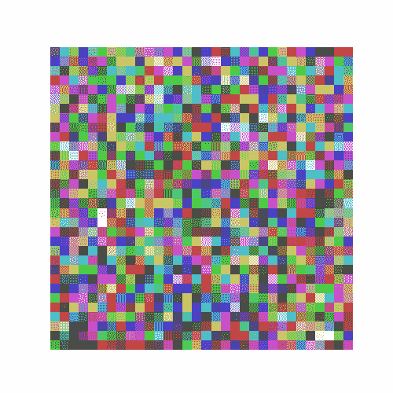

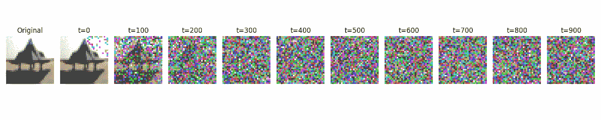

### 3.4 训练过程（train）

```
import os

import torch
import torch.nn as nn
import torch.optim as optim
import argparse
from tqdm import tqdm

from diffusion import NoiseScheduler
from unet import SimpleUnet
from dataloader import load_transformed_dataset
from sample import sample, plot


def test_step(model, dataloader, noise_scheduler, criterion, epoch, num_epochs, device):
    &quot;&quot;&quot;测试步骤,计算测试集上的损失&quot;&quot;&quot;
    model.eval()
    with torch.no_grad():
        loss_sum = 0
        num_batches = 0
        pbar = tqdm(dataloader)
        for batch in pbar:
            images, _ = batch
            images = images.to(device)
            t = torch.full((images.shape[0],), noise_scheduler.num_steps-1, device=device)
            noisy_images, noise = noise_scheduler.add_noise(images, t)

            predicted_noise = model(noisy_images, t)
            loss = criterion(noise, predicted_noise)
            loss_sum += loss.item()
            num_batches += 1
            pbar.set_description(f&quot;Epoch {epoch+1}/{num_epochs}, Test Loss: {loss_sum/num_batches:.4f}&quot;)
        return loss_sum / len(dataloader)


def train_step(model, dataloader, noise_scheduler, criterion, optimizer, epoch, num_epochs, device):
    &quot;&quot;&quot;训练步骤,计算训练集上的损失并更新模型参数&quot;&quot;&quot;
    # 设置模型为训练模式
    model.train()
    loss_sum = 0
    num_batches = 0
    pbar = tqdm(dataloader)
    for batch in pbar:
        # 获取一个batch的图像数据并移至指定设备
        images, _ = batch
        images = images.to(device)
        
        # 随机采样时间步t
        t = torch.randint(0, noise_scheduler.num_steps, (images.shape[0],), device=device)
        
        # 对图像添加噪声,获得带噪声的图像和噪声
        noisy_images, noise = noise_scheduler.add_noise(images, t)

        # 使用模型预测噪声
        predicted_noise = model(noisy_images, t)
        
        # 计算预测噪声和真实噪声之间的MSE损失
        loss = criterion(noise, predicted_noise)
        
        # 反向传播和优化
        optimizer.zero_grad()  # 清空梯度
        loss.backward()  # 计算梯度
        torch.nn.utils.clip_grad_norm_(model.parameters(), 1.0)  # 梯度裁剪,防止梯度爆炸
        optimizer.step()  # 更新参数

        # 累计损失并更新进度条
        loss_sum += loss.item()
        num_batches += 1
        pbar.set_description(f&quot;Epoch {epoch+1}/{num_epochs}, Train Loss: {loss_sum/num_batches:.4f}&quot;)
        
    # 返回平均损失
    return loss_sum / len(dataloader)


def train(model, train_loader, test_loader, noise_scheduler, criterion, optimizer, device, num_epochs=100, img_size=32):
    &quot;&quot;&quot;训练模型&quot;&quot;&quot;
    for epoch in range(num_epochs):
        train_loss = train_step(model, train_loader, noise_scheduler, criterion, optimizer, epoch, num_epochs, device)
        test_loss = test_step(model, test_loader, noise_scheduler, criterion, epoch, num_epochs, device)
        if epoch % 10 == 0:
            # 采样10张图像
            images = sample(model, noise_scheduler, 10, (3, img_size, img_size), device)
            # 将图像从[-1, 1]范围缩放到[0, 1]范围,以便可视化
            images = ((images + 1) / 2).detach().cpu()
            fig = plot(images)
            os.makedirs(&quot;samples&quot;, exist_ok=True)
            fig.savefig(f&quot;samples/epoch_{epoch}.png&quot;)
    return model


if __name__ == &quot;__main__&quot;:
    parser = argparse.ArgumentParser()
    parser.add_argument(&#x27;--batch_size&#x27;, type=int, default=128)
    parser.add_argument(&#x27;--epochs&#x27;, type=int, default=200)
    parser.add_argument(&#x27;--lr&#x27;, type=float, default=1e-4)
    parser.add_argument(&#x27;--img_size&#x27;, type=int, default=32)
    args = parser.parse_args()

    device = &quot;cuda&quot; if torch.cuda.is_available() else &quot;cpu&quot;

    train_loader, test_loader = load_transformed_dataset(args.img_size, args.batch_size)
    noise_scheduler = NoiseScheduler().to(device)
    model = SimpleUnet().to(device)
    optimizer = optim.Adam(model.parameters(), lr=args.lr)
    criterion = nn.MSELoss()
    model = train(model, train_loader, test_loader, noise_scheduler, criterion, optimizer, device, args.epochs, args.img_size)
    torch.save(model.state_dict(), f&quot;simple-unet-ddpm-{args.img_size}.pth&quot;)
```

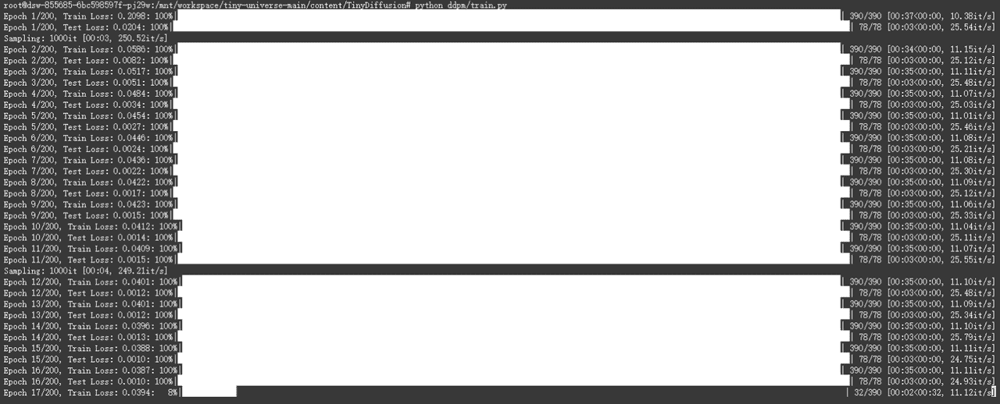

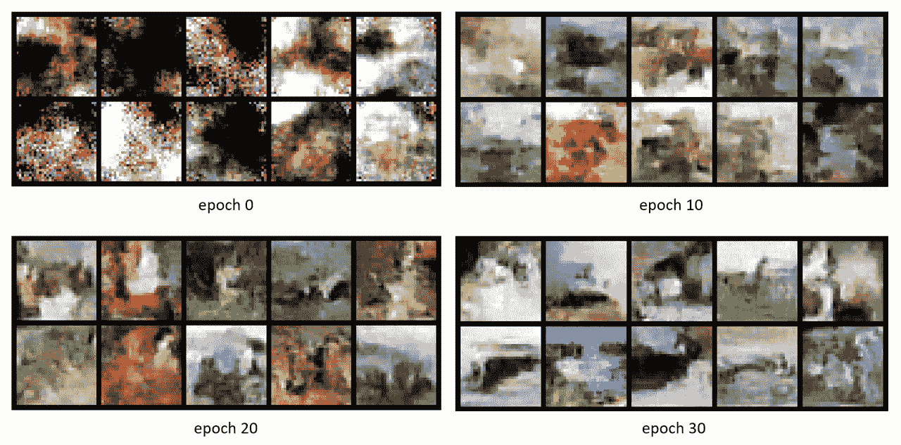

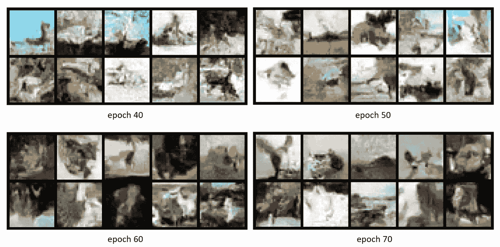

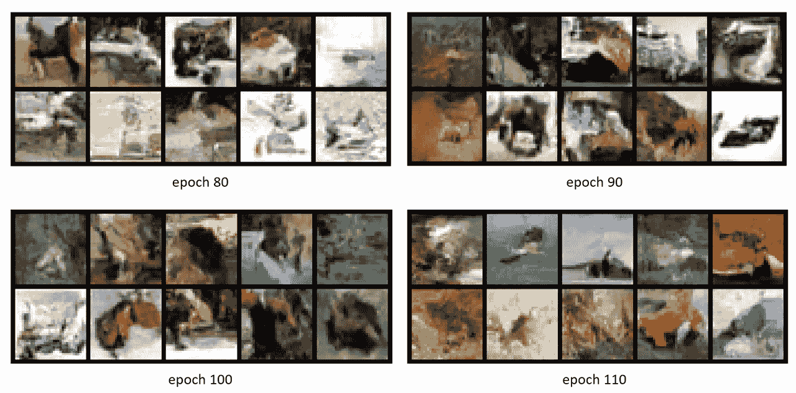

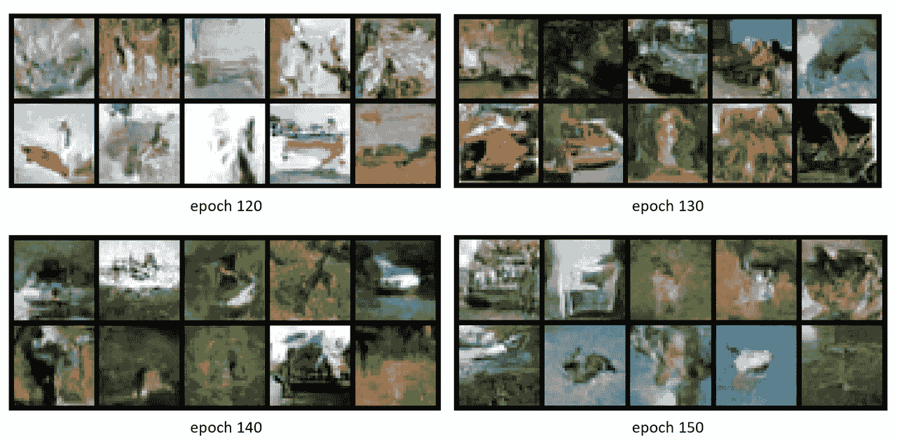

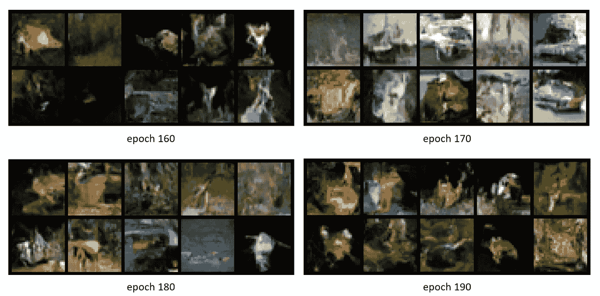

### 3.5 采样过程（sample）

```
import torch
import torchvision
from tqdm import tqdm
import matplotlib.pyplot as plt
from unet import SimpleUnet
from diffusion import NoiseScheduler


def sample(model, scheduler, num_samples, size, device=&quot;cpu&quot;):
    &quot;&quot;&quot;从噪声采样生成图像的函数
    Args:
        model: UNet模型,用于预测噪声
        scheduler: 噪声调度器,包含采样所需的所有系数
        num_samples: 要生成的样本数量
        size: 生成图像的大小,如(3,32,32)
        device: 运行设备
    Returns:
        生成的图像张量
    &quot;&quot;&quot;
    model.eval()
    with torch.no_grad():
        # 从标准正态分布采样初始噪声 x_T ~ N(0,I)
        x_t = torch.randn(num_samples, *size).to(device)

        # 逐步去噪,从t=T到t=0
        for t in tqdm(reversed(range(scheduler.num_steps)), desc=&quot;Sampling&quot;):
            # 构造时间步batch
            t_batch = torch.tensor([t] * num_samples).to(device)

            # 获取采样需要的系数
            sqrt_recip_alpha_bar = scheduler.get(scheduler.sqrt_recip_alphas_bar, t_batch, x_t.shape)
            sqrt_recipm1_alpha_bar = scheduler.get(scheduler.sqrt_recipm1_alphas_bar, t_batch, x_t.shape)
            posterior_mean_coef1 = scheduler.get(scheduler.posterior_mean_coef1, t_batch, x_t.shape)
            posterior_mean_coef2 = scheduler.get(scheduler.posterior_mean_coef2, t_batch, x_t.shape)

            # 预测噪声 ε_θ(x_t,t)
            predicted_noise = model(x_t, t_batch)

            # 计算x_0的预测值: x_0 = 1/sqrt(α_bar_t) * x_t - sqrt(1/α_bar_t-1) * ε_θ(x_t,t)
            _x_0 = sqrt_recip_alpha_bar * x_t - sqrt_recipm1_alpha_bar * predicted_noise
            # 计算后验分布均值 μ_θ(x_t,t)
            model_mean = posterior_mean_coef1 * _x_0 + posterior_mean_coef2 * x_t
            # 计算后验分布方差的对数值 log(σ_t^2)
            model_log_var = scheduler.get(torch.log(torch.cat([scheduler.posterior_var[1:2], scheduler.betas[1:]])), t_batch, x_t.shape)

            if t &gt; 0:
                # t&gt;0时从后验分布采样: x_t-1 = μ_θ(x_t,t) + σ_t * z, z~N(0,I)
                noise = torch.randn_like(x_t).to(device)
                x_t = model_mean + torch.exp(0.5 * model_log_var) * noise
            else:
                # t=0时直接使用均值作为生成结果
                x_t = model_mean
        # 将最终结果裁剪到[-1,1]范围
        x_0 = torch.clamp(x_t, -1.0, 1.0)
    return x_0


def plot(images):
    fig = plt.figure(figsize=(12, 8))
    plt.axis(&quot;off&quot;)
    plt.imshow(torchvision.utils.make_grid(images, nrow=5).permute(1, 2, 0))
    plt.tight_layout(pad=1)
    return fig


if __name__ == &quot;__main__&quot;:
    image_size = 32
    model = SimpleUnet()
    model.load_state_dict(torch.load(f&quot;simple-unet-ddpm-{image_size}.pth&quot;, weights_only=True))
    device = &quot;cuda&quot; if torch.cuda.is_available() else &quot;cpu&quot;
    model.to(device)
    scheduler = NoiseScheduler().to(device)
    
    images = sample(model, scheduler, 10, (3, image_size, image_size), device)
    images = ((images + 1) / 2).detach().cpu()
    fig = plot(images)
    fig.savefig(&quot;images-simple-unet-ddpm.png&quot;, bbox_inches=&#x27;tight&#x27;, pad_inches=0)

```

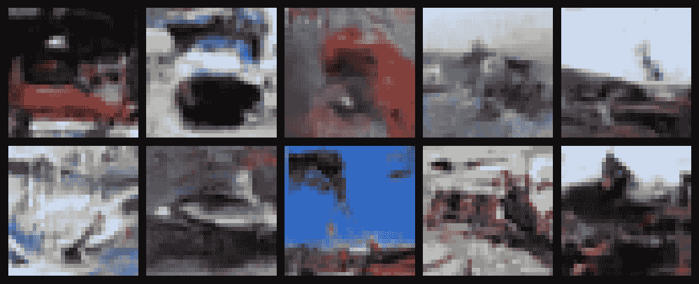

### 3.6 评估（metrics）

```
import torch
import torch.nn as nn
import torchvision.models as models
from torch.nn import functional as F
import numpy as np
from scipy import linalg
from tqdm import tqdm
from torchvision import transforms
from torch.utils.data import DataLoader, TensorDataset


class InceptionStatistics:
    def __init__(self, device=&#x27;cuda&#x27;):
        self.device = device
        # 加载预训练的Inception v3模型
        self.model = models.inception_v3(weights=models.Inception_V3_Weights.IMAGENET1K_V1, transform_input=False)
        self.model.fc = nn.Identity()  # 移除最后的全连接层
        self.model = self.model.to(device)
        self.model.eval()
        
        # 设置图像预处理
        self.preprocess = transforms.Compose([
            transforms.Resize(299),
            transforms.Normalize((0.5, 0.5, 0.5), (0.5, 0.5, 0.5))
        ])
    
    @torch.no_grad()
    def get_features(self, images):
        &quot;&quot;&quot;获取Inception特征&quot;&quot;&quot;
        features = []
        probs = []
        
        # 将图像处理为299x299大小
        images = self.preprocess(images)
        
        # 批量处理图像
        dataset = TensorDataset(images)
        dataloader = DataLoader(dataset, batch_size=32)
        
        for (batch,) in tqdm(dataloader):
            batch = batch.to(self.device)
            
            # 获取特征和logits
            feature = self.model(batch)
            prob = F.softmax(feature, dim=1)
            
            features.append(feature.cpu().numpy())
            probs.append(prob.cpu().numpy())
            
        features = np.concatenate(features, axis=0)
        probs = np.concatenate(probs, axis=0)
        
        return features, probs

def calculate_inception_score(probs, splits=10):
    &quot;&quot;&quot;计算Inception Score
    
    IS = exp(E[KL(p(y|x) || p(y))])
    
    其中:
    - p(y|x) 是生成图像通过Inception模型得到的条件类别分布(probs)
    - p(y) 是边缘类别分布,通过对所有图像的p(y|x)取平均得到
    - KL是KL散度,用于衡量两个分布的差异
    - E是对所有图像的期望
    
    具体步骤:
    1. 将所有图像分成splits组
    2. 对每组计算:
       - 计算边缘分布p(y)
       - 计算KL散度
       - 取指数
    3. 返回所有组得分的均值和标准差
    &quot;&quot;&quot;
    # 存储每个split的IS分数
    scores = []
    # 计算每个split的大小
    split_size = probs.shape[0] // splits
    
    # 对每个split进行计算
    for i in tqdm(range(splits)):
        # 获取当前split的概率分布
        part = probs[i * split_size:(i + 1) * split_size]
        # 计算KL散度: KL(p(y|x) || p(y))
        kl = part * (np.log(part) - np.log(np.expand_dims(np.mean(part, axis=0), 0)))
        # 对每个样本的KL散度求平均
        kl = np.mean(np.sum(kl, axis=1))
        # 计算exp(KL)并添加到scores列表
        scores.append(np.exp(kl))
        
    # 返回所有split的IS分数的均值和标准差
    return np.mean(scores), np.std(scores)

def calculate_fid(real_features, fake_features):
    &quot;&quot;&quot;计算Fréchet Inception Distance (FID)分数
    
    FID = ||μ_r - μ_f||^2 + Tr(Σ_r + Σ_f - 2(Σ_r Σ_f)^(1/2))
    
    其中:
    - μ_r, μ_f 分别是真实图像和生成图像特征的均值向量
    - Σ_r, Σ_f 分别是真实图像和生成图像特征的协方差矩阵
    - Tr 表示矩阵的迹(对角线元素之和)
    - ||·||^2 表示欧几里得距离的平方
    
    FID越小表示生成图像的质量越好,分布越接近真实图像
    &quot;&quot;&quot;
    # 计算真实图像和生成图像特征的均值向量和协方差矩阵
    mu1, sigma1 = real_features.mean(axis=0), np.cov(real_features, rowvar=False)
    mu2, sigma2 = fake_features.mean(axis=0), np.cov(fake_features, rowvar=False)
    
    # 计算均值向量之间的欧几里得距离的平方
    ssdiff = np.sum((mu1 - mu2) ** 2)
    # 计算协方差矩阵的平方根项:(Σ_r Σ_f)^(1/2)
    covmean = linalg.sqrtm(sigma1.dot(sigma2))  # 耗时较长
    # 如果结果包含复数,取其实部
    if np.iscomplexobj(covmean):
        covmean = covmean.real

    # 计算最终的FID分数
    fid = ssdiff + np.trace(sigma1 + sigma2 - 2 * covmean)
    return fid

def evaluate_model(model, scheduler, train_loader, num_samples, batch_size, image_size, device=&quot;cuda&quot;):
    &quot;&quot;&quot;评估模型的IS和FID分数&quot;&quot;&quot;
    # 生成样本
    fake_images = []
    num_batches = num_samples // batch_size  # 每批生成batch_size张图片
    
    print(f&quot;生成{num_samples}张图像...&quot;)
    for _ in tqdm(range(num_batches)):
        fake_batch = sample(model, scheduler, batch_size, (3, image_size, image_size), device)
        fake_batch = ((fake_batch + 1) / 2)  # 转换到[0,1]范围
        fake_images.append(fake_batch.cpu())
    
    fake_images = torch.cat(fake_images, dim=0)

    # 收集所有真实图像
    print(&quot;收集真实图像...&quot;)
    real_images = []
    for batch in tqdm(train_loader):
        real_images.append(batch[0])
    real_images = torch.cat(real_images, dim=0)

    # 初始化Inception模型
    inception = InceptionStatistics(device=device)
    
    # 获取真实图像和生成图像的特征
    print(&quot;计算真实图像特征...&quot;)
    real_features, real_probs = inception.get_features(real_images)
    print(&quot;计算生成图像特征...&quot;)
    fake_features, fake_probs = inception.get_features(fake_images)
    
    # 计算IS分数
    print(&quot;计算IS分数...&quot;)
    is_score, is_std = calculate_inception_score(fake_probs)
    
    # 计算FID分数
    print(&quot;计算FID分数...&quot;)
    fid_score = calculate_fid(real_features, fake_features)
    
    return {
        &quot;is_score&quot;: is_score,
        &quot;is_std&quot;: is_std,
        &quot;fid_score&quot;: fid_score
    }

if __name__ == &quot;__main__&quot;:
    from unet import SimpleUnet
    from diffusion import NoiseScheduler
    from sample import sample
    from dataloader import load_transformed_dataset
    
    # 加载模型和数据
    device = &quot;cuda&quot; if torch.cuda.is_available() else &quot;cpu&quot;
    image_size = 32
    model = SimpleUnet()
    model.load_state_dict(torch.load(f&quot;simple-unet-ddpm-{image_size}.pth&quot;, weights_only=True))
    model = model.to(device)
    model.eval()
    
    scheduler = NoiseScheduler().to(device)
    
    # 加载真实图像数据
    train_loader, _ = load_transformed_dataset(image_size, batch_size=128)
    
    # 评估模型
    metrics = evaluate_model(
        model=model,
        scheduler=scheduler,
        train_loader=train_loader,  # 传入整个train_loader
        num_samples=10000,  # 生成10000张图片进行评估
        batch_size=100,
        image_size=image_size,
        device=device
    )
    
    print(f&quot;Inception Score: {metrics[&#x27;is_score&#x27;]:.2f} ± {metrics[&#x27;is_std&#x27;]:.2f}&quot;)
    print(f&quot;FID Score: {metrics[&#x27;fid_score&#x27;]:.2f}&quot;)
```

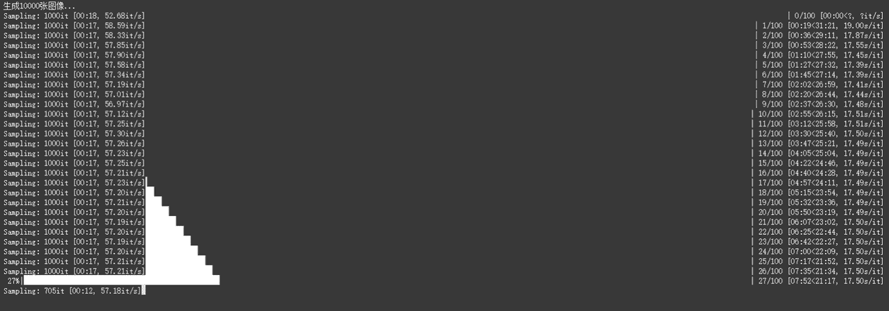

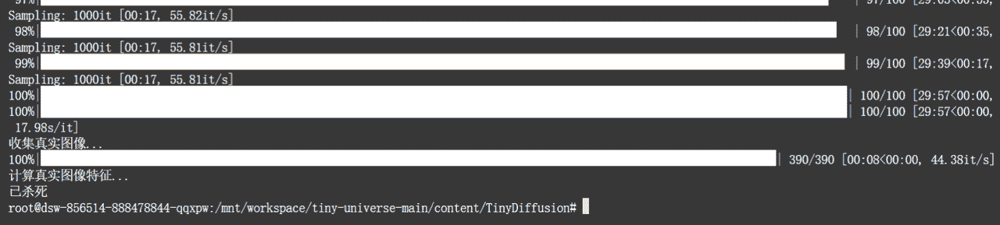

进程killed...没算出来（暂时还没解决bbq）

## 学习总结

第一次细致的学习扩散模型（DDPM）的数学原理和代码实现，对我来说，还是有些难度的。不管怎么来说，现在必须得给自己一个大大的赞👍！

DDPM这个过程就像是在做概率推理，从一个混沌的状态逐步恢复出有序的信息。虽然背后的数学推导看起来很复杂，但整个框架却非常优雅，体现了如何通过马尔可夫链将一个复杂的生成问题分解成一系列简单的去噪步骤。U-Net的多尺度结构设计也很巧妙（既有战略视角，也有战术视角hhh），能够同时捕捉图像的全局语义信息和局部细节特征。

也感谢datawhale细致的教程~

参考学习链接：

+   https://arxiv.org/pdf/2006.11239

+   https://github.com/datawhalechina/tiny-universe/tree/main/content/TinyDiffusion