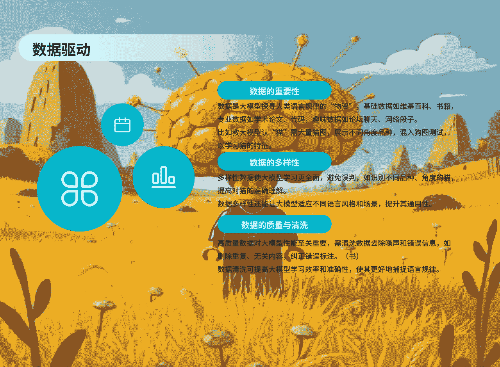
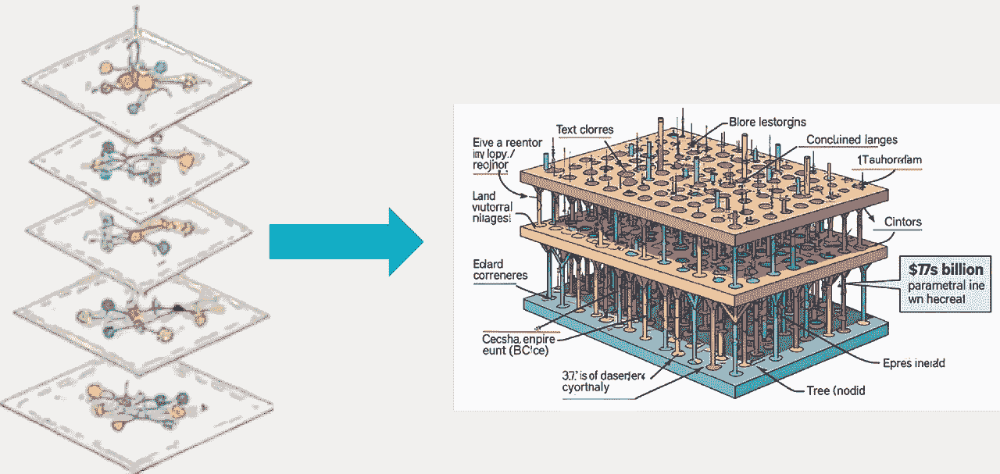
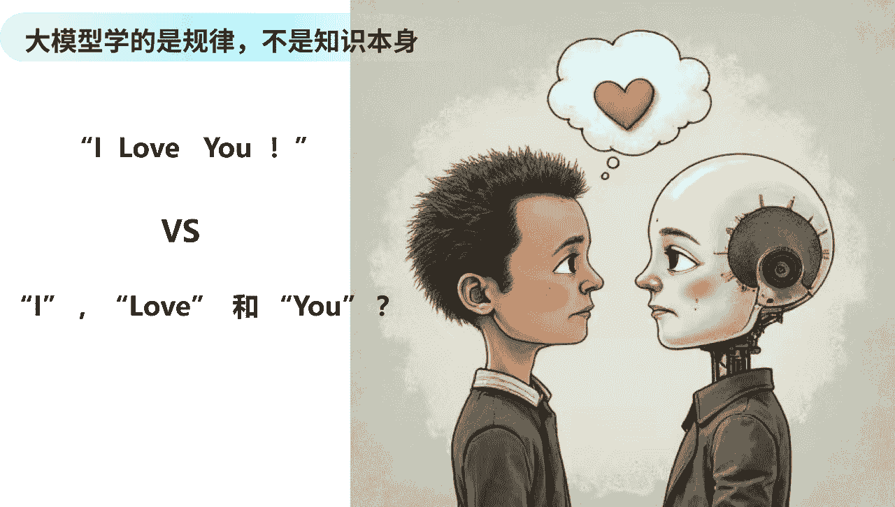

# 大模型原理简介小白版

> 来源：[https://datawhaler.feishu.cn/docx/M0cVdQk7pojXhbxsftAcUHh9njb](https://datawhaler.feishu.cn/docx/M0cVdQk7pojXhbxsftAcUHh9njb)

## 视频教学

> **(**视频内容相较于教程内容更精简，也相对更小白友好一些，如果看完视频想多了解大模型原理，可再读教程，两者是渐进而非完全重叠的内容~)

【AI通识科普之大模型原理（小白友好版）】

<https://player.bilibili.com/player.html?bvid=1DuP7evE2g&share_source=copy_web&vd_source=99d62277c98b139101f059d01614c1e3>

课程声明

> 本课程主要为大模型小白盆友服务，在教程内容上有所深入和添加，所以我会尽可能多的用形象的事物类比帮助读者理解大模型及其原理，并避免过多专业词汇和公式的引用，由于目的是帮助读者快速无痛概览大模型大局，所以也不会太过深入地剖析内部技术细节，所以不用担心文章晦涩~~

> 首先关于大模型原理，回忆学习过的内容，深思熟虑后提炼出了两个关键词，数据驱动和生成式学习

> 一句话总结是：** 大模型**是用 **神经网络 结**构**，在海量**数据**中借**助自注意力**机制和算**力支持捕捉规律以不断进行参数调整，最终依据概率最佳组合原则生成符合人类表达习惯规律的内容。

> 其中数据驱动对应“海量数据”，生成式学习对应包括“神经网络”、“自注意力机制”、“算力支持”、“规律”和“参数调整”。

---

**好啦，下面就听我娓娓道来**

## 一、大模型基础认知

### 1. 什么是大模型？

定义：全称是大型语言模型（Large Language Model，简称LLM），是参数量巨大（通常超过10亿）的深度学习模型（如GPT-4、PaLM）。这里我们可以用乐高积木来比喻，积木块就像大模型的“脑细胞”、“神经元”（大模型内部参数），越多一定程度上能构建越复杂的东西，每一块积木对全局都有或轻或重的影响。

特点：每个领域的知识它都会一点（通用性强）；基础理论素养扎实，啃了好多图书馆的书（海量数据预训练）；既能写诗又会解数学题，像班级里的全能学霸（支持多任务学习）。


> 注：深度学习模型较之大模型涵盖更广，包括小规模模型（如CNN、RNN）和非生成式模型（如ResNet）。

> 市面上的很多都是通用大模型，因为它们学习的海量数据涵盖多个领域，而经过特定数据集微调的，使模型在某个专门领域表现更好（可以理解为某个领域专家）的大模型称为垂类大模型。

> 大模型起初主要用于自然语言处理（NLP）任务，现在仿照文本数据规律的学习模式，还迁移到图像和声音相关的任务。

## 二、核心原理逐个击破

### 1. 数据驱动

可以直接理解为无差别学习，所有大模型都必须要建立在海量数据的基础上才有后面的“故事”。数据就是为大模型探寻人类语言“内在规律逻辑”准备的“物资”。

数据之于大模型，就像粮食之于人类：

+   **基础数据**：米饭馒头（维基百科、书籍）

+   **专业数据**：维生素片（学术论文、代码）

+   **趣味数据**：糖果零食（论坛聊天、网络段子）



> 具体案例：

> 教AI认"猫"需要：

+   喂100万张猫片（数据输入）

+   展示不同角度/品种（多样性）

+   混入狗图测试（防误判）

### 2. 生成式学习

目前大模型都是流式输出，就是一个字一个词的蹦，它通过模仿在训练时摸索积累到的文本规律，在输出中不断预测着下一个字、下一个词，最后选中的都是概率最大解，其实就是概率接龙游戏，目的是输出符合人类语言规律逻辑的，符合人类认知的完整文本。就像婴孩模仿父母口型发音学说话一样，大模型模仿“造句规律”写作。


> 形象比喻：

+   输入"床前明月"

+   分析百万诗句中后续词出现概率：

+   光（90%）

+   亮（5%）

+   灯具（0.01%）

+   选择概率最高的"光"继续接龙

#### （1）自注意力机制

有重点的观览全局机制，就像我们读书时用的荧光笔。

> 形象比喻：

> 读书时的重点标注：

+   **找重点**：读"小猫追着毛线球跑"时，自动用荧光笔标出"追"这个动作

+   **联系上下文**：看到"他"字时，快速翻回前文确认指代对象

+   **动态聚焦**：处理数学题时重点看数字，写故事时关注形容词

典型载体（架构）：

> **Transformer架构**：像高效工厂流水线，每个工位（注意力头）负责不同任务：

>  - 1号工位：识别动作词汇

>  - 2号工位：捕捉情感表达

>  - 3号工位：分析逻辑关系



```
互动实验：试着快速回答&quot;天空是___色的&quot;，体会大脑自动补全的过程。
```

#### （2）参数调整

这就像是你在解一道很难的数学题，一开始可能会有各种各样的想法（参数初始值），然后通过不断地尝试、对照答案（数据规律），去调整自己的思路（参数）。大模型也是，它通过不断找寻、总结海量数据里的规律，来调整自己的参数，就像在学习怎么更好地模仿人类的语言表达习惯。（也可与数学建模类比）

> **形象比喻**:

+   初始学车阶段——模型初始化 （情景：你第一次跨上自行车）

> - 大脑空白：就像AI模型初始参数都是随机设置的

> - 身体僵硬：相当于模型刚开始的预测误差很大

> - 案例：你第一次蹬踏板时，车头突然左偏30度，差点撞到花坛。这就像AI第一次预测把猫认成长颈鹿

>

+   调整平衡——学习率调节 （情景：控制车把左右摇晃）

> - 猛打方向（高学习率）：像突然把车把转90度→直接摔倒（梯度爆炸）

> - 微调不足（低学习率）：像只敢转5度→摇摇晃晃半天停不下来（收敛过慢）

> - 最佳调整：每次转15-20度（适中学习率），就像老司机流畅过弯

>

+   摔倒次数——损失函数 （情景：每次摔跤后的反思）

> - 膝盖擦伤程度：就像损失函数计算的误差值

> - 案例：侧摔比前摔更疼→AI发现把狗认成狼比认成猫的惩罚更大

> - 调整策略：下次遇到石子路提前减速，相当于模型调整权重防止同类错误

>

+   练习天数——迭代次数 （情景：暑假每天练车）

> - 三天打鱼：练5天就放弃→模型欠拟合（还是不会转弯）

> - 两年特训：每天练8小时→模型过拟合（只会骑自家小区那条路）

> - 最佳周期：持续练习两周→模型刚好掌握各种路况（良好泛化）

>

+   家长指导——正则化 （情景：爸爸扶着后座教你）

> - 禁止危险动作：就像L1正则化限制参数绝对值

> - 保持姿势规范：类似L2正则化控制参数变化幅度

> - 案例：你想尝试单手骑车被制止→防止模型过于复杂导致过拟合

#### （3）深度学习

深度学习这可以类比成一个超级复杂的学生团队，一层一层地学习知识。就好比你学数学，先学加减法，再学乘除法，一步步深入。深度学习也是这样，通过好多层的神经网络结构，一层层地去挖掘数据里的深层次规律。

#### （4）泛化输出

大模型在面对新的问题时，会迁移预测能力，生成内容的时候，就像是在猜下一个字、下一个词出现的可能性。它会根据前面的内容（上文），就像你写作文时，根据前面的语境来想下一个词怎么写一样，去计算每个可能的字或词出现的概率，然后选出最合适的，就像在一堆选项里挑最符合语境的那个。

> 当大模型学习了成千上万的数学题时，你给它一道新编的题，它也是可以给你解答的，就像我们老师说的万变不离其宗~可能只是前提条件顺序变了罢，本质上的原理是一样哒~

## 三、典型应用场景

### 1. 智能写作助手

+   学生：自动生成作文大纲，就像获得鲁迅先生的写作提示

+   白领：5分钟搞定周报，比秘书更懂你的工作习惯

### 2. 跨次元翻译官

+   实时翻译：把川菜菜谱转换成意大利语，连"麻辣"都能译出地中海风味

+   图文互转：用"夕阳下的奔跑"生成梵高风格油画

### 3. 编程小导师

+   代码补全：像坐在你肩上的编程大师，随时提示下一行代码

+   错误修复：比同桌更耐心，能解释为什么变量名不能叫"孙悟空"

### 4. 科学探索者

+   蛋白质预测：3天完成原本需要3年的生物实验

+   天文分析：从千万张星空照片中发现新行星痕迹

## 四、误区和拓展

1.  大模型**学的是规律，不是知识本身**，大模型并不理解知识本身

+   模型通过**概率分布**判断“哪些词组合更可能合理”（如“天空是_”更可能接“蓝色”而非“酸甜”）。

+   **案例**：ChatGPT写诗时并不“懂”诗意，而是模仿训练数据中的诗歌结构。



> 如果有一天AI真的有了感情、浪漫细胞，它是会先帮单身狗写情书呢？还是先酷酷给自己写封辞职信呢~~

1.  缩放定律（Scaling Laws）

+   模型性能提升依赖数据量、参数规模、算力同步增长，而非单纯堆数据。

+   **案例**：PaLM模型在足够大的规模下，突然涌现出小模型不具备的数学推理能力。

1.  很**多**人会把大模型和人工智能混为一谈，人工智能（AI）有通用人工智能和专用人工智能，大模型有通用模型和垂类模型。真正的“通用人工智能”（AGI，Artificial General Intelligence）尚未实现。现有的AI系统（包括大语言模型、图像生成模型等）均属于“专用人工智能”（Narrow AI），它们仅在特定任务或领域内表现出类人甚至超人的能力，但远未达到人类水平的通用智能。市面上如ChatGPT等多属于通用大模型，因为各领域知识学而不专，但是通过微调（利用特定领域或学科的数据集基于通用模型的能力基础再训练，使得变成某个领域的专业老师的过程）可以变成垂类大模型。

1.  当前的几个主要概念包含关系如下：

## PPT源文档：

#### 初级PPT（视频中的）：


[大模型原理新版.pptx](https://internal-api-drive-stream.feishu.cn/space/api/box/stream/download/all/KwrWbPbXAoOcd4xiEzxccMOQn8e)

#### 进阶PPT（教程中的）：


[大模型原理简介.pptx](https://internal-api-drive-stream.feishu.cn/space/api/box/stream/download/all/CuZbbg6cqokDEwxrsR3cb2MbngC)