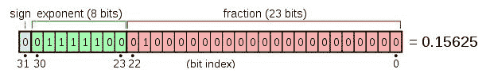
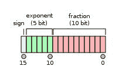
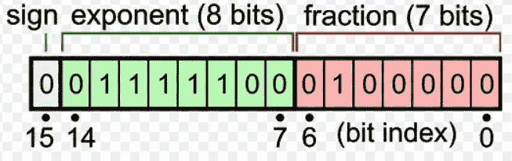

# AI 为何偏爱 Bfloat16？一文搞懂 Float32、Float16 与 Bfloat16

> 来源：[https://datawhaler.feishu.cn/docx/IdcpdJAZzocsDwxf5q8cBOBsnKN](https://datawhaler.feishu.cn/docx/IdcpdJAZzocsDwxf5q8cBOBsnKN)

# AI 为何偏爱 Bfloat16？一文搞懂 Float32、Float16 与 Bfloat16

## 🎯 文章目标

本文面向对计算机底层数字表示、AI计算优化、或数值计算精度问题感兴趣的开发者，旨在帮助大家：

+   理解浮点数（遵循IEEE 754标准）的基本构成：符号位、指数位、尾数位。

+   掌握指数偏置 (Bias) 的概念、作用及其对浮点数比较的影响。

+   掌握零(0)、无穷大(Inf)、非数字(NaN)等特殊值的表示原理。

+   清晰辨析 float32 (单精度)、float16 (半精度) 和 bfloat16 (脑浮点数) 三种常见格式的内部结构、表示范围、精度差异及应用场景。

+   了解浮点数结构设计背后的逻辑与权衡。

+   从浮点数精度角度，理解模型量化中误差影响的实际意义。

> **💡 小提示

> **在编程中直接比较两个浮点数是否相等 (a == b) 通常是不可靠的，因为存在精度误差。推荐使用容差比较法：检查它们的差的绝对值是否小于一个很小的数 (epsilon)，即 abs(a - b) < epsilon。

## 📄 主题

**本次主题**：探索计算机内部浮点数的表示机制，包括特殊值的表示，重点对比 float32, float16, bfloat16 的特性与应用，并探讨精度损失在模型量化中的意义。

## 📚 摘要

+   计算机使用符号位、指数位、尾数位三部分来表示浮点数，模拟科学记数法，遵循 IEEE 754 标准。

+   **指数位采用“偏置 (Bias)”存储，简化比**较并表示正负指数；特定的指数位模式（全0或全1）结合尾数位用于表示0, Inf, NaN 及非规格化数。

+   float32 是标准 32 位格式；float16 牺牲范围和精度换效率；bfloat16 牺牲精度保留 float32 范围换效率，常用于 AI。

+   浮点数结构设计是为了平衡范围与精度、提高效率并实现标准化。

+   **模**型量化引入的低精度表示会导致误差，即使误差百分比很小（如0.1%），其在大型模型中的累积效应和对特定任务的影响也需仔细评估。

---

## 🚁 前言

从科学计算到图形渲染，再到如今火热的人工智能，浮点数无处不在。它们是计算机表示实数的主要方式。然而，你是否真正了解它们在内存中是如何存储的？为何会有 float32, float16, bfloat16 等不同精度格式？尤其在 AI 领域，低精度计算（如 float16 和 bfloat16）已成为加速训练和推理的关键技术。深入理解浮点数的内部机制、特性差异、特殊值的处理方式以及精度损失的影响，对于编写高效、可靠的代码，以及优化现代计算任务至关重要。本文将带你揭开浮点数的面纱，探究其核心原理与实践应用。

---

> ✨ 你好，我是筱可，欢迎来到「筱可 AI 研习社」！

> **🚀 标签关键词**

> | AI 实战派开发者 | 技术成长陪伴者 | RAG 前沿探索者 | 文档处理先锋 |

## 🐱 一、浮点数基础：结构与原理

### 🐷 1.1 浮点数的“三驾马车”：符号、指数与尾数

计算机表示浮点数（如   或  ）借鉴了科学记数法，并遵循 IEEE 754 标准。一个浮点数在内存中会被划分为三个核心部分：

1.  符号位 (Sign bit - S):

+   **定义:** 表示数字的正负。

+   **长度:** 通常为 1 位。

+   **规则:** 0 代表正数 (+)，1 代表负数 (-)。

1.  指数位 (Exponent bits - E):

+   **定义:** 决定数值的大小范围（量级），即小数点可以“浮动”的范围。它存储的不是实际指数，而是一个经过“偏置 (Bias)”处理的值。

+   **长度:** 不同格式位数不同（例如 float32 是 8 位，float16 是 5 位）。

+   **规则:** 存储的值 = 实际指数 + 偏置值 (Bias)。偏置值是一个预设的正整数（如 float32 中是 127），目的是让存储的指数始终为非负数，便于硬件比较。实际指数 = 存储值 - Bias。特殊的指数位模式（全0或全1）用于表示特殊值（详见 1.4 节）。

1.  尾数位 (Mantissa/Fraction bits - M/F):

+   **定义:** 决定数值的精度（有效数字）。它存储的是有效数字的小数部分。

+   **长度:** 不同格式位数不同（例如 float32 是 23 位，float16 是 10 位）。

+   **规则:** **对于**“规格化 (normalized)”的数，其形式通常为  （二进制）。为了节省空间，整数部分的 '1' 是隐含的，不实际存储。尾数位 F 存储的是小数点后的部分。因此，有效精度（Significand）等于 1 (隐含位) + 尾数位数。例如，float32 有 23 个尾数位，提供 24 位精度。

**数值表示公式：**

+   规格化数 (Normalized):

+   这里的 F 是由尾数位表示的小数值 (   )。

+   **符号解释:**

: 符号位 (0 为正, 1 为负)。

: 尾数位表示的小数部分。

: 指数位存储的（偏置后的）值。

: 指数偏置值。

+   非规格化数 (Denormalized/Subnormal):

+   用于表示非常接近零的数，此时指数位 E 全为 0，且尾数位 F 非零。

+   **符号解释:**

: 符号位 (0 为正, 1 为负)。

: 尾数位表示的小数部分 (此时不含隐含的 '1')。

: 指数偏置值。注意此时实际指数固定为  。

💡 示例：用 Float32 表示 1.5

我们以 float32 (Bias=127) 为例，看看数字 1.5 是如何存储的：

1.  **符号 (S):** 1.5 是正数，所以 S = 0。

1.  **二进制转换:**  。

1.  **科学记数法:**  。

1.  **指数 (E):**

+   实际指数是 0。

+   存储的指数 E = 实际指数 + Bias = 0 + 127 = 127。

+   127 的 8 位二进制表示是 01111111。

1.  **尾数 (F):**

+   科学记数法   中，小数点后的部分是 1。

+   float32 有 23 位尾数位，所以我们需要补齐 0：10000000000000000000000。

1.  **组合:**

+   符号位 (1 bit): 0

+   指数位 (8 bits): 01111111

+   尾数位 (23 bits): 10000000000000000000000

+   **最终表示 (32 bits):** 0 01111111 10000000000000000000000 (空格仅为方便阅读)

**理解规格化与非规格化：**

+   规格化数 (Normalized Numbers):

+   这是浮点数最**标准、最常用**的表示形式。

+   **特点:** 指数位 E **不**是全 0 也**不**是全 1。尾数部分隐含一个前导 '1' (即   形式)，这使得在相同的尾数位数下能表示更高的精度。

+   **💡 为什么隐含前导 '1'？**

+   考虑一个非零的**二进**制**数，**当它被写成科学记数法形式时（例如  ），整数部分总是 '1'（除非这个数本身是0，但0有特殊表示）。既然对于所有规格化数，这个前导 '1' 都是固定存在的，那么在存储时就可以省略它，从而节省一位宝贵的存储空间。

+   **优势：** 省略的这一位可以用来存储尾数（小数部分）的额外一位，相当于在不增加总位数的情况下，将尾数的有效精度提高了一位。例如，float32 有 23 个尾数位，但由于隐含了前导 '1'，其实际有效精度是 24 位。

+   **作用:** 用最高效的方式表示绝大多数的实数。

+   **非规格化数 (Denormalized**/Subnormal Numbers):

+   这是一种**特殊**的表示形式，用于处理那些**绝对值非常小**、比最小规格化数更接近零的数值。

+   **特点:** 指数位 E **全为 0**，且尾数位 F **非零**。此时，尾数部分**不再**隐含前导 '1' (即   形式)，实际指数固定为  （或等效的最小值）。

+   **作用:** 实现“**渐进下溢** (Gradual Underflow)”。如果没有非规格化数，当计算结果小于最小规格化数时，会直接变成 0，造成较大的精度跳跃。非规格化数填补了最小规格化数和 0 之间的空隙，使得下溢过程更平滑，但代价是这些数的精度会降低（因为失去了隐含的 '1'）。

+   💡 非规格化数示例：表示 Float32 最小正非规格化数

1.  **符号 (S):** 正数，S = 0。

1.  **指数 (E):** 非规格化数要求指数位全 0。8 位全为 00000000。

1.  **尾数 (F):** 最小正非规格化数要求尾数位非零且最小。23 位尾数位为 00000000000000000000001。

1.  **组合 (32 bits):** 0 00000000 00000000000000000000001。

1.  **计算值:**

+   符号 =  。

+   尾数部分 F =   (因为最低位是1)。

+   实际指数 =  。

+   值 =  。这是 float32 能表示的最小正数。

### 🐰 1.2 指数偏置 (Bias) 的奥秘

指数位并非直接存储实际的指数（可正可负），而是存储 实际指数 + 偏置值。偏置值是一个预设的正整数。

**偏置值是如何确定的？**

通常，对于具有   个指数位的浮点格式，偏置值 (Bias) 被设定为  。这个选择旨在平衡可表示的正负指数范围。

**常见格式的偏置值：**

+   **Float32 (单精度):** 有 8 个指数位 ( )。Bias =  。

+   **Float16 (半精度):** 有 5 个指数位 ( )。Bias =  。

+   Bfloat16 (脑浮点数): 有 8 个指数位 ( )。Bias =  。

**为何需要 Bias？**

+   **简化比较：** 核心目的！通过 Bias，所有合法的指数（包括负指数）存入指数位后都变成非负整数。这使得硬件可以直接按无符号整数比较指数位来判断哪个浮点数的范围更大，极大简化了比较逻辑。

+   **表示正负指数：** 无需额外的符号位来表示指数的正负。

+   **预留特殊值：** 指数位的全 0 和全 1 模式被保留，用于明确表示 0、无穷大、NaN（非数字）等特殊情况。

### 🦊 1.3 为何如此设计？浮点表示的逻辑

将数字拆分为符号、指数、尾数的设计并非偶然，其背后逻辑在于：

+   **模拟科学记数法：** 自然且高效地表示具有广泛范围和特定精度的数字。

+   **分离关注点：** 符号管正负，指数管范围，尾数管精度，各司其职。

+   **效率与平衡：**

+   在有限位数下平衡表示范围和精度（核心权衡）。

+   硬件实现乘除、比较等运算相对高效。

+   通过隐含位等优化提高存储效率。

+   **标准化 (IEEE 754):** 保证了跨平台、跨语言的一致性和互操作性。

+   **健壮性：** 内建了处理特殊数值（0, Inf, NaN）的机制。

### 🐸 1.4 特殊值的表示：零、无穷大与NaN

IEEE 754 标准定义了特殊的位模式来表示这几个重要的值，主要利用了指数位的保留模式（全0 和 全1）：

1.  **零 (Zero):**

+   **指数位 (E):** 全 0。

+   **尾数位 (F):** 全 0。

+   **符号位 (S):** S=0 表示 +0，S=1 表示 -0。区分正负零有助于处理涉及无穷大或下溢时的符号问题。

1.  无穷大 (Infinity / Inf):

+   **指数位 (E):** 全 1。

+   **尾数位 (F):** 全 0。

+   **符号位 (S):** S=0 表示 +Infinity，S=1 表示 -Infinity。通常由上溢（结果超出最大可表示范围）或除以零产生。

1.  非数字 (Not a Number / NaN):

+   **指数位 (E):** 全 1。

+   **尾数位 (F):** **非零** (任何不全是0的模式)。

+   **符号位 (S):** 通常无意义，但存在。NaN 用于表示无效操作的结果，如 0/0、sqrt(-1)、Inf - Inf 等。NaN 具有传染性，任何涉及 NaN 的运算结果通常还是 NaN。

1.  **非规格化数 (Denormalized**/Subnormal Numbers):

+   **指数位 (E):** 全 0。

+   **尾数位 (F):** **非零**。

+   **表示:** 这些数用于表示比最小规格化数更接近零的数值，实现了“渐进下溢”，避免了从最小规格化数直接跳到零的突变。其有效数字不再隐含前导'1'，而是  。

## 🐶 二、常见浮点格式对比：Float32, Float16, Bfloat16

### 🐻 2.1 标准担当：Float32 (单精度)

+   **结构:** 32 位 = 1位符号 + 8位指数 (Bias=127) + 23位尾数 (24位精度)。

+   **特点:** 最常见的浮点格式，范围大约在正负 10 的 38 次方之间，精度达到良好平衡。是许多编程语言和系统的默认 float 类型。

### 🐼 2.2 效率先锋：Float16 (半精度)

+   **结构:** 16 位 = 1位符号 + 5位指数 (Bias=15) + 10位尾数 (11位精度)。

+   **特点:**** 内存占用减半，计算速度快（需硬**件支持）。缺点是指数位少导致范围大约在正负 65000 之间，大幅缩水，且精度较低，容易出现上溢/下溢。

+   **应用:** 图形处理、AI 加速（混合精度训练），但需小心处理其范围限制。

### 🐨 2.3 AI 新宠：Bfloat16 (脑浮点数)

+   **结构:** 16 位 = 1位符号 + 8位指数 (Bias=127) + 7位尾数 (8位精度)。

+   **特点:** 由 Goog**le**** Brain ****提出，专为 AI 设****计。它保****留了与 flo****at3**2 相同的 8 位指数位，因此具有与 float32 几乎相同的数值范围。代价是尾数位大幅减少至 7 位，导致精度比 float16 更低。这种设计牺牲精度以换取更大的动态范围和接近 float32 的训练稳定性，同时保持 16 位的内存和计算优势。

+   **应用:** 深度学习训练（尤其是在 TPU 和支持 Bfloat16 的 GPU 上），因为它在保持训练稳定性的同时提供了显著的性能提升。

### 🦉 2.4 横向对比：一张表看懂差异

| 特性 | Float32 | Float16 | Bfloat16 |
| --- | --- | --- | --- |
| 总位数 | 32 | 16 | 16 |
| 符号位 | 1 | 1 | 1 |
| 指数位 | 8 | 5 | **8** |
| 尾数位 | 23 | **10** | 7 |
| 指数偏置值 | 127 | 15 | **127** |
| 有效精度(位) | 24 | 11 | 8 |
| 大致范围 | 大约 ±10^38 | 大约 ±6.5万 | 大约 ±10^38 |
| 主要优势 | 平衡的标准 | 内存/速度, 精度 | 内存/速度, **范围** |
| 主要劣势 | 内存/速度较慢 | **范围小**, 精度低 | **精度最低** |

### 🦅 2.5 精度损失与量化误差：“微小”误差的真实影响

当我们从 float32 转换到 float16、bfloat16 甚至 int8 等低精度格式时，尾数位的减少或消失意味着**精度**损失。原始 float32** 值无法**被精确表示，必须通过舍入来近似，由此产生的差值即为量化误差。

那么，当评估报告中提到模型量化后“误差仅为0.1%”或“精度下降不到1%”时，这背后的实际影响有多大？

+   **个体看似微不足道：** 对于单个数值而言，0.1% 的误差确实很小。

+   **系统层面的累积效应：** 深度神经网络包含数百万乃至数十亿参数，并在训练和推理中执行海量计**算。即使单次运算的误差**极小，经过多层网络、复杂的非线性变换后，这些微小的误差可能累积、放大甚至相互作用。其最终对模型整体行为的影响难以简单预测，有时会导致模型性能显著下降，例如，量化后的语言模型可能出现逻辑混乱或生成不相关内容的情况。

**观点：** 不能仅凭百分比低估量化误差的影响。“0.1% 的误差”需要在具体的模型架构、训练数据、累积效应以及最终应用场景的背景下进行审慎评估。尽管低精度计算在 AI 领域已证明其价值，显示出模型对一定精度损失的鲁棒性，但这绝不意味着可以忽视量化可能带来的潜在风险和对特定任务性能的细微影响。

---

> **🙋♂️ 入群交流**

+   公众号菜单点击「社群」，扫码直接入群

+   回复关键词「入群」，添加作者微信人工邀请，注意备注：入群

## 📒 总结与展望

🚀 技**术全景图**

+   **相关概念:** 除了浮点数，还有定点数 (Fixed-Point) 表示法，常见于嵌入式系统或需要严格控制范围和舍入的场景。

+   **AI 领域:** 低精度计算（float16, bfloat16,甚至 int8）与量化 (Quantization) 技术是模型压缩和加速的核心手段。理解这些格式是进行混合精度训练和优化的基础。

+   **数值稳定性:** 使用低精度浮点数需要关注潜在的数值不稳定问题，如梯度消失/爆炸、精度损失累积等。

+   **硬件支持:** 不同硬件（CPU, GPU, TPU, NPU）对低精度浮点数的支持程度不同，影响实际性能提升。

📓 学**习汇总**

+   浮点数由符号、指数（带偏置）、尾数（含隐含位）组成；特定位模式表示 0, Inf, NaN, 非规格化数。

+   指数偏置简化了比较操作。

+   float32, float16, bfloat16 在位数、范围、精度上各有侧重：f32平衡，f16重效率牺牲范围，bf16重范围牺牲精度。

+   浮点结构设计是效率、范围、精度、标准化等多方面权衡的结果。

+   量化引入的误差虽小，但其累积影响和任务敏感性需审慎评估。

---

🔥 动**手挑战**

1.  **探索极值与精度:** 使用你熟悉的编程语言（如 Python 的 numpy 库），查找并打印 float32 和 float16 类型能表示的最大/最小值、机器精度 (epsilon)、以及 +0, -0, +Inf, -Inf, NaN 的表示。

1.  **手动转换:** 选择一个简单的 float32 数值（例如 1.5 或 -0.75），尝试手动将其转换为 bfloat16 的二进制表示（需要确定符号位，计算带偏置的指数位，并截取前 7 位尾数）。

1.  **框架实践:** 如果你使用深度学习框架（如 PyTorch, TensorFlow），查阅其文档，了解如何启用混合精度训练 (Mixed Precision Training)，并尝试运行一个简单模型对比使用 float32 和 float16/bfloat16 时的训练速度、内存占用和最终模型精度。

---

♻️ **互动问题**

1.  在你过去的开发或学习经历中，是否遇到过因 float16 范围限制导致的数值溢出问题？当时是如何发现并解决的？

1.  相比 float16，bfloat16 主要解决了什么痛点，使其在现代 AI 硬件和模型训练中越来越受欢迎？

1.  当你看到一份模型量化报告声称“精度损失仅 0.5%”时，你会从哪些角度去进一步评估这个结果的实际影响？

> 欢迎在留言区分享你的想法，每条留言我都会认真阅读！

> 你的反馈是我创作的最大动力 ❤️

> **💗 立即行动**

1.  点赞、收藏、关注，分享给朋友。

1.  为账号加星标，获取更多内容。

1.  以本文为灵感，整理一份属于自己的笔记。

> **🚗 行动召唤**

> "与其等着 AI 改变世界，不如自己参与变革！在这里，让 AI 成为你弯道超车的秘密武器。"

## 📚 往期精选

+   RAG 的检索优化：MMR 平衡相关性与多样性

+   你的RAG检索太“笨”？用K-Means聚类来“调教”

+   [RAG之延迟交互与残差压缩：从ColB](https://mp.weixin.qq.com/s/2-9FqIFxgWM10X9lnora4A)ERT到ColBERTv2的演进及其应用

+   RAG：ColBERT原理、延迟交互机制与稠密向量的对比分析

+   RAG背后的数学：向量点积与余弦的秘密