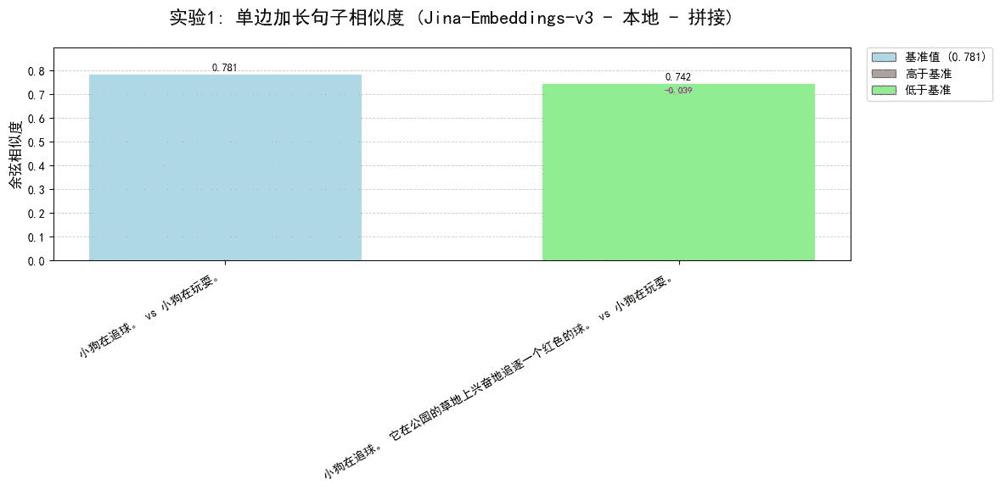
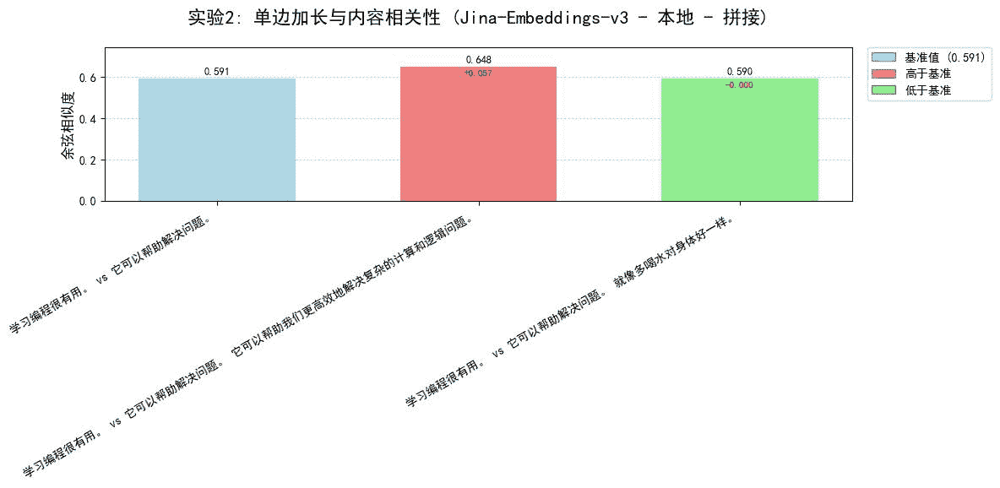
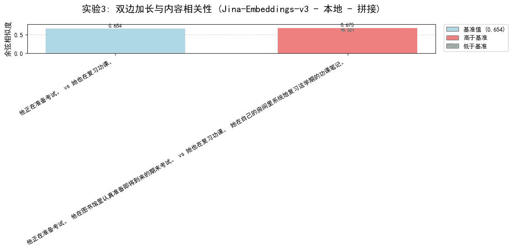
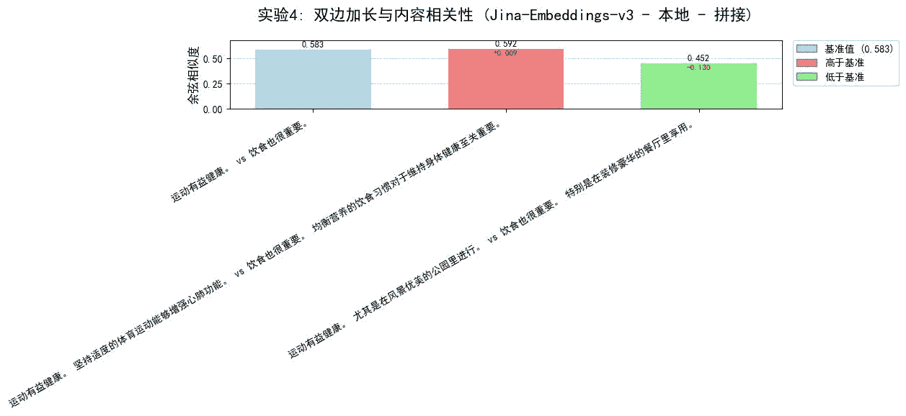
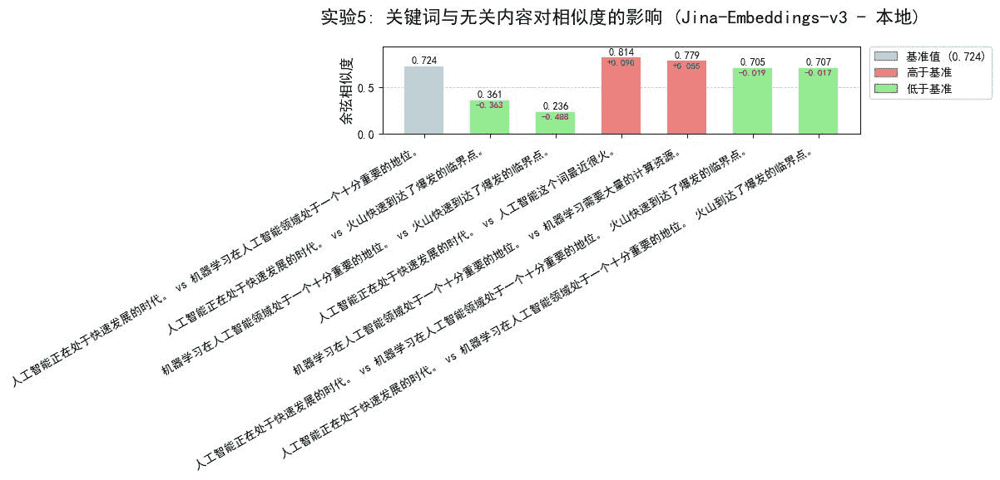
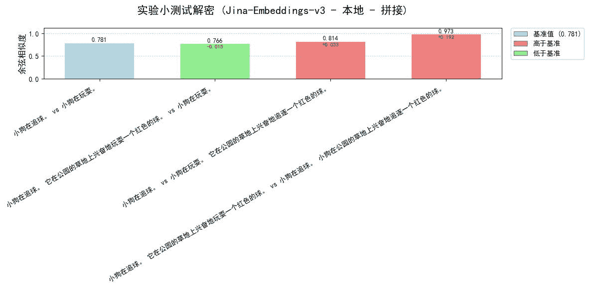

# 向量相似度揭秘：长度、相关性与关键词如何“迷惑”Embedding模型？

> 来源：[https://datawhaler.feishu.cn/docx/HKg6dkpFIoZoAOxYoG3cEhrSnZd](https://datawhaler.feishu.cn/docx/HKg6dkpFIoZoAOxYoG3cEhrSnZd)

# 向量相似度揭秘：长度、相关性与关键词如何“迷惑”Embedding模型？

## 🎯 文章目标

本文面向 **RAG（Retrieval-Augm**ented Generation）爱好者 以及对文本向量表示和相似度计算感兴趣的朋友们，旨在帮助大家：

+   理解句子**长度**变化对向量余弦相似度的潜在影响。

+   探究**内容相关性**（相关 vs. 不相关信息）如何调节句子间的相似度得分。

+   认识**关键词重叠**在相似度计算中的重要作用及其与语义的微妙关系。

+   观察不同**Embedding模型**（如BGE-M3, BGE-Large-ZH-v1.5, Jina-Embeddings-v3）在处理这些情况时的行为差异。

+   为**RAG应用**中的Chunking策略、模型选择和相似度阈值设定提供实践参考。

> **💡 小提示

> **向量间的余弦相似度是一个强大的工具，但绝非银弹！理解其背后的影响因素，才能更精准地驾驭它。

> 本次代码开源地址：[https://github.com/li-xiu-qi/XiaokeAILabs/blob/main/datas/test_](https://github.com/li-xiu-qi/XiaokeAILabs/blob/main/datas/test_sentence_length/sentence_length_similarity_experiments.ipynb)sentence_length/sentence_length_similarity_experiments.ipynb

## 📄 主题

**本次主题**：深入剖析句子长度、内容相关性及关键词重叠对文本向量余弦相似度的影响，并探讨其在RAG等实际应用中的启示。

## 📚 摘要

+   **长度影响复杂**：简单增加句子长度（即使内容相关）并不总能提升相似度，有时甚至会降低，效果依赖于模型和加长方式。

+   **相关性效果各异**：增加**相关**内容对相似度的影响因模型而异。部分模型（如 Jina-v3, BGE-Large）在特定场景下（实验** 2、**4）会提升相似度，而 BGE-M3 在某些情况下（实验 2）对相关/不相关加长均表现为相似度下降。普遍规律是，添加不相关内容通常会降低相似度（实验 2、4）。

+   **关键词对于bge-m3是强信号**：共享核心关键词能显著提升相似度得分，有时甚至能掩盖部分语义差异或无关“噪音”，对于其他模型也有不小的影响。

+   **模型差异显著**：不同 Embedding 模型对上述因素的反应存在明显差异。例如，Jina-v3 在某些双边相关加长场景下表现出相似度提升，而 BGE 系列模型则倾向于下降。BGE-M3 在实验 5 中对添加无关“噪音”后的相似度甚至略微上升，表现出独特的鲁棒性（或敏感性）。

+   **RAG 启示**：实验结果警示我们**不能迷信绝对的相似度分数**。RAG 系统设计需谨慎考虑 Chunk 长度、内容连贯性、模型选择，并可能需要更复杂的 Re-ranking 策略而非单一依赖向量相似度阈值，对于RAG中的文本块（Chunk）划分、模型选型、相似度阈值设定和查询处理具有重要的指导意义。

---

## 🚁 前言

最**近读到一篇文章**，提到一个有趣的观点：向量模型的核心是测量语义相似度，但这玩意儿很容易被“带偏”。其中一个常见的“干扰项”就是输入内容的长度。文章说，有时候，长文本仅仅因为“长”，就可能在向量空间中显得跟其他文本更“相似”，哪怕内容上并没那么贴切。

这引发了我的思考 🤔：我们平时在RAG或者其他基于向量检索的场景里，拿到一个相似度分数（比如余弦相似度大于0.75），真的就能高枕无忧地认为内容“相关”吗？如果一个不相关的长文档也能刷出高分，那我们岂不是被“骗”了？

我们常常依赖 Embedding 技术将文本转化为向量，并通过计算向量间的余弦相似度 (Cosine Similarity) 来衡量文本间的语义关联程度。理想情况下，高相似度意味着内容相关。

上文提到的文章有部分指出：『向量模型的核心功能是测量语义相似度，但这个测量结果很容易受到多种干扰因素的影响...长文本向量往往得分更高，哪怕它们的实际内容没那么相似...单靠向量模型本身，其实很难准确评估内容的“相关性”...我们无法单凭相似度分数，就判断这个“最佳匹配”或者其他得分较低的结果，内容是否真的相关。』

这段话让我有了一些探索关于向量和文本长度之间联系的想法：我们今天使用导入一个sentence transformer 就可以直接对模型进行推理，并进行想两相似度对比，觉得好像是一个挺简单的任务，但我想说的是，我们是否过于简化了对向量相似度的理解？文本长度、附加信息的性质、甚至关键词的出现频率，是否都在悄悄地“操纵”着我们看到的相似度分数？

为了更深入地理解这些因素的作用机制，并验证上述观点，我们设计并执行了一系列实验，系统地探究了句子长度（通过拼接方式）、内容相关性以及关键词重叠对常用 Embedding 模型（包括本地部署的 BGE-M3, BGE-Large-ZH-v1.5, Jina-Embeddings-v3 及 BGE-M3 API）计算的余弦相似度的影响。本文将详细展示实验过程、结果，并结合分析，希望能为 RAG 应用的实践者提供一些有价值的参考。

---

> ✨ 你好，我是筱可，欢迎来到「筱可 AI 研习社」！

> **🚀 标签关键词**

> | AI 实战派开发者 | 技术成长陪伴者 | RAG 前沿探索者 | 文档处理先锋 |

## 🐱 一、实验设计总览

我们的目标是解开句子向量相似度背后的“秘密”。为此，我们设计了五个环环相扣的实验，并使用了当前流行的一些Embedding模型进行测试。

### 🐷 1.1 核心问题与动机

1.  **长度之谜**：简单加长句子，相似度会升还是降？

1.  **相关性力量**：添加与核心内容相关的补充信息，和添加风马牛不相及的信息，对相似度的影响有何不同？

1.  **关键词效应**：句子间共享的形容关键词（如“快速”）对相似度有多大贡献？模型能区分词汇重合和真正的语义相似吗？

1.  **噪音干扰**：在相关的句子中混入少量完全无关的“噪音”信息，模型还能保持判断力吗？

1.  **模型差异**：不同的Embedding模型（多语言 vs. 单语言，不同训练目标）在上述问题上表现是否一致？

### 🐰 1.2 实验设置

+   **核心度量**: 我们使用余弦相似度 (Cosine Similarity) 来衡量两个句子向量间的相似程度。其计算公式为：
 
其中   和   分别是两个句子的向量表示，  和   是向量的第   个分量。得分范围在   之间，越接近 1 表示越相似。对于非负向量（如某些模型输出），范围是  。

+   **模型选用**:

+   **BGE-M3**: 来自智源研究院的多语言模型，支持长**文本，是当**前**的热门选项。**我们同时测试了其API版本和本地部署版本。

+   BGE-Large-ZH-v1.5: 同样来自智源，但专注于中文的大模型。

+   Jina-Embeddings-v3: Jina AI 推出的新一代多语言模型，也备受关注。

+   所有本地模型均通过 sentence-transformers 库加载，并启用 normalize_embeddings=True 以便直接计算点积作为余弦相似度。

+   **句子加长方式**: 本次实验统一采用拼接 (Concatenation) 的方式在原句子末尾添加额外内容来模拟句子加长。

### 🦉 1.3 各实验详解

+   **实验 1: 单边加长句子**

+   **目的**: 观察将一个句子通过拼接方式加长后，与另一个基础句子的相似度变化。

+   **方法**: 对比基础对 ("小狗在追球。", "小狗在玩耍。") 和单边加长对 ("小狗在追球。 它在公园的草地上兴奋地追逐一个红色的球。", "小狗在玩耍。") 的相似度。

+   实验 2: 单边加长与内容相关性

+   **目的**: 探究单边加长时，添加相关内容与添加不相关内容对相似度的不同影响。

+   **方法**: 对比基础对 ("学习编程很有用。", "它可以帮助解决问题。") 与分别添加相关内容 ("学习编程很有用。", "它可以帮助解决问题。 它可以帮助我们更高效地解决复杂的计算和逻辑问题。") 和不相关内容 ("学习编程很有用。", "它可以帮助解决问题。 就像多喝水对身体好一样。") 后的相似度。

+   实验 3: 双边加长与内容相关性

+   **目的**: 观察将两个句子都通过拼接方式加长（且补充内容相关）后，它们之间的相似度变化。

+   **方法**: 对比基础对 ("他正在准备考试。", "她也在复习功课。") 和双边加长对 ("他正在准备考试。 他在图书馆里认真准备即将到来的期末考试。", "她也在复习功课。 她在自己的房间里系统地复习这学期的功课笔记。") 的相似度。

+   实验 4: 双边加长与内容相关性 (相关/不相关)

+   **目的**: 探究双边加长时，同时添加相关内容与同时添加不相关内容对相似度的不同影响。

+   **方法**: 对比基础对 ("运动有益健康。", "饮食也很重要。") 与分别同时添加相关内容 ("运动有益健康。 坚持适度的体育运动能够增强心肺功能。", "饮食也很重要。 均衡营养的饮食习惯对于维持身体健康至关重要。") 和不相关内容 ("运动有益健康。 尤其是在风景优美的公园里进行。", "饮食也很重要。 特别是在装修豪华的餐厅里享用。") 后的相似度。

+   实验 5: 关键词重叠与无关内容

+   **目的**: 检验关键词重叠对相似度的影响，以及在存在关键词重叠的情况下，添加完全无关内容是否会显著降低相似度。

+   **方法**: 设计了多组句子对，包括：共享关键词且主题相关、无共享关键词且主题无关、共享关键词但主题部分相关、共享关键词但其中一个句子添加了完全无关的内容（火山例子）。通过对比这些句子对的相似度，分析关键词和无关信息的作用。

---

## 🐶 二、实验结果与深度分析

下面我们逐一解析每个实验的结果，看看能挖出哪些有意思的发现。（注意：API与本地BGE-M3结果非常接近，说明我们生成的向量是没有问题的，分析主要基于本地模型结果，API结果趋势一致。）

### 🐷 3.1 实验 1: 单边加长句子

+   **设置**: 比较 ("小狗在追球。", "小狗在玩耍。") 与 ("小狗在追球。 它在公园的草地上兴奋地追逐一个红色的球。", "小狗在玩耍。") 的相似度。

+   **结果**:

+   **所有模型 (BGE-M3, BGE-Large, **Jina-v3, API BGE-**M3) 均显**示，单边拼接加长（添加了与“追球”相关的细节）后，与“小狗在玩耍”的相似度均下降。

+   BGE-M3 (本地): 0.827 -> 0.752 (-0.075)

+   BGE-Large: 0.800 -> 0.677 (-0.123)

+   Jina-v3: 0.781 -> 0.742 (-0.039)

+   BGE-M3 (API): 0.826 -> 0.752 (-0.074)

+   **分析**:

+   这与“长文本得分更高”的直觉相悖。在本例中，**对一个**句子增加具体、相关的细节描述，反而稀释了其与另一个基础句（“小狗在玩耍”）的核心语义联系，或者说改变了句子向量在空间中的方向，导致余弦相似度降低。

+   **思考**: 如果将“追逐”改为“玩耍”相关的扩展，相似度可能提升。具体的推测可以从下面的实验结果看出来，感兴趣的小伙伴可以自己试试。

### 🐰 3.2 实验 2: 单边加长与内容相关性

+   **设置**: 比较 ("学习编程很有用。", "它可以帮助解决问题。") (基础对) 与 添加相关内容 (... 它可以帮助我们更高效地解决复杂的计算和逻辑问题。) 和 添加不相关内容 (... 就像多喝水对身体好一样。) 后的相似度。

+   **结果**:

+   **BG****E-M**3 (本地 & API): 基础对相似度约 0.684。添加相关内容后下降至 0.665 (-0.019)，添加不相关内容后下降至 0.674 (-0.010)。两者均下降，相关内容下降略多。

+   **BGE-Large****: **基础对**相似****度 0**.62**5。**添加相关内容后上升至 0.658 (+0.033)。添加不相关内容后下降至 0.550 (-0.075)。

+   **Jina-v3****: **基础对**相似****度 0**.591。**添加相关内**容后上升至 0.648 (+0.057)。添加不相关内容后基本持平/微降至 0.590 (-0.001)。

+   **分析**:

+   模型行为出现分化。BGE-Large 和 Jina-v3 的表现更符合直觉：添加相关内容增强了语义联系（提升相似度），而不相关内容则削弱了联系（降低或持平相似度）。

+   **BGE-M3 的表现较为独特**：无论添加相关还是不相关内容，相似度均出现下降。这可能表明 BGE-M3 对单边句子结构或长度变化更为敏感。虽然 Jina-v3 也是多语言模型，但表现不同，说明 BGE-M3 的响应模式并非简单由多语言特性决定，可能源于他特定的内部机制对这类句子修改的反应。

### 🦊 3.3 实验 3: 双边加长与内容相关性

+   **设置**: 比较 ("他正在准备考试。", "她也在复习功课。") (基础对) 与 双边添加相关细节后的 ("他正在准备考试。 他在图书馆里认真准备即将到来的期末考试。", "她也在复习功课。 她在自己的房间里系统地复习这学期的功课笔记。") 的相似度。

+   **结果**:

+   BGE-M**3 **(本地 & API): 相似度下降 (本地: 0.765 -> 0.668, -0.097; API: 0.765 -> 0.668, -0.097)。

+   **BGE-Large**: 相似度**下降** (0.619 -> 0.554, -0.065)。

+   **Jina-v3**: 相似度**上升** (0.654 -> 0.675, +0.021)。

+   **分析**:

+   模型表现再次出现分化。**BGE 系列模型**在双边添加相关细节后，相似度依然下降。这可能是因为，尽管补充内容与各自原句相关，但引入的具体细节（如图书馆 vs. 房间，期末考试 vs. 功课笔记）增加了新的语义元素，反而拉大了两个长句子向量在语义空间中的距离。

+   **Jina-v3 则表现不同**，相似度略有提升。这可能得益于其对长文本的处理能力或捕捉高层语义关联的能力，使得模型认为“都在为学习努力”的核心主题因细节补充而得到加强。

+   **观察**: BGE 模型的相似度下降可能与加长后句子间重合字词减少有关。然而，Jina-v3 的相似度提升表明，模型有能力超越字面重合，理解更深层次的语义关联。值得注意的是，根据 Jina AI 官方信息，Jina Embeddings v3 模型特别优化了作为查询嵌入（Query Embedding），适用于非对称检索任务（如短查询匹配长文档），这或许能部分解释其在本次对称比较测试中的优秀表现。

### 🧐 3.4 实验 4: 双边加长与内容相关性 (相关/不相关)

+   **设置**: 比较 ("运动有益健康。", "饮食也很重要。") (基础对) 与 双边添加相关内容 (运动+增强心肺, 饮食+均衡营养) 和 双边添加不相关内容 (运动+公园风景, 饮食+餐厅装修) 后的相似度。

+   **结果**:

+   **所有模型 (BGE-M3, BGE-Large, **Jina-v3, API BGE-M3):

+   双边添加**相关**内容后，相似度均**上升**。

+   BGE-M3: 0.683 -> 0.720 (+0.037)

+   BGE-Large: 0.606 -> 0.614 (+0.008)

+   Jina-v3: 0.583 -> 0.592 (+0.009)

+   双边添加**不相关**内容后，相似度均**显著下降**。

+   BGE-M3: 0.683 -> 0.608 (-0.075)

+   BGE-Large: 0.606 -> 0.428 (-0.178)

+   Jina-v3: 0.583 -> 0.452 (-0.131)

+   **分析**:

+   **模型表现高度一致且符合直觉**。当两个句子同时围绕一个共同的、更具体的主题（健康）进行扩展时，它们的语义联系得到加强，相似度提升。当两个句子各自引入完全不相关的主题时（风景 vs 装修），它们的核心联系被严重破坏，相似度大幅下降。

+   **这与实验** 2、3 的部分结果不同，表明双边同步的相关/不相关扩展，其信号更强，更容易被所有模型一致地捕捉。

### 🤖 3.5 实验 5: 关键词重叠与无关内容

+   **设置**: 比较多组句子对，核心关注共享关键词（如“人工智能”、“机器学习”）和添加无关噪音（“火山...”）的影响。

+   **结果**:

+   **关键词作用**:

+   共享核心关键词且主题相关的句子对 (AI发展 vs ML重要) 相似度较高 (BGE-M3: 0.681, Jina: 0.724)。

+   共享核心关键词但主题仅部分重合的句子对 (AI发展 vs AI很**火, **ML重要 vs ML需资源) 相似度非常高 (普遍 > 0.72, BGE-M3 的 AI发展 vs AI很火 甚至达到 0.814)。

+   无共享关键词且主题无关的句子对 (AI发展 vs 火山**, M**L重要 vs 火山) 相似度非常低 (普遍 < 0.54, BGE-M3 的 ML重要 vs 火山 仅 0.332, Jina 为 0.236)。

+   **噪音鲁棒性**: 对比 (AI发展, ML重要) 与 (AI发展, ML重要 + 火山爆发):

+   **BGE-**M3 (本地 & API): 相似度从 0.681 略微上升 到 0.691 (+0.010)。

+   **BGE-**Large: 相似度从 0.681 略微下降 到 0.678 (-0.003)。

+   **Jina**-v3: 相似度从 0.724 略微下降 到 0.705 (-0.019)。

+   **分析**:

+   **关键词是相似度判断的强信号**。即使语义焦点有所不同（发展 vs 热度），只要核心关键词重叠度高，模型就倾向于给出高分。这提示模型可能在一定程度上依赖词汇层面的匹配。

+   **模型对少量噪音有一定鲁棒性**。在已有较强相关性的基础上，添加一句完全无关的话，并未导致相似度崩溃。BGE-Large 和 Jina-v3 的轻微下降符合预期。

+   **观察点**: BGE-M3 的相似度反而**略微上升****，这**非常值得注意！我觉得可**能是**因为加入了重复词“快速”（火山快速到达... vs AI快速发展...）。很可能是 BGE-M3 对这种词汇重叠（即使在无关语境中）给予了不成比例的权重，导致了反常的相似度提升。这再次印证了我之前说的模型特别关注了关键词的部分，我怀疑是由于bge-m3模型支持稀疏向量生成导致的问题，相比之下，Jina-v3 的结果显示相似度下降表现更符合语义逻辑。

---

## 💡 三、 实验结论与反思

综合五个实验的结果，我们可以得出以下结论：

1.  长度影响并非简单的“**越长越相**似”: **实验**表**明，至少**在拼接加长这种方式下，增加句子长度（即使是相关内容）并不总是提升余弦相似度。单边加长（Exp 1）和部分双边加长（Exp 3, BGE模型）甚至导致相似度下降。这可能是因为新增信息改变了句子的整体语义重心或向量方向，稀释了与对比句的原始联系。这提示，原始文章提到的“长度偏差”可能更复杂，或在平均意义上成立，但在具体案例中不一定。加长内容的方式和具体语义至关重要。

1.  内容相关**性是**关键，但模型解**读各异**: 添加相关内容通常比添加不相关内容更能维持或提升相似度（Exp 2, 4）。然而，不同模型对“相关性”的解读和利用方式不同。Jina-v3 和 BGE-Large 在某些场景下能从相关信息中获益提升相似度，而 BGE-M3 对单边加长（无论相关与否）似乎更倾向于降低相似度。双边同步的相关/不相关扩展则得到了模型一致的响应。

1.  关键词是强信号，尤其对 BGE-M3: 共享核心关键词能显著提升相似度得分（Exp 5），有时甚至能掩盖部分语义差异或无关“噪音”。这种效应在 BGE-M3 上尤为明显，但对其他模型也有不小的影响。

1.  无关噪音有一定抵抗力，但需警惕异常: 模型对在强相关信号基础上添加的少量噪音表现出一定鲁棒性（Exp 5），相似度变化不大。但 BGE-M3 对包含巧合关键词的噪音产生的反常提升现象（Exp 5），警示我们模型可能捕捉到非预期的、基于词汇的关联。

1.  **模型选择影响重大**: BGE-M3、BGE-Large-ZH-v1.5 和 Jina-Embeddings-v3 在处理长度、相关性和关键词时展现出不同的“性格”。Jina-v3 在处理长文本和从相关细节中获益方面似乎有优势。BGE-M3 对长度变化和特定词汇重叠表现敏感。BGE-Large 介于两者之间。没有绝对最优的模型，选择应基于具体应用场景和对这些特性的理解，但似乎jian embedding v3 几乎在多个实验中的表现都是比较满足我们的预期的，所以如果没有特殊情况，可以优先选择jina embedding v3模型进行embedding，值得再提一嘴的是bge-m3支持多功能，也就是多向量、稠密向量以及稀疏向量。

**核心结论**: 文本向量的余弦相似度是一个受句子长度、内容相关性、关键词重叠度以及所选用 Embedding 模型共同影响的复杂指标。我们不能将其视为衡量语义相关性的绝对“黄金标准”。理解这些影响因素及其在不同模型上的表现差异，对于有效利用 Embedding 技术至关重要。

---

## 🚀 四、 RAG应用启示

这些实验结果为我们构建和优化RAG系统提供了切实的指导：

1.  **Chunking策略再思考**:

+   **长度影响**: 简单的定长切块（Fixed-size Chunking）可能不是最优。过长的Chunk可能包含过多信息点，导致其向量表示在与查询匹配时被“稀释”（类似实验1）。过短的Chunk可能信息不足。

+   **内容连贯性**: 切块时应尽量保证每个Chunk内部的语义连贯性。避免强行切分或合并语义相关但表述差异大的内容（类似实验3的补充描述），这可能影响BGE等模型的效果。

+   语义切块 (Semantic Chunking) 值得尝试，它试图根据语义边界来划分文本块，可能更能适应模型的特性。

1.  Embedding模型选型与测试:

+   **没有免费午餐**: 不存在一个在所有情况下都完美的模型。需要根据你的主要文档类型、查询特点和对相关性/噪音的容忍度来选择。

+   **领域数据测试**: 模型在通用测试集上的排名不一定完全适用于你的特定领域。务必使用你自己的数据和典型查询来评估候选模型的表现，特别是关注它们在处理不同长度、相关性组合时的稳定性。

+   **考虑Jina?**: 从本次实验看，Jina-Embeddings-v3在处理相关性、抵抗噪音方面表现抢眼，值得在你的候选模型列表中占有一席之地。

1.  **告别“一刀切”的相似度阈值**:

+   **相对排名为主****: **应主要将相似度得分用于对检索结果进行排序，而不是依赖一个固定的阈值来判断绝对相关性。

+   **动态阈值或多阶段过滤**: 如果确实需要阈值，可以考虑根据查询类型、文档**长度或其他元数据动态调**整阈值。或者，采用召回 + Rerank 的策略：先用Embedding模型召回一个较宽松的候选集，再用更复杂的（通常也更慢）Reranker模型（如Cross-Encoder）进行精排和相关性判断。

1.  **查询处理与转换**:

+   **查询长度**: 用户的自然语言查询长度也可能影响结果。思考是否需要对过短或过长的查询进行标准化或扩展处理（Query Expansion/假设文档生成），但要小心引入不相关信息（类似实验2）。

+   **关键词提取**: 鉴于关键词的重要性，可以考虑从查询中提取核心关键词，并可能在检索或Rerank阶段给予这些词汇更高的权重（结合了向量检索和关键词检索的混合搜索 Hybrid Search 是一个常见方案）。

1.  **文档预处理**:

+   **去噪**: 实验5的结果提示，虽然模型有一定抗噪能力，但去除文档中明显的无关内容（如广告、模板化页眉页脚、不相关的旁注）可能有助于提高检索精度，减少“噪音”向量的干扰。

## 📒五、实验小测试解密

---

> **🙋♂️ 入群交流**

+   👸号菜单点击「社群」，扫码直接入群

+   回复关键词「入群」，添加作者🛰️人工邀请，注意备注：入群

## 📒 总结与展望

🚀 技**术全景图**

+   **核心技术**: 文本向量嵌入 (Text Embedding), 余弦相似度 (Cosine Similarity)。

+   **关键因素**: 句子长度 (Sentence Length), 内容相关性 (Content Relevance), 关键词重叠 (Keyword Overlap)。

+   **涉及模型**: BGE-M3, BGE-Large-ZH-v1.5, Jina-Embeddings-v3 (Sentence Transformers & API)。

+   **应用场景**: RAG (Retrieval-Augmented Generation), 语义搜索 (Semantic Search)。

📓 学**习汇总**

+   文本向量相似度受长度、内容相关性、关键词和模型选择共同影响。

+   简单加长未必提升相似度，内容相关性影响依赖模型，关键词作用显著。

+   模型各有千秋，需结合实际场景测试选择。

+   相似度得分是相对指标，勿用固定阈值判断绝对相关性。

+   实验结果为RAG的Chunking、模型选择、阈值设定、查询处理提供了参考。

---

🔥 动**手挑战**

1.  **尝试不同加长方式**: 使用“改写”而非“拼接”的方式加长句子，观察结果是否不同。

1.  **测试更多模型**: 引入其他类型的 Embedding 模型（如 M3E, E5 系列等），进行对比实验。

1.  **构建特定测试集**: 设计更贴近您 RAG 场景的测试用例，包含不同长度、结构和相关性级别的真实数据。

1.  **量化长度偏差**: 设计实验更直接地测试原始文章的“长度偏差”假说，例如比较不同长度但语义无关文本间的平均相似度。

1.  **探索校准方法**: 研究是否存在方法可以校准余弦相似度分数，以减轻长度或关键词偏差的影响？

---

♻️ **互动问题**

1.  你在使用向量相似度时遇到过哪些“反直觉”或难以解释的情况？

1.  对于RAG中的Chunking策略，你有什么实践经验或独到见解？

1.  你认为除了长度、相关性和关键词，还有哪些因素会显著影响向量相似度的计算？

> 欢迎在留言区分享你的想法，每条留言我都会认真阅读！

> 你的反馈是我创作的最大动力 ❤️

> **💗 立即行动**

1.  点赞、收藏、关注，分享给朋友。

1.  为账号加星标，获取更多内容。

1.  以本文为灵感，整理一份属于自己的笔记。

> **🚗 行动召唤**

> "与其等着 AI 改变世界，不如自己参与变革！在这里，让 AI 成为你弯道超车的秘密武器。"

## 📚 往期精选

+   [AI 为何偏爱 Bfloat16？一文搞懂 Float3](https://mp.weixin.qq.com/s/INKz346v_tDE5i9yAizEAQ)2、Float16 与 Bfloat16

+   RAG 的检索优化：MMR 平衡相关性与多样性

+   你的RAG检索太“笨”？用K-Means聚类来“调教”

+   [RAG之延迟交互与残差压缩：从ColB](https://mp.weixin.qq.com/s/2-9FqIFxgWM10X9lnora4A)ERT到ColBERTv2的演进及其应用

+   RAG：ColBERT原理、延迟交互机制与稠密向量的对比分析