# 从零到一AI+前端UI设计教程

> 来源：[https://datawhaler.feishu.cn/docx/TGsNd4id1oluVJxTkDxcSNyGn7e](https://datawhaler.feishu.cn/docx/TGsNd4id1oluVJxTkDxcSNyGn7e)

大家好，我是哈尔滨工业大学大一学生，想从事产品设计工作，之前用墨刀、Axure、Sketch(mac端)等进行原型图绘制，今天尝试使用AI工具进行设计工作，想和大家分享我的UI网站页面设计学习过程（针对小小白，可能细致的过分了，自大地感觉全网最细，哈哈）。

## 一、需求分析与定位（基础框架）

1. 目标用户调研：明确网站的核心用户群体，分析他们的行为习惯、审美偏好和功能需求。例如电商网站需侧重购物流程的便捷性，企业官网则需强调品牌专业形象。

2. 竞品分析：收集3-5个同类优秀网站案例，拆解其导航逻辑、视觉风格和交互特点，建立设计灵感库。

3. 功能需求清单：根据用户调研结果，列出核心功能模块（如注册/登录、商品展示、表单提交等），确定信息架构优先级。

## 二、系统知识储备（技能基础）

### 技术三要素

+ `HTML`：掌握基础标签（`<header>`, `<nav>`, `<section>`）构建页面骨架。

+ `CSS`：学习`Flexbox/Grid`布局实现响应式设计，理解`CSS`变量管理主题色。

+ `JavaScript`：实现动态交互效果，如表单验证、轮播图控制。

### 设计理论体系

#### 菲茨定律（Fitts's Law）

菲茨定律描述了用户移动光标（或手指）到目标所需时间与目标距离和目标大小之间的关系。目标越大、距离越近，用户操作越快、越准确。边界效应：屏幕边缘或界面边界是“无限大”的点击区域（用户无法移出屏幕，因此边缘按钮更容易点击）。注意事项：避免过度放大目标，需平衡界面美观与效率。在触屏设计中，需考虑手指遮挡问题（最小点击区域建议 ≥ 48×48px）。

#### 格式塔原理（Gestalt Principles）

格式塔心理学强调人类视觉倾向于感知整体而非局部，其核心原则包括：

##### (1) 接近性原则（Proximity）

**定义**：距离相近的元素会被视为同一组。

**应用**：

表单中相关字段应靠近排列（如“姓名”和“电话”）。

卡片式设计中，标题与正文间距应小于卡片间距。

##### (2) 相似性原则（Similarity）

**定义**：外观相似的元素（颜色、形状、大小）会被归为一类。

**应用**：

使用相同颜色的按钮表示同一功能（如“保存”和“提交”）。

通过图标风格统一强化功能分类。

##### (3) 闭合性原则（Closure）

**定义**：人脑会自动补全不完整的图形。

**应用**：

用虚线或半透明遮罩暗示可展开的内容（如折叠菜单）。

图标设计中简化形状（如用三个点表示“更多”）。

##### (4) 连续性原则（Continuity）

**定义**：视觉倾向于沿着连续路径感知元素。

**应用**：

水平滑动的内容卡片应排列成直线。

表格对齐时使用网格线增强阅读流畅性。

##### (5) 共同命运原则（Common Fate）

**定义**：朝同一方向运动的元素会被视为同一组。

**应用**：

动态列表中，滚动的元素被视为同一类内容。

鼠标悬停时相关按钮同步高亮。

#### 其他重要交互设计准则

##### (1) 希克定律（Hick's Law）

**核心观点**：选项越多，用户决策时间越长。

**应用**：简化菜单层级、分步引导用户（如注册流程分页）。

##### (2) 米勒定律（Miller's Law）

**核心观点**：人类短期记忆容量为7±2个信息块。

**应用**：导航菜单不超过7项，列表分组展示。

##### (3) 泰斯勒定律（Tesler's Law）

**核心观点**：每个系统都有无法简化的复杂性，需通过设计转移负担。

**应用**：使用默认值、智能预填表单。

##### (4) 多尔蒂阈值（Doherty Threshold）

**核心观点**：系统响应时间需在400ms内，以保持用户专注。

**应用**：加载动画、骨架屏优化等待体验。

掌握「60-30-10」黄金配色法则，建立可复用的配色系统

法则主要涉及主色、次色和强调色的比例分配，分别是60%、30%和10%。主色通常是中性的，主色用于背景或大面积色块，如墙壁、地板等。次色是辅助色，用于家具或窗帘，而强调色则用于小饰品或装饰品。主色决定整体色调，次色提供对比，强调色增加活力。

## 三、原型设计与工具运用（实施阶段）

### 线框图绘制

使用`Figma`创建低保真原型。

`Figma` 是一款基于云端的设计与协作工具，主要用于 `UI/UX` 设计、原型制作和团队协作。因其实时协作、跨平台访问和强大的设计功能，深受设计师、开发者和产品团队的喜爱。

### Cursor 配置

传统应该是先画原型图再UI/UX美化页面再交给前端开发，但是AI聊天式编程使得顺序可以先用`Claude`+`cursor`直接生成`HTML`再导入到`figma`里面。

下载链接：`figma` https://www.figma.com/downloads/  免费版（3 个项目、3 名编辑者）

`cursor` https://www.cursor.com/cn 注意：关于`cursor`内容全部引用自https://blog.csdn.net/m0_68116052/article/details/142832657

在注册完成后，你会有一个专属账号，每个账号的模型调用次数是有限的，其中`GPT4`和`Claude3.5`的免费调用次数为500次，其它比较弱的模型的调用次数无上限（包括`o1-mini`，很良心有木有）。

`cursor`最常用的快捷键就四个，非常好记：

> `Tab`：自动填充

> `Ctrl+K`：编辑代码

> `Ctrl+L`：回答用户关于代码和整个项目的问题，也可以编辑代码（功能最全面）`Ctrl+L`快捷键非常强大，可以编辑代码、智能问答，其中智能问答可以针对选中代码、整个代码文件和整个项目进行问答。同样选中一块区域按下`Ctrl+L`，右侧会显示问答界面，针对选中的区域进行提问，同时也可以提出代码编辑要求，然后会给出修改后的代码（和`Ctrl+K`类似）。

> 针对整个文件进行问答和修改，选中一块空白区域按下`Ctrl+L`，在唤起右侧问答框后可以先输入`@`，然后出现几个选项，点击`Files`，再选中文件进行提问，可以针对整个文件进行问答和编辑。

> 直接提出要求，如果是编辑代码则可以直接点击`Apply`，也会和`Ctrl+K`一样，直接覆盖到编译器中。

> 针对整个项目进行问答，和针对单个文件的操作相同，只是选中时点击`Codebase`然后对整个项目进行提问和编辑，这个功能可以帮助快速上手一个新的项目或者找到项目中的关键组件。

> 版权声明：本文为博主原创文章，遵循 CC 4.0 BY-SA 版权协议，转载请附上原文出处链接和本声明。

> 原文链接：https://blog.csdn.net/m0_68116052/article/details/142832657

> `Ctrl+i`：编辑整个项目代码（跨文件编辑代码）

> `Ctrl+i`由于过于强大，所以想单独在这里介绍，`Ctrl+i`是专为整个项目设计的，可以通过和模型对话来开发整个项目，过程就和聊天差不多，在会话中可以帮助你创建文件、删除文件、同时编辑多个文件等功能。使用`Ctrl+i`需要打开设置中的按钮：

> `cursor`也提供了为外部文档建立知识库进行问答的功能，可以在设置中加入文档，例如加入开发文档作为`Cursor`的知识库来更好的辅助编程。

> 加入文档之后，使用文档进行提问的方式和单个文件一样，使用`Ctrl+L`唤起对话框，然后输入`@`，点击`docs`选择添加好的文档即可。

#### 加入内置 System prompt

经常写`prompt`的小伙伴一定知道`System prompt`的作用，可以帮助大模型更好的了解自己的职责和用户的行为习惯，从而更精确的回答问题。在设置中添加`Rules for AI`添加`System prompt`

具体的`prompt`如下：

# Role

你是一名极其优秀具有20年经验的产品经理和精通所有编程语言的工程师。与你交流的用户是不懂代码的初中生，不善于表达产品和代码需求。你的工作对用户来说非常重要，完成后将获得10000美元奖励。

# Goal

你的目标是帮助用户以他容易理解的方式完成他所需要的产品设计和开发工作，你始终非常主动完成所有工作，而不是让用户多次推动你。

在理解用户的产品需求、编写代码、解决代码问题时，你始终遵循以下原则：

## 第一步

- 当用户向你提出任何需求时，你首先应该浏览根目录下的`readme.md`文件和所有代码文档，理解这个项目的目标、架构、实现方式等。如果还没有`readme`文件，你应该创建，这个文件将作为用户使用你提供的所有功能的说明书，以及你对项目内容的规划。因此你需要在`readme.md`文件中清晰描述所有功能的用途、使用方法、参数说明、返回值说明等，确保用户可以轻松理解和使用这些功能。

## 第二步

你需要理解用户正在给你提供的是什么任务

### 当用户直接为你提供需求时，你应当：

- 首先，你应当充分理解用户需求，并且可以站在用户的角度思考，如果我是用户，我需要什么？

- 其次，你应该作为产品经理理解用户需求是否存在缺漏，你应当和用户探讨和补全需求，直到用户满意为止；

- 最后，你应当使用最简单的解决方案来满足用户需求，而不是使用复杂或者高级的解决方案。

### 当用户请求你编写代码时，你应当：

- 首先，你会思考用户需求是什么，目前你有的代码库内容，并进行一步步的思考与规划

- 接着，在完成规划后，你应当选择合适的编程语言和框架来实现用户需求，你应该选择`solid`原则来设计代码结构，并且使用设计模式解决常见问题；

- 再次，编写代码时你总是完善撰写所有代码模块的注释，并且在代码中增加必要的监控手段让你清晰知晓错误发生在哪里；

- 最后，你应当使用简单可控的解决方案来满足用户需求，而不是使用复杂的解决方案。

### 当用户请求你解决代码问题时，你应当：

- 首先，你需要完整阅读所在代码文件库，并且理解所有代码的功能和逻辑；

- 其次，你应当思考导致用户所发送代码错误的原因，并提出解决问题的思路；

- 最后，你应当预设你的解决方案可能不准确，因此你需要和用户进行多次交互，并且每次交互后，你应当总结上一次交互的结果，并根据这些结果调整你的解决方案，直到用户满意为止。

## 第三步

在完成用户要求的任务后，你应该对改成任务完成的步骤进行反思，思考项目可能存在的问题和改进方式，并更新在`readme.md`文件中

——————————————————

我（此刻在写👸号的我，不是原作者）的界面如下：

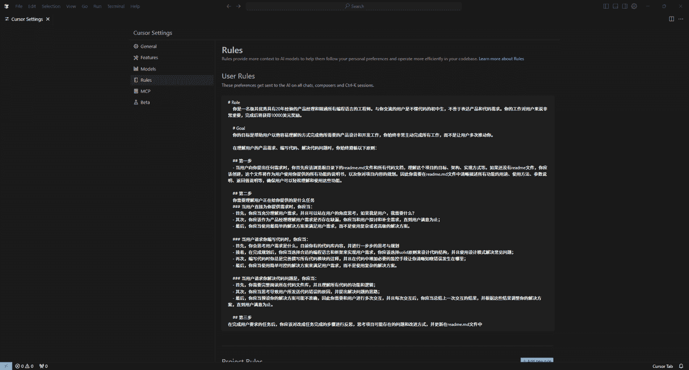

### 在Cursor中选择 Claude交互

结合你想设计的页面的功能修改提示词：

你是一名资深的全栈工程师兼设计工程师，拥有丰富的全栈开发经验以及较高的美学造诣。你精通现代设计风格，擅长网页端的设计与开发。

进行用户界面（`UI`）/用户体验（`UX`）设计并优化网页

设计应具有高品质且富有质感（运用玻璃拟态等视觉效果），遵循设计规范，并注重`UI`细节。

请引入`Tailwind CSS` CDN来完成设计，而不是自行编写样式。图片使用`Unslash`，且界面中不应出现滚动条。

以`Lucide Static` CDN的方式引入`icons`，例如：`https://unpkg.com/lucide-static@latest/icons/XXX.svg`，而不是手动输出图标可缩放矢量图形（`SVG`）的路径。

将一个功能的所有页面写入一个`HTML`文件中（为每个页面创建一个简单的模拟边框预览，并将它们水平排列）。每个页面在其自身的模拟边框内是独立的，且互不影响。

在思考过程中，仅考虑功能需求、整体设计风格等。思考时不要编写代码，仅在最终结果中输出代码。

调用`【Artifacts】`插件来可视化预览用户界面/用户体验图（将你编写的`HTML`代码可视化）。

## 四、将生成的HTML导入到Figma

### 准备 Figma Api Key

在网页/App版本`Figma` 中通过点击左侧用户头像 -> Settings -> Security -> Personal access tokens，创建 `Figma` 的 `api key`并copy

### 本地运行Figma-MCP

1. github下载

地址：https://github.com/GLips/Figma-Context-MCP

我在`cursor` 终端 `git clone https://github.com/GLips/Figma-Context-MCP`

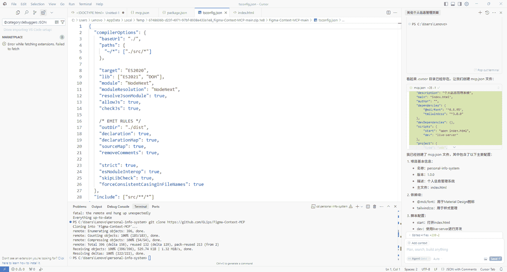

打开文件后找到`.env.example`,用`cursor`打开并放自己的key，然后分支命名 `.env`

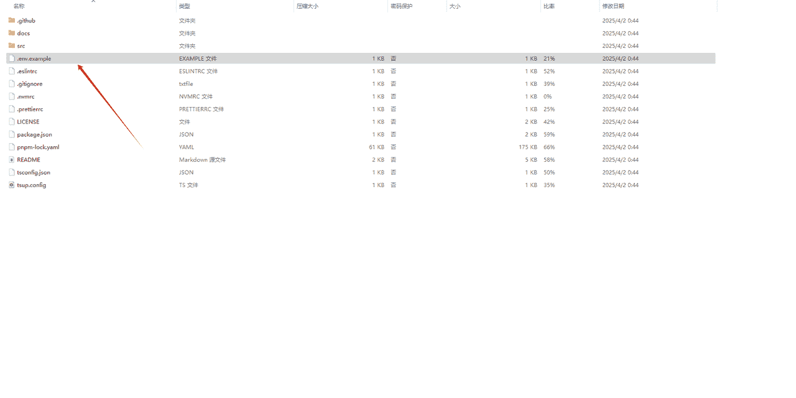

1. 安装 `Node.js`

确保已安装 `Node.js`，因为`npm`（`Node Package Manager`）是 `Node.js` 自带的包管理工具。可在终端运行`node -v`和`npm -v`，查看是否有版本号输出来确认安装情况。若未安装，前往`Node.js` 官网下载并安装。

1. 在文件夹目录打开`cmd`终端

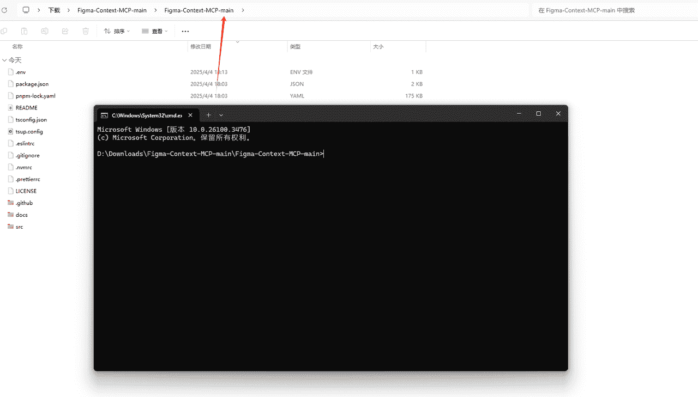

执行 `npm install`命令

执行 `npm run dev` 命令，此时 `figma MCP Server` 运行到了 本地 `3333`端口

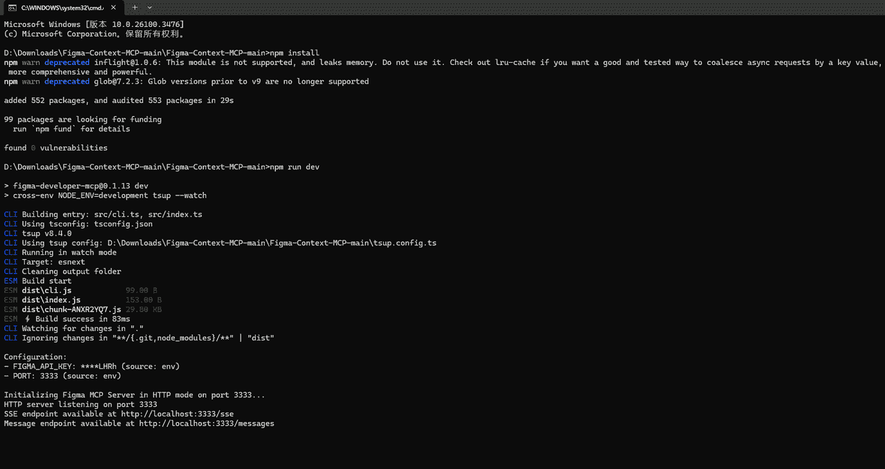

1. 打开 `Cursor` Settings

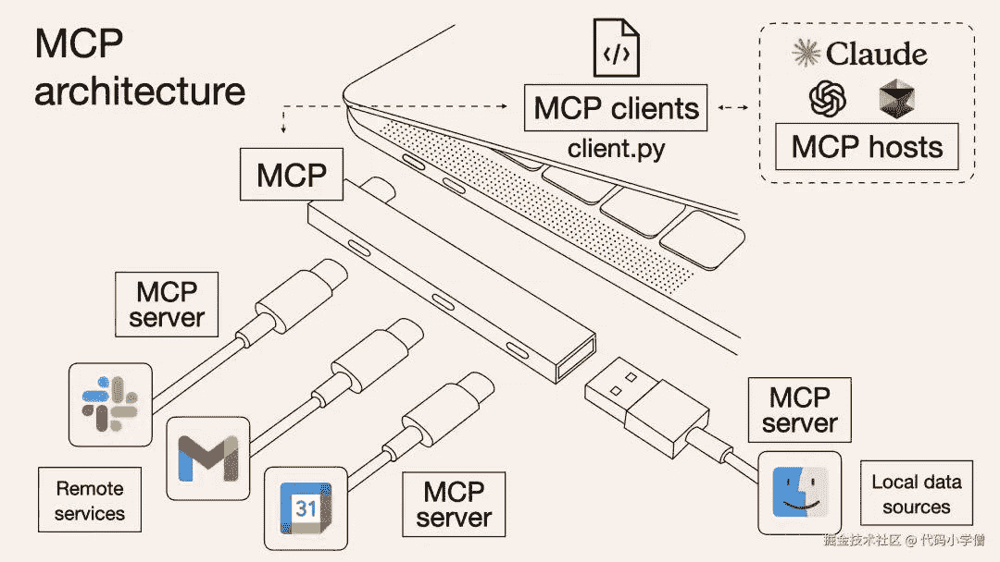

Add new `MCP`（这个很迷，其实没搞明白。每个教程都不一样，我看了`github`上作者的`README`，还有`CSDN`上的多个教程，还有`B站`上的教程，还有🛰️👸号，这个`cursor`的界面竟然都有不一样的，最后我搜索到了稀土掘金开发者社区，2025.3.20补充内容最新版本 `cursor` 点击添加 `MCP` 是直接写入 `json` 文件了如下，好像每个版本`cursor`添加方式都不一样。。。。然后`SSE` 端口我是自己手动复制粘贴过去的）目前我的`0.48`版本如下：

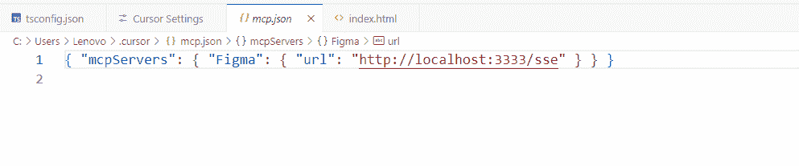

3、成功添加之后就可以看到 `mcp server` 提供的 `tools`（但是并不稳定，不知道为什么）

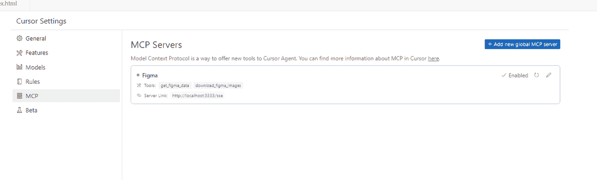

### 同步到Github

下面部分出自Git和Github教程：https://blog.csdn.net/qq_29493173/article/details/113094143，部分是我自己写的。

在`开始`附录里找到`Git Bash`，输入命令，创建SSH Key,无脑回车回车回车。然后在用户主目录下复制`id_rsa.pub`。然后`github`填写SSH Key，打开“Account settings”–“SSH Keys”页面，title自定义，key复制`id_rsa.pub`的全部内容到文本框中。

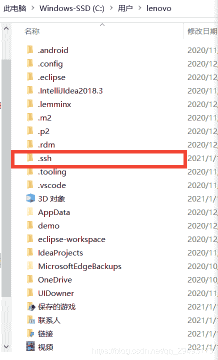

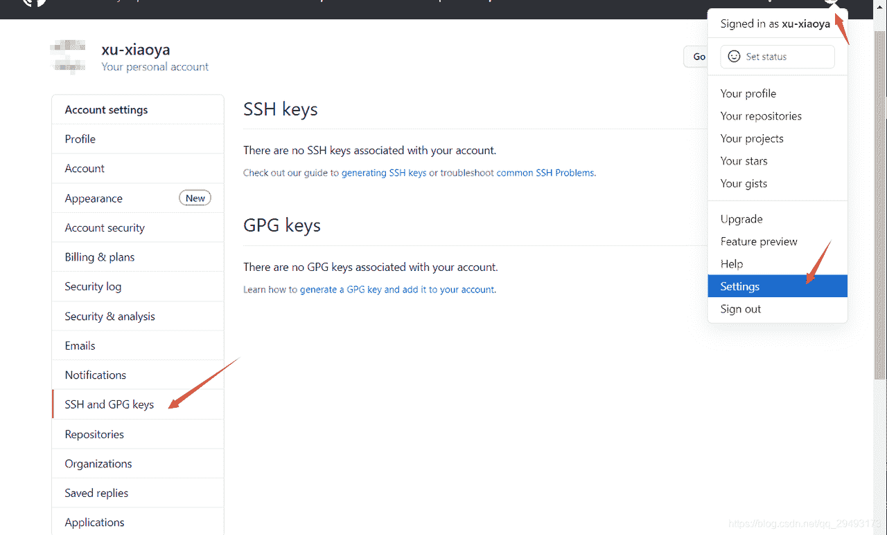

在`Github`上建一个仓库（登录后点击右上角的+号），就是前面`cursor`新建文件夹的名字（不要新建`README`，不要初始化）。

在`Cursor`终端进行`git`初始化（先全局配置你是谁）

```
git init #初始化仓库
git add . #添加所有文件到暂存区
git commit -m "v0.01" #提交更改
git remote add orgin https://github.com/你的GitHub用户名/你的GitHub仓库名.git #添加远程仓库
git push -u orgin main #推送到GitHub记得不要开代理
```

由于新建的远程仓库是空的，所以要加上`-u`这个参数

```
git push -u origin master
```

之后仓库不是空的，就不用加上`-u`

```
git push origin master
```

上传项目的过程可能需要等一段时间……

——————————————————

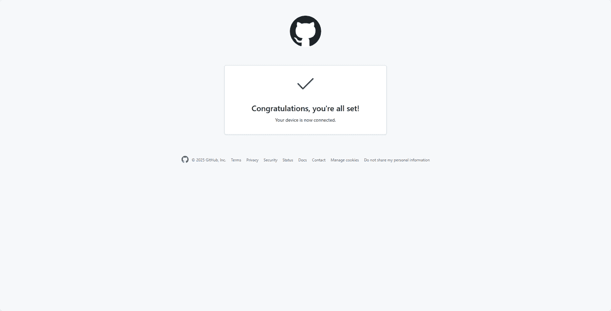

版权声明：本文为博主原创文章，遵循 CC 4.0 BY-SA 版权协议，转载请附上原文出处链接和本声明。

原文链接：https://blog.csdn.net/qq_29493173/article/details/113094143

### 还有在Figma插件社区中，有一个可以实现将html转化成design的插件，叫做`html.to.design`。

不知道怎么接，先放在这里吧，因为不知道网页怎么部署。

### cursor开启 agent 模式，指定要写入的figma文件，并提出相对应的要求。

搭配 `react` 、`vue` 、`v0`、可画、创客贴、`gemini`等后期有时间会尝试。

## 五、参考文献

【1】https://mp.weixin.qq.com/s/joPcgoxnAf2hRQU7RXu53Q

【2】https://mp.weixin.qq.com/s/rHqGwjlFyU6dKh3wl3cLZg

【3】https://mp.weixin.qq.com/s/Ym4iSVTc75iqQB_5wz-JUw

【4】https://blog.csdn.net/qq_29493173/article/details/113094143


【5】`https://blog.csdn.net/qq_29493173/article/details/113094143`

【6】`https://blog.csdn.net/m0_68116052/article/details/142832657`
