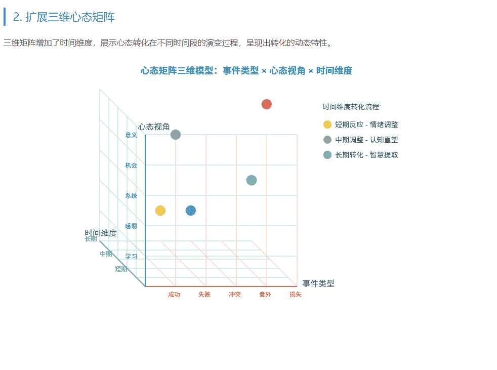
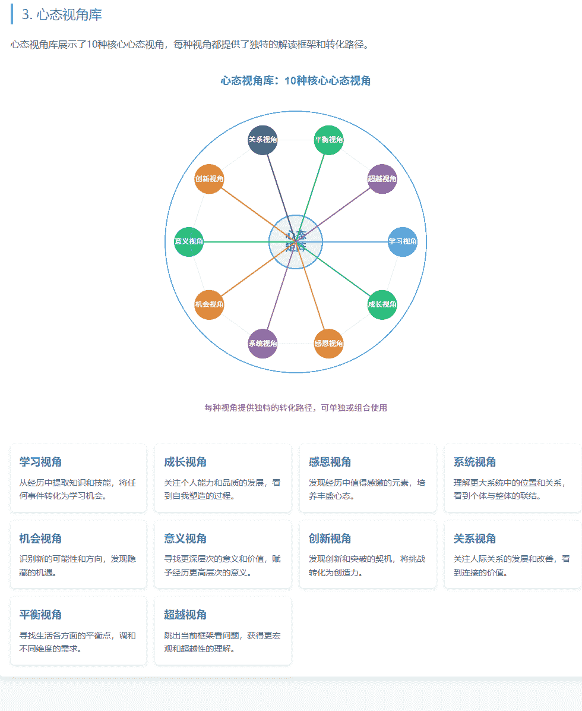
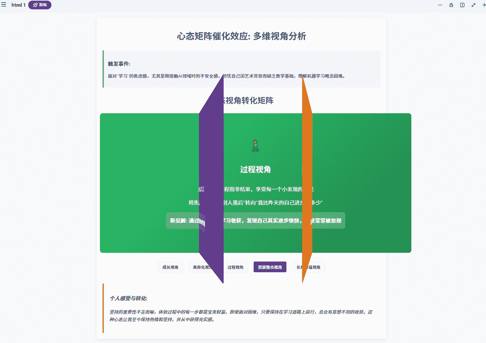
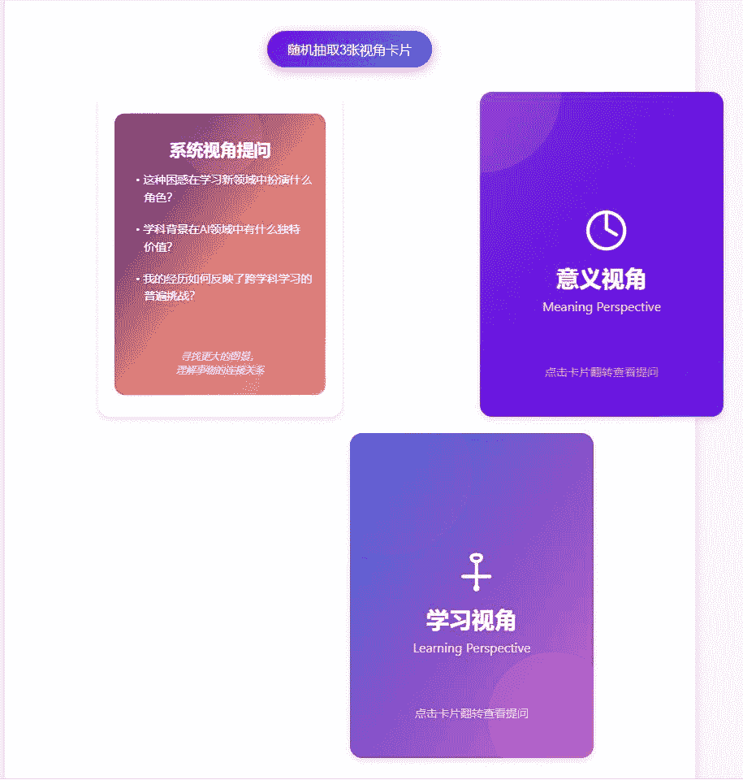
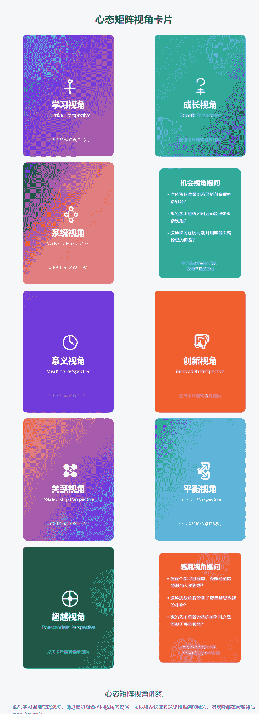
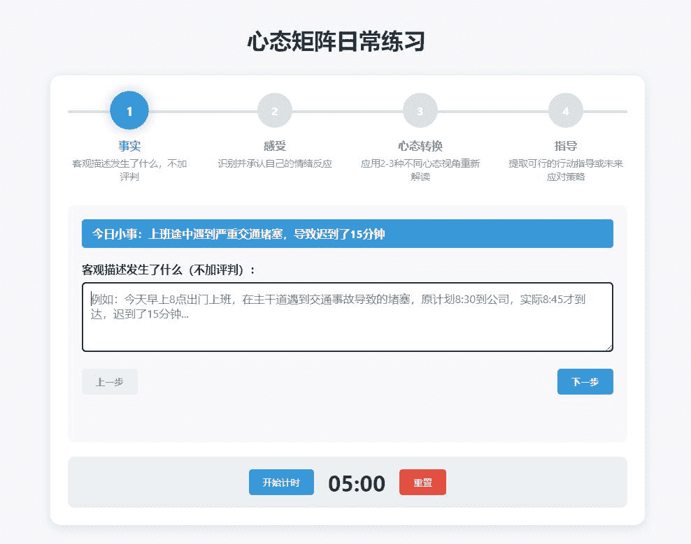
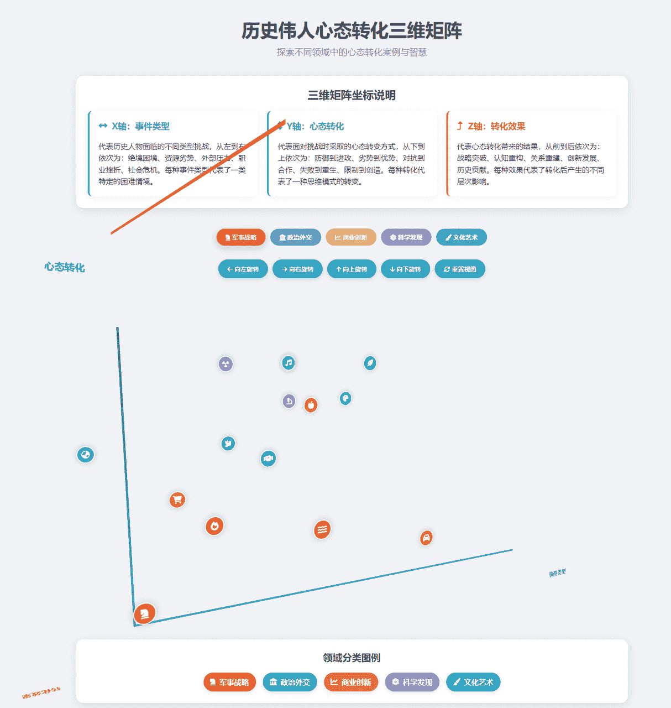
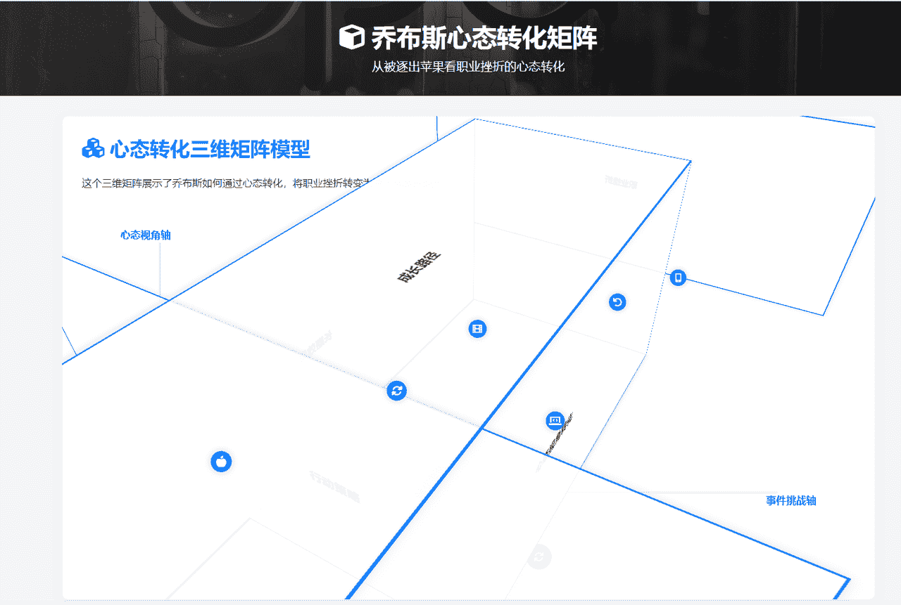
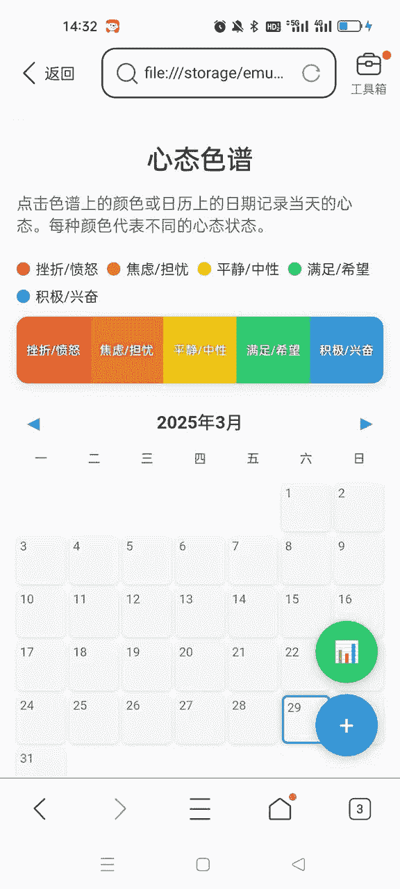

# 心态矩阵催化效应的具象化与实践体系

> 来源：[https://datawhaler.feishu.cn/docx/QlKTdxxp9ortaBxXbcwcpIBcnGh](https://datawhaler.feishu.cn/docx/QlKTdxxp9ortaBxXbcwcpIBcnGh)

#

将心态矩阵催化效应具象化是一个从抽象概念转变为具体可操作的方法论。它不仅是一种思维工具，更是一种生活哲学，帮助我们在复杂多变的世界中保持心理弹性和成长动力。通过这种方法，即使是最困难的经历也能转化为宝贵的指导资源，让我们在未来的道路上走得更加从容和智慧。

"巧妙而恰当的心态催化矩阵"可以帮助我们重新定义经历的意义，从而改变我们与过去和未来的关系。这不是简单的积极思考，而是一种更深层次的转化能力，让我们能够从任何经历中提取价值和智慧。

# 一、心态矩阵催化效应的理论基础

### 1.1 核心定义

心态矩阵催化效应是指通过多维度的心态转换，将经历(尤其是负面经历)转化为积极指导的系统性思维过程。它基于矩阵思维，将事件与心态视角作为不同维度，探索它们之间的交互作用及转化路径。

### 1.2 理论支撑

+   认知重评理论 ：人对事件的情绪反应主要来自对事件的解释而非事件本身

+   心理韧性研究 ：逆境中的成长机制与心态转换密切相关

+   系统思维理论 ：事件与反应之间存在复杂的多维关系网络

+   叙事治疗理论 ：通过重新叙述经历来改变其意义和影响

### 1.3 核心假设

1.  任何经历都可以通过适当的心态转换产生积极价值

1.  心态转换的效果可以被系统化记录和分析

1.  个体可以通过练习提高心态转换的能力

1.  不同类型的经历适合不同的心态转换路径

# 二、心态矩阵的具象化模型

### 2.1 基础矩阵结构

二维基础矩阵 ：

+   横轴：事件类型（成功、失败、冲突、意外、损失等）

+   纵轴：心态视角（学习视角、感恩视角、系统视角、机会视角等）

+   矩阵单元：特定事件在特定心态下的转化路径和价值提取


代码示例

```
&lt;!DOCTYPE html&gt;
&lt;html lang=&quot;zh&quot;&gt;
&lt;head&gt;
    &lt;meta charset=&quot;UTF-8&quot;&gt;
    &lt;meta name=&quot;viewport&quot; content=&quot;width=device-width, initial-scale=1.0&quot;&gt;
    &lt;title&gt;心态矩阵催化效应可视化&lt;/title&gt;
    &lt;style&gt;
        body {
            font-family: &#x27;Microsoft YaHei&#x27;, Arial, sans-serif;
            line-height: 1.6;
            color: #333;
            max-width: 1000px;
            margin: 0 auto;
            padding: 20px;
            background-color: #f9f9f9;
        }
        h1, h2 {
            color: #2c3e50;
        }
        h1 {
            text-align: center;
            margin-bottom: 30px;
            border-bottom: 2px solid #3498db;
            padding-bottom: 15px;
        }
        .matrix-container {
            margin: 40px 0;
            background: white;
            border-radius: 8px;
            padding: 20px;
            box-shadow: 0 4px 12px rgba(0,0,0,0.1);
        }
        .matrix-title {
            font-size: 22px;
            margin-bottom: 20px;
            color: #2980b9;
            border-left: 4px solid #3498db;
            padding-left: 15px;
        }
        .description {
            margin-bottom: 20px;
            font-size: 16px;
            color: #555;
        }
        canvas {
            display: block;
            margin: 0 auto;
            background: white;
        }
        .perspective-library {
            margin-top: 40px;
            display: grid;
            grid-template-columns: repeat(auto-fill, minmax(220px, 1fr));
            gap: 15px;
        }
        .perspective {
            padding: 15px;
            border-radius: 6px;
            background: white;
            box-shadow: 0 2px 6px rgba(0,0,0,0.1);
            transition: all 0.3s ease;
        }
        .perspective:hover {
            transform: translateY(-5px);
            box-shadow: 0 6px 12px rgba(0,0,0,0.15);
        }
        .perspective h3 {
            color: #2980b9;
            margin-top: 0;
            margin-bottom: 10px;
            font-size: 18px;
        }
        .perspective p {
            margin: 0;
            font-size: 14px;
            color: #666;
        }
        @media (max-width: 768px) {
            canvas {
                max-width: 100%;
                height: auto;
            }
            .perspective-library {
                grid-template-columns: repeat(auto-fill, minmax(150px, 1fr));
            }
        }
    &lt;/style&gt;
&lt;/head&gt;
&lt;body&gt;
    &lt;h1&gt;心态矩阵催化效应可视化&lt;/h1&gt;
    
    &lt;div class=&quot;matrix-container&quot;&gt;
        &lt;div class=&quot;matrix-title&quot;&gt;1. 基础二维心态矩阵&lt;/div&gt;
        &lt;div class=&quot;description&quot;&gt;
            二维基础矩阵将事件类型与心态视角相结合，形成一个转化矩阵，帮助我们从不同角度解读各类经历。
        &lt;/div&gt;
        &lt;canvas id=&quot;basicMatrix&quot; width=&quot;800&quot; height=&quot;500&quot;&gt;&lt;/canvas&gt;
    &lt;/div&gt;
    
    &lt;div class=&quot;matrix-container&quot;&gt;
        &lt;div class=&quot;matrix-title&quot;&gt;2. 扩展三维心态矩阵&lt;/div&gt;
        &lt;div class=&quot;description&quot;&gt;
            三维矩阵增加了时间维度，展示心态转化在不同时间段的演变过程，呈现出转化的动态特性。
        &lt;/div&gt;
        &lt;canvas id=&quot;3dMatrix&quot; width=&quot;800&quot; height=&quot;600&quot;&gt;&lt;/canvas&gt;
    &lt;/div&gt;
    
    &lt;div class=&quot;matrix-container&quot;&gt;
        &lt;div class=&quot;matrix-title&quot;&gt;3. 心态视角库&lt;/div&gt;
        &lt;div class=&quot;description&quot;&gt;
            心态视角库展示了10种核心心态视角，每种视角都提供了独特的解读框架和转化路径。
        &lt;/div&gt;
        &lt;canvas id=&quot;perspectiveLibrary&quot; width=&quot;800&quot; height=&quot;600&quot;&gt;&lt;/canvas&gt;
        
        &lt;div class=&quot;perspective-library&quot;&gt;
            &lt;div class=&quot;perspective&quot;&gt;
                &lt;h3&gt;学习视角&lt;/h3&gt;
                &lt;p&gt;从经历中提取知识和技能，将任何事件转化为学习机会。&lt;/p&gt;
            &lt;/div&gt;
            &lt;div class=&quot;perspective&quot;&gt;
                &lt;h3&gt;成长视角&lt;/h3&gt;
                &lt;p&gt;关注个人能力和品质的发展，看到自我塑造的过程。&lt;/p&gt;
            &lt;/div&gt;
            &lt;div class=&quot;perspective&quot;&gt;
                &lt;h3&gt;感恩视角&lt;/h3&gt;
                &lt;p&gt;发现经历中值得感激的元素，培养丰盛心态。&lt;/p&gt;
            &lt;/div&gt;
            &lt;div class=&quot;perspective&quot;&gt;
                &lt;h3&gt;系统视角&lt;/h3&gt;
                &lt;p&gt;理解更大系统中的位置和关系，看到个体与整体的联结。&lt;/p&gt;
            &lt;/div&gt;
            &lt;div class=&quot;perspective&quot;&gt;
                &lt;h3&gt;机会视角&lt;/h3&gt;
                &lt;p&gt;识别新的可能性和方向，发现隐藏的机遇。&lt;/p&gt;
            &lt;/div&gt;
            &lt;div class=&quot;perspective&quot;&gt;
                &lt;h3&gt;意义视角&lt;/h3&gt;
                &lt;p&gt;寻找更深层次的意义和价值，赋予经历更高层次的意义。&lt;/p&gt;
            &lt;/div&gt;
            &lt;div class=&quot;perspective&quot;&gt;
                &lt;h3&gt;创新视角&lt;/h3&gt;
                &lt;p&gt;发现创新和突破的契机，将挑战转化为创造力。&lt;/p&gt;
            &lt;/div&gt;
            &lt;div class=&quot;perspective&quot;&gt;
                &lt;h3&gt;关系视角&lt;/h3&gt;
                &lt;p&gt;关注人际关系的发展和改善，看到连接的价值。&lt;/p&gt;
            &lt;/div&gt;
            &lt;div class=&quot;perspective&quot;&gt;
                &lt;h3&gt;平衡视角&lt;/h3&gt;
                &lt;p&gt;寻找生活各方面的平衡点，调和不同维度的需求。&lt;/p&gt;
            &lt;/div&gt;
            &lt;div class=&quot;perspective&quot;&gt;
                &lt;h3&gt;超越视角&lt;/h3&gt;
                &lt;p&gt;跳出当前框架看问题，获得更宏观和超越性的理解。&lt;/p&gt;
            &lt;/div&gt;
        &lt;/div&gt;
    &lt;/div&gt;

    &lt;script&gt;
        // 基础矩阵绘制
        function drawBasicMatrix() {
            const canvas = document.getElementById(&#x27;basicMatrix&#x27;);
            const ctx = canvas.getContext(&#x27;2d&#x27;);
            
            // 设置坐标系
            ctx.clearRect(0, 0, canvas.width, canvas.height);
            
            const margin = { top: 60, right: 40, bottom: 60, left: 80 };
            const width = canvas.width - margin.left - margin.right;
            const height = canvas.height - margin.top - margin.bottom;
            
            // 心态视角（纵轴）
            const perspectives = [&#x27;学习视角&#x27;, &#x27;感恩视角&#x27;, &#x27;系统视角&#x27;, &#x27;机会视角&#x27;, &#x27;意义视角&#x27;];
            
            // 事件类型（横轴）
            const events = [&#x27;成功&#x27;, &#x27;失败&#x27;, &#x27;冲突&#x27;, &#x27;意外&#x27;, &#x27;损失&#x27;];
            
            const cellWidth = width / events.length;
            const cellHeight = height / perspectives.length;
            
            // 绘制网格
            ctx.beginPath();
            ctx.strokeStyle = &#x27;#ddd&#x27;;
            
            // 绘制垂直线
            for (let i = 0; i &lt;= events.length; i++) {
                const x = margin.left + i * cellWidth;
                ctx.moveTo(x, margin.top);
                ctx.lineTo(x, margin.top + height);
            }
            
            // 绘制水平线
            for (let i = 0; i &lt;= perspectives.length; i++) {
                const y = margin.top + i * cellHeight;
                ctx.moveTo(margin.left, y);
                ctx.lineTo(margin.left + width, y);
            }
            
            ctx.stroke();
            
            // 绘制标签
            ctx.fillStyle = &#x27;#2c3e50&#x27;;
            ctx.font = &#x27;14px Arial&#x27;;
            ctx.textAlign = &#x27;center&#x27;;
            
            // 绘制横轴标签（事件类型）
            for (let i = 0; i &lt; events.length; i++) {
                const x = margin.left + i * cellWidth + cellWidth / 2;
                ctx.fillText(events[i], x, margin.top - 15);
            }
            
            // 绘制纵轴标签（心态视角）
            ctx.textAlign = &#x27;right&#x27;;
            for (let i = 0; i &lt; perspectives.length; i++) {
                const y = margin.top + i * cellHeight + cellHeight / 2;
                ctx.fillText(perspectives[i], margin.left - 10, y + 5);
            }
            
            // 绘制坐标轴标题
            ctx.font = &#x27;16px Arial&#x27;;
            ctx.textAlign = &#x27;center&#x27;;
            ctx.fillText(&#x27;事件类型&#x27;, margin.left + width / 2, margin.top + height + 40);
            
            ctx.save();
            ctx.translate(margin.left - 50, margin.top + height / 2);
            ctx.rotate(-Math.PI / 2);
            ctx.fillText(&#x27;心态视角&#x27;, 0, 0);
            ctx.restore();
            
            // 绘制单元格内容（用不同颜色表示）
            const colors = [
                [&#x27;#e6f7ff&#x27;, &#x27;#bae7ff&#x27;, &#x27;#91d5ff&#x27;, &#x27;#69c0ff&#x27;, &#x27;#40a9ff&#x27;],
                [&#x27;#f6ffed&#x27;, &#x27;#d9f7be&#x27;, &#x27;#b7eb8f&#x27;, &#x27;#95de64&#x27;, &#x27;#73d13d&#x27;],
                [&#x27;#fff7e6&#x27;, &#x27;#ffe7ba&#x27;, &#x27;#ffd591&#x27;, &#x27;#ffc069&#x27;, &#x27;#ffa940&#x27;],
                [&#x27;#fff0f6&#x27;, &#x27;#ffd6e7&#x27;, &#x27;#ffadd2&#x27;, &#x27;#ff85c0&#x27;, &#x27;#f759ab&#x27;],
                [&#x27;#f9f0ff&#x27;, &#x27;#efdbff&#x27;, &#x27;#d3adf7&#x27;, &#x27;#b37feb&#x27;, &#x27;#9254de&#x27;]
            ];
            
            for (let i = 0; i &lt; perspectives.length; i++) {
                for (let j = 0; j &lt; events.length; j++) {
                    const x = margin.left + j * cellWidth;
                    const y = margin.top + i * cellHeight;
                    
                    ctx.fillStyle = colors[i][j];
                    ctx.fillRect(x, y, cellWidth, cellHeight);
                    
                    // 添加转化路径简短文本
                    ctx.fillStyle = &#x27;#555&#x27;;
                    ctx.font = &#x27;12px Arial&#x27;;
                    ctx.textAlign = &#x27;center&#x27;;
                    ctx.fillText(&#x27;转化路径&#x27;, x + cellWidth / 2, y + cellHeight / 2);
                }
            }
            
            // 添加矩阵标题
            ctx.font = &#x27;bold 18px Arial&#x27;;
            ctx.textAlign = &#x27;center&#x27;;
            ctx.fillStyle = &#x27;#2980b9&#x27;;
            ctx.fillText(&#x27;心态矩阵基础模型：事件类型 × 心态视角&#x27;, canvas.width / 2, 30);
        }
        
        // 3D矩阵绘制（模拟3D效果）
        function draw3DMatrix() {
            const canvas = document.getElementById(&#x27;3dMatrix&#x27;);
            const ctx = canvas.getContext(&#x27;2d&#x27;);
            
            ctx.clearRect(0, 0, canvas.width, canvas.height);
            
            // 设置3D坐标原点和尺寸
            const originX = 200;
            const originY = 450;
            const axisLength = 300;
            const perspective = 0.3; // 透视效果
            
            // 绘制3D坐标轴
            // X轴 - 事件类型
            ctx.beginPath();
            ctx.moveTo(originX, originY);
            ctx.lineTo(originX + axisLength, originY);
            ctx.strokeStyle = &#x27;#e74c3c&#x27;;
            ctx.lineWidth = 2;
            ctx.stroke();
            
            // Y轴 - 心态视角
            ctx.beginPath();
            ctx.moveTo(originX, originY);
            ctx.lineTo(originX, originY - axisLength);
            ctx.strokeStyle = &#x27;#3498db&#x27;;
            ctx.lineWidth = 2;
            ctx.stroke();
            
            // Z轴 - 时间维度
            ctx.beginPath();
            ctx.moveTo(originX, originY);
            ctx.lineTo(originX - axisLength * perspective, originY - axisLength * perspective);
            ctx.strokeStyle = &#x27;#2ecc71&#x27;;
            ctx.lineWidth = 2;
            ctx.stroke();
            
            // 添加坐标轴标签
            ctx.font = &#x27;16px Arial&#x27;;
            ctx.fillStyle = &#x27;#2c3e50&#x27;;
            
            // X轴标签
            ctx.fillText(&#x27;事件类型&#x27;, originX + axisLength + 10, originY);
            
            // Y轴标签
            ctx.fillText(&#x27;心态视角&#x27;, originX - 15, originY - axisLength - 10);
            
            // Z轴标签
            ctx.fillText(&#x27;时间维度&#x27;, originX - axisLength * perspective - 30, originY - axisLength * perspective - 10);
            
            // 绘制3D网格
            const steps = 5;
            const stepX = axisLength / steps;
            const stepY = axisLength / steps;
            const stepZ = axisLength / steps;
            
            // Z轴网格线
            for (let i = 1; i &lt;= steps; i++) {
                // 绘制Z轴上的点
                const z = i * stepZ;
                const zX = originX - z * perspective;
                const zY = originY - z * perspective;
                
                // Z-X平面
                ctx.beginPath();
                ctx.moveTo(zX, zY);
                ctx.lineTo(zX + axisLength, zY);
                ctx.strokeStyle = &#x27;rgba(46, 204, 113, 0.2)&#x27;;
                ctx.stroke();
                
                // Z-Y平面
                ctx.beginPath();
                ctx.moveTo(zX, zY);
                ctx.lineTo(zX, zY - axisLength);
                ctx.strokeStyle = &#x27;rgba(46, 204, 113, 0.2)&#x27;;
                ctx.stroke();
            }
            
            // X轴网格线
            for (let i = 1; i &lt;= steps; i++) {
                const x = i * stepX;
                
                // X-Y平面
                ctx.beginPath();
                ctx.moveTo(originX + x, originY);
                ctx.lineTo(originX + x, originY - axisLength);
                ctx.strokeStyle = &#x27;rgba(231, 76, 60, 0.2)&#x27;;
                ctx.stroke();
                
                // X-Z平面
                ctx.beginPath();
                ctx.moveTo(originX + x, originY);
                ctx.lineTo(originX + x - axisLength * perspective, originY - axisLength * perspective);
                ctx.strokeStyle = &#x27;rgba(231, 76, 60, 0.2)&#x27;;
                ctx.stroke();
            }
            
            // Y轴网格线
            for (let i = 1; i &lt;= steps; i++) {
                const y = i * stepY;
                
                // Y-X平面
                ctx.beginPath();
                ctx.moveTo(originX, originY - y);
                ctx.lineTo(originX + axisLength, originY - y);
                ctx.strokeStyle = &#x27;rgba(52, 152, 219, 0.2)&#x27;;
                ctx.stroke();
                
                // Y-Z平面
                ctx.beginPath();
                ctx.moveTo(originX, originY - y);
                ctx.lineTo(originX - axisLength * perspective, originY - y - axisLength * perspective);
                ctx.strokeStyle = &#x27;rgba(52, 152, 219, 0.2)&#x27;;
                ctx.stroke();
            }
            
            // 在坐标轴上标记刻度
            const timeLabels = [&#x27;短期&#x27;, &#x27;中期&#x27;, &#x27;长期&#x27;];
            const eventLabels = [&#x27;成功&#x27;, &#x27;失败&#x27;, &#x27;冲突&#x27;, &#x27;意外&#x27;, &#x27;损失&#x27;];
            const perspectiveLabels = [&#x27;学习&#x27;, &#x27;感恩&#x27;, &#x27;系统&#x27;, &#x27;机会&#x27;, &#x27;意义&#x27;];
            
            ctx.font = &#x27;12px Arial&#x27;;
            
            // 时间轴刻度
            for (let i = 1; i &lt;= 3; i++) {
                const z = i * stepZ * 5/3;
                const zX = originX - z * perspective;
                const zY = originY - z * perspective;
                
                ctx.fillStyle = &#x27;#2ecc71&#x27;;
                ctx.fillText(timeLabels[i-1], zX - 30, zY);
            }
            
            // 事件轴刻度
            for (let i = 1; i &lt;= 5; i++) {
                const x = i * stepX;
                ctx.fillStyle = &#x27;#e74c3c&#x27;;
                ctx.fillText(eventLabels[i-1], originX + x - 15, originY + 20);
            }
            
            // 视角轴刻度
            for (let i = 1; i &lt;= 5; i++) {
                const y = i * stepY;
                ctx.fillStyle = &#x27;#3498db&#x27;;
                ctx.fillText(perspectiveLabels[i-1], originX - 40, originY - y + 5);
            }
            
            // 绘制一些示例数据点
            const dataPoints = [
                {x: 1, y: 2, z: 1, color: &#x27;rgba(241, 196, 15, 0.8)&#x27;},
                {x: 2, y: 4, z: 2, color: &#x27;rgba(155, 89, 182, 0.8)&#x27;},
                {x: 3, y: 1, z: 3, color: &#x27;rgba(52, 152, 219, 0.8)&#x27;},
                {x: 4, y: 3, z: 1, color: &#x27;rgba(46, 204, 113, 0.8)&#x27;},
                {x: 5, y: 5, z: 2, color: &#x27;rgba(231, 76, 60, 0.8)&#x27;}
            ];
            
            // 绘制数据点
            for (const point of dataPoints) {
                const x = originX + point.x * stepX;
                const y = originY - point.y * stepY;
                const z = point.z * stepZ / 3 * 5;
                
                const px = x - z * perspective;
                const py = y - z * perspective;
                
                ctx.beginPath();
                ctx.arc(px, py, 10, 0, Math.PI * 2);
                ctx.fillStyle = point.color;
                ctx.fill();
                ctx.stroke();
            }
            
            // 添加图表标题
            ctx.font = &#x27;bold 18px Arial&#x27;;
            ctx.textAlign = &#x27;center&#x27;;
            ctx.fillStyle = &#x27;#2980b9&#x27;;
            ctx.fillText(&#x27;心态矩阵三维模型：事件类型 × 心态视角 × 时间维度&#x27;, canvas.width / 2, 30);
            
            // 添加图例
            const legendX = 550;
            const legendY = 100;
            
            ctx.font = &#x27;14px Arial&#x27;;
            ctx.textAlign = &#x27;left&#x27;;
            ctx.fillStyle = &#x27;#2c3e50&#x27;;
            ctx.fillText(&#x27;时间维度转化流程:&#x27;, legendX, legendY);
            
            ctx.fillStyle = &#x27;rgba(241, 196, 15, 0.8)&#x27;;
            ctx.beginPath();
            ctx.arc(legendX + 10, legendY + 30, 8, 0, Math.PI * 2);
            ctx.fill();
            ctx.fillStyle = &#x27;#2c3e50&#x27;;
            ctx.fillText(&#x27;短期反应 - 情绪调整&#x27;, legendX + 25, legendY + 35);
            
            ctx.fillStyle = &#x27;rgba(155, 89, 182, 0.8)&#x27;;
            ctx.beginPath();
            ctx.arc(legendX + 10, legendY + 60, 8, 0, Math.PI * 2);
            ctx.fill();
            ctx.fillStyle = &#x27;#2c3e50&#x27;;
            ctx.fillText(&#x27;中期调整 - 认知重塑&#x27;, legendX + 25, legendY + 65);
            
            ctx.fillStyle = &#x27;rgba(46, 204, 113, 0.8)&#x27;;
            ctx.beginPath();
            ctx.arc(legendX + 10, legendY + 90, 8, 0, Math.PI * 2);
            ctx.fill();
            ctx.fillStyle = &#x27;#2c3e50&#x27;;
            ctx.fillText(&#x27;长期转化 - 智慧提取&#x27;, legendX + 25, legendY + 95);
        }
        
        // 心态视角库可视化
        function drawPerspectiveLibrary() {
            const canvas = document.getElementById(&#x27;perspectiveLibrary&#x27;);
            const ctx = canvas.getContext(&#x27;2d&#x27;);
            
            ctx.clearRect(0, 0, canvas.width, canvas.height);
            
            const centerX = canvas.width / 2;
            const centerY = canvas.height / 2;
            const radius = 180;
            
            // 定义10个心态视角
            const perspectives = [
                { name: &#x27;学习视角&#x27;, color: &#x27;#3498db&#x27; },
                { name: &#x27;成长视角&#x27;, color: &#x27;#2ecc71&#x27; },
                { name: &#x27;感恩视角&#x27;, color: &#x27;#f1c40f&#x27; },
                { name: &#x27;系统视角&#x27;, color: &#x27;#9b59b6&#x27; },
                { name: &#x27;机会视角&#x27;, color: &#x27;#e67e22&#x27; },
                { name: &#x27;意义视角&#x27;, color: &#x27;#1abc9c&#x27; },
                { name: &#x27;创新视角&#x27;, color: &#x27;#e74c3c&#x27; },
                { name: &#x27;关系视角&#x27;, color: &#x27;#34495e&#x27; },
                { name: &#x27;平衡视角&#x27;, color: &#x27;#27ae60&#x27; },
                { name: &#x27;超越视角&#x27;, color: &#x27;#8e44ad&#x27; }
            ];
            
            // 绘制中心圆
            ctx.beginPath();
            ctx.arc(centerX, centerY, radius/4, 0, Math.PI * 2);
            ctx.fillStyle = &#x27;rgba(52, 152, 219, 0.1)&#x27;;
            ctx.fill();
            ctx.strokeStyle = &#x27;#3498db&#x27;;
            ctx.lineWidth = 2;
            ctx.stroke();
            
            // 在中心圆中绘制文字
            ctx.font = &#x27;bold 18px Arial&#x27;;
            ctx.fillStyle = &#x27;#2980b9&#x27;;
            ctx.textAlign = &#x27;center&#x27;;
            ctx.textBaseline = &#x27;middle&#x27;;
            ctx.fillText(&#x27;心态&#x27;, centerX, centerY - 10);
            ctx.fillText(&#x27;矩阵&#x27;, centerX, centerY + 10);
            
            // 绘制视角点和连线
            const numPerspectives = perspectives.length;
            const angleStep = (Math.PI * 2) / numPerspectives;
            
            for (let i = 0; i &lt; numPerspectives; i++) {
                const angle = i * angleStep;
                const x = centerX + radius * Math.cos(angle);
                const y = centerY + radius * Math.sin(angle);
                
                // 绘制连线
                ctx.beginPath();
                ctx.moveTo(centerX, centerY);
                ctx.lineTo(x, y);
                ctx.strokeStyle = perspectives[i].color;
                ctx.lineWidth = 2;
                ctx.stroke();
                
                // 绘制视角点
                ctx.beginPath();
                ctx.arc(x, y, 25, 0, Math.PI * 2);
                ctx.fillStyle = perspectives[i].color;
                ctx.fill();
                
                // 绘制标签
                ctx.font = &#x27;12px Arial&#x27;;
                ctx.fillStyle = &#x27;#fff&#x27;;
                ctx.textAlign = &#x27;center&#x27;;
                ctx.textBaseline = &#x27;middle&#x27;;
                
                // 将长标签分成两行
                if (perspectives[i].name.length &gt; 4) {
                    const parts = perspectives[i].name.split(&#x27;视角&#x27;);
                    ctx.fillText(parts[0], x, y - 5);
                    ctx.fillText(&#x27;视角&#x27;, x, y + 10);
                } else {
                    ctx.fillText(perspectives[i].name, x, y);
                }
                
                // 绘制外层圆环
                ctx.beginPath();
                ctx.arc(centerX, centerY, radius + 40, 0, Math.PI * 2);
                ctx.strokeStyle = &#x27;rgba(52, 152, 219, 0.3)&#x27;;
                ctx.lineWidth = 1;
                ctx.stroke();
            }
            
            // 绘制次要连接（视角间的关系）
            for (let i = 0; i &lt; numPerspectives; i++) {
                const angle1 = i * angleStep;
                const x1 = centerX + radius * Math.cos(angle1);
                const y1 = centerY + radius * Math.sin(angle1);
                
                for (let j = i + 1; j &lt; numPerspectives; j++) {
                    // 只连接相邻或者有特定关系的视角
                    if (j === (i + 1) % numPerspectives || j === (i + 5) % numPerspectives) {
                        const angle2 = j * angleStep;
                        const x2 = centerX + radius * Math.cos(angle2);
                        const y2 = centerY + radius * Math.sin(angle2);
                        
                        ctx.beginPath();
                        ctx.moveTo(x1, y1);
                        ctx.lineTo(x2, y2);
                        ctx.strokeStyle = &#x27;rgba(189, 195, 199, 0.3)&#x27;;
                        ctx.lineWidth = 1;
                        ctx.stroke();
                    }
                }
            }
            
            // 添加图表标题
            ctx.font = &#x27;bold 18px Arial&#x27;;
            ctx.textAlign = &#x27;center&#x27;;
            ctx.fillStyle = &#x27;#2980b9&#x27;;
            ctx.fillText(&#x27;心态视角库：10种核心心态视角&#x27;, canvas.width / 2, 30);
            
            // 添加图表说明
            ctx.font = &#x27;14px Arial&#x27;;
            ctx.fillStyle = &#x27;#7f8c8d&#x27;;
            ctx.fillText(&#x27;每种视角提供独特的转化路径，可单独或组合使用&#x27;, canvas.width / 2, canvas.height - 20);
        }
        
        // 页面加载后绘制所有图表
        window.onload = function() {
            drawBasicMatrix();
            draw3DMatrix();
            drawPerspectiveLibrary();
        };
    &lt;/script&gt;
&lt;/body&gt;
&lt;/html&gt;
```

### 2.2 扩展三维矩阵

+   横轴：事件类型

+   纵轴：心态视角

+   深度轴：时间维度（短期反应、中期调整、长期转化）

+   矩阵单元：在不同时间段内的转化过程和成果



### 2.3 心态视角库

1.  学习视角 ：从经历中提取知识和技能

1.  成长视角 ：关注个人能力和品质的发展

1.  感恩视角 ：发现经历中值得感激的元素

1.  系统视角 ：理解更大系统中的位置和关系

1.  机会视角 ：识别新的可能性和方向

1.  意义视角 ：寻找更深层次的意义和价值

1.  创新视角 ：发现创新和突破的契机

1.  关系视角 ：关注人际关系的发展和改善

1.  平衡视角 ：寻找生活各方面的平衡点

1.  超越视角 ：跳出当前框架看问题



# 三、记录与分析的必要性

### 3.1 记录的价值

记录心态矩阵催化过程具有重要价值：

1.  克服认知偏差 ：人脑容易遗忘和美化过去，记录提供客观参照

1.  发现个人模式 ：长期记录可以发现个人特有的心态转换模式

1.  加深转化效果 ：书写本身是一种深度加工，强化转化效果

1.  建立参考库 ：积累个人的心态转换案例库，便于未来参考

1.  促进元认知 ：提高对自己思维过程的觉察和理解

### 3.2 记录的形式

记录不必过于复杂，可以根据个人习惯选择：

1.  结构化日志 ：使用预设模板记录转化过程

1.  图表可视化 ：使用矩阵图表直观展示转化路径

1.  语音记录 ：口述转化过程，后期整理

1.  数字化工具 ：使用专门的应用程序或表格

1.  简化记录 ：仅记录关键事件和主要转化路径

### 3.3 分析的方法

定期分析记录可以发现更深层次的模式：

1.  模式识别 ：发现最常用和最有效的心态转换路径

1.  效果评估 ：评估不同转化路径的长期效果

1.  个性化调整 ：根据分析结果调整个人的转化策略

1.  成长轨迹 ：观察心态转换能力的发展变化

# 四、心态矩阵催化效应的实践体系

## 4.1 入门阶段：基础练习

### 1. 单一事件多视角分析：

选择事件 ：面对"学习"的焦虑感，尤其是刚接触AI领域时的不安全感，担忧自己因其他学科背景（与AI技术无相关的学科）而缺乏数学基础，理解机器学习概念困难。

从5个不同心态视角分析 ：

1.  成长视角 ：

+   将焦虑视为成长必经的信号，表明你正在拓展舒适区

+   每个人学习新领域都会经历这种不适感，这恰恰证明你在进步

+   新见解：焦虑不是障碍，而是成长的指示灯，它提醒我正在经历有意义的挑战

1.  差异化视角 ：

+   其他学科背景不是劣势，而是独特优势，提供了不同于理工科学生的思维方式

+   跨领域学习者往往能发现常规思维者看不到的创新点

+   新见解：我的学科背景可能让我在AI的创意应用、用户体验等方面有独特洞察

1.  过程视角 ：

+   关注学习过程而非结果，享受每一个小发现的喜悦

+   将焦点从"我比别人落后"转向"我比昨天的自己进步了多少"

+   新见解：通过记录每日学习收获，发现自己其实进步很快，只是常常被忽视

1.  资源整合视角 ：

+   将焦虑转化为寻找更有效学习方法的动力

+   识别自己的学习风格，寻找适合艺术思维者的学习资源

+   新见解：发现通过可视化学习和实践项目，我比纯理论学习效果更好

1.  长期价值视角 ：

+   将当前的困难放在更长的时间线上看

+   思考跨领域知识在未来的独特价值

+   新见解：自身学科与AI的结合正成为新兴领域，我的"短板"可能是未来的"长板"

记录的个人感受 ：坚持的重要性不言而喻，体验过程中的每一步都是宝贵财富。即使面对困难，只要保持在学习道路上前行，总会有意想不到的收获。这种心态让我至今保持热情和坚持，并从中获得充实感。

```
&lt;!DOCTYPE html&gt;
&lt;html lang=&quot;zh-CN&quot;&gt;
&lt;head&gt;
    &lt;meta charset=&quot;UTF-8&quot;&gt;
    &lt;meta name=&quot;viewport&quot; content=&quot;width=device-width, initial-scale=1.0&quot;&gt;
    &lt;title&gt;心态矩阵催化效应可视化&lt;/title&gt;
    &lt;style&gt;
        body {
            font-family: &#x27;Segoe UI&#x27;, Tahoma, Geneva, Verdana, sans-serif;
            margin: 0;
            padding: 20px;
            background-color: #f8f9fa;
            color: #333;
        }
        
        .container {
            max-width: 1000px;
            margin: 0 auto;
            background-color: white;
            border-radius: 8px;
            box-shadow: 0 4px 12px rgba(0,0,0,0.1);
            padding: 20px;
        }
        
        h1 {
            text-align: center;
            color: #2c3e50;
            margin-bottom: 30px;
        }
        
        .event-box {
            background-color: #f1f7fe;
            border-left: 5px solid #3498db;
            padding: 15px;
            margin-bottom: 20px;
            border-radius: 4px;
        }
        
        #visualization-container {
            width: 100%;
            height: 450px;
            position: relative;
            margin: 30px 0;
            perspective: 1000px;
        }
        
        #perspective-cube {
            width: 100%;
            height: 100%;
            position: relative;
            transform-style: preserve-3d;
            transition: transform 1s;
        }
        
        .perspective-face {
            position: absolute;
            width: 90%;
            height: 90%;
            display: flex;
            flex-direction: column;
            justify-content: center;
            align-items: center;
            padding: 20px;
            box-sizing: border-box;
            border-radius: 8px;
            backface-visibility: hidden;
            transition: all 0.4s;
            cursor: pointer;
            overflow: hidden;
        }
        
        .perspective-face:hover {
            transform: scale(1.02);
            box-shadow: 0 8px 25px rgba(0,0,0,0.15);
        }
        
        .perspective-face h3 {
            font-size: 1.4rem;
            margin-bottom: 15px;
            color: white;
            text-align: center;
        }
        
        .perspective-content {
            color: white;
            text-align: center;
            line-height: 1.6;
            font-size: 0.95rem;
        }
        
        .insight {
            margin-top: 15px;
            padding: 12px;
            background-color: rgba(255,255,255,0.2);
            border-radius: 6px;
            font-weight: bold;
        }
        
        .face-growth {
            background: linear-gradient(135deg, #4b6cb7, #182848);
            transform: translateZ(225px);
        }
        
        .face-difference {
            background: linear-gradient(135deg, #8e44ad, #5b2c6f);
            transform: rotateY(72deg) translateZ(225px);
        }
        
        .face-process {
            background: linear-gradient(135deg, #2ecc71, #1e8449);
            transform: rotateY(144deg) translateZ(225px);
        }
        
        .face-resource {
            background: linear-gradient(135deg, #e67e22, #d35400);
            transform: rotateY(-144deg) translateZ(225px);
        }
        
        .face-longterm {
            background: linear-gradient(135deg, #e74c3c, #922b21);
            transform: rotateY(-72deg) translateZ(225px);
        }
        
        .control-panel {
            display: flex;
            justify-content: center;
            margin-top: 20px;
            flex-wrap: wrap;
            gap: 10px;
        }
        
        .perspective-button {
            background-color: #f8f9fa;
            border: 1px solid #ddd;
            padding: 8px 15px;
            margin: 0 5px;
            cursor: pointer;
            border-radius: 4px;
            transition: all 0.3s;
            font-size: 0.9rem;
        }
        
        .perspective-button:hover {
            background-color: #e9ecef;
        }
        
        .perspective-button.active {
            background-color: #007bff;
            color: white;
            border-color: #007bff;
        }
        
        .reflection-box {
            background-color: #fdf9f3;
            border-left: 5px solid #f39c12;
            padding: 20px;
            margin-top: 40px;
            border-radius: 4px;
            font-style: italic;
            line-height: 1.7;
        }
        
        .visualization-title {
            text-align: center;
            font-size: 1.2rem;
            margin-bottom: 15px;
            color: #555;
        }
        
        .mobile-message {
            display: none;
            text-align: center;
            padding: 10px;
            background-color: #e3f2fd;
            margin: 10px 0;
            border-radius: 4px;
        }
        
        .icon {
            font-size: 2rem;
            margin-bottom: 10px;
        }

        @media (max-width: 768px) {
            .mobile-message {
                display: block;
            }
            #visualization-container {
                height: 380px;
            }
            .perspective-face {
                width: 85%;
                height: 85%;
                font-size: 0.9rem;
            }
            .perspective-face h3 {
                font-size: 1.2rem;
            }
            .perspective-content {
                font-size: 0.85rem;
            }
        }
        
        @media (max-width: 480px) {
            #visualization-container {
                height: 340px;
            }
            .perspective-face {
                width: 80%;
                height: 80%;
                padding: 15px;
            }
            .perspective-face h3 {
                font-size: 1.1rem;
                margin-bottom: 10px;
            }
            .perspective-content {
                font-size: 0.8rem;
            }
            .insight {
                padding: 8px;
                margin-top: 10px;
            }
        }
    &lt;/style&gt;
&lt;/head&gt;
&lt;body&gt;
    &lt;div class=&quot;container&quot;&gt;
        &lt;h1&gt;心态矩阵催化效应: 多维视角分析&lt;/h1&gt;
        
        &lt;div class=&quot;event-box&quot;&gt;
            &lt;h3&gt;触发事件:&lt;/h3&gt;
            &lt;p&gt;面对&quot;学习&quot;的焦虑感，尤其是刚接触AI领域时的不安全感，担忧自己因艺术背景而缺乏数学基础，理解机器学习概念困难。&lt;/p&gt;
        &lt;/div&gt;
        
        &lt;div class=&quot;visualization-title&quot;&gt;
            &lt;h2&gt;心态视角转化矩阵&lt;/h2&gt;
            &lt;p&gt;点击下方按钮切换不同视角，或直接点击矩阵面查看详情&lt;/p&gt;
        &lt;/div&gt;
        
        &lt;div class=&quot;mobile-message&quot;&gt;
            在移动设备上，您可以通过按钮切换视角
        &lt;/div&gt;
        
        &lt;div id=&quot;visualization-container&quot;&gt;
            &lt;div id=&quot;perspective-cube&quot;&gt;
                &lt;div class=&quot;perspective-face face-growth&quot;&gt;
                    &lt;div class=&quot;icon&quot;&gt;🌱&lt;/div&gt;
                    &lt;h3&gt;成长视角&lt;/h3&gt;
                    &lt;div class=&quot;perspective-content&quot;&gt;
                        &lt;p&gt;将焦虑视为成长必经的信号，表明你正在拓展舒适区&lt;/p&gt;
                        &lt;p&gt;每个人学习新领域都会经历这种不适感，这恰恰证明你在进步&lt;/p&gt;
                        &lt;div class=&quot;insight&quot;&gt;新见解: 焦虑不是障碍，而是成长的指示灯，它提醒我正在经历有意义的挑战&lt;/div&gt;
                    &lt;/div&gt;
                &lt;/div&gt;
                
                &lt;div class=&quot;perspective-face face-difference&quot;&gt;
                    &lt;div class=&quot;icon&quot;&gt;🎨&lt;/div&gt;
                    &lt;h3&gt;差异化视角&lt;/h3&gt;
                    &lt;div class=&quot;perspective-content&quot;&gt;
                        &lt;p&gt;艺术背景不是劣势，而是独特优势，提供了不同于理工科学生的思维方式&lt;/p&gt;
                        &lt;p&gt;跨领域学习者往往能发现常规思维者看不到的创新点&lt;/p&gt;
                        &lt;div class=&quot;insight&quot;&gt;新见解: 我的艺术背景可能让我在AI的创意应用、用户体验等方面有独特洞察&lt;/div&gt;
                    &lt;/div&gt;
                &lt;/div&gt;
                
                &lt;div class=&quot;perspective-face face-process&quot;&gt;
                    &lt;div class=&quot;icon&quot;&gt;🚶‍♂️&lt;/div&gt;
                    &lt;h3&gt;过程视角&lt;/h3&gt;
                    &lt;div class=&quot;perspective-content&quot;&gt;
                        &lt;p&gt;关注学习过程而非结果，享受每一个小发现的喜悦&lt;/p&gt;
                        &lt;p&gt;将焦点从&quot;我比别人落后&quot;转向&quot;我比昨天的自己进步了多少&quot;&lt;/p&gt;
                        &lt;div class=&quot;insight&quot;&gt;新见解: 通过记录每日学习收获，发现自己其实进步很快，只是常常被忽视&lt;/div&gt;
                    &lt;/div&gt;
                &lt;/div&gt;
                
                &lt;div class=&quot;perspective-face face-resource&quot;&gt;
                    &lt;div class=&quot;icon&quot;&gt;🔍&lt;/div&gt;
                    &lt;h3&gt;资源整合视角&lt;/h3&gt;
                    &lt;div class=&quot;perspective-content&quot;&gt;
                        &lt;p&gt;将焦虑转化为寻找更有效学习方法的动力&lt;/p&gt;
                        &lt;p&gt;识别自己的学习风格，寻找适合艺术思维者的学习资源&lt;/p&gt;
                        &lt;div class=&quot;insight&quot;&gt;新见解: 发现通过可视化学习和实践项目，我比纯理论学习效果更好&lt;/div&gt;
                    &lt;/div&gt;
                &lt;/div&gt;
                
                &lt;div class=&quot;perspective-face face-longterm&quot;&gt;
                    &lt;div class=&quot;icon&quot;&gt;🔭&lt;/div&gt;
                    &lt;h3&gt;长期价值视角&lt;/h3&gt;
                    &lt;div class=&quot;perspective-content&quot;&gt;
                        &lt;p&gt;将当前的困难放在更长的时间线上看&lt;/p&gt;
                        &lt;p&gt;思考跨领域知识在未来的独特价值&lt;/p&gt;
                        &lt;div class=&quot;insight&quot;&gt;新见解: 艺术与AI的结合正成为新兴领域，我的&quot;短板&quot;可能是未来的&quot;长板&quot;&lt;/div&gt;
                    &lt;/div&gt;
                &lt;/div&gt;
            &lt;/div&gt;
        &lt;/div&gt;
        
        &lt;div class=&quot;control-panel&quot;&gt;
            &lt;button class=&quot;perspective-button active&quot; data-position=&quot;0&quot;&gt;成长视角&lt;/button&gt;
            &lt;button class=&quot;perspective-button&quot; data-position=&quot;72&quot;&gt;差异化视角&lt;/button&gt;
            &lt;button class=&quot;perspective-button&quot; data-position=&quot;144&quot;&gt;过程视角&lt;/button&gt;
            &lt;button class=&quot;perspective-button&quot; data-position=&quot;-144&quot;&gt;资源整合视角&lt;/button&gt;
            &lt;button class=&quot;perspective-button&quot; data-position=&quot;-72&quot;&gt;长期价值视角&lt;/button&gt;
        &lt;/div&gt;
        
        &lt;div class=&quot;reflection-box&quot;&gt;
            &lt;h3&gt;个人感受与转化:&lt;/h3&gt;
            &lt;p&gt;坚持的重要性不言而喻，体验过程中的每一步都是宝贵财富。即使面对困难，只要保持在学习道路上前行，总会有意想不到的收获。这种心态让我至今保持热情和坚持，并从中获得充实感。&lt;/p&gt;
        &lt;/div&gt;
    &lt;/div&gt;

    &lt;script&gt;
        document.addEventListener(&#x27;DOMContentLoaded&#x27;, function() {
            const cube = document.getElementById(&#x27;perspective-cube&#x27;);
            const buttons = document.querySelectorAll(&#x27;.perspective-button&#x27;);
            const faces = document.querySelectorAll(&#x27;.perspective-face&#x27;);
            
            // 初始化旋转
            let currentRotationY = 0;
            
            // 按钮切换逻辑
            buttons.forEach(button =&gt; {
                button.addEventListener(&#x27;click&#x27;, function() {
                    const position = parseInt(this.getAttribute(&#x27;data-position&#x27;));
                    
                    // 更新UI激活状态
                    buttons.forEach(btn =&gt; btn.classList.remove(&#x27;active&#x27;));
                    this.classList.add(&#x27;active&#x27;);
                    
                    // 旋转立方体
                    rotateCube(position);
                });
            });
            
            // 点击面板也可以切换
            faces.forEach((face, index) =&gt; {
                face.addEventListener(&#x27;click&#x27;, function() {
                    const positions = [0, 72, 144, -144, -72];
                    
                    // 更新UI激活状态
                    buttons.forEach(btn =&gt; btn.classList.remove(&#x27;active&#x27;));
                    buttons[index].classList.add(&#x27;active&#x27;);
                    
                    // 旋转立方体
                    rotateCube(positions[index]);
                });
            });
            
            // 旋转立方体的函数
            function rotateCube(degrees) {
                currentRotationY = degrees;
                cube.style.transform = `rotateY(${degrees}deg)`;
            }
            
            // 添加一些交互性 - 鼠标/触摸拖动
            let isDragging = false;
            let startX = 0;
            let startRotation = 0;
            
            const container = document.getElementById(&#x27;visualization-container&#x27;);
            
            container.addEventListener(&#x27;mousedown&#x27;, startDrag);
            container.addEventListener(&#x27;touchstart&#x27;, function(e) {
                const touch = e.touches[0];
                startDrag(touch);
            }, { passive: true });
            
            document.addEventListener(&#x27;mousemove&#x27;, drag);
            document.addEventListener(&#x27;touchmove&#x27;, function(e) {
                const touch = e.touches[0];
                drag(touch);
            }, { passive: true });
            
            document.addEventListener(&#x27;mouseup&#x27;, endDrag);
            document.addEventListener(&#x27;touchend&#x27;, endDrag);
            
            function startDrag(e) {
                isDragging = true;
                startX = e.clientX || e.pageX;
                startRotation = currentRotationY;
                
                container.style.cursor = &#x27;grabbing&#x27;;
            }
            
            function drag(e) {
                if (!isDragging) return;
                
                const x = e.clientX || e.pageX;
                const deltaX = x - startX;
                const newRotation = startRotation + deltaX * 0.5;
                
                cube.style.transform = `rotateY(${newRotation}deg)`;
                currentRotationY = newRotation;
            }
            
            function endDrag() {
                isDragging = false;
                container.style.cursor = &#x27;grab&#x27;;
                
                // 找到最接近的视角吸附
                const positions = [0, 72, 144, -144, -72];
                let closestPosition = positions[0];
                let minDistance = Math.abs(currentRotationY - positions[0]);
                
                positions.forEach(pos =&gt; {
                    const distance = Math.abs(currentRotationY - pos);
                    if (distance &lt; minDistance) {
                        minDistance = distance;
                        closestPosition = pos;
                    }
                });
                
                // 更新UI激活状态
                const index = positions.indexOf(closestPosition);
                buttons.forEach(btn =&gt; btn.classList.remove(&#x27;active&#x27;));
                buttons[index].classList.add(&#x27;active&#x27;);
                
                // 平滑过渡到最近的视角
                currentRotationY = closestPosition;
                cube.style.transition = &#x27;transform 0.3s ease-out&#x27;;
                cube.style.transform = `rotateY(${closestPosition}deg)`;
                
                // 恢复过渡效果
                setTimeout(() =&gt; {
                    cube.style.transition = &#x27;transform 1s&#x27;;
                }, 300);
            }
        });
    &lt;/script&gt;
&lt;/body&gt;
&lt;/html&gt;
```



### 2. 心态视角库建设：

10种基本心态视角简介 ：

1.  学习视角 ：将任何经历视为学习机会，关注可获取的知识和技能

1.  成长视角 ：关注个人能力和品质的发展，视挑战为成长催化剂

1.  感恩视角 ：寻找值得感激的元素，即使在困难中也能发现积极因素

1.  系统视角 ：从更大系统和环境中理解个人处境，看到更广阔的联系

1.  机会视角 ：在变化和挑战中发现新的可能性和方向

1.  意义视角 ：寻找经历的更深层意义和价值，连接到个人使命

1.  创新视角 ：将限制视为创新的催化剂，寻找突破性解决方案

1.  关系视角 ：关注事件如何影响和改善人际关系

1.  平衡视角 ：寻找生活各方面的平衡点，避免极端思维

1.  超越视角 ：跳出当前框架，从更高维度或未来角度看待当前处境

```
&lt;!DOCTYPE html&gt;
&lt;html lang=&quot;zh-CN&quot;&gt;
&lt;head&gt;
    &lt;meta charset=&quot;UTF-8&quot;&gt;
    &lt;meta name=&quot;viewport&quot; content=&quot;width=device-width, initial-scale=1.0&quot;&gt;
    &lt;title&gt;心态视角库&lt;/title&gt;
    &lt;style&gt;
        body {
            font-family: &#x27;Segoe UI&#x27;, Tahoma, Geneva, Verdana, sans-serif;
            max-width: 1000px;
            margin: 0 auto;
            padding: 20px;
            background-color: #f9f9f9;
            color: #333;
        }
        h1 {
            text-align: center;
            color: #2c3e50;
            margin-bottom: 30px;
        }
        .perspective-container {
            display: flex;
            flex-wrap: wrap;
            justify-content: space-between;
            gap: 20px;
        }
        .perspective-card {
            background-color: #fff;
            border-radius: 8px;
            box-shadow: 0 4px 8px rgba(0,0,0,0.1);
            padding: 20px;
            width: calc(50% - 20px);
            margin-bottom: 20px;
            transition: transform 0.3s, box-shadow 0.3s;
        }
        .perspective-card:hover {
            transform: translateY(-5px);
            box-shadow: 0 6px 12px rgba(0,0,0,0.15);
        }
        .perspective-title {
            color: #fff;
            padding: 10px 15px;
            border-radius: 5px;
            font-weight: bold;
            margin-bottom: 15px;
            display: inline-block;
        }
        .perspective-content {
            line-height: 1.6;
        }
        .learn { background-color: #3498db; }
        .growth { background-color: #2ecc71; }
        .gratitude { background-color: #f39c12; }
        .system { background-color: #9b59b6; }
        .opportunity { background-color: #e74c3c; }
        .meaning { background-color: #1abc9c; }
        .innovation { background-color: #d35400; }
        .relationship { background-color: #27ae60; }
        .balance { background-color: #8e44ad; }
        .transcend { background-color: #c0392b; }
        
        @media (max-width: 768px) {
            .perspective-card {
                width: 100%;
            }
        }
    &lt;/style&gt;
&lt;/head&gt;
&lt;body&gt;
    &lt;h1&gt;心态视角库：10种基本心态视角&lt;/h1&gt;
    
    &lt;div class=&quot;perspective-container&quot;&gt;
        &lt;div class=&quot;perspective-card&quot;&gt;
            &lt;div class=&quot;perspective-title learn&quot;&gt;学习视角&lt;/div&gt;
            &lt;div class=&quot;perspective-content&quot;&gt;
                将任何经历视为学习机会，关注可获取的知识和技能。无论面对成功还是挫折，都专注于从中获取的教训和成长点。
            &lt;/div&gt;
        &lt;/div&gt;
        
        &lt;div class=&quot;perspective-card&quot;&gt;
            &lt;div class=&quot;perspective-title growth&quot;&gt;成长视角&lt;/div&gt;
            &lt;div class=&quot;perspective-content&quot;&gt;
                关注个人能力和品质的发展，视挑战为成长催化剂。相信通过努力和坚持，能力可以不断提升，挑战是锻炼自我的机会。
            &lt;/div&gt;
        &lt;/div&gt;
        
        &lt;div class=&quot;perspective-card&quot;&gt;
            &lt;div class=&quot;perspective-title gratitude&quot;&gt;感恩视角&lt;/div&gt;
            &lt;div class=&quot;perspective-content&quot;&gt;
                寻找值得感激的元素，即使在困难中也能发现积极因素。培养对生活中各种恩赐的感激之情，从而增强幸福感和满足感。
            &lt;/div&gt;
        &lt;/div&gt;
        
        &lt;div class=&quot;perspective-card&quot;&gt;
            &lt;div class=&quot;perspective-title system&quot;&gt;系统视角&lt;/div&gt;
            &lt;div class=&quot;perspective-content&quot;&gt;
                从更大系统和环境中理解个人处境，看到更广阔的联系。理解个人是如何嵌入在更大的社会、文化和历史背景中的。
            &lt;/div&gt;
        &lt;/div&gt;
        
        &lt;div class=&quot;perspective-card&quot;&gt;
            &lt;div class=&quot;perspective-title opportunity&quot;&gt;机会视角&lt;/div&gt;
            &lt;div class=&quot;perspective-content&quot;&gt;
                在变化和挑战中发现新的可能性和方向。将危机视为转机，主动寻找每个情境中隐藏的机会和潜在价值。
            &lt;/div&gt;
        &lt;/div&gt;
        
        &lt;div class=&quot;perspective-card&quot;&gt;
            &lt;div class=&quot;perspective-title meaning&quot;&gt;意义视角&lt;/div&gt;
            &lt;div class=&quot;perspective-content&quot;&gt;
                寻找经历的更深层意义和价值，连接到个人使命。探索事件如何与个人价值观和更大的人生目标相联系。
            &lt;/div&gt;
        &lt;/div&gt;
        
        &lt;div class=&quot;perspective-card&quot;&gt;
            &lt;div class=&quot;perspective-title innovation&quot;&gt;创新视角&lt;/div&gt;
            &lt;div class=&quot;perspective-content&quot;&gt;
                将限制视为创新的催化剂，寻找突破性解决方案。在约束条件下激发创造力，开发新的思维方式和解决问题的途径。
            &lt;/div&gt;
        &lt;/div&gt;
        
        &lt;div class=&quot;perspective-card&quot;&gt;
            &lt;div class=&quot;perspective-title relationship&quot;&gt;关系视角&lt;/div&gt;
            &lt;div class=&quot;perspective-content&quot;&gt;
                关注事件如何影响和改善人际关系。思考经历如何帮助建立更深层次的连接，增强共情能力和社交智慧。
            &lt;/div&gt;
        &lt;/div&gt;
        
        &lt;div class=&quot;perspective-card&quot;&gt;
            &lt;div class=&quot;perspective-title balance&quot;&gt;平衡视角&lt;/div&gt;
            &lt;div class=&quot;perspective-content&quot;&gt;
                寻找生活各方面的平衡点，避免极端思维。在对立面之间找到中庸之道，追求整体和谐与可持续发展。
            &lt;/div&gt;
        &lt;/div&gt;
        
        &lt;div class=&quot;perspective-card&quot;&gt;
            &lt;div class=&quot;perspective-title transcend&quot;&gt;超越视角&lt;/div&gt;
            &lt;div class=&quot;perspective-content&quot;&gt;
                跳出当前框架，从更高维度或未来角度看待当前处境。超越眼前的局限，获得更广阔、更长远的洞察。
            &lt;/div&gt;
        &lt;/div&gt;
    &lt;/div&gt;
&lt;/body&gt;
&lt;/html&gt;

```

针对学习焦虑的提问清单 ：

1.  学习视角提问 ：

+   这种焦虑教会了我什么关于自己的学习方式？

+   我可以从中学到哪些应对未知领域的策略？

+   这种体验如何帮助我理解其他初学者的感受？

1.  成长视角提问 ：

+   这种挑战如何锻炼了我的哪些能力？

+   我的心理韧性在这个过程中有何变化？

+   与开始相比，我在哪些方面有了明显进步？

1.  系统视角提问 ：

+   这种焦虑在学习新领域中扮演什么角色？

+   学科背景在AI领域中有什么独特价值？

+   我的经历如何反映了跨学科学习的普遍挑战？

1.  机会视角提问 ：

+   这种独特背景组合可能创造哪些新机会？

+   我的艺术思维如何为AI领域带来新视角？

+   这种学习经历可能开启哪些未曾预想的道路？

1.  意义视角提问 ：

+   这段学习旅程如何与我的长期目标相连？

+   克服这些挑战对我的人生意义是什么？

+   这种经历如何帮助我发现自己真正在乎的事？

1.  创新视角提问 ：

+   我如何利用艺术思维创新性地理解AI概念？

+   有哪些独特的学习方法可以弥补我的数学短板？

+   我可以如何将艺术与AI创造性地结合？

1.  关系视角提问 ：

+   这种学习经历如何影响我与他人的连接？

+   我可以如何利用社区支持克服学习障碍？

+   我的经历如何帮助我与不同背景的人建立联系？

1.  平衡视角提问 ：

+   如何在追求进步和接纳现状之间找到平衡？

+   我如何平衡深度学习与保持广度的需求？

+   如何在努力学习与避免倦怠之间取得平衡？

1.  超越视角提问 ：

+   五年后回看这段经历，我会有什么感受？

+   如果我是自己的导师，会给现在的自己什么建议？

+   这种学习经历如何改变我看待其他挑战的方式？

1.  感恩视角提问 ：

+   在这个学习过程中，有哪些值得感激的人和资源？

+   这种挑战给我带来了哪些意想不到的礼物？

+   我的艺术背景为我的AI学习之旅贡献了哪些优势？


```
&lt;!DOCTYPE html&gt;
&lt;html lang=&quot;zh-CN&quot;&gt;
&lt;head&gt;
    &lt;meta charset=&quot;UTF-8&quot;&gt;
    &lt;meta name=&quot;viewport&quot; content=&quot;width=device-width, initial-scale=1.0&quot;&gt;
    &lt;title&gt;学习焦虑提问清单&lt;/title&gt;
    &lt;style&gt;
        body {
            font-family: &#x27;Segoe UI&#x27;, Tahoma, Geneva, Verdana, sans-serif;
            max-width: 1000px;
            margin: 0 auto;
            padding: 20px;
            background-color: #f5f7fa;
            color: #333;
        }
        h1, h2 {
            text-align: center;
            color: #2c3e50;
        }
        h1 {
            margin-bottom: 30px;
            padding-bottom: 15px;
            border-bottom: 2px solid #e0e6ed;
        }
        .accordion {
            margin-bottom: 20px;
        }
        .accordion-header {
            background-color: #34495e;
            color: white;
            padding: 15px 20px;
            cursor: pointer;
            border-radius: 5px;
            margin-bottom: 2px;
            font-weight: bold;
            display: flex;
            justify-content: space-between;
            align-items: center;
            transition: background-color 0.3s;
        }
        .accordion-header:hover {
            background-color: #2c3e50;
        }
        .accordion-header::after {
            content: &#x27;+&#x27;;
            font-size: 20px;
        }
        .accordion-header.active::after {
            content: &#x27;-&#x27;;
        }
        .accordion-content {
            display: none;
            background-color: white;
            padding: 20px;
            border-radius: 0 0 5px 5px;
            box-shadow: 0 2px 8px rgba(0,0,0,0.1);
        }
        .accordion-content.show {
            display: block;
        }
        .question {
            background-color: #f8f9fa;
            padding: 12px 15px;
            margin-bottom: 10px;
            border-left: 4px solid #3498db;
            border-radius: 0 5px 5px 0;
            transition: transform 0.2s, box-shadow 0.2s;
        }
        .question:hover {
            transform: translateX(5px);
            box-shadow: 0 2px 5px rgba(0,0,0,0.1);
        }
        .learn-color { border-left-color: #3498db; }
        .growth-color { border-left-color: #2ecc71; }
        .system-color { border-left-color: #9b59b6; }
        .opportunity-color { border-left-color: #e74c3c; }
        .meaning-color { border-left-color: #1abc9c; }
        .innovation-color { border-left-color: #d35400; }
        .relationship-color { border-left-color: #27ae60; }
        .balance-color { border-left-color: #8e44ad; }
        .transcend-color { border-left-color: #c0392b; }
        .gratitude-color { border-left-color: #f39c12; }
        
        @media print {
            .accordion-content {
                display: block;
            }
            .accordion-header::after {
                display: none;
            }
        }
    &lt;/style&gt;
&lt;/head&gt;
&lt;body&gt;
    &lt;h1&gt;针对学习焦虑的提问清单&lt;/h1&gt;
    
    &lt;div class=&quot;accordion&quot;&gt;
        &lt;div class=&quot;accordion-header&quot;&gt;学习视角提问&lt;/div&gt;
        &lt;div class=&quot;accordion-content&quot;&gt;
            &lt;div class=&quot;question learn-color&quot;&gt;这种焦虑教会了我什么关于自己的学习方式？&lt;/div&gt;
            &lt;div class=&quot;question learn-color&quot;&gt;我可以从中学到哪些应对未知领域的策略？&lt;/div&gt;
            &lt;div class=&quot;question learn-color&quot;&gt;这种体验如何帮助我理解其他初学者的感受？&lt;/div&gt;
        &lt;/div&gt;
    &lt;/div&gt;
    
    &lt;div class=&quot;accordion&quot;&gt;
        &lt;div class=&quot;accordion-header&quot;&gt;成长视角提问&lt;/div&gt;
        &lt;div class=&quot;accordion-content&quot;&gt;
            &lt;div class=&quot;question growth-color&quot;&gt;这种挑战如何锻炼了我的哪些能力？&lt;/div&gt;
            &lt;div class=&quot;question growth-color&quot;&gt;我的心理韧性在这个过程中有何变化？&lt;/div&gt;
            &lt;div class=&quot;question growth-color&quot;&gt;与开始相比，我在哪些方面有了明显进步？&lt;/div&gt;
        &lt;/div&gt;
    &lt;/div&gt;
    
    &lt;div class=&quot;accordion&quot;&gt;
        &lt;div class=&quot;accordion-header&quot;&gt;系统视角提问&lt;/div&gt;
        &lt;div class=&quot;accordion-content&quot;&gt;
            &lt;div class=&quot;question system-color&quot;&gt;这种焦虑在学习新领域中扮演什么角色？&lt;/div&gt;
            &lt;div class=&quot;question system-color&quot;&gt;艺术背景在AI领域中有什么独特价值？&lt;/div&gt;
            &lt;div class=&quot;question system-color&quot;&gt;我的经历如何反映了跨学科学习的普遍挑战？&lt;/div&gt;
        &lt;/div&gt;
    &lt;/div&gt;
    
    &lt;div class=&quot;accordion&quot;&gt;
        &lt;div class=&quot;accordion-header&quot;&gt;机会视角提问&lt;/div&gt;
        &lt;div class=&quot;accordion-content&quot;&gt;
            &lt;div class=&quot;question opportunity-color&quot;&gt;这种独特背景组合可能创造哪些新机会？&lt;/div&gt;
            &lt;div class=&quot;question opportunity-color&quot;&gt;我的艺术思维如何为AI领域带来新视角？&lt;/div&gt;
            &lt;div class=&quot;question opportunity-color&quot;&gt;这种学习经历可能开启哪些未曾预想的道路？&lt;/div&gt;
        &lt;/div&gt;
    &lt;/div&gt;
    
    &lt;div class=&quot;accordion&quot;&gt;
        &lt;div class=&quot;accordion-header&quot;&gt;意义视角提问&lt;/div&gt;
        &lt;div class=&quot;accordion-content&quot;&gt;
            &lt;div class=&quot;question meaning-color&quot;&gt;这段学习旅程如何与我的长期目标相连？&lt;/div&gt;
            &lt;div class=&quot;question meaning-color&quot;&gt;克服这些挑战对我的人生意义是什么？&lt;/div&gt;
            &lt;div class=&quot;question meaning-color&quot;&gt;这种经历如何帮助我发现自己真正在乎的事？&lt;/div&gt;
        &lt;/div&gt;
    &lt;/div&gt;
    
    &lt;div class=&quot;accordion&quot;&gt;
        &lt;div class=&quot;accordion-header&quot;&gt;创新视角提问&lt;/div&gt;
        &lt;div class=&quot;accordion-content&quot;&gt;
            &lt;div class=&quot;question innovation-color&quot;&gt;我如何利用艺术思维创新性地理解AI概念？&lt;/div&gt;
            &lt;div class=&quot;question innovation-color&quot;&gt;有哪些独特的学习方法可以弥补我的数学短板？&lt;/div&gt;
            &lt;div class=&quot;question innovation-color&quot;&gt;我可以如何将艺术与AI创造性地结合？&lt;/div&gt;
        &lt;/div&gt;
    &lt;/div&gt;
    
    &lt;div class=&quot;accordion&quot;&gt;
        &lt;div class=&quot;accordion-header&quot;&gt;关系视角提问&lt;/div&gt;
        &lt;div class=&quot;accordion-content&quot;&gt;
            &lt;div class=&quot;question relationship-color&quot;&gt;这种学习经历如何影响我与他人的连接？&lt;/div&gt;
            &lt;div class=&quot;question relationship-color&quot;&gt;我可以如何利用社区支持克服学习障碍？&lt;/div&gt;
            &lt;div class=&quot;question relationship-color&quot;&gt;我的经历如何帮助我与不同背景的人建立联系？&lt;/div&gt;
        &lt;/div&gt;
    &lt;/div&gt;
    
    &lt;div class=&quot;accordion&quot;&gt;
        &lt;div class=&quot;accordion-header&quot;&gt;平衡视角提问&lt;/div&gt;
        &lt;div class=&quot;accordion-content&quot;&gt;
            &lt;div class=&quot;question balance-color&quot;&gt;如何在追求进步和接纳现状之间找到平衡？&lt;/div&gt;
            &lt;div class=&quot;question balance-color&quot;&gt;我如何平衡深度学习与保持广度的需求？&lt;/div&gt;
            &lt;div class=&quot;question balance-color&quot;&gt;如何在努力学习与避免倦怠之间取得平衡？&lt;/div&gt;
        &lt;/div&gt;
    &lt;/div&gt;
    
    &lt;div class=&quot;accordion&quot;&gt;
        &lt;div class=&quot;accordion-header&quot;&gt;超越视角提问&lt;/div&gt;
        &lt;div class=&quot;accordion-content&quot;&gt;
            &lt;div class=&quot;question transcend-color&quot;&gt;五年后回看这段经历，我会有什么感受？&lt;/div&gt;
            &lt;div class=&quot;question transcend-color&quot;&gt;如果我是自己的导师，会给现在的自己什么建议？&lt;/div&gt;
            &lt;div class=&quot;question transcend-color&quot;&gt;这种学习经历如何改变我看待其他挑战的方式？&lt;/div&gt;
        &lt;/div&gt;
    &lt;/div&gt;
    
    &lt;div class=&quot;accordion&quot;&gt;
        &lt;div class=&quot;accordion-header&quot;&gt;感恩视角提问&lt;/div&gt;
        &lt;div class=&quot;accordion-content&quot;&gt;
            &lt;div class=&quot;question gratitude-color&quot;&gt;在这个学习过程中，有哪些值得感激的人和资源？&lt;/div&gt;
            &lt;div class=&quot;question gratitude-color&quot;&gt;这种挑战给我带来了哪些意想不到的礼物？&lt;/div&gt;
            &lt;div class=&quot;question gratitude-color&quot;&gt;我的艺术背景为我的AI学习之旅贡献了哪些优势？&lt;/div&gt;
        &lt;/div&gt;
    &lt;/div&gt;

    &lt;script&gt;
        document.querySelectorAll(&#x27;.accordion-header&#x27;).forEach(button =&gt; {
            button.addEventListener(&#x27;click&#x27;, () =&gt; {
                button.classList.toggle(&#x27;active&#x27;);
                const content = button.nextElementSibling;
                if (content.style.display === &#x27;block&#x27;) {
                    content.style.display = &#x27;none&#x27;;
                } else {
                    content.style.display = &#x27;block&#x27;;
                }
            });
        });
    &lt;/script&gt;
&lt;/body&gt;
&lt;/html&gt;

```

练习快速切换不同视角的能力 ：

1.  视角卡片练习 ：

+   制作10张卡片，每张写一种心态视角及其核心问题

+   面对问题时随机抽取2-3张卡片，强制从这些视角思考

+   逐渐缩短每个视角的思考时间，训练快速转换能力

1.  "三视角"日常练习 ：

+   每遇到一个问题，强制自己至少用三种不同视角分析

+   从最不自然的视角开始，挑战思维定式

+   记录每种视角带来的独特见解，强化多视角思维

1.  角色扮演法 ：

+   想象自己是不同背景的人（如科学家、艺术家、企业家）

+   从这些角色的视角思考同一问题

+   通过"扮演"不同角色，自然切换不同心态视角

1.  视角计时挑战 ：

+   设定计时器，每个视角限时1-2分钟

+   快速写下该视角下的关键见解

+   逐渐缩短时间，训练思维敏捷性

1.  对话式思考 ：

+   与朋友进行"视角对话"，每人代表不同视角

+   轮流从各自视角发言，相互启发

+   练习在对话中快速调整和适应不同视角

```
&lt;!DOCTYPE html&gt;
&lt;html lang=&quot;zh-CN&quot;&gt;
&lt;head&gt;
    &lt;meta charset=&quot;UTF-8&quot;&gt;
    &lt;meta name=&quot;viewport&quot; content=&quot;width=device-width, initial-scale=1.0&quot;&gt;
    &lt;title&gt;心态矩阵视角卡片&lt;/title&gt;
    &lt;style&gt;
        body {
            font-family: &#x27;Segoe UI&#x27;, Tahoma, Geneva, Verdana, sans-serif;
            background-color: #f5f7fa;
            margin: 0;
            padding: 20px;
            display: flex;
            flex-direction: column;
            align-items: center;
        }
        
        .container {
            max-width: 1200px;
            margin: 0 auto;
        }
        
        h1 {
            color: #2c3e50;
            text-align: center;
            margin-bottom: 30px;
        }
        
        .cards-container {
            display: grid;
            grid-template-columns: repeat(auto-fit, minmax(300px, 1fr));
            gap: 20px;
            margin-bottom: 40px;
        }
        
        .card {
            width: 100%;
            height: 400px;
            perspective: 1000px;
            cursor: pointer;
        }
        
        .card-inner {
            position: relative;
            width: 100%;
            height: 100%;
            transition: transform 0.8s;
            transform-style: preserve-3d;
        }
        
        .card:hover .card-inner {
            transform: rotateY(180deg);
        }
        
        .card-front, .card-back {
            position: absolute;
            width: 100%;
            height: 100%;
            -webkit-backface-visibility: hidden;
            backface-visibility: hidden;
            border-radius: 15px;
            box-shadow: 0 4px 8px rgba(0, 0, 0, 0.1);
            overflow: hidden;
        }
        
        .card-back {
            transform: rotateY(180deg);
            padding: 20px;
            box-sizing: border-box;
            display: flex;
            flex-direction: column;
            justify-content: center;
        }
        
        .question {
            margin-bottom: 10px;
            font-size: 1rem;
            line-height: 1.5;
            color: rgba(255, 255, 255, 0.9);
            position: relative;
            padding-left: 25px;
        }
        
        .question:before {
            content: &quot;•&quot;;
            position: absolute;
            left: 10px;
            color: rgba(255, 255, 255, 0.7);
        }
        
        .card-title {
            font-size: 1.4rem;
            margin-bottom: 20px;
            font-weight: 600;
            text-align: center;
            color: white;
        }
        
        .instruction-box {
            background-color: white;
            border-radius: 15px;
            padding: 25px;
            margin-top: 20px;
            box-shadow: 0 4px 15px rgba(0, 0, 0, 0.1);
            max-width: 800px;
        }
        
        .instruction-title {
            font-size: 1.5rem;
            color: #2c3e50;
            margin-bottom: 15px;
            text-align: center;
        }
        
        .instruction-text {
            line-height: 1.6;
            color: #34495e;
            margin-bottom: 20px;
        }
        
        .instruction-steps {
            padding-left: 20px;
        }
        
        .instruction-steps li {
            margin-bottom: 10px;
            position: relative;
            padding-left: 10px;
        }
        
        .random-button {
            background: linear-gradient(135deg, #6a11cb, #2575fc);
            color: white;
            border: none;
            padding: 12px 25px;
            font-size: 1rem;
            border-radius: 30px;
            cursor: pointer;
            margin-top: 20px;
            transition: all 0.3s ease;
            box-shadow: 0 4px 15px rgba(106, 17, 203, 0.4);
        }
        
        .random-button:hover {
            transform: translateY(-3px);
            box-shadow: 0 7px 20px rgba(106, 17, 203, 0.5);
        }
        
        .selected-cards {
            display: flex;
            flex-wrap: wrap;
            justify-content: center;
            gap: 20px;
            margin-top: 30px;
        }
        
        .reset-button {
            background-color: #e74c3c;
            color: white;
            border: none;
            padding: 10px 20px;
            font-size: 0.9rem;
            border-radius: 30px;
            cursor: pointer;
            margin-top: 20px;
            transition: all 0.3s ease;
        }
        
        .reset-button:hover {
            background-color: #c0392b;
        }
        
        .selected-card-container {
            width: 300px;
            perspective: 1000px;
        }
        
        .timer-container {
            margin-top: 20px;
            text-align: center;
        }
        
        .timer {
            font-size: 2rem;
            font-weight: bold;
            color: #2c3e50;
        }
        
        .timer-controls {
            margin-top: 10px;
        }
        
        .timer-button {
            background-color: #3498db;
            color: white;
            border: none;
            padding: 8px 15px;
            margin: 0 5px;
            border-radius: 5px;
            cursor: pointer;
            transition: background-color 0.3s;
        }
        
        .timer-button:hover {
            background-color: #2980b9;
        }
        
        @media (max-width: 768px) {
            .cards-container {
                grid-template-columns: repeat(auto-fit, minmax(250px, 1fr));
            }
            
            .card {
                height: 350px;
            }
            
            .selected-card-container {
                width: 250px;
            }
        }
        
        .practice-mode {
            margin-top: 40px;
            text-align: center;
        }
    &lt;/style&gt;
&lt;/head&gt;
&lt;body&gt;
    &lt;div class=&quot;container&quot;&gt;
        &lt;h1&gt;心态矩阵视角卡片&lt;/h1&gt;
        
        &lt;div class=&quot;cards-container&quot;&gt;
            &lt;!-- 学习视角 --&gt;
            &lt;div class=&quot;card&quot;&gt;
                &lt;div class=&quot;card-inner&quot;&gt;
                    &lt;svg class=&quot;card-front&quot; viewBox=&quot;0 0 300 400&quot; xmlns=&quot;http://www.w3.org/2000/svg&quot;&gt;
                        &lt;defs&gt;
                            &lt;linearGradient id=&quot;learning-gradient&quot; x1=&quot;0%&quot; y1=&quot;0%&quot; x2=&quot;100%&quot; y2=&quot;100%&quot;&gt;
                                &lt;stop offset=&quot;0%&quot; stop-color=&quot;#4158D0&quot; /&gt;
                                &lt;stop offset=&quot;100%&quot; stop-color=&quot;#C850C0&quot; /&gt;
                            &lt;/linearGradient&gt;
                            &lt;clipPath id=&quot;rounded-rect&quot;&gt;
                                &lt;rect x=&quot;0&quot; y=&quot;0&quot; width=&quot;300&quot; height=&quot;400&quot; rx=&quot;15&quot; ry=&quot;15&quot; /&gt;
                            &lt;/clipPath&gt;
                        &lt;/defs&gt;
                        
                        &lt;!-- 背景 --&gt;
                        &lt;rect width=&quot;300&quot; height=&quot;400&quot; fill=&quot;url(#learning-gradient)&quot; clip-path=&quot;url(#rounded-rect)&quot; /&gt;
                        
                        &lt;!-- 图案 --&gt;
                        &lt;circle cx=&quot;50&quot; cy=&quot;50&quot; r=&quot;100&quot; fill=&quot;rgba(255,255,255,0.1)&quot; /&gt;
                        &lt;circle cx=&quot;250&quot; cy=&quot;350&quot; r=&quot;80&quot; fill=&quot;rgba(255,255,255,0.1)&quot; /&gt;
                        
                        &lt;!-- 图标 --&gt;
                        &lt;g transform=&quot;translate(125, 140) scale(0.12)&quot;&gt;
                            &lt;path d=&quot;M256 152L256 424M256 152C201.333 152 170.667 80 256 80C341.333 80 310.667 152 256 152Z&quot; stroke=&quot;white&quot; stroke-width=&quot;35&quot; stroke-linecap=&quot;round&quot; stroke-linejoin=&quot;round&quot; fill=&quot;none&quot;/&gt;
                            &lt;circle cx=&quot;256&quot; cy=&quot;424&quot; r=&quot;32&quot; fill=&quot;white&quot;/&gt;
                            &lt;path d=&quot;M118 304H394&quot; stroke=&quot;white&quot; stroke-width=&quot;35&quot; stroke-linecap=&quot;round&quot;/&gt;
                        &lt;/g&gt;
                        
                        &lt;!-- 标题 --&gt;
                        &lt;text x=&quot;150&quot; y=&quot;240&quot; font-family=&quot;&#x27;Segoe UI&#x27;, sans-serif&quot; font-size=&quot;28&quot; font-weight=&quot;bold&quot; text-anchor=&quot;middle&quot; fill=&quot;white&quot;&gt;学习视角&lt;/text&gt;
                        &lt;text x=&quot;150&quot; y=&quot;270&quot; font-family=&quot;&#x27;Segoe UI&#x27;, sans-serif&quot; font-size=&quot;16&quot; text-anchor=&quot;middle&quot; fill=&quot;rgba(255,255,255,0.8)&quot;&gt;Learning Perspective&lt;/text&gt;
                        
                        &lt;!-- 提示 --&gt;
                        &lt;text x=&quot;150&quot; y=&quot;350&quot; font-family=&quot;&#x27;Segoe UI&#x27;, sans-serif&quot; font-size=&quot;14&quot; text-anchor=&quot;middle&quot; fill=&quot;rgba(255,255,255,0.6)&quot;&gt;点击卡片翻转查看提问&lt;/text&gt;
                    &lt;/svg&gt;
                    
                    &lt;svg class=&quot;card-back&quot; viewBox=&quot;0 0 300 400&quot; xmlns=&quot;http://www.w3.org/2000/svg&quot;&gt;
                        &lt;defs&gt;
                            &lt;linearGradient id=&quot;learning-back-gradient&quot; x1=&quot;0%&quot; y1=&quot;0%&quot; x2=&quot;100%&quot; y2=&quot;100%&quot;&gt;
                                &lt;stop offset=&quot;0%&quot; stop-color=&quot;#4158D0&quot; /&gt;
                                &lt;stop offset=&quot;100%&quot; stop-color=&quot;#C850C0&quot; /&gt;
                            &lt;/linearGradient&gt;
                        &lt;/defs&gt;
                        
                        &lt;!-- 背景 --&gt;
                        &lt;rect width=&quot;300&quot; height=&quot;400&quot; rx=&quot;15&quot; ry=&quot;15&quot; fill=&quot;url(#learning-back-gradient)&quot; /&gt;
                        
                        &lt;!-- 装饰 --&gt;
                        &lt;circle cx=&quot;30&quot; cy=&quot;30&quot; r=&quot;60&quot; fill=&quot;rgba(255,255,255,0.1)&quot; /&gt;
                        &lt;circle cx=&quot;270&quot; cy=&quot;370&quot; r=&quot;60&quot; fill=&quot;rgba(255,255,255,0.1)&quot; /&gt;
                        
                        &lt;!-- 内容 --&gt;
                        &lt;text x=&quot;150&quot; y=&quot;60&quot; font-family=&quot;&#x27;Segoe UI&#x27;, sans-serif&quot; font-size=&quot;24&quot; font-weight=&quot;bold&quot; text-anchor=&quot;middle&quot; fill=&quot;white&quot;&gt;学习视角提问&lt;/text&gt;
                        
                        &lt;g transform=&quot;translate(30, 100)&quot;&gt;
                            &lt;text x=&quot;0&quot; y=&quot;0&quot; font-family=&quot;&#x27;Segoe UI&#x27;, sans-serif&quot; font-size=&quot;16&quot; fill=&quot;white&quot;&gt;• 这种困惑教会了我什么关于自己的&lt;/text&gt;
                            &lt;text x=&quot;12&quot; y=&quot;25&quot; font-family=&quot;&#x27;Segoe UI&#x27;, sans-serif&quot; font-size=&quot;16&quot; fill=&quot;white&quot;&gt;学习方式？&lt;/text&gt;
                            
                            &lt;text x=&quot;0&quot; y=&quot;70&quot; font-family=&quot;&#x27;Segoe UI&#x27;, sans-serif&quot; font-size=&quot;16&quot; fill=&quot;white&quot;&gt;• 我可以从中学到哪些应对未知领域&lt;/text&gt;
                            &lt;text x=&quot;12&quot; y=&quot;95&quot; font-family=&quot;&#x27;Segoe UI&#x27;, sans-serif&quot; font-size=&quot;16&quot; fill=&quot;white&quot;&gt;的策略？&lt;/text&gt;
                            
                            &lt;text x=&quot;0&quot; y=&quot;140&quot; font-family=&quot;&#x27;Segoe UI&#x27;, sans-serif&quot; font-size=&quot;16&quot; fill=&quot;white&quot;&gt;• 这种体验如何帮助我理解其他初学&lt;/text&gt;
                            &lt;text x=&quot;12&quot; y=&quot;165&quot; font-family=&quot;&#x27;Segoe UI&#x27;, sans-serif&quot; font-size=&quot;16&quot; fill=&quot;white&quot;&gt;者的感受？&lt;/text&gt;
                        &lt;/g&gt;
                        
                        &lt;!-- 底部提示 --&gt;
                        &lt;text x=&quot;150&quot; y=&quot;350&quot; font-family=&quot;&#x27;Segoe UI&#x27;, sans-serif&quot; font-size=&quot;14&quot; font-style=&quot;italic&quot; text-anchor=&quot;middle&quot; fill=&quot;rgba(255,255,255,0.7)&quot;&gt;记录这些问题的答案，&lt;/text&gt;
                        &lt;text x=&quot;150&quot; y=&quot;370&quot; font-family=&quot;&#x27;Segoe UI&#x27;, sans-serif&quot; font-size=&quot;14&quot; font-style=&quot;italic&quot; text-anchor=&quot;middle&quot; fill=&quot;rgba(255,255,255,0.7)&quot;&gt;发现自己的学习模式&lt;/text&gt;
                    &lt;/svg&gt;
                &lt;/div&gt;
            &lt;/div&gt;
            
            &lt;!-- 成长视角 --&gt;
            &lt;div class=&quot;card&quot;&gt;
                &lt;div class=&quot;card-inner&quot;&gt;
                    &lt;svg class=&quot;card-front&quot; viewBox=&quot;0 0 300 400&quot; xmlns=&quot;http://www.w3.org/2000/svg&quot;&gt;
                        &lt;defs&gt;
                            &lt;linearGradient id=&quot;growth-gradient&quot; x1=&quot;0%&quot; y1=&quot;0%&quot; x2=&quot;100%&quot; y2=&quot;100%&quot;&gt;
                                &lt;stop offset=&quot;0%&quot; stop-color=&quot;#43cea2&quot; /&gt;
                                &lt;stop offset=&quot;100%&quot; stop-color=&quot;#185a9d&quot; /&gt;
                            &lt;/linearGradient&gt;
                            &lt;clipPath id=&quot;rounded-rect-2&quot;&gt;
                                &lt;rect x=&quot;0&quot; y=&quot;0&quot; width=&quot;300&quot; height=&quot;400&quot; rx=&quot;15&quot; ry=&quot;15&quot; /&gt;
                            &lt;/clipPath&gt;
                        &lt;/defs&gt;
                        
                        &lt;!-- 背景 --&gt;
                        &lt;rect width=&quot;300&quot; height=&quot;400&quot; fill=&quot;url(#growth-gradient)&quot; clip-path=&quot;url(#rounded-rect-2)&quot; /&gt;
                        
                        &lt;!-- 图案 --&gt;
                        &lt;circle cx=&quot;270&quot; cy=&quot;50&quot; r=&quot;100&quot; fill=&quot;rgba(255,255,255,0.1)&quot; /&gt;
                        &lt;circle cx=&quot;30&quot; cy=&quot;350&quot; r=&quot;80&quot; fill=&quot;rgba(255,255,255,0.1)&quot; /&gt;
                        
                        &lt;!-- 图标 --&gt;
                        &lt;g transform=&quot;translate(125, 140) scale(0.12)&quot;&gt;
                            &lt;path d=&quot;M128 128C128 74.98 170.98 32 224 32C277.02 32 320 74.98 320 128C320 181.02 277.02 224 224 224&quot; stroke=&quot;white&quot; stroke-width=&quot;35&quot; stroke-linecap=&quot;round&quot; fill=&quot;none&quot;/&gt;
                            &lt;line x1=&quot;224&quot; y1=&quot;320&quot; x2=&quot;224&quot; y2=&quot;480&quot; stroke=&quot;white&quot; stroke-width=&quot;35&quot; stroke-linecap=&quot;round&quot;/&gt;
                            &lt;line x1=&quot;288&quot; y1=&quot;352&quot; x2=&quot;160&quot; y2=&quot;352&quot; stroke=&quot;white&quot; stroke-width=&quot;35&quot; stroke-linecap=&quot;round&quot;/&gt;
                            &lt;line x1=&quot;320&quot; y1=&quot;416&quot; x2=&quot;128&quot; y2=&quot;416&quot; stroke=&quot;white&quot; stroke-width=&quot;35&quot; stroke-linecap=&quot;round&quot;/&gt;
                        &lt;/g&gt;
                        
                        &lt;!-- 标题 --&gt;
                        &lt;text x=&quot;150&quot; y=&quot;240&quot; font-family=&quot;&#x27;Segoe UI&#x27;, sans-serif&quot; font-size=&quot;28&quot; font-weight=&quot;bold&quot; text-anchor=&quot;middle&quot; fill=&quot;white&quot;&gt;成长视角&lt;/text&gt;
                        &lt;text x=&quot;150&quot; y=&quot;270&quot; font-family=&quot;&#x27;Segoe UI&#x27;, sans-serif&quot; font-size=&quot;16&quot; text-anchor=&quot;middle&quot; fill=&quot;rgba(255,255,255,0.8)&quot;&gt;Growth Perspective&lt;/text&gt;
                        
                        &lt;!-- 提示 --&gt;
                        &lt;text x=&quot;150&quot; y=&quot;350&quot; font-family=&quot;&#x27;Segoe UI&#x27;, sans-serif&quot; font-size=&quot;14&quot; text-anchor=&quot;middle&quot; fill=&quot;rgba(255,255,255,0.6)&quot;&gt;点击卡片翻转查看提问&lt;/text&gt;
                    &lt;/svg&gt;
                    
                    &lt;svg class=&quot;card-back&quot; viewBox=&quot;0 0 300 400&quot; xmlns=&quot;http://www.w3.org/2000/svg&quot;&gt;
                        &lt;defs&gt;
                            &lt;linearGradient id=&quot;growth-back-gradient&quot; x1=&quot;0%&quot; y1=&quot;0%&quot; x2=&quot;100%&quot; y2=&quot;100%&quot;&gt;
                                &lt;stop offset=&quot;0%&quot; stop-color=&quot;#43cea2&quot; /&gt;
                                &lt;stop offset=&quot;100%&quot; stop-color=&quot;#185a9d&quot; /&gt;
                            &lt;/linearGradient&gt;
                        &lt;/defs&gt;
                        
                        &lt;!-- 背景 --&gt;
                        &lt;rect width=&quot;300&quot; height=&quot;400&quot; rx=&quot;15&quot; ry=&quot;15&quot; fill=&quot;url(#growth-back-gradient)&quot; /&gt;
                        
                        &lt;!-- 装饰 --&gt;
                        &lt;circle cx=&quot;270&quot; cy=&quot;30&quot; r=&quot;60&quot; fill=&quot;rgba(255,255,255,0.1)&quot; /&gt;
                        &lt;circle cx=&quot;30&quot; cy=&quot;370&quot; r=&quot;60&quot; fill=&quot;rgba(255,255,255,0.1)&quot; /&gt;
                        
                        &lt;!-- 内容 --&gt;
                        &lt;text x=&quot;150&quot; y=&quot;60&quot; font-family=&quot;&#x27;Segoe UI&#x27;, sans-serif&quot; font-size=&quot;24&quot; font-weight=&quot;bold&quot; text-anchor=&quot;middle&quot; fill=&quot;white&quot;&gt;成长视角提问&lt;/text&gt;
                        
                        &lt;g transform=&quot;translate(30, 100)&quot;&gt;
                            &lt;text x=&quot;0&quot; y=&quot;0&quot; font-family=&quot;&#x27;Segoe UI&#x27;, sans-serif&quot; font-size=&quot;16&quot; fill=&quot;white&quot;&gt;• 这种挑战如何锻炼了我的哪些能力？&lt;/text&gt;
                            
                            &lt;text x=&quot;0&quot; y=&quot;50&quot; font-family=&quot;&#x27;Segoe UI&#x27;, sans-serif&quot; font-size=&quot;16&quot; fill=&quot;white&quot;&gt;• 我的心理韧性在这个过程中有何&lt;/text&gt;
                            &lt;text x=&quot;12&quot; y=&quot;75&quot; font-family=&quot;&#x27;Segoe UI&#x27;, sans-serif&quot; font-size=&quot;16&quot; fill=&quot;white&quot;&gt;变化？&lt;/text&gt;
                            
                            &lt;text x=&quot;0&quot; y=&quot;125&quot; font-family=&quot;&#x27;Segoe UI&#x27;, sans-serif&quot; font-size=&quot;16&quot; fill=&quot;white&quot;&gt;• 与开始相比，我在哪些方面有了&lt;/text&gt;
                            &lt;text x=&quot;12&quot; y=&quot;150&quot; font-family=&quot;&#x27;Segoe UI&#x27;, sans-serif&quot; font-size=&quot;16&quot; fill=&quot;white&quot;&gt;明显进步？&lt;/text&gt;
                        &lt;/g&gt;
                        
                        &lt;!-- 底部提示 --&gt;
                        &lt;text x=&quot;150&quot; y=&quot;350&quot; font-family=&quot;&#x27;Segoe UI&#x27;, sans-serif&quot; font-size=&quot;14&quot; font-style=&quot;italic&quot; text-anchor=&quot;middle&quot; fill=&quot;rgba(255,255,255,0.7)&quot;&gt;关注成长过程，&lt;/text&gt;
                        &lt;text x=&quot;150&quot; y=&quot;370&quot; font-family=&quot;&#x27;Segoe UI&#x27;, sans-serif&quot; font-size=&quot;14&quot; font-style=&quot;italic&quot; text-anchor=&quot;middle&quot; fill=&quot;rgba(255,255,255,0.7)&quot;&gt;而非仅仅关注结果&lt;/text&gt;
                    &lt;/svg&gt;
                &lt;/div&gt;
            &lt;/div&gt;
            
            &lt;!-- 系统视角 --&gt;
            &lt;div class=&quot;card&quot;&gt;
                &lt;div class=&quot;card-inner&quot;&gt;
                    &lt;svg class=&quot;card-front&quot; viewBox=&quot;0 0 300 400&quot; xmlns=&quot;http://www.w3.org/2000/svg&quot;&gt;
                        &lt;defs&gt;
                            &lt;linearGradient id=&quot;system-gradient&quot; x1=&quot;0%&quot; y1=&quot;0%&quot; x2=&quot;100%&quot; y2=&quot;100%&quot;&gt;
                                &lt;stop offset=&quot;0%&quot; stop-color=&quot;#3a1c71&quot; /&gt;
                                &lt;stop offset=&quot;50%&quot; stop-color=&quot;#d76d77&quot; /&gt;
                                &lt;stop offset=&quot;100%&quot; stop-color=&quot;#ffaf7b&quot; /&gt;
                            &lt;/linearGradient&gt;
                            &lt;clipPath id=&quot;rounded-rect-3&quot;&gt;
                                &lt;rect x=&quot;0&quot; y=&quot;0&quot; width=&quot;300&quot; height=&quot;400&quot; rx=&quot;15&quot; ry=&quot;15&quot; /&gt;
                            &lt;/clipPath&gt;
                        &lt;/defs&gt;
                        
                        &lt;!-- 背景 --&gt;
                        &lt;rect width=&quot;300&quot; height=&quot;400&quot; fill=&quot;url(#system-gradient)&quot; clip-path=&quot;url(#rounded-rect-3)&quot; /&gt;
                        
                        &lt;!-- 图案 --&gt;
                        &lt;circle cx=&quot;150&quot; cy=&quot;0&quot; r=&quot;100&quot; fill=&quot;rgba(255,255,255,0.1)&quot; /&gt;
                        &lt;circle cx=&quot;150&quot; cy=&quot;400&quot; r=&quot;80&quot; fill=&quot;rgba(255,255,255,0.1)&quot; /&gt;
                        
                        &lt;!-- 图标 --&gt;
                        &lt;g transform=&quot;translate(125, 140) scale(0.12)&quot;&gt;
                            &lt;circle cx=&quot;160&quot; cy=&quot;256&quot; r=&quot;48&quot; fill=&quot;none&quot; stroke=&quot;white&quot; stroke-width=&quot;35&quot;/&gt;
                            &lt;circle cx=&quot;416&quot; cy=&quot;256&quot; r=&quot;48&quot; fill=&quot;none&quot; stroke=&quot;white&quot; stroke-width=&quot;35&quot;/&gt;
                            &lt;circle cx=&quot;288&quot; cy=&quot;416&quot; r=&quot;48&quot; fill=&quot;none&quot; stroke=&quot;white&quot; stroke-width=&quot;35&quot;/&gt;
                            &lt;circle cx=&quot;288&quot; cy=&quot;96&quot; r=&quot;48&quot; fill=&quot;none&quot; stroke=&quot;white&quot; stroke-width=&quot;35&quot;/&gt;
                            &lt;line x1=&quot;192&quot; y1=&quot;224&quot; x2=&quot;256&quot; y2=&quot;128&quot; stroke=&quot;white&quot; stroke-width=&quot;20&quot;/&gt;
                            &lt;line x1=&quot;320&quot; y1=&quot;128&quot; x2=&quot;384&quot; y2=&quot;224&quot; stroke=&quot;white&quot; stroke-width=&quot;20&quot;/&gt;
                            &lt;line x1=&quot;384&quot; y1=&quot;288&quot; x2=&quot;320&quot; y2=&quot;384&quot; stroke=&quot;white&quot; stroke-width=&quot;20&quot;/&gt;
                            &lt;line x1=&quot;256&quot; y1=&quot;384&quot; x2=&quot;192&quot; y2=&quot;288&quot; stroke=&quot;white&quot; stroke-width=&quot;20&quot;/&gt;
                        &lt;/g&gt;
                        
                        &lt;!-- 标题 --&gt;
                        &lt;text x=&quot;150&quot; y=&quot;240&quot; font-family=&quot;&#x27;Segoe UI&#x27;, sans-serif&quot; font-size=&quot;28&quot; font-weight=&quot;bold&quot; text-anchor=&quot;middle&quot; fill=&quot;white&quot;&gt;系统视角&lt;/text&gt;
                        &lt;text x=&quot;150&quot; y=&quot;270&quot; font-family=&quot;&#x27;Segoe UI&#x27;, sans-serif&quot; font-size=&quot;16&quot; text-anchor=&quot;middle&quot; fill=&quot;rgba(255,255,255,0.8)&quot;&gt;Systems Perspective&lt;/text&gt;
                        
                        &lt;!-- 提示 --&gt;
                        &lt;text x=&quot;150&quot; y=&quot;350&quot; font-family=&quot;&#x27;Segoe UI&#x27;, sans-serif&quot; font-size=&quot;14&quot; text-anchor=&quot;middle&quot; fill=&quot;rgba(255,255,255,0.6)&quot;&gt;点击卡片翻转查看提问&lt;/text&gt;
                    &lt;/svg&gt;
                    
                    &lt;svg class=&quot;card-back&quot; viewBox=&quot;0 0 300 400&quot; xmlns=&quot;http://www.w3.org/2000/svg&quot;&gt;
                        &lt;defs&gt;
                            &lt;linearGradient id=&quot;system-back-gradient&quot; x1=&quot;0%&quot; y1=&quot;0%&quot; x2=&quot;100%&quot; y2=&quot;100%&quot;&gt;
                                &lt;stop offset=&quot;0%&quot; stop-color=&quot;#3a1c71&quot; /&gt;
                                &lt;stop offset=&quot;50%&quot; stop-color=&quot;#d76d77&quot; /&gt;
                                &lt;stop offset=&quot;100%&quot; stop-color=&quot;#ffaf7b&quot; /&gt;
                            &lt;/linearGradient&gt;
                        &lt;/defs&gt;
                        
                        &lt;!-- 背景 --&gt;
                        &lt;rect width=&quot;300&quot; height=&quot;400&quot; rx=&quot;15&quot; ry=&quot;15&quot; fill=&quot;url(#system-back-gradient)&quot; /&gt;
                        
                        &lt;!-- 装饰 --&gt;
                        &lt;circle cx=&quot;150&quot; cy=&quot;30&quot; r=&quot;60&quot; fill=&quot;rgba(255,255,255,0.1)&quot; /&gt;
                        &lt;circle cx=&quot;150&quot; cy=&quot;370&quot; r=&quot;60&quot; fill=&quot;rgba(255,255,255,0.1)&quot; /&gt;
                        
                        &lt;!-- 内容 --&gt;
                        &lt;text x=&quot;150&quot; y=&quot;60&quot; font-family=&quot;&#x27;Segoe UI&#x27;, sans-serif&quot; font-size=&quot;24&quot; font-weight=&quot;bold&quot; text-anchor=&quot;middle&quot; fill=&quot;white&quot;&gt;系统视角提问&lt;/text&gt;
                        
                        &lt;g transform=&quot;translate(30, 100)&quot;&gt;
                            &lt;text x=&quot;0&quot; y=&quot;0&quot; font-family=&quot;&#x27;Segoe UI&#x27;, sans-serif&quot; font-size=&quot;16&quot; fill=&quot;white&quot;&gt;• 这种困惑在学习新领域中扮演什么&lt;/text&gt;
                            &lt;text x=&quot;12&quot; y=&quot;25&quot; font-family=&quot;&#x27;Segoe UI&#x27;, sans-serif&quot; font-size=&quot;16&quot; fill=&quot;white&quot;&gt;角色？&lt;/text&gt;
                            
                            &lt;text x=&quot;0&quot; y=&quot;70&quot; font-family=&quot;&#x27;Segoe UI&#x27;, sans-serif&quot; font-size=&quot;16&quot; fill=&quot;white&quot;&gt;• 学科背景在AI领域中有什么独特&lt;/text&gt;
                            &lt;text x=&quot;12&quot; y=&quot;95&quot; font-family=&quot;&#x27;Segoe UI&#x27;, sans-serif&quot; font-size=&quot;16&quot; fill=&quot;white&quot;&gt;价值？&lt;/text&gt;
                            
                            &lt;text x=&quot;0&quot; y=&quot;140&quot; font-family=&quot;&#x27;Segoe UI&#x27;, sans-serif&quot; font-size=&quot;16&quot; fill=&quot;white&quot;&gt;• 我的经历如何反映了跨学科学习的&lt;/text&gt;
                            &lt;text x=&quot;12&quot; y=&quot;165&quot; font-family=&quot;&#x27;Segoe UI&#x27;, sans-serif&quot; font-size=&quot;16&quot; fill=&quot;white&quot;&gt;普遍挑战？&lt;/text&gt;
                        &lt;/g&gt;
                        
                        &lt;!-- 底部提示 --&gt;
                        &lt;text x=&quot;150&quot; y=&quot;350&quot; font-family=&quot;&#x27;Segoe UI&#x27;, sans-serif&quot; font-size=&quot;14&quot; font-style=&quot;italic&quot; text-anchor=&quot;middle&quot; fill=&quot;rgba(255,255,255,0.7)&quot;&gt;寻找更大的图景，&lt;/text&gt;
                        &lt;text x=&quot;150&quot; y=&quot;370&quot; font-family=&quot;&#x27;Segoe UI&#x27;, sans-serif&quot; font-size=&quot;14&quot; font-style=&quot;italic&quot; text-anchor=&quot;middle&quot; fill=&quot;rgba(255,255,255,0.7)&quot;&gt;理解事物的连接关系&lt;/text&gt;
                    &lt;/svg&gt;
                &lt;/div&gt;
            &lt;/div&gt;
            
            &lt;!-- 机会视角 --&gt;
            &lt;div class=&quot;card&quot;&gt;
                &lt;div class=&quot;card-inner&quot;&gt;
                    &lt;svg class=&quot;card-front&quot; viewBox=&quot;0 0 300 400&quot; xmlns=&quot;http://www.w3.org/2000/svg&quot;&gt;
                        &lt;defs&gt;
                            &lt;linearGradient id=&quot;opportunity-gradient&quot; x1=&quot;0%&quot; y1=&quot;0%&quot; x2=&quot;100%&quot; y2=&quot;100%&quot;&gt;
                                &lt;stop offset=&quot;0%&quot; stop-color=&quot;#11998e&quot; /&gt;
                                &lt;stop offset=&quot;100%&quot; stop-color=&quot;#38ef7d&quot; /&gt;
                            &lt;/linearGradient&gt;
                            &lt;clipPath id=&quot;rounded-rect-4&quot;&gt;
                                &lt;rect x=&quot;0&quot; y=&quot;0&quot; width=&quot;300&quot; height=&quot;400&quot; rx=&quot;15&quot; ry=&quot;15&quot; /&gt;
                            &lt;/clipPath&gt;
                        &lt;/defs&gt;
                        
                        &lt;!-- 背景 --&gt;
                        &lt;rect width=&quot;300&quot; height=&quot;400&quot; fill=&quot;url(#opportunity-gradient)&quot; clip-path=&quot;url(#rounded-rect-4)&quot; /&gt;
                        
                        &lt;!-- 图案 --&gt;
                        &lt;circle cx=&quot;0&quot; cy=&quot;200&quot; r=&quot;100&quot; fill=&quot;rgba(255,255,255,0.1)&quot; /&gt;
                        &lt;circle cx=&quot;300&quot; cy=&quot;200&quot; r=&quot;80&quot; fill=&quot;rgba(255,255,255,0.1)&quot; /&gt;
                        
                        &lt;!-- 图标 --&gt;
                        &lt;g transform=&quot;translate(125, 140) scale(0.12)&quot;&gt;
                            &lt;path d=&quot;M320 96H192L144 48H48C21.5 48 0 69.5 0 96V416C0 442.5 21.5 464 48 464H320C346.5 464 368 442.5 368 416V144C368 117.5 346.5 96 320 96Z&quot; fill=&quot;none&quot; stroke=&quot;white&quot; stroke-width=&quot;30&quot;/&gt;
                            &lt;path d=&quot;M397.4 119.6C386.9 109.1 370.1 109.1 359.6 119.6L186.3 292.9C175.8 303.4 175.8 320.2 186.3 330.7C196.8 341.2 213.6 341.2 224.1 330.7L397.4 157.4C407.9 146.9 407.9 130.1 397.4 119.6Z&quot; fill=&quot;white&quot;/&gt;
                        &lt;/g&gt;
                        
                        &lt;!-- 标题 --&gt;
                        &lt;text x=&quot;150&quot; y=&quot;240&quot; font-family=&quot;&#x27;Segoe UI&#x27;, sans-serif&quot; font-size=&quot;28&quot; font-weight=&quot;bold&quot; text-anchor=&quot;middle&quot; fill=&quot;white&quot;&gt;机会视角&lt;/text&gt;
                        &lt;text x=&quot;150&quot; y=&quot;270&quot; font-family=&quot;&#x27;Segoe UI&#x27;, sans-serif&quot; font-size=&quot;16&quot; text-anchor=&quot;middle&quot; fill=&quot;rgba(255,255,255,0.8)&quot;&gt;Opportunity Perspective&lt;/text&gt;
                        
                        &lt;!-- 提示 --&gt;
                        &lt;text x=&quot;150&quot; y=&quot;350&quot; font-family=&quot;&#x27;Segoe UI&#x27;, sans-serif&quot; font-size=&quot;14&quot; text-anchor=&quot;middle&quot; fill=&quot;rgba(255,255,255,0.6)&quot;&gt;点击卡片翻转查看提问&lt;/text&gt;
                    &lt;/svg&gt;
                    
                    &lt;svg class=&quot;card-back&quot; viewBox=&quot;0 0 300 400&quot; xmlns=&quot;http://www.w3.org/2000/svg&quot;&gt;
                        &lt;defs&gt;
                            &lt;linearGradient id=&quot;opportunity-back-gradient&quot; x1=&quot;0%&quot; y1=&quot;0%&quot; x2=&quot;100%&quot; y2=&quot;100%&quot;&gt;
                                &lt;stop offset=&quot;0%&quot; stop-color=&quot;#11998e&quot; /&gt;
                                &lt;stop offset=&quot;100%&quot; stop-color=&quot;#38ef7d&quot; /&gt;
                            &lt;/linearGradient&gt;
                        &lt;/defs&gt;
                        
                        &lt;!-- 背景 --&gt;
                        &lt;rect width=&quot;300&quot; height=&quot;400&quot; rx=&quot;15&quot; ry=&quot;15&quot; fill=&quot;url(#opportunity-back-gradient)&quot; /&gt;
                        
                        &lt;!-- 装饰 --&gt;
                        &lt;circle cx=&quot;30&quot; cy=&quot;30&quot; r=&quot;60&quot; fill=&quot;rgba(255,255,255,0.1)&quot; /&gt;
                        &lt;circle cx=&quot;270&quot; cy=&quot;370&quot; r=&quot;60&quot; fill=&quot;rgba(255,255,255,0.1)&quot; /&gt;
                        
                        &lt;!-- 内容 --&gt;
                        &lt;text x=&quot;150&quot; y=&quot;60&quot; font-family=&quot;&#x27;Segoe UI&#x27;, sans-serif&quot; font-size=&quot;24&quot; font-weight=&quot;bold&quot; text-anchor=&quot;middle&quot; fill=&quot;white&quot;&gt;机会视角提问&lt;/text&gt;
                        
                        &lt;g transform=&quot;translate(30, 100)&quot;&gt;
                            &lt;text x=&quot;0&quot; y=&quot;0&quot; font-family=&quot;&#x27;Segoe UI&#x27;, sans-serif&quot; font-size=&quot;16&quot; fill=&quot;white&quot;&gt;• 这种独特背景组合可能创造哪些&lt;/text&gt;
                            &lt;text x=&quot;12&quot; y=&quot;25&quot; font-family=&quot;&#x27;Segoe UI&#x27;, sans-serif&quot; font-size=&quot;16&quot; fill=&quot;white&quot;&gt;新机会？&lt;/text&gt;
                            
                            &lt;text x=&quot;0&quot; y=&quot;70&quot; font-family=&quot;&#x27;Segoe UI&#x27;, sans-serif&quot; font-size=&quot;16&quot; fill=&quot;white&quot;&gt;• 我的艺术思维如何为AI领域带来&lt;/text&gt;
                            &lt;text x=&quot;12&quot; y=&quot;95&quot; font-family=&quot;&#x27;Segoe UI&#x27;, sans-serif&quot; font-size=&quot;16&quot; fill=&quot;white&quot;&gt;新视角？&lt;/text&gt;
                            
                            &lt;text x=&quot;0&quot; y=&quot;140&quot; font-family=&quot;&#x27;Segoe UI&#x27;, sans-serif&quot; font-size=&quot;16&quot; fill=&quot;white&quot;&gt;• 这种学习经历可能开启哪些未曾&lt;/text&gt;
                            &lt;text x=&quot;12&quot; y=&quot;165&quot; font-family=&quot;&#x27;Segoe UI&#x27;, sans-serif&quot; font-size=&quot;16&quot; fill=&quot;white&quot;&gt;预想的道路？&lt;/text&gt;
                        &lt;/g&gt;
                        
                        &lt;!-- 底部提示 --&gt;
                        &lt;text x=&quot;150&quot; y=&quot;350&quot; font-family=&quot;&#x27;Segoe UI&#x27;, sans-serif&quot; font-size=&quot;14&quot; font-style=&quot;italic&quot; text-anchor=&quot;middle&quot; fill=&quot;rgba(255,255,255,0.7)&quot;&gt;每个挑战都藏着机会，&lt;/text&gt;
                        &lt;text x=&quot;150&quot; y=&quot;370&quot; font-family=&quot;&#x27;Segoe UI&#x27;, sans-serif&quot; font-size=&quot;14&quot; font-style=&quot;italic&quot; text-anchor=&quot;middle&quot; fill=&quot;rgba(255,255,255,0.7)&quot;&gt;发现并抓住它们&lt;/text&gt;
                    &lt;/svg&gt;
                &lt;/div&gt;
            &lt;/div&gt;
            
            &lt;!-- 意义视角 --&gt;
            &lt;div class=&quot;card&quot;&gt;
                &lt;div class=&quot;card-inner&quot;&gt;
                    &lt;svg class=&quot;card-front&quot; viewBox=&quot;0 0 300 400&quot; xmlns=&quot;http://www.w3.org/2000/svg&quot;&gt;
                        &lt;defs&gt;
                            &lt;linearGradient id=&quot;meaning-gradient&quot; x1=&quot;0%&quot; y1=&quot;0%&quot; x2=&quot;100%&quot; y2=&quot;100%&quot;&gt;
                                &lt;stop offset=&quot;0%&quot; stop-color=&quot;#8E2DE2&quot; /&gt;
                                &lt;stop offset=&quot;100%&quot; stop-color=&quot;#4A00E0&quot; /&gt;
                            &lt;/linearGradient&gt;
                            &lt;clipPath id=&quot;rounded-rect-5&quot;&gt;
                                &lt;rect x=&quot;0&quot; y=&quot;0&quot; width=&quot;300&quot; height=&quot;400&quot; rx=&quot;15&quot; ry=&quot;15&quot; /&gt;
                            &lt;/clipPath&gt;
                        &lt;/defs&gt;
                        
                        &lt;!-- 背景 --&gt;
                        &lt;rect width=&quot;300&quot; height=&quot;400&quot; fill=&quot;url(#meaning-gradient)&quot; clip-path=&quot;url(#rounded-rect-5)&quot; /&gt;
                        
                        &lt;!-- 图案 --&gt;
                        &lt;circle cx=&quot;0&quot; cy=&quot;0&quot; r=&quot;100&quot; fill=&quot;rgba(255,255,255,0.1)&quot; /&gt;
                        &lt;circle cx=&quot;300&quot; cy=&quot;400&quot; r=&quot;80&quot; fill=&quot;rgba(255,255,255,0.1)&quot; /&gt;
                        
                        &lt;!-- 图标 --&gt;
                        &lt;g transform=&quot;translate(125, 140) scale(0.12)&quot;&gt;
                            &lt;circle cx=&quot;256&quot; cy=&quot;256&quot; r=&quot;188&quot; stroke=&quot;white&quot; stroke-width=&quot;35&quot; fill=&quot;none&quot;/&gt;
                            &lt;path d=&quot;M256 96V240L360 300&quot; stroke=&quot;white&quot; stroke-width=&quot;35&quot; stroke-linecap=&quot;round&quot; stroke-linejoin=&quot;round&quot; fill=&quot;none&quot;/&gt;
                        &lt;/g&gt;
                        
                        &lt;!-- 标题 --&gt;
                        &lt;text x=&quot;150&quot; y=&quot;240&quot; font-family=&quot;&#x27;Segoe UI&#x27;, sans-serif&quot; font-size=&quot;28&quot; font-weight=&quot;bold&quot; text-anchor=&quot;middle&quot; fill=&quot;white&quot;&gt;意义视角&lt;/text&gt;
                        &lt;text x=&quot;150&quot; y=&quot;270&quot; font-family=&quot;&#x27;Segoe UI&#x27;, sans-serif&quot; font-size=&quot;16&quot; text-anchor=&quot;middle&quot; fill=&quot;rgba(255,255,255,0.8)&quot;&gt;Meaning Perspective&lt;/text&gt;
                        
                        &lt;!-- 提示 --&gt;
                        &lt;text x=&quot;150&quot; y=&quot;350&quot; font-family=&quot;&#x27;Segoe UI&#x27;, sans-serif&quot; font-size=&quot;14&quot; text-anchor=&quot;middle&quot; fill=&quot;rgba(255,255,255,0.6)&quot;&gt;点击卡片翻转查看提问&lt;/text&gt;
                    &lt;/svg&gt;
                    
                    &lt;svg class=&quot;card-back&quot; viewBox=&quot;0 0 300 400&quot; xmlns=&quot;http://www.w3.org/2000/svg&quot;&gt;
                        &lt;defs&gt;
                            &lt;linearGradient id=&quot;meaning-back-gradient&quot; x1=&quot;0%&quot; y1=&quot;0%&quot; x2=&quot;100%&quot; y2=&quot;100%&quot;&gt;
                                &lt;stop offset=&quot;0%&quot; stop-color=&quot;#8E2DE2&quot; /&gt;
                                &lt;stop offset=&quot;100%&quot; stop-color=&quot;#4A00E0&quot; /&gt;
                            &lt;/linearGradient&gt;
                        &lt;/defs&gt;
                        
                        &lt;!-- 背景 --&gt;
                        &lt;rect width=&quot;300&quot; height=&quot;400&quot; rx=&quot;15&quot; ry=&quot;15&quot; fill=&quot;url(#meaning-back-gradient)&quot; /&gt;
                        
                        &lt;!-- 装饰 --&gt;
                        &lt;circle cx=&quot;30&quot; cy=&quot;30&quot; r=&quot;60&quot; fill=&quot;rgba(255,255,255,0.1)&quot; /&gt;
                        &lt;circle cx=&quot;270&quot; cy=&quot;370&quot; r=&quot;60&quot; fill=&quot;rgba(255,255,255,0.1)&quot; /&gt;
                        
                        &lt;!-- 内容 --&gt;
                        &lt;text x=&quot;150&quot; y=&quot;60&quot; font-family=&quot;&#x27;Segoe UI&#x27;, sans-serif&quot; font-size=&quot;24&quot; font-weight=&quot;bold&quot; text-anchor=&quot;middle&quot; fill=&quot;white&quot;&gt;意义视角提问&lt;/text&gt;
                        
                        &lt;g transform=&quot;translate(30, 100)&quot;&gt;
                            &lt;text x=&quot;0&quot; y=&quot;0&quot; font-family=&quot;&#x27;Segoe UI&#x27;, sans-serif&quot; font-size=&quot;16&quot; fill=&quot;white&quot;&gt;• 这段学习旅程如何与我的长期目标&lt;/text&gt;
                            &lt;text x=&quot;12&quot; y=&quot;25&quot; font-family=&quot;&#x27;Segoe UI&#x27;, sans-serif&quot; font-size=&quot;16&quot; fill=&quot;white&quot;&gt;相连？&lt;/text&gt;
                            
                            &lt;text x=&quot;0&quot; y=&quot;70&quot; font-family=&quot;&#x27;Segoe UI&#x27;, sans-serif&quot; font-size=&quot;16&quot; fill=&quot;white&quot;&gt;• 克服这些挑战对我的人生意义是&lt;/text&gt;
                            &lt;text x=&quot;12&quot; y=&quot;95&quot; font-family=&quot;&#x27;Segoe UI&#x27;, sans-serif&quot; font-size=&quot;16&quot; fill=&quot;white&quot;&gt;什么？&lt;/text&gt;
                            
                            &lt;text x=&quot;0&quot; y=&quot;140&quot; font-family=&quot;&#x27;Segoe UI&#x27;, sans-serif&quot; font-size=&quot;16&quot; fill=&quot;white&quot;&gt;• 这种经历如何帮助我发现自己真正&lt;/text&gt;
                            &lt;text x=&quot;12&quot; y=&quot;165&quot; font-family=&quot;&#x27;Segoe UI&#x27;, sans-serif&quot; font-size=&quot;16&quot; fill=&quot;white&quot;&gt;在乎的事？&lt;/text&gt;
                        &lt;/g&gt;
                        
                        &lt;!-- 底部提示 --&gt;
                        &lt;text x=&quot;150&quot; y=&quot;350&quot; font-family=&quot;&#x27;Segoe UI&#x27;, sans-serif&quot; font-size=&quot;14&quot; font-style=&quot;italic&quot; text-anchor=&quot;middle&quot; fill=&quot;rgba(255,255,255,0.7)&quot;&gt;寻找更深层次的意义，&lt;/text&gt;
                        &lt;text x=&quot;150&quot; y=&quot;370&quot; font-family=&quot;&#x27;Segoe UI&#x27;, sans-serif&quot; font-size=&quot;14&quot; font-style=&quot;italic&quot; text-anchor=&quot;middle&quot; fill=&quot;rgba(255,255,255,0.7)&quot;&gt;连接个人价值与目标&lt;/text&gt;
                    &lt;/svg&gt;
                &lt;/div&gt;
            &lt;/div&gt;
            
            &lt;!-- 创新视角 --&gt;
            &lt;div class=&quot;card&quot;&gt;
                &lt;div class=&quot;card-inner&quot;&gt;
                    &lt;svg class=&quot;card-front&quot; viewBox=&quot;0 0 300 400&quot; xmlns=&quot;http://www.w3.org/2000/svg&quot;&gt;
                        &lt;defs&gt;
                            &lt;linearGradient id=&quot;innovation-gradient&quot; x1=&quot;0%&quot; y1=&quot;0%&quot; x2=&quot;100%&quot; y2=&quot;100%&quot;&gt;
                                &lt;stop offset=&quot;0%&quot; stop-color=&quot;#f12711&quot; /&gt;
                                &lt;stop offset=&quot;100%&quot; stop-color=&quot;#f5af19&quot; /&gt;
                            &lt;/linearGradient&gt;
                            &lt;clipPath id=&quot;rounded-rect-6&quot;&gt;
                                &lt;rect x=&quot;0&quot; y=&quot;0&quot; width=&quot;300&quot; height=&quot;400&quot; rx=&quot;15&quot; ry=&quot;15&quot; /&gt;
                            &lt;/clipPath&gt;
                        &lt;/defs&gt;
                        
                        &lt;!-- 背景 --&gt;
                        &lt;rect width=&quot;300&quot; height=&quot;400&quot; fill=&quot;url(#innovation-gradient)&quot; clip-path=&quot;url(#rounded-rect-6)&quot; /&gt;
                        
                        &lt;!-- 图案 --&gt;
                        &lt;circle cx=&quot;300&quot; cy=&quot;0&quot; r=&quot;100&quot; fill=&quot;rgba(255,255,255,0.1)&quot; /&gt;
                        &lt;circle cx=&quot;0&quot; cy=&quot;400&quot; r=&quot;80&quot; fill=&quot;rgba(255,255,255,0.1)&quot; /&gt;
                        
                        &lt;!-- 图标 --&gt;
                        &lt;g transform=&quot;translate(125, 140) scale(0.12)&quot;&gt;
                            &lt;path d=&quot;M320 367.79C320 384.59 306.55 398.04 289.75 398.04H286.22C274.5 398.04 264.36 390.91 260.58 379.86L219.32 268.63C215.55 257.58 205.4 250.46 193.69 250.46H160.82C160.82 250.46 160.82 306.57 160.82 320.46C160.82 337.26 147.37 350.71 130.57 350.71C113.77 350.71 100.32 337.26 100.32 320.46V103.08C100.32 81.7 117.61 64.41 138.99 64.41C168.6 64.41 194.33 64.41 244.2 64.41C293.93 64.41 411.68 85.95 411.68 207.03C411.68 249.98 387.79 285.75 352.04 302.75C340.47 308.36 329.91 318.33 329.91 332.36V367.79C329.91 384.59 316.46 398.04 299.66 398.04C282.86 398.04 269.41 384.59 269.41 367.79V346.54C269.41 334.6 279.06 324.96 291 324.96C291 324.96 308.22 324.96 318 324.96C344.69 324.96 351.18 285.57 351.18 207.04C351.18 128.51 259.71 125.16 209.38 125.16H167.43C163.16 125.16 159.7 128.63 159.7 132.89V190.1H199.58C216.37 190.1 229.83 203.55 229.83 220.35C229.83 237.15 216.37 250.6 199.58 250.6H169.23C163.25 250.6 158.4 255.45 158.4 261.43C158.4 267.41 163.25 272.26 169.23 272.26H193.69C223.1 272.26 249.55 291.47 259.82 320.2L276.5 367.79C276.5 384.59 290.06 398.04 306.86 398.04C323.66 398.04 337.11 384.59 337.11 367.79V332.36C337.11 305.33 354.98 285.6 375.55 275.11C421.61 252.72 452.18 205.66 452.18 149.22C452.18 -15.75 278.47 23.91 244.2 23.91C209.93 23.91 138.99 23.91 138.99 23.91C95.45 23.91 59.82 59.54 59.82 103.08V320.46C59.82 359.75 91.28 391.21 130.57 391.21C169.86 391.21 201.32 359.75 201.32 320.46V291.1H199.58C194.02 291.1 189.5 286.59 189.5 281.03C189.5 275.47 194.02 270.96 199.58 270.96H229.92C235.48 270.96 239.99 275.47 239.99 281.03C239.99 286.59 235.48 291.1 229.92 291.1H223.04C217.48 291.1 212.96 295.62 212.96 301.18C212.96 306.74 217.48 311.25 223.04 311.25H230.32C246.53 311.25 259.58 324.3 259.58 340.51V367.79C259.58 384.59 273.03 398.04 289.83 398.04H293.36C305.08 398.04 315.22 390.91 319 379.86L328.08 354.79C331.86 343.74 342 336.61 353.72 336.61H356.82C365.68 336.61 372.86 343.79 372.86 352.64V367.79C372.86 389.76 355.3 407.61 333.76 407.88C333.15 407.9 316.26 407.91 299.66 407.91C283.06 407.91 266.18 407.9 265.57 407.88C243.63 407.59 225.73 389.37 225.73 367.04V340.51C225.73 343.08 223.64 345.17 221.08 345.17H212.96C194.55 345.17 179.68 330.29 179.68 311.89V311.25H201.32V320.46C201.32 324.62 204.69 328 208.85 328H212.96C213.87 328 214.66 327.22 214.66 326.31V320.46C214.66 316.3 211.29 312.93 207.13 312.93H201.32V311.25H207.13C217.18 311.25 225.33 319.4 225.33 329.45V326.31C225.33 333.09 219.74 338.67 212.96 338.67H208.85C199.4 338.67 191.65 330.92 191.65 321.48V301.18C191.65 295.22 186.61 290.17 180.64 290.17H150.33C144.37 290.17 139.32 295.22 139.32 301.18V320.46C139.32 336.87 125.98 350.22 109.57 350.22C93.16 350.22 79.82 336.87 79.82 320.46V103.08C79.82 70.56 106.47 43.91 138.99 43.91H244.2C285.26 43.91 432.18 8.51 432.18 149.22C432.18 198.3 405.82 239.08 366.04 258.67C347.8 267.64 337.11 283.56 337.11 304.03V340.31&quot; stroke=&quot;white&quot; stroke-width=&quot;20&quot; fill=&quot;none&quot;/&gt;
                        &lt;/g&gt;
                        
                        &lt;!-- 标题 --&gt;
                        &lt;text x=&quot;150&quot; y=&quot;240&quot; font-family=&quot;&#x27;Segoe UI&#x27;, sans-serif&quot; font-size=&quot;28&quot; font-weight=&quot;bold&quot; text-anchor=&quot;middle&quot; fill=&quot;white&quot;&gt;创新视角&lt;/text&gt;
                        &lt;text x=&quot;150&quot; y=&quot;270&quot; font-family=&quot;&#x27;Segoe UI&#x27;, sans-serif&quot; font-size=&quot;16&quot; text-anchor=&quot;middle&quot; fill=&quot;rgba(255,255,255,0.8)&quot;&gt;Innovation Perspective&lt;/text&gt;
                        
                        &lt;!-- 提示 --&gt;
                        &lt;text x=&quot;150&quot; y=&quot;350&quot; font-family=&quot;&#x27;Segoe UI&#x27;, sans-serif&quot; font-size=&quot;14&quot; text-anchor=&quot;middle&quot; fill=&quot;rgba(255,255,255,0.6)&quot;&gt;点击卡片翻转查看提问&lt;/text&gt;
                    &lt;/svg&gt;
                    
                    &lt;svg class=&quot;card-back&quot; viewBox=&quot;0 0 300 400&quot; xmlns=&quot;http://www.w3.org/2000/svg&quot;&gt;
                        &lt;defs&gt;
                            &lt;linearGradient id=&quot;innovation-back-gradient&quot; x1=&quot;0%&quot; y1=&quot;0%&quot; x2=&quot;100%&quot; y2=&quot;100%&quot;&gt;
                                &lt;stop offset=&quot;0%&quot; stop-color=&quot;#f12711&quot; /&gt;
                                &lt;stop offset=&quot;100%&quot; stop-color=&quot;#f5af19&quot; /&gt;
                            &lt;/linearGradient&gt;
                        &lt;/defs&gt;
                        
                        &lt;!-- 背景 --&gt;
                        &lt;rect width=&quot;300&quot; height=&quot;400&quot; rx=&quot;15&quot; ry=&quot;15&quot; fill=&quot;url(#innovation-back-gradient)&quot; /&gt;
                        
                        &lt;!-- 装饰 --&gt;
                        &lt;circle cx=&quot;270&quot; cy=&quot;30&quot; r=&quot;60&quot; fill=&quot;rgba(255,255,255,0.1)&quot; /&gt;
                        &lt;circle cx=&quot;30&quot; cy=&quot;370&quot; r=&quot;60&quot; fill=&quot;rgba(255,255,255,0.1)&quot; /&gt;
                        
                        &lt;!-- 内容 --&gt;
                        &lt;text x=&quot;150&quot; y=&quot;60&quot; font-family=&quot;&#x27;Segoe UI&#x27;, sans-serif&quot; font-size=&quot;24&quot; font-weight=&quot;bold&quot; text-anchor=&quot;middle&quot; fill=&quot;white&quot;&gt;创新视角提问&lt;/text&gt;
                        
                        &lt;g transform=&quot;translate(30, 100)&quot;&gt;
                            &lt;text x=&quot;0&quot; y=&quot;0&quot; font-family=&quot;&#x27;Segoe UI&#x27;, sans-serif&quot; font-size=&quot;16&quot; fill=&quot;white&quot;&gt;• 我如何利用自我思维创新性地理解&lt;/text&gt;
                            &lt;text x=&quot;12&quot; y=&quot;25&quot; font-family=&quot;&#x27;Segoe UI&#x27;, sans-serif&quot; font-size=&quot;16&quot; fill=&quot;white&quot;&gt;AI概念？&lt;/text&gt;
                            
                            &lt;text x=&quot;0&quot; y=&quot;70&quot; font-family=&quot;&#x27;Segoe UI&#x27;, sans-serif&quot; font-size=&quot;16&quot; fill=&quot;white&quot;&gt;• 有哪些独特的学习方法可以弥补我&lt;/text&gt;
                            &lt;text x=&quot;12&quot; y=&quot;95&quot; font-family=&quot;&#x27;Segoe UI&#x27;, sans-serif&quot; font-size=&quot;16&quot; fill=&quot;white&quot;&gt;的数学短板？&lt;/text&gt;
                            
                            &lt;text x=&quot;0&quot; y=&quot;140&quot; font-family=&quot;&#x27;Segoe UI&#x27;, sans-serif&quot; font-size=&quot;16&quot; fill=&quot;white&quot;&gt;• 我可以如何将艺术与AI创造性地&lt;/text&gt;
                            &lt;text x=&quot;12&quot; y=&quot;165&quot; font-family=&quot;&#x27;Segoe UI&#x27;, sans-serif&quot; font-size=&quot;16&quot; fill=&quot;white&quot;&gt;结合？&lt;/text&gt;
                        &lt;/g&gt;
                        
                        &lt;!-- 底部提示 --&gt;
                        &lt;text x=&quot;150&quot; y=&quot;350&quot; font-family=&quot;&#x27;Segoe UI&#x27;, sans-serif&quot; font-size=&quot;14&quot; font-style=&quot;italic&quot; text-anchor=&quot;middle&quot; fill=&quot;rgba(255,255,255,0.7)&quot;&gt;思考常规之外的可能性，&lt;/text&gt;
                        &lt;text x=&quot;150&quot; y=&quot;370&quot; font-family=&quot;&#x27;Segoe UI&#x27;, sans-serif&quot; font-size=&quot;14&quot; font-style=&quot;italic&quot; text-anchor=&quot;middle&quot; fill=&quot;rgba(255,255,255,0.7)&quot;&gt;创造性地解决问题&lt;/text&gt;
                    &lt;/svg&gt;
                &lt;/div&gt;
            &lt;/div&gt;
            
            &lt;!-- 关系视角 --&gt;
            &lt;div class=&quot;card&quot;&gt;
                &lt;div class=&quot;card-inner&quot;&gt;
                    &lt;svg class=&quot;card-front&quot; viewBox=&quot;0 0 300 400&quot; xmlns=&quot;http://www.w3.org/2000/svg&quot;&gt;
                        &lt;defs&gt;
                            &lt;linearGradient id=&quot;relation-gradient&quot; x1=&quot;0%&quot; y1=&quot;0%&quot; x2=&quot;100%&quot; y2=&quot;100%&quot;&gt;
                                &lt;stop offset=&quot;0%&quot; stop-color=&quot;#FC466B&quot; /&gt;
                                &lt;stop offset=&quot;100%&quot; stop-color=&quot;#3F5EFB&quot; /&gt;
                            &lt;/linearGradient&gt;
                            &lt;clipPath id=&quot;rounded-rect-7&quot;&gt;
                                &lt;rect x=&quot;0&quot; y=&quot;0&quot; width=&quot;300&quot; height=&quot;400&quot; rx=&quot;15&quot; ry=&quot;15&quot; /&gt;
                            &lt;/clipPath&gt;
                        &lt;/defs&gt;
                        
                        &lt;!-- 背景 --&gt;
                        &lt;rect width=&quot;300&quot; height=&quot;400&quot; fill=&quot;url(#relation-gradient)&quot; clip-path=&quot;url(#rounded-rect-7)&quot; /&gt;
                        
                        &lt;!-- 图案 --&gt;
                        &lt;circle cx=&quot;50&quot; cy=&quot;350&quot; r=&quot;100&quot; fill=&quot;rgba(255,255,255,0.1)&quot; /&gt;
                        &lt;circle cx=&quot;250&quot; cy=&quot;50&quot; r=&quot;80&quot; fill=&quot;rgba(255,255,255,0.1)&quot; /&gt;
                        
                        &lt;!-- 图标 --&gt;
                        &lt;g transform=&quot;translate(125, 140) scale(0.12)&quot;&gt;
                            &lt;circle cx=&quot;152&quot; cy=&quot;152&quot; r=&quot;80&quot; fill=&quot;white&quot;/&gt;
                            &lt;circle cx=&quot;360&quot; cy=&quot;152&quot; r=&quot;80&quot; fill=&quot;white&quot;/&gt;
                            &lt;circle cx=&quot;152&quot; cy=&quot;360&quot; r=&quot;80&quot; fill=&quot;white&quot;/&gt;
                            &lt;circle cx=&quot;360&quot; cy=&quot;360&quot; r=&quot;80&quot; fill=&quot;white&quot;/&gt;
                            &lt;line x1=&quot;152&quot; y1=&quot;152&quot; x2=&quot;360&quot; y2=&quot;152&quot; stroke=&quot;white&quot; stroke-width=&quot;20&quot;/&gt;
                            &lt;line x1=&quot;152&quot; y1=&quot;152&quot; x2=&quot;152&quot; y2=&quot;360&quot; stroke=&quot;white&quot; stroke-width=&quot;20&quot;/&gt;
                            &lt;line x1=&quot;152&quot; y1=&quot;360&quot; x2=&quot;360&quot; y2=&quot;360&quot; stroke=&quot;white&quot; stroke-width=&quot;20&quot;/&gt;
                            &lt;line x1=&quot;360&quot; y1=&quot;152&quot; x2=&quot;360&quot; y2=&quot;360&quot; stroke=&quot;white&quot; stroke-width=&quot;20&quot;/&gt;
                            &lt;line x1=&quot;152&quot; y1=&quot;152&quot; x2=&quot;360&quot; y2=&quot;360&quot; stroke=&quot;white&quot; stroke-width=&quot;20&quot;/&gt;
                            &lt;line x1=&quot;360&quot; y1=&quot;152&quot; x2=&quot;152&quot; y2=&quot;360&quot; stroke=&quot;white&quot; stroke-width=&quot;20&quot;/&gt;
                        &lt;/g&gt;
                        
                        &lt;!-- 标题 --&gt;
                        &lt;text x=&quot;150&quot; y=&quot;240&quot; font-family=&quot;&#x27;Segoe UI&#x27;, sans-serif&quot; font-size=&quot;28&quot; font-weight=&quot;bold&quot; text-anchor=&quot;middle&quot; fill=&quot;white&quot;&gt;关系视角&lt;/text&gt;
                        &lt;text x=&quot;150&quot; y=&quot;270&quot; font-family=&quot;&#x27;Segoe UI&#x27;, sans-serif&quot; font-size=&quot;16&quot; text-anchor=&quot;middle&quot; fill=&quot;rgba(255,255,255,0.8)&quot;&gt;Relationship Perspective&lt;/text&gt;
                        
                        &lt;!-- 提示 --&gt;
                        &lt;text x=&quot;150&quot; y=&quot;350&quot; font-family=&quot;&#x27;Segoe UI&#x27;, sans-serif&quot; font-size=&quot;14&quot; text-anchor=&quot;middle&quot; fill=&quot;rgba(255,255,255,0.6)&quot;&gt;点击卡片翻转查看提问&lt;/text&gt;
                    &lt;/svg&gt;
                    
                    &lt;svg class=&quot;card-back&quot; viewBox=&quot;0 0 300 400&quot; xmlns=&quot;http://www.w3.org/2000/svg&quot;&gt;
                        &lt;defs&gt;
                            &lt;linearGradient id=&quot;relation-back-gradient&quot; x1=&quot;0%&quot; y1=&quot;0%&quot; x2=&quot;100%&quot; y2=&quot;100%&quot;&gt;
                                &lt;stop offset=&quot;0%&quot; stop-color=&quot;#FC466B&quot; /&gt;
                                &lt;stop offset=&quot;100%&quot; stop-color=&quot;#3F5EFB&quot; /&gt;
                            &lt;/linearGradient&gt;
                        &lt;/defs&gt;
                        
                        &lt;!-- 背景 --&gt;
                        &lt;rect width=&quot;300&quot; height=&quot;400&quot; rx=&quot;15&quot; ry=&quot;15&quot; fill=&quot;url(#relation-back-gradient)&quot; /&gt;
                        
                        &lt;!-- 装饰 --&gt;
                        &lt;circle cx=&quot;30&quot; cy=&quot;370&quot; r=&quot;60&quot; fill=&quot;rgba(255,255,255,0.1)&quot; /&gt;
                        &lt;circle cx=&quot;270&quot; cy=&quot;30&quot; r=&quot;60&quot; fill=&quot;rgba(255,255,255,0.1)&quot; /&gt;
                        
                        &lt;!-- 内容 --&gt;
                        &lt;text x=&quot;150&quot; y=&quot;60&quot; font-family=&quot;&#x27;Segoe UI&#x27;, sans-serif&quot; font-size=&quot;24&quot; font-weight=&quot;bold&quot; text-anchor=&quot;middle&quot; fill=&quot;white&quot;&gt;关系视角提问&lt;/text&gt;
                        
                        &lt;g transform=&quot;translate(30, 100)&quot;&gt;
                            &lt;text x=&quot;0&quot; y=&quot;0&quot; font-family=&quot;&#x27;Segoe UI&#x27;, sans-serif&quot; font-size=&quot;16&quot; fill=&quot;white&quot;&gt;• 这种学习经历如何影响我与他人的&lt;/text&gt;
                            &lt;text x=&quot;12&quot; y=&quot;25&quot; font-family=&quot;&#x27;Segoe UI&#x27;, sans-serif&quot; font-size=&quot;16&quot; fill=&quot;white&quot;&gt;连接？&lt;/text&gt;
                            
                            &lt;text x=&quot;0&quot; y=&quot;70&quot; font-family=&quot;&#x27;Segoe UI&#x27;, sans-serif&quot; font-size=&quot;16&quot; fill=&quot;white&quot;&gt;• 我可以如何利用社区支持克服学习&lt;/text&gt;
                            &lt;text x=&quot;12&quot; y=&quot;95&quot; font-family=&quot;&#x27;Segoe UI&#x27;, sans-serif&quot; font-size=&quot;16&quot; fill=&quot;white&quot;&gt;障碍？&lt;/text&gt;
                            
                            &lt;text x=&quot;0&quot; y=&quot;140&quot; font-family=&quot;&#x27;Segoe UI&#x27;, sans-serif&quot; font-size=&quot;16&quot; fill=&quot;white&quot;&gt;• 我的经历如何帮助我与不同背景的&lt;/text&gt;
                            &lt;text x=&quot;12&quot; y=&quot;165&quot; font-family=&quot;&#x27;Segoe UI&#x27;, sans-serif&quot; font-size=&quot;16&quot; fill=&quot;white&quot;&gt;人建立联系？&lt;/text&gt;
                        &lt;/g&gt;
                        
                        &lt;!-- 底部提示 --&gt;
                        &lt;text x=&quot;150&quot; y=&quot;350&quot; font-family=&quot;&#x27;Segoe UI&#x27;, sans-serif&quot; font-size=&quot;14&quot; font-style=&quot;italic&quot; text-anchor=&quot;middle&quot; fill=&quot;rgba(255,255,255,0.7)&quot;&gt;探索人际连接，&lt;/text&gt;
                        &lt;text x=&quot;150&quot; y=&quot;370&quot; font-family=&quot;&#x27;Segoe UI&#x27;, sans-serif&quot; font-size=&quot;14&quot; font-style=&quot;italic&quot; text-anchor=&quot;middle&quot; fill=&quot;rgba(255,255,255,0.7)&quot;&gt;寻找社区与合作的力量&lt;/text&gt;
                    &lt;/svg&gt;
                &lt;/div&gt;
            &lt;/div&gt;
            
            &lt;!-- 平衡视角 --&gt;
            &lt;div class=&quot;card&quot;&gt;
                &lt;div class=&quot;card-inner&quot;&gt;
                    &lt;svg class=&quot;card-front&quot; viewBox=&quot;0 0 300 400&quot; xmlns=&quot;http://www.w3.org/2000/svg&quot;&gt;
                        &lt;defs&gt;
                            &lt;linearGradient id=&quot;balance-gradient&quot; x1=&quot;0%&quot; y1=&quot;0%&quot; x2=&quot;100%&quot; y2=&quot;100%&quot;&gt;
                                &lt;stop offset=&quot;0%&quot; stop-color=&quot;#2980B9&quot; /&gt;
                                &lt;stop offset=&quot;100%&quot; stop-color=&quot;#6DD5FA&quot; /&gt;
                            &lt;/linearGradient&gt;
                            &lt;clipPath id=&quot;rounded-rect-8&quot;&gt;
                                &lt;rect x=&quot;0&quot; y=&quot;0&quot; width=&quot;300&quot; height=&quot;400&quot; rx=&quot;15&quot; ry=&quot;15&quot; /&gt;
                            &lt;/clipPath&gt;
                        &lt;/defs&gt;
                        
                        &lt;!-- 背景 --&gt;
                        &lt;rect width=&quot;300&quot; height=&quot;400&quot; fill=&quot;url(#balance-gradient)&quot; clip-path=&quot;url(#rounded-rect-8)&quot; /&gt;
                        
                        &lt;!-- 图案 --&gt;
                        &lt;circle cx=&quot;150&quot; cy=&quot;50&quot; r=&quot;100&quot; fill=&quot;rgba(255,255,255,0.1)&quot; /&gt;
                        &lt;circle cx=&quot;150&quot; cy=&quot;350&quot; r=&quot;80&quot; fill=&quot;rgba(255,255,255,0.1)&quot; /&gt;
                        
                        &lt;!-- 图标 --&gt;
                        &lt;g transform=&quot;translate(125, 140) scale(0.12)&quot;&gt;
                            &lt;path d=&quot;M256 64C256 46.33 270.33 32 288 32H415.63C434.45 32 448 45.55 448 64.37V192C448 209.67 433.67 224 416 224C398.33 224 384 209.67 384 192V150.63L213.5 321.13C202 332.63 183.5 332.63 172 321.13C160.5 309.63 160.5 291.13 172 279.63L342.5 109.13H304C286.33 109.13 272 94.8 272 77.13C272 59.46 286.33 45.13 304 45.13H432C437.1 45.13 441.8 46.4 446 48.63M416 288C433.67 288 448 302.33 448 320V447.63C448 466.45 434.45 480 415.63 480H288C270.33 480 256 465.67 256 448C256 430.33 270.33 416 288 416H330.5L160 245.5C148.5 234 148.5 215.5 160 204C171.5 192.5 190 192.5 201.5 204L372 374.5V336C372 318.33 386.33 304 404 304C421.67 304 436 318.33 436 336H436V464C436 469.1 434.73 473.8 432.5 478&quot; stroke=&quot;white&quot; stroke-width=&quot;35&quot; fill=&quot;none&quot;/&gt;
                        &lt;/g&gt;
                        
                        &lt;!-- 标题 --&gt;
                        &lt;text x=&quot;150&quot; y=&quot;240&quot; font-family=&quot;&#x27;Segoe UI&#x27;, sans-serif&quot; font-size=&quot;28&quot; font-weight=&quot;bold&quot; text-anchor=&quot;middle&quot; fill=&quot;white&quot;&gt;平衡视角&lt;/text&gt;
                        &lt;text x=&quot;150&quot; y=&quot;270&quot; font-family=&quot;&#x27;Segoe UI&#x27;, sans-serif&quot; font-size=&quot;16&quot; text-anchor=&quot;middle&quot; fill=&quot;rgba(255,255,255,0.8)&quot;&gt;Balance Perspective&lt;/text&gt;
                        
                        &lt;!-- 提示 --&gt;
                        &lt;text x=&quot;150&quot; y=&quot;350&quot; font-family=&quot;&#x27;Segoe UI&#x27;, sans-serif&quot; font-size=&quot;14&quot; text-anchor=&quot;middle&quot; fill=&quot;rgba(255,255,255,0.6)&quot;&gt;点击卡片翻转查看提问&lt;/text&gt;
                    &lt;/svg&gt;
                    
                    &lt;svg class=&quot;card-back&quot; viewBox=&quot;0 0 300 400&quot; xmlns=&quot;http://www.w3.org/2000/svg&quot;&gt;
                        &lt;defs&gt;
                            &lt;linearGradient id=&quot;balance-back-gradient&quot; x1=&quot;0%&quot; y1=&quot;0%&quot; x2=&quot;100%&quot; y2=&quot;100%&quot;&gt;
                                &lt;stop offset=&quot;0%&quot; stop-color=&quot;#2980B9&quot; /&gt;
                                &lt;stop offset=&quot;100%&quot; stop-color=&quot;#6DD5FA&quot; /&gt;
                            &lt;/linearGradient&gt;
                        &lt;/defs&gt;
                        
                        &lt;!-- 背景 --&gt;
                        &lt;rect width=&quot;300&quot; height=&quot;400&quot; rx=&quot;15&quot; ry=&quot;15&quot; fill=&quot;url(#balance-back-gradient)&quot; /&gt;
                        
                        &lt;!-- 装饰 --&gt;
                        &lt;circle cx=&quot;150&quot; cy=&quot;30&quot; r=&quot;60&quot; fill=&quot;rgba(255,255,255,0.1)&quot; /&gt;
                        &lt;circle cx=&quot;150&quot; cy=&quot;370&quot; r=&quot;60&quot; fill=&quot;rgba(255,255,255,0.1)&quot; /&gt;
                        
                        &lt;!-- 内容 --&gt;
                        &lt;text x=&quot;150&quot; y=&quot;60&quot; font-family=&quot;&#x27;Segoe UI&#x27;, sans-serif&quot; font-size=&quot;24&quot; font-weight=&quot;bold&quot; text-anchor=&quot;middle&quot; fill=&quot;white&quot;&gt;平衡视角提问&lt;/text&gt;
                        
                        &lt;g transform=&quot;translate(30, 100)&quot;&gt;
                            &lt;text x=&quot;0&quot; y=&quot;0&quot; font-family=&quot;&#x27;Segoe UI&#x27;, sans-serif&quot; font-size=&quot;16&quot; fill=&quot;white&quot;&gt;• 如何在追求进步和接纳现状之间&lt;/text&gt;
                            &lt;text x=&quot;12&quot; y=&quot;25&quot; font-family=&quot;&#x27;Segoe UI&#x27;, sans-serif&quot; font-size=&quot;16&quot; fill=&quot;white&quot;&gt;找到平衡？&lt;/text&gt;
                            
                            &lt;text x=&quot;0&quot; y=&quot;70&quot; font-family=&quot;&#x27;Segoe UI&#x27;, sans-serif&quot; font-size=&quot;16&quot; fill=&quot;white&quot;&gt;• 我如何平衡深度学习与保持广度的&lt;/text&gt;
                            &lt;text x=&quot;12&quot; y=&quot;95&quot; font-family=&quot;&#x27;Segoe UI&#x27;, sans-serif&quot; font-size=&quot;16&quot; fill=&quot;white&quot;&gt;需求？&lt;/text&gt;
                            
                            &lt;text x=&quot;0&quot; y=&quot;140&quot; font-family=&quot;&#x27;Segoe UI&#x27;, sans-serif&quot; font-size=&quot;16&quot; fill=&quot;white&quot;&gt;• 如何在努力学习与避免倦怠之间&lt;/text&gt;
                            &lt;text x=&quot;12&quot; y=&quot;165&quot; font-family=&quot;&#x27;Segoe UI&#x27;, sans-serif&quot; font-size=&quot;16&quot; fill=&quot;white&quot;&gt;取得平衡？&lt;/text&gt;
                        &lt;/g&gt;
                        
                        &lt;!-- 底部提示 --&gt;
                        &lt;text x=&quot;150&quot; y=&quot;350&quot; font-family=&quot;&#x27;Segoe UI&#x27;, sans-serif&quot; font-size=&quot;14&quot; font-style=&quot;italic&quot; text-anchor=&quot;middle&quot; fill=&quot;rgba(255,255,255,0.7)&quot;&gt;寻找矛盾中的和谐，&lt;/text&gt;
                        &lt;text x=&quot;150&quot; y=&quot;370&quot; font-family=&quot;&#x27;Segoe UI&#x27;, sans-serif&quot; font-size=&quot;14&quot; font-style=&quot;italic&quot; text-anchor=&quot;middle&quot; fill=&quot;rgba(255,255,255,0.7)&quot;&gt;平衡不同需求与目标&lt;/text&gt;
                    &lt;/svg&gt;
                &lt;/div&gt;
            &lt;/div&gt;
            
            &lt;!-- 超越视角 --&gt;
            &lt;div class=&quot;card&quot;&gt;
                &lt;div class=&quot;card-inner&quot;&gt;
                    &lt;svg class=&quot;card-front&quot; viewBox=&quot;0 0 300 400&quot; xmlns=&quot;http://www.w3.org/2000/svg&quot;&gt;
                        &lt;defs&gt;
                            &lt;linearGradient id=&quot;transcend-gradient&quot; x1=&quot;0%&quot; y1=&quot;0%&quot; x2=&quot;100%&quot; y2=&quot;100%&quot;&gt;
                                &lt;stop offset=&quot;0%&quot; stop-color=&quot;#093028&quot; /&gt;
                                &lt;stop offset=&quot;100%&quot; stop-color=&quot;#237A57&quot; /&gt;
                            &lt;/linearGradient&gt;
                            &lt;clipPath id=&quot;rounded-rect-9&quot;&gt;
                                &lt;rect x=&quot;0&quot; y=&quot;0&quot; width=&quot;300&quot; height=&quot;400&quot; rx=&quot;15&quot; ry=&quot;15&quot; /&gt;
                            &lt;/clipPath&gt;
                        &lt;/defs&gt;
                        
                        &lt;!-- 背景 --&gt;
                        &lt;rect width=&quot;300&quot; height=&quot;400&quot; fill=&quot;url(#transcend-gradient)&quot; clip-path=&quot;url(#rounded-rect-9)&quot; /&gt;
                        
                        &lt;!-- 图案 --&gt;
                        &lt;circle cx=&quot;0&quot; cy=&quot;150&quot; r=&quot;100&quot; fill=&quot;rgba(255,255,255,0.1)&quot; /&gt;
                        &lt;circle cx=&quot;300&quot; cy=&quot;150&quot; r=&quot;80&quot; fill=&quot;rgba(255,255,255,0.1)&quot; /&gt;
                        
                        &lt;!-- 图标 --&gt;
                        &lt;g transform=&quot;translate(125, 140) scale(0.12)&quot;&gt;
                            &lt;circle cx=&quot;256&quot; cy=&quot;256&quot; r=&quot;208&quot; stroke=&quot;white&quot; stroke-width=&quot;35&quot; fill=&quot;none&quot;/&gt;
                            &lt;path d=&quot;M256 64V448M64 256H448&quot; stroke=&quot;white&quot; stroke-width=&quot;35&quot;/&gt;
                            &lt;circle cx=&quot;256&quot; cy=&quot;256&quot; r=&quot;64&quot; fill=&quot;white&quot;/&gt;
                        &lt;/g&gt;
                        
                        &lt;!-- 标题 --&gt;
                        &lt;text x=&quot;150&quot; y=&quot;240&quot; font-family=&quot;&#x27;Segoe UI&#x27;, sans-serif&quot; font-size=&quot;28&quot; font-weight=&quot;bold&quot; text-anchor=&quot;middle&quot; fill=&quot;white&quot;&gt;超越视角&lt;/text&gt;
                        &lt;text x=&quot;150&quot; y=&quot;270&quot; font-family=&quot;&#x27;Segoe UI&#x27;, sans-serif&quot; font-size=&quot;16&quot; text-anchor=&quot;middle&quot; fill=&quot;rgba(255,255,255,0.8)&quot;&gt;Transcendent Perspective&lt;/text&gt;
                        
                        &lt;!-- 提示 --&gt;
                        &lt;text x=&quot;150&quot; y=&quot;350&quot; font-family=&quot;&#x27;Segoe UI&#x27;, sans-serif&quot; font-size=&quot;14&quot; text-anchor=&quot;middle&quot; fill=&quot;rgba(255,255,255,0.6)&quot;&gt;点击卡片翻转查看提问&lt;/text&gt;
                    &lt;/svg&gt;
                    
                    &lt;svg class=&quot;card-back&quot; viewBox=&quot;0 0 300 400&quot; xmlns=&quot;http://www.w3.org/2000/svg&quot;&gt;
                        &lt;defs&gt;
                            &lt;linearGradient id=&quot;transcend-back-gradient&quot; x1=&quot;0%&quot; y1=&quot;0%&quot; x2=&quot;100%&quot; y2=&quot;100%&quot;&gt;
                                &lt;stop offset=&quot;0%&quot; stop-color=&quot;#093028&quot; /&gt;
                                &lt;stop offset=&quot;100%&quot; stop-color=&quot;#237A57&quot; /&gt;
                            &lt;/linearGradient&gt;
                        &lt;/defs&gt;
                        
                        &lt;!-- 背景 --&gt;
                        &lt;rect width=&quot;300&quot; height=&quot;400&quot; rx=&quot;15&quot; ry=&quot;15&quot; fill=&quot;url(#transcend-back-gradient)&quot; /&gt;
                        
                        &lt;!-- 装饰 --&gt;
                        &lt;circle cx=&quot;30&quot; cy=&quot;200&quot; r=&quot;60&quot; fill=&quot;rgba(255,255,255,0.1)&quot; /&gt;
                        &lt;circle cx=&quot;270&quot; cy=&quot;200&quot; r=&quot;60&quot; fill=&quot;rgba(255,255,255,0.1)&quot; /&gt;
                        
                        &lt;!-- 内容 --&gt;
                        &lt;text x=&quot;150&quot; y=&quot;60&quot; font-family=&quot;&#x27;Segoe UI&#x27;, sans-serif&quot; font-size=&quot;24&quot; font-weight=&quot;bold&quot; text-anchor=&quot;middle&quot; fill=&quot;white&quot;&gt;超越视角提问&lt;/text&gt;
                        
                        &lt;g transform=&quot;translate(30, 100)&quot;&gt;
                            &lt;text x=&quot;0&quot; y=&quot;0&quot; font-family=&quot;&#x27;Segoe UI&#x27;, sans-serif&quot; font-size=&quot;16&quot; fill=&quot;white&quot;&gt;• 五年后回看这段经历，我会有什么&lt;/text&gt;
                            &lt;text x=&quot;12&quot; y=&quot;25&quot; font-family=&quot;&#x27;Segoe UI&#x27;, sans-serif&quot; font-size=&quot;16&quot; fill=&quot;white&quot;&gt;感受？&lt;/text&gt;
                            
                            &lt;text x=&quot;0&quot; y=&quot;70&quot; font-family=&quot;&#x27;Segoe UI&#x27;, sans-serif&quot; font-size=&quot;16&quot; fill=&quot;white&quot;&gt;• 如果我是自己的导师，会给现在的&lt;/text&gt;
                            &lt;text x=&quot;12&quot; y=&quot;95&quot; font-family=&quot;&#x27;Segoe UI&#x27;, sans-serif&quot; font-size=&quot;16&quot; fill=&quot;white&quot;&gt;自己什么建议？&lt;/text&gt;
                            
                            &lt;text x=&quot;0&quot; y=&quot;140&quot; font-family=&quot;&#x27;Segoe UI&#x27;, sans-serif&quot; font-size=&quot;16&quot; fill=&quot;white&quot;&gt;• 这种学习经历如何改变我看待其他&lt;/text&gt;
                            &lt;text x=&quot;12&quot; y=&quot;165&quot; font-family=&quot;&#x27;Segoe UI&#x27;, sans-serif&quot; font-size=&quot;16&quot; fill=&quot;white&quot;&gt;挑战的方式？&lt;/text&gt;
                        &lt;/g&gt;
                        
                        &lt;!-- 底部提示 --&gt;
                        &lt;text x=&quot;150&quot; y=&quot;350&quot; font-family=&quot;&#x27;Segoe UI&#x27;, sans-serif&quot; font-size=&quot;14&quot; font-style=&quot;italic&quot; text-anchor=&quot;middle&quot; fill=&quot;rgba(255,255,255,0.7)&quot;&gt;从更高视角审视当下，&lt;/text&gt;
                        &lt;text x=&quot;150&quot; y=&quot;370&quot; font-family=&quot;&#x27;Segoe UI&#x27;, sans-serif&quot; font-size=&quot;14&quot; font-style=&quot;italic&quot; text-anchor=&quot;middle&quot; fill=&quot;rgba(255,255,255,0.7)&quot;&gt;超越当前时空限制&lt;/text&gt;
                    &lt;/svg&gt;
                &lt;/div&gt;
            &lt;/div&gt;
            
            &lt;!-- 感恩视角 --&gt;
            &lt;div class=&quot;card&quot;&gt;
                &lt;div class=&quot;card-inner&quot;&gt;
                    &lt;svg class=&quot;card-front&quot; viewBox=&quot;0 0 300 400&quot; xmlns=&quot;http://www.w3.org/2000/svg&quot;&gt;
                        &lt;defs&gt;
                            &lt;linearGradient id=&quot;gratitude-gradient&quot; x1=&quot;0%&quot; y1=&quot;0%&quot; x2=&quot;100%&quot; y2=&quot;100%&quot;&gt;
                                &lt;stop offset=&quot;0%&quot; stop-color=&quot;#EB3349&quot; /&gt;
                                &lt;stop offset=&quot;100%&quot; stop-color=&quot;#F45C43&quot; /&gt;
                            &lt;/linearGradient&gt;
                            &lt;clipPath id=&quot;rounded-rect-10&quot;&gt;
                                &lt;rect x=&quot;0&quot; y=&quot;0&quot; width=&quot;300&quot; height=&quot;400&quot; rx=&quot;15&quot; ry=&quot;15&quot; /&gt;
                            &lt;/clipPath&gt;
                        &lt;/defs&gt;
                        
                        &lt;!-- 背景 --&gt;
                        &lt;rect width=&quot;300&quot; height=&quot;400&quot; fill=&quot;url(#gratitude-gradient)&quot; clip-path=&quot;url(#rounded-rect-10)&quot; /&gt;
                        
                        &lt;!-- 图案 --&gt;
                        &lt;circle cx=&quot;200&quot; cy=&quot;100&quot; r=&quot;100&quot; fill=&quot;rgba(255,255,255,0.1)&quot; /&gt;
                        &lt;circle cx=&quot;100&quot; cy=&quot;300&quot; r=&quot;80&quot; fill=&quot;rgba(255,255,255,0.1)&quot; /&gt;
                        
                        &lt;!-- 图标 --&gt;
                        &lt;g transform=&quot;translate(125, 140) scale(0.12)&quot;&gt;
                            &lt;path d=&quot;M244 84L255.1 96L267.1 84.02C300.6 51.37 347 36.51 392.6 44.1C461.5 55.58 512 115.2 512 185.1V190.9C512 232.4 494.8 272.1 464.4 300.4L283.7 469.1C276.2 476.1 266.3 480 256 480C245.7 480 235.8 476.1 228.3 469.1L47.59 300.4C17.23 272.1 0 232.4 0 190.9V185.1C0 115.2 50.52 55.58 119.4 44.1C164.1 36.51 211.4 51.37 244 84Z&quot; fill=&quot;white&quot;/&gt;
                        &lt;/g&gt;
                        
                        &lt;!-- 标题 --&gt;
                        &lt;text x=&quot;150&quot; y=&quot;240&quot; font-family=&quot;&#x27;Segoe UI&#x27;, sans-serif&quot; font-size=&quot;28&quot; font-weight=&quot;bold&quot; text-anchor=&quot;middle&quot; fill=&quot;white&quot;&gt;感恩视角&lt;/text&gt;
                        &lt;text x=&quot;150&quot; y=&quot;270&quot; font-family=&quot;&#x27;Segoe UI&#x27;, sans-serif&quot; font-size=&quot;16&quot; text-anchor=&quot;middle&quot; fill=&quot;rgba(255,255,255,0.8)&quot;&gt;Gratitude Perspective&lt;/text&gt;
                        
                        &lt;!-- 提示 --&gt;
                        &lt;text x=&quot;150&quot; y=&quot;350&quot; font-family=&quot;&#x27;Segoe UI&#x27;, sans-serif&quot; font-size=&quot;14&quot; text-anchor=&quot;middle&quot; fill=&quot;rgba(255,255,255,0.6)&quot;&gt;点击卡片翻转查看提问&lt;/text&gt;
                    &lt;/svg&gt;
                    
                    &lt;svg class=&quot;card-back&quot; viewBox=&quot;0 0 300 400&quot; xmlns=&quot;http://www.w3.org/2000/svg&quot;&gt;
                        &lt;defs&gt;
                            &lt;linearGradient id=&quot;gratitude-back-gradient&quot; x1=&quot;0%&quot; y1=&quot;0%&quot; x2=&quot;100%&quot; y2=&quot;100%&quot;&gt;
                                &lt;stop offset=&quot;0%&quot; stop-color=&quot;#EB3349&quot; /&gt;
                                &lt;stop offset=&quot;100%&quot; stop-color=&quot;#F45C43&quot; /&gt;
                            &lt;/linearGradient&gt;
                        &lt;/defs&gt;
                        
                        &lt;!-- 背景 --&gt;
                        &lt;rect width=&quot;300&quot; height=&quot;400&quot; rx=&quot;15&quot; ry=&quot;15&quot; fill=&quot;url(#gratitude-back-gradient)&quot; /&gt;
                        
                        &lt;!-- 装饰 --&gt;
                        &lt;circle cx=&quot;200&quot; cy=&quot;30&quot; r=&quot;60&quot; fill=&quot;rgba(255,255,255,0.1)&quot; /&gt;
                        &lt;circle cx=&quot;100&quot; cy=&quot;370&quot; r=&quot;60&quot; fill=&quot;rgba(255,255,255,0.1)&quot; /&gt;
                        
                        &lt;!-- 内容 --&gt;
                        &lt;text x=&quot;150&quot; y=&quot;60&quot; font-family=&quot;&#x27;Segoe UI&#x27;, sans-serif&quot; font-size=&quot;24&quot; font-weight=&quot;bold&quot; text-anchor=&quot;middle&quot; fill=&quot;white&quot;&gt;感恩视角提问&lt;/text&gt;
                        
                        &lt;g transform=&quot;translate(30, 100)&quot;&gt;
                            &lt;text x=&quot;0&quot; y=&quot;0&quot; font-family=&quot;&#x27;Segoe UI&#x27;, sans-serif&quot; font-size=&quot;16&quot; fill=&quot;white&quot;&gt;• 在这个学习过程中，有哪些值得&lt;/text&gt;
                            &lt;text x=&quot;12&quot; y=&quot;25&quot; font-family=&quot;&#x27;Segoe UI&#x27;, sans-serif&quot; font-size=&quot;16&quot; fill=&quot;white&quot;&gt;感激的人和资源？&lt;/text&gt;
                            
                            &lt;text x=&quot;0&quot; y=&quot;70&quot; font-family=&quot;&#x27;Segoe UI&#x27;, sans-serif&quot; font-size=&quot;16&quot; fill=&quot;white&quot;&gt;• 这种挑战给我带来了哪些意想不到&lt;/text&gt;
                            &lt;text x=&quot;12&quot; y=&quot;95&quot; font-family=&quot;&#x27;Segoe UI&#x27;, sans-serif&quot; font-size=&quot;16&quot; fill=&quot;white&quot;&gt;的礼物？&lt;/text&gt;
                            
                            &lt;text x=&quot;0&quot; y=&quot;140&quot; font-family=&quot;&#x27;Segoe UI&#x27;, sans-serif&quot; font-size=&quot;16&quot; fill=&quot;white&quot;&gt;• 我的艺术背景为我的AI学习之旅&lt;/text&gt;
                            &lt;text x=&quot;12&quot; y=&quot;165&quot; font-family=&quot;&#x27;Segoe UI&#x27;, sans-serif&quot; font-size=&quot;16&quot; fill=&quot;white&quot;&gt;贡献了哪些优势？&lt;/text&gt;
                        &lt;/g&gt;
                        
                        &lt;!-- 底部提示 --&gt;
                        &lt;text x=&quot;150&quot; y=&quot;350&quot; font-family=&quot;&#x27;Segoe UI&#x27;, sans-serif&quot; font-size=&quot;14&quot; font-style=&quot;italic&quot; text-anchor=&quot;middle&quot; fill=&quot;rgba(255,255,255,0.7)&quot;&gt;聚焦值得感恩的方面，&lt;/text&gt;
                        &lt;text x=&quot;150&quot; y=&quot;370&quot; font-family=&quot;&#x27;Segoe UI&#x27;, sans-serif&quot; font-size=&quot;14&quot; font-style=&quot;italic&quot; text-anchor=&quot;middle&quot; fill=&quot;rgba(255,255,255,0.7)&quot;&gt;发现隐藏的礼物和价值&lt;/text&gt;
                    &lt;/svg&gt;
                &lt;/div&gt;
            &lt;/div&gt;
        &lt;/div&gt;
        
        &lt;div class=&quot;instruction-box&quot;&gt;
            &lt;div class=&quot;instruction-title&quot;&gt;心态矩阵视角训练&lt;/div&gt;
            &lt;div class=&quot;instruction-text&quot;&gt;
                面对学习困难或挑战时，通过随机组合不同视角的提问，可以培养快速转换思维框架的能力，发现隐藏在问题背后的机会和洞察。
            &lt;/div&gt;
            &lt;ol class=&quot;instruction-steps&quot;&gt;
                &lt;li&gt;随机抽取2-3张不同视角的卡片&lt;/li&gt;
                &lt;li&gt;针对当前面临的困难，尝试从抽取的视角提出问题并回答&lt;/li&gt;
                &lt;li&gt;逐渐缩短每个视角的思考时间，训练快速转换视角的能力&lt;/li&gt;
                &lt;li&gt;记录各视角带来的新见解，形成行动指南&lt;/li&gt;
            &lt;/ol&gt;
            
            &lt;div class=&quot;practice-mode&quot;&gt;
                &lt;button class=&quot;random-button&quot; id=&quot;random-cards-button&quot;&gt;随机抽取3张视角卡片&lt;/button&gt;
                &lt;div class=&quot;selected-cards&quot; id=&quot;selected-cards&quot;&gt;&lt;/div&gt;
                
                &lt;div class=&quot;timer-container&quot; style=&quot;display: none;&quot; id=&quot;timer-section&quot;&gt;
                    &lt;div class=&quot;timer&quot; id=&quot;timer&quot;&gt;05:00&lt;/div&gt;
                    &lt;div class=&quot;timer-controls&quot;&gt;
                        &lt;button class=&quot;timer-button&quot; id=&quot;start-timer&quot;&gt;开始&lt;/button&gt;
                        &lt;button class=&quot;timer-button&quot; id=&quot;pause-timer&quot;&gt;暂停&lt;/button&gt;
                        &lt;button class=&quot;timer-button&quot; id=&quot;reset-timer&quot;&gt;重置&lt;/button&gt;
                    &lt;/div&gt;
                &lt;/div&gt;
            &lt;/div&gt;
        &lt;/div&gt;
    &lt;/div&gt;

    &lt;script&gt;
        document.addEventListener(&#x27;DOMContentLoaded&#x27;, function() {
            // 卡片随机抽取功能
            const randomButton = document.getElementById(&#x27;random-cards-button&#x27;);
            const selectedCardsContainer = document.getElementById(&#x27;selected-cards&#x27;);
            const timerSection = document.getElementById(&#x27;timer-section&#x27;);
            const timerDisplay = document.getElementById(&#x27;timer&#x27;);
            const startTimerButton = document.getElementById(&#x27;start-timer&#x27;);
            const pauseTimerButton = document.getElementById(&#x27;pause-timer&#x27;);
            const resetTimerButton = document.getElementById(&#x27;reset-timer&#x27;);
            
            let cardElements = document.querySelectorAll(&#x27;.card&#x27;);
            let timer;
            let timeLeft = 300; // 5分钟 = 300秒
            let timerRunning = false;
            
            // 随机抽卡功能
            randomButton.addEventListener(&#x27;click&#x27;, function() {
                // 清空已选卡片
                selectedCardsContainer.innerHTML = &#x27;&#x27;;
                
                // 随机选择3张卡片
                let cards = Array.from(cardElements);
                let selectedCards = [];
                
                // Fisher-Yates洗牌算法
                for (let i = cards.length - 1; i &gt; 0; i--) {
                    const j = Math.floor(Math.random() * (i + 1));
                    [cards[i], cards[j]] = [cards[j], cards[i]];
                }
                
                // 取前3张
                selectedCards = cards.slice(0, 3);
                
                // 展示选中的卡片
                selectedCards.forEach(card =&gt; {
                    const clone = card.cloneNode(true);
                    const container = document.createElement(&#x27;div&#x27;);
                    container.className = &#x27;selected-card-container&#x27;;
                    container.appendChild(clone);
                    selectedCardsContainer.appendChild(container);
                });
                
                // 显示计时器
                timerSection.style.display = &#x27;block&#x27;;
                resetTimer();
            });
            
            // 计时器功能
            function updateTimerDisplay() {
                const minutes = Math.floor(timeLeft / 60);
                const seconds = timeLeft % 60;
                timerDisplay.textContent = `${minutes.toString().padStart(2, &#x27;0&#x27;)}:${seconds.toString().padStart(2, &#x27;0&#x27;)}`;
            }
            
            function startTimer() {
                if (!timerRunning) {
                    timerRunning = true;
                    timer = setInterval(function() {
                        timeLeft--;
                        updateTimerDisplay();
                        
                        if (timeLeft &lt;= 0) {
                            clearInterval(timer);
                            timerRunning = false;
                            timerDisplay.textContent = &quot;时间到!&quot;;
                        }
                    }, 1000);
                }
            }
            
            function pauseTimer() {
                clearInterval(timer);
                timerRunning = false;
            }
            
            function resetTimer() {
                clearInterval(timer);
                timerRunning = false;
                timeLeft = 300;
                updateTimerDisplay();
            }
            
            startTimerButton.addEventListener(&#x27;click&#x27;, startTimer);
            pauseTimerButton.addEventListener(&#x27;click&#x27;, pauseTimer);
            resetTimerButton.addEventListener(&#x27;click&#x27;, resetTimer);
        });
    &lt;/script&gt;
&lt;/body&gt;
&lt;/html&gt;
```

#### SVG卡片集





### 3. 日常小事练习：

每天选择一件小事进行心态矩阵分析 ：

+   如遇到交通堵塞、工作中的小挫折、与朋友的小误会等

从"事实-感受-心态转换-指导"四步进行 ：

1.  事实 ：客观描述发生了什么，不加评判

1.  感受 ：识别并承认自己的情绪反应

1.  心态转换 ：应用2-3种不同心态视角重新解读

1.  指导 ：提取可行的行动指导或未来应对策略

控制在5-10分钟内完成 ：

+   使用手机备忘录或专门的日记应用快速记录

+   设置计时器确保高效完成

+   关注质量而非数量，深度大于广度

```
&lt;!DOCTYPE html&gt;
&lt;html lang=&quot;zh-CN&quot;&gt;
&lt;head&gt;
    &lt;meta charset=&quot;UTF-8&quot;&gt;
    &lt;meta name=&quot;viewport&quot; content=&quot;width=device-width, initial-scale=1.0&quot;&gt;
    &lt;title&gt;心态矩阵日常练习可视化&lt;/title&gt;
    &lt;style&gt;
        body {
            font-family: &#x27;Segoe UI&#x27;, Tahoma, Geneva, Verdana, sans-serif;
            background-color: #f5f7fa;
            margin: 0;
            padding: 20px;
            display: flex;
            flex-direction: column;
            align-items: center;
        }
        
        .container {
            max-width: 1000px;
            margin: 0 auto;
        }
        
        h1 {
            color: #2c3e50;
            text-align: center;
            margin-bottom: 30px;
        }
        
        .practice-container {
            background-color: white;
            border-radius: 15px;
            padding: 25px;
            box-shadow: 0 4px 15px rgba(0, 0, 0, 0.1);
            margin-bottom: 30px;
            width: 100%;
            max-width: 800px;
        }
        
        .step-container {
            display: flex;
            justify-content: space-between;
            margin-bottom: 30px;
            position: relative;
        }
        
        .step-container:after {
            content: &quot;&quot;;
            position: absolute;
            top: 25px;
            left: 0;
            right: 0;
            height: 4px;
            background-color: #e0e0e0;
            z-index: 1;
        }
        
        .step {
            width: 22%;
            position: relative;
            z-index: 2;
            text-align: center;
        }
        
        .step-circle {
            width: 50px;
            height: 50px;
            border-radius: 50%;
            background-color: #e0e0e0;
            display: flex;
            align-items: center;
            justify-content: center;
            margin: 0 auto 15px;
            font-weight: bold;
            color: white;
            position: relative;
            transition: all 0.5s ease;
        }
        
        .step.active .step-circle {
            background-color: #3498db;
            transform: scale(1.1);
            box-shadow: 0 0 15px rgba(52, 152, 219, 0.5);
        }
        
        .step.completed .step-circle {
            background-color: #2ecc71;
        }
        
        .step-title {
            font-weight: bold;
            color: #7f8c8d;
            margin-bottom: 5px;
            transition: all 0.5s ease;
        }
        
        .step.active .step-title {
            color: #3498db;
        }
        
        .step.completed .step-title {
            color: #2ecc71;
        }
        
        .step-description {
            font-size: 0.85rem;
            color: #95a5a6;
            height: 40px;
        }
        
        .content-area {
            background-color: #f9f9f9;
            border-radius: 10px;
            padding: 20px;
            min-height: 300px;
            transition: all 0.5s ease;
        }
        
        .step-content {
            display: none;
        }
        
        .step-content.active {
            display: block;
            animation: fadeIn 0.5s ease;
        }
        
        @keyframes fadeIn {
            from { opacity: 0; transform: translateY(20px); }
            to { opacity: 1; transform: translateY(0); }
        }
        
        .input-group {
            margin-bottom: 15px;
        }
        
        .input-label {
            display: block;
            margin-bottom: 8px;
            font-weight: bold;
            color: #34495e;
        }
        
        textarea, input[type=&quot;text&quot;] {
            width: 100%;
            padding: 12px;
            border: 1px solid #ddd;
            border-radius: 5px;
            font-family: inherit;
            font-size: 1rem;
            resize: vertical;
            min-height: 100px;
            box-sizing: border-box;
        }
        
        input[type=&quot;text&quot;] {
            min-height: auto;
        }
        
        .button-group {
            display: flex;
            justify-content: space-between;
            margin-top: 20px;
        }
        
        .nav-button {
            padding: 10px 20px;
            border: none;
            border-radius: 5px;
            cursor: pointer;
            font-weight: bold;
            transition: all 0.3s ease;
        }
        
        .prev-button {
            background-color: #ecf0f1;
            color: #7f8c8d;
        }
        
        .prev-button:hover {
            background-color: #dfe6e9;
        }
        
        .next-button {
            background-color: #3498db;
            color: white;
        }
        
        .next-button:hover {
            background-color: #2980b9;
        }
        
        .perspective-cards {
            display: flex;
            flex-wrap: wrap;
            gap: 15px;
            margin-top: 20px;
        }
        
        .perspective-card {
            width: calc(50% - 15px);
            padding: 15px;
            border-radius: 8px;
            cursor: pointer;
            transition: all 0.3s ease;
            border: 2px solid transparent;
        }
        
        .perspective-card:hover {
            transform: translateY(-5px);
            box-shadow: 0 5px 15px rgba(0, 0, 0, 0.1);
        }
        
        .perspective-card.selected {
            border-color: #3498db;
            background-color: rgba(52, 152, 219, 0.1);
        }
        
        .perspective-card h3 {
            margin-top: 0;
            margin-bottom: 10px;
        }
        
        .perspective-card p {
            margin: 0;
            font-size: 0.9rem;
            color: #7f8c8d;
        }
        
        .growth-perspective { background-color: rgba(231, 76, 60, 0.1); }
        .growth-perspective h3 { color: #e74c3c; }
        
        .differentiation-perspective { background-color: rgba(52, 152, 219, 0.1); }
        .differentiation-perspective h3 { color: #3498db; }
        
        .process-perspective { background-color: rgba(46, 204, 113, 0.1); }
        .process-perspective h3 { color: #2ecc71; }
        
        .resource-perspective { background-color: rgba(243, 156, 18, 0.1); }
        .resource-perspective h3 { color: #f39c12; }
        
        .longterm-perspective { background-color: rgba(155, 89, 182, 0.1); }
        .longterm-perspective h3 { color: #9b59b6; }
        
        .timer-container {
            display: flex;
            align-items: center;
            justify-content: center;
            margin-top: 20px;
            background-color: #ecf0f1;
            padding: 15px;
            border-radius: 10px;
        }
        
        .timer {
            font-size: 2rem;
            font-weight: bold;
            color: #2c3e50;
            margin: 0 20px;
        }
        
        .timer-button {
            background-color: #3498db;
            color: white;
            border: none;
            padding: 10px 20px;
            border-radius: 5px;
            cursor: pointer;
            transition: all 0.3s ease;
        }
        
        .timer-button:hover {
            background-color: #2980b9;
        }
        
        .timer-button.reset {
            background-color: #e74c3c;
        }
        
        .timer-button.reset:hover {
            background-color: #c0392b;
        }
        
        .example-event {
            background-color: #3498db;
            color: white;
            padding: 10px 15px;
            border-radius: 5px;
            margin-bottom: 20px;
            font-weight: bold;
        }
        
        .summary-container {
            margin-top: 30px;
        }
        
        .summary-title {
            font-size: 1.2rem;
            font-weight: bold;
            margin-bottom: 15px;
            color: #2c3e50;
        }
        
        .summary-content {
            background-color: white;
            border-radius: 10px;
            padding: 20px;
            box-shadow: 0 2px 10px rgba(0, 0, 0, 0.1);
        }
        
        .summary-section {
            margin-bottom: 15px;
        }
        
        .summary-section-title {
            font-weight: bold;
            color: #3498db;
            margin-bottom: 5px;
        }
        
        .save-button {
            background-color: #2ecc71;
            color: white;
            border: none;
            padding: 12px 25px;
            border-radius: 5px;
            cursor: pointer;
            font-weight: bold;
            margin-top: 20px;
            transition: all 0.3s ease;
        }
        
        .save-button:hover {
            background-color: #27ae60;
        }
        
        .animation-container {
            position: fixed;
            top: 0;
            left: 0;
            width: 100%;
            height: 100%;
            background-color: rgba(0, 0, 0, 0.8);
            display: flex;
            align-items: center;
            justify-content: center;
            z-index: 1000;
            opacity: 0;
            visibility: hidden;
            transition: all 0.5s ease;
        }
        
        .animation-container.show {
            opacity: 1;
            visibility: visible;
        }
        
        .animation-content {
            background-color: white;
            border-radius: 15px;
            padding: 30px;
            max-width: 600px;
            text-align: center;
        }
        
        .animation-title {
            font-size: 1.5rem;
            color: #2c3e50;
            margin-bottom: 20px;
        }
        
        .animation-icon {
            font-size: 5rem;
            color: #2ecc71;
            margin-bottom: 20px;
        }
        
        .close-animation {
            background-color: #3498db;
            color: white;
            border: none;
            padding: 10px 20px;
            border-radius: 5px;
            cursor: pointer;
            margin-top: 20px;
        }
        
        @media (max-width: 768px) {
            .step-container {
                flex-direction: column;
                align-items: center;
            }
            
            .step-container:after {
                display: none;
            }
            
            .step {
                width: 100%;
                margin-bottom: 20px;
                display: flex;
                align-items: center;
            }
            
            .step-circle {
                margin: 0 15px 0 0;
            }
            
            .step-info {
                text-align: left;
            }
            
            .perspective-card {
                width: 100%;
            }
        }
    &lt;/style&gt;
&lt;/head&gt;
&lt;body&gt;
    &lt;div class=&quot;container&quot;&gt;
        &lt;h1&gt;心态矩阵日常练习&lt;/h1&gt;
        
        &lt;div class=&quot;practice-container&quot;&gt;
            &lt;div class=&quot;step-container&quot;&gt;
                &lt;div class=&quot;step active&quot; id=&quot;step1&quot;&gt;
                    &lt;div class=&quot;step-circle&quot;&gt;1&lt;/div&gt;
                    &lt;div class=&quot;step-title&quot;&gt;事实&lt;/div&gt;
                    &lt;div class=&quot;step-description&quot;&gt;客观描述发生了什么，不加评判&lt;/div&gt;
                &lt;/div&gt;
                &lt;div class=&quot;step&quot; id=&quot;step2&quot;&gt;
                    &lt;div class=&quot;step-circle&quot;&gt;2&lt;/div&gt;
                    &lt;div class=&quot;step-title&quot;&gt;感受&lt;/div&gt;
                    &lt;div class=&quot;step-description&quot;&gt;识别并承认自己的情绪反应&lt;/div&gt;
                &lt;/div&gt;
                &lt;div class=&quot;step&quot; id=&quot;step3&quot;&gt;
                    &lt;div class=&quot;step-circle&quot;&gt;3&lt;/div&gt;
                    &lt;div class=&quot;step-title&quot;&gt;心态转换&lt;/div&gt;
                    &lt;div class=&quot;step-description&quot;&gt;应用2-3种不同心态视角重新解读&lt;/div&gt;
                &lt;/div&gt;
                &lt;div class=&quot;step&quot; id=&quot;step4&quot;&gt;
                    &lt;div class=&quot;step-circle&quot;&gt;4&lt;/div&gt;
                    &lt;div class=&quot;step-title&quot;&gt;指导&lt;/div&gt;
                    &lt;div class=&quot;step-description&quot;&gt;提取可行的行动指导或未来应对策略&lt;/div&gt;
                &lt;/div&gt;
            &lt;/div&gt;
            
            &lt;div class=&quot;content-area&quot;&gt;
                &lt;!-- 步骤1：事实 --&gt;
                &lt;div class=&quot;step-content active&quot; id=&quot;step1-content&quot;&gt;
                    &lt;div class=&quot;example-event&quot;&gt;今日小事：上班途中遇到严重交通堵塞，导致迟到了15分钟&lt;/div&gt;
                    
                    &lt;div class=&quot;input-group&quot;&gt;
                        &lt;label class=&quot;input-label&quot;&gt;客观描述发生了什么（不加评判）：&lt;/label&gt;
                        &lt;textarea id=&quot;fact-input&quot; placeholder=&quot;例如：今天早上8点出门上班，在主干道遇到交通事故导致的堵塞，原计划8:30到公司，实际8:45才到达，迟到了15分钟...&quot;&gt;&lt;/textarea&gt;
                    &lt;/div&gt;
                    
                    &lt;div class=&quot;button-group&quot;&gt;
                        &lt;button class=&quot;nav-button prev-button&quot; disabled&gt;上一步&lt;/button&gt;
                        &lt;button class=&quot;nav-button next-button&quot; id=&quot;to-step2&quot;&gt;下一步&lt;/button&gt;
                    &lt;/div&gt;
                &lt;/div&gt;
                
                &lt;!-- 步骤2：感受 --&gt;
                &lt;div class=&quot;step-content&quot; id=&quot;step2-content&quot;&gt;
                    &lt;div class=&quot;input-group&quot;&gt;
                        &lt;label class=&quot;input-label&quot;&gt;识别并承认自己的情绪反应：&lt;/label&gt;
                        &lt;textarea id=&quot;feeling-input&quot; placeholder=&quot;例如：感到焦虑和紧张，担心迟到会影响工作评价。对无法控制的交通状况感到沮丧和无力...&quot;&gt;&lt;/textarea&gt;
                    &lt;/div&gt;
                    
                    &lt;div class=&quot;button-group&quot;&gt;
                        &lt;button class=&quot;nav-button prev-button&quot; id=&quot;to-step1&quot;&gt;上一步&lt;/button&gt;
                        &lt;button class=&quot;nav-button next-button&quot; id=&quot;to-step3&quot;&gt;下一步&lt;/button&gt;
                    &lt;/div&gt;
                &lt;/div&gt;
                
                &lt;!-- 步骤3：心态转换 --&gt;
                &lt;div class=&quot;step-content&quot; id=&quot;step3-content&quot;&gt;
                    &lt;div class=&quot;input-group&quot;&gt;
                        &lt;label class=&quot;input-label&quot;&gt;选择2-3种心态视角重新解读这一经历：&lt;/label&gt;
                        
                        &lt;div class=&quot;perspective-cards&quot;&gt;
                            &lt;div class=&quot;perspective-card growth-perspective&quot; onclick=&quot;toggleSelection(this)&quot;&gt;
                                &lt;h3&gt;成长视角&lt;/h3&gt;
                                &lt;p&gt;将挫折视为成长必经的信号，关注个人能力和品质的发展&lt;/p&gt;
                            &lt;/div&gt;
                            
                            &lt;div class=&quot;perspective-card differentiation-perspective&quot; onclick=&quot;toggleSelection(this)&quot;&gt;
                                &lt;h3&gt;差异化视角&lt;/h3&gt;
                                &lt;p&gt;寻找独特优势和不同思维方式，发现常规思维者看不到的创新点&lt;/p&gt;
                            &lt;/div&gt;
                            
                            &lt;div class=&quot;perspective-card process-perspective&quot; onclick=&quot;toggleSelection(this)&quot;&gt;
                                &lt;h3&gt;过程视角&lt;/h3&gt;
                                &lt;p&gt;关注过程而非结果，享受每一个小发现的喜悦&lt;/p&gt;
                            &lt;/div&gt;
                            
                            &lt;div class=&quot;perspective-card resource-perspective&quot; onclick=&quot;toggleSelection(this)&quot;&gt;
                                &lt;h3&gt;资源整合视角&lt;/h3&gt;
                                &lt;p&gt;将挑战转化为寻找更有效方法的动力，整合可用资源&lt;/p&gt;
                            &lt;/div&gt;
                            
                            &lt;div class=&quot;perspective-card longterm-perspective&quot; onclick=&quot;toggleSelection(this)&quot;&gt;
                                &lt;h3&gt;长期价值视角&lt;/h3&gt;
                                &lt;p&gt;将当前的困难放在更长的时间线上看，思考长远价值&lt;/p&gt;
                            &lt;/div&gt;
                        &lt;/div&gt;
                    &lt;/div&gt;
                    
                    &lt;div class=&quot;input-group&quot;&gt;
                        &lt;label class=&quot;input-label&quot;&gt;基于选择的视角，重新解读这一经历：&lt;/label&gt;
                        &lt;textarea id=&quot;perspective-input&quot; placeholder=&quot;例如：从成长视角看，这次经历让我意识到需要为不可控因素预留更多缓冲时间...&quot;&gt;&lt;/textarea&gt;
                    &lt;/div&gt;
                    
                    &lt;div class=&quot;button-group&quot;&gt;
                        &lt;button class=&quot;nav-button prev-button&quot; id=&quot;to-step2-from-3&quot;&gt;上一步&lt;/button&gt;
                        &lt;button class=&quot;nav-button next-button&quot; id=&quot;to-step4&quot;&gt;下一步&lt;/button&gt;
                    &lt;/div&gt;
                &lt;/div&gt;
                
                &lt;!-- 步骤4：指导 --&gt;
                &lt;div class=&quot;step-content&quot; id=&quot;step4-content&quot;&gt;
                    &lt;div class=&quot;input-group&quot;&gt;
                        &lt;label class=&quot;input-label&quot;&gt;提取可行的行动指导或未来应对策略：&lt;/label&gt;
                        &lt;textarea id=&quot;guidance-input&quot; placeholder=&quot;例如：1. 提前15分钟出门，为交通意外预留缓冲时间 2. 探索备选路线，避开常堵路段 3. 准备一些有声书或播客，让堵车时间变得有价值...&quot;&gt;&lt;/textarea&gt;
                    &lt;/div&gt;
                    
                    &lt;div class=&quot;button-group&quot;&gt;
                        &lt;button class=&quot;nav-button prev-button&quot; id=&quot;to-step3-from-4&quot;&gt;上一步&lt;/button&gt;
                        &lt;button class=&quot;nav-button next-button&quot; id=&quot;complete-analysis&quot;&gt;完成分析&lt;/button&gt;
                    &lt;/div&gt;
                &lt;/div&gt;
            &lt;/div&gt;
            
            &lt;div class=&quot;timer-container&quot;&gt;
                &lt;button class=&quot;timer-button&quot; id=&quot;start-timer&quot;&gt;开始计时&lt;/button&gt;
                &lt;div class=&quot;timer&quot; id=&quot;timer&quot;&gt;05:00&lt;/div&gt;
                &lt;button class=&quot;timer-button reset&quot; id=&quot;reset-timer&quot;&gt;重置&lt;/button&gt;
            &lt;/div&gt;
        &lt;/div&gt;
        
        &lt;div class=&quot;summary-container&quot; id=&quot;summary-section&quot; style=&quot;display: none;&quot;&gt;
            &lt;div class=&quot;summary-title&quot;&gt;分析总结&lt;/div&gt;
            &lt;div class=&quot;summary-content&quot;&gt;
                &lt;div class=&quot;summary-section&quot;&gt;
                    &lt;div class=&quot;summary-section-title&quot;&gt;事实：&lt;/div&gt;
                    &lt;div id=&quot;summary-fact&quot;&gt;&lt;/div&gt;
                &lt;/div&gt;
                
                &lt;div class=&quot;summary-section&quot;&gt;
                    &lt;div class=&quot;summary-section-title&quot;&gt;感受：&lt;/div&gt;
                    &lt;div id=&quot;summary-feeling&quot;&gt;&lt;/div&gt;
                &lt;/div&gt;
                
                &lt;div class=&quot;summary-section&quot;&gt;
                    &lt;div class=&quot;summary-section-title&quot;&gt;心态转换：&lt;/div&gt;
                    &lt;div id=&quot;summary-perspective&quot;&gt;&lt;/div&gt;
                &lt;/div&gt;
                
                &lt;div class=&quot;summary-section&quot;&gt;
                    &lt;div class=&quot;summary-section-title&quot;&gt;行动指导：&lt;/div&gt;
                    &lt;div id=&quot;summary-guidance&quot;&gt;&lt;/div&gt;
                &lt;/div&gt;
                
                &lt;div class=&quot;summary-section&quot;&gt;
                    &lt;div class=&quot;summary-section-title&quot;&gt;完成时间：&lt;/div&gt;
                    &lt;div id=&quot;summary-time&quot;&gt;&lt;/div&gt;
                &lt;/div&gt;
            &lt;/div&gt;
            
            &lt;button class=&quot;save-button&quot; id=&quot;save-analysis&quot;&gt;保存分析&lt;/button&gt;
        &lt;/div&gt;
    &lt;/div&gt;
    
    &lt;div class=&quot;animation-container&quot; id=&quot;save-animation&quot;&gt;
        &lt;div class=&quot;animation-content&quot;&gt;
            &lt;div class=&quot;animation-icon&quot;&gt;✓&lt;/div&gt;
            &lt;div class=&quot;animation-title&quot;&gt;分析已保存！&lt;/div&gt;
            &lt;p&gt;你已成功完成今日的心态矩阵分析练习&lt;/p&gt;
            &lt;button class=&quot;close-animation&quot; id=&quot;close-animation&quot;&gt;关闭&lt;/button&gt;
        &lt;/div&gt;
    &lt;/div&gt;

    &lt;script&gt;
        // 步骤导航
        document.getElementById(&#x27;to-step2&#x27;).addEventListener(&#x27;click&#x27;, function() {
            navigateToStep(2);
        });
        
        document.getElementById(&#x27;to-step1&#x27;).addEventListener(&#x27;click&#x27;, function() {
            navigateToStep(1);
        });
        
        document.getElementById(&#x27;to-step3&#x27;).addEventListener(&#x27;click&#x27;, function() {
            navigateToStep(3);
        });
        
        document.getElementById(&#x27;to-step2-from-3&#x27;).addEventListener(&#x27;click&#x27;, function() {
            navigateToStep(2);
        });
        
        document.getElementById(&#x27;to-step4&#x27;).addEventListener(&#x27;click&#x27;, function() {
            navigateToStep(4);
        });
        
        document.getElementById(&#x27;to-step3-from-4&#x27;).addEventListener(&#x27;click&#x27;, function() {
            navigateToStep(3);
        });
        
        document.getElementById(&#x27;complete-analysis&#x27;).addEventListener(&#x27;click&#x27;, function() {
            completeAnalysis();
        });
        
        function navigateToStep(stepNumber) {
            // 隐藏所有步骤内容
            document.querySelectorAll(&#x27;.step-content&#x27;).forEach(function(content) {
                content.classList.remove(&#x27;active&#x27;);
            });
            
            // 显示目标步骤内容
            document.getElementById(&#x27;step&#x27; + stepNumber + &#x27;-content&#x27;).classList.add(&#x27;active&#x27;);
            
            // 更新步骤状态
            document.querySelectorAll(&#x27;.step&#x27;).forEach(function(step, index) {
                step.classList.remove(&#x27;active&#x27;, &#x27;completed&#x27;);
                
                if (index + 1 &lt; stepNumber) {
                    step.classList.add(&#x27;completed&#x27;);
                } else if (index + 1 === stepNumber) {
                    step.classList.add(&#x27;active&#x27;);
                }
            });
        }
        
        // 视角卡片选择
        function toggleSelection(card) {
            card.classList.toggle(&#x27;selected&#x27;);
            
            // 限制最多选择3个
            const selectedCards = document.querySelectorAll(&#x27;.perspective-card.selected&#x27;);
            if (selectedCards.length &gt; 3) {
                selectedCards[0].classList.remove(&#x27;selected&#x27;);
            }
        }
        
        // 计时器功能
        let timerInterval;
        let timerSeconds = 300; // 5分钟
        
        document.getElementById(&#x27;start-timer&#x27;).addEventListener(&#x27;click&#x27;, function() {
            if (this.textContent === &#x27;开始计时&#x27;) {
                startTimer();
                this.textContent = &#x27;暂停&#x27;;
            } else {
                clearInterval(timerInterval);
                this.textContent = &#x27;开始计时&#x27;;
            }
        });
        
        document.getElementById(&#x27;reset-timer&#x27;).addEventListener(&#x27;click&#x27;, function() {
            clearInterval(timerInterval);
            timerSeconds = 300;
            updateTimerDisplay();
            document.getElementById(&#x27;start-timer&#x27;).textContent = &#x27;开始计时&#x27;;
        });
        
        function startTimer() {
            timerInterval = setInterval(function() {
                timerSeconds--;
                
                if (timerSeconds &lt;= 0) {
                    clearInterval(timerInterval);
                    alert(&#x27;时间到！请尽快完成分析。&#x27;);
                }
                
                updateTimerDisplay();
            }, 1000);
        }
        
        function updateTimerDisplay() {
            const minutes = Math.floor(timerSeconds / 60);
            const seconds = timerSeconds % 60;
            
            document.getElementById(&#x27;timer&#x27;).textContent = 
                (minutes &lt; 10 ? &#x27;0&#x27; : &#x27;&#x27;) + minutes + &#x27;:&#x27; + 
                (seconds &lt; 10 ? &#x27;0&#x27; : &#x27;&#x27;) + seconds;
        }
        
        // 完成分析
        function completeAnalysis() {
            // 获取用户输入
            const factText = document.getElementById(&#x27;fact-input&#x27;).value;
            const feelingText = document.getElementById(&#x27;feeling-input&#x27;).value;
            const perspectiveText = document.getElementById(&#x27;perspective-input&#x27;).value;
            const guidanceText = document.getElementById(&#x27;guidance-input&#x27;).value;
            
            // 填充摘要
            document.getElementById(&#x27;summary-fact&#x27;).textContent = factText;
            document.getElementById(&#x27;summary-feeling&#x27;).textContent = feelingText;
            document.getElementById(&#x27;summary-perspective&#x27;).textContent = perspectiveText;
            document.getElementById(&#x27;summary-guidance&#x27;).textContent = guidanceText;
            
            // 计算用时
            const usedSeconds = 300 - timerSeconds;
            const usedMinutes = Math.floor(usedSeconds / 60);
            const remainingSeconds = usedSeconds % 60;
            document.getElementById(&#x27;summary-time&#x27;).textContent = 
                usedMinutes + &#x27;分&#x27; + remainingSeconds + &#x27;秒&#x27;;
            
            // 显示摘要部分
            document.getElementById(&#x27;summary-section&#x27;).style.display = &#x27;block&#x27;;
            
            // 滚动到摘要部分
            document.getElementById(&#x27;summary-section&#x27;).scrollIntoView({
                behavior: &#x27;smooth&#x27;
            });
        }
        
        // 保存分析
        document.getElementById(&#x27;save-analysis&#x27;).addEventListener(&#x27;click&#x27;, function() {
            document.getElementById(&#x27;save-animation&#x27;).classList.add(&#x27;show&#x27;);
        });
        
        document.getElementById(&#x27;close-animation&#x27;).addEventListener(&#x27;click&#x27;, function() {
            document.getElementById(&#x27;save-animation&#x27;).classList.remove(&#x27;show&#x27;);
        });
    &lt;/script&gt;
&lt;/body&gt;
&lt;/html&gt;
```



## 4.2 进阶阶段：系统应用

1.  重大事件深度分析 ：

+   选择对你影响深远的1-3个事件

+   创建完整的心态矩阵分析

+   追踪转化效果的长期变化

1.  特定领域应用 ：

+   针对工作、学习、人际关系等特定领域

+   开发领域特定的心态视角和转化路径

+   建立领域特定的案例库

1.  群体互动练习 ：

+   与信任的朋友分享心态矩阵分析

+   获取他人对同一事件的不同视角

+   丰富自己的心态视角库

## 4.3 高阶阶段：创新与整合

1.  个人化心态矩阵系统 ：

+   根据个人特点定制心态视角库

+   开发个人特有的转化路径

+   创建个性化的记录和分析方法

1.  预防性应用 ：

+   在事件发生前预设多种心态视角

+   建立心态预案，提高应对弹性

+   主动设计经历的意义框架

1.  生活哲学整合 ：

+   将心态矩阵思维融入个人生活哲学

+   发展基于此的决策和行动原则

+   形成个人独特的生活智慧体系

##### 矩阵具象化

```
&lt;!DOCTYPE html&gt;
&lt;html lang=&quot;zh-CN&quot;&gt;
&lt;head&gt;
    &lt;meta charset=&quot;UTF-8&quot;&gt;
    &lt;meta name=&quot;viewport&quot; content=&quot;width=device-width, initial-scale=1.0&quot;&gt;
    &lt;title&gt;心态转换三维矩阵&lt;/title&gt;
    &lt;style&gt;
        body {
            font-family: &#x27;Microsoft YaHei&#x27;, Arial, sans-serif;
            background-color: #f5f7fa;
            margin: 0;
            padding: 20px;
            color: #333;
        }
        
        .container {
            max-width: 1200px;
            margin: 0 auto;
        }
        
        h1, h2 {
            color: #2c3e50;
            text-align: center;
        }
        
        h1 {
            margin-bottom: 30px;
            border-bottom: 2px solid #3498db;
            padding-bottom: 15px;
        }
        
        .matrix-container {
            position: relative;
            width: 100%;
            height: 600px;
            margin: 40px auto;
            perspective: 1200px;
        }
        
        .matrix-3d {
            width: 100%;
            height: 100%;
            position: relative;
            transform-style: preserve-3d;
            transform: rotateX(20deg) rotateY(30deg);
            transition: transform 1s ease;
        }
        
        .axis {
            position: absolute;
            transform-style: preserve-3d;
        }
        
        .x-axis, .y-axis, .z-axis {
            position: absolute;
            background-color: rgba(0, 0, 0, 0.7);
        }
        
        .x-axis {
            width: 80%;
            height: 2px;
            transform: translateZ(0);
        }
        
        .y-axis {
            width: 2px;
            height: 80%;
            transform: translateZ(0);
        }
        
        .z-axis {
            width: 2px;
            height: 80%;
            transform: rotateX(90deg) translateZ(0);
        }
        
        .axis-label {
            position: absolute;
            color: #2c3e50;
            font-weight: bold;
            font-size: 14px;
            white-space: nowrap;
        }
        
        .x-label {
            right: -50px;
            bottom: -25px;
        }
        
        .y-label {
            top: -30px;
            left: 10px;
        }
        
        .z-label {
            bottom: -30px;
            left: -40px;
            transform: rotateX(-90deg) rotateY(180deg);
        }
        
        .data-point {
            position: absolute;
            width: 20px;
            height: 20px;
            border-radius: 50%;
            transform-style: preserve-3d;
            cursor: pointer;
            transition: all 0.3s ease;
        }
        
        .data-point:hover {
            transform: scale(1.5);
        }
        
        .data-point::after {
            content: &quot;&quot;;
            position: absolute;
            width: 2px;
            height: 100px;
            background: rgba(0, 0, 0, 0.1);
            bottom: 0;
            left: 50%;
            transform: translateX(-50%);
            transform-origin: bottom;
        }
        
        .controls {
            display: flex;
            justify-content: center;
            margin-bottom: 20px;
        }
        
        .control-button {
            background-color: #3498db;
            color: white;
            border: none;
            padding: 10px 15px;
            margin: 0 5px;
            border-radius: 5px;
            cursor: pointer;
            transition: background-color 0.3s;
        }
        
        .control-button:hover {
            background-color: #2980b9;
        }
        
        .detail-panel {
            position: fixed;
            top: 50%;
            left: 50%;
            transform: translate(-50%, -50%);
            width: 80%;
            max-width: 600px;
            background-color: white;
            border-radius: 10px;
            padding: 20px;
            box-shadow: 0 5px 25px rgba(0, 0, 0, 0.2);
            z-index: 100;
            display: none;
        }
        
        .detail-panel.active {
            display: block;
            animation: fadeIn 0.3s ease;
        }
        
        @keyframes fadeIn {
            from { opacity: 0; }
            to { opacity: 1; }
        }
        
        .detail-header {
            display: flex;
            justify-content: space-between;
            align-items: center;
            margin-bottom: 15px;
            padding-bottom: 10px;
            border-bottom: 1px solid #eee;
        }
        
        .detail-title {
            font-size: 1.2rem;
            font-weight: bold;
            color: #2c3e50;
            margin: 0;
        }
        
        .close-button {
            background: none;
            border: none;
            font-size: 1.5rem;
            cursor: pointer;
            color: #7f8c8d;
        }
        
        .detail-content {
            margin-bottom: 20px;
        }
        
        .detail-section {
            margin-bottom: 15px;
        }
        
        .detail-section-title {
            font-weight: bold;
            color: #3498db;
            margin-bottom: 5px;
        }
        
        .detail-section-content {
            line-height: 1.6;
        }
        
        .perspective-tag {
            display: inline-block;
            padding: 3px 8px;
            margin: 3px;
            border-radius: 15px;
            font-size: 0.8rem;
            color: white;
        }
        
        .growth { background-color: #e74c3c; }
        .differentiation { background-color: #3498db; }
        .process { background-color: #2ecc71; }
        .resource { background-color: #f39c12; }
        .longterm { background-color: #9b59b6; }
        
        .overlay {
            position: fixed;
            top: 0;
            left: 0;
            width: 100%;
            height: 100%;
            background-color: rgba(0, 0, 0, 0.5);
            z-index: 50;
            display: none;
        }
        
        .overlay.active {
            display: block;
        }
        
        .legend {
            background-color: white;
            border-radius: 10px;
            padding: 15px;
            box-shadow: 0 2px 10px rgba(0, 0, 0, 0.1);
            margin-top: 20px;
        }
        
        .legend-title {
            font-weight: bold;
            margin-bottom: 10px;
            color: #2c3e50;
        }
        
        .legend-items {
            display: flex;
            flex-wrap: wrap;
            gap: 10px;
        }
        
        .legend-item {
            display: flex;
            align-items: center;
            margin-right: 15px;
        }
        
        .legend-color {
            width: 15px;
            height: 15px;
            border-radius: 50%;
            margin-right: 5px;
        }
        
        .axis-description {
            margin: 30px 0;
            padding: 15px;
            background-color: #ecf0f1;
            border-radius: 10px;
        }
        
        .axis-description h3 {
            color: #2c3e50;
            margin-top: 0;
        }
        
        .axis-description p {
            margin-bottom: 10px;
        }
        
        .axis-description ul {
            padding-left: 20px;
        }
        
        .axis-description li {
            margin-bottom: 5px;
        }
    &lt;/style&gt;
&lt;/head&gt;
&lt;body&gt;
    &lt;div class=&quot;container&quot;&gt;
        &lt;h1&gt;心态矩阵催化效应三维可视化&lt;/h1&gt;
        
        &lt;div class=&quot;axis-description&quot;&gt;
            &lt;h3&gt;三维矩阵坐标说明&lt;/h3&gt;
            &lt;p&gt;本三维矩阵展示了常见负面事实如何通过不同心态视角转换，最终导向积极行动指导的过程：&lt;/p&gt;
            &lt;ul&gt;
                &lt;li&gt;&lt;strong&gt;X轴 - 事实类型&lt;/strong&gt;：从左到右表示不同类型的负面事实，如失败、冲突、损失等&lt;/li&gt;
                &lt;li&gt;&lt;strong&gt;Y轴 - 心态视角&lt;/strong&gt;：从下到上表示不同的心态转换视角，如成长视角、差异化视角等&lt;/li&gt;
                &lt;li&gt;&lt;strong&gt;Z轴 - 行动指导&lt;/strong&gt;：从前到后表示转化后的行动指导类型，如学习策略、关系修复等&lt;/li&gt;
            &lt;/ul&gt;
            &lt;p&gt;点击矩阵中的彩色点可查看详细的转化案例。&lt;/p&gt;
        &lt;/div&gt;
        
        &lt;div class=&quot;controls&quot;&gt;
            &lt;button class=&quot;control-button&quot; id=&quot;rotate-left&quot;&gt;向左旋转&lt;/button&gt;
            &lt;button class=&quot;control-button&quot; id=&quot;rotate-right&quot;&gt;向右旋转&lt;/button&gt;
            &lt;button class=&quot;control-button&quot; id=&quot;rotate-up&quot;&gt;向上旋转&lt;/button&gt;
            &lt;button class=&quot;control-button&quot; id=&quot;rotate-down&quot;&gt;向下旋转&lt;/button&gt;
            &lt;button class=&quot;control-button&quot; id=&quot;reset-view&quot;&gt;重置视图&lt;/button&gt;
        &lt;/div&gt;
        
        &lt;div class=&quot;matrix-container&quot;&gt;
            &lt;div class=&quot;matrix-3d&quot; id=&quot;matrix&quot;&gt;
                &lt;!-- 坐标轴 --&gt;
                &lt;div class=&quot;axis x-axis&quot;&gt;&lt;/div&gt;
                &lt;div class=&quot;axis y-axis&quot;&gt;&lt;/div&gt;
                &lt;div class=&quot;axis z-axis&quot;&gt;&lt;/div&gt;
                
                &lt;div class=&quot;axis-label x-label&quot;&gt;事实类型&lt;/div&gt;
                &lt;div class=&quot;axis-label y-label&quot;&gt;心态视角&lt;/div&gt;
                &lt;div class=&quot;axis-label z-label&quot;&gt;行动指导&lt;/div&gt;
                
                &lt;!-- 数据点将通过JavaScript动态生成 --&gt;
            &lt;/div&gt;
        &lt;/div&gt;
        
        &lt;div class=&quot;legend&quot;&gt;
            &lt;div class=&quot;legend-title&quot;&gt;心态视角图例&lt;/div&gt;
            &lt;div class=&quot;legend-items&quot;&gt;
                &lt;div class=&quot;legend-item&quot;&gt;
                    &lt;div class=&quot;legend-color&quot; style=&quot;background-color: #e74c3c;&quot;&gt;&lt;/div&gt;
                    &lt;span&gt;成长视角&lt;/span&gt;
                &lt;/div&gt;
                &lt;div class=&quot;legend-item&quot;&gt;
                    &lt;div class=&quot;legend-color&quot; style=&quot;background-color: #3498db;&quot;&gt;&lt;/div&gt;
                    &lt;span&gt;差异化视角&lt;/span&gt;
                &lt;/div&gt;
                &lt;div class=&quot;legend-item&quot;&gt;
                    &lt;div class=&quot;legend-color&quot; style=&quot;background-color: #2ecc71;&quot;&gt;&lt;/div&gt;
                    &lt;span&gt;过程视角&lt;/span&gt;
                &lt;/div&gt;
                &lt;div class=&quot;legend-item&quot;&gt;
                    &lt;div class=&quot;legend-color&quot; style=&quot;background-color: #f39c12;&quot;&gt;&lt;/div&gt;
                    &lt;span&gt;资源整合视角&lt;/span&gt;
                &lt;/div&gt;
                &lt;div class=&quot;legend-item&quot;&gt;
                    &lt;div class=&quot;legend-color&quot; style=&quot;background-color: #9b59b6;&quot;&gt;&lt;/div&gt;
                    &lt;span&gt;长期价值视角&lt;/span&gt;
                &lt;/div&gt;
            &lt;/div&gt;
        &lt;/div&gt;
    &lt;/div&gt;
    
    &lt;div class=&quot;overlay&quot; id=&quot;overlay&quot;&gt;&lt;/div&gt;
    
    &lt;div class=&quot;detail-panel&quot; id=&quot;detail-panel&quot;&gt;
        &lt;div class=&quot;detail-header&quot;&gt;
            &lt;h3 class=&quot;detail-title&quot; id=&quot;detail-title&quot;&gt;案例详情&lt;/h3&gt;
            &lt;button class=&quot;close-button&quot; id=&quot;close-detail&quot;&gt;&amp;times;&lt;/button&gt;
        &lt;/div&gt;
        &lt;div class=&quot;detail-content&quot;&gt;
            &lt;div class=&quot;detail-section&quot;&gt;
                &lt;div class=&quot;detail-section-title&quot;&gt;事实：&lt;/div&gt;
                &lt;div class=&quot;detail-section-content&quot; id=&quot;detail-fact&quot;&gt;&lt;/div&gt;
            &lt;/div&gt;
            
            &lt;div class=&quot;detail-section&quot;&gt;
                &lt;div class=&quot;detail-section-title&quot;&gt;心态视角：&lt;/div&gt;
                &lt;div class=&quot;detail-section-content&quot; id=&quot;detail-perspective&quot;&gt;&lt;/div&gt;
            &lt;/div&gt;
            
            &lt;div class=&quot;detail-section&quot;&gt;
                &lt;div class=&quot;detail-section-title&quot;&gt;心态转换：&lt;/div&gt;
                &lt;div class=&quot;detail-section-content&quot; id=&quot;detail-transformation&quot;&gt;&lt;/div&gt;
            &lt;/div&gt;
            
            &lt;div class=&quot;detail-section&quot;&gt;
                &lt;div class=&quot;detail-section-title&quot;&gt;行动指导：&lt;/div&gt;
                &lt;div class=&quot;detail-section-content&quot; id=&quot;detail-guidance&quot;&gt;&lt;/div&gt;
            &lt;/div&gt;
        &lt;/div&gt;
    &lt;/div&gt;

    &lt;script&gt;
        // 定义数据
        const matrixData = [
            // 工作/学习失败类
            {
                id: 1,
                fact: &quot;项目提案被拒绝&quot;,
                factType: &quot;失败&quot;,
                factTypeIndex: 0,
                perspective: &quot;成长视角&quot;,
                perspectiveIndex: 0,
                transformation: &quot;将拒绝视为完善想法的机会，每次拒绝都包含着宝贵的反馈信息，帮助我们发现盲点并改进方案。&quot;,
                guidance: &quot;收集反馈改进&quot;,
                guidanceIndex: 0,
                color: &quot;#e74c3c&quot;
            },
            {
                id: 2,
                fact: &quot;项目提案被拒绝&quot;,
                factType: &quot;失败&quot;,
                factTypeIndex: 0,
                perspective: &quot;差异化视角&quot;,
                perspectiveIndex: 1,
                transformation: &quot;拒绝可能意味着我的想法过于前卫或与众不同，这恰恰是潜在的差异化优势，可能只是需要找到正确的受众。&quot;,
                guidance: &quot;寻找合适平台&quot;,
                guidanceIndex: 1,
                color: &quot;#3498db&quot;
            },
            {
                id: 3,
                fact: &quot;重要考试失利&quot;,
                factType: &quot;失败&quot;,
                factTypeIndex: 0,
                perspective: &quot;过程视角&quot;,
                perspectiveIndex: 2,
                transformation: &quot;考试只是学习过程中的一个节点，真正的价值在于准备过程中获得的知识和能力，这些不会因为一次考试成绩而消失。&quot;,
                guidance: &quot;复盘学习方法&quot;,
                guidanceIndex: 2,
                color: &quot;#2ecc71&quot;
            },
            {
                id: 4,
                fact: &quot;工作汇报表现不佳&quot;,
                factType: &quot;失败&quot;,
                factTypeIndex: 0,
                perspective: &quot;资源整合视角&quot;,
                perspectiveIndex: 3,
                transformation: &quot;这次经历暴露了我在表达和展示方面的短板，正好可以寻找相关资源来提升这方面的能力。&quot;,
                guidance: &quot;技能针对性提升&quot;,
                guidanceIndex: 3,
                color: &quot;#f39c12&quot;
            },
            
            // 人际冲突类
            {
                id: 5,
                fact: &quot;与同事发生争执&quot;,
                factType: &quot;冲突&quot;,
                factTypeIndex: 1,
                perspective: &quot;成长视角&quot;,
                perspectiveIndex: 0,
                transformation: &quot;冲突往往暴露出我们的沟通盲区和情绪触发点，是认识自己和提升人际能力的绝佳机会。&quot;,
                guidance: &quot;情绪管理提升&quot;,
                guidanceIndex: 0,
                color: &quot;#e74c3c&quot;
            },
            {
                id: 6,
                fact: &quot;与同事发生争执&quot;,
                factType: &quot;冲突&quot;,
                factTypeIndex: 1,
                perspective: &quot;差异化视角&quot;,
                perspectiveIndex: 1,
                transformation: &quot;冲突源于不同的思维方式和价值观，理解这些差异可以帮助我获得更全面的视角，丰富我的思考维度。&quot;,
                guidance: &quot;多元思维培养&quot;,
                guidanceIndex: 1,
                color: &quot;#3498db&quot;
            },
            {
                id: 7,
                fact: &quot;团队合作不顺&quot;,
                factType: &quot;冲突&quot;,
                factTypeIndex: 1,
                perspective: &quot;长期价值视角&quot;,
                perspectiveIndex: 4,
                transformation: &quot;现在的磨合虽然困难，但正是通过这些挑战，团队才能形成更高效的协作模式，为长期合作奠定基础。&quot;,
                guidance: &quot;建立协作机制&quot;,
                guidanceIndex: 4,
                color: &quot;#9b59b6&quot;
            },
            
            // 意外变故类
            {
                id: 8,
                fact: &quot;计划被突发事件打乱&quot;,
                factType: &quot;意外&quot;,
                factTypeIndex: 2,
                perspective: &quot;资源整合视角&quot;,
                perspectiveIndex: 3,
                transformation: &quot;意外事件迫使我们跳出常规思维，寻找替代方案和资源，往往能激发创造性解决问题的能力。&quot;,
                guidance: &quot;应变能力培养&quot;,
                guidanceIndex: 3,
                color: &quot;#f39c12&quot;
            },
            {
                id: 9,
                fact: &quot;计划被突发事件打乱&quot;,
                factType: &quot;意外&quot;,
                factTypeIndex: 2,
                perspective: &quot;过程视角&quot;,
                perspectiveIndex: 2,
                transformation: &quot;计划赶不上变化，真正的能力不是制定完美计划，而是在变化中保持方向并灵活调整的能力。&quot;,
                guidance: &quot;灵活规划方法&quot;,
                guidanceIndex: 2,
                color: &quot;#2ecc71&quot;
            },
            
            // 资源损失类
            {
                id: 10,
                fact: &quot;投资项目亏损&quot;,
                factType: &quot;损失&quot;,
                factTypeIndex: 3,
                perspective: &quot;成长视角&quot;,
                perspectiveIndex: 0,
                transformation: &quot;亏损是投资教育的学费，通过分析失误原因，可以获得比任何课程都更有价值的经验教训。&quot;,
                guidance: &quot;风险管理学习&quot;,
                guidanceIndex: 0,
                color: &quot;#e74c3c&quot;
            },
            {
                id: 11,
                fact: &quot;投资项目亏损&quot;,
                factType: &quot;损失&quot;,
                factTypeIndex: 3,
                perspective: &quot;长期价值视角&quot;,
                perspectiveIndex: 4,
                transformation: &quot;短期亏损不等于长期无价值，这次经历让我更清楚自己的风险承受能力和投资偏好，有助于构建更适合的长期投资策略。&quot;,
                guidance: &quot;长期策略调整&quot;,
                guidanceIndex: 4,
                color: &quot;#9b59b6&quot;
            },
            
            // 健康问题类
            {
                id: 12,
                fact: &quot;身体出现健康问题&quot;,
                factType: &quot;健康&quot;,
                factTypeIndex: 4,
                perspective: &quot;资源整合视角&quot;,
                perspectiveIndex: 3,
                transformation: &quot;健康问题是身体发出的信号，提醒我们重新审视生活方式和优先级，整合资源建立更健康的生活模式。&quot;,
                guidance: &quot;生活方式优化&quot;,
                guidanceIndex: 3,
                color: &quot;#f39c12&quot;
            },
            {
                id: 13,
                fact: &quot;身体出现健康问题&quot;,
                factType: &quot;健康&quot;,
                factTypeIndex: 4,
                perspective: &quot;长期价值视角&quot;,
                perspectiveIndex: 4,
                transformation: &quot;健康挑战让我们重新思考什么对生活真正重要，往往能促使我们做出更符合长期幸福的生活选择。&quot;,
                guidance: &quot;价值观重建&quot;,
                guidanceIndex: 4,
                color: &quot;#9b59b6&quot;
            }
        ];
        
        // 初始化三维矩阵
        function initMatrix() {
            const matrix = document.getElementById(&#x27;matrix&#x27;);
            const containerWidth = matrix.offsetWidth;
            const containerHeight = matrix.offsetHeight;
            
            // 定义坐标轴范围
            const xRange = 5; // 事实类型数量
            const yRange = 5; // 心态视角数量
            const zRange = 5; // 行动指导类型数量
            
            // 计算单位长度
            const xUnit = containerWidth * 0.8 / xRange;
            const yUnit = containerHeight * 0.8 / yRange;
            const zUnit = containerWidth * 0.6 / zRange;
            
            // 设置坐标轴位置和大小
            const xAxis = document.querySelector(&#x27;.x-axis&#x27;);
            const yAxis = document.querySelector(&#x27;.y-axis&#x27;);
            const zAxis = document.querySelector(&#x27;.z-axis&#x27;);
            
            xAxis.style.width = `${xUnit * xRange}px`;
            xAxis.style.left = `${containerWidth * 0.1}px`;
            xAxis.style.bottom = `${containerHeight * 0.1}px`;
            
            yAxis.style.height = `${yUnit * yRange}px`;
            yAxis.style.left = `${containerWidth * 0.1}px`;
            yAxis.style.bottom = `${containerHeight * 0.1}px`;
            
            zAxis.style.height = `${zUnit * zRange}px`;
            zAxis.style.left = `${containerWidth * 0.1}px`;
            zAxis.style.bottom = `${containerHeight * 0.1}px`;
            
            // 添加数据点
            matrixData.forEach(point =&gt; {
                const dataPoint = document.createElement(&#x27;div&#x27;);
                dataPoint.className = &#x27;data-point&#x27;;
                dataPoint.style.backgroundColor = point.color;
                
                // 计算位置
                const x = containerWidth * 0.1 + point.factTypeIndex * xUnit;
                const y = containerHeight * 0.1 + point.perspectiveIndex * yUnit;
                const z = point.guidanceIndex * zUnit * -1; // 负值使z轴向屏幕内延伸
                
                dataPoint.style.left = `${x}px`;
                dataPoint.style.bottom = `${y}px`;
                dataPoint.style.transform = `translateZ(${z}px)`;
                
                // 添加点击事件
                dataPoint.addEventListener(&#x27;click&#x27;, () =&gt; showDetail(point));
                
                // 添加数据属性
                dataPoint.dataset.id = point.id;
                
                matrix.appendChild(dataPoint);
            });
        }
        
        // 显示详情面板
        function showDetail(point) {
            document.getElementById(&#x27;detail-title&#x27;).textContent = `${point.factType} × ${point.perspective}`;
            document.getElementById(&#x27;detail-fact&#x27;).textContent = point.fact;
            
            // 创建带颜色标签的视角
            const perspectiveEl = document.getElementById(&#x27;detail-perspective&#x27;);
            perspectiveEl.innerHTML = `&lt;span class=&quot;perspective-tag ${getClassFromPerspective(point.perspective)}&quot;&gt;${point.perspective}&lt;/span&gt;`;
            
            document.getElementById(&#x27;detail-transformation&#x27;).textContent = point.transformation;
            document.getElementById(&#x27;detail-guidance&#x27;).textContent = point.guidance;
            
            document.getElementById(&#x27;detail-panel&#x27;).classList.add(&#x27;active&#x27;);
            document.getElementById(&#x27;overlay&#x27;).classList.add(&#x27;active&#x27;);
        }
        
        // 根据视角名称获取对应的CSS类名
        function getClassFromPerspective(perspective) {
            const map = {
                &quot;成长视角&quot;: &quot;growth&quot;,
                &quot;差异化视角&quot;: &quot;differentiation&quot;,
                &quot;过程视角&quot;: &quot;process&quot;,
                &quot;资源整合视角&quot;: &quot;resource&quot;,
                &quot;长期价值视角&quot;: &quot;longterm&quot;
            };
            return map[perspective] || &quot;&quot;;
        }
        
        // 关闭详情面板
        document.getElementById(&#x27;close-detail&#x27;).addEventListener(&#x27;click&#x27;, () =&gt; {
            document.getElementById(&#x27;detail-panel&#x27;).classList.remove(&#x27;active&#x27;);
            document.getElementById(&#x27;overlay&#x27;).classList.remove(&#x27;active&#x27;);
        });
        
        document.getElementById(&#x27;overlay&#x27;).addEventListener(&#x27;click&#x27;, () =&gt; {
            document.getElementById(&#x27;detail-panel&#x27;).classList.remove(&#x27;active&#x27;);
            document.getElementById(&#x27;overlay&#x27;).classList.remove(&#x27;active&#x27;);
        });
        
        // 旋转控制
        let rotateX = 20;
        let rotateY = 30;
        const matrix = document.getElementById(&#x27;matrix&#x27;);
        
        document.getElementById(&#x27;rotate-left&#x27;).addEventListener(&#x27;click&#x27;, () =&gt; {
            rotateY -= 15;
            updateRotation();
        });
        
        document.getElementById(&#x27;rotate-right&#x27;).addEventListener(&#x27;click&#x27;, () =&gt; {
            rotateY += 15;
            updateRotation();
        });
        
        document.getElementById(&#x27;rotate-up&#x27;).addEventListener(&#x27;click&#x27;, () =&gt; {
            rotateX -= 15;
            updateRotation();
        });
        
        document.getElementById(&#x27;rotate-down&#x27;).addEventListener(&#x27;click&#x27;, () =&gt; {
            rotateX += 15;
            updateRotation();
        });
        
        document.getElementById(&#x27;reset-view&#x27;).addEventListener(&#x27;click&#x27;, () =&gt; {
            rotateX = 20;
            rotateY = 30;
            updateRotation();
        });
        
        function updateRotation() {
            matrix.style.transform = `rotateX(${rotateX}deg) rotateY(${rotateY}deg)`;
        }
        
        // 页面加载完成后初始化
        window.addEventListener(&#x27;load&#x27;, initMatrix);
    &lt;/script&gt;
&lt;/body&gt;
&lt;/html&gt;
```


# 五.心态视角转化的历史案例分析

我们首先研究的方向为"不同心态视角对特定类型事件的转化效果有何差异"。历史是一面很好的镜子，提供了丰富的案例来分析心态转化的效果。以下是一些代表性的历史事件，它们展示了不同的心态视角如何转化困境为机遇：

## 军事战略领域的心态转化案例

1.  诸葛亮空城计

+   事件类型：敌强我弱的绝境

+   心态转化：从"防御视角"转为"心理战视角"

+   转化效果：利用敌方将领的心理预期，以反常行为制造不确定性

1.  孙膑"减灶计"

+   事件类型：兵力劣势

+   心态转化：从"数量劣势"转为"心理操控视角"

+   转化效果：通过制造错误信息引导敌方决策失误

1.  韩信背水一战

+   事件类型：军队士气低落

+   心态转化：从"退路思维"转为"绝境求生视角"

+   转化效果：将不利条件转化为激发士气的催化剂

## 政治外交领域的心态转化

1.  周恩来在万隆会议的表现

+   事件类型：国际政治孤立

+   心态转化：从"对抗视角"转为"共同利益视角"

+   转化效果：打破外交僵局，建立新的国际关系

1.  尼克松访华

+   事件类型：长期敌对关系

+   心态转化：从"意识形态对立"转为"战略利益视角"

+   转化效果：改变了国际格局，创造了历史性突破

1.  曼德拉从囚犯到总统

+   事件类型：长期政治迫害

+   心态转化：从"受害者视角"转为"和解与重建视角"

+   转化效果：避免了种族报复循环，实现了国家转型

## 商业创新领域的心态转化

1.  乔布斯被逐出苹果后的转变

+   事件类型：职业重大挫折

+   心态转化：从"失败视角"转为"重新定义视角"

+   转化效果：创立NeXT和皮克斯，最终以更强姿态回归

1.  阿里巴巴早期被拒绝融资

+   事件类型：创业困境

+   心态转化：从"资源缺乏视角"转为"自我突破视角"

+   转化效果：发展出独特商业模式，最终成为全球巨头

1.  丰田危机管理

+   事件类型：产品质量危机

+   心态转化：从"防御视角"转为"自我革新视角"

+   转化效果：通过危机重塑企业文化，提升品质管理

## 科学发现领域的心态转化

1.  爱因斯坦的思想实验

+   事件类型：理论困境

+   心态转化：从"常规思维"转为"想象视角"

+   转化效果：突破性理论创新，改变物理学格局

1.  弗莱明发现青霉素

+   事件类型：实验"失败"

+   心态转化：从"预期结果视角"转为"意外发现视角"

+   转化效果：从实验污染中发现抗生素，挽救无数生命

1.  居里夫人的坚持

+   事件类型：性别歧视与资源限制

+   心态转化：从"障碍视角"转为"纯粹科学追求视角"

+   转化效果：突破社会限制，取得重大科学成就

## 文化艺术领域的心态转化

1.  贝多芬失聪后的创作

+   事件类型：职业致命打击

+   心态转化：从"身体限制视角"转为"内在音乐视角"

+   转化效果：创作出生涯最伟大的作品

1.  梵高生前不被认可

+   事件类型：艺术价值否定

+   心态转化：从"外部认可视角"转为"艺术自我表达视角"

+   转化效果：坚持独特风格，最终成为艺术史上的巨匠

1.  莎士比亚在瘟疫时期的创作

+   事件类型：社会危机

+   心态转化：从"灾难视角"转为"创作机会视角"

+   转化效果：在剧院关闭期间创作出重要作品

                image: &quot;https://img.zcool.cn/community/01f9af5d11b04ca801211d53c0e5b6.jpg@1280w_1l_2o_100sh.jpg&quot;,
                image: &quot;https://pic.baike.soso.com/ugc/baikepic2/0/20220428144229-1683244535_jpeg_900_506_76368.jpg/800&quot;,
                image: &quot;https://pic.baike.soso.com/ugc/baikepic2/0/20200721144225-1624833205_jpg_814_543_51478.jpg/800&quot;,
                image: &quot;https://pic.baike.soso.com/ugc/baikepic2/0/20220119134929-1634271945_jpg_1024_640_131299.jpg/800&quot;,
                image: &quot;https://pic.baike.soso.com/ugc/baikepic2/0/20200629134929-1634271945_jpg_1024_640_131299.jpg/800&quot;,
                image: &quot;https://pic.baike.soso.com/ugc/baikepic2/0/20220119134929-1634271945_jpg_1024_640_131299.jpg/800&quot;,
                image: &quot;https://pic.baike.soso.com/ugc/baikepic2/0/20220119134929-1634271945_jpg_1024_640_131299.jpg/800&quot;,
                image: &quot;https://pic.baike.soso.com/ugc/baikepic2/0/20220119134929-1634271945_jpg_1024_640_131299.jpg/800&quot;,
                image: &quot;https://pic.baike.soso.com/ugc/baikepic2/0/20220119134929-1634271945_jpg_1024_640_131299.jpg/800&quot;,
                image: &quot;https://pic.baike.soso.com/ugc/baikepic2/0/20220119134929-1634271945_jpg_1024_640_131299.jpg/800&quot;,
                image: &quot;https://pic.baike.soso.com/ugc/baikepic2/0/20220119134929-1634271945_jpg_1024_640_131299.jpg/800&quot;,
                image: &quot;https://pic.baike.soso.com/ugc/baikepic2/0/20220119134929-1634271945_jpg_1024_640_131299.jpg/800&quot;,
                image: &quot;https://pic.baike.soso.com/ugc/baikepic2/0/20220119134929-1634271945_jpg_1024_640_131299.jpg/800&quot;,
                image: &quot;https://pic.baike.soso.com/ugc/baikepic2/0/20220119134929-1634271945_jpg_1024_640_131299.jpg/800&quot;,
                image: &quot;https://pic.baike.soso.com/ugc/baikepic2/0/20220119134929-1634271945_jpg_1024_640_131299.jpg/800&quot;,

```
&lt;!DOCTYPE html&gt;
&lt;html lang=&quot;zh-CN&quot;&gt;
&lt;head&gt;
    &lt;meta charset=&quot;UTF-8&quot;&gt;
    &lt;meta name=&quot;viewport&quot; content=&quot;width=device-width, initial-scale=1.0&quot;&gt;
    &lt;title&gt;历史伟人心态转化三维矩阵&lt;/title&gt;
    &lt;style&gt;
        body {
            font-family: &#x27;Microsoft YaHei&#x27;, Arial, sans-serif;
            background-color: #f0f2f5;
            margin: 0;
            padding: 0;
            color: #333;
        }
        
        .container {
            max-width: 1200px;
            margin: 0 auto;
            padding: 20px;
        }
        
        header {
            text-align: center;
            margin-bottom: 40px;
        }
        
        h1 {
            color: #2c3e50;
            font-size: 2.5rem;
            margin-bottom: 10px;
            text-shadow: 1px 1px 3px rgba(0,0,0,0.1);
        }
        
        .subtitle {
            color: #7f8c8d;
            font-size: 1.2rem;
        }
        
        .matrix-container {
            position: relative;
            width: 100%;
            height: 700px;
            margin: 40px auto;
            perspective: 1500px;
            perspective-origin: 50% 50%;
        }
        
        .matrix-3d {
            width: 100%;
            height: 100%;
            position: relative;
            transform-style: preserve-3d;
            transform: rotateX(20deg) rotateY(30deg);
            transition: transform 1s ease;
        }
        
        .axis {
            position: absolute;
            transform-style: preserve-3d;
        }
        
        .x-axis, .y-axis, .z-axis {
            position: absolute;
        }
        
        .x-axis {
            width: 80%;
            height: 4px;
            background: linear-gradient(90deg, #3498db, #2980b9);
            transform: translateZ(0);
            bottom: 0;
            left: 0;
        }
        
        .y-axis {
            width: 4px;
            height: 80%;
            background: linear-gradient(0deg, #2ecc71, #27ae60);
            transform: translateZ(0);
            bottom: 0;
            left: 0;
        }
        
        .z-axis {
            width: 4px;
            height: 80%;
            background: linear-gradient(0deg, #e74c3c, #c0392b);
            transform: rotateX(90deg) rotateY(90deg);
            transform-origin: top left;
            bottom: 0;
            left: 0;
        }
        
        .axis-label {
            position: absolute;
            color: #2c3e50;
            font-weight: bold;
            font-size: 16px;
            white-space: nowrap;
        }
        
        .x-label {
            right: -80px;
            bottom: -30px;
            color: #3498db;
        }
        
        .y-label {
            top: -40px;
            left: 10px;
            color: #2ecc71;
        }
        
        .z-label {
            bottom: -30px;
            left: -80px;
            transform: rotateX(-90deg) rotateY(180deg);
            color: #e74c3c;
        }
        
        .data-point {
            position: absolute;
            width: 40px;
            height: 40px;
            border-radius: 50%;
            transform-style: preserve-3d;
            cursor: pointer;
            transition: all 0.3s ease;
            display: flex;
            align-items: center;
            justify-content: center;
            font-size: 20px;
            color: white;
            box-shadow: 0 0 15px rgba(0,0,0,0.2);
            background-size: cover;
            background-position: center;
            border: 2px solid white;
        }
        
        .data-point:hover {
            transform: scale(1.3) translateZ(20px);
            box-shadow: 0 0 25px rgba(0,0,0,0.3);
        }
        
        .data-point::after {
            content: &quot;&quot;;
            position: absolute;
            width: 2px;
            bottom: -100px;
            left: 50%;
            transform: translateX(-50%);
            transform-origin: bottom;
            background: linear-gradient(to top, rgba(0,0,0,0.05), rgba(0,0,0,0.2));
        }
        
        .controls {
            display: flex;
            justify-content: center;
            margin-bottom: 30px;
            flex-wrap: wrap;
        }
        
        .control-button {
            background-color: #3498db;
            color: white;
            border: none;
            padding: 12px 20px;
            margin: 5px;
            border-radius: 30px;
            cursor: pointer;
            transition: all 0.3s ease;
            font-weight: bold;
            box-shadow: 0 3px 10px rgba(0,0,0,0.1);
        }
        
        .control-button:hover {
            background-color: #2980b9;
            transform: translateY(-3px);
            box-shadow: 0 5px 15px rgba(0,0,0,0.2);
        }
        
        .control-button.active {
            background-color: #2c3e50;
        }
        
        .detail-panel {
            position: fixed;
            top: 50%;
            left: 50%;
            transform: translate(-50%, -50%);
            width: 90%;
            max-width: 700px;
            background-color: white;
            border-radius: 15px;
            padding: 0;
            box-shadow: 0 10px 50px rgba(0, 0, 0, 0.3);
            z-index: 100;
            display: none;
            overflow: hidden;
        }
        
        .detail-panel.active {
            display: block;
            animation: fadeIn 0.3s ease;
        }
        
        @keyframes fadeIn {
            from { opacity: 0; transform: translate(-50%, -40%); }
            to { opacity: 1; transform: translate(-50%, -50%); }
        }
        
        .detail-header {
            display: flex;
            justify-content: space-between;
            align-items: center;
            padding: 20px 30px;
            border-bottom: 1px solid #eee;
            background-size: cover;
            background-position: center;
            position: relative;
        }
        
        .detail-header::before {
            content: &quot;&quot;;
            position: absolute;
            top: 0;
            left: 0;
            right: 0;
            bottom: 0;
            background: rgba(0,0,0,0.5);
            z-index: 0;
        }
        
        .detail-title {
            font-size: 1.8rem;
            font-weight: bold;
            color: white;
            margin: 0;
            position: relative;
            z-index: 1;
        }
        
        .detail-subtitle {
            font-size: 1rem;
            color: rgba(255,255,255,0.8);
            margin-top: 5px;
            position: relative;
            z-index: 1;
        }
        
        .close-button {
            background: none;
            border: none;
            font-size: 2rem;
            cursor: pointer;
            color: white;
            position: relative;
            z-index: 1;
            transition: all 0.3s ease;
        }
        
        .close-button:hover {
            transform: rotate(90deg);
        }
        
        .detail-content {
            padding: 30px;
        }
        
        .detail-section {
            margin-bottom: 25px;
        }
        
        .detail-section-title {
            font-weight: bold;
            color: #3498db;
            margin-bottom: 10px;
            font-size: 1.2rem;
            display: flex;
            align-items: center;
        }
        
        .detail-section-title i {
            margin-right: 10px;
            font-size: 1.4rem;
        }
        
        .detail-section-content {
            line-height: 1.7;
            color: #555;
        }
        
        .detail-quote {
            font-style: italic;
            color: #7f8c8d;
            border-left: 4px solid #3498db;
            padding-left: 15px;
            margin: 20px 0;
        }
        
        .detail-image {
            width: 100%;
            border-radius: 10px;
            margin: 20px 0;
            box-shadow: 0 5px 15px rgba(0,0,0,0.1);
        }
        
        .detail-footer {
            background-color: #f8f9fa;
            padding: 20px 30px;
            border-top: 1px solid #eee;
        }
        
        .detail-footer-title {
            font-weight: bold;
            color: #2c3e50;
            margin-bottom: 10px;
        }
        
        .detail-lessons {
            list-style-type: none;
            padding: 0;
            margin: 0;
        }
        
        .detail-lessons li {
            margin-bottom: 10px;
            padding-left: 25px;
            position: relative;
        }
        
        .detail-lessons li:before {
            content: &quot;✓&quot;;
            position: absolute;
            left: 0;
            color: #2ecc71;
            font-weight: bold;
        }
        
        .overlay {
            position: fixed;
            top: 0;
            left: 0;
            width: 100%;
            height: 100%;
            background-color: rgba(0, 0, 0, 0.7);
            z-index: 50;
            display: none;
            backdrop-filter: blur(5px);
        }
        
        .overlay.active {
            display: block;
        }
        
        .legend {
            background-color: white;
            border-radius: 15px;
            padding: 25px;
            box-shadow: 0 5px 20px rgba(0, 0, 0, 0.1);
            margin-top: 30px;
        }
        
        .legend-title {
            font-weight: bold;
            margin-bottom: 20px;
            color: #2c3e50;
            font-size: 1.3rem;
            text-align: center;
        }
        
        .legend-categories {
            display: flex;
            flex-wrap: wrap;
            gap: 15px;
            justify-content: center;
        }
        
        .legend-category {
            padding: 10px 15px;
            border-radius: 30px;
            color: white;
            font-weight: bold;
            display: flex;
            align-items: center;
            box-shadow: 0 3px 10px rgba(0,0,0,0.1);
        }
        
        .legend-category i {
            margin-right: 8px;
        }
        
        .military { background-color: #e74c3c; }
        .political { background-color: #3498db; }
        .business { background-color: #f39c12; }
        .science { background-color: #9b59b6; }
        .arts { background-color: #1abc9c; }
        
        .axis-description {
            margin: 40px 0;
            padding: 25px;
            background-color: white;
            border-radius: 15px;
            box-shadow: 0 5px 20px rgba(0, 0, 0, 0.1);
        }
        
        .axis-description h2 {
            color: #2c3e50;
            margin-top: 0;
            text-align: center;
            margin-bottom: 20px;
        }
        
        .axis-items {
            display: flex;
            flex-wrap: wrap;
            gap: 20px;
        }
        
        .axis-item {
            flex: 1;
            min-width: 300px;
            padding: 20px;
            border-radius: 10px;
            box-shadow: 0 3px 15px rgba(0,0,0,0.05);
        }
        
        .axis-item h3 {
            margin-top: 0;
            display: flex;
            align-items: center;
        }
        
        .axis-item h3 i {
            margin-right: 10px;
        }
        
        .axis-item p {
            margin-bottom: 0;
            line-height: 1.6;
        }
        
        .x-item { border-left: 4px solid #3498db; }
        .x-item h3 { color: #3498db; }
        
        .y-item { border-left: 4px solid #2ecc71; }
        .y-item h3 { color: #2ecc71; }
        
        .z-item { border-left: 4px solid #e74c3c; }
        .z-item h3 { color: #e74c3c; }
        
        .category-filter {
            display: flex;
            justify-content: center;
            margin-bottom: 20px;
            flex-wrap: wrap;
        }
        
        .category-button {
            padding: 10px 20px;
            margin: 5px;
            border: none;
            border-radius: 30px;
            cursor: pointer;
            font-weight: bold;
            color: white;
            transition: all 0.3s ease;
            opacity: 0.7;
        }
        
        .category-button:hover {
            opacity: 1;
            transform: translateY(-3px);
        }
        
        .category-button.active {
            opacity: 1;
            box-shadow: 0 5px 15px rgba(0,0,0,0.2);
        }
        
        .animation-container {
            position: fixed;
            top: 0;
            left: 0;
            width: 100%;
            height: 100%;
            display: flex;
            align-items: center;
            justify-content: center;
            z-index: 1000;
            background-color: #2c3e50;
            transition: opacity 0.5s ease;
        }
        
        .animation-content {
            text-align: center;
            color: white;
        }
        
        .animation-title {
            font-size: 3rem;
            margin-bottom: 20px;
            opacity: 0;
            animation: fadeUp 1s ease forwards;
            animation-delay: 0.5s;
        }
        
        .animation-subtitle {
            font-size: 1.5rem;
            margin-bottom: 40px;
            opacity: 0;
            animation: fadeUp 1s ease forwards;
            animation-delay: 1s;
        }
        
        .animation-icon {
            font-size: 5rem;
            margin-bottom: 30px;
            opacity: 0;
            animation: pulse 2s ease infinite, fadeIn 1s ease forwards;
        }
        
        @keyframes fadeUp {
            from { opacity: 0; transform: translateY(30px); }
            to { opacity: 1; transform: translateY(0); }
        }
        
        @keyframes pulse {
            0% { transform: scale(1); }
            50% { transform: scale(1.1); }
            100% { transform: scale(1); }
        }
        
        @keyframes fadeIn {
            from { opacity: 0; }
            to { opacity: 1; }
        }
        
        @media (max-width: 768px) {
            .matrix-container {
                height: 500px;
            }
            
            .data-point {
                width: 30px;
                height: 30px;
                font-size: 14px;
            }
            
            .detail-panel {
                width: 95%;
            }
            
            .detail-title {
                font-size: 1.5rem;
            }
            
            .axis-items {
                flex-direction: column;
            }
        }
    &lt;/style&gt;
    &lt;link rel=&quot;stylesheet&quot; href=&quot;https://cdnjs.cloudflare.com/ajax/libs/font-awesome/6.0.0-beta3/css/all.min.css&quot;&gt;
&lt;/head&gt;
&lt;body&gt;
    &lt;div class=&quot;animation-container&quot; id=&quot;intro-animation&quot;&gt;
        &lt;div class=&quot;animation-content&quot;&gt;
            &lt;div class=&quot;animation-icon&quot;&gt;&lt;i class=&quot;fas fa-lightbulb&quot;&gt;&lt;/i&gt;&lt;/div&gt;
            &lt;div class=&quot;animation-title&quot;&gt;心态转化三维矩阵&lt;/div&gt;
            &lt;div class=&quot;animation-subtitle&quot;&gt;探索历史伟人如何通过心态转化创造非凡成就&lt;/div&gt;
        &lt;/div&gt;
    &lt;/div&gt;

    &lt;div class=&quot;container&quot;&gt;
        &lt;header&gt;
            &lt;h1&gt;历史伟人心态转化三维矩阵&lt;/h1&gt;
            &lt;div class=&quot;subtitle&quot;&gt;探索不同领域中的心态转化案例与智慧&lt;/div&gt;
        &lt;/header&gt;
        
        &lt;div class=&quot;axis-description&quot;&gt;
            &lt;h2&gt;三维矩阵坐标说明&lt;/h2&gt;
            &lt;div class=&quot;axis-items&quot;&gt;
                &lt;div class=&quot;axis-item x-item&quot;&gt;
                    &lt;h3&gt;&lt;i class=&quot;fas fa-arrows-alt-h&quot;&gt;&lt;/i&gt; X轴：事件类型&lt;/h3&gt;
                    &lt;p&gt;代表历史人物面临的不同类型挑战，从左到右依次为：绝境困境、资源劣势、外部压力、职业挫折、社会危机。每种事件类型代表了一类特定的困难情境。&lt;/p&gt;
                &lt;/div&gt;
                &lt;div class=&quot;axis-item y-item&quot;&gt;
                    &lt;h3&gt;&lt;i class=&quot;fas fa-arrows-alt-v&quot;&gt;&lt;/i&gt; Y轴：心态转化&lt;/h3&gt;
                    &lt;p&gt;代表面对挑战时采取的心态转变方式，从下到上依次为：防御到进攻、劣势到优势、对抗到合作、失败到重生、限制到创造。每种转化代表了一种思维模式的转变。&lt;/p&gt;
                &lt;/div&gt;
                &lt;div class=&quot;axis-item z-item&quot;&gt;
                    &lt;h3&gt;&lt;i class=&quot;fas fa-level-up-alt&quot;&gt;&lt;/i&gt; Z轴：转化效果&lt;/h3&gt;
                    &lt;p&gt;代表心态转化带来的结果，从前到后依次为：战略突破、认知重构、关系重建、创新发展、历史贡献。每种效果代表了转化后产生的不同层次影响。&lt;/p&gt;
                &lt;/div&gt;
            &lt;/div&gt;
        &lt;/div&gt;
        
        &lt;div class=&quot;category-filter&quot;&gt;
            &lt;button class=&quot;category-button military active&quot; style=&quot;background-color: #e74c3c;&quot; data-category=&quot;military&quot;&gt;
                &lt;i class=&quot;fas fa-chess-knight&quot;&gt;&lt;/i&gt; 军事战略
            &lt;/button&gt;
            &lt;button class=&quot;category-button political&quot; style=&quot;background-color: #3498db;&quot; data-category=&quot;political&quot;&gt;
                &lt;i class=&quot;fas fa-landmark&quot;&gt;&lt;/i&gt; 政治外交
            &lt;/button&gt;
            &lt;button class=&quot;category-button business&quot; style=&quot;background-color: #f39c12;&quot; data-category=&quot;business&quot;&gt;
                &lt;i class=&quot;fas fa-chart-line&quot;&gt;&lt;/i&gt; 商业创新
            &lt;/button&gt;
            &lt;button class=&quot;category-button science&quot; style=&quot;background-color: #9b59b6;&quot; data-category=&quot;science&quot;&gt;
                &lt;i class=&quot;fas fa-atom&quot;&gt;&lt;/i&gt; 科学发现
            &lt;/button&gt;
            &lt;button class=&quot;category-button arts&quot; style=&quot;background-color: #1abc9c;&quot; data-category=&quot;arts&quot;&gt;
                &lt;i class=&quot;fas fa-paint-brush&quot;&gt;&lt;/i&gt; 文化艺术
            &lt;/button&gt;
        &lt;/div&gt;
        
        &lt;div class=&quot;controls&quot;&gt;
            &lt;button class=&quot;control-button&quot; id=&quot;rotate-left&quot;&gt;&lt;i class=&quot;fas fa-arrow-left&quot;&gt;&lt;/i&gt; 向左旋转&lt;/button&gt;
            &lt;button class=&quot;control-button&quot; id=&quot;rotate-right&quot;&gt;&lt;i class=&quot;fas fa-arrow-right&quot;&gt;&lt;/i&gt; 向右旋转&lt;/button&gt;
            &lt;button class=&quot;control-button&quot; id=&quot;rotate-up&quot;&gt;&lt;i class=&quot;fas fa-arrow-up&quot;&gt;&lt;/i&gt; 向上旋转&lt;/button&gt;
            &lt;button class=&quot;control-button&quot; id=&quot;rotate-down&quot;&gt;&lt;i class=&quot;fas fa-arrow-down&quot;&gt;&lt;/i&gt; 向下旋转&lt;/button&gt;
            &lt;button class=&quot;control-button&quot; id=&quot;reset-view&quot;&gt;&lt;i class=&quot;fas fa-sync-alt&quot;&gt;&lt;/i&gt; 重置视图&lt;/button&gt;
        &lt;/div&gt;
        
        &lt;div class=&quot;matrix-container&quot;&gt;
            &lt;div class=&quot;matrix-3d&quot; id=&quot;matrix&quot;&gt;
                &lt;!-- 坐标轴 --&gt;
                &lt;div class=&quot;axis x-axis&quot;&gt;&lt;/div&gt;
                &lt;div class=&quot;axis y-axis&quot;&gt;&lt;/div&gt;
                &lt;div class=&quot;axis z-axis&quot;&gt;&lt;/div&gt;
                
                &lt;div class=&quot;axis-label x-label&quot;&gt;事件类型&lt;/div&gt;
                &lt;div class=&quot;axis-label y-label&quot;&gt;心态转化&lt;/div&gt;
                &lt;div class=&quot;axis-label z-label&quot;&gt;转化效果&lt;/div&gt;
                
                &lt;!-- 数据点将通过JavaScript动态生成 --&gt;
            &lt;/div&gt;
        &lt;/div&gt;
        
        &lt;div class=&quot;legend&quot;&gt;
            &lt;div class=&quot;legend-title&quot;&gt;领域分类图例&lt;/div&gt;
            &lt;div class=&quot;legend-categories&quot;&gt;
                &lt;div class=&quot;legend-category military&quot;&gt;
                    &lt;i class=&quot;fas fa-chess-knight&quot;&gt;&lt;/i&gt; 军事战略
                &lt;/div&gt;
                &lt;div class=&quot;legend-category political&quot;&gt;
                    &lt;i class=&quot;fas fa-landmark&quot;&gt;&lt;/i&gt; 政治外交
                &lt;/div&gt;
                &lt;div class=&quot;legend-category business&quot;&gt;
                    &lt;i class=&quot;fas fa-chart-line&quot;&gt;&lt;/i&gt; 商业创新
                &lt;/div&gt;
                &lt;div class=&quot;legend-category science&quot;&gt;
                    &lt;i class=&quot;fas fa-atom&quot;&gt;&lt;/i&gt; 科学发现
                &lt;/div&gt;
                &lt;div class=&quot;legend-category arts&quot;&gt;
                    &lt;i class=&quot;fas fa-paint-brush&quot;&gt;&lt;/i&gt; 文化艺术
                &lt;/div&gt;
            &lt;/div&gt;
        &lt;/div&gt;
    &lt;/div&gt;
    
    &lt;div class=&quot;overlay&quot; id=&quot;overlay&quot;&gt;&lt;/div&gt;
    
    &lt;div class=&quot;detail-panel&quot; id=&quot;detail-panel&quot;&gt;
        &lt;div class=&quot;detail-header&quot; id=&quot;detail-header&quot;&gt;
            &lt;div&gt;
                &lt;h3 class=&quot;detail-title&quot; id=&quot;detail-title&quot;&gt;案例详情&lt;/h3&gt;
                &lt;div class=&quot;detail-subtitle&quot; id=&quot;detail-subtitle&quot;&gt;&lt;/div&gt;
            &lt;/div&gt;
            &lt;button class=&quot;close-button&quot; id=&quot;close-detail&quot;&gt;&amp;times;&lt;/button&gt;
        &lt;/div&gt;
        &lt;div class=&quot;detail-content&quot; id=&quot;detail-content&quot;&gt;
            &lt;!-- 内容将通过JavaScript动态生成 --&gt;
        &lt;/div&gt;
        &lt;div class=&quot;detail-footer&quot;&gt;
            &lt;div class=&quot;detail-footer-title&quot;&gt;现代启示&lt;/div&gt;
            &lt;ul class=&quot;detail-lessons&quot; id=&quot;detail-lessons&quot;&gt;
                &lt;!-- 启示将通过JavaScript动态生成 --&gt;
            &lt;/ul&gt;
        &lt;/div&gt;
    &lt;/div&gt;

    &lt;script&gt;
        // 定义数据
        const matrixData = [
            // 军事战略领域
            {
                id: 1,
                name: &quot;诸葛亮&quot;,
                title: &quot;空城计&quot;,
                category: &quot;military&quot;,
                factType: &quot;绝境困境&quot;,
                factTypeIndex: 0,
                perspective: &quot;防御到进攻&quot;,
                perspectiveIndex: 0,
                effect: &quot;战略突破&quot;,
                effectIndex: 0,
                description: &quot;蜀汉丞相诸葛亮在西城时，面对司马懿率领的大军压境，而自己手中只有少量兵力的绝境。&quot;,
                transformation: &quot;诸葛亮没有选择仓皇撤退，而是转换思维，从防御视角转为心理战视角。他命令打开城门，自己在城楼上淡定弹琴，以反常行为制造不确定性。&quot;,
                result: &quot;司马懿疑心诸葛亮设下埋伏，不敢贸然进攻，最终撤军，使西城转危为安。这一战略不仅解除了当时的危机，还在心理战层面击败了敌军。&quot;,
                quote: &quot;非常之事，须以非常之计应之。&quot;,
                icon: &quot;chess-knight&quot;,
                color: &quot;#e74c3c&quot;,
                lessons: [
                    &quot;在资源极度有限时，心理战可能比物理战更有效&quot;,
                    &quot;了解对手的思维模式和顾虑，可以巧妙利用其心理弱点&quot;,
                    &quot;有时表现出的自信和从容本身就是最好的防御&quot;
                ]
            },
            {
                id: 2,
                name: &quot;孙膑&quot;,
                title: &quot;减灶计&quot;,
                category: &quot;military&quot;,
                factType: &quot;资源劣势&quot;,
                factTypeIndex: 1,
                perspective: &quot;劣势到优势&quot;,
                perspectiveIndex: 1,
                effect: &quot;认知重构&quot;,
                effectIndex: 1,
                description: &quot;齐国军队在与魏军对峙时，面临兵力不足的劣势，如果硬拼必败无疑。&quot;,
                transformation: &quot;孙膑没有被数量劣势所困扰，而是转换为心理操控视角。他命令军队每天减少做饭的灶数，制造齐军士兵逃亡的假象。&quot;,
                result: &quot;魏军轻敌冒进，中了埋伏，齐军大获全胜。这一计谋成功地将兵力劣势转化为战略优势，通过误导敌方决策获得胜利。&quot;,
                quote: &quot;兵者，诡道也。故能而示之不能，用而示之不用，近而示之远，远而示之近。&quot;,
                icon: &quot;fire&quot;,
                color: &quot;#e74c3c&quot;,
                lessons: [
                    &quot;劣势可以通过创造性思维转化为优势&quot;,
                    &quot;控制信息流向和对手认知是现代竞争的关键&quot;,
                    &quot;有时表面的退缩可能是为了更好的进攻&quot;
                ]
            },
            {
                id: 3,
                name: &quot;韩信&quot;,
                title: &quot;背水一战&quot;,
                category: &quot;military&quot;,
                factType: &quot;外部压力&quot;,
                factTypeIndex: 2,
                perspective: &quot;劣势到优势&quot;,
                perspectiveIndex: 1,
                effect: &quot;战略突破&quot;,
                effectIndex: 0,
                description: &quot;韩信率领的汉军在与赵军作战时，士气低落，面临强大的敌军压力。&quot;,
                transformation: &quot;韩信没有选择保留退路，而是转换为绝境求生视角。他将军队摆在背水的位置，切断了士兵的退路，创造了不得不战的局面。&quot;,
                result: &quot;汉军在绝境中爆发出惊人战力，最终大败赵军。这一战略将不利条件转化为激发士气的催化剂，创造了军事史上的经典战例。&quot;,
                quote: &quot;置之死地而后生。&quot;,
                icon: &quot;water&quot;,
                color: &quot;#e74c3c&quot;,
                lessons: [
                    &quot;有时消除退路反而能激发最大潜能&quot;,
                    &quot;绝境中人的潜力往往超出想象&quot;,
                    &quot;领导者需要善于创造能激发团队斗志的环境&quot;
                ]
            },
            
            // 政治外交领域
            {
                id: 4,
                name: &quot;周恩来&quot;,
                title: &quot;万隆会议&quot;,
                category: &quot;political&quot;,
                factType: &quot;外部压力&quot;,
                factTypeIndex: 2,
                perspective: &quot;对抗到合作&quot;,
                perspectiveIndex: 2,
                effect: &quot;关系重建&quot;,
                effectIndex: 2,
                description: &quot;1955年，新中国成立初期面临西方阵营的孤立和封锁，周恩来率团参加万隆会议，面临复杂的国际环境。&quot;,
                transformation: &quot;周恩来没有采取对抗姿态，而是转换为共同利益视角。他提出求同存异原则，强调亚非国家的共同历史遭遇和发展诉求。&quot;,
                result: &quot;成功打破外交僵局，建立了与多个亚非国家的友好关系，为中国赢得了国际舞台上的话语权和影响力。&quot;,
                quote: &quot;我们愿意同世界各国在和平共处五项原则的基础上建立友好合作关系。&quot;,
                icon: &quot;handshake&quot;,
                color: &quot;#3498db&quot;,
                lessons: [
                    &quot;在对立中寻找共同点是解决冲突的关键&quot;,
                    &quot;软实力和外交智慧有时比硬实力更有效&quot;,
                    &quot;尊重差异的同时寻求合作是多元世界的相处之道&quot;
                ]
            },
            {
                id: 5,
                name: &quot;尼克松&quot;,
                title: &quot;访华破冰&quot;,
                category: &quot;political&quot;,
                factType: &quot;绝境困境&quot;,
                factTypeIndex: 0,
                perspective: &quot;对抗到合作&quot;,
                perspectiveIndex: 2,
                effect: &quot;历史贡献&quot;,
                effectIndex: 4,
                description: &quot;美国与中国长期处于敌对状态，冷战格局下两国关系陷入僵局。&quot;,
                transformation: &quot;尼克松突破意识形态束缚，转向战略利益视角。他认识到中美关系正常化对全球战略格局的重要性，决定打破僵局。&quot;,
                result: &quot;1972年尼克松访华，开启了中美关系正常化进程，改变了国际格局，创造了20世纪最重要的外交突破之一。&quot;,
                quote: &quot;这是一个改变世界的一周。&quot;,
                icon: &quot;globe-asia&quot;,
                color: &quot;#3498db&quot;,
                lessons: [
                    &quot;战略利益有时需要超越意识形态分歧&quot;,
                    &quot;大国关系中，领导人的远见可以改变历史进程&quot;,
                    &quot;寻找共同利益点是解决长期对立的关键&quot;
                ]
            },
            {
                id: 6,
                name: &quot;曼德拉&quot;,
                title: &quot;从囚犯到总统&quot;,
                category: &quot;political&quot;,
                factType: &quot;外部压力&quot;,
                factTypeIndex: 2,
                perspective: &quot;对抗到合作&quot;,
                perspectiveIndex: 2,
                effect: &quot;历史贡献&quot;,
                effectIndex: 4,
                description: &quot;曼德拉因反对种族隔离制度而被监禁27年，面临极端的政治迫害。&quot;,
                transformation: &quot;从监狱释放后，曼德拉没有选择报复和对抗，而是转向和解与重建视角，提出建立&#x27;彩虹国度&#x27;的愿景。&quot;,
                result: &quot;避免了南非可能的种族报复循环，实现了国家的和平转型，成为全球和解与宽恕的典范。&quot;,
                quote: &quot;宽恕是解放灵魂的方式，它消除恐惧。这就是为什么宽恕是如此强大的武器。&quot;,
                icon: &quot;dove&quot;,
                color: &quot;#3498db&quot;,
                lessons: [
                    &quot;真正的领导力在于超越个人恩怨，着眼国家未来&quot;,
                    &quot;和解比报复更能带来长久和平&quot;,
                    &quot;宽恕不是软弱，而是强大的道德力量&quot;
                ]
            },
            
            // 商业创新领域
            {
                id: 7,
                name: &quot;乔布斯&quot;,
                title: &quot;被逐出苹果后的重生&quot;,
                category: &quot;business&quot;,
                factType: &quot;职业挫折&quot;,
                factTypeIndex: 3,
                perspective: &quot;失败到重生&quot;,
                perspectiveIndex: 3,
                effect: &quot;创新发展&quot;,
                effectIndex: 3,
                description: &quot;1985年，乔布斯被自己一手创办的苹果公司董事会解职，面临职业生涯的重大挫折。&quot;,
                transformation: &quot;乔布斯没有沉浸在失败中，而是转向重新定义视角。他将这次挫折视为探索新领域的机会，创立了NeXT和皮克斯。&quot;,
                result: &quot;通过NeXT积累了关键技术，皮克斯则取得了巨大成功。1997年，他以更强大的姿态回归苹果，带领公司创造了iPhone等革命性产品。&quot;,
                quote: &quot;有时候生活会拿砖头拍你的头。不要失去信念。我确信我热爱的事情是我生命中唯一让我前进的动力。&quot;,
                icon: &quot;apple-alt&quot;,
                color: &quot;#f39c12&quot;,
                lessons: [
                    &quot;挫折可能是人生中最好的转折点&quot;,
                    &quot;保持对自己热爱事业的专注和热情&quot;,
                    &quot;多元化经历可以带来意想不到的创新视角&quot;
                ]
            },
            {
                id: 8,
                name: &quot;马云&quot;,
                title: &quot;阿里巴巴的艰难起步&quot;,
                category: &quot;business&quot;,
                factType: &quot;资源劣势&quot;,
                factTypeIndex: 1,
                perspective: &quot;劣势到优势&quot;,
                perspectiveIndex: 1,
                effect: &quot;创新发展&quot;,
                effectIndex: 3,
                description: &quot;阿里巴巴创立初期，马云带领团队四处寻求融资，却被多家风投机构拒绝，面临严重的资源缺乏。&quot;,
                transformation: &quot;马云没有被资源限制所困，而是转向自我突破视角。他将融资困难视为打造独特商业模式的动力，专注于解决中小企业的实际需求。&quot;,
                result: &quot;阿里巴巴发展出独特的商业模式，最终成长为全球电商巨头，改变了中国乃至全球的商业格局。&quot;,
                quote: &quot;今天很残酷，明天更残酷，后天很美好，但绝大多数人死在明天晚上。&quot;,
                icon: &quot;shopping-cart&quot;,
                color: &quot;#f39c12&quot;,
                lessons: [
                    &quot;资源限制可以激发商业模式创新&quot;,
                    &quot;专注于解决用户真正的痛点比追逐资本更重要&quot;,
                    &quot;坚持愿景度过至暗时刻是创业成功的关键&quot;
                ]
            },
            {
                id: 9,
                name: &quot;丰田&quot;,
                title: &quot;质量危机管理&quot;,
                category: &quot;business&quot;,
                factType: &quot;社会危机&quot;,
                factTypeIndex: 4,
                perspective: &quot;防御到进攻&quot;,
                perspectiveIndex: 0,
                effect: &quot;认知重构&quot;,
                effectIndex: 1,
                description: &quot;2009-2010年，丰田汽车面临大规模召回危机，品牌声誉受到严重打击。&quot;,
                transformation: &quot;丰田领导层没有停留在防御和公关层面，而是转向自我革新视角。他们将危机视为重塑企业文化、提升品质管理的契机。&quot;,
                result: &quot;通过全面改革质量管理体系，丰田不仅恢复了消费者信任，还强化了精益生产理念，重新确立了在汽车行业的领导地位。&quot;,
                quote: &quot;危机不是灾难，而是暴露问题并解决问题的机会。&quot;,
                icon: &quot;car&quot;,
                color: &quot;#f39c12&quot;,
                lessons: [
                    &quot;危机是企业自我革新的最佳时机&quot;,
                    &quot;真诚面对问题比掩盖问题更能赢得信任&quot;,
                    &quot;系统性思考比应急措施更能解决根本问题&quot;
                ]
            },
            
            // 科学发现领域
            {
                id: 10,
                name: &quot;爱因斯坦&quot;,
                title: &quot;思想实验突破&quot;,
                category: &quot;science&quot;,
                factType: &quot;职业挫折&quot;,
                factTypeIndex: 3,
                perspective: &quot;限制到创造&quot;,
                perspectiveIndex: 4,
                effect: &quot;历史贡献&quot;,
                effectIndex: 4,
                description: &quot;爱因斯坦在伯尔尼专利局工作期间，无法获得学术资源和实验条件，面临职业发展的瓶颈。&quot;,
                transformation: &quot;爱因斯坦没有被实验条件限制，而是转向想象视角。他通过纯粹的思想实验，如追赶光束的想象，探索物理学的本质问题。&quot;,
                result: &quot;1905年的奇迹年，发表了包括相对论在内的多篇革命性论文，彻底改变了物理学格局，成为20世纪最伟大的科学家。&quot;,
                quote: &quot;想象力比知识更重要，因为知识是有限的，而想象力概括着世界的一切。&quot;,
                icon: &quot;atom&quot;,
                color: &quot;#9b59b6&quot;,
                lessons: [
                    &quot;资源限制可以激发创造性思维方式&quot;,
                    &quot;想象力和思想实验是科学突破的强大工具&quot;,
                    &quot;跳出常规思维框架是创新的关键&quot;
                ]
            },
            {
                id: 11,
                name: &quot;弗莱明&quot;,
                title: &quot;青霉素的意外发现&quot;,
                category: &quot;science&quot;,
                factType: &quot;职业挫折&quot;,
                factTypeIndex: 3,
                perspective: &quot;失败到重生&quot;,
                perspectiveIndex: 3,
                effect: &quot;历史贡献&quot;,
                effectIndex: 4,
                description: &quot;1928年，弗莱明的细菌培养皿被霉菌污染，原本的实验失败了。&quot;,
                transformation: &quot;弗莱明没有简单地丢弃失败的实验，而是转向意外发现视角。他注意到霉菌周围没有细菌生长的现象，并决定深入研究。&quot;,
                result: &quot;这一观察最终导致青霉素的发现，开创了抗生素时代，挽救了无数生命，被认为是医学史上最重要的发现之一。&quot;,
                quote: &quot;有时候，你必须寻找你没有在寻找的东西。&quot;,
                icon: &quot;microscope&quot;,
                color: &quot;#9b59b6&quot;,
                lessons: [
                    &quot;实验失败可能隐藏着重大发现&quot;,
                    &quot;保持好奇心和观察力比严格执行计划更重要&quot;,
                    &quot;意外和偶然在科学发现中扮演重要角色&quot;
                ]
            },
            {
                id: 12,
                name: &quot;居里夫人&quot;,
                title: &quot;突破性别歧视&quot;,
                category: &quot;science&quot;,
                factType: &quot;外部压力&quot;,
                factTypeIndex: 2,
                perspective: &quot;限制到创造&quot;,
                perspectiveIndex: 4,
                effect: &quot;历史贡献&quot;,
                effectIndex: 4,
                description: &quot;19世纪末20世纪初，居里夫人面临严重的性别歧视和资源限制，女性几乎没有机会从事高等科学研究。&quot;,
                transformation: &quot;居里夫人没有被社会限制所困，而是转向纯粹科学追求视角。她将外部障碍视为次要因素，专注于放射性元素的研究。&quot;,
                result: &quot;发现了钋和镭两种元素，两次获得诺贝尔奖，成为科学史上最杰出的女性科学家，为后来的女性科研工作者开辟了道路。&quot;,
                quote: &quot;在科学中，我们应该对事物本身感兴趣，而不是它们的作者。&quot;,
                icon: &quot;radiation&quot;,
                color: &quot;#9b59b6&quot;,
                lessons: [
                    &quot;专注于工作本身而非外部评价可以突破社会限制&quot;,
                    &quot;坚持追求真理比追求认可更能取得突破&quot;,
                    &quot;杰出成就本身是打破偏见最有力的武器&quot;
                ]
            },
            
            // 文化艺术领域
            {
                id: 13,
                name: &quot;贝多芬&quot;,
                title: &quot;失聪后的创作&quot;,
                category: &quot;arts&quot;,
                factType: &quot;职业挫折&quot;,
                factTypeIndex: 3,
                perspective: &quot;限制到创造&quot;,
                perspectiveIndex: 4,
                effect: &quot;历史贡献&quot;,
                effectIndex: 4,
                description: &quot;贝多芬在事业巅峰时期开始失聪，这对一个音乐家来说是灾难性的打击。&quot;,
                transformation: &quot;贝多芬没有被身体限制所困，而是转向内在音乐视角。他依靠内心的音乐想象和对音乐结构的深刻理解继续创作。&quot;,
                result: &quot;在完全失聪后创作了包括第九交响曲在内的多部伟大作品，这些作品被认为是西方音乐史上的巅峰之作。&quot;,
                quote: &quot;我要扼住命运的咽喉，它绝不能使我完全屈服。&quot;,
                icon: &quot;music&quot;,
                color: &quot;#1abc9c&quot;,
                lessons: [
                    &quot;身体限制不能阻碍精神创造&quot;,
                    &quot;逆境可以激发更深层次的艺术表达&quot;,
                    &quot;内在视野有时比外在感官更重要&quot;
                ]
            },
            {
                id: 14,
                name: &quot;梵高&quot;,
                title: &quot;坚持独特风格&quot;,
                category: &quot;arts&quot;,
                factType: &quot;社会危机&quot;,
                factTypeIndex: 4,
                perspective: &quot;失败到重生&quot;,
                perspectiveIndex: 3,
                effect: &quot;历史贡献&quot;,
                effectIndex: 4,
                description: &quot;梵高生前几乎没有作品售出，面临极度贫困和社会孤立，被当时的艺术界完全否定。&quot;,
                transformation: &quot;梵高没有迎合市场和评论家，而是转向艺术自我表达视角。他将外部否定视为次要因素，专注于发展自己独特的艺术语言。&quot;,
                result: &quot;创作了《星空》等不朽杰作，死后被认为是后印象派最重要的画家之一，对20世纪艺术产生了深远影响。&quot;,
                quote: &quot;如果你听从内心的声音，你就会找到自己的道路。&quot;,
                icon: &quot;palette&quot;,
                color: &quot;#1abc9c&quot;,
                lessons: [
                    &quot;真正的艺术价值不一定能在当下被认可&quot;,
                    &quot;坚持独特视角比迎合主流更能创造永恒价值&quot;,
                    &quot;艺术创新往往需要突破现有审美框架&quot;
                ]
            },
            {
                id: 15,
                name: &quot;莎士比亚&quot;,
                title: &quot;瘟疫时期创作&quot;,
                category: &quot;arts&quot;,
                factType: &quot;社会危机&quot;,
                factTypeIndex: 4,
                perspective: &quot;限制到创造&quot;,
                perspectiveIndex: 4,
                effect: &quot;创新发展&quot;,
                effectIndex: 3,
                description: &quot;16世纪末17世纪初，伦敦多次爆发瘟疫，剧院被迫关闭，演员和剧作家失去生计。&quot;,
                transformation: &quot;莎士比亚没有被社会危机所困，而是转向创作机会视角。他利用剧院关闭的时间专注于创作诗歌和完善剧本。&quot;,
                result: &quot;在这些危机时期创作了包括《李尔王》《麦克白》在内的多部重要作品，奠定了其文学巨匠的地位。&quot;,
                quote: &quot;逆境是智慧的试金石。&quot;,
                icon: &quot;feather-alt&quot;,
                color: &quot;#1abc9c&quot;,
                lessons: [
                    &quot;社会危机可以成为深度创作的契机&quot;,
                    &quot;外部限制可以促使艺术家转向更深层次的表达&quot;,
                    &quot;危机时期往往能激发人类最深刻的思考&quot;
                ]
            }
        ];
        
        // 初始化三维矩阵
        function initMatrix() {
            const matrix = document.getElementById(&#x27;matrix&#x27;);
            const containerWidth = matrix.offsetWidth;
            const containerHeight = matrix.offsetHeight;
            
            // 定义坐标轴范围
            const xRange = 5; // 事件类型数量
            const yRange = 5; // 心态视角数量
            const zRange = 5; // 转化效果类型数量
            
            // 计算单位长度
            const xUnit = containerWidth * 0.8 / xRange;
            const yUnit = containerHeight * 0.8 / yRange;
            const zUnit = containerWidth * 0.6 / zRange;
            
            // 设置坐标轴位置和大小
            const xAxis = document.querySelector(&#x27;.x-axis&#x27;);
            const yAxis = document.querySelector(&#x27;.y-axis&#x27;);
            const zAxis = document.querySelector(&#x27;.z-axis&#x27;);
            
            xAxis.style.width = `${xUnit * xRange}px`;
            xAxis.style.left = `${containerWidth * 0.1}px`;
            xAxis.style.bottom = `${containerHeight * 0.1}px`;
            
            yAxis.style.height = `${yUnit * yRange}px`;
            yAxis.style.left = `${containerWidth * 0.1}px`;
            yAxis.style.bottom = `${containerHeight * 0.1}px`;
            
            zAxis.style.height = `${zUnit * zRange}px`;
            zAxis.style.left = `${containerWidth * 0.1}px`;
            zAxis.style.bottom = `${containerHeight * 0.1}px`;
            
            // 添加数据点
            matrixData.forEach(point =&gt; {
                const dataPoint = document.createElement(&#x27;div&#x27;);
                dataPoint.className = &#x27;data-point&#x27;;
                dataPoint.style.backgroundColor = point.color;
                
                // 添加图标
                dataPoint.innerHTML = `&lt;i class=&quot;fas fa-${point.icon}&quot;&gt;&lt;/i&gt;`;
                
                // 计算位置
                const x = containerWidth * 0.1 + point.factTypeIndex * xUnit;
                const y = containerHeight * 0.1 + point.perspectiveIndex * yUnit;
                const z = point.effectIndex * zUnit * -1; // 负值使z轴向屏幕内延伸
                
                dataPoint.style.left = `${x}px`;
                dataPoint.style.bottom = `${y}px`;
                dataPoint.style.transform = `translateZ(${z}px)`;
                
                // 添加点击事件
                dataPoint.addEventListener(&#x27;click&#x27;, () =&gt; showDetail(point));
                
                // 添加数据属性
                dataPoint.dataset.id = point.id;
                dataPoint.dataset.category = point.category;
                
                matrix.appendChild(dataPoint);
            });
        }
        
        // 显示详情面板
        function showDetail(point) {
            // 设置标题和副标题
            document.getElementById(&#x27;detail-title&#x27;).textContent = point.title;
            document.getElementById(&#x27;detail-subtitle&#x27;).textContent = point.name;
            
            // 设置背景图片
            document.getElementById(&#x27;detail-header&#x27;).style.backgroundImage = `url(${point.image})`;
            
            // 构建内容HTML
            let contentHTML = `
                &lt;div class=&quot;detail-section&quot;&gt;
                    &lt;div class=&quot;detail-section-title&quot;&gt;&lt;i class=&quot;fas fa-history&quot;&gt;&lt;/i&gt; 历史背景&lt;/div&gt;
                    &lt;div class=&quot;detail-section-content&quot;&gt;${point.description}&lt;/div&gt;
                &lt;/div&gt;
                
                &lt;div class=&quot;detail-section&quot;&gt;
                    &lt;div class=&quot;detail-section-title&quot;&gt;&lt;i class=&quot;fas fa-sync-alt&quot;&gt;&lt;/i&gt; 心态转化&lt;/div&gt;
                    &lt;div class=&quot;detail-section-content&quot;&gt;${point.transformation}&lt;/div&gt;
                &lt;/div&gt;
                
                &lt;div class=&quot;detail-section&quot;&gt;
                    &lt;div class=&quot;detail-section-title&quot;&gt;&lt;i class=&quot;fas fa-chart-line&quot;&gt;&lt;/i&gt; 转化效果&lt;/div&gt;
                    &lt;div class=&quot;detail-section-content&quot;&gt;${point.result}&lt;/div&gt;
                &lt;/div&gt;
                
                &lt;div class=&quot;detail-quote&quot;&gt;&quot;${point.quote}&quot;&lt;/div&gt;
            `;
            
            document.getElementById(&#x27;detail-content&#x27;).innerHTML = contentHTML;
            
            // 设置启示列表
            const lessonsHTML = point.lessons.map(lesson =&gt; `&lt;li&gt;${lesson}&lt;/li&gt;`).join(&#x27;&#x27;);
            document.getElementById(&#x27;detail-lessons&#x27;).innerHTML = lessonsHTML;
            
            // 显示详情面板和遮罩
            document.getElementById(&#x27;detail-panel&#x27;).classList.add(&#x27;active&#x27;);
            document.getElementById(&#x27;overlay&#x27;).classList.add(&#x27;active&#x27;);
        }
        
        // 关闭详情面板
        document.getElementById(&#x27;close-detail&#x27;).addEventListener(&#x27;click&#x27;, () =&gt; {
            document.getElementById(&#x27;detail-panel&#x27;).classList.remove(&#x27;active&#x27;);
            document.getElementById(&#x27;overlay&#x27;).classList.remove(&#x27;active&#x27;);
        });
        
        document.getElementById(&#x27;overlay&#x27;).addEventListener(&#x27;click&#x27;, () =&gt; {
            document.getElementById(&#x27;detail-panel&#x27;).classList.remove(&#x27;active&#x27;);
            document.getElementById(&#x27;overlay&#x27;).classList.remove(&#x27;active&#x27;);
        });
        
        // 旋转控制
        let rotateX = 20;
        let rotateY = 30;
        const matrix = document.getElementById(&#x27;matrix&#x27;);
        
        document.getElementById(&#x27;rotate-left&#x27;).addEventListener(&#x27;click&#x27;, () =&gt; {
            rotateY -= 15;
            updateRotation();
        });
        
        document.getElementById(&#x27;rotate-right&#x27;).addEventListener(&#x27;click&#x27;, () =&gt; {
            rotateY += 15;
            updateRotation();
        });
        
        document.getElementById(&#x27;rotate-up&#x27;).addEventListener(&#x27;click&#x27;, () =&gt; {
            rotateX -= 15;
            updateRotation();
        });
        
        document.getElementById(&#x27;rotate-down&#x27;).addEventListener(&#x27;click&#x27;, () =&gt; {
            rotateX += 15;
            updateRotation();
        });
        
        document.getElementById(&#x27;reset-view&#x27;).addEventListener(&#x27;click&#x27;, () =&gt; {
            rotateX = 20;
            rotateY = 30;
            updateRotation();
        });
        
        function updateRotation() {
            matrix.style.transform = `rotateX(${rotateX}deg) rotateY(${rotateY}deg)`;
        }
        
        // 类别筛选
        document.querySelectorAll(&#x27;.category-button&#x27;).forEach(button =&gt; {
            button.addEventListener(&#x27;click&#x27;, function() {
                const category = this.dataset.category;
                
                // 更新按钮状态
                document.querySelectorAll(&#x27;.category-button&#x27;).forEach(btn =&gt; {
                    btn.classList.remove(&#x27;active&#x27;);
                });
                this.classList.add(&#x27;active&#x27;);
                
                // 筛选数据点
                document.querySelectorAll(&#x27;.data-point&#x27;).forEach(point =&gt; {
                    if (category === &#x27;all&#x27; || point.dataset.category === category) {
                        point.style.display = &#x27;flex&#x27;;
                    } else {
                        point.style.display = &#x27;none&#x27;;
                    }
                });
            });
        });
        
        // 页面加载完成后初始化
        window.addEventListener(&#x27;load&#x27;, () =&gt; {
            // 显示介绍动画
            setTimeout(() =&gt; {
                document.getElementById(&#x27;intro-animation&#x27;).style.opacity = 0;
                setTimeout(() =&gt; {
                    document.getElementById(&#x27;intro-animation&#x27;).style.display = &#x27;none&#x27;;
                }, 500);
            }, 3000);
            
            // 初始化矩阵
            initMatrix();
        });
    &lt;/script&gt;
&lt;/body&gt;
&lt;/html&gt;
```




# 六.从乔布斯被逐出苹果看职业挫折的心态转化

```
&lt;!DOCTYPE html&gt;
&lt;html lang=&quot;zh-CN&quot;&gt;
&lt;head&gt;
    &lt;meta charset=&quot;UTF-8&quot;&gt;
    &lt;meta name=&quot;viewport&quot; content=&quot;width=device-width, initial-scale=1.0&quot;&gt;
    &lt;title&gt;乔布斯心态转化矩阵&lt;/title&gt;
    &lt;link href=&quot;https://cdn.jsdelivr.net/npm/bootstrap@5.1.3/dist/css/bootstrap.min.css&quot; rel=&quot;stylesheet&quot;&gt;
    &lt;link rel=&quot;stylesheet&quot; href=&quot;https://cdnjs.cloudflare.com/ajax/libs/font-awesome/6.0.0-beta3/css/all.min.css&quot;&gt;
    &lt;style&gt;
        :root {
            --primary: #007bff;
            --secondary: #6c757d;
            --success: #28a745;
            --info: #17a2b8;
            --warning: #ffc107;
            --danger: #dc3545;
            --light: #f8f9fa;
            --dark: #343a40;
        }
        
        body {
            font-family: &#x27;Segoe UI&#x27;, Tahoma, Geneva, Verdana, sans-serif;
            background-color: #f5f5f7;
            color: #333;
            line-height: 1.6;
        }
        
        .header {
            background: linear-gradient(135deg, #333 0%, #000 100%);
            color: white;
            padding: 2rem 0;
            text-align: center;
            margin-bottom: 2rem;
            position: relative;
            overflow: hidden;
        }
        
        .header::before {
            content: &#x27;&#x27;;
            position: absolute;
            top: 0;
            left: 0;
            width: 100%;
            height: 100%;
            background-image: url(&#x27;https://images.unsplash.com/photo-1569017388730-020b5f80a004&#x27;);
            background-size: cover;
            background-position: center;
            opacity: 0.2;
            z-index: 0;
        }
        
        .header-content {
            position: relative;
            z-index: 1;
        }
        
        .header h1 {
            font-weight: 700;
            margin-bottom: 0.5rem;
        }
        
        .header p {
            font-size: 1.2rem;
            max-width: 800px;
            margin: 0 auto;
        }
        
        .quote {
            font-style: italic;
            border-left: 4px solid var(--primary);
            padding-left: 1rem;
            margin: 1.5rem 0;
        }
        
        .matrix-container {
            background-color: white;
            border-radius: 10px;
            box-shadow: 0 5px 15px rgba(0,0,0,0.1);
            padding: 2rem;
            margin-bottom: 2rem;
            position: relative;
            overflow: hidden;
        }
        
        .matrix-title {
            font-weight: 600;
            color: var(--primary);
            margin-bottom: 1.5rem;
            display: flex;
            align-items: center;
        }
        
        .matrix-title i {
            margin-right: 0.5rem;
        }
        
        .matrix-3d {
            height: 500px;
            position: relative;
            perspective: 1000px;
            margin: 2rem 0;
        }
        
        .cube {
            width: 100%;
            height: 100%;
            position: relative;
            transform-style: preserve-3d;
            transform: rotateX(20deg) rotateY(30deg);
            transition: transform 1s;
        }
        
        .cube-face {
            position: absolute;
            width: 80%;
            height: 80%;
            background-color: rgba(255,255,255,0.9);
            border: 2px solid var(--primary);
            display: flex;
            justify-content: center;
            align-items: center;
            font-weight: bold;
            font-size: 1.2rem;
            padding: 1rem;
            box-shadow: 0 0 10px rgba(0,0,0,0.1);
        }
        
        .cube-face.front {
            transform: translateZ(200px);
        }
        
        .cube-face.back {
            transform: rotateY(180deg) translateZ(200px);
        }
        
        .cube-face.right {
            transform: rotateY(90deg) translateZ(200px);
        }
        
        .cube-face.left {
            transform: rotateY(-90deg) translateZ(200px);
        }
        
        .cube-face.top {
            transform: rotateX(90deg) translateZ(200px);
        }
        
        .cube-face.bottom {
            transform: rotateX(-90deg) translateZ(200px);
        }
        
        .axis {
            position: absolute;
            background-color: rgba(0,0,0,0.1);
        }
        
        .x-axis {
            width: 80%;
            height: 2px;
            bottom: 10%;
            left: 10%;
        }
        
        .y-axis {
            width: 2px;
            height: 80%;
            bottom: 10%;
            left: 10%;
        }
        
        .z-axis {
            width: 2px;
            height: 80%;
            bottom: 10%;
            left: 10%;
            transform: rotateY(90deg);
            transform-origin: bottom left;
        }
        
        .data-point {
            position: absolute;
            width: 30px;
            height: 30px;
            border-radius: 50%;
            background-color: var(--primary);
            display: flex;
            justify-content: center;
            align-items: center;
            color: white;
            cursor: pointer;
            transition: all 0.3s;
            box-shadow: 0 0 10px rgba(0,0,0,0.2);
        }
        
        .data-point:hover {
            transform: scale(1.2);
        }
        
        .timeline {
            position: relative;
            max-width: 1200px;
            margin: 0 auto;
        }
        
        .timeline::after {
            content: &#x27;&#x27;;
            position: absolute;
            width: 6px;
            background-color: var(--primary);
            top: 0;
            bottom: 0;
            left: 50%;
            margin-left: -3px;
        }
        
        .timeline-container {
            padding: 10px 40px;
            position: relative;
            background-color: inherit;
            width: 50%;
        }
        
        .timeline-container::after {
            content: &#x27;&#x27;;
            position: absolute;
            width: 25px;
            height: 25px;
            right: -12px;
            background-color: white;
            border: 4px solid var(--primary);
            top: 15px;
            border-radius: 50%;
            z-index: 1;
        }
        
        .left {
            left: 0;
        }
        
        .right {
            left: 50%;
        }
        
        .left::before {
            content: &quot; &quot;;
            height: 0;
            position: absolute;
            top: 22px;
            width: 0;
            z-index: 1;
            right: 30px;
            border: medium solid var(--light);
            border-width: 10px 0 10px 10px;
            border-color: transparent transparent transparent white;
        }
        
        .right::before {
            content: &quot; &quot;;
            height: 0;
            position: absolute;
            top: 22px;
            width: 0;
            z-index: 1;
            left: 30px;
            border: medium solid var(--light);
            border-width: 10px 10px 10px 0;
            border-color: transparent white transparent transparent;
        }
        
        .right::after {
            left: -12px;
        }
        
        .timeline-content {
            padding: 20px 30px;
            background-color: white;
            position: relative;
            border-radius: 6px;
            box-shadow: 0 2px 10px rgba(0,0,0,0.1);
        }
        
        .matrix-grid {
            display: grid;
            grid-template-columns: repeat(3, 1fr);
            gap: 1rem;
            margin: 2rem 0;
        }
        
        .matrix-cell {
            background-color: white;
            border-radius: 8px;
            padding: 1rem;
            box-shadow: 0 2px 8px rgba(0,0,0,0.1);
            transition: all 0.3s;
        }
        
        .matrix-cell:hover {
            transform: translateY(-5px);
            box-shadow: 0 5px 15px rgba(0,0,0,0.2);
        }
        
        .matrix-cell-header {
            font-weight: 600;
            margin-bottom: 0.5rem;
            color: var(--primary);
            display: flex;
            align-items: center;
        }
        
        .matrix-cell-header i {
            margin-right: 0.5rem;
        }
        
        .matrix-cell-content {
            font-size: 0.9rem;
        }
        
        .matrix-cell-content ul {
            padding-left: 1.2rem;
            margin-bottom: 0;
        }
        
        .matrix-cell-content li {
            margin-bottom: 0.5rem;
        }
        
        .matrix-cell-content li:last-child {
            margin-bottom: 0;
        }
        
        .transformation-path {
            position: relative;
            padding: 2rem 0;
        }
        
        .path-step {
            display: flex;
            margin-bottom: 1.5rem;
            position: relative;
        }
        
        .path-step:not(:last-child)::after {
            content: &#x27;&#x27;;
            position: absolute;
            top: 2.5rem;
            left: 1.5rem;
            width: 2px;
            height: calc(100% - 1rem);
            background-color: var(--primary);
        }
        
        .path-icon {
            width: 3rem;
            height: 3rem;
            background-color: var(--primary);
            border-radius: 50%;
            display: flex;
            justify-content: center;
            align-items: center;
            color: white;
            margin-right: 1rem;
            flex-shrink: 0;
        }
        
        .path-content {
            background-color: white;
            border-radius: 8px;
            padding: 1rem;
            box-shadow: 0 2px 8px rgba(0,0,0,0.1);
            flex-grow: 1;
        }
        
        .path-title {
            font-weight: 600;
            margin-bottom: 0.5rem;
            color: var(--primary);
        }
        
        .comparison-table {
            width: 100%;
            border-collapse: collapse;
            margin: 2rem 0;
        }
        
        .comparison-table th, .comparison-table td {
            padding: 1rem;
            text-align: left;
            border: 1px solid #ddd;
        }
        
        .comparison-table th {
            background-color: var(--primary);
            color: white;
        }
        
        .comparison-table tr:nth-child(even) {
            background-color: #f2f2f2;
        }
        
        .comparison-table tr:hover {
            background-color: #e9ecef;
        }
        
        .principles-container {
            display: flex;
            flex-wrap: wrap;
            gap: 1rem;
            margin: 2rem 0;
        }
        
        .principle-card {
            flex: 1 1 300px;
            background-color: white;
            border-radius: 8px;
            padding: 1.5rem;
            box-shadow: 0 2px 8px rgba(0,0,0,0.1);
            transition: all 0.3s;
        }
        
        .principle-card:hover {
            transform: translateY(-5px);
            box-shadow: 0 5px 15px rgba(0,0,0,0.2);
        }
        
        .principle-icon {
            width: 4rem;
            height: 4rem;
            background-color: var(--primary);
            border-radius: 50%;
            display: flex;
            justify-content: center;
            align-items: center;
            color: white;
            margin: 0 auto 1rem;
        }
        
        .principle-title {
            font-weight: 600;
            text-align: center;
            margin-bottom: 1rem;
            color: var(--primary);
        }
        
        .principle-content ul {
            padding-left: 1.2rem;
            margin-bottom: 0;
        }
        
        .principle-content li {
            margin-bottom: 0.5rem;
        }
        
        .conclusion {
            background: linear-gradient(135deg, var(--primary) 0%, #0056b3 100%);
            color: white;
            padding: 2rem;
            border-radius: 10px;
            margin: 2rem 0;
            position: relative;
            overflow: hidden;
        }
        
        .conclusion::before {
            content: &#x27;&#x27;;
            position: absolute;
            top: 0;
            left: 0;
            width: 100%;
            height: 100%;
            background-image: url(&#x27;https://images.unsplash.com/photo-1516321318423-f06f85e504b3&#x27;);
            background-size: cover;
            background-position: center;
            opacity: 0.1;
            z-index: 0;
        }
        
        .conclusion-content {
            position: relative;
            z-index: 1;
        }
        
        .conclusion h3 {
            font-weight: 700;
            margin-bottom: 1rem;
        }
        
        .conclusion p {
            font-size: 1.1rem;
            max-width: 800px;
            margin: 0 auto 1rem;
        }
        
        .conclusion .quote {
            border-left-color: white;
        }
        
        .controls {
            display: flex;
            justify-content: center;
            gap: 1rem;
            margin-bottom: 1rem;
        }
        
        .control-btn {
            background-color: var(--primary);
            color: white;
            border: none;
            border-radius: 50%;
            width: 40px;
            height: 40px;
            display: flex;
            justify-content: center;
            align-items: center;
            cursor: pointer;
            transition: all 0.3s;
        }
        
        .control-btn:hover {
            background-color: #0056b3;
            transform: scale(1.1);
        }
        
        .axis-label {
            position: absolute;
            font-weight: bold;
            color: var(--primary);
        }
        
        .x-label {
            bottom: 5%;
            right: 5%;
        }
        
        .y-label {
            top: 5%;
            left: 5%;
        }
        
        .z-label {
            bottom: 5%;
            left: 30%;
            transform: rotateY(90deg);
        }
        
        @media screen and (max-width: 768px) {
            .matrix-grid {
                grid-template-columns: 1fr;
            }
            
            .timeline::after {
                left: 31px;
            }
            
            .timeline-container {
                width: 100%;
                padding-left: 70px;
                padding-right: 25px;
            }
            
            .timeline-container::before {
                left: 60px;
                border: medium solid white;
                border-width: 10px 10px 10px 0;
                border-color: transparent white transparent transparent;
            }
            
            .left::after, .right::after {
                left: 15px;
            }
            
            .right {
                left: 0%;
            }
        }
    &lt;/style&gt;
&lt;/head&gt;
&lt;body&gt;
    &lt;div class=&quot;header&quot;&gt;
        &lt;div class=&quot;header-content&quot;&gt;
            &lt;h1&gt;&lt;i class=&quot;fas fa-cube&quot;&gt;&lt;/i&gt; 乔布斯心态转化矩阵&lt;/h1&gt;
            &lt;p&gt;从被逐出苹果看职业挫折的心态转化&lt;/p&gt;
        &lt;/div&gt;
    &lt;/div&gt;
    
    &lt;div class=&quot;container&quot;&gt;
        &lt;div class=&quot;matrix-container&quot;&gt;
            &lt;h2 class=&quot;matrix-title&quot;&gt;&lt;i class=&quot;fas fa-cubes&quot;&gt;&lt;/i&gt; 心态转化三维矩阵模型&lt;/h2&gt;
            &lt;p&gt;这个三维矩阵展示了乔布斯如何通过心态转化，将职业挫折转变为更大成就的跳板。&lt;/p&gt;
            
            &lt;div class=&quot;matrix-3d&quot;&gt;
                &lt;div class=&quot;axis x-axis&quot;&gt;&lt;/div&gt;
                &lt;div class=&quot;axis y-axis&quot;&gt;&lt;/div&gt;
                &lt;div class=&quot;axis z-axis&quot;&gt;&lt;/div&gt;
                
                &lt;div class=&quot;axis-label x-label&quot;&gt;事件挑战轴&lt;/div&gt;
                &lt;div class=&quot;axis-label y-label&quot;&gt;心态视角轴&lt;/div&gt;
                &lt;div class=&quot;axis-label z-label&quot;&gt;转化效果轴&lt;/div&gt;
                
                &lt;div class=&quot;cube&quot;&gt;
                    &lt;div class=&quot;cube-face front&quot;&gt;心态视角转化&lt;/div&gt;
                    &lt;div class=&quot;cube-face back&quot;&gt;长期效果&lt;/div&gt;
                    &lt;div class=&quot;cube-face right&quot;&gt;职业挫折&lt;/div&gt;
                    &lt;div class=&quot;cube-face left&quot;&gt;行动策略&lt;/div&gt;
                    &lt;div class=&quot;cube-face top&quot;&gt;成长路径&lt;/div&gt;
                    &lt;div class=&quot;cube-face bottom&quot;&gt;转化原则&lt;/div&gt;
                &lt;/div&gt;
                
                &lt;!-- 数据点 --&gt;
                &lt;div class=&quot;data-point&quot; style=&quot;left: 20%; bottom: 20%; transform: translateZ(100px);&quot; title=&quot;被逐出苹果&quot;&gt;
                    &lt;i class=&quot;fas fa-apple-alt&quot;&gt;&lt;/i&gt;
                &lt;/div&gt;
                
                &lt;div class=&quot;data-point&quot; style=&quot;left: 40%; bottom: 40%; transform: translateZ(50px);&quot; title=&quot;重新定义视角&quot;&gt;
                    &lt;i class=&quot;fas fa-sync-alt&quot;&gt;&lt;/i&gt;
                &lt;/div&gt;
                
                &lt;div class=&quot;data-point&quot; style=&quot;left: 60%; bottom: 30%; transform: translateZ(0px);&quot; title=&quot;创立NeXT&quot;&gt;
                    &lt;i class=&quot;fas fa-laptop-code&quot;&gt;&lt;/i&gt;
                &lt;/div&gt;
                
                &lt;div class=&quot;data-point&quot; style=&quot;left: 50%; bottom: 60%; transform: translateZ(-50px);&quot; title=&quot;收购皮克斯&quot;&gt;
                    &lt;i class=&quot;fas fa-film&quot;&gt;&lt;/i&gt;
                &lt;/div&gt;
                
                &lt;div class=&quot;data-point&quot; style=&quot;left: 70%; bottom: 70%; transform: translateZ(-100px);&quot; title=&quot;重返苹果&quot;&gt;
                    &lt;i class=&quot;fas fa-undo&quot;&gt;&lt;/i&gt;
                &lt;/div&gt;
                
                &lt;div class=&quot;data-point&quot; style=&quot;left: 80%; bottom: 80%; transform: translateZ(-150px);&quot; title=&quot;iPhone革命&quot;&gt;
                    &lt;i class=&quot;fas fa-mobile-alt&quot;&gt;&lt;/i&gt;
                &lt;/div&gt;
            &lt;/div&gt;
            
            &lt;div class=&quot;controls&quot;&gt;
                &lt;button class=&quot;control-btn&quot; id=&quot;rotate-left&quot;&gt;&lt;i class=&quot;fas fa-arrow-left&quot;&gt;&lt;/i&gt;&lt;/button&gt;
                &lt;button class=&quot;control-btn&quot; id=&quot;rotate-right&quot;&gt;&lt;i class=&quot;fas fa-arrow-right&quot;&gt;&lt;/i&gt;&lt;/button&gt;
                &lt;button class=&quot;control-btn&quot; id=&quot;rotate-up&quot;&gt;&lt;i class=&quot;fas fa-arrow-up&quot;&gt;&lt;/i&gt;&lt;/button&gt;
                &lt;button class=&quot;control-btn&quot; id=&quot;rotate-down&quot;&gt;&lt;i class=&quot;fas fa-arrow-down&quot;&gt;&lt;/i&gt;&lt;/button&gt;
                &lt;button class=&quot;control-btn&quot; id=&quot;reset-view&quot;&gt;&lt;i class=&quot;fas fa-sync&quot;&gt;&lt;/i&gt;&lt;/button&gt;
            &lt;/div&gt;
        &lt;/div&gt;
        
        &lt;div class=&quot;matrix-container&quot;&gt;
            &lt;h2 class=&quot;matrix-title&quot;&gt;&lt;i class=&quot;fas fa-history&quot;&gt;&lt;/i&gt; 事件背景与挑战&lt;/h2&gt;
            
            &lt;div class=&quot;timeline&quot;&gt;
                &lt;div class=&quot;timeline-container left&quot;&gt;
                    &lt;div class=&quot;timeline-content&quot;&gt;
                        &lt;h3&gt;1976年&lt;/h3&gt;
                        &lt;p&gt;21岁的乔布斯与沃兹尼亚克创立苹果公司&lt;/p&gt;
                    &lt;/div&gt;
                &lt;/div&gt;
                &lt;div class=&quot;timeline-container right&quot;&gt;
                    &lt;div class=&quot;timeline-content&quot;&gt;
                        &lt;h3&gt;1984年&lt;/h3&gt;
                        &lt;p&gt;推出具有革命性的Macintosh电脑&lt;/p&gt;
                    &lt;/div&gt;
                &lt;/div&gt;
                &lt;div class=&quot;timeline-container left&quot;&gt;
                    &lt;div class=&quot;timeline-content&quot;&gt;
                        &lt;h3&gt;1985年&lt;/h3&gt;
                        &lt;p&gt;在与CEO约翰·斯卡利的权力斗争中失败，被董事会剥夺实权&lt;/p&gt;
                    &lt;/div&gt;
                &lt;/div&gt;
                &lt;div class=&quot;timeline-container right&quot;&gt;
                    &lt;div class=&quot;timeline-content&quot;&gt;
                        &lt;h3&gt;1985年&lt;/h3&gt;
                        &lt;p&gt;最终选择辞职，离开自己一手创办的公司&lt;/p&gt;
                    &lt;/div&gt;
                &lt;/div&gt;
            &lt;/div&gt;
            
            &lt;h3 class=&quot;mt-4&quot;&gt;核心挑战&lt;/h3&gt;
            &lt;div class=&quot;matrix-grid&quot;&gt;
                &lt;div class=&quot;matrix-cell&quot;&gt;
                    &lt;div class=&quot;matrix-cell-header&quot;&gt;
                        &lt;i class=&quot;fas fa-id-card&quot;&gt;&lt;/i&gt; 身份危机
                    &lt;/div&gt;
                    &lt;div class=&quot;matrix-cell-content&quot;&gt;
                        从&quot;苹果创始人&quot;到&quot;被驱逐者&quot;
                    &lt;/div&gt;
                &lt;/div&gt;
                &lt;div class=&quot;matrix-cell&quot;&gt;
                    &lt;div class=&quot;matrix-cell-header&quot;&gt;
                        &lt;i class=&quot;fas fa-image&quot;&gt;&lt;/i&gt; 公众形象受损
                    &lt;/div&gt;
                    &lt;div class=&quot;matrix-cell-content&quot;&gt;
                        被视为难以合作的问题人物
                    &lt;/div&gt;
                &lt;/div&gt;
                &lt;div class=&quot;matrix-cell&quot;&gt;
                    &lt;div class=&quot;matrix-cell-header&quot;&gt;
                        &lt;i class=&quot;fas fa-compass&quot;&gt;&lt;/i&gt; 职业方向迷失
                    &lt;/div&gt;
                    &lt;div class=&quot;matrix-cell-content&quot;&gt;
                        30岁就经历事业巅峰与低谷
                    &lt;/div&gt;
                &lt;/div&gt;
                &lt;div class=&quot;matrix-cell&quot;&gt;
                    &lt;div class=&quot;matrix-cell-header&quot;&gt;
                        &lt;i class=&quot;fas fa-question-circle&quot;&gt;&lt;/i&gt; 个人价值质疑
                    &lt;/div&gt;
                    &lt;div class=&quot;matrix-cell-content&quot;&gt;
                        自我怀疑与否定
                    &lt;/div&gt;
                &lt;/div&gt;
            &lt;/div&gt;
            
            &lt;h3 class=&quot;mt-4&quot;&gt;当代年轻人的对应困境&lt;/h3&gt;
            &lt;div class=&quot;matrix-grid&quot;&gt;
                &lt;div class=&quot;matrix-cell&quot;&gt;
                    &lt;div class=&quot;matrix-cell-header&quot;&gt;
                        &lt;i class=&quot;fas fa-user-times&quot;&gt;&lt;/i&gt; 身份认同危机
                    &lt;/div&gt;
                    &lt;div class=&quot;matrix-cell-content&quot;&gt;
                        职场&quot;被优化&quot;后的身份认同危机
                    &lt;/div&gt;
                &lt;/div&gt;
                &lt;div class=&quot;matrix-cell&quot;&gt;
                    &lt;div class=&quot;matrix-cell-header&quot;&gt;
                        &lt;i class=&quot;fas fa-route&quot;&gt;&lt;/i&gt; 方向迷失
                    &lt;/div&gt;
                    &lt;div class=&quot;matrix-cell-content&quot;&gt;
                        在高速变化的就业市场中找不到方向
                    &lt;/div&gt;
                &lt;/div&gt;
                &lt;div class=&quot;matrix-cell&quot;&gt;
                    &lt;div class=&quot;matrix-cell-header&quot;&gt;
                        &lt;i class=&quot;fas fa-balance-scale&quot;&gt;&lt;/i&gt; 期望落差
                    &lt;/div&gt;
                    &lt;div class=&quot;matrix-cell-content&quot;&gt;
                        社会期望与个人能力的巨大落差
                    &lt;/div&gt;
                &lt;/div&gt;
                &lt;div class=&quot;matrix-cell&quot;&gt;
                    &lt;div class=&quot;matrix-cell-header&quot;&gt;
                        &lt;i class=&quot;fas fa-heart-broken&quot;&gt;&lt;/i&gt; 自我怀疑
                    &lt;/div&gt;
                    &lt;div class=&quot;matrix-cell-content&quot;&gt;
                        面对挫折时的自我价值怀疑
                    &lt;/div&gt;
                &lt;/div&gt;
            &lt;/div&gt;
        &lt;/div&gt;
        
        &lt;div class=&quot;matrix-container&quot;&gt;
            &lt;h2 class=&quot;matrix-title&quot;&gt;&lt;i class=&quot;fas fa-exchange-alt&quot;&gt;&lt;/i&gt; 传统反应 vs 心态转化&lt;/h2&gt;
            
            &lt;div class=&quot;row&quot;&gt;
                &lt;div class=&quot;col-md-6&quot;&gt;
                    &lt;h3&gt;传统/预期反应&lt;/h3&gt;
                    &lt;div class=&quot;matrix-cell&quot;&gt;
                        &lt;div class=&quot;matrix-cell-header&quot;&gt;
                            &lt;i class=&quot;fas fa-thumbs-down&quot;&gt;&lt;/i&gt; 常见反应模式
                        &lt;/div&gt;
                        &lt;div class=&quot;matrix-cell-content&quot;&gt;
                            &lt;ul&gt;
                                &lt;li&gt;沉浸在失败和背叛的负面情绪中&lt;/li&gt;
                                &lt;li&gt;通过诉讼或公开批评寻求报复&lt;/li&gt;
                                &lt;li&gt;转向完全不同的行业，放弃原有专长&lt;/li&gt;
                                &lt;li&gt;长期陷入自我怀疑和职业迷茫&lt;/li&gt;
                            &lt;/ul&gt;
                        &lt;/div&gt;
                    &lt;/div&gt;
                &lt;/div&gt;
                &lt;div class=&quot;col-md-6&quot;&gt;
                    &lt;h3&gt;实际采用的心态视角&lt;/h3&gt;
                    &lt;div class=&quot;matrix-cell&quot;&gt;
                        &lt;div class=&quot;matrix-cell-header&quot;&gt;
                            &lt;i class=&quot;fas fa-sync-alt&quot;&gt;&lt;/i&gt; 重新定义视角
                        &lt;/div&gt;
                        &lt;div class=&quot;matrix-cell-content&quot;&gt;
                            &lt;ul&gt;
                                &lt;li&gt;将&quot;被驱逐&quot;重新定义为&quot;获得自由&quot;&lt;/li&gt;
                                &lt;li&gt;视挫折为新起点而非终点&lt;/li&gt;
                                &lt;li&gt;从&quot;我失去了苹果&quot;转变为&quot;我可以创造新的东西&quot;&lt;/li&gt;
                            &lt;/ul&gt;
                        &lt;/div&gt;
                    &lt;/div&gt;
                &lt;/div&gt;
            &lt;/div&gt;
            
            &lt;div class=&quot;quote&quot;&gt;
                &quot;被炒出苹果是发生在我身上最好的事情。成功的沉重被初学者的轻盈所替代，让我更自由地进入人生中最有创造力的一个阶段。&quot;
                &lt;footer&gt;— 史蒂夫·乔布斯&lt;/footer&gt;
            &lt;/div&gt;
            
            &lt;h3&gt;心态转化矩阵&lt;/h3&gt;
            &lt;table class=&quot;comparison-table&quot;&gt;
                &lt;thead&gt;
                    &lt;tr&gt;
                        &lt;th&gt;心态维度&lt;/th&gt;
                        &lt;th&gt;传统反应&lt;/th&gt;
                        &lt;th&gt;乔布斯的转化&lt;/th&gt;
                        &lt;th&gt;转化效果&lt;/th&gt;
                    &lt;/tr&gt;
                &lt;/thead&gt;
                &lt;tbody&gt;
                    &lt;tr&gt;
                        &lt;td&gt;&lt;strong&gt;定义视角&lt;/strong&gt;&lt;/td&gt;
                        &lt;td&gt;将挫折视为失败和终点&lt;/td&gt;
                        &lt;td&gt;将挫折视为新起点和自由&lt;/td&gt;
                        &lt;td&gt;创造性思维释放，开启新可能&lt;/td&gt;
                    &lt;/tr&gt;
                    &lt;tr&gt;
                        &lt;td&gt;&lt;strong&gt;时间视角&lt;/strong&gt;&lt;/td&gt;
                        &lt;td&gt;沉浸在当下的痛苦中&lt;/td&gt;
                        &lt;td&gt;着眼长远目标和价值&lt;/td&gt;
                        &lt;td&gt;战略性决策，布局未来&lt;/td&gt;
                    &lt;/tr&gt;
                    &lt;tr&gt;
                        &lt;td&gt;&lt;strong&gt;学习视角&lt;/strong&gt;&lt;/td&gt;
                        &lt;td&gt;归咎外部，拒绝反思&lt;/td&gt;
                        &lt;td&gt;从失败中学习，反思成长&lt;/td&gt;
                        &lt;td&gt;领导能力提升，避免重复错误&lt;/td&gt;
                    &lt;/tr&gt;
                    &lt;tr&gt;
                        &lt;td&gt;&lt;strong&gt;行动视角&lt;/strong&gt;&lt;/td&gt;
                        &lt;td&gt;消极等待或报复&lt;/td&gt;
                        &lt;td&gt;主动创造新机会&lt;/td&gt;
                        &lt;td&gt;创立NeXT和投资皮克斯&lt;/td&gt;
                    &lt;/tr&gt;
                    &lt;tr&gt;
                        &lt;td&gt;&lt;strong&gt;身份视角&lt;/strong&gt;&lt;/td&gt;
                        &lt;td&gt;固守&quot;受害者&quot;身份&lt;/td&gt;
                        &lt;td&gt;重新定义自我价值&lt;/td&gt;
                        &lt;td&gt;建立更广阔的职业身份&lt;/td&gt;
                    &lt;/tr&gt;
                &lt;/tbody&gt;
            &lt;/table&gt;
        &lt;/div&gt;
        
        &lt;div class=&quot;matrix-container&quot;&gt;
            &lt;h2 class=&quot;matrix-title&quot;&gt;&lt;i class=&quot;fas fa-road&quot;&gt;&lt;/i&gt; 转化过程与策略&lt;/h2&gt;
            
            &lt;div class=&quot;transformation-path&quot;&gt;
                &lt;div class=&quot;path-step&quot;&gt;
                    &lt;div class=&quot;path-icon&quot;&gt;
                        &lt;i class=&quot;fas fa-heart&quot;&gt;&lt;/i&gt;
                    &lt;/div&gt;
                    &lt;div class=&quot;path-content&quot;&gt;
                        &lt;div class=&quot;path-title&quot;&gt;情感处理阶段&lt;/div&gt;
                        &lt;div class=&quot;path-description&quot;&gt;
                            &lt;ul&gt;
                                &lt;li&gt;短暂的伤痛与反思期&lt;/li&gt;
                                &lt;li&gt;与少数亲密朋友分享感受&lt;/li&gt;
                                &lt;li&gt;通过旅行和冥想获得情感距离&lt;/li&gt;
                            &lt;/ul&gt;
                        &lt;/div&gt;
                    &lt;/div&gt;
                &lt;/div&gt;
                
                &lt;div class=&quot;path-step&quot;&gt;
                    &lt;div class=&quot;path-icon&quot;&gt;
                        &lt;i class=&quot;fas fa-search&quot;&gt;&lt;/i&gt;
                    &lt;/div&gt;
                    &lt;div class=&quot;path-content&quot;&gt;
                        &lt;div class=&quot;path-title&quot;&gt;重新聚焦阶段&lt;/div&gt;
                        &lt;div class=&quot;path-description&quot;&gt;
                            &lt;ul&gt;
                                &lt;li&gt;回归初心，思考真正的兴趣所在&lt;/li&gt;
                                &lt;li&gt;识别自己的核心优势和价值&lt;/li&gt;
                                &lt;li&gt;寻找新的创新机会&lt;/li&gt;
                            &lt;/ul&gt;
                        &lt;/div&gt;
                    &lt;/div&gt;
                &lt;/div&gt;
                
                &lt;div class=&quot;path-step&quot;&gt;
                    &lt;div class=&quot;path-icon&quot;&gt;
                        &lt;i class=&quot;fas fa-search&quot;&gt;&lt;/i&gt;
                    &lt;/div&gt;
                    &lt;div class=&quot;path-content&quot;&gt;
                        &lt;div class=&quot;path-title&quot;&gt;重新聚焦阶段&lt;/div&gt;
                        &lt;div class=&quot;path-description&quot;&gt;
                            &lt;ul&gt;
                                &lt;li&gt;回归初心，思考真正的兴趣所在&lt;/li&gt;
                                &lt;li&gt;识别自己的核心优势和价值&lt;/li&gt;
                                &lt;li&gt;寻找新的创新机会&lt;/li&gt;
                            &lt;/ul&gt;
                        &lt;/div&gt;
                    &lt;/div&gt;
                &lt;/div&gt;
                
                &lt;div class=&quot;path-step&quot;&gt;
                    &lt;div class=&quot;path-icon&quot;&gt;
                        &lt;i class=&quot;fas fa-rocket&quot;&gt;&lt;/i&gt;
                    &lt;/div&gt;
                    &lt;div class=&quot;path-content&quot;&gt;
                        &lt;div class=&quot;path-title&quot;&gt;行动重建阶段&lt;/div&gt;
                        &lt;div class=&quot;path-description&quot;&gt;
                            &lt;ul&gt;
                                &lt;li&gt;创立NeXT公司，专注高端计算机市场&lt;/li&gt;
                                &lt;li&gt;收购皮克斯动画工作室&lt;/li&gt;
                                &lt;li&gt;在全新领域建立专业知识和网络&lt;/li&gt;
                            &lt;/ul&gt;
                        &lt;/div&gt;
                    &lt;/div&gt;
                &lt;/div&gt;
                
                &lt;div class=&quot;path-step&quot;&gt;
                    &lt;div class=&quot;path-icon&quot;&gt;
                        &lt;i class=&quot;fas fa-sliders-h&quot;&gt;&lt;/i&gt;
                    &lt;/div&gt;
                    &lt;div class=&quot;path-content&quot;&gt;
                        &lt;div class=&quot;path-title&quot;&gt;持续调整阶段&lt;/div&gt;
                        &lt;div class=&quot;path-description&quot;&gt;
                            &lt;ul&gt;
                                &lt;li&gt;根据市场反馈调整NeXT的业务方向&lt;/li&gt;
                                &lt;li&gt;在皮克斯的成功中找到新的信心&lt;/li&gt;
                                &lt;li&gt;保持与技术发展的紧密联系&lt;/li&gt;
                            &lt;/ul&gt;
                        &lt;/div&gt;
                    &lt;/div&gt;
                &lt;/div&gt;
            &lt;/div&gt;
            
            &lt;h3&gt;短期与长期效果矩阵&lt;/h3&gt;
            &lt;div class=&quot;row&quot;&gt;
                &lt;div class=&quot;col-md-6&quot;&gt;
                    &lt;div class=&quot;matrix-cell&quot;&gt;
                        &lt;div class=&quot;matrix-cell-header&quot;&gt;
                            &lt;i class=&quot;fas fa-hourglass-start&quot;&gt;&lt;/i&gt; 短期效果
                        &lt;/div&gt;
                        &lt;div class=&quot;matrix-cell-content&quot;&gt;
                            &lt;ul&gt;
                                &lt;li&gt;创立NeXT公司，虽然商业上并不立即成功&lt;/li&gt;
                                &lt;li&gt;投资皮克斯，初期面临巨大财务压力&lt;/li&gt;
                                &lt;li&gt;重建个人信心和职业认同&lt;/li&gt;
                                &lt;li&gt;获得更多自由探索创新理念&lt;/li&gt;
                            &lt;/ul&gt;
                        &lt;/div&gt;
                    &lt;/div&gt;
                &lt;/div&gt;
                &lt;div class=&quot;col-md-6&quot;&gt;
                    &lt;div class=&quot;matrix-cell&quot;&gt;
                        &lt;div class=&quot;matrix-cell-header&quot;&gt;
                            &lt;i class=&quot;fas fa-hourglass-end&quot;&gt;&lt;/i&gt; 长期效果
                        &lt;/div&gt;
                        &lt;div class=&quot;matrix-cell-content&quot;&gt;
                            &lt;ul&gt;
                                &lt;li&gt;皮克斯成为动画行业领导者，与迪士尼合作&lt;/li&gt;
                                &lt;li&gt;NeXT开发的技术后来成为苹果复兴的基础&lt;/li&gt;
                                &lt;li&gt;1996年，苹果收购NeXT，乔布斯重返苹果&lt;/li&gt;
                                &lt;li&gt;最终带领苹果创造iPhone等革命性产品，成为全球最有价值公司&lt;/li&gt;
                            &lt;/ul&gt;
                        &lt;/div&gt;
                    &lt;/div&gt;
                &lt;/div&gt;
            &lt;/div&gt;
        &lt;/div&gt;
        
        &lt;div class=&quot;matrix-container&quot;&gt;
            &lt;h2 class=&quot;matrix-title&quot;&gt;&lt;i class=&quot;fas fa-lightbulb&quot;&gt;&lt;/i&gt; 可提取的普遍原则&lt;/h2&gt;
            
            &lt;div class=&quot;principles-container&quot;&gt;
                &lt;div class=&quot;principle-card&quot;&gt;
                    &lt;div class=&quot;principle-icon&quot;&gt;
                        &lt;i class=&quot;fas fa-sync-alt&quot;&gt;&lt;/i&gt;
                    &lt;/div&gt;
                    &lt;div class=&quot;principle-title&quot;&gt;重新定义失败&lt;/div&gt;
                    &lt;div class=&quot;principle-content&quot;&gt;
                        &lt;ul&gt;
                            &lt;li&gt;失败不是终点，而是转折点&lt;/li&gt;
                            &lt;li&gt;挫折可以成为摆脱旧框架的契机&lt;/li&gt;
                            &lt;li&gt;被迫改变常常带来意想不到的机会&lt;/li&gt;
                        &lt;/ul&gt;
                    &lt;/div&gt;
                &lt;/div&gt;
                
                &lt;div class=&quot;principle-card&quot;&gt;
                    &lt;div class=&quot;principle-icon&quot;&gt;
                        &lt;i class=&quot;fas fa-compass&quot;&gt;&lt;/i&gt;
                    &lt;/div&gt;
                    &lt;div class=&quot;principle-title&quot;&gt;保持核心，调整路径&lt;/div&gt;
                    &lt;div class=&quot;principle-content&quot;&gt;
                        &lt;ul&gt;
                            &lt;li&gt;坚持核心价值和优势&lt;/li&gt;
                            &lt;li&gt;灵活调整实现目标的方式&lt;/li&gt;
                            &lt;li&gt;将专业知识应用到新环境中&lt;/li&gt;
                        &lt;/ul&gt;
                    &lt;/div&gt;
                &lt;/div&gt;
                
                &lt;div class=&quot;principle-card&quot;&gt;
                    &lt;div class=&quot;principle-icon&quot;&gt;
                        &lt;i class=&quot;fas fa-mountain&quot;&gt;&lt;/i&gt;
                    &lt;/div&gt;
                    &lt;div class=&quot;principle-title&quot;&gt;利用逆境创造独特优势&lt;/div&gt;
                    &lt;div class=&quot;principle-content&quot;&gt;
                        &lt;ul&gt;
                            &lt;li&gt;挫折经历本身可以成为独特资源&lt;/li&gt;
                            &lt;li&gt;困境中获得的视角往往更加深刻&lt;/li&gt;
                            &lt;li&gt;逆境磨练出常人难以获得的能力&lt;/li&gt;
                        &lt;/ul&gt;
                    &lt;/div&gt;
                &lt;/div&gt;
                
                &lt;div class=&quot;principle-card&quot;&gt;
                    &lt;div class=&quot;principle-icon&quot;&gt;
                        &lt;i class=&quot;fas fa-clock&quot;&gt;&lt;/i&gt;
                    &lt;/div&gt;
                    &lt;div class=&quot;principle-title&quot;&gt;长期思维&lt;/div&gt;
                    &lt;div class=&quot;principle-content&quot;&gt;
                        &lt;ul&gt;
                            &lt;li&gt;不被短期结果定义成功与失败&lt;/li&gt;
                            &lt;li&gt;将当前挫折放在更长的时间线上评估&lt;/li&gt;
                            &lt;li&gt;着眼于构建长期竞争力而非即时回报&lt;/li&gt;
                        &lt;/ul&gt;
                    &lt;/div&gt;
                &lt;/div&gt;
            &lt;/div&gt;
        &lt;/div&gt;
        
        &lt;div class=&quot;matrix-container&quot;&gt;
            &lt;h2 class=&quot;matrix-title&quot;&gt;&lt;i class=&quot;fas fa-balance-scale&quot;&gt;&lt;/i&gt; 比较研究&lt;/h2&gt;
            
            &lt;h3&gt;同类事件下不同心态视角的效果对比&lt;/h3&gt;
            &lt;table class=&quot;comparison-table&quot;&gt;
                &lt;thead&gt;
                    &lt;tr&gt;
                        &lt;th&gt;案例&lt;/th&gt;
                        &lt;th&gt;心态视角&lt;/th&gt;
                        &lt;th&gt;行动策略&lt;/th&gt;
                        &lt;th&gt;最终结果&lt;/th&gt;
                    &lt;/tr&gt;
                &lt;/thead&gt;
                &lt;tbody&gt;
                    &lt;tr&gt;
                        &lt;td&gt;&lt;strong&gt;乔布斯（苹果）&lt;/strong&gt;&lt;/td&gt;
                        &lt;td&gt;将挫折视为自由和新起点&lt;/td&gt;
                        &lt;td&gt;创立NeXT，投资皮克斯&lt;/td&gt;
                        &lt;td&gt;重返苹果，创造全球最有价值公司&lt;/td&gt;
                    &lt;/tr&gt;
                    &lt;tr&gt;
                        &lt;td&gt;&lt;strong&gt;霍华德·舒尔茨（星巴克）&lt;/strong&gt;&lt;/td&gt;
                        &lt;td&gt;坚持咖啡行业愿景&lt;/td&gt;
                        &lt;td&gt;重新收购星巴克&lt;/td&gt;
                        &lt;td&gt;将星巴克打造成全球品牌&lt;/td&gt;
                    &lt;/tr&gt;
                    &lt;tr&gt;
                        &lt;td&gt;&lt;strong&gt;约翰·斯卡利&lt;/strong&gt;&lt;/td&gt;
                        &lt;td&gt;固守过去成功模式&lt;/td&gt;
                        &lt;td&gt;尝试复制过去经验&lt;/td&gt;
                        &lt;td&gt;职业生涯起伏不定&lt;/td&gt;
                    &lt;/tr&gt;
                    &lt;tr&gt;
                        &lt;td&gt;&lt;strong&gt;杰拉尔德·莱文&lt;/strong&gt;&lt;/td&gt;
                        &lt;td&gt;沉浸在怨恨中&lt;/td&gt;
                        &lt;td&gt;缺乏有效行动&lt;/td&gt;
                        &lt;td&gt;未能有效重建职业&lt;/td&gt;
                    &lt;/tr&gt;
                &lt;/tbody&gt;
            &lt;/table&gt;
            
            &lt;h3 class=&quot;mt-4&quot;&gt;心态转化的关键触发因素&lt;/h3&gt;
            &lt;div class=&quot;matrix-grid&quot;&gt;
                &lt;div class=&quot;matrix-cell&quot;&gt;
                    &lt;div class=&quot;matrix-cell-header&quot;&gt;
                        &lt;i class=&quot;fas fa-brain&quot;&gt;&lt;/i&gt; 内部触发因素
                    &lt;/div&gt;
                    &lt;div class=&quot;matrix-cell-content&quot;&gt;
                        &lt;ul&gt;
                            &lt;li&gt;对更大目标的坚持&lt;/li&gt;
                            &lt;li&gt;个人价值观的明确&lt;/li&gt;
                            &lt;li&gt;内在动机的驱动&lt;/li&gt;
                            &lt;li&gt;自我效能感的恢复&lt;/li&gt;
                        &lt;/ul&gt;
                    &lt;/div&gt;
                &lt;/div&gt;
                &lt;div class=&quot;matrix-cell&quot;&gt;
                    &lt;div class=&quot;matrix-cell-header&quot;&gt;
                        &lt;i class=&quot;fas fa-users&quot;&gt;&lt;/i&gt; 外部触发因素
                    &lt;/div&gt;
                    &lt;div class=&quot;matrix-cell-content&quot;&gt;
                        &lt;ul&gt;
                            &lt;li&gt;支持性人际关系&lt;/li&gt;
                            &lt;li&gt;新机会的出现&lt;/li&gt;
                            &lt;li&gt;积极榜样的影响&lt;/li&gt;
                            &lt;li&gt;环境变化带来的可能性&lt;/li&gt;
                        &lt;/ul&gt;
                    &lt;/div&gt;
                &lt;/div&gt;
                &lt;div class=&quot;matrix-cell&quot;&gt;
                    &lt;div class=&quot;matrix-cell-header&quot;&gt;
                        &lt;i class=&quot;fas fa-exchange-alt&quot;&gt;&lt;/i&gt; 关键转折点
                    &lt;/div&gt;
                    &lt;div class=&quot;matrix-cell-content&quot;&gt;
                        &lt;ul&gt;
                            &lt;li&gt;从受害者思维到主动选择&lt;/li&gt;
                            &lt;li&gt;从过去执着到未来导向&lt;/li&gt;
                            &lt;li&gt;从自我怀疑到自我接纳&lt;/li&gt;
                            &lt;li&gt;从封闭防御到开放学习&lt;/li&gt;
                        &lt;/ul&gt;
                    &lt;/div&gt;
                &lt;/div&gt;
            &lt;/div&gt;
        &lt;/div&gt;
        
        &lt;div class=&quot;matrix-container&quot;&gt;
            &lt;h2 class=&quot;matrix-title&quot;&gt;&lt;i class=&quot;fas fa-graduation-cap&quot;&gt;&lt;/i&gt; 对当代年轻人的启示&lt;/h2&gt;
            
            &lt;h3&gt;职业挫折中的心态转化策略&lt;/h3&gt;
            &lt;div class=&quot;matrix-grid&quot;&gt;
                &lt;div class=&quot;matrix-cell&quot;&gt;
                    &lt;div class=&quot;matrix-cell-header&quot;&gt;
                        &lt;i class=&quot;fas fa-trophy&quot;&gt;&lt;/i&gt; 重新定义&quot;成功&quot;
                    &lt;/div&gt;
                    &lt;div class=&quot;matrix-cell-content&quot;&gt;
                        &lt;ul&gt;
                            &lt;li&gt;打破单一职业路径的成功定义&lt;/li&gt;
                            &lt;li&gt;建立多元化的成功标准&lt;/li&gt;
                            &lt;li&gt;关注成长和学习，而非头衔和地位&lt;/li&gt;
                        &lt;/ul&gt;
                    &lt;/div&gt;
                &lt;/div&gt;
                &lt;div class=&quot;matrix-cell&quot;&gt;
                    &lt;div class=&quot;matrix-cell-header&quot;&gt;
                        &lt;i class=&quot;fas fa-cubes&quot;&gt;&lt;/i&gt; 将专业知识模块化
                    &lt;/div&gt;
                    &lt;div class=&quot;matrix-cell-content&quot;&gt;
                        &lt;ul&gt;
                            &lt;li&gt;识别自己的核心技能模块&lt;/li&gt;
                            &lt;li&gt;寻找技能的新应用场景&lt;/li&gt;
                            &lt;li&gt;构建独特的技能组合优势&lt;/li&gt;
                        &lt;/ul&gt;
                    &lt;/div&gt;
                &lt;/div&gt;
                &lt;div class=&quot;matrix-cell&quot;&gt;
                    &lt;div class=&quot;matrix-cell-header&quot;&gt;
                        &lt;i class=&quot;fas fa-life-ring&quot;&gt;&lt;/i&gt; 建立&quot;职业弹性&quot;
                    &lt;/div&gt;
                    &lt;div class=&quot;matrix-cell-content&quot;&gt;
                        &lt;ul&gt;
                            &lt;li&gt;培养多元化的职业身份&lt;/li&gt;
                            &lt;li&gt;发展跨领域的适应能力&lt;/li&gt;
                            &lt;li&gt;建立多样化的收入来源&lt;/li&gt;
                        &lt;/ul&gt;
                    &lt;/div&gt;
                &lt;/div&gt;
                &lt;div class=&quot;matrix-cell&quot;&gt;
                    &lt;div class=&quot;matrix-cell-header&quot;&gt;
                        &lt;i class=&quot;fas fa-laptop&quot;&gt;&lt;/i&gt; 利用数字时代优势
                    &lt;/div&gt;
                    &lt;div class=&quot;matrix-cell-content&quot;&gt;
                        &lt;ul&gt;
                            &lt;li&gt;低成本尝试新方向&lt;/li&gt;
                            &lt;li&gt;利用在线平台展示专业能力&lt;/li&gt;
                            &lt;li&gt;通过社区获取支持和反馈&lt;/li&gt;
                        &lt;/ul&gt;
                    &lt;/div&gt;
                &lt;/div&gt;
            &lt;/div&gt;
            
            &lt;h3 class=&quot;mt-4&quot;&gt;实践建议&lt;/h3&gt;
            &lt;div class=&quot;transformation-path&quot;&gt;
                &lt;div class=&quot;path-step&quot;&gt;
                    &lt;div class=&quot;path-icon&quot;&gt;
                        &lt;i class=&quot;fas fa-comments&quot;&gt;&lt;/i&gt;
                    &lt;/div&gt;
                    &lt;div class=&quot;path-content&quot;&gt;
                        &lt;div class=&quot;path-title&quot;&gt;挫折后的自我对话&lt;/div&gt;
                        &lt;div class=&quot;path-description&quot;&gt;
                            &lt;ul&gt;
                                &lt;li&gt;&quot;这次经历教会了我什么？&quot;&lt;/li&gt;
                                &lt;li&gt;&quot;我保留下来的核心优势是什么？&quot;&lt;/li&gt;
                                &lt;li&gt;&quot;如果这是一个转折点而非终点，下一章会是什么？&quot;&lt;/li&gt;
                            &lt;/ul&gt;
                        &lt;/div&gt;
                    &lt;/div&gt;
                &lt;/div&gt;
                
                &lt;div class=&quot;path-step&quot;&gt;
                    &lt;div class=&quot;path-icon&quot;&gt;
                        &lt;i class=&quot;fas fa-flask&quot;&gt;&lt;/i&gt;
                    &lt;/div&gt;
                    &lt;div class=&quot;path-content&quot;&gt;
                        &lt;div class=&quot;path-title&quot;&gt;小规模实验&lt;/div&gt;
                        &lt;div class=&quot;path-description&quot;&gt;
                            &lt;ul&gt;
                                &lt;li&gt;在不放弃现有工作的情况下尝试副业&lt;/li&gt;
                                &lt;li&gt;参与短期项目测试新方向&lt;/li&gt;
                                &lt;li&gt;通过志愿服务探索新领域&lt;/li&gt;
                            &lt;/ul&gt;
                        &lt;/div&gt;
                    &lt;/div&gt;
                &lt;/div&gt;
                
                &lt;div class=&quot;path-step&quot;&gt;
                    &lt;div class=&quot;path-icon&quot;&gt;
                        &lt;i class=&quot;fas fa-network-wired&quot;&gt;&lt;/i&gt;
                    &lt;/div&gt;
                    &lt;div class=&quot;path-content&quot;&gt;
                        &lt;div class=&quot;path-title&quot;&gt;建立支持网络&lt;/div&gt;
                        &lt;div class=&quot;path-description&quot;&gt;
                            &lt;ul&gt;
                                &lt;li&gt;寻找经历类似挫折的榜样&lt;/li&gt;
                                &lt;li&gt;加入相关社区分享经验&lt;/li&gt;
                                &lt;li&gt;找到能提供建设性反馈的导师&lt;/li&gt;
                            &lt;/ul&gt;
                        &lt;/div&gt;
                    &lt;/div&gt;
                &lt;/div&gt;
                
                &lt;div class=&quot;path-step&quot;&gt;
                    &lt;div class=&quot;path-icon&quot;&gt;
                        &lt;i class=&quot;fas fa-binoculars&quot;&gt;&lt;/i&gt;
                    &lt;/div&gt;
                    &lt;div class=&quot;path-content&quot;&gt;
                        &lt;div class=&quot;path-title&quot;&gt;长期视角培养&lt;/div&gt;
                        &lt;div class=&quot;path-description&quot;&gt;
                            &lt;ul&gt;
                                &lt;li&gt;制定3-5年的发展愿景&lt;/li&gt;
                                &lt;li&gt;将当前挫折放在更长时间线上评估&lt;/li&gt;
                                &lt;li&gt;记录个人成长历程，看到进步轨迹&lt;/li&gt;
                            &lt;/ul&gt;
                        &lt;/div&gt;
                    &lt;/div&gt;
                &lt;/div&gt;
            &lt;/div&gt;
        &lt;/div&gt;
        
        &lt;div class=&quot;conclusion&quot;&gt;
            &lt;div class=&quot;conclusion-content&quot;&gt;
                &lt;h3&gt;心态转化的催化效应&lt;/h3&gt;
                &lt;p&gt;乔布斯的案例向我们展示，职业挫折不是终点，而是重新定义自我和创造更大价值的起点。通过转换心态视角，我们可以将&quot;被选择&quot;的挫败感转化为主动创造的动力。&lt;/p&gt;
                
                &lt;div class=&quot;quote&quot;&gt;
                    &quot;你不可能预先把点点滴滴串联起来；只有回头看时，你才会发现它们之间的关联。&quot;
                    &lt;footer&gt;— 史蒂夫·乔布斯，斯坦福大学演讲&lt;/footer&gt;
                &lt;/div&gt;
                
                &lt;p&gt;对于当代年轻人而言，职业道路已不再是直线，而是充满转折的旅程。每一次挫折都是重新审视自我、发现新可能性的机会。通过心态矩阵催化效应，我们可以将职业挫折转化为个人成长和创新的催化剂，最终找到更符合自己天赋和热情的发展道路。&lt;/p&gt;
            &lt;/div&gt;
        &lt;/div&gt;
    &lt;/div&gt;
    
    &lt;script&gt;
        // 3D矩阵旋转控制
        let rotateX = 20;
        let rotateY = 30;
        const cube = document.querySelector(&#x27;.cube&#x27;);
        
        function updateCubeRotation() {
            cube.style.transform = `rotateX(${rotateX}deg) rotateY(${rotateY}deg)`;
        }
        
        document.getElementById(&#x27;rotate-left&#x27;).addEventListener(&#x27;click&#x27;, () =&gt; {
            rotateY -= 15;
            updateCubeRotation();
        });
        
        document.getElementById(&#x27;rotate-right&#x27;).addEventListener(&#x27;click&#x27;, () =&gt; {
            rotateY += 15;
            updateCubeRotation();
        });
        
        document.getElementById(&#x27;rotate-up&#x27;).addEventListener(&#x27;click&#x27;, () =&gt; {
            rotateX -= 15;
            updateCubeRotation();
        });
        
        document.getElementById(&#x27;rotate-down&#x27;).addEventListener(&#x27;click&#x27;, () =&gt; {
            rotateX += 15;
            updateCubeRotation();
        });
        
        document.getElementById(&#x27;reset-view&#x27;).addEventListener(&#x27;click&#x27;, () =&gt; {
            rotateX = 20;
            rotateY = 30;
            updateCubeRotation();
        });
        
        // 数据点悬停效果
        const dataPoints = document.querySelectorAll(&#x27;.data-point&#x27;);
        dataPoints.forEach(point =&gt; {
            point.addEventListener(&#x27;mouseover&#x27;, () =&gt; {
                point.style.transform = &#x27;scale(1.2)&#x27;;
            });
            
            point.addEventListener(&#x27;mouseout&#x27;, () =&gt; {
                point.style.transform = &#x27;scale(1)&#x27;;
            });
        });
    &lt;/script&gt;
&lt;/body&gt;
&lt;/html&gt;
```



## 一、案例分析框架

### 1. 事件背景与挑战

乔布斯的背景 ：

+   1976年，21岁的乔布斯与沃兹尼亚克创立苹果公司

+   1984年，推出具有革命性的Macintosh电脑

+   1985年，在与CEO约翰·斯卡利的权力斗争中失败，被董事会剥夺实权

+   最终选择辞职，离开自己一手创办的公司

核心挑战 ：

+   身份危机：从"苹果创始人"到"被驱逐者"

+   公众形象受损：被视为难以合作的问题人物

+   职业方向迷失：30岁就经历事业巅峰与低谷

+   个人价值质疑：自我怀疑与否定

当代年轻人的对应困境 ：

+   职场"被优化"后的身份认同危机

+   在高速变化的就业市场中找不到方向

+   社会期望与个人能力的巨大落差

+   面对挫折时的自我价值怀疑

### 2. 传统/预期反应

常见反应模式 ：

+   沉浸在失败和背叛的负面情绪中

+   通过诉讼或公开批评寻求报复

+   转向完全不同的行业，放弃原有专长

+   长期陷入自我怀疑和职业迷茫

乔布斯可能的传统反应 ：

+   利用媒体抨击苹果和斯卡利

+   通过法律手段争夺权力

+   彻底离开科技行业

+   长期沉浸在失败的痛苦中

当代年轻人的常见反应 ：

+   反复跳槽但缺乏方向

+   消极应对，精神内耗

+   完全放弃专业发展，随波逐流

+   过度自责或归咎外部环境

### 3. 实际采用的心态视角

乔布斯的心态转化 ：

1.  重新定义视角 ：

+   将"被驱逐"重新定义为"获得自由"

+   视挫折为新起点而非终点

+   从"我失去了苹果"转变为"我可以创造新的东西"

1.  长期价值视角 ：

+   超越当下困境，着眼更长远的目标

+   相信自己的价值不因一时失败而改变

+   将挫折视为更大成功的必经阶段

1.  学习成长视角 ：

+   将失败视为宝贵的学习机会

+   反思自身领导风格的不足

+   吸取经验教训用于未来发展

乔布斯后来回忆道："被炒出苹果是发生在我身上最好的事情。成功的沉重被初学者的轻盈所替代，让我更自由地进入人生中最有创造力的一个阶段。"

### 4. 转化过程与策略

乔布斯的转化策略 ：

1.  情感处理阶段 ：

+   短暂的伤痛与反思期

+   与少数亲密朋友分享感受

+   通过旅行和冥想获得情感距离

1.  重新聚焦阶段 ：

+   回归初心，思考真正的兴趣所在

+   识别自己的核心优势和价值

+   寻找新的创新机会

1.  行动重建阶段 ：

+   创立NeXT公司，专注高端计算机市场

+   收购皮克斯动画工作室

+   在全新领域建立专业知识和网络

1.  持续调整阶段 ：

+   根据市场反馈调整NeXT的业务方向

+   在皮克斯的成功中找到新的信心

+   保持与技术发展的紧密联系

### 5. 短期与长期效果

短期效果 ：

+   创立NeXT公司，虽然商业上并不立即成功

+   投资皮克斯，初期面临巨大财务压力

+   重建个人信心和职业认同

+   获得更多自由探索创新理念

长期效果 ：

+   皮克斯成为动画行业领导者，与迪士尼合作

+   NeXT开发的技术后来成为苹果复兴的基础

+   1996年，苹果收购NeXT，乔布斯重返苹果

+   最终带领苹果创造iPhone等革命性产品，成为全球最有价值公司

转化的质变 ：

+   从单一技术专注转向跨领域创新思维

+   领导风格更加成熟和有效

+   商业视野更加开阔

+   个人成长超越了单纯的职业成功

### 6. 可提取的普遍原则

1.  重新定义失败 ：

+   失败不是终点，而是转折点

+   挫折可以成为摆脱旧框架的契机

+   被迫改变常常带来意想不到的机会

1.  保持核心，调整路径 ：

+   坚持核心价值和优势

+   灵活调整实现目标的方式

+   将专业知识应用到新环境中

1.  利用逆境创造独特优势 ：

+   挫折经历本身可以成为独特资源

+   困境中获得的视角往往更加深刻

+   逆境磨练出常人难以获得的能力

1.  长期思维 ：

+   不被短期结果定义成功与失败

+   将当前挫折放在更长的时间线上评估

+   着眼于构建长期竞争力而非即时回报

## 二、比较研究

### 1. 同类事件下不同心态视角的效果对比

积极转化案例 ：

+   霍华德·舒尔茨 （星巴克）：被公司解雇后，坚持咖啡行业愿景，最终回归并将星巴克打造成全球品牌

+   安妮塔·罗迪克 （Body Shop）：早期创业失败后，坚持环保理念，创建全新商业模式

消极应对案例 ：

+   约翰·斯卡利 ：离开苹果后未能成功转型，职业生涯起伏不定

+   杰拉尔德·莱文 ：被IBM解雇后长期沉浸在怨恨中，未能有效重建职业

对比分析 ：

+   积极转化者将挫折视为重新定义自我的机会

+   消极应对者往往执着于过去的身份和失去的东西

+   积极转化者更关注"我能创造什么"，而非"我失去了什么"

### 2. 同一心态视角应用于不同类型事件的效果对比

"重新定义视角"应用于不同情境 ：

+   职业挫折 （乔布斯案例）：促成更大成功

+   健康危机 （魔术师约翰逊）：HIV诊断后转型为商业人士和健康倡导者

+   学业失败 （比尔·盖茨、扎克伯格）：辍学后将精力转向创业

+   市场失败 （特斯拉早期）：面对困境，重新定义为能源公司而非汽车公司

效果对比 ：

+   在各种危机中，重新定义视角都能创造新的可能性

+   这种心态在职业转型中尤其有效

+   结合个人核心优势时效果最佳

### 3. 成功案例与失败案例的对比分析

成功转化的共同特征 ：

+   保持核心专业知识和优势

+   愿意从失败中学习并调整方向

+   寻找新环境应用自己的才能

+   保持长期视角

转化失败的共同特征 ：

+   过度执着于过去的身份和地位

+   将失败完全归因于外部因素

+   缺乏自我反思和调整能力

+   短期思维，期望立即恢复原有地位

## 三、提取模式

### 1. 最有效的心态转化路径

四阶段转化模型 ：

1.  接受现实阶段 ：

+   承认失败或挫折的事实

+   允许自己经历负面情绪

+   避免否认或过度合理化

1.  意义重构阶段 ：

+   寻找新的解释框架

+   发现挫折中的价值和机会

+   重新定义自我身份和目标

1.  资源盘点阶段 ：

+   识别保留的核心优势和资源

+   评估可迁移的技能和知识

+   盘点可利用的人际网络和支持系统

1.  战略重建阶段 ：

+   设定新的长期愿景

+   制定具体行动计划

+   建立反馈和调整机制

### 2. 不同领域的共同转化原则

1.  保持核心，变换形式 ：

+   识别并保留自己的核心优势和价值

+   寻找新的表达和应用方式

+   将专业知识迁移到相关领域

1.  利用边缘优势 ：

+   将"局外人"身份转化为创新优势

+   利用跨领域经验带来新视角

+   不受传统思维限制

1.  构建支持系统 ：

+   寻找理解和支持的人际网络

+   建立新的专业联系

+   获取情感和实践层面的支持

1.  迭代而非完美 ：

+   快速尝试新方向

+   根据反馈持续调整

+   允许犯错并从中学习

### 3. 心态转化的关键触发因素

1.  内部触发因素 ：

+   对更大目标的坚持

+   个人价值观的明确

+   内在动机的驱动

+   自我效能感的恢复

1.  外部触发因素 ：

+   支持性人际关系

+   新机会的出现

+   积极榜样的影响

+   环境变化带来的可能性

1.  关键转折点 ：

+   从受害者思维到主动选择

+   从过去执着到未来导向

+   从自我怀疑到自我接纳

+   从封闭防御到开放学习

## 四、对当代年轻人的启示

### 1. 职业挫折中的心态转化策略

1.  重新定义"成功" ：

+   打破单一职业路径的成功定义

+   建立多元化的成功标准

+   关注成长和学习，而非头衔和地位

1.  将专业知识模块化 ：

+   识别自己的核心技能模块

+   寻找技能的新应用场景

+   构建独特的技能组合优势

1.  建立"职业弹性" ：

+   培养多元化的职业身份

+   发展跨领域的适应能力

+   建立多样化的收入来源

1.  利用数字时代优势 ：

+   低成本尝试新方向

+   利用在线平台展示专业能力

+   通过社区获取支持和反馈

### 2. 实践建议

1.  挫折后的自我对话 ：

+   "这次经历教会了我什么？"

+   "我保留下来的核心优势是什么？"

+   "如果这是一个转折点而非终点，下一章会是什么？"

1.  小规模实验 ：

+   在不放弃现有工作的情况下尝试副业

+   参与短期项目测试新方向

+   通过志愿服务探索新领域

1.  建立支持网络 ：

+   寻找经历类似挫折的榜样

+   加入相关社区分享经验

+   找到能提供建设性反馈的导师

1.  长期视角培养 ：

+   制定3-5年的发展愿景

+   将当前挫折放在更长时间线上评估

+   记录个人成长历程，看到进步轨迹

乔布斯的案例向我们展示，职业挫折不是终点，而是重新定义自我和创造更大价值的起点。通过转换心态视角，我们可以将"被选择"的挫败感转化为主动创造的动力。正如乔布斯在斯坦福大学演讲中所说："你不可能预先把点点滴滴串联起来；只有回头看时，你才会发现它们之间的关联。"

对于当代年轻人而言，职业道路已不再是直线，而是充满转折的旅程。每一次挫折都是重新审视自我、发现新可能性的机会。通过心态矩阵催化效应，我们可以将职业挫折转化为个人成长和创新的催化剂，最终找到更符合自己天赋和热情的发展道路。

# 七.如何让心态矩阵转换思维从理论变为人们能够坚持的实践

心态矩阵转换的关键在于将其融入日常生活，而非作为额外负担。我设计了三种非常简便的记录实践方式，可以帮助人们将这一思维方式内化为自然反应。最终目标是让心态转换成为一种思维习惯，而非刻意为之的技术。

## 1. 心态象限图

这个象限图将情绪和思考放在坐标系中，可以直观地标记和追踪心态变化

```
&lt;!DOCTYPE html&gt;
&lt;html&gt;
&lt;head&gt;
    &lt;title&gt;心态象限图&lt;/title&gt;
    &lt;style&gt;
        .quadrant-container {
            width: 500px;
            height: 500px;
            margin: 20px auto;
            position: relative;
            border: 1px solid #ccc;
            background-color: #f9f9f9;
        }
        
        .axis {
            position: absolute;
            background-color: #333;
        }
        
        .x-axis {
            width: 100%;
            height: 2px;
            top: 50%;
        }
        
        .y-axis {
            width: 2px;
            height: 100%;
            left: 50%;
        }
        
        .quadrant-label {
            position: absolute;
            font-family: Arial, sans-serif;
            font-size: 14px;
            color: #555;
            text-align: center;
            width: 120px;
        }
        
        .q1 {
            top: 20%;
            right: 20%;
            background-color: rgba(0, 128, 0, 0.1);
            padding: 10px;
            border-radius: 5px;
        }
        
        .q2 {
            top: 20%;
            left: 20%;
            background-color: rgba(255, 165, 0, 0.1);
            padding: 10px;
            border-radius: 5px;
        }
        
        .q3 {
            bottom: 20%;
            left: 20%;
            background-color: rgba(255, 0, 0, 0.1);
            padding: 10px;
            border-radius: 5px;
        }
        
        .q4 {
            bottom: 20%;
            right: 20%;
            background-color: rgba(0, 0, 255, 0.1);
            padding: 10px;
            border-radius: 5px;
        }
        
        .axis-label {
            position: absolute;
            font-family: Arial, sans-serif;
            font-size: 12px;
            color: #333;
        }
        
        .x-positive {
            right: 10px;
            top: 50%;
            transform: translateY(-50%);
        }
        
        .x-negative {
            left: 10px;
            top: 50%;
            transform: translateY(-50%);
        }
        
        .y-positive {
            top: 10px;
            left: 50%;
            transform: translateX(-50%);
        }
        
        .y-negative {
            bottom: 10px;
            left: 50%;
            transform: translateX(-50%);
        }
        
        .data-point {
            position: absolute;
            width: 15px;
            height: 15px;
            border-radius: 50%;
            background-color: #ff5722;
            transform: translate(-50%, -50%);
            cursor: pointer;
            transition: all 0.3s;
        }
        
        .data-point:hover {
            width: 20px;
            height: 20px;
            box-shadow: 0 0 10px rgba(0,0,0,0.3);
        }
        
        .data-point-label {
            position: absolute;
            background-color: white;
            padding: 5px;
            border-radius: 3px;
            font-size: 12px;
            box-shadow: 0 0 5px rgba(0,0,0,0.2);
            display: none;
            white-space: nowrap;
        }
        
        .data-point:hover .data-point-label {
            display: block;
        }
        
        .title {
            text-align: center;
            font-family: Arial, sans-serif;
            margin-bottom: 10px;
            color: #333;
        }
        
        .instructions {
            width: 500px;
            margin: 0 auto;
            font-family: Arial, sans-serif;
            font-size: 14px;
            color: #666;
            margin-bottom: 20px;
        }
        
        .controls {
            width: 500px;
            margin: 20px auto;
            text-align: center;
        }
        
        button {
            padding: 8px 15px;
            background-color: #4CAF50;
            color: white;
            border: none;
            border-radius: 4px;
            cursor: pointer;
            margin: 0 5px;
        }
        
        button:hover {
            background-color: #45a049;
        }
    &lt;/style&gt;
&lt;/head&gt;
&lt;body&gt;
    &lt;h2 class=&quot;title&quot;&gt;心态象限图&lt;/h2&gt;
    &lt;div class=&quot;instructions&quot;&gt;
        &lt;p&gt;这个象限图帮助您可视化记录情绪和思考状态。点击图中任意位置添加一个数据点，记录当前的心态状态。&lt;/p&gt;
        &lt;p&gt;&lt;strong&gt;横轴&lt;/strong&gt;：思考方式（从消极思考到积极思考）&lt;/p&gt;
        &lt;p&gt;&lt;strong&gt;纵轴&lt;/strong&gt;：情绪状态（从低落情绪到高昂情绪）&lt;/p&gt;
    &lt;/div&gt;
    
    &lt;div class=&quot;quadrant-container&quot; id=&quot;quadrant&quot;&gt;
        &lt;div class=&quot;axis x-axis&quot;&gt;&lt;/div&gt;
        &lt;div class=&quot;axis y-axis&quot;&gt;&lt;/div&gt;
        
        &lt;div class=&quot;quadrant-label q1&quot;&gt;积极思考&lt;br&gt;高昂情绪&lt;br&gt;(成长区)&lt;/div&gt;
        &lt;div class=&quot;quadrant-label q2&quot;&gt;消极思考&lt;br&gt;高昂情绪&lt;br&gt;(焦虑区)&lt;/div&gt;
        &lt;div class=&quot;quadrant-label q3&quot;&gt;消极思考&lt;br&gt;低落情绪&lt;br&gt;(舒适区)&lt;/div&gt;
        &lt;div class=&quot;quadrant-label q4&quot;&gt;积极思考&lt;br&gt;低落情绪&lt;br&gt;(转化区)&lt;/div&gt;
        
        &lt;div class=&quot;axis-label x-positive&quot;&gt;积极思考&lt;/div&gt;
        &lt;div class=&quot;axis-label x-negative&quot;&gt;消极思考&lt;/div&gt;
        &lt;div class=&quot;axis-label y-positive&quot;&gt;高昂情绪&lt;/div&gt;
        &lt;div class=&quot;axis-label y-negative&quot;&gt;低落情绪&lt;/div&gt;
        
        &lt;!-- 示例数据点 --&gt;
        &lt;div class=&quot;data-point&quot; style=&quot;left: 30%; top: 70%;&quot;&gt;
            &lt;div class=&quot;data-point-label&quot;&gt;周一：项目被否决后的沮丧&lt;/div&gt;
        &lt;/div&gt;
        &lt;div class=&quot;data-point&quot; style=&quot;left: 40%; top: 60%;&quot;&gt;
            &lt;div class=&quot;data-point-label&quot;&gt;周二：开始思考替代方案&lt;/div&gt;
        &lt;/div&gt;
        &lt;div class=&quot;data-point&quot; style=&quot;left: 60%; top: 45%;&quot;&gt;
            &lt;div class=&quot;data-point-label&quot;&gt;周三：发现新的机会&lt;/div&gt;
        &lt;/div&gt;
        &lt;div class=&quot;data-point&quot; style=&quot;left: 75%; top: 30%;&quot;&gt;
            &lt;div class=&quot;data-point-label&quot;&gt;周四：制定新计划的兴奋&lt;/div&gt;
        &lt;/div&gt;
    &lt;/div&gt;
    
    &lt;div class=&quot;controls&quot;&gt;
        &lt;button id=&quot;add-point&quot;&gt;添加今日心态点&lt;/button&gt;
        &lt;button id=&quot;clear-points&quot;&gt;清除所有点&lt;/button&gt;
    &lt;/div&gt;
    
    &lt;script&gt;
        const quadrant = document.getElementById(&#x27;quadrant&#x27;);
        const addButton = document.getElementById(&#x27;add-point&#x27;);
        const clearButton = document.getElementById(&#x27;clear-points&#x27;);
        
        // 添加点击事件，在象限图上添加数据点
        quadrant.addEventListener(&#x27;click&#x27;, function(e) {
            if(e.target === quadrant || e.target.classList.contains(&#x27;axis&#x27;)) {
                const rect = quadrant.getBoundingClientRect();
                const x = e.clientX - rect.left;
                const y = e.clientY - rect.top;
                
                const dataPoint = document.createElement(&#x27;div&#x27;);
                dataPoint.className = &#x27;data-point&#x27;;
                dataPoint.style.left = (x / rect.width * 100) + &#x27;%&#x27;;
                dataPoint.style.top = (y / rect.height * 100) + &#x27;%&#x27;;
                
                const label = document.createElement(&#x27;div&#x27;);
                label.className = &#x27;data-point-label&#x27;;
                
                const today = new Date();
                const dateStr = today.toLocaleDateString();
                label.textContent = `${dateStr}: 点击编辑描述`;
                
                dataPoint.appendChild(label);
                quadrant.appendChild(dataPoint);
                
                // 使标签可编辑
                label.addEventListener(&#x27;click&#x27;, function(e) {
                    e.stopPropagation();
                    const text = prompt(&#x27;请输入这个心态点的描述:&#x27;, label.textContent);
                    if(text) {
                        label.textContent = text;
                    }
                });
            }
        });
        
        // 添加按钮点击事件
        addButton.addEventListener(&#x27;click&#x27;, function() {
            const description = prompt(&#x27;请描述今天的心态状态:&#x27;);
            if(!description) return;
            
            const emotionLevel = prompt(&#x27;请评估您的情绪水平(0-100，0为最低落，100为最高昂):&#x27;, &#x27;50&#x27;);
            const thinkingLevel = prompt(&#x27;请评估您的思考方式(0-100，0为最消极，100为最积极):&#x27;, &#x27;50&#x27;);
            
            if(!emotionLevel || !thinkingLevel) return;
            
            const dataPoint = document.createElement(&#x27;div&#x27;);
            dataPoint.className = &#x27;data-point&#x27;;
            dataPoint.style.left = thinkingLevel + &#x27;%&#x27;;
            dataPoint.style.top = (100 - emotionLevel) + &#x27;%&#x27;;
            
            const label = document.createElement(&#x27;div&#x27;);
            label.className = &#x27;data-point-label&#x27;;
            
            const today = new Date();
            const dateStr = today.toLocaleDateString();
            label.textContent = `${dateStr}: ${description}`;
            
            dataPoint.appendChild(label);
            quadrant.appendChild(dataPoint);
        });
        
        // 清除按钮点击事件
        clearButton.addEventListener(&#x27;click&#x27;, function() {
            if(confirm(&#x27;确定要清除所有心态记录点吗？&#x27;)) {
                const points = document.querySelectorAll(&#x27;.data-point&#x27;);
                points.forEach(point =&gt; {
                    if(!point.classList.contains(&#x27;example-point&#x27;)) {
                        point.remove();
                    }
                });
            }
        });
    &lt;/script&gt;
&lt;/body&gt;
&lt;/html&gt;
```


## 2. 心态色谱

这个色谱使用不同颜色代表不同的心态状态，直观地追踪心态变化。

```
&lt;!DOCTYPE html&gt;
&lt;html&gt;
&lt;head&gt;
    &lt;title&gt;心态色谱&lt;/title&gt;
    &lt;style&gt;
        body {
            font-family: Arial, sans-serif;
            margin: 0;
            padding: 20px;
        }
        
        .container {
            width: 600px;
            margin: 0 auto;
        }
        
        .title {
            text-align: center;
            margin-bottom: 20px;
        }
        
        .instructions {
            margin-bottom: 30px;
            color: #666;
            line-height: 1.5;
        }
        
        .color-spectrum {
            display: flex;
            height: 60px;
            border-radius: 5px;
            overflow: hidden;
            margin-bottom: 20px;
            box-shadow: 0 2px 10px rgba(0,0,0,0.1);
        }
        
        .color-segment {
            flex: 1;
            display: flex;
            align-items: center;
            justify-content: center;
            color: white;
            font-weight: bold;
            text-shadow: 0 0 3px rgba(0,0,0,0.5);
            transition: all 0.3s;
            cursor: pointer;
        }
        
        .color-segment:hover {
            transform: scaleY(1.1);
        }
        
        .mood-log {
            margin-top: 30px;
        }
        
        .log-entry {
            display: flex;
            margin-bottom: 15px;
            align-items: center;
        }
        
        .log-color {
            width: 30px;
            height: 30px;
            border-radius: 50%;
            margin-right: 15px;
            flex-shrink: 0;
        }
        
        .log-date {
            width: 100px;
            color: #666;
            flex-shrink: 0;
        }
        
        .log-description {
            flex-grow: 1;
            padding: 10px;
            background-color: #f5f5f5;
            border-radius: 5px;
        }
        
        .controls {
            margin-top: 20px;
            text-align: center;
        }
        
        button {
            padding: 8px 15px;
            background-color: #4CAF50;
            color: white;
            border: none;
            border-radius: 4px;
            cursor: pointer;
            margin: 0 5px;
        }
        
        button:hover {
            background-color: #45a049;
        }
        
        .mood-calendar {
            display: grid;
            grid-template-columns: repeat(7, 1fr);
            gap: 5px;
            margin-top: 30px;
        }
        
        .calendar-header {
            display: grid;
            grid-template-columns: repeat(7, 1fr);
            gap: 5px;
            margin-bottom: 5px;
        }
        
        .day-header {
            text-align: center;
            font-weight: bold;
            color: #666;
        }
        
        .calendar-day {
            aspect-ratio: 1;
            display: flex;
            align-items: center;
            justify-content: center;
            border-radius: 5px;
            cursor: pointer;
            position: relative;
            background-color: #f5f5f5;
        }
        
        .calendar-day:hover {
            transform: scale(1.05);
        }
        
        .day-number {
            font-size: 12px;
            position: absolute;
            top: 5px;
            left: 5px;
            color: #666;
        }
        
        .color-legend {
            display: flex;
            justify-content: space-between;
            margin: 20px 0;
        }
        
        .legend-item {
            display: flex;
            align-items: center;
        }
        
        .legend-color {
            width: 15px;
            height: 15px;
            border-radius: 50%;
            margin-right: 5px;
        }
        
        .legend-label {
            font-size: 12px;
            color: #666;
        }
    &lt;/style&gt;
&lt;/head&gt;
&lt;body&gt;
    &lt;div class=&quot;container&quot;&gt;
        &lt;h1 class=&quot;title&quot;&gt;心态色谱记录&lt;/h1&gt;
        
        &lt;div class=&quot;instructions&quot;&gt;
            &lt;p&gt;心态色谱帮助您用颜色直观地记录和追踪心态变化。每种颜色代表不同的心态状态，点击色谱上的颜色记录当天的心态。&lt;/p&gt;
        &lt;/div&gt;
        
        &lt;div class=&quot;color-legend&quot;&gt;
            &lt;div class=&quot;legend-item&quot;&gt;
                &lt;div class=&quot;legend-color&quot; style=&quot;background-color: #e74c3c;&quot;&gt;&lt;/div&gt;
                &lt;div class=&quot;legend-label&quot;&gt;挫折/愤怒&lt;/div&gt;
            &lt;/div&gt;
            &lt;div class=&quot;legend-item&quot;&gt;
                &lt;div class=&quot;legend-color&quot; style=&quot;background-color: #e67e22;&quot;&gt;&lt;/div&gt;
                &lt;div class=&quot;legend-label&quot;&gt;焦虑/担忧&lt;/div&gt;
            &lt;/div&gt;
            &lt;div class=&quot;legend-item&quot;&gt;
                &lt;div class=&quot;legend-color&quot; style=&quot;background-color: #f1c40f;&quot;&gt;&lt;/div&gt;
                &lt;div class=&quot;legend-label&quot;&gt;平静/中性&lt;/div&gt;
            &lt;/div&gt;
            &lt;div class=&quot;legend-item&quot;&gt;
                &lt;div class=&quot;legend-color&quot; style=&quot;background-color: #2ecc71;&quot;&gt;&lt;/div&gt;
                &lt;div class=&quot;legend-label&quot;&gt;满足/希望&lt;/div&gt;
            &lt;/div&gt;
            &lt;div class=&quot;legend-item&quot;&gt;
                &lt;div class=&quot;legend-color&quot; style=&quot;background-color: #3498db;&quot;&gt;&lt;/div&gt;
                &lt;div class=&quot;legend-label&quot;&gt;积极/兴奋&lt;/div&gt;
            &lt;/div&gt;
        &lt;/div&gt;
        
        &lt;div class=&quot;color-spectrum&quot;&gt;
            &lt;div class=&quot;color-segment&quot; style=&quot;background-color: #e74c3c;&quot; data-mood=&quot;挫折/愤怒&quot;&gt;挫折/愤怒&lt;/div&gt;
            &lt;div class=&quot;color-segment&quot; style=&quot;background-color: #e67e22;&quot; data-mood=&quot;焦虑/担忧&quot;&gt;焦虑/担忧&lt;/div&gt;
            &lt;div class=&quot;color-segment&quot; style=&quot;background-color: #f1c40f;&quot; data-mood=&quot;平静/中性&quot;&gt;平静/中性&lt;/div&gt;
            &lt;div class=&quot;color-segment&quot; style=&quot;background-color: #2ecc71;&quot; data-mood=&quot;满足/希望&quot;&gt;满足/希望&lt;/div&gt;
            &lt;div class=&quot;color-segment&quot; style=&quot;background-color: #3498db;&quot; data-mood=&quot;积极/兴奋&quot;&gt;积极/兴奋&lt;/div&gt;
        &lt;/div&gt;
        
        &lt;h3&gt;本月心态日历&lt;/h3&gt;
        &lt;div class=&quot;calendar-header&quot;&gt;
            &lt;div class=&quot;day-header&quot;&gt;周一&lt;/div&gt;
            &lt;div class=&quot;day-header&quot;&gt;周二&lt;/div&gt;
            &lt;div class=&quot;day-header&quot;&gt;周三&lt;/div&gt;
            &lt;div class=&quot;day-header&quot;&gt;周四&lt;/div&gt;
            &lt;div class=&quot;day-header&quot;&gt;周五&lt;/div&gt;
            &lt;div class=&quot;day-header&quot;&gt;周六&lt;/div&gt;
            &lt;div class=&quot;day-header&quot;&gt;周日&lt;/div&gt;
        &lt;/div&gt;
        &lt;div class=&quot;mood-calendar&quot; id=&quot;mood-calendar&quot;&gt;
            &lt;!-- 日历将通过JavaScript生成 --&gt;
        &lt;/div&gt;
        
        &lt;h3&gt;最近心态记录&lt;/h3&gt;
        &lt;div class=&quot;mood-log&quot; id=&quot;mood-log&quot;&gt;
            &lt;!-- 示例记录 --&gt;
            &lt;div class=&quot;log-entry&quot;&gt;
                &lt;div class=&quot;log-color&quot; style=&quot;background-color: #e74c3c;&quot;&gt;&lt;/div&gt;
                &lt;div class=&quot;log-date&quot;&gt;2023-05-01&lt;/div&gt;
                &lt;div class=&quot;log-description&quot;&gt;项目截止日期临近，感到压力很大&lt;/div&gt;
            &lt;/div&gt;
            &lt;div class=&quot;log-entry&quot;&gt;
                &lt;div class=&quot;log-color&quot; style=&quot;background-color: #e67e22;&quot;&gt;&lt;/div&gt;
                &lt;div class=&quot;log-date&quot;&gt;2023-05-02&lt;/div&gt;
                &lt;div class=&quot;log-description&quot;&gt;担心项目质量不达标，但开始寻找解决方案&lt;/div&gt;
            &lt;/div&gt;
            &lt;div class=&quot;log-entry&quot;&gt;
                &lt;div class=&quot;log-color&quot; style=&quot;background-color: #f1c40f;&quot;&gt;&lt;/div&gt;
                &lt;div class=&quot;log-date&quot;&gt;2023-05-03&lt;/div&gt;
                &lt;div class=&quot;log-description&quot;&gt;项目进展顺利，心态平稳&lt;/div&gt;
            &lt;/div&gt;
            &lt;div class=&quot;log-entry&quot;&gt;
                &lt;div class=&quot;log-color&quot; style=&quot;background-color: #2ecc71;&quot;&gt;&lt;/div&gt;
                &lt;div class=&quot;log-date&quot;&gt;2023-05-04&lt;/div&gt;
                &lt;div class=&quot;log-description&quot;&gt;找到了创新解决方案，对项目前景充满希望&lt;/div&gt;
            &lt;/div&gt;
        &lt;/div&gt;
        
        &lt;div class=&quot;controls&quot;&gt;
            &lt;button id=&quot;add-entry&quot;&gt;添加今日心态&lt;/button&gt;
            &lt;button id=&quot;view-trends&quot;&gt;查看心态趋势&lt;/button&gt;
        &lt;/div&gt;
    &lt;/div&gt;
    
    &lt;script&gt;
        // 生成日历
        function generateCalendar() {
            const calendar = document.getElementById(&#x27;mood-calendar&#x27;);
            calendar.innerHTML = &#x27;&#x27;;
            
            const today = new Date();
            const currentMonth = today.getMonth();
            const currentYear = today.getFullYear();
            
            // 获取当月第一天
            const firstDay = new Date(currentYear, currentMonth, 1);
            // 获取当月第一天是星期几（0是星期日，1是星期一，以此类推）
            let dayOfWeek = firstDay.getDay();
            // 调整为周一为一周的第一天
            dayOfWeek = dayOfWeek === 0 ? 6 : dayOfWeek - 1;
            
            // 获取当月天数
            const daysInMonth = new Date(currentYear, currentMonth + 1, 0).getDate();
            
            // 添加上个月的占位日
            for (let i = 0; i &lt; dayOfWeek; i++) {
                const emptyDay = document.createElement(&#x27;div&#x27;);
                emptyDay.className = &#x27;calendar-day&#x27;;
                emptyDay.style.visibility = &#x27;hidden&#x27;;
                calendar.appendChild(emptyDay);
            }
            
            // 添加当月的日期
            for (let i = 1; i &lt;= daysInMonth; i++) {
                const day = document.createElement(&#x27;div&#x27;);
                day.className = &#x27;calendar-day&#x27;;
                
                const dayNumber = document.createElement(&#x27;div&#x27;);
                dayNumber.className = &#x27;day-number&#x27;;
                dayNumber.textContent = i;
                day.appendChild(dayNumber);
                
                // 随机添加一些心态颜色作为示例
                if (i &lt; today.getDate()) {
                    const colors = [&#x27;#e74c3c&#x27;, &#x27;#e67e22&#x27;, &#x27;#f1c40f&#x27;, &#x27;#2ecc71&#x27;, &#x27;#3498db&#x27;];
                    const randomColor = colors[Math.floor(Math.random() * colors.length)];
                    day.style.backgroundColor = randomColor;
                }
                
                // 如果是今天，添加特殊样式
                if (i === today.getDate()) {
                    day.style.border = &#x27;2px solid #3498db&#x27;;
                    day.style.boxShadow = &#x27;0 0 5px rgba(52, 152, 219, 0.5)&#x27;;
                }
                
                day.addEventListener(&#x27;click&#x27;, function() {
                    if (i &lt;= today.getDate()) {
                        addMoodEntry(i);
                    }
                });
                
                calendar.appendChild(day);
            }
        }
        
        // 添加心态记录
    function addMoodEntry(day = null) {
        const today = new Date();
        if (day) {
            today.setDate(day);
        }
        
        const dateStr = today.toISOString().split(&#x27;T&#x27;)[0];
        
        const mood = prompt(&#x27;请选择今天的心态状态:\n1. 挫折/愤怒\n2. 焦虑/担忧\n3. 平静/中性\n4. 满足/希望\n5. 积极/兴奋&#x27;, &#x27;3&#x27;);
        
        if (!mood) return;
        
        const moodColors = {
            &#x27;1&#x27;: &#x27;#e74c3c&#x27;,
            &#x27;2&#x27;: &#x27;#e67e22&#x27;,
            &#x27;3&#x27;: &#x27;#f1c40f&#x27;,
            &#x27;4&#x27;: &#x27;#2ecc71&#x27;,
            &#x27;5&#x27;: &#x27;#3498db&#x27;
        };
        
        const moodNames = {
            &#x27;1&#x27;: &#x27;挫折/愤怒&#x27;,
            &#x27;2&#x27;: &#x27;焦虑/担忧&#x27;,
            &#x27;3&#x27;: &#x27;平静/中性&#x27;,
            &#x27;4&#x27;: &#x27;满足/希望&#x27;,
            &#x27;5&#x27;: &#x27;积极/兴奋&#x27;
        };
        
        const description = prompt(`请描述今天的${moodNames[mood]}心态:`);
        if (!description) return;
        
        const moodLog = document.getElementById(&#x27;mood-log&#x27;);
        
        const logEntry = document.createElement(&#x27;div&#x27;);
        logEntry.className = &#x27;log-entry&#x27;;
        
        const logColor = document.createElement(&#x27;div&#x27;);
        logColor.className = &#x27;log-color&#x27;;
        logColor.style.backgroundColor = moodColors[mood];
        
        const logDate = document.createElement(&#x27;div&#x27;);
        logDate.className = &#x27;log-date&#x27;;
        logDate.textContent = dateStr;
        
        const logDescription = document.createElement(&#x27;div&#x27;);
        logDescription.className = &#x27;log-description&#x27;;
        logDescription.textContent = description;
        
        logEntry.appendChild(logColor);
        logEntry.appendChild(logDate);
        logEntry.appendChild(logDescription);
        
        moodLog.insertBefore(logEntry, moodLog.firstChild);
        
        // 更新日历
        if (day) {
            const calendarDays = document.querySelectorAll(&#x27;.calendar-day&#x27;);
            const dayIndex = day + document.querySelectorAll(&#x27;.calendar-day[style*=&quot;visibility: hidden&quot;]&#x27;).length - 1;
            if (calendarDays[dayIndex]) {
                calendarDays[dayIndex].style.backgroundColor = moodColors[mood];
            }
        } else {
            // 如果没有指定日期，则更新今天的日历
            const today = new Date();
            const calendarDays = document.querySelectorAll(&#x27;.calendar-day&#x27;);
            const dayIndex = today.getDate() + document.querySelectorAll(&#x27;.calendar-day[style*=&quot;visibility: hidden&quot;]&#x27;).length - 1;
            if (calendarDays[dayIndex]) {
                calendarDays[dayIndex].style.backgroundColor = moodColors[mood];
            }
        }
    }
    
    // 显示心态趋势
    function showMoodTrends() {
        // 获取所有记录
        const entries = document.querySelectorAll(&#x27;.log-entry&#x27;);
        if (entries.length === 0) {
            alert(&#x27;暂无足够的心态记录来生成趋势分析。请先添加更多记录。&#x27;);
            return;
        }
        
        // 简单的趋势分析
        let message = &#x27;心态趋势分析：\n\n&#x27;;
        
        // 统计各种心态的数量
        const colors = {
            &#x27;#e74c3c&#x27;: &#x27;挫折/愤怒&#x27;,
            &#x27;#e67e22&#x27;: &#x27;焦虑/担忧&#x27;,
            &#x27;#f1c40f&#x27;: &#x27;平静/中性&#x27;,
            &#x27;#2ecc71&#x27;: &#x27;满足/希望&#x27;,
            &#x27;#3498db&#x27;: &#x27;积极/兴奋&#x27;
        };
        
        const stats = {};
        for (const color in colors) {
            stats[color] = 0;
        }
        
        entries.forEach(entry =&gt; {
            const colorDiv = entry.querySelector(&#x27;.log-color&#x27;);
            const bgColor = colorDiv.style.backgroundColor;
            
            // 将rgb颜色转换为十六进制
            const rgb = bgColor.match(/\d+/g);
            if (rgb) {
                const hex = &#x27;#&#x27; + rgb.map(x =&gt; {
                    const hex = parseInt(x).toString(16);
                    return hex.length === 1 ? &#x27;0&#x27; + hex : hex;
                }).join(&#x27;&#x27;);
                
                // 找到最接近的颜色
                let closestColor = Object.keys(colors)[0];
                for (const color in colors) {
                    if (color.toLowerCase() === hex.toLowerCase()) {
                        closestColor = color;
                        break;
                    }
                }
                
                stats[closestColor]++;
            }
        });
        
        // 生成统计信息
        for (const color in stats) {
            if (stats[color] &gt; 0) {
                message += `${colors[color]}: ${stats[color]}次\n`;
            }
        }
        
        // 分析最近趋势
        const recentEntries = Array.from(entries).slice(0, 3);
        if (recentEntries.length &gt; 0) {
            message += &#x27;\n最近心态：\n&#x27;;
            recentEntries.forEach(entry =&gt; {
                const date = entry.querySelector(&#x27;.log-date&#x27;).textContent;
                const desc = entry.querySelector(&#x27;.log-description&#x27;).textContent;
                message += `${date}: ${desc}\n`;
            });
        }
        
        // 显示趋势分析
        alert(message);
    }
    
    // 初始化
    document.addEventListener(&#x27;DOMContentLoaded&#x27;, function() {
        generateCalendar();
        
        // 添加事件监听器
        const addButton = document.getElementById(&#x27;add-entry&#x27;);
        if (addButton) {
            addButton.addEventListener(&#x27;click&#x27;, function() {
                addMoodEntry();
            });
        }
        
        const trendsButton = document.getElementById(&#x27;view-trends&#x27;);
        if (trendsButton) {
            trendsButton.addEventListener(&#x27;click&#x27;, function() {
                showMoodTrends();
            });
        }
        
        // 为色谱添加点击事件
        const colorSegments = document.querySelectorAll(&#x27;.color-segment&#x27;);
        colorSegments.forEach(segment =&gt; {
            segment.addEventListener(&#x27;click&#x27;, function() {
                const mood = this.getAttribute(&#x27;data-mood&#x27;);
                const description = prompt(`请描述今天的${mood}心态:`);
                if (!description) return;
                
                const today = new Date();
                const dateStr = today.toISOString().split(&#x27;T&#x27;)[0];
                
                const moodLog = document.getElementById(&#x27;mood-log&#x27;);
                
                const logEntry = document.createElement(&#x27;div&#x27;);
                logEntry.className = &#x27;log-entry&#x27;;
                
                const logColor = document.createElement(&#x27;div&#x27;);
                logColor.className = &#x27;log-color&#x27;;
                logColor.style.backgroundColor = this.style.backgroundColor;
                
                const logDate = document.createElement(&#x27;div&#x27;);
                logDate.className = &#x27;log-date&#x27;;
                logDate.textContent = dateStr;
                
                const logDescription = document.createElement(&#x27;div&#x27;);
                logDescription.className = &#x27;log-description&#x27;;
                logDescription.textContent = description;
                
                logEntry.appendChild(logColor);
                logEntry.appendChild(logDate);
                logEntry.appendChild(logDescription);
                
                moodLog.insertBefore(logEntry, moodLog.firstChild);
                
                // 更新今天在日历中的颜色
                const calendarDays = document.querySelectorAll(&#x27;.calendar-day&#x27;);
                const dayIndex = today.getDate() + document.querySelectorAll(&#x27;.calendar-day[style*=&quot;visibility: hidden&quot;]&#x27;).length - 1;
                if (calendarDays[dayIndex]) {
                    calendarDays[dayIndex].style.backgroundColor = this.style.backgroundColor;
                }
            });
        });
    });
&lt;/script&gt;
&lt;/body&gt;
&lt;/html&gt;
```


## 3. 心态转换路径图

这个路径图可视化展示从挑战到转换的路径，可以追踪心态转换的过程。

```
&lt;!DOCTYPE html&gt;
&lt;html&gt;
&lt;head&gt;
    &lt;title&gt;心态转换路径图&lt;/title&gt;
    &lt;style&gt;
        body {
            font-family: Arial, sans-serif;
            margin: 0;
            padding: 20px;
            background-color: #f9f9f9;
        }
        
        .container {
            width: 800px;
            margin: 0 auto;
            background-color: white;
            padding: 20px;
            border-radius: 10px;
            box-shadow: 0 0 20px rgba(0,0,0,0.1);
        }
        
        .title {
            text-align: center;
            margin-bottom: 20px;
            color: #333;
        }
        
        .instructions {
            margin-bottom: 30px;
            color: #666;
            line-height: 1.5;
        }
        
        .path-container {
            position: relative;
            height: 400px;
            margin: 50px 0;
            overflow: hidden;
        }
        
        .path {
            position: absolute;
            top: 0;
            left: 0;
            width: 100%;
            height: 100%;
        }
        
        .path-line {
            stroke: #3498db;
            stroke-width: 3;
            fill: none;
            stroke-dasharray: 1000;
            stroke-dashoffset: 1000;
            animation: dash 2s linear forwards;
        }
        
        @keyframes dash {
            to {
                stroke-dashoffset: 0;
            }
        }
        
        .path-point {
            fill: white;
            stroke: #3498db;
            stroke-width: 2;
            cursor: pointer;
            transition: all 0.3s;
        }
        
        .path-point:hover {
            fill: #3498db;
            transform: scale(1.2);
        }
        
        .path-label {
            font-size: 12px;
            fill: #666;
            text-anchor: middle;
        }
        
        .path-stage {
            font-size: 14px;
            font-weight: bold;
            fill: #333;
            text-anchor: middle;
        }
        
        .challenge-zone {
            fill: rgba(231, 76, 60, 0.1);
        }
        
        .transition-zone {
            fill: rgba(241, 196, 15, 0.1);
        }
        
        .growth-zone {
            fill: rgba(46, 204, 113, 0.1);
        }
        
        .zone-label {
            font-size: 16px;
            font-weight: bold;
            fill: #666;
            text-anchor: middle;
        }
        
        .entry-form {
            margin-top: 30px;
            padding: 20px;
            background-color: #f5f5f5;
            border-radius: 10px;
        }
        
        .form-group {
            margin-bottom: 15px;
        }
        
        .form-group label {
            display: block;
            margin-bottom: 5px;
            font-weight: bold;
            color: #555;
        }
        
        .form-group input, .form-group textarea, .form-group select {
            width: 100%;
            padding: 8px;
            border: 1px solid #ddd;
            border-radius: 4px;
            box-sizing: border-box;
        }
        
        .form-group textarea {
            height: 80px;
            resize: vertical;
        }
        
        .btn {
            padding: 10px 15px;
            background-color: #3498db;
            color: white;
            border: none;
            border-radius: 4px;
            cursor: pointer;
            font-size: 14px;
        }
        
        .btn:hover {
            background-color: #2980b9;
        }
        
        .path-entries {
            margin-top: 30px;
        }
        
        .path-entry {
            padding: 15px;
            margin-bottom: 15px;
            border-left: 3px solid #3498db;
            background-color: #f9f9f9;
            border-radius: 0 5px 5px 0;
        }
        
        .entry-header {
            display: flex;
            justify-content: space-between;
            margin-bottom: 10px;
        }
        
        .entry-date {
            color: #666;
            font-size: 14px;
        }
        
        .entry-stage {
            font-weight: bold;
            color: #3498db;
        }
        
        .entry-challenge {
            margin-bottom: 10px;
            font-weight: bold;
        }
        
        .entry-thoughts {
            color: #555;
            line-height: 1.4;
        }
        
        .entry-actions {
            margin-top: 10px;
            color: #27ae60;
            font-style: italic;
        }
    &lt;/style&gt;
&lt;/head&gt;
&lt;body&gt;
    &lt;div class=&quot;container&quot;&gt;
        &lt;h1 class=&quot;title&quot;&gt;心态转换路径图&lt;/h1&gt;
        
        &lt;div class=&quot;instructions&quot;&gt;
            &lt;p&gt;心态转换路径图帮助您可视化记录从挑战到成长的心态转换过程。记录每个阶段的想法和行动，追踪您的心态转换历程。&lt;/p&gt;
        &lt;/div&gt;
        
        &lt;div class=&quot;path-container&quot;&gt;
            &lt;svg class=&quot;path&quot; viewBox=&quot;0 0 800 400&quot;&gt;
                &lt;!-- 背景区域 --&gt;
                &lt;rect class=&quot;challenge-zone&quot; x=&quot;0&quot; y=&quot;0&quot; width=&quot;266&quot; height=&quot;400&quot; /&gt;
                &lt;rect class=&quot;transition-zone&quot; x=&quot;266&quot; y=&quot;0&quot; width=&quot;266&quot; height=&quot;400&quot; /&gt;
                &lt;rect class=&quot;growth-zone&quot; x=&quot;532&quot; y=&quot;0&quot; width=&quot;268&quot; height=&quot;400&quot; /&gt;
                
                &lt;text class=&quot;zone-label&quot; x=&quot;133&quot; y=&quot;30&quot;&gt;挑战区&lt;/text&gt;
                &lt;text class=&quot;zone-label&quot; x=&quot;400&quot; y=&quot;30&quot;&gt;转换区&lt;/text&gt;
                &lt;text class=&quot;zone-label&quot; x=&quot;666&quot; y=&quot;30&quot;&gt;成长区&lt;/text&gt;
                
                &lt;!-- 路径线 --&gt;
                &lt;path class=&quot;path-line&quot; d=&quot;M 50,200 C 150,300 250,100 400,200 S 650,300 750,200&quot; /&gt;
                
                &lt;!-- 路径点 --&gt;
                &lt;circle class=&quot;path-point&quot; cx=&quot;50&quot; cy=&quot;200&quot; r=&quot;8&quot; data-stage=&quot;挑战初始&quot; /&gt;
                &lt;text class=&quot;path-label&quot; x=&quot;50&quot; y=&quot;230&quot;&gt;挑战初始&lt;/text&gt;
                
                &lt;circle class=&quot;path-point&quot; cx=&quot;200&quot; cy=&quot;250&quot; r=&quot;8&quot; data-stage=&quot;情绪低谷&quot; /&gt;
                &lt;text class=&quot;path-label&quot; x=&quot;200&quot; y=&quot;280&quot;&gt;情绪低谷&lt;/text&gt;
                
                &lt;circle class=&quot;path-point&quot; cx=&quot;350&quot; cy=&quot;150&quot; r=&quot;8&quot; data-stage=&quot;视角转换&quot; /&gt;
                &lt;text class=&quot;path-label&quot; x=&quot;350&quot; y=&quot;180&quot;&gt;视角转换&lt;/text&gt;
                
                &lt;circle class=&quot;path-point&quot; cx=&quot;500&quot; cy=&quot;200&quot; r=&quot;8&quot; data-stage=&quot;新行动&quot; /&gt;
                &lt;text class=&quot;path-label&quot; x=&quot;500&quot; y=&quot;230&quot;&gt;新行动&lt;/text&gt;
                
                &lt;circle class=&quot;path-point&quot; cx=&quot;650&quot; cy=&quot;250&quot; r=&quot;8&quot; data-stage=&quot;意义构建&quot; /&gt;
                &lt;text class=&quot;path-label&quot; x=&quot;650&quot; y=&quot;280&quot;&gt;意义构建&lt;/text&gt;
                
                &lt;circle class=&quot;path-point&quot; cx=&quot;750&quot; cy=&quot;200&quot; r=&quot;8&quot; data-stage=&quot;成长整合&quot; /&gt;
                &lt;text class=&quot;path-label&quot; x=&quot;750&quot; y=&quot;230&quot;&gt;成长整合&lt;/text&gt;
                
                &lt;!-- 当前位置标记 --&gt;
                &lt;circle id=&quot;current-position&quot; cx=&quot;350&quot; cy=&quot;150&quot; r=&quot;12&quot; fill=&quot;rgba(52, 152, 219, 0.5)&quot; stroke=&quot;#3498db&quot; stroke-width=&quot;2&quot; /&gt;
                &lt;text class=&quot;path-stage&quot; x=&quot;350&quot; y=&quot;120&quot;&gt;当前位置: 视角转换&lt;/text&gt;
            &lt;/svg&gt;
        &lt;/div&gt;
        
        &lt;div class=&quot;entry-form&quot;&gt;
            &lt;h3&gt;记录心态转换&lt;/h3&gt;
            &lt;div class=&quot;form-group&quot;&gt;
                &lt;label for=&quot;challenge&quot;&gt;面临的挑战&lt;/label&gt;
                &lt;input type=&quot;text&quot; id=&quot;challenge&quot; placeholder=&quot;描述您正在面对的挑战或困境&quot;&gt;
            &lt;/div&gt;
            
            &lt;div class=&quot;form-group&quot;&gt;
                &lt;label for=&quot;stage&quot;&gt;当前阶段&lt;/label&gt;
                &lt;select id=&quot;stage&quot;&gt;
                    &lt;option value=&quot;挑战初始&quot;&gt;挑战初始 - 刚刚遇到挑战&lt;/option&gt;
                    &lt;option value=&quot;情绪低谷&quot;&gt;情绪低谷 - 感到沮丧或困惑&lt;/option&gt;
                    &lt;option value=&quot;视角转换&quot;&gt;视角转换 - 开始重新思考&lt;/option&gt;
                    &lt;option value=&quot;新行动&quot;&gt;新行动 - 采取不同的行动&lt;/option&gt;
                    &lt;option value=&quot;意义构建&quot;&gt;意义构建 - 发现新的意义&lt;/option&gt;
                    &lt;option value=&quot;成长整合&quot;&gt;成长整合 - 整合经验与成长&lt;/option&gt;
                &lt;/select&gt;
            &lt;/div&gt;
            
            &lt;div class=&quot;form-group&quot;&gt;
                &lt;label for=&quot;thoughts&quot;&gt;思考与感受&lt;/label&gt;
                &lt;textarea id=&quot;thoughts&quot; placeholder=&quot;描述您的想法、感受和心态转变&quot;&gt;&lt;/textarea&gt;
            &lt;/div&gt;
            
            &lt;div class=&quot;form-group&quot;&gt;
                &lt;label for=&quot;actions&quot;&gt;采取的行动&lt;/label&gt;
                &lt;textarea id=&quot;actions&quot; placeholder=&quot;描述您采取或计划采取的行动&quot;&gt;&lt;/textarea&gt;
            &lt;/div&gt;
            
            &lt;button class=&quot;btn&quot; id=&quot;save-entry&quot;&gt;保存记录&lt;/button&gt;
        &lt;/div&gt;
        
        &lt;div class=&quot;path-entries&quot; id=&quot;path-entries&quot;&gt;
            &lt;h3&gt;心态转换历程&lt;/h3&gt;
            
            &lt;!-- 示例记录 --&gt;
            &lt;div class=&quot;path-entry&quot;&gt;
                &lt;div class=&quot;entry-header&quot;&gt;
                    &lt;div class=&quot;entry-date&quot;&gt;2023-05-01&lt;/div&gt;
                    &lt;div class=&quot;entry-stage&quot;&gt;挑战初始&lt;/div&gt;
                &lt;/div&gt;
                &lt;div class=&quot;entry-challenge&quot;&gt;项目提案被拒绝&lt;/div&gt;
                &lt;div class=&quot;entry-thoughts&quot;&gt;感到非常失望，质疑自己的能力和方向。担心这会影响我在团队中的地位。&lt;/div&gt;
                &lt;div class=&quot;entry-actions&quot;&gt;记录下被拒绝的具体原因，准备与导师讨论。&lt;/div&gt;
            &lt;/div&gt;
            
            &lt;div class=&quot;path-entry&quot;&gt;
                &lt;div class=&quot;entry-header&quot;&gt;
                    &lt;div class=&quot;entry-date&quot;&gt;2023-05-03&lt;/div&gt;
                    &lt;div class=&quot;entry-stage&quot;&gt;情绪低谷&lt;/div&gt;
                &lt;/div&gt;
                &lt;div class=&quot;entry-challenge&quot;&gt;项目提案被拒绝&lt;/div&gt;
                &lt;div class=&quot;entry-thoughts&quot;&gt;连续几天感到沮丧，难以集中精力。开始思考是否选错了职业方向。&lt;/div&gt;
                &lt;div class=&quot;entry-actions&quot;&gt;与朋友分享了感受，尝试通过运动缓解压力。&lt;/div&gt;
            &lt;/div&gt;
            
            &lt;div class=&quot;path-entry&quot;&gt;
                &lt;div class=&quot;entry-header&quot;&gt;
                    &lt;div class=&quot;entry-date&quot;&gt;2023-05-07&lt;/div&gt;
                    &lt;div class=&quot;entry-stage&quot;&gt;视角转换&lt;/div&gt;
                &lt;/div&gt;
                &lt;div class=&quot;entry-challenge&quot;&gt;项目提案被拒绝&lt;/div&gt;
                &lt;div class=&quot;entry-thoughts&quot;&gt;开始思考这次拒绝可能是一个学习机会。也许我的提案确实有改进空间，这不是对我能力的否定，而是成长的机会。&lt;/div&gt;
                &lt;div class=&quot;entry-actions&quot;&gt;重新分析提案的弱点，研究成功案例，寻找改进方向。&lt;/div&gt;
            &lt;/div&gt;
        &lt;/div&gt;
    &lt;/div&gt;
    
    &lt;script&gt;
        document.addEventListener(&#x27;DOMContentLoaded&#x27;, function() {
            // 保存记录按钮点击事件
            document.getElementById(&#x27;save-entry&#x27;).addEventListener(&#x27;click&#x27;, function() {
                const challenge = document.getElementById(&#x27;challenge&#x27;).value;
                const stage = document.getElementById(&#x27;stage&#x27;).value;
                const thoughts = document.getElementById(&#x27;thoughts&#x27;).value;
                const actions = document.getElementById(&#x27;actions&#x27;).value;
                
                if (!challenge || !thoughts) {
                    alert(&#x27;请至少填写挑战和思考内容&#x27;);
                    return;
                }
                
                // 创建新记录
                const entry = document.createElement(&#x27;div&#x27;);
                entry.className = &#x27;path-entry&#x27;;
                
                const header = document.createElement(&#x27;div&#x27;);
                header.className = &#x27;entry-header&#x27;;
                
                const date = document.createElement(&#x27;div&#x27;);
                date.className = &#x27;entry-date&#x27;;
                date.textContent = new Date().toISOString().split(&#x27;T&#x27;)[0];
                
                const stageEl = document.createElement(&#x27;div&#x27;);
                stageEl.className = &#x27;entry-stage&#x27;;
                stageEl.textContent = stage;
                
                header.appendChild(date);
                header.appendChild(stageEl);
                
                const challengeEl = document.createElement(&#x27;div&#x27;);
                challengeEl.className = &#x27;entry-challenge&#x27;;
                challengeEl.textContent = challenge;
                
                const thoughtsEl = document.createElement(&#x27;div&#x27;);
                thoughtsEl.className = &#x27;entry-thoughts&#x27;;
                thoughtsEl.textContent = thoughts;
                
                entry.appendChild(header);
                entry.appendChild(challengeEl);
                entry.appendChild(thoughtsEl);
                
                if (actions) {
                    const actionsEl = document.createElement(&#x27;div&#x27;);
                    actionsEl.className = &#x27;entry-actions&#x27;;
                    actionsEl.textContent = actions;
                    entry.appendChild(actionsEl);
                }
                
                // 添加到记录列表
                const entriesContainer = document.getElementById(&#x27;path-entries&#x27;);
                entriesContainer.insertBefore(entry, entriesContainer.children[1]);
                
                // 更新路径上的当前位置
                updateCurrentPosition(stage);
                
                // 清空表单
                document.getElementById(&#x27;challenge&#x27;).value = &#x27;&#x27;;
                document.getElementById(&#x27;thoughts&#x27;).value = &#x27;&#x27;;
                document.getElementById(&#x27;actions&#x27;).value = &#x27;&#x27;;
            });
            
            // 路径点点击事件
            const pathPoints = document.querySelectorAll(&#x27;.path-point&#x27;);
            pathPoints.forEach(point =&gt; {
                point.addEventListener(&#x27;click&#x27;, function() {
                    const stage = this.getAttribute(&#x27;data-stage&#x27;);
                    document.getElementById(&#x27;stage&#x27;).value = stage;
                    updateCurrentPosition(stage);
                });
            });
            
            // 更新当前位置
            function updateCurrentPosition(stage) {
                const currentPosition = document.getElementById(&#x27;current-position&#x27;);
                const pathStage = document.querySelector(&#x27;.path-stage&#x27;);
                
                let cx, cy;
                
                switch(stage) {
                    case &#x27;挑战初始&#x27;:
                        cx = 50;
                        cy = 200;
                        break;
                    case &#x27;情绪低谷&#x27;:
                        cx = 200;
                        cy = 250;
                        break;
                    case &#x27;视角转换&#x27;:
                        cx = 350;
                        cy = 150;
                        break;
                    case &#x27;新行动&#x27;:
                        cx = 500;
                        cy = 200;
                        break;
                    case &#x27;意义构建&#x27;:
                        cx = 650;
                        cy = 250;
                        break;
                    case &#x27;成长整合&#x27;:
                        cx = 750;
                        cy = 200;
                        break;
                    default:
                        cx = 50;
                        cy = 200;
                }
                
                currentPosition.setAttribute(&#x27;cx&#x27;, cx);
                currentPosition.setAttribute(&#x27;cy&#x27;, cy);
                pathStage.setAttribute(&#x27;x&#x27;, cx);
                pathStage.setAttribute(&#x27;y&#x27;, cy - 30);
                pathStage.textContent = `当前位置: ${stage}`;
            }
        });
    &lt;/script&gt;
&lt;/body&gt;
&lt;/html&gt;
```


## 4.特别针对手机移动设备设计的简易记录

```
&lt;!DOCTYPE html&gt;
&lt;html&gt;
&lt;head&gt;
    &lt;title&gt;心态色谱 - 移动版&lt;/title&gt;
    &lt;meta name=&quot;viewport&quot; content=&quot;width=device-width, initial-scale=1.0, maximum-scale=1.0, user-scalable=no&quot;&gt;
    &lt;style&gt;
        * {
            box-sizing: border-box;
            margin: 0;
            padding: 0;
            font-family: -apple-system, BlinkMacSystemFont, &quot;Segoe UI&quot;, Roboto, Helvetica, Arial, sans-serif;
        }
        
        body {
            background-color: #f8f9fa;
            color: #333;
            padding: 15px;
            max-width: 100%;
            overflow-x: hidden;
        }
        
        .container {
            width: 100%;
            margin: 0 auto;
        }
        
        .title {
            text-align: center;
            margin: 15px 0;
            font-size: 1.5rem;
            font-weight: bold;
        }
        
        .instructions {
            margin-bottom: 20px;
            color: #666;
            font-size: 0.9rem;
            line-height: 1.4;
        }
        
        .color-spectrum {
            display: flex;
            height: 60px;
            border-radius: 10px;
            overflow: hidden;
            margin-bottom: 20px;
            box-shadow: 0 2px 10px rgba(0,0,0,0.1);
        }
        
        .color-segment {
            flex: 1;
            display: flex;
            align-items: center;
            justify-content: center;
            color: white;
            font-weight: bold;
            text-shadow: 0 0 3px rgba(0,0,0,0.5);
            transition: all 0.2s;
            cursor: pointer;
            font-size: 0.8rem;
            text-align: center;
        }
        
        .color-segment:active {
            transform: scale(0.95);
        }
        
        .mood-calendar {
            display: grid;
            grid-template-columns: repeat(7, 1fr);
            gap: 4px;
            margin: 15px 0;
        }
        
        .calendar-header {
            display: grid;
            grid-template-columns: repeat(7, 1fr);
            gap: 4px;
            margin-bottom: 4px;
        }
        
        .day-header {
            text-align: center;
            font-weight: bold;
            color: #666;
            font-size: 0.8rem;
        }
        
        .calendar-day {
            aspect-ratio: 1;
            display: flex;
            align-items: center;
            justify-content: center;
            border-radius: 5px;
            cursor: pointer;
            position: relative;
            background-color: #f5f5f5;
            box-shadow: 0 1px 3px rgba(0,0,0,0.1);
        }
        
        .calendar-day:active {
            transform: scale(0.95);
        }
        
        .day-number {
            font-size: 0.7rem;
            position: absolute;
            top: 3px;
            left: 3px;
            color: #666;
        }
        
        .month-selector {
            display: flex;
            justify-content: space-between;
            align-items: center;
            margin: 10px 0;
        }
        
        .month-title {
            font-weight: bold;
            font-size: 1rem;
        }
        
        .month-nav {
            background: none;
            border: none;
            font-size: 1.2rem;
            color: #3498db;
            cursor: pointer;
            width: 30px;
            height: 30px;
            display: flex;
            align-items: center;
            justify-content: center;
            border-radius: 50%;
        }
        
        .month-nav:active {
            background-color: rgba(52, 152, 219, 0.1);
        }
        
        .section-title {
            margin: 20px 0 10px 0;
            font-size: 1.1rem;
            font-weight: bold;
            color: #333;
        }
        
        .mood-log {
            margin-top: 20px;
        }
        
        .log-entry {
            display: flex;
            margin-bottom: 12px;
            background-color: white;
            border-radius: 10px;
            overflow: hidden;
            box-shadow: 0 1px 3px rgba(0,0,0,0.1);
        }
        
        .log-color {
            width: 12px;
            flex-shrink: 0;
        }
        
        .log-content {
            padding: 10px;
            flex-grow: 1;
        }
        
        .log-header {
            display: flex;
            justify-content: space-between;
            margin-bottom: 5px;
        }
        
        .log-date {
            font-size: 0.8rem;
            color: #666;
        }
        
        .log-mood {
            font-size: 0.8rem;
            font-weight: bold;
        }
        
        .log-description {
            font-size: 0.9rem;
            line-height: 1.4;
        }
        
        .action-buttons {
            position: fixed;
            bottom: 20px;
            right: 20px;
            display: flex;
            flex-direction: column;
            gap: 10px;
        }
        
        .action-button {
            width: 56px;
            height: 56px;
            border-radius: 50%;
            background-color: #3498db;
            color: white;
            display: flex;
            align-items: center;
            justify-content: center;
            box-shadow: 0 2px 10px rgba(0,0,0,0.2);
            border: none;
            cursor: pointer;
            font-size: 1.5rem;
        }
        
        .action-button:active {
            transform: scale(0.95);
        }
        
        .action-button.secondary {
            background-color: #2ecc71;
            font-size: 1.2rem;
        }
        
        .modal {
            position: fixed;
            top: 0;
            left: 0;
            width: 100%;
            height: 100%;
            background-color: rgba(0,0,0,0.5);
            display: none;
            align-items: center;
            justify-content: center;
            z-index: 1000;
        }
        
        .modal-content {
            width: 90%;
            max-width: 350px;
            background-color: white;
            border-radius: 10px;
            padding: 20px;
            box-shadow: 0 4px 20px rgba(0,0,0,0.2);
        }
        
        .modal-title {
            font-size: 1.2rem;
            font-weight: bold;
            margin-bottom: 15px;
            text-align: center;
        }
        
        .form-group {
            margin-bottom: 15px;
        }
        
        .form-group label {
            display: block;
            margin-bottom: 5px;
            font-weight: bold;
            font-size: 0.9rem;
        }
        
        .form-group textarea {
            width: 100%;
            padding: 10px;
            border: 1px solid #ddd;
            border-radius: 5px;
            font-size: 0.9rem;
            height: 80px;
            resize: none;
        }
        
        .mood-options {
            display: flex;
            gap: 5px;
            margin-bottom: 15px;
        }
        
        .mood-option {
            flex: 1;
            height: 40px;
            border-radius: 5px;
            display: flex;
            align-items: center;
            justify-content: center;
            cursor: pointer;
            border: 2px solid transparent;
        }
        
        .mood-option.selected {
            border-color: rgba(0,0,0,0.3);
            transform: scale(1.05);
        }
        
        .modal-buttons {
            display: flex;
            justify-content: space-between;
            gap: 10px;
        }
        
        .modal-button {
            flex: 1;
            padding: 10px;
            border: none;
            border-radius: 5px;
            font-weight: bold;
            cursor: pointer;
        }
        
        .modal-button.cancel {
            background-color: #f1f2f6;
            color: #333;
        }
        
        .modal-button.save {
            background-color: #3498db;
            color: white;
        }
        
        .trends-container {
            padding: 15px;
        }
        
        .trend-chart {
            height: 200px;
            margin: 20px 0;
            display: flex;
            align-items: flex-end;
            gap: 5px;
        }
        
        .trend-bar {
            flex: 1;
            background-color: #3498db;
            border-radius: 5px 5px 0 0;
            position: relative;
            min-height: 20px;
        }
        
        .trend-label {
            position: absolute;
            bottom: -20px;
            left: 0;
            width: 100%;
            text-align: center;
            font-size: 0.7rem;
            color: #666;
        }
        
        .trend-summary {
            margin-top: 30px;
            background-color: white;
            border-radius: 10px;
            padding: 15px;
            box-shadow: 0 1px 3px rgba(0,0,0,0.1);
        }
        
        .summary-title {
            font-weight: bold;
            margin-bottom: 10px;
        }
        
        .summary-item {
            display: flex;
            align-items: center;
            margin-bottom: 8px;
        }
        
        .summary-color {
            width: 15px;
            height: 15px;
            border-radius: 50%;
            margin-right: 10px;
        }
        
        .color-legend {
            display: flex;
            flex-wrap: wrap;
            gap: 8px;
            margin: 10px 0;
        }
        
        .legend-item {
            display: flex;
            align-items: center;
            font-size: 0.8rem;
        }
        
        .legend-color {
            width: 12px;
            height: 12px;
            border-radius: 50%;
            margin-right: 5px;
        }
        
        @media (max-width: 360px) {
            .color-segment {
                font-size: 0.7rem;
            }
            
            .day-header {
                font-size: 0.7rem;
            }
        }
    &lt;/style&gt;
&lt;/head&gt;
&lt;body&gt;
    &lt;div class=&quot;container&quot;&gt;
        &lt;h1 class=&quot;title&quot;&gt;心态色谱&lt;/h1&gt;
        
        &lt;div class=&quot;instructions&quot;&gt;
            点击色谱上的颜色或日历上的日期记录当天的心态。每种颜色代表不同的心态状态。
        &lt;/div&gt;
        
        &lt;div class=&quot;color-legend&quot;&gt;
            &lt;div class=&quot;legend-item&quot;&gt;
                &lt;div class=&quot;legend-color&quot; style=&quot;background-color: #e74c3c;&quot;&gt;&lt;/div&gt;
                &lt;div class=&quot;legend-label&quot;&gt;挫折/愤怒&lt;/div&gt;
            &lt;/div&gt;
            &lt;div class=&quot;legend-item&quot;&gt;
                &lt;div class=&quot;legend-color&quot; style=&quot;background-color: #e67e22;&quot;&gt;&lt;/div&gt;
                &lt;div class=&quot;legend-label&quot;&gt;焦虑/担忧&lt;/div&gt;
            &lt;/div&gt;
            &lt;div class=&quot;legend-item&quot;&gt;
                &lt;div class=&quot;legend-color&quot; style=&quot;background-color: #f1c40f;&quot;&gt;&lt;/div&gt;
                &lt;div class=&quot;legend-label&quot;&gt;平静/中性&lt;/div&gt;
            &lt;/div&gt;
            &lt;div class=&quot;legend-item&quot;&gt;
                &lt;div class=&quot;legend-color&quot; style=&quot;background-color: #2ecc71;&quot;&gt;&lt;/div&gt;
                &lt;div class=&quot;legend-label&quot;&gt;满足/希望&lt;/div&gt;
            &lt;/div&gt;
            &lt;div class=&quot;legend-item&quot;&gt;
                &lt;div class=&quot;legend-color&quot; style=&quot;background-color: #3498db;&quot;&gt;&lt;/div&gt;
                &lt;div class=&quot;legend-label&quot;&gt;积极/兴奋&lt;/div&gt;
            &lt;/div&gt;
        &lt;/div&gt;
        
        &lt;div class=&quot;color-spectrum&quot;&gt;
            &lt;div class=&quot;color-segment&quot; style=&quot;background-color: #e74c3c;&quot; data-mood=&quot;挫折/愤怒&quot; data-value=&quot;1&quot;&gt;挫折/愤怒&lt;/div&gt;
            &lt;div class=&quot;color-segment&quot; style=&quot;background-color: #e67e22;&quot; data-mood=&quot;焦虑/担忧&quot; data-value=&quot;2&quot;&gt;焦虑/担忧&lt;/div&gt;
            &lt;div class=&quot;color-segment&quot; style=&quot;background-color: #f1c40f;&quot; data-mood=&quot;平静/中性&quot; data-value=&quot;3&quot;&gt;平静/中性&lt;/div&gt;
            &lt;div class=&quot;color-segment&quot; style=&quot;background-color: #2ecc71;&quot; data-mood=&quot;满足/希望&quot; data-value=&quot;4&quot;&gt;满足/希望&lt;/div&gt;
            &lt;div class=&quot;color-segment&quot; style=&quot;background-color: #3498db;&quot; data-mood=&quot;积极/兴奋&quot; data-value=&quot;5&quot;&gt;积极/兴奋&lt;/div&gt;
        &lt;/div&gt;
        
        &lt;div class=&quot;month-selector&quot;&gt;
            &lt;button class=&quot;month-nav&quot; id=&quot;prev-month&quot;&gt;◀&lt;/button&gt;
            &lt;div class=&quot;month-title&quot; id=&quot;current-month&quot;&gt;2023年5月&lt;/div&gt;
            &lt;button class=&quot;month-nav&quot; id=&quot;next-month&quot;&gt;▶&lt;/button&gt;
        &lt;/div&gt;
        
        &lt;div class=&quot;calendar-header&quot;&gt;
            &lt;div class=&quot;day-header&quot;&gt;一&lt;/div&gt;
            &lt;div class=&quot;day-header&quot;&gt;二&lt;/div&gt;
            &lt;div class=&quot;day-header&quot;&gt;三&lt;/div&gt;
            &lt;div class=&quot;day-header&quot;&gt;四&lt;/div&gt;
            &lt;div class=&quot;day-header&quot;&gt;五&lt;/div&gt;
            &lt;div class=&quot;day-header&quot;&gt;六&lt;/div&gt;
            &lt;div class=&quot;day-header&quot;&gt;日&lt;/div&gt;
        &lt;/div&gt;
        
        &lt;div class=&quot;mood-calendar&quot; id=&quot;mood-calendar&quot;&gt;
            &lt;!-- 日历将通过JavaScript生成 --&gt;
        &lt;/div&gt;
        
        &lt;h3 class=&quot;section-title&quot;&gt;最近心态记录&lt;/h3&gt;
        &lt;div class=&quot;mood-log&quot; id=&quot;mood-log&quot;&gt;
            &lt;!-- 示例记录 --&gt;
            &lt;div class=&quot;log-entry&quot;&gt;
                &lt;div class=&quot;log-color&quot; style=&quot;background-color: #e74c3c;&quot;&gt;&lt;/div&gt;
                &lt;div class=&quot;log-content&quot;&gt;
                    &lt;div class=&quot;log-header&quot;&gt;
                        &lt;div class=&quot;log-date&quot;&gt;2023-05-01&lt;/div&gt;
                        &lt;div class=&quot;log-mood&quot;&gt;挫折/愤怒&lt;/div&gt;
                    &lt;/div&gt;
                    &lt;div class=&quot;log-description&quot;&gt;项目截止日期临近，感到压力很大&lt;/div&gt;
                &lt;/div&gt;
            &lt;/div&gt;
            &lt;div class=&quot;log-entry&quot;&gt;
                &lt;div class=&quot;log-color&quot; style=&quot;background-color: #e67e22;&quot;&gt;&lt;/div&gt;
                &lt;div class=&quot;log-content&quot;&gt;
                    &lt;div class=&quot;log-header&quot;&gt;
                        &lt;div class=&quot;log-date&quot;&gt;2023-05-02&lt;/div&gt;
                        &lt;div class=&quot;log-mood&quot;&gt;焦虑/担忧&lt;/div&gt;
                    &lt;/div&gt;
                    &lt;div class=&quot;log-description&quot;&gt;担心项目质量不达标，但开始寻找解决方案&lt;/div&gt;
                &lt;/div&gt;
            &lt;/div&gt;
            &lt;div class=&quot;log-entry&quot;&gt;
                &lt;div class=&quot;log-color&quot; style=&quot;background-color: #f1c40f;&quot;&gt;&lt;/div&gt;
                &lt;div class=&quot;log-content&quot;&gt;
                    &lt;div class=&quot;log-header&quot;&gt;
                        &lt;div class=&quot;log-date&quot;&gt;2023-05-03&lt;/div&gt;
                        &lt;div class=&quot;log-mood&quot;&gt;平静/中性&lt;/div&gt;
                    &lt;/div&gt;
                    &lt;div class=&quot;log-description&quot;&gt;项目进展顺利，心态平稳&lt;/div&gt;
                &lt;/div&gt;
            &lt;/div&gt;
            &lt;div class=&quot;log-entry&quot;&gt;
                &lt;div class=&quot;log-color&quot; style=&quot;background-color: #2ecc71;&quot;&gt;&lt;/div&gt;
                &lt;div class=&quot;log-content&quot;&gt;
                    &lt;div class=&quot;log-header&quot;&gt;
                        &lt;div class=&quot;log-date&quot;&gt;2023-05-04&lt;/div&gt;
                        &lt;div class=&quot;log-mood&quot;&gt;满足/希望&lt;/div&gt;
                    &lt;/div&gt;
                    &lt;div class=&quot;log-description&quot;&gt;找到了创新解决方案，对项目前景充满希望&lt;/div&gt;
                &lt;/div&gt;
            &lt;/div&gt;
        &lt;/div&gt;
    &lt;/div&gt;
    
    &lt;div class=&quot;action-buttons&quot;&gt;
        &lt;button class=&quot;action-button secondary&quot; id=&quot;view-trends&quot;&gt;📊&lt;/button&gt;
        &lt;button class=&quot;action-button&quot; id=&quot;add-entry&quot;&gt;+&lt;/button&gt;
    &lt;/div&gt;
    
    &lt;!-- 添加心态记录的模态框 --&gt;
    &lt;div class=&quot;modal&quot; id=&quot;mood-modal&quot;&gt;
        &lt;div class=&quot;modal-content&quot;&gt;
            &lt;div class=&quot;modal-title&quot;&gt;记录今日心态&lt;/div&gt;
            
            &lt;div class=&quot;form-group&quot;&gt;
                &lt;label&gt;选择心态:&lt;/label&gt;
                &lt;div class=&quot;mood-options&quot;&gt;
                    &lt;div class=&quot;mood-option&quot; style=&quot;background-color: #e74c3c;&quot; data-value=&quot;1&quot;&gt;&lt;/div&gt;
                    &lt;div class=&quot;mood-option&quot; style=&quot;background-color: #e67e22;&quot; data-value=&quot;2&quot;&gt;&lt;/div&gt;
                    &lt;div class=&quot;mood-option&quot; style=&quot;background-color: #f1c40f;&quot; data-value=&quot;3&quot;&gt;&lt;/div&gt;
                    &lt;div class=&quot;mood-option&quot; style=&quot;background-color: #2ecc71;&quot; data-value=&quot;4&quot;&gt;&lt;/div&gt;
                    &lt;div class=&quot;mood-option&quot; style=&quot;background-color: #3498db;&quot; data-value=&quot;5&quot;&gt;&lt;/div&gt;
                &lt;/div&gt;
                &lt;div id=&quot;selected-mood-text&quot;&gt;已选择: 平静/中性&lt;/div&gt;
            &lt;/div&gt;
            
            &lt;div class=&quot;form-group&quot;&gt;
                &lt;label for=&quot;mood-description&quot;&gt;描述你的心态:&lt;/label&gt;
                &lt;textarea id=&quot;mood-description&quot; placeholder=&quot;今天我感觉...&quot;&gt;&lt;/textarea&gt;
            &lt;/div&gt;
            
            &lt;div class=&quot;modal-buttons&quot;&gt;
                &lt;button class=&quot;modal-button cancel&quot; id=&quot;cancel-mood&quot;&gt;取消&lt;/button&gt;
                &lt;button class=&quot;modal-button save&quot; id=&quot;save-mood&quot;&gt;保存&lt;/button&gt;
            &lt;/div&gt;
        &lt;/div&gt;
    &lt;/div&gt;
    
    &lt;!-- 查看趋势的模态框 --&gt;
    &lt;div class=&quot;modal&quot; id=&quot;trends-modal&quot;&gt;
        &lt;div class=&quot;modal-content trends-container&quot;&gt;
            &lt;div class=&quot;modal-title&quot;&gt;心态趋势分析&lt;/div&gt;
            
            &lt;div class=&quot;trend-chart&quot; id=&quot;trend-chart&quot;&gt;
                &lt;!-- 趋势图将通过JavaScript生成 --&gt;
            &lt;/div&gt;
            
            &lt;div class=&quot;trend-summary&quot; id=&quot;trend-summary&quot;&gt;
                &lt;div class=&quot;summary-title&quot;&gt;本月心态统计&lt;/div&gt;
                &lt;!-- 统计信息将通过JavaScript生成 --&gt;
            &lt;/div&gt;
            
            &lt;div class=&quot;modal-buttons&quot;&gt;
                &lt;button class=&quot;modal-button save&quot; id=&quot;close-trends&quot;&gt;关闭&lt;/button&gt;
            &lt;/div&gt;
        &lt;/div&gt;
    &lt;/div&gt;
    
    &lt;script&gt;
        // 全局变量
        let currentDate = new Date();
        let selectedMood = 3;
        let selectedDay = null;
        const moodColors = {
            &#x27;1&#x27;: &#x27;#e74c3c&#x27;,
            &#x27;2&#x27;: &#x27;#e67e22&#x27;,
            &#x27;3&#x27;: &#x27;#f1c40f&#x27;,
            &#x27;4&#x27;: &#x27;#2ecc71&#x27;,
            &#x27;5&#x27;: &#x27;#3498db&#x27;
        };
        
        const moodNames = {
            &#x27;1&#x27;: &#x27;挫折/愤怒&#x27;,
            &#x27;2&#x27;: &#x27;焦虑/担忧&#x27;,
            &#x27;3&#x27;: &#x27;平静/中性&#x27;,
            &#x27;4&#x27;: &#x27;满足/希望&#x27;,
            &#x27;5&#x27;: &#x27;积极/兴奋&#x27;
        };
        
        // 本地存储键
        const STORAGE_KEY = &#x27;mood_records&#x27;;
        
        // 初始化
        document.addEventListener(&#x27;DOMContentLoaded&#x27;, function() {
            // 生成日历
            updateCalendar();
            
            // 加载存储的记录
            loadMoodRecords();
            
            // 添加事件监听器
            setupEventListeners();
        });
        
        // 设置事件监听器
        function setupEventListeners() {
            // 色谱点击事件
            const colorSegments = document.querySelectorAll(&#x27;.color-segment&#x27;);
            colorSegments.forEach(segment =&gt; {
                segment.addEventListener(&#x27;click&#x27;, function() {
                    selectedMood = this.getAttribute(&#x27;data-value&#x27;);
                    openMoodModal();
                });
            });
            
            // 月份导航
            document.getElementById(&#x27;prev-month&#x27;).addEventListener(&#x27;click&#x27;, function() {
                currentDate.setMonth(currentDate.getMonth() - 1);
                updateCalendar();
            });
            
            document.getElementById(&#x27;next-month&#x27;).addEventListener(&#x27;click&#x27;, function() {
                currentDate.setMonth(currentDate.getMonth() + 1);
                updateCalendar();
            });
            
            // 添加按钮
            document.getElementById(&#x27;add-entry&#x27;).addEventListener(&#x27;click&#x27;, function() {
                selectedDay = new Date().getDate();
                openMoodModal();
            });
            
            // 查看趋势按钮
            document.getElementById(&#x27;view-trends&#x27;).addEventListener(&#x27;click&#x27;, function() {
                openTrendsModal();
            });
            
            // 模态框按钮
            document.getElementById(&#x27;cancel-mood&#x27;).addEventListener(&#x27;click&#x27;, closeMoodModal);
            document.getElementById(&#x27;save-mood&#x27;).addEventListener(&#x27;click&#x27;, saveMoodEntry);
            document.getElementById(&#x27;close-trends&#x27;).addEventListener(&#x27;click&#x27;, closeTrendsModal);
            
            // 心情选项
            const moodOptions = document.querySelectorAll(&#x27;.mood-option&#x27;);
            moodOptions.forEach(option =&gt; {
                option.addEventListener(&#x27;click&#x27;, function() {
                    selectedMood = this.getAttribute(&#x27;data-value&#x27;);
                    updateSelectedMood();
                    
                    // 移除其他选项的选中状态
                    moodOptions.forEach(opt =&gt; opt.classList.remove(&#x27;selected&#x27;));
                    // 添加当前选项的选中状态
                    this.classList.add(&#x27;selected&#x27;);
                });
            });
        }
        
        // 更新日历
        function updateCalendar() {
            const calendar = document.getElementById(&#x27;mood-calendar&#x27;);
            calendar.innerHTML = &#x27;&#x27;;
            
            const year = currentDate.getFullYear();
            const month = currentDate.getMonth();
            
            // 更新月份标题
            document.getElementById(&#x27;current-month&#x27;).textContent = `${year}年${month + 1}月`;
            
            // 获取当月第一天
            const firstDay = new Date(year, month, 1);
            // 获取当月第一天是星期几（0是星期日，1是星期一，以此类推）
            let dayOfWeek = firstDay.getDay();
            // 调整为周一为一周的第一天
            dayOfWeek = dayOfWeek === 0 ? 6 : dayOfWeek - 1;
            
            // 获取当月天数
            const daysInMonth = new Date(year, month + 1, 0).getDate();
            
            // 添加上个月的占位日
            for (let i = 0; i &lt; dayOfWeek; i++) {
                const emptyDay = document.createElement(&#x27;div&#x27;);
                emptyDay.className = &#x27;calendar-day&#x27;;
                emptyDay.style.visibility = &#x27;hidden&#x27;;
                calendar.appendChild(emptyDay);
            }
            
            // 获取存储的记录
            const records = getMoodRecords();
            
            // 添加当月的日期
            for (let i = 1; i &lt;= daysInMonth; i++) {
                const day = document.createElement(&#x27;div&#x27;);
                day.className = &#x27;calendar-day&#x27;;
                
                const dayNumber = document.createElement(&#x27;div&#x27;);
                dayNumber.className = &#x27;day-number&#x27;;
                dayNumber.textContent = i;
                day.appendChild(dayNumber);
                
                // 检查是否有记录
                const dateStr = `${year}-${String(month + 1).padStart(2, &#x27;0&#x27;)}-${String(i).padStart(2, &#x27;0&#x27;)}`;
                const record = records.find(r =&gt; r.date === dateStr);
                
                if (record) {
                    day.style.backgroundColor = moodColors[record.mood];
                }
                
                // 如果是今天，添加特殊样式
                const today = new Date();
                if (i === today.getDate() &amp;&amp; month === today.getMonth() &amp;&amp; year === today.getFullYear()) {
                    day.style.border = &#x27;2px solid #3498db&#x27;;
                    day.style.boxShadow = &#x27;0 0 5px rgba(52, 152, 219, 0.5)&#x27;;
                }
                
                // 添加点击事件
                day.addEventListener(&#x27;click&#x27;, function() {
                    selectedDay = i;
                    openMoodModal(record ? record.mood : 3);
                });
                
                calendar.appendChild(day);
            }
        }
        
        // 打开心态记录模态框
        function openMoodModal(mood = selectedMood) {
            selectedMood = mood;
            updateSelectedMood();
            
            // 清空描述
            document.getElementById(&#x27;mood-description&#x27;).value = &#x27;&#x27;;
            
            // 显示模态框
            document.getElementById(&#x27;mood-modal&#x27;).style.display = &#x27;flex&#x27;;
            
            // 设置选中的心情
            const moodOptions = document.querySelectorAll(&#x27;.mood-option&#x27;);
            moodOptions.forEach(option =&gt; {
                option.classList.remove(&#x27;selected&#x27;);
                if (option.getAttribute(&#x27;data-value&#x27;) == selectedMood) {
                    option.classList.add(&#x27;selected&#x27;);
                }
            });
        }
        
        // 关闭心态记录模态框
        function closeMoodModal() {
            document.getElementById(&#x27;mood-modal&#x27;).style.display = &#x27;none&#x27;;
        }
        
        // 更新选中的心情文本
        function updateSelectedMood() {
            document.getElementById(&#x27;selected-mood-text&#x27;).textContent = `已选择: ${moodNames[selectedMood]}`;
        }
        
        // 保存心态记录
        function saveMoodEntry() {
            const description = document.getElementById(&#x27;mood-description&#x27;).value;
            if (!description) {
                alert(&#x27;请描述你的心态&#x27;);
                return;
            }
            
            // 创建记录对象
            const day = selectedDay || new Date().getDate();
            const date = new Date(currentDate.getFullYear(), currentDate.getMonth(), day);
            const dateStr = date.toISOString().split(&#x27;T&#x27;)[0];
            
            const record = {
                date: dateStr,
                mood: selectedMood,
                description: description
            };
            
            // 保存记录
            saveMoodRecord(record);
            
            // 更新UI
            updateCalendar();
            updateMoodLog();
            
            // 关闭模态框
            closeMoodModal();
        }
        
        // 获取心态记录
        function getMoodRecords() {
            const records = localStorage.getItem(STORAGE_KEY);
            return records ? JSON.parse(records) : [];
        }
        
        // 保存心态记录
        function saveMoodRecord(record) {
            let records = getMoodRecords();
            
            // 检查是否已有该日期的记录
            const index = records.findIndex(r =&gt; r.date === record.date);
            if (index !== -1) {
                records[index] = record;
            } else {
                records.push(record);
            }
            
            // 按日期排序
            records.sort((a, b) =&gt; new Date(b.date) - new Date(a.date));
            
            // 保存到本地存储
            localStorage.setItem(STORAGE_KEY, JSON.stringify(records));
        }
        
        // 加载心态记录
        function loadMoodRecords() {
            updateMoodLog();
        }
        
        // 更新心态记录日志
        function updateMoodLog() {
            const moodLog = document.getElementById(&#x27;mood-log&#x27;);
            moodLog.innerHTML = &#x27;&#x27;;
            
            const records = getMoodRecords();
            
            if (records.length === 0) {
                moodLog.innerHTML = &#x27;&lt;div style=&quot;text-align: center; padding: 20px; color: #666;&quot;&gt;暂无记录&lt;/div&gt;&#x27;;
                return;
            }
            
            // 显示最近的记录
            records.slice(0, 10).forEach(record =&gt; {
                const logEntry = document.createElement(&#x27;div&#x27;);
                logEntry.className = &#x27;log-entry&#x27;;
                
                const logColor = document.createElement(&#x27;div&#x27;);
                logColor.className = &#x27;log-color&#x27;;
                logColor.style.backgroundColor = moodColors[record.mood];
                
                const logContent = document.createElement(&#x27;div&#x27;);
                logContent.className = &#x27;log-content&#x27;;
                
                const logHeader = document.createElement(&#x27;div&#x27;);
                logHeader.className = &#x27;log-header&#x27;;
                
                const logDate = document.createElement(&#x27;div&#x27;);
                logDate.className = &#x27;log-date&#x27;;
                logDate.textContent = record.date;
                
                const logMood = document.createElement(&#x27;div&#x27;);
                logMood.className = &#x27;log-mood&#x27;;
                logMood.textContent = moodNames[record.mood];
                
                logHeader.appendChild(logDate);
                logHeader.appendChild(logMood);
                
                const logDescription = document.createElement(&#x27;div&#x27;);
                logDescription.className = &#x27;log-description&#x27;;
                logDescription.textContent = record.description;
                
                logContent.appendChild(logHeader);
                logContent.appendChild(logDescription);
                
                logEntry.appendChild(logColor);
                logEntry.appendChild(logContent);
                
                moodLog.appendChild(logEntry);
            });
        }
        
        // 打开趋势模态框
        function openTrendsModal() {
            const records = getMoodRecords();
            
            if (records.length &lt; 3) {
                alert(&#x27;需要至少3条记录才能生成趋势分析&#x27;);
                return;
            }
            
            // 生成趋势图
            generateTrendChart(records);
            
            // 生成趋势统计
            generateTrendSummary(records);
            
            // 显示模态框
            document.getElementById(&#x27;trends-modal&#x27;).style.display = &#x27;flex&#x27;;
        }
        
        // 关闭趋势模态框
        function closeTrendsModal() {
            document.getElementById(&#x27;trends-modal&#x27;).style.display = &#x27;none&#x27;;
        }
        
        // 生成趋势图
        function generateTrendChart(records) {
            const trendChart = document.getElementById(&#x27;trend-chart&#x27;);
            trendChart.innerHTML = &#x27;&#x27;;
            
            // 获取最近14天的记录
            const recentRecords = records.slice(0, 14).reverse();
            
            // 计算每个记录的高度百分比
            const maxHeight = 180; // 最大高度
            
            recentRecords.forEach(record =&gt; {
                const height = (parseInt(record.mood) / 5) * maxHeight;
                
                const bar = document.createElement(&#x27;div&#x27;);
                bar.className = &#x27;trend-bar&#x27;;
                bar.style.height = `${height}px`;
                bar.style.backgroundColor = moodColors[record.mood];
                
                const label = document.createElement(&#x27;div&#x27;);
                label.className = &#x27;trend-label&#x27;;
                label.textContent = record.date.split(&#x27;-&#x27;)[2]; // 只显示日期
                
                bar.appendChild(label);
                trendChart.appendChild(bar);
            });
        }
        
        // 生成趋势统计
        function generateTrendSummary(records) {
            const trendSummary = document.getElementById(&#x27;trend-summary&#x27;);
            trendSummary.innerHTML = &#x27;&lt;div class=&quot;summary-title&quot;&gt;本月心态统计&lt;/div&gt;&#x27;;
            
            // 统计各种心态的数量
            const stats = {
                &#x27;1&#x27;: 0,
                &#x27;2&#x27;: 0,
                &#x27;3&#x27;: 0,
                &#x27;4&#x27;: 0,
                &#x27;5&#x27;: 0
            };
            
            // 获取当月记录
            const today = new Date();
            const currentMonth = today.getMonth();
            const currentYear = today.getFullYear();
            
            const monthRecords = records.filter(record =&gt; {
                const recordDate = new Date(record.date);
                return recordDate.getMonth() === currentMonth &amp;&amp; recordDate.getFullYear() === currentYear;
            });
            
            monthRecords.forEach(record =&gt; {
                stats[record.mood]++;
            });
            
            // 生成统计信息
            for (const mood in stats) {
                if (stats[mood] &gt; 0) {
                    const summaryItem = document.createElement(&#x27;div&#x27;);
                    summaryItem.className = &#x27;summary-item&#x27;;
                    
                    const summaryColor = document.createElement(&#x27;div&#x27;);
                    summaryColor.className = &#x27;summary-color&#x27;;
                    summaryColor.style.backgroundColor = moodColors[mood];
                    
                    const summaryText = document.createElement(&#x27;div&#x27;);
                    summaryText.textContent = `${moodNames[mood]}: ${stats[mood]}次 (${Math.round(stats[mood] / monthRecords.length * 100)}%)`;
                    
                    summaryItem.appendChild(summaryColor);
                    summaryItem.appendChild(summaryText);
                    
                    trendSummary.appendChild(summaryItem);
                }
            }
            
            // 添加心态趋势分析
            if (monthRecords.length &gt;= 3) {
                const trendAnalysis = document.createElement(&#x27;div&#x27;);
                trendAnalysis.style.marginTop = &#x27;15px&#x27;;
                trendAnalysis.style.borderTop = &#x27;1px solid #eee&#x27;;
                trendAnalysis.style.paddingTop = &#x27;10px&#x27;;
                
                // 计算平均心情值
                const avgMood = monthRecords.reduce((sum, record) =&gt; sum + parseInt(record.mood), 0) / monthRecords.length;
                
                // 分析趋势
                let trendText = &#x27;&#x27;;
                if (avgMood &lt; 2.5) {
                    trendText = &#x27;本月心态整体偏向消极，建议多关注积极事件，尝试转换视角。&#x27;;
                } else if (avgMood &lt; 3.5) {
                    trendText = &#x27;本月心态整体平稳，继续保持平衡的心态面对挑战。&#x27;;
                } else {
                    trendText = &#x27;本月心态整体积极向上，很好地保持了积极心态！&#x27;;
                }
                
                trendAnalysis.textContent = trendText;
                trendSummary.appendChild(trendAnalysis);
            }
        }
    &lt;/script&gt;
&lt;/body&gt;
&lt;/html&gt;
```

