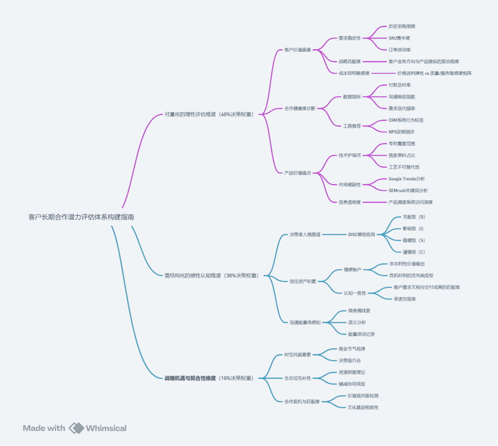
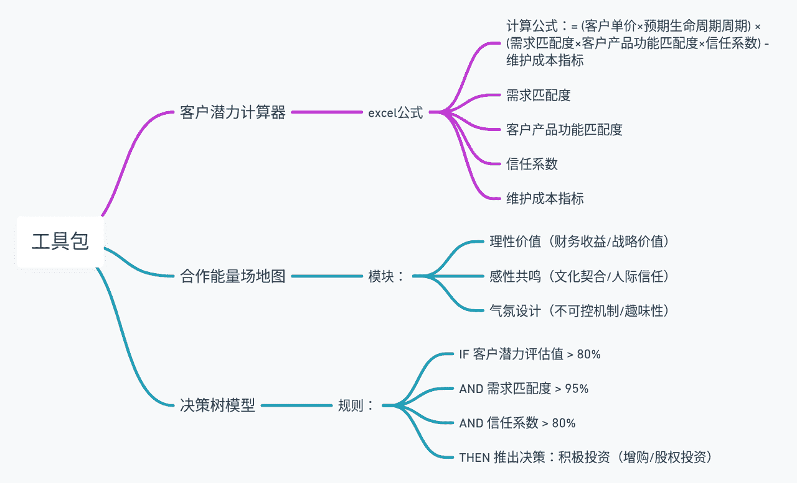
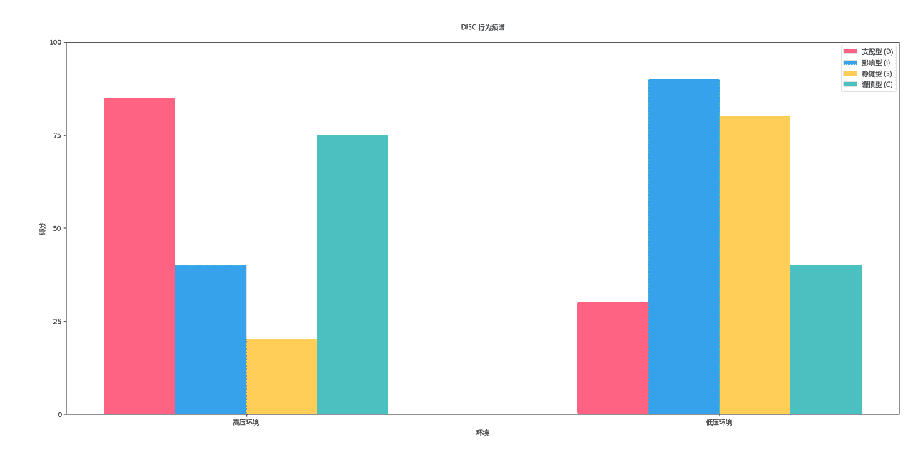
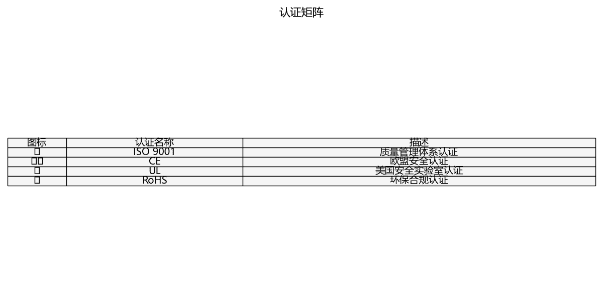

# 客户长期合作潜力评估体系

> 来源：[https://datawhaler.feishu.cn/docx/WTC5dmjC4oXrkdxYurocCueJnud](https://datawhaler.feishu.cn/docx/WTC5dmjC4oXrkdxYurocCueJnud)

## 可量化的理性评估维度（60%决策权重）

## 需结构化的感性认知维度（30%决策权重）

## 战略机遇与契合性维度（10%决策权重）





## 可量化的理性评估维度（60%决策权重）

| 1. 客户价值画像 | 2. 合作健康度诊断 |

| --- | --- |

| 3. 产品价值锚点 | 4. 双向价值创造 |

**量化评估实施工具**

CRM系统行为标签（含`Deal Probability`算法）和`NPS`测评的完整实施指南

### 一、`CRM`系统行为标签体系构建（以`HubSpot`为例）

1. `Deal Probability`算法原理

**本质**：基于历史交易数据的机器学习模型，通过客户行为模式预测成交概率

核心参数：

**基础维度**（系统自动抓取）

页面停留时长（产品页/案例页） 打开率/点击率 浏览行为（收藏/加购）

**高阶维度**（需人工标注）

需求明确性（1-5分制） 预算匹配度（低/中/高） 决策链复杂度（关键人数量）

#### 实施六步法

| 步骤1：客户行为埋点 | 步骤2：销售流程阶段定义 | 步骤3：历史数据训练 |

| --- | --- | --- |

| 步骤4：概率校准规则 | 步骤5：预警看板设置 | 步骤6：持续优化机制 |

### `NPS`（净推荐值）系统化运营方案

| 1. 测评设计黄金法则 | 2. 数据清洗与分析 | 3. 闭环改进流程 |

| --- | --- | --- |

### 三、系统整合与增效技巧

| 1. `CRM`+`NPS`数据联动 | 2. 员工绩效考核绑定 | 3. 客户生命周期价值（`LTV`）模型 |

| --- | --- | --- |

### 四、常见问题解决方案

**问题1**：客户不愿填写`NPS`问卷

方案：在合同附录增加「参与满意度测评」条款

话术："您的反馈将优先获得新产品内测资格"或其他切实关乎客户实际利益点

问题2：`Deal Probability`波动异常

检查点：

➢ 是否更新行业特征权重

➢ 确认埋点代码未被广告拦截器屏蔽

➢ 验证历史数据是否包含足够失败案例

**问题3**：跨部门数据孤岛

破解方法：

① 设立「客户数据委员会」

② 实施`Data Warehouse`（推荐`Snowflake`）

③ 制定数据共享积分奖励制度

### 实施路线图（8周计划）

| 周数 | 里程碑 | 交付物 | 周数 | 里程碑 | 交付物 |

| --- | --- | --- | --- | --- | --- |

| 1-2 | `CRM`系统部署 | 客户数据迁移完成表 | 3-4 | `Deal`模型训练 | 预测准确率验收报告 |

| 5 | `NPS`问卷上线 | 首期测评数据包 | 6-7 | 改进计划实施 | 客户挽回案例库 |

| 8 | 系统整合验收 | `LTV`计算仪表盘 | | | |

这套体系的价值不仅在于预测准确性，更在于它迫使组织用同一套语言理解客户。当销售说"这个客户很有潜力"时，能明确指出是`NPS`高于均值，还是需求匹配度达80%以上。

建议先用3个月跑通最小闭环，再逐步叠加AI预测等高级功能。

## 特别针对淘系电商的具体实施步骤整理

在淘宝平台上实现类似CRM系统的行为数据自动抓取，需要结合淘宝开放平台（TOP）API和店铺后台数据工具。以下是具体实施方案：

---

### 一、淘宝数据抓取技术路径

1. 淘宝开放平台（TOP）API接入

| 核心接口： | 权限申请： |

| --- | --- |

**示例代码**（Python调用API）：

```
import requests

def get_user_behavior(app_key, app_secret, user_id):
    url = "https://eco.taobao.com/router/rest"
    params = {
        "method": "taobao.miniapp.user.trace.get",
        "app_key": app_key,
        "timestamp": str(int(time.time())),
        "format": "json",
        "v": "2.0",
        "sign_method": "md5",
        "user_id": user_id
    }
    # 生成签名（参考TOP文档）
    params['sign'] = generate_sign(params, app_secret)
    response = requests.get(url, params=params)
    return response.json()

# 返回数据结构示例
{
    "page_views": [
        {"page_name": "产品详情页", "duration": 120},
        {"page_name": "购物车页", "duration": 30}
    ],
    "click_events": [
        {"event_name": "收藏商品", "count": 1},
        {"event_name": "加入购物车", "count": 2}
    ]
}
```

---

1. 店铺后台数据工具

**官方工具**：

**生意参谋**：提供访客行为热力图、页面停留时长分布

**数据银行**：支持用户分群、行为路径分析

**关键指标**：

**页面停留**：详情页平均停留时长、跳出率

**点击事件**：收藏率、加购率、客服咨询率

**转化漏斗**：浏览→加购→下单的转化率

**数据导出**：

支持CSV格式导出，可接入自建BI系统

通过API定时同步（需申请高级权限）

---

### 淘宝场景下的行为标签体系

| 1. 基础行为标签 | 1. 高阶行为标签 |

| --- | --- |

| 标签名称 定义 数据来源 | 标签名称 算法逻辑 应用场景 |

---

### 三、数据采集与处理架构

1. 技术栈选择

**数据采集**：淘宝API + 埋点SDK（如`GrowingIO`）

**实时计算**：`Flink`/`Spark Streaming`

**数据存储**：`ClickHouse`（高并发查询）

**可视化**：`Superset`/`Grafana`

1. 数据流设计

淘宝API/埋点 → Kafka消息队列 → `Flink`实时处理 →

↘ 行为标签计算 → `ClickHouse`存储

↘ 异常检测报警 → 钉钉通知

1. 数据安全合规

用户隐私保护：数据脱敏处理（如手机号→138****5678） 权限分级：按角色分配数据访问权限 日志审计：记录所有数据访问操作

---

### 四、实施路线图（6周计划）

| 周数 | 任务 | 交付物 | 周数 | 任务 | 交付物 | 周数 | 任务 | 交付物 |

| --- | --- | --- | --- | --- | --- | --- | --- | --- |

| 1 | 淘宝API权限申请 | 开发者账号 | 3 | 行为标签算法开发 | 标签计算模块 | 5 | 数据质量校验 | 数据准确性报告 |

| 2 | 数据采集系统搭建 | 数据接入测试报告 | 4 | 实时看板开发 | 数据可视化系统 | 6 | 系统联调验收 | 用户行为分析报告 |

---

### 常见问题解决方案

| **问题1**：`API`调用频率限制 | **问题2**：数据孤岛问题 | **问题3**：实时性要求高 |

| --- | --- | --- |

---

在淘宝生态中构建用户行为分析体系，既要充分利用平台开放能力，也要注重数据合规与系统性能优化。建议从核心指标（如加购率、停留时长）入手，逐步扩展到预测性分析（如流失预警、复购概率）。

## 需结构化的感性认知维度（30%决策权重）

### 1. 决策者人格图谱

+ **DISC模型应用**：

+ 支配型（D）：关注效率，需直接呈现ROI计算

+ 影响型（I）：重视体验，需强化服务故事包装

+ 稳健型（S）：规避风险，需提供第三方认证背书

+ 谨慎型（C）：痴迷细节，需开放全流程数据权限

### DISC模型深度解析与应用指南

（科学构建人格图谱+实战策略库）

---

### 一、DISC模型核心架构

**理论起源**：1928年威廉·莫尔顿·马斯顿博士提出，基于人类对外界刺激的行为响应模式分类，非心理测评工具，而是行为风格识别系统。

**四维定义**：

**行为频谱**：



### 二、人格图谱构建五步法

1. **数据采集维度**

1. **特征量化模型**

**权重分配表**：

**计算公式**：

`DISC综合值 = Σ（特征表现值 × 维度权重）`

例：某客户邮件回复速度得分80（D权重0.15→12分）+表情符号使用率得分90（I权重0.3→27分）→倾向I型

1. **动态校准机制**

+ **环境因子修正**：紧急状态下D/C倾向上升30%

+ **角色身份权重**：技术决策者C权重+20%；商务决策者I权重+15%

+ **跨文化调整**：东亚客户S基准值默认+10分

---

### 三、"决策者人格图谱"实战策略库

1. **D型（支配型）攻单策略**

**数据记录重点**：

+ 单次沟通时长（>15分钟触发负面情绪）

+ `ROI`计算引用次数

+ 打断他人发言频率

**作战工具包**：

+ **闪电提案**：首屏直接展示成本节省/效率提升数据

+ **权威碾压**：引用行业龙头应用案例（如："三一重工通过本方案减少停机时间35%"）

+ **决策沙盘**：提供`AB`方案对比表，引导其自主选择

**禁忌预警**：

⚠️ 避免使用"可能""大概"等模糊词汇

⚠️ 严禁超过约定时间仍未交付承诺文档

1. **I型（影响型）关系深化策略**

**数据记录重点**：

+ 非业务话题占比（理想值30%-40%）

+ 社交媒体互动频次

+ 对可视化素材的停留时长

**作战工具包**：

+ **故事银行**：准备3类故事模板

```
1. 客户成功故事："某潮牌主理人用我们的系统后，员工效率提升还能每天早下班打卡晒朋友圈"  
2. 团队人文故事："我们的95后工程师为调试系统在机房过了生日"  
3. 行业愿景故事："我们正在和米兰设计周策划跨界艺术展"  
```

+ **体验式验证**：提供产品试用版时附带定制欢迎视频

+ **社交货币**：设计限量版周边礼品（如联名款笔记本）

**禁忌预警**：

⚠️ 避免纯数据堆砌式提案

⚠️ 忌用标准化话术模板

1. **S型（稳健型）信任构建策略**

**数据记录重点**：

+ 需求变更申请提前期（>7天为安全值）

+ 对合同条款咨询次数

+ 历史合作供应商合作时长

**作战工具包**：

+ **风险对冲清单**：

+ **连续性证明**：展示供应链各环节备份方案（如："注塑模具同时在东莞和越南开模"）

+ **渐进式承诺**：从季度合作到年度框架的阶梯协议

**禁忌预警**：

⚠️ 避免突然更换对接人

⚠️ 严禁过度承诺灵活性

1. **C型（谨慎型）技术征服策略**

**数据记录重点**：

+ 需求文档修订版本数

+ 参数询问深度（如追问到钢材屈服强度）

+ 第三方检测报告查阅时长

**作战工具包**：

+ **数据核武器**：

```
- 材料溯源：钢材批次号→炼钢炉温度曲线  
- 过程证据：每个焊点拍照存档+GPS定位  
- 失败案例库：公开107次测试失败数据  
```

+ **开放沙盒**：提供`API`调试平台+实时数据监控

+ **认证矩阵**：



**禁忌预警**：

⚠️ 禁止使用"行业通用做法"等模糊解释

⚠️ 技术参数必须精确到小数点后两位

---

### 四、人格图谱管理系统搭建

1. **CRM集成方案**

+ **字段设计**：

+ **自动化触发**：

```
WHEN 客户.DISC类型 = 'C' THEN 
   自动发送详细技术白皮书 
   AND 预约工程师深度沟通
```

1. **团队训练体系**

+ **模拟训练室**：

+ **话术基因库**：

```
D型杀手锏："这个方案能让您在下季度KPI考核中领先23%"  
I型金句："您将是首批体验我们与法拉利联名款设计的客户"  
```

1. **效果评估指标**

+ **战略层**：客户生命周期价值（`LTV`）提升率

+ **战术层**：

+ 提案通过周期缩短天数

+ 需求变更率下降百分比

+ **执行层**：

+ 客户对接情绪指数（基于语音情感分析）

+ 沟通记录关键词命中率

---

### 五、历史案例验证

**案例背景**：某工业阀门制造商大客户攻单

+ **原始状态**：

+ 技术总监（C型）：要求开放生产监控系统

+ 采购副总（D型）：要求次日给出降价方案

+ 设备经理（S型）：担忧安装影响现有产线

**人格图谱应对**：

1. 对C型：提供实时生产数据`API`接口

1. 对D型：8小时内提交成本拆分表，承诺阶梯返利

1. 对S型：制定周末错峰施工方案，附赔偿承诺书

**结果**：合同金额提升40%，付款周期缩短15天

---

**DISC模型的价值**不在于给人贴标签，而在于建立可操作的认知框架。当你能预判客户会如何提问、怎样决策时，就能像棋手般布局攻守。记住：最高境界是让D型觉得高效、I型感到愉悦、S型获得安心、C型得到严谨，而这一切都建立在精准的行为数据洞察之上。

### 2. 信任资产积累

### 信任资产积累体系构建指南

（情感账户+认知一致性双轮驱动模型）

---

### 一、情感账户：非功利性价值输出

### 短视频内容策略

1. **内容定位与分类**

**内容示例**：

+ **行业快讯**：《2024年高空安全设备新规解读》

+ **技术解析**：《新型复合材料如何提升安全带强度》

+ **案例故事**：《某500强企业高空作业安全改造纪实》

+ **安全科普**：《高空作业安全带正确穿戴指南》

---

1. **短视频制作流程**

```
### 短视频脚本模板
1. 开场（0-5秒）：吸睛画面 + 核心问题抛出  
2. 主体（5-45秒）：分点阐述 + 数据/案例支撑  
3. 结尾（45-60秒）：行动号召 + 品牌露出
```

**制作工具**：

+ **剪辑**：剪映（模板丰富）、`Premiere`（专业级）

+ **动画**：`After Effects`、`Lottie`

+ **字幕**：`Arctime`（高效字幕工具）

---

1. **核心指标定义**

1. **数据采集方案**

**平台API接入**：


# 抖音API示例

```python
import requests

def get_video_stats(video_id):
    url = "https://open.douyin.com/api/video/data/"
    params = {
        "access_token": "your_access_token",
        "video_id": video_id
    }
    response = requests.get(url, params=params)
    return response.json()
```

## 返回数据结构

```json
{
    "play_count": 10000,
    "digg_count": 500,
    "comment_count": 200,
    "share_count": 300,
    "complete_rate": 0.45
}
```

## 数据存储

```sql
CREATE TABLE video_performance (
    video_id INT PRIMARY KEY,
    play_count INT,
    digg_count INT,
    comment_count INT,
    share_count INT,
    complete_rate DECIMAL(5,2),
    conversion_rate DECIMAL(5,2),
    post_date DATE
);
```

# 实时看板设计

## 技术栈

+ **前端**：React + ECharts
+ **后端**：Node.js + Express
+ **数据库**：MySQL

## 看板布局

```jsx
import { BarChart, Bar, XAxis, YAxis, Tooltip } from 'recharts';

const data = [
    { name: '视频A', play: 10000, complete: 4500 },
    { name: '视频B', play: 8000, complete: 3600 },
];

const VideoPerformanceChart = () => (
    <BarChart width={600} height={300} data={data}>
        <XAxis dataKey="name" />
        <YAxis />
        <Tooltip />
        <Bar dataKey="play" fill="#8884d8" />
        <Bar dataKey="complete" fill="#82ca9d" />
    </BarChart>
);
```

# A/B测试策略

## 测试维度

## 测试流程

1. 制作两版内容（A/B版）
1. 同时发布，各分配50%流量
1. 24小时后分析数据，选择优胜版本全面推广

# 热点追踪与借势

## 工具推荐

+ **热点监测**：新榜、飞瓜数据
+ **关键词挖掘**：巨量算数、百度指数

## 借势策略

+ **节日热点**：安全生产月专题
+ **行业事件**：新规发布解读
+ **社会热点**：结合热门话题制作安全科普

# 短视频信任积分体系

## 积分规则

## 积分兑换

+ 100分：领取安全作业手册
+ 500分：免费参加安全培训
+ 1000分：优先试用新产品

# 客户分层运营

# 四、实施路线图

## 供应链风险预警系统

### 预警维度

### 客户价值传递

+ **预警看板**：为客户开放供应链状态实时监控权限
+ **联合演练**：每季度组织供应链中断模拟演习
+ **透明沟通**：每周发送《供应链健康度报告》

### 数据埋点

```javascript
// 风险预警触发日志
logEvent('supply_risk_alert', {
  risk_type: '原材料短缺',
  trigger_time: new Date(),
  affected_clients: ['客户A', '客户B'],
  response_plan: '备选供应商切换'
});
```

## 危机时刻优先响应权

### 案例库建设

# 二、认知一致性：需求与交付的精准匹配

## 1. CRD-交付成果匹配度雷达图

### 指标体系

### 可视化实现

```jsx
import { RadarChart, PolarGrid, PolarAngleAxis, PolarRadiusAxis, Radar } from 'recharts';

const data = [
  { dimension: '功能完整性', value: 95 },
  { dimension: '性能达标度', value: 88 },
  { dimension: '交付时效性', value: 92 },
  { dimension: '成本可控性', value: 90 },
  { dimension: '服务响应度', value: 97 },
];

const CRDMatchRadar = () => (
  <RadarChart outerRadius={150} width={500} height={400} data={data}>
    <PolarGrid />
    <PolarAngleAxis dataKey="dimension" />
    <PolarRadiusAxis angle={30} domain={[0, 100]} />
    <Radar dataKey="value" stroke="#8884d8" fill="#8884d8" fillOpacity={0.6} />
  </RadarChart>
);
```

## 2. 承诺兑现率可视化看板

### KPI设计

### 看板布局

### 承诺兑现率看板

| 指标         | 本月   | 上月   | 同比   |
|--------------|--------|--------|--------|
| 交付准时率   | 96.5%  | 94.2%  | +2.3%  |
| 质量合格率   | 98.7%  | 97.8%  | +0.9%  |
| 服务响应率   | 91.2%  | 89.5%  | +1.7%  |

### 动态更新

```python
# 数据同步脚本示例
def update_kpi_dashboard():
    delivery_rate = calculate_delivery_rate()
    quality_rate = calculate_quality_rate()
    response_rate = calculate_response_rate()
    save_to_dashboard({
        'delivery_rate': delivery_rate,
        'quality_rate': quality_rate,
        'response_rate': response_rate
    })
```

# 三、信任资产运营机制

## 1. 数据采集与清洗

+ **来源**：CRM系统、项目管理系统、客户反馈表

### 清洗规则

```sql
CREATE TABLE trust_assets (
    client_id INT PRIMARY KEY,
    white_paper_downloads INT,
    risk_alerts_responded INT,
    crd_match_score DECIMAL(5,2),
    promise_fulfillment_rate DECIMAL(5,2)
);
```

## 2. 信任指数计算模型

```python
def calculate_trust_index(client):
    return (
        0.4 * client.white_paper_downloads +
        0.3 * client.risk_alerts_responded +
        0.2 * client.crd_match_score +
        0.1 * client.promise_fulfillment_rate
    )
```

## 3. 应用场景

+ **客户分级**：根据信任指数划分VIP等级
+ **资源分配**：优先向高信任客户开放新产品内测
+ **风险预警**：信任指数下降时触发客户挽回流程

# 四、实施路线图

## 1. 沟通能量场感知

### 微表情线索

视频会议中瞳孔放大（兴趣信号）、手指敲击（焦虑指标）

### 语义分析

+ 积极词汇密度（“创新”“共赢”等词频）
+ 被动语态占比（反映决策权限）

### 能量波动记录

建立客户对接情绪日志（类似医护疼痛指数评估）

## 4. 跨团队协作生态

+ 对接层级匹配度：双方对接人在各自组织的决策权限对等性
+ 跨部门覆盖广度：合作触及客户组织的部门数量
+ 人员流动影响力：关键联系人变动对合作的风险评估

# 战略机遇与契合性维度（10%决策权重）

## 1. 时空共振要素

+ **商业节气规律**：客户预算周期、行业展会时间窗、财报发布节点
+ **决策链巧合**：关键决策者任期剩余时长、竞品突发负面事件

## 2. 生态位互补性

+ **资源拼图理论**：评估客户缺失能力与贵司核心资源的互补性指数
+ **熵减协同效应**：合作后客户内部流程复杂度是否降低

## 3. 合作契机与匹配度

### 价值观共振检测

+ ESG政策契合度（环保/社会责任/公司治理）
+ 创新容忍度匹配（客户研发投入占比 vs 贵司产品迭代速度）

### 文化基因相容性

+ 会议礼仪偏好（如德企的准时性 vs 中东企业的弹性）
+ 决策权重分布（家族企业 vs 职业经理人制度）
