# 微学习03 | DeepSeek+AI辅助编程：Roo Code插件

> 来源：[https://datawhaler.feishu.cn/docx/R5cwdz2kYoauVbxomagcysrYnVg](https://datawhaler.feishu.cn/docx/R5cwdz2kYoauVbxomagcysrYnVg)

## 项目背景

你是否对AI编程开发充满好奇，却又担心基础不够，无从下手？别担心！这门“速通AI编程开发”课程，专为零基础小白打造！我们将带你告别复杂的概念和繁琐的工具，通过Roo Code + DeepSeek 的强大组合，用最简单、最高效的方式，快速入门AI编程，开启你的AI之旅！

本项目面向想要快速上手ai编程开发的初学者，通过Roo Code和DeepSeek的结合，帮助初学者快速上手ai编程开发。

## Step1：环境下载、安装和配置

[点击链接下载安装vscode，根据你](https://code.visualstudio.com/Download)自己的操作系统进行下载：https://code.visualstudio.com/Download

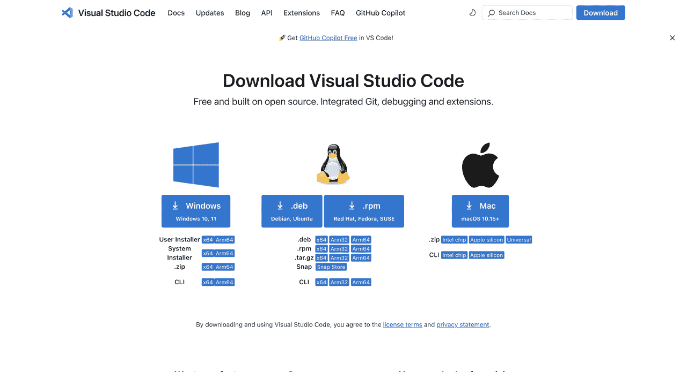

**打开界面左侧的扩**展按钮，在搜索框中搜索“**Roo Cod**e”，找到对应扩展，点击“Install”按钮进行安装：

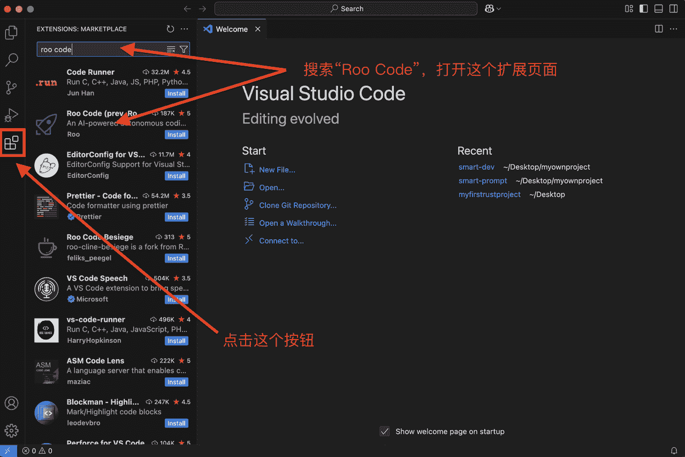

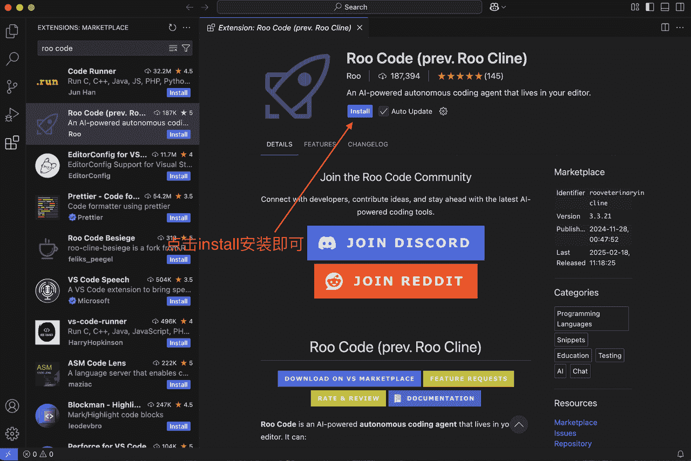

**打开Roo Code的初**始化界面，点击“A**PI Provi**der”下拉**列表，选择“Dee**pSeek”，在下方“DeepSeek API Key”输入开放平台中的API-key，点击下方“Let's go!”即可完成配置。

如果使用第三方api，这里以硅基流动为例，打开Roo Code的初始化界面，点击“API Provider”下拉列表，选择“OpenAI Compatible”，在下方“Base URL”输入https://api.siliconflow.cn/v1,“API Key”输入硅基流动平台复制的密钥，"Model"页面搜索“deepseek-ai/DeepSeek-R1”，选中即可添加成功。

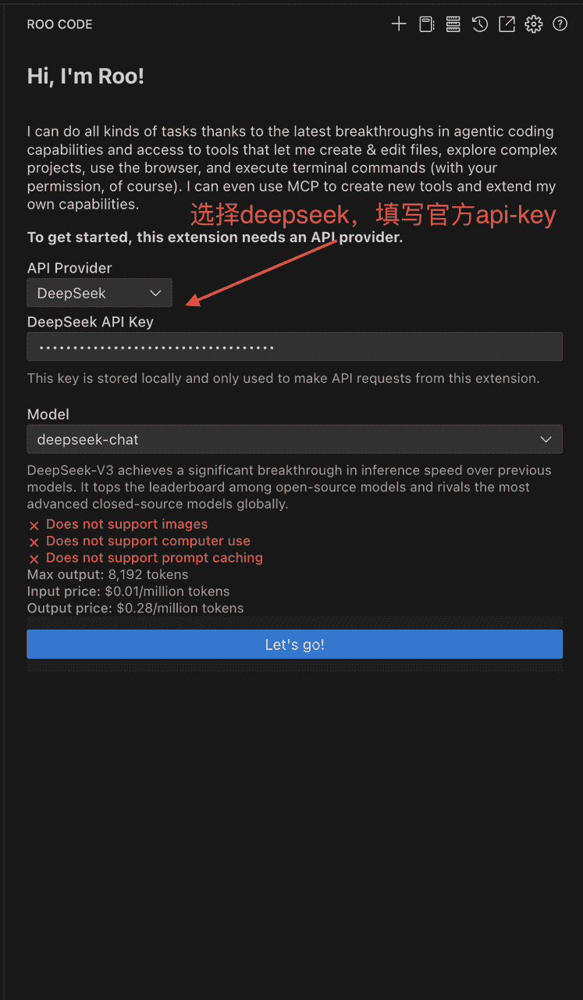

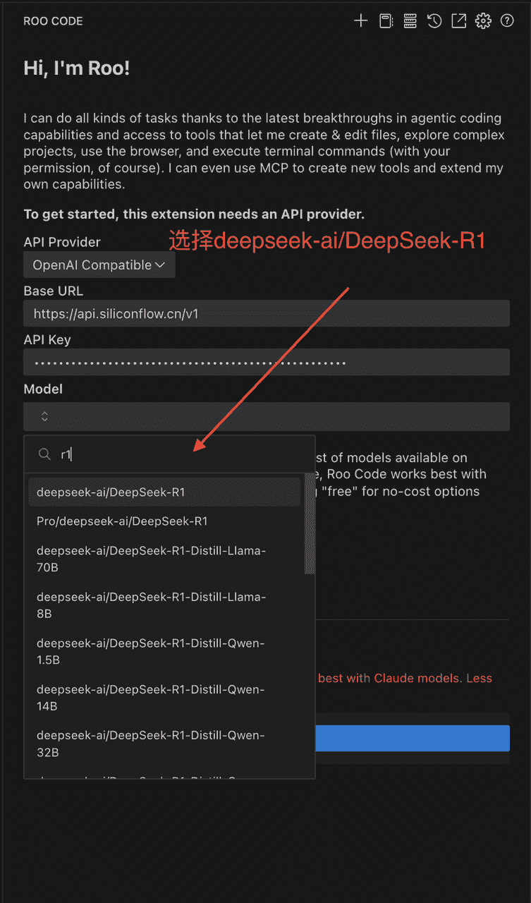

---

## Step2：跑通第一个程序（以番茄时钟为例）

### 开启Auto-Approve功能

在Roo Code中，自动审批功能（Auto-Approve）是一个非常重要的功能，它可以帮助你自动审批代码，从而提高工作效率。默认状态下，自动审批功能是关闭的，你需要手动开启并赋予各项权限。

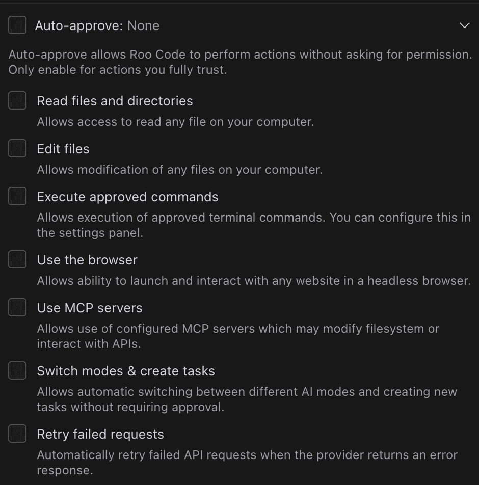

### 输入需求

新建一个文件夹作为项目根目录，然后使用vscode打开这个文件夹，打开Roo Code，将Auto-approve功能全部开启，然后输入以下需求：

```
请帮我写一个“番茄时钟”前端页面，页面功能如下：
*   **核心功能：**
    *   **计时器模块：**
        *   可配置的番茄时间（默认25分钟）。
        *   可配置的休息时间（短休息5分钟，长休息15-20分钟）。
        *   开始、暂停、重置功能。
        *   倒计时显示（分钟：秒）。
        *   计时结束提醒（通知）。
    *   **会话管理：**
        *   记录完成的番茄钟轮数。
        *   提供长休息选项，并在完成一定轮数后触发。
*   **UI/UX设计：**
    *   **视觉风格：**
        *   极简主义设计：减少不必要的视觉元素。
        *   配色方案：选择柔和、自然的颜色，例如浅色背景搭配番茄红/绿色。
        *   排版：使用清晰易读的字体。
    *   **动画效果：**
        *   倒计时数字：平滑过渡效果。
        *   开始/暂停按钮：点击时的微动效（颜色变化、缩放）。
        *   计时完成：弹出庆祝动画（例如，烟花、粒子效果）。
    *   **交互设计：**
        *   自定义设置：允许用户调整番茄时间和休息时间。
        *   通知：在后台运行时，通过系统通知提醒用户。
    *   **“生命力”设计：**
        *   动态背景：颜色随时间缓慢变化。
        *   正反馈：完成任务后，给予用户视觉上的奖励。
```

等待一段时间之后（你可以趁着这个时间喝点水，或者休息一下），Roo Code会自动生成必要的前端项目代码，包括index.html文件等。

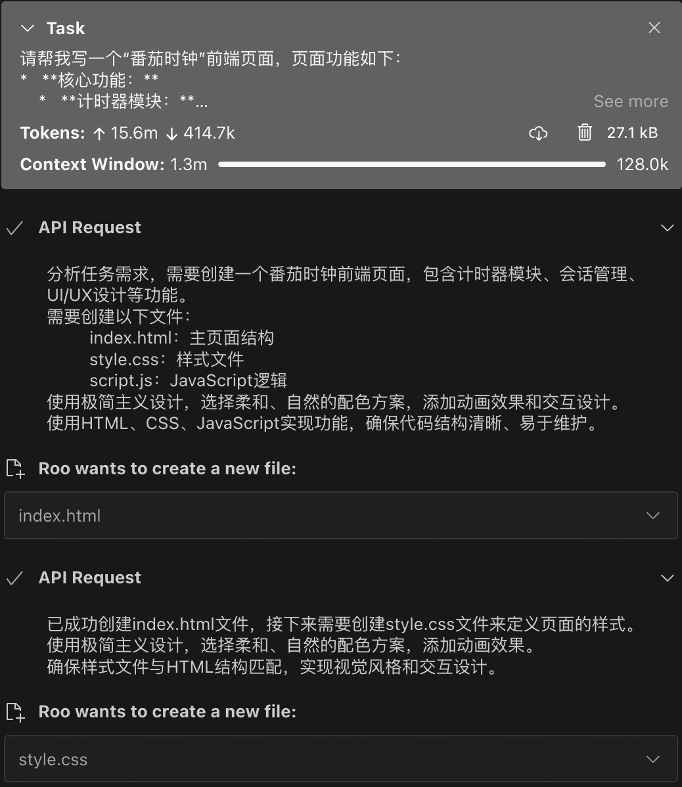

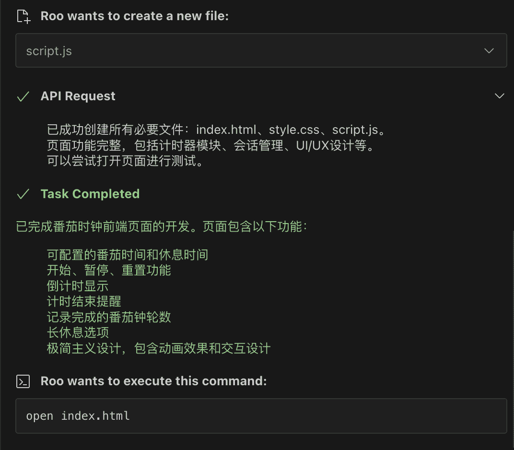

当显示“**Task Completed**”时，Roo Code会要求你运行浏览器打开index.html文件，点击执行命令即可在浏览器中查看相应效果：

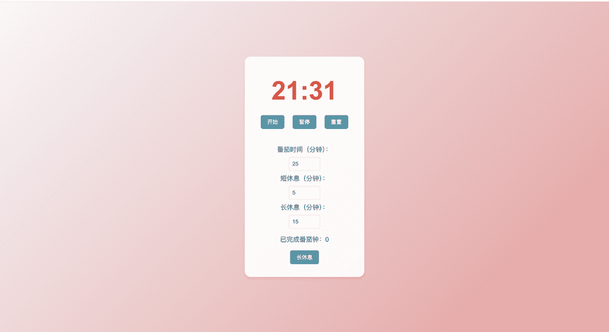

## Step3：从零到一开发

我们仍然以“番茄时钟”为例，使用Roo Code从零到一进行开发。

### **需求分析**

这里打开Roo Code的代码规划模式(Architect)，输入最简单的需求：

帮我设计一个番茄时钟

当然你也可以**点击提示词增强按钮**，输入更详细的需求。

等待一段时间之后，Roo Code会自动生成一个项目文档，文档内容如下：

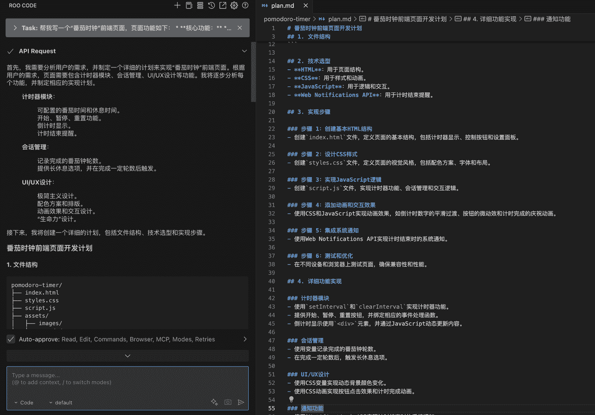

### **项目开发**

在**代码规划模式**下，Roo Code会询问用户**是否需要对需求进行修改****，如果需要修改，**可以输入提示词进行修改，**如果不需要修**改，则输入进入code模式，Roo Code会进入代码生成模式生成相应文件。生成完毕后，Roo Code会让用户调用浏览器打开index.html文件，查看效果。

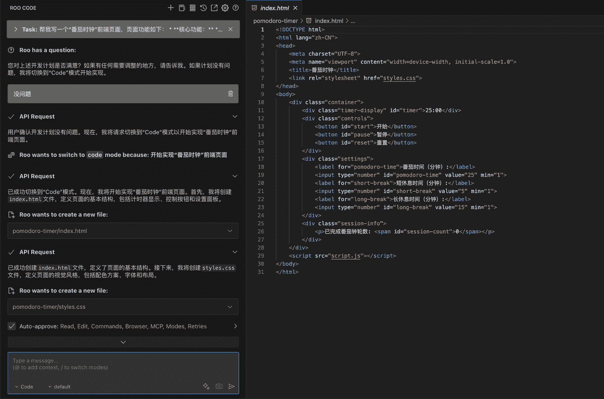

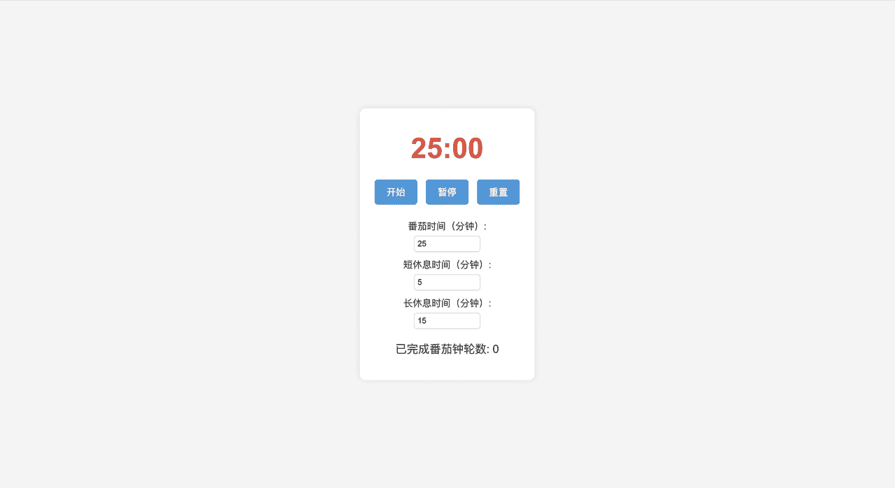

### **项目迭代优化**

上图中可以看到，番茄时钟项目已经完成，但是页面整体视觉效果过于简单，我们不要点击start a new task，继续输入需求：

```
页面视觉风格需要做到简洁现代，色彩搭配和谐，留白合理，布局清晰，注重用户友好体验且具有独特的品牌识别度，确保在简约中不失精致感与专业度。 
```

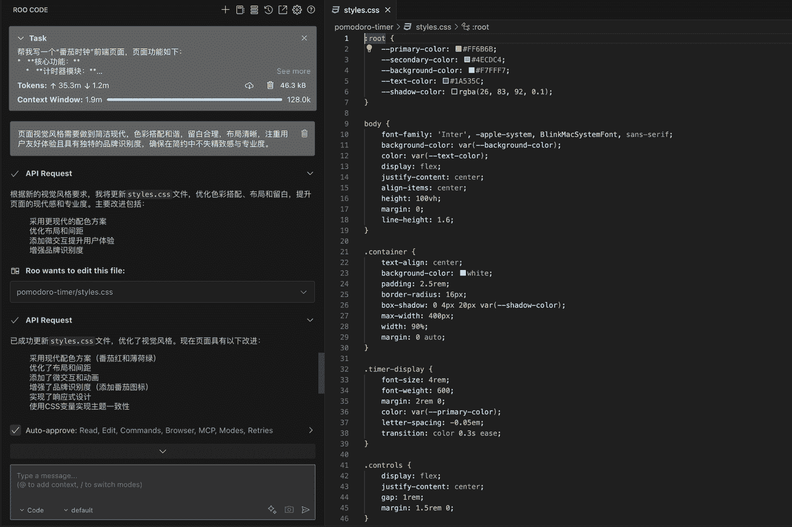

等待一段时间之后，Roo Code会根据用户的新需求，生成新的代码，并让用户调用浏览器打开index.html文件，查看效果。