# 【基于Deepseek的智能卡片工坊】🔥一秒变设计大神！这个AI神器让我在📕爆单了💥

> 来源：[https://datawhaler.feishu.cn/docx/A1F4dpXfrogPyPxGmHmcqwdmn3b](https://datawhaler.feishu.cn/docx/A1F4dpXfrogPyPxGmHmcqwdmn3b)

# 项目介绍

智能卡片工坊是一款基于AI的内容转换工具，可以将文本、网页内容或HTML代码转换为精美的卡片图像。

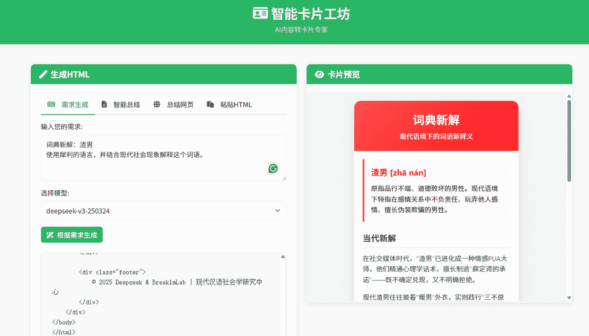

介绍视频：

效果一览：


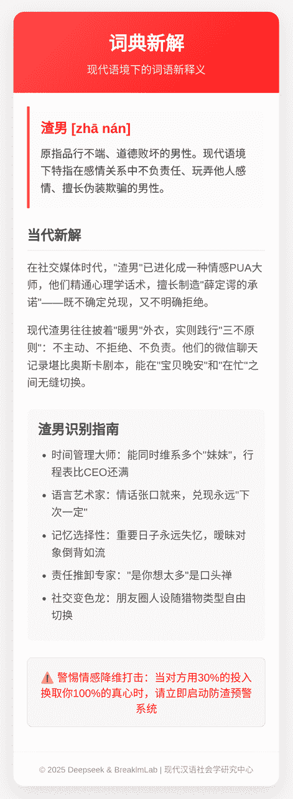

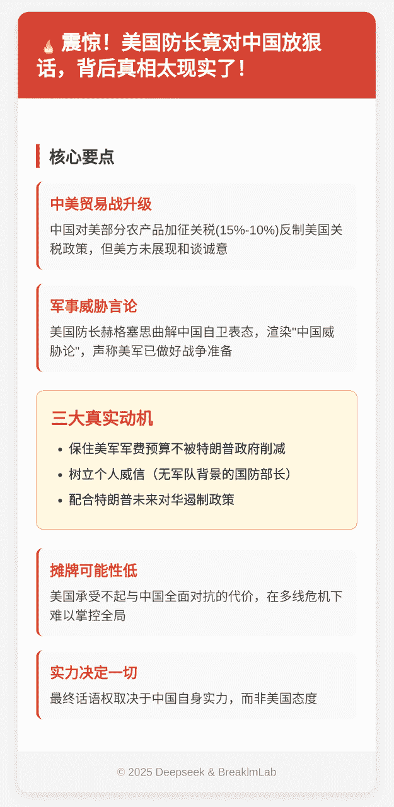

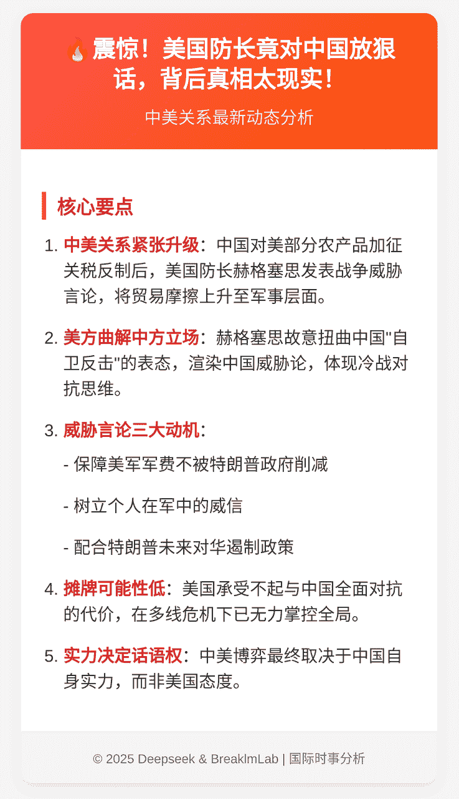

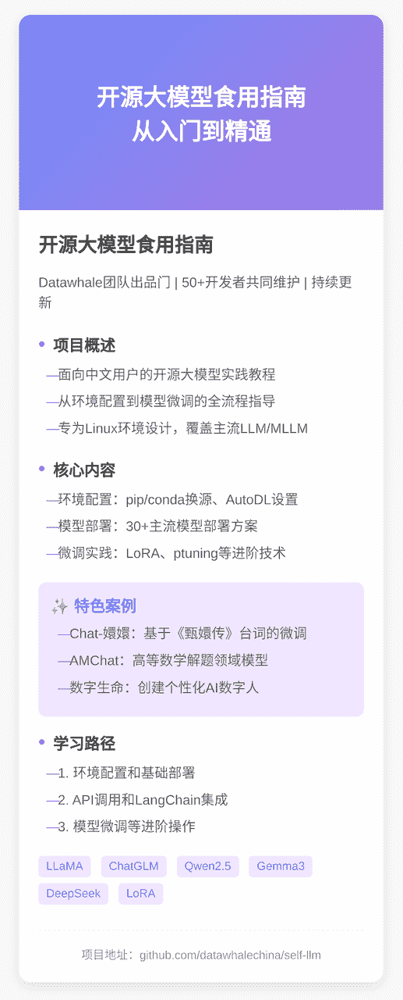

# 功能介绍

## 2.1 需求生成

需求生成功能是通过输入一些需求内容，Deepseek可以根据你的需求智能生成卡片。然后可以在右侧预览卡片内容。

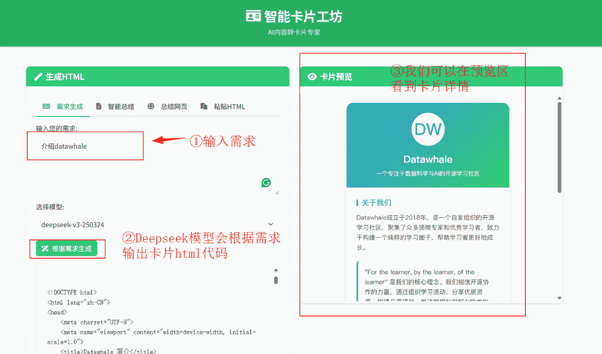

当你觉得内容很棒，可以点击卡片图片下载或是下载HTML。保存你的卡片。

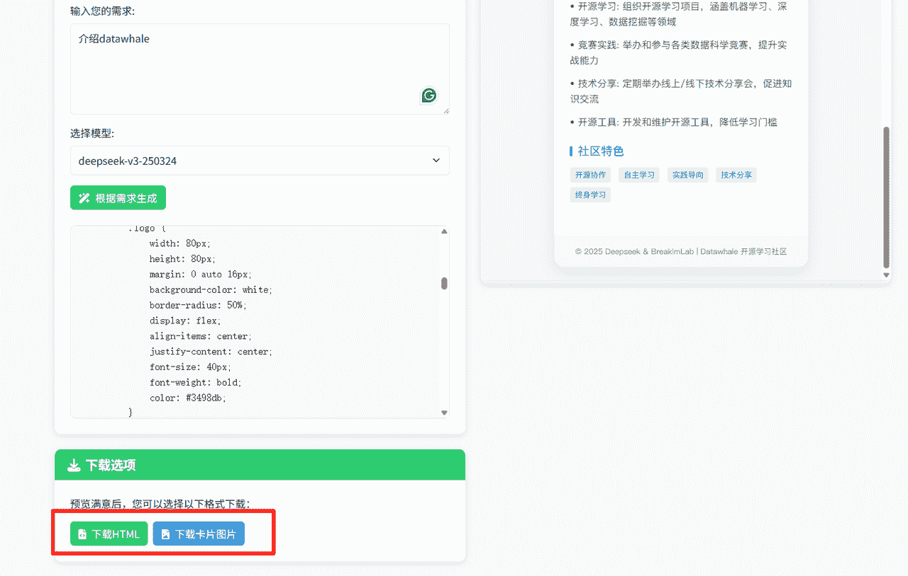

样例展示：

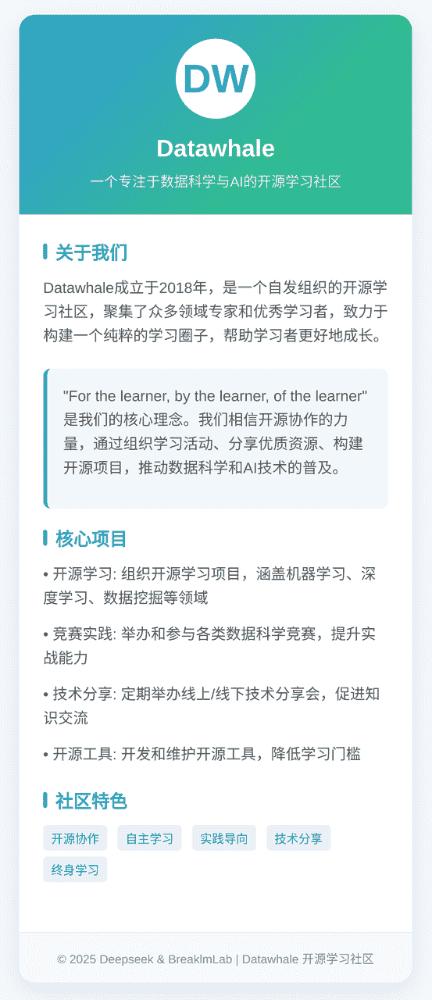

> prompt标记

> 【词典新解】用这个能生成渣男那张，蛮有趣的。

> 词典新解：渣男

> 使用犀利的语言，并结合现代社会现象解释这个词语。

## 2.2 智能总结

智能总结区域你可以手动送入一些文本内容，AI一键总结成MD格式内容。然后根据MD内容生成卡片~

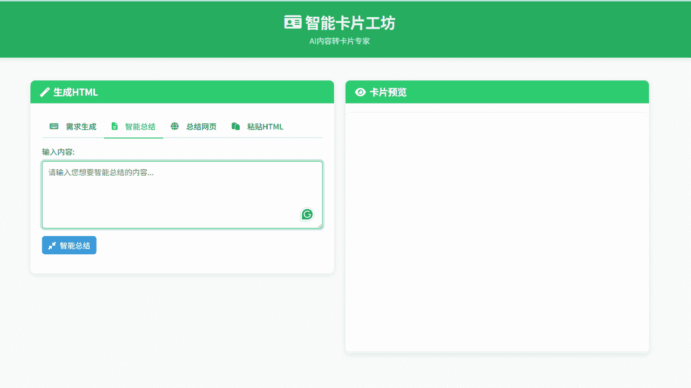

例如我们需要总结：datawhale的介绍页

这里我们加入了爆款标题的需求……所以生成的总结很……很有网感吧

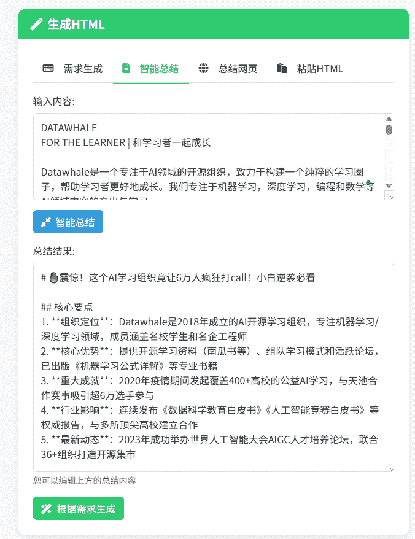

然后我们点击生成试试

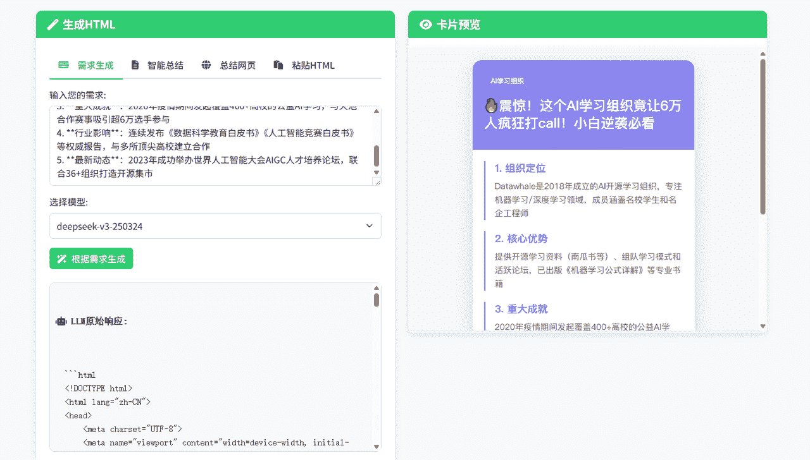

Emmm  蛮有趣的  你们看看

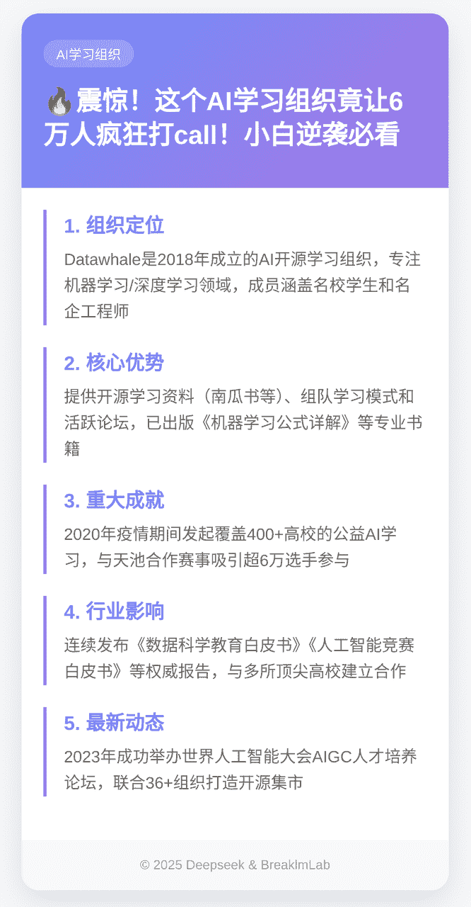

## 2.3 网页总结

网页总结我们首先使用Jina搜集网页内容，然后进行总结后和智能总结类似切换到需求生成的部分。主要是方便直接总结网页内容，但是目前JinaReader不太稳定，如果动手能力强可以换成其他框架。

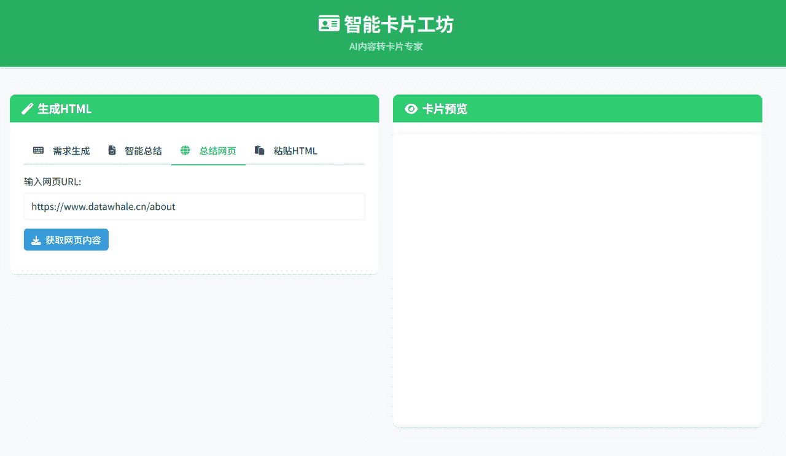

我们用bilibili的这个新闻页面测试一下

[加征关税不到24小时，特朗普摊上大事](https://www.bilibili.com/opus/1030876340991033347?from=search&spm_id_from=333.337.0.0):中方反制，盟友也报复美国 - 哔哩哔哩

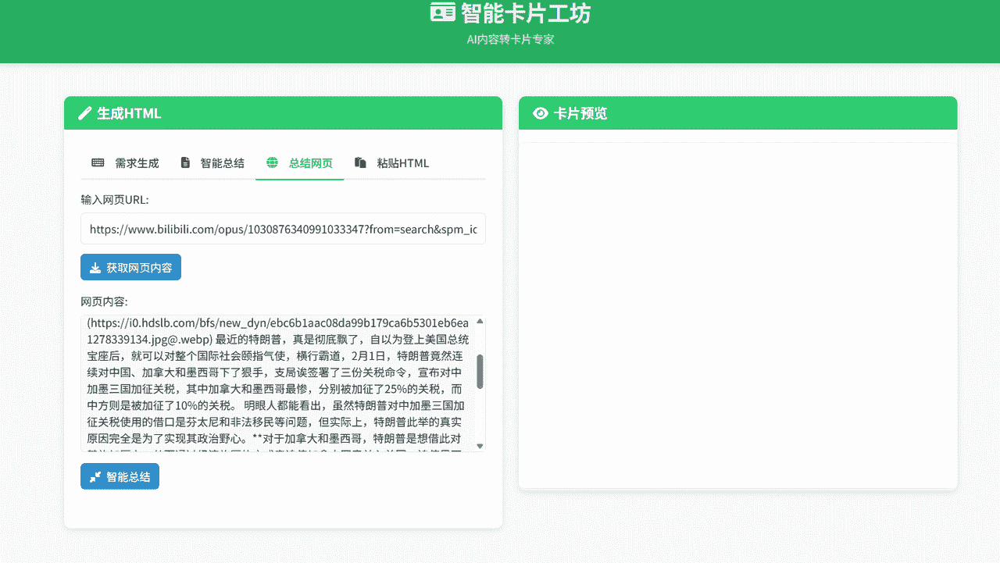

Jina貌似对文档内容有上限！不过能抽取差不多内容。【可以尝试使用Jina的 jinareader2版本  能力更强】

Title: 加征关税不到24小时，特朗普摊上大事：中方反制，盟友也报复美国 - 哔哩哔哩 URL Source: https://www.bilibili.com/opus/1030876340991033347?from=search&amp;spm_id_from=333.337.0.0 Markdown Content: 对华加征关税不到24小时，特朗普摊上大事：中方发起强力反制，后果严重！**美国盟友也纷纷开始报复美国，甚至对美国实施更大力度关税反制措施，特朗普这次，可真是要面临大麻烦了。**  最近的特朗普，真是彻底飘了，自以为登上美国总统宝座后，就可以对整个国际社会颐指气使，横行霸道，2月1日，特朗普竟然连续对中国、加拿大和墨西哥下了狠手，支局诶签署了三份关税命令，宣布对中加墨三国加征关税，其中加拿大和墨西哥最惨，分别被加征了25%的关税，而中方则是被加征了10%的关税。 明眼人都能看出，虽然特朗普对中加墨三国加征关税使用的借口是芬太尼和非法移民等问题，但实际上，特朗普此举的真实原因完全是为了实现其政治野心。**对于加拿大和墨西哥，特朗普是想借此对其施加压力，从而通过经济施压的方式来迫使加拿大同意并入美国，迫使墨西哥同意配合美国实施驱逐非法移民的政策，将大量美国南部的非法移民都给送到墨西哥。**  而对于中国，特朗普的野心则是希望中方能够大量进口美国的农产品、石油和天然气，这样一来，既可以让美国政府赚取到大量利润，也可以让中方在这些“国家命脉产品”上极大增强对美国的依赖性，这相当于是送给美方的一份“投名状”。 显然，在特朗普看来，以美国政府的强大实力，只要自己的“关税大棒”一挥舞起来，无论是加拿大墨西哥还是中国，很快都将承受不住，将向自己屈服，**但不得不说，特朗普这次，是彻底失算了，这一次，不仅是中方没有屈服发起霸气反制，就连加拿大等美国盟友也开始报复美国，几乎...

```
```

接着我们进行智能总结

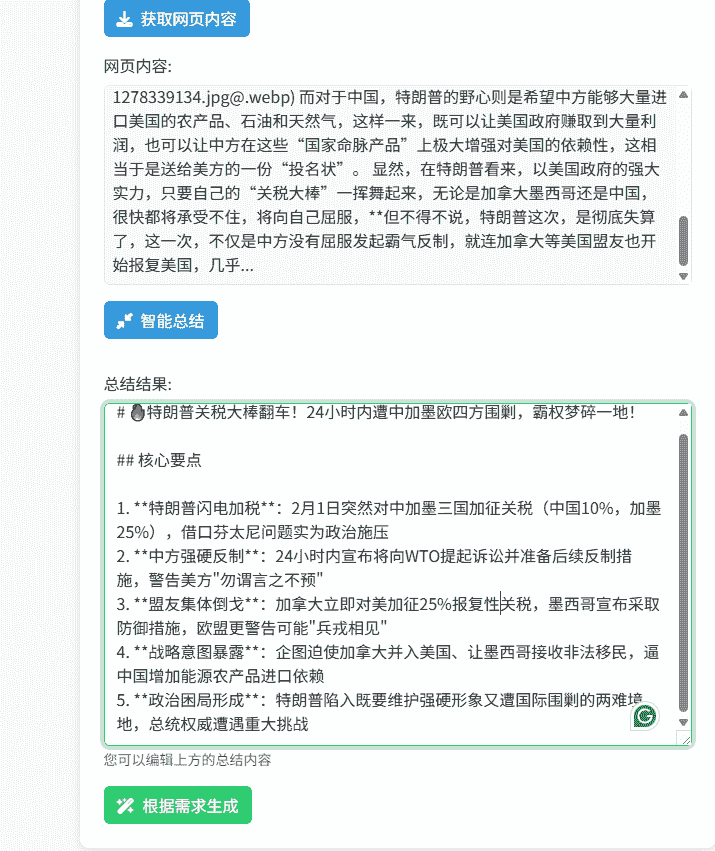

最后根据需求生成即可。

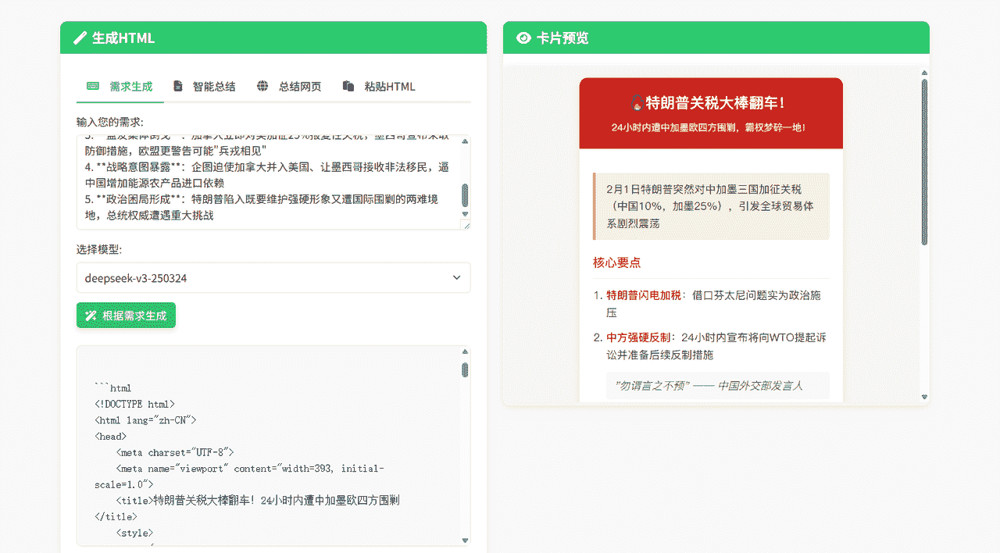

最终效果

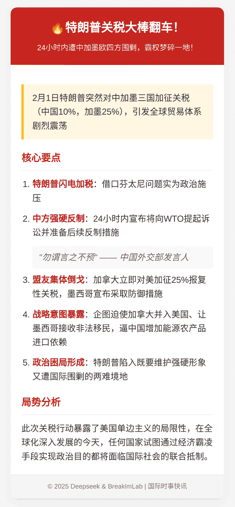

## 2.4 粘贴HTML

顾名思义，粘贴HTML代码生成卡片。这个方便大家生成后的内容做微调，直接在这里渲染。

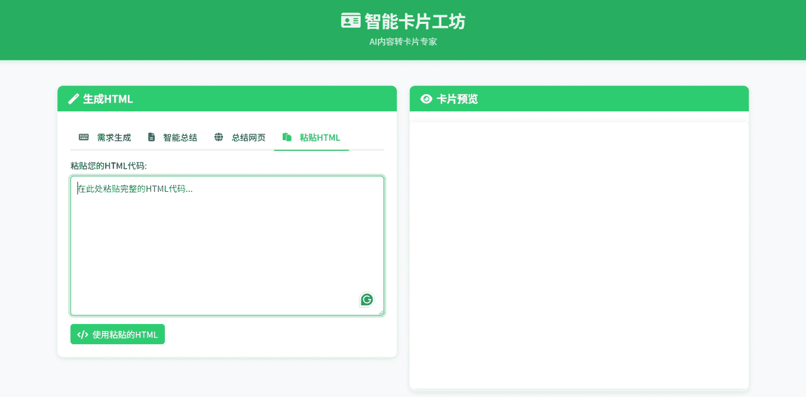

我拿下面html为例。

```
&lt;!DOCTYPE html&gt;
&lt;html lang=&quot;zh-CN&quot;&gt;
&lt;head&gt;
    &lt;meta charset=&quot;UTF-8&quot;&gt;
    &lt;meta name=&quot;viewport&quot; content=&quot;width=device-width, initial-scale=1.0&quot;&gt;
    &lt;title&gt;2025蛇年贺卡&lt;/title&gt;
    &lt;style&gt;
        * {
            margin: 0;
            padding: 0;
            box-sizing: border-box;
            font-family: &#x27;PingFang SC&#x27;, &#x27;Microsoft YaHei&#x27;, sans-serif;
        }
        
        body {
            background-color: #f8f3e8;
            display: flex;
            justify-content: center;
            align-items: center;
            min-height: 100vh;
            padding: 20px;
        }
        
        .card {
            width: 393px;
            background: linear-gradient(135deg, #e63946 0%, #a8dadc 100%);
            border-radius: 20px;
            box-shadow: 0 10px 30px rgba(0, 0, 0, 0.2);
            overflow: hidden;
            position: relative;
            color: #fff;
            padding: 30px;
            text-align: center;
        }
        
        .card::before {
            content: &quot;&quot;;
            position: absolute;
            top: 0;
            left: 0;
            right: 0;
            bottom: 0;
            background: url(&#x27;data:image/svg+xml;utf8,&lt;svg xmlns=&quot;http://www.w3.org/2000/svg&quot; width=&quot;100&quot; height=&quot;100&quot; viewBox=&quot;0 0 100 100&quot;&gt;&lt;path fill=&quot;rgba(255,255,255,0.1)&quot; d=&quot;M30,50 Q50,30 70,50 Q50,70 30,50 Z&quot;/&gt;&lt;/svg&gt;&#x27;);
            opacity: 0.3;
        }
        
        .header {
            margin-bottom: 25px;
            position: relative;
            z-index: 1;
        }
        
        .year {
            font-size: 3rem;
            font-weight: 700;
            margin-bottom: 10px;
            text-shadow: 2px 2px 4px rgba(0, 0, 0, 0.3);
        }
        
        .title {
            font-size: 2.2rem;
            margin-bottom: 5px;
            letter-spacing: 2px;
        }
        
        .subtitle {
            font-size: 1.2rem;
            opacity: 0.9;
        }
        
        .snake {
            width: 180px;
            height: 180px;
            margin: 20px auto;
            background-image: url(&#x27;data:image/svg+xml;utf8,&lt;svg xmlns=&quot;http://www.w3.org/2000/svg&quot; viewBox=&quot;0 0 100 100&quot;&gt;&lt;path fill=&quot;%23f1faee&quot; d=&quot;M50,10 Q70,20 80,40 Q90,60 85,80 Q80,95 60,90 Q40,85 30,70 Q20,55 25,35 Q30,15 50,10 Z&quot;/&gt;&lt;circle cx=&quot;40&quot; cy=&quot;35&quot; r=&quot;3&quot; fill=&quot;%231d3557&quot;/&gt;&lt;circle cx=&quot;60&quot; cy=&quot;35&quot; r=&quot;3&quot; fill=&quot;%231d3557&quot;/&gt;&lt;/svg&gt;&#x27;);
            background-size: contain;
            background-repeat: no-repeat;
            filter: drop-shadow(0 5px 10px rgba(0, 0, 0, 0.3));
        }
        
        .message {
            background-color: rgba(255, 255, 255, 0.2);
            padding: 20px;
            border-radius: 15px;
            margin: 25px 0;
            font-size: 1rem;
            line-height: 1.6;
            backdrop-filter: blur(5px);
            border: 1px solid rgba(255, 255, 255, 0.3);
        }
        
        .wishes {
            font-size: 1.1rem;
            margin-top: 20px;
            font-style: italic;
        }
        
        .footer {
            margin-top: 30px;
            font-size: 0.9rem;
            opacity: 0.8;
        }
        
        .signature {
            margin-top: 15px;
            font-family: cursive;
            font-size: 1.2rem;
        }
    &lt;/style&gt;
&lt;/head&gt;
&lt;body&gt;
    &lt;div class=&quot;card&quot;&gt;
        &lt;div class=&quot;header&quot;&gt;
            &lt;div class=&quot;year&quot;&gt;2025&lt;/div&gt;
            &lt;h1 class=&quot;title&quot;&gt;乙巳蛇年&lt;/h1&gt;
            &lt;p class=&quot;subtitle&quot;&gt;Year of the Snake&lt;/p&gt;
        &lt;/div&gt;
        
        &lt;div class=&quot;snake&quot;&gt;&lt;/div&gt;
        
        &lt;div class=&quot;message&quot;&gt;
            金蛇狂舞辞旧岁，骏马奔腾迎新春。&lt;br&gt;
            在这辞旧迎新的美好时刻，愿您如灵蛇般智慧敏捷，事业如蛇般蜿蜒上升，生活如蛇般优雅从容。
        &lt;/div&gt;
        
        &lt;p class=&quot;wishes&quot;&gt;愿新的一年带给您健康、财富与幸福！&lt;/p&gt;
        
        &lt;div class=&quot;footer&quot;&gt;
            &lt;p&gt;© 2025 恭贺新禧&lt;/p&gt;
            &lt;p class=&quot;signature&quot;&gt;Deepseek &amp; BreaklmLab&lt;/p&gt;
        &lt;/div&gt;
    &lt;/div&gt;
&lt;/body&gt;
&lt;/html&gt;
```

粘贴生成后即可下载。

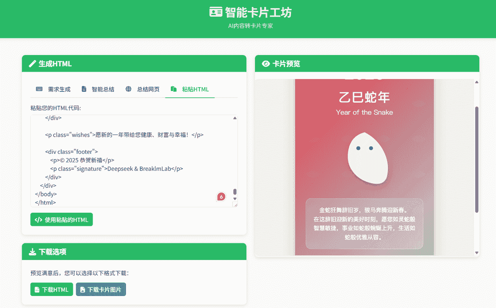

# 项目地址

https://github.com/Bald0Wang/Smart_Card_Workshop/tree/main

【后续会切换为datawhale项目地址，此地址为临时地址】

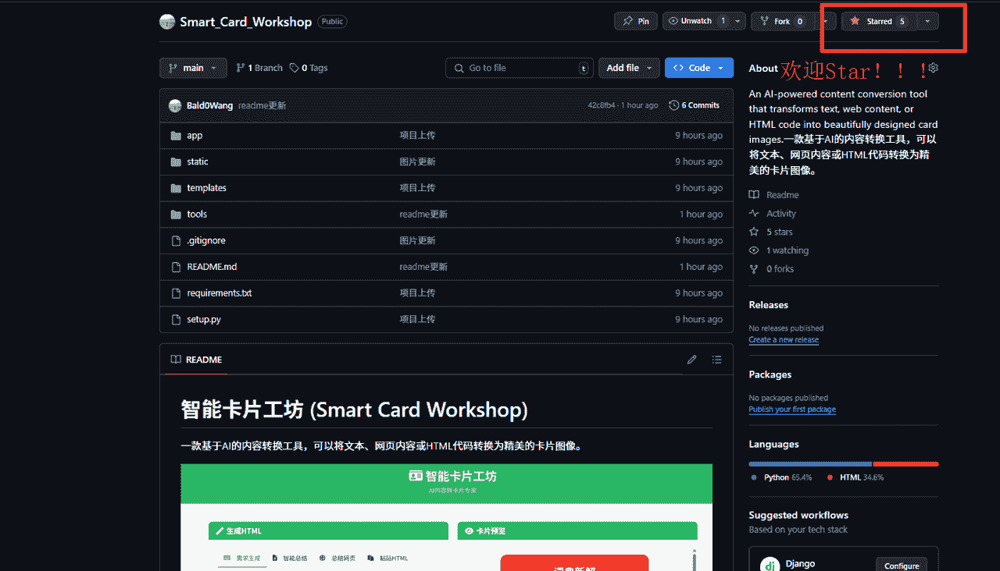

# 启动方式

## 4.1 **安装指南**

如果克隆困难从这里下载即可。


[Smart_Card_Workshop-main.zip](https://internal-api-drive-stream.feishu.cn/space/api/box/stream/download/all/Fgh6b3NqOoSIOfxXeiZclCZDnP3)

### 4.1.1 **使用uv包管理器安装**

[uv](https://github.com/astral-sh/uv) 是一个快速且现代的Python包管理器，推荐使用它来安装项目依赖。

#### **安装uv**

```
# 使用pip安装uv
pip install uv

# 或者使用pipx安装(推荐)
pipx install uv
```

#### **克隆项目并安装依赖**

```
# 克隆项目
git clone https://github.com/yourusername/smart-card-workshop.git
cd smart-card-workshop

# 创建虚拟环境并安装依赖
uv venv
uv pip install -r app/requirements.txt
```

### 4.1.2 **环境变量配置**

ARK指的是火山平台，你需要完成两步可以得到你的可用api_key

1.  创建api_key

https://console.volcengine.com/ark/region:ark+cn-beijing/apiKey?apikey=%7B%7D

1.  创建模型推理接入点，记得选择deepseekv3 0324版本

https://console.volcengine.com/ark/region:ark+cn-beijing/endpoint?config=%7B%7D

Jina api需要再下面的网页获取token，如果不用网页获取功能可以随便填一个key哦

https://jina.ai/zh-CN/

在tools目录下创建一个.env文件，添加以下配置：

```
# ARK平台API密钥
ARK_API_KEY=&quot;your_ark_api_key_here&quot;

# Jina API密钥(用于网页抓取)
JINA_API_KEY=&quot;your_jina_api_key_here&quot;
```

## 4.2 **运行应用**

```
# 激活虚拟环境
# Windows
.venv\Scripts\activate
# Linux/MacOS
source .venv/bin/activate

# 启动应用
cd app
uvicorn main:app --reload
```

然后在浏览器中访问 http://localhost:8000 即可使用应用。

以上就是智能卡片工坊项目的全部介绍啦，如果有更好的意见和建议欢迎留言。祝你有一个愉快地使用体验~

# 实验

本实验通过一个新账号发布卡片内容（以科普人工智能概念为主），定期更新涨粉情况。

## 5.1 知识大纲

1.  **人工智能（AI）是什么？**

1.  **AI的两种主要类型**

+   2.1 弱人工智能（Narrow AI）

+   2.2 强人工智能（General AI）

1.  **生成式AI：创造内容的AI**

1.  AI如何学习？——机器学习三大方式

+   4.1 监督学习

+   4.2 无监督学习

+   4.3 强化学习

1.  **AI的日常应用场景**

+   5.1 生活类（语音助手、推荐系统）

+   5.2 行业类（医疗、金融、自动驾驶）

1.  **AI的核心技术概念**

+   6.1 神经网络

+   6.2 深度学习

+   6.3 大数据的作用

1.  **AI的局限性**

+   7.1 数据依赖与偏见

+   7.2 缺乏常识逻辑

+   7.3 “黑箱”难题

1.  **AI的伦理与争议**

+   8.1 隐私风险

+   8.2 失业影响

+   8.3 虚假信息（如Deepfake）

1.  **AI的未来发展趋势**

1.  **通俗理解AI的比喻**

## 5.2 效果看板

| 知识点 | 产品图 | 浏览 | 点赞 | 喜欢 | 评论 |
| --- | --- | --- | --- | --- | --- |
| **人工智能（AI）是什么？** | 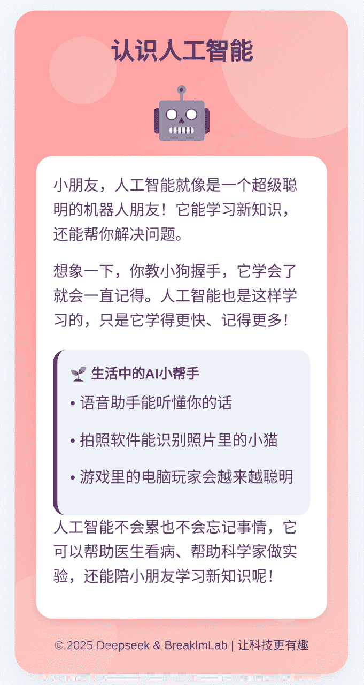 |  |  |  |  |
| 弱人工智能 | 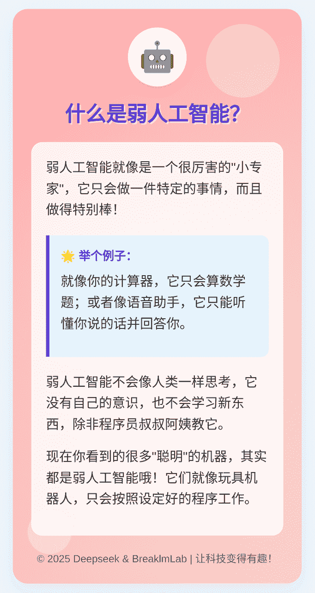 |  |  |  |  |
| 强人工智能 | 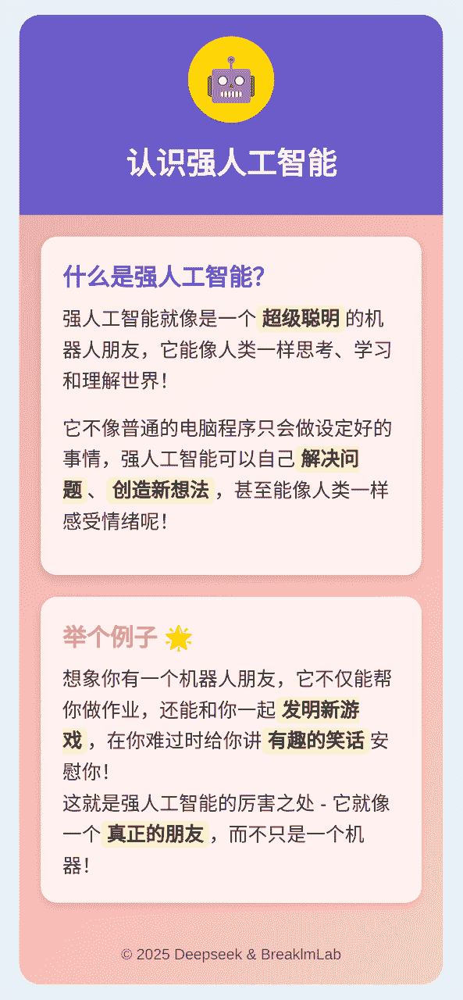 |  |  |  |  |
| **生成式AI：创造内容的AI** | 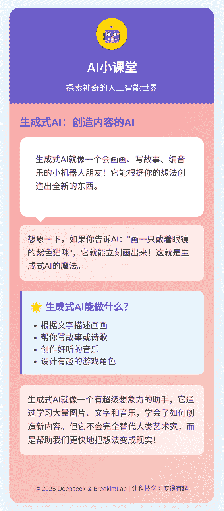 |  |  |  |  |
| 监督学习 | 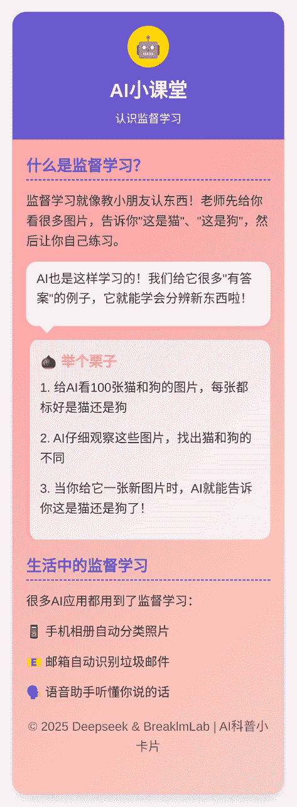 |  |  |  |  |
| 无监督学习 | 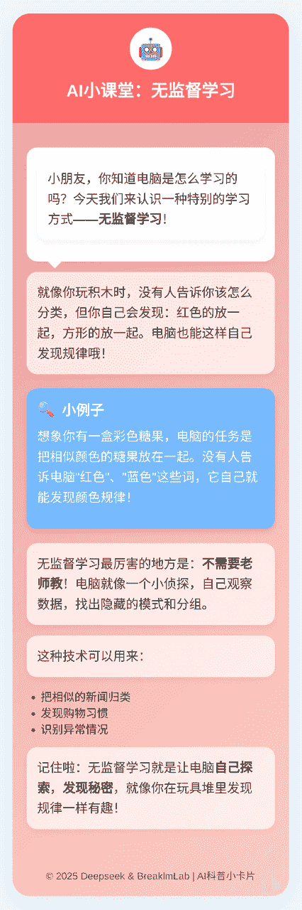 |  |  |  |  |
| 强化学习 | 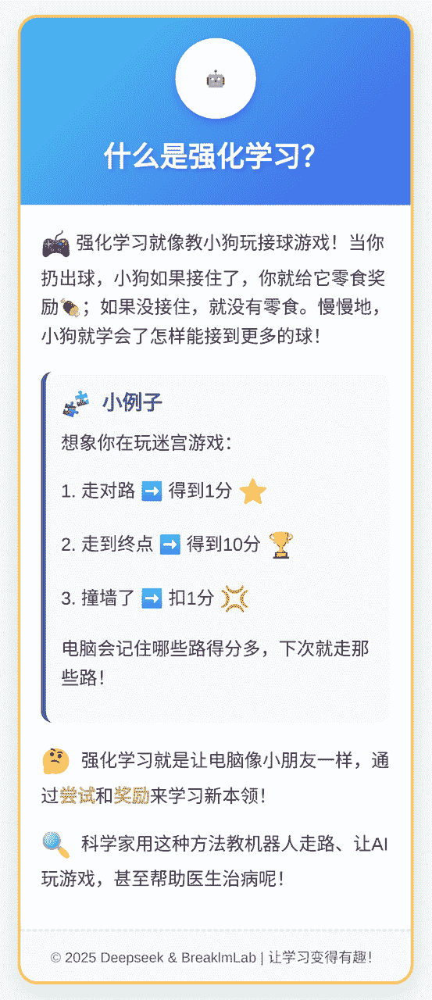 |  |  |  |  |
| **AI的日常应用场景：语音助手** |  |  |  |  |  |
| **AI的日常应用场景：推荐系统** |  |  |  |  |  |
| **AI的日常应用场景：医疗** |  |  |  |  |  |
| **AI的日常应用场景：金融** |  |  |  |  |  |
| **AI的日常应用场景：自动驾驶** |  |  |  |  |  |
| 神经网络 |  |  |  |  |  |
| 深度学习 |  |  |  |  |  |
| 大数据的作用 |  |  |  |  |  |
| **AI的局限性：**数据依赖与偏见 |  |  |  |  |  |
| **AI的局限性：缺乏常识逻辑** |  |  |  |  |  |
| **AI的局限性：“黑箱”难题** |  |  |  |  |  |
| **AI的伦理与争议：隐私风险** |  |  |  |  |  |
| **AI的伦理与争议：失业影响** |  |  |  |  |  |
| AI的伦理与争议：虚假信息（如Deepfake） |  |  |  |  |  |
| **AI的未来发展趋势** |  |  |  |  |  |
|  |  |  |  |  |  |