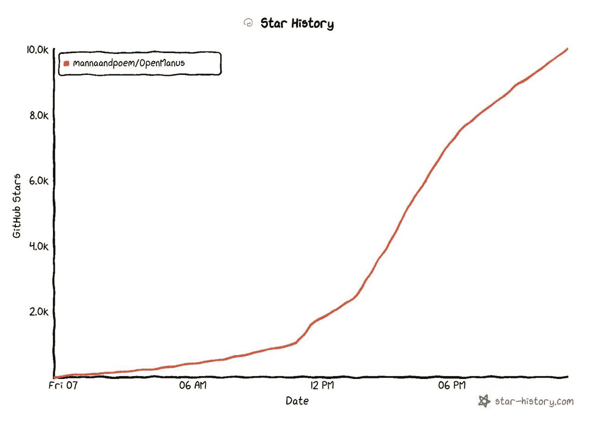
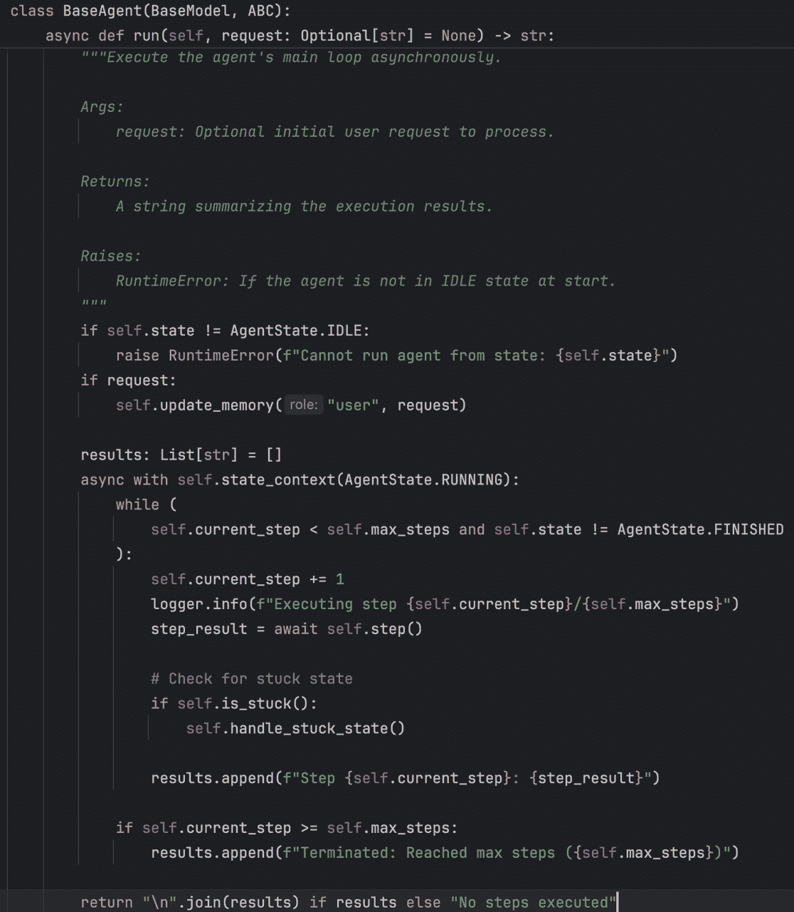
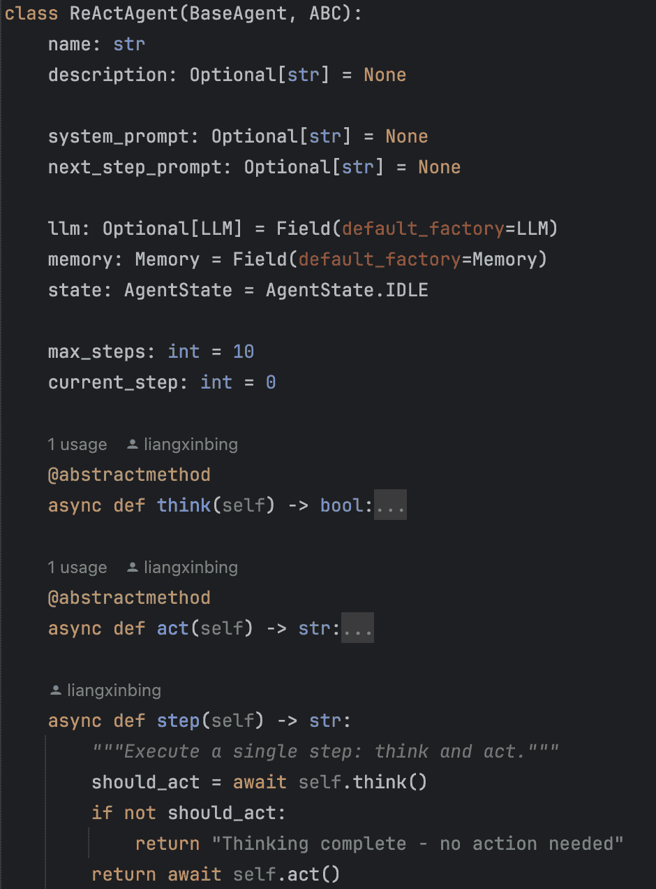
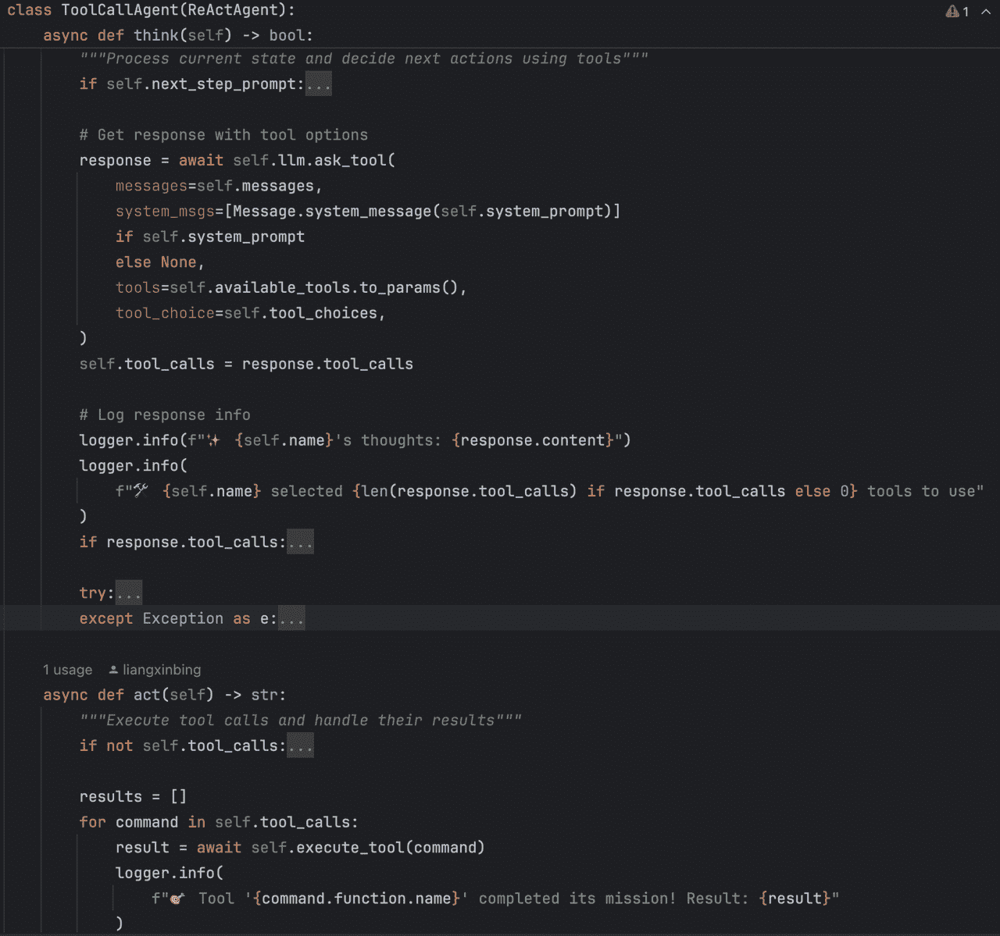
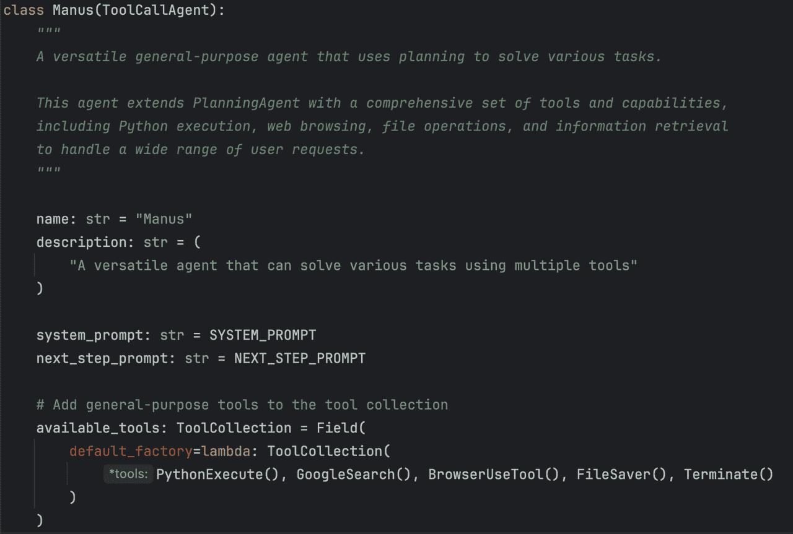
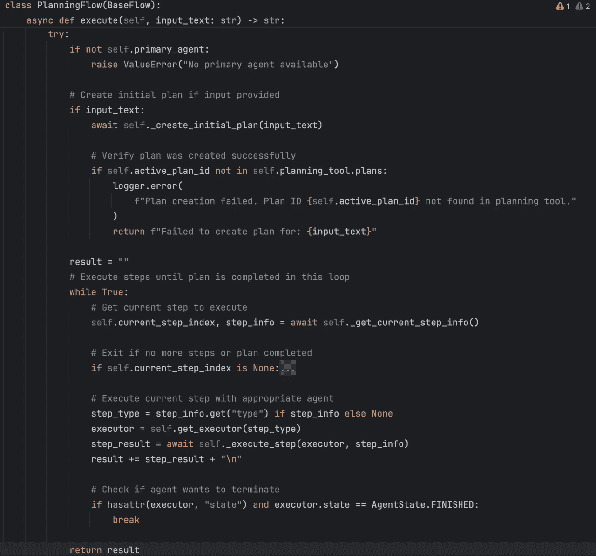

# Manus 分析 & OpenManus 技术方案

> 来源：[https://datawhaler.feishu.cn/docx/Bn5cd1HdOoSbjRxNTkWcj63Bnpg](https://datawhaler.feishu.cn/docx/Bn5cd1HdOoSbjRxNTkWcj63Bnpg)

OpenManus 项目链接：https://github.com/mannaandpoem/OpenManus

非常感谢大家对OpenManus的支持，1 天涨 10k star

# 前言

## 背景

Manus 是一款通用的AI 智能体产品，从用户示例中展示了卓越的用户体验，整体交互给人感觉很不错。但从技术方案上来说，Manus使用了大量的业内共识的核心基础技术。在那天晚饭过程中，我们讨论了Manus的产品形态和技术路线，然后我们整体使用了三个小时左右的时间，开发出来 OpenManus 这个开源项目。

除开工程上的卓越工作，让我们分析Manus的算法实现：

Manus 是一个多智能体系统，它首先先使用PlanningTool做规划，形成一个包含多个任务的线性结构的计划，然后顺序执行每一个任务并动态分配给相应的 Agent。Agent 在执行每个任务的过程中，以 ReAct 循环的形式调用工具以完成每一个任务。

1.  规划能力：Manus 将 PlanningTool 规划工具引入多智能体框架。在这里我想说一下 Planning 规划的重要性，Claude-3.7 在 SWEBench 上达到了，70% 解决率的效果，此前是49% 的 解决率。一部分提升来源于模型，另一部分就来源于规划。

而从我们之前的工作，Data Interpreter 也可以证明规划在处理现实问题中的重要性和有效性。

我们不仅会在多智能体上加入规划能力，也会尝试在单智能体上加上规划能力。

1.  工具使用能力：猜测：Manus应该是Claude+一些其它自己post train的模型，在工程上做了很大程度上的优化，这增强了它在不同场景下的工具使用能力。

## 目的

我觉得Manus产品交互做的挺好的，有很多技术也值得学习，至于OpenManus我们这边目前效果还很有限，我们没有单独调效果。

OpenManus 前期目标打算达到原始 Manus 的相同的效果，后续会依靠庞大的开源社区不断优化 Computer Use, Browser Use 和 Planning Use，以及工具调用的能力，从而给带来OpenManus更高的智能涌现～

# 方法

## 基础技术沉淀 & Insight

1.  一个极简的Agent框架，应该是可插拔的Tools和 Prompt的组合，之后我们沿着这个思路，写了一个完整的Agent迷你框架。

1.  而决定一个ReAct Agent( Reason和Act)的效果的关键是提示词引导和工具使用，在 OpenManus 中，Prompt控制了Agent整体的行为逻辑，Tools给定了Agent的行动空间，二者被定义就能完整诠释一个ReAct Agent。我在 React Agent 的基础上，基于Function Call 实现了一个轻量的 ToolCall Agent，它以更格式化的方式去选择和执行工具。OpenManus 也是基于 ToolCall Agent 去做的。

1.  可插拔的优点是可组合，我可以把几个不同场景下的Tools组合到一起来创造一个新的Agent，定义也很方便，不需要单独写内部逻辑，只需要修改动作空间（Tools）。Tools本身就该是可组合的，我们的工作是把抽象做的更干净。提供丰富的工具集合，支持多种Agent 通过装备工具集可以灵活扩展在不同场景下的能力。

1.  规划能力: OpenManus 继承了 Manus 的规划优势，通过 PlanningTool 实现任务分解，可以处理现实世界中的复杂问题。

## OpenManus 工作流程

1.  类图

首先，OpenManus在接收到用户需求后，会使用PlanningTool形成一个包含多个任务的线性结构的计划，写入至一个  plan 的 markdowns 文件中去，然后OpenManus查看这个 Plan，从中依次取出每个任务，在执行任务时，会将该任务分配给最适合处理该任务的 Agent，这些 Agents 装备了不同的工具集，在处理不同任务时，有不同的优势。

注：Agent 分配是在执行每个任务时临时被分配的。这种动态分配的方式让系统更灵活，能够根据任务的具体需求和上下文选择最合适的 Agent。目前使用正则匹配对 Agent 进行任务的分配，如果没匹配到，则使用默认配置的 Agent 去执行任务。

未来，我们也会考虑让 LLM 去将任务分配给某个 Agent。但每次执行任务时都使用 LLM 识别意图并分配Agent，会增加计算成本和延迟。

1.  流程图

## 代码细节

# 参考

1.  OpenManus: https://github.com/mannaandpoem/OpenManus

1.  Manus: https://manus.im/

1.  claude-computer-use: https://www.anthropic.com/news/3-5-models-and-computer-use

1.  claude-3-7-sonnet: https://www.anthropic.com/news/claude-3-7-sonnet

1.  OpenHands: https://github.com/All-Hands-AI/OpenHands

1.  browser-use: https://github.com/browser-use/browser-use

1.  Data Interpreter: https://arxiv.org/pdf/2402.18679