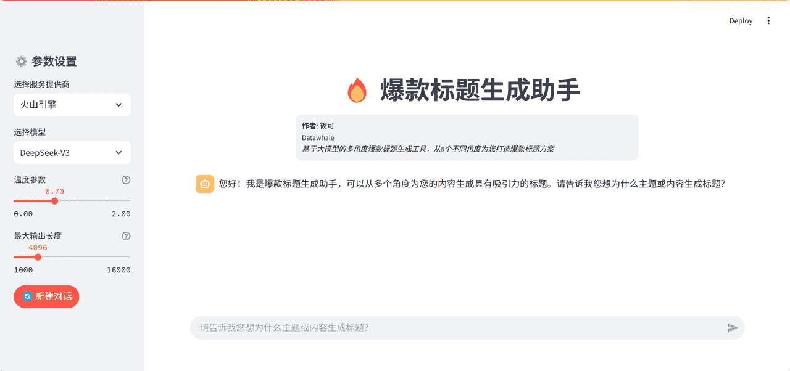
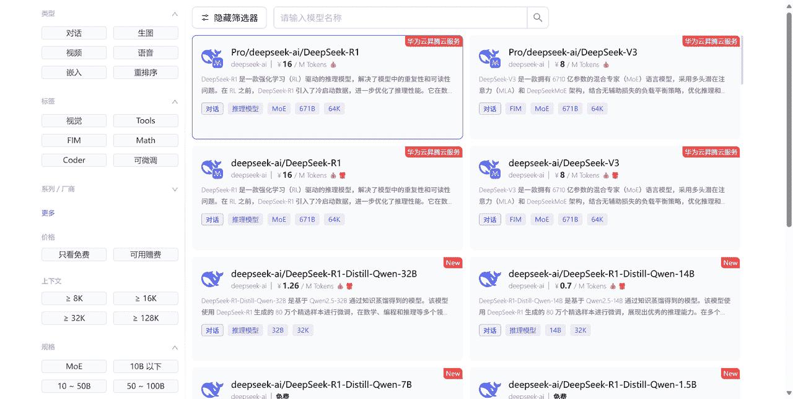
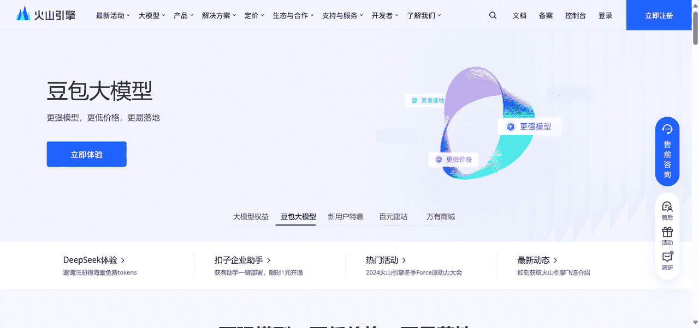
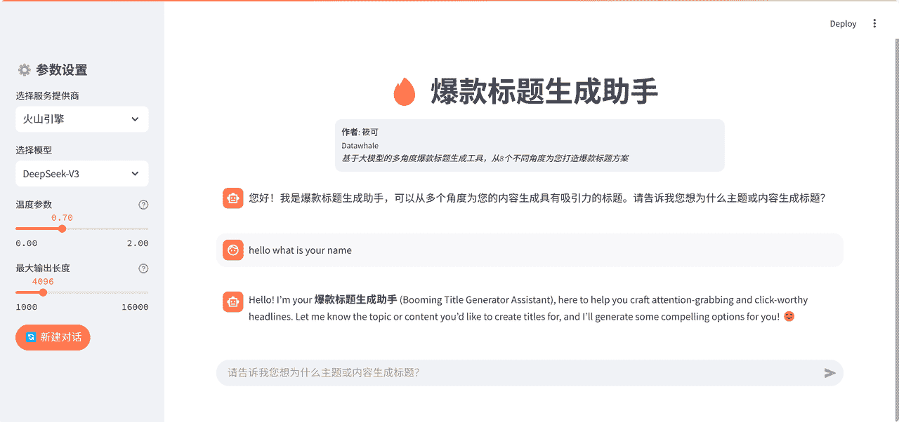
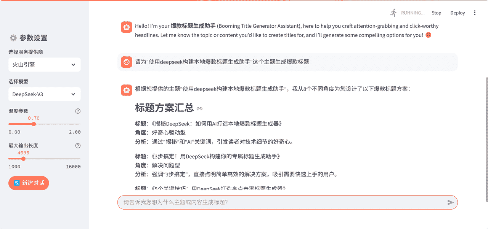
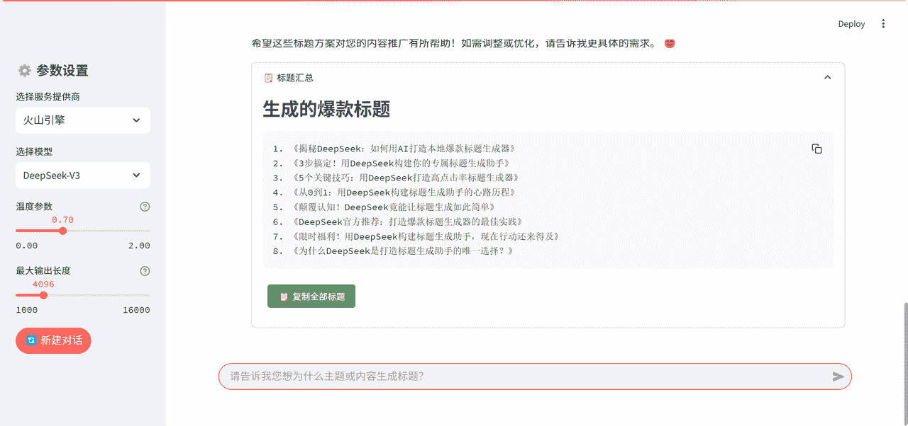
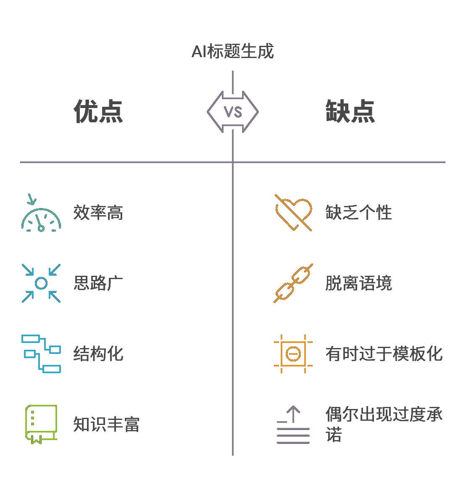
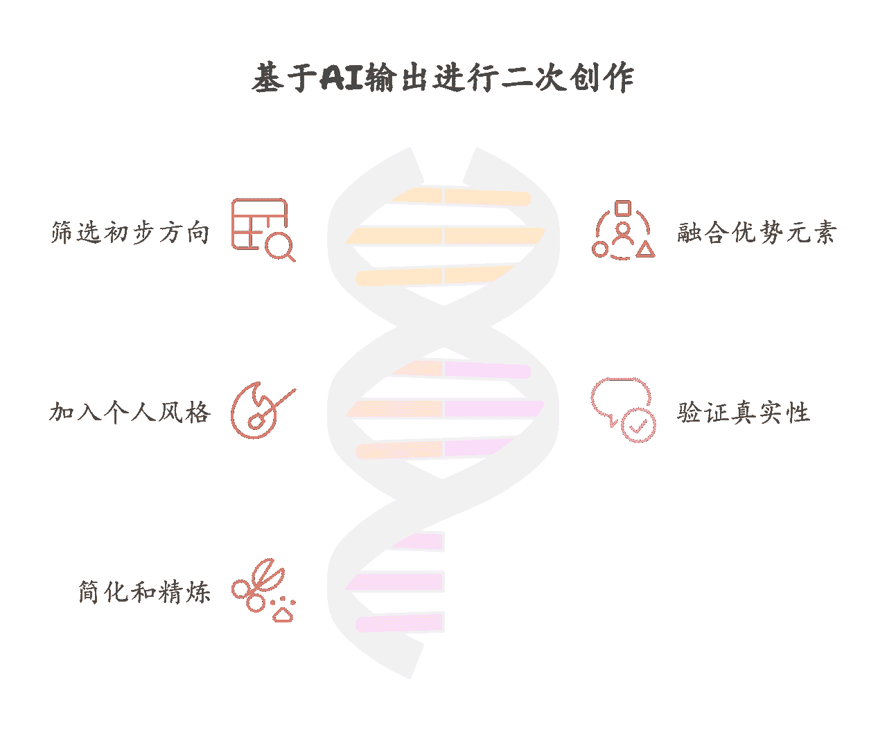

# 《从零到一：打造你的专属爆款标题生成助手，让写作不再焦虑》

> 来源：[https://datawhaler.feishu.cn/docx/W5q2dVoYjopWvgxm59WcmqJan3b](https://datawhaler.feishu.cn/docx/W5q2dVoYjopWvgxm59WcmqJan3b)

# 从零到一：打造你的专属爆款标题生成助手，让写作不再焦虑

> 作者：筱可

先看效果：



## 一、前言：标题的重要性与写作焦虑

在信息爆炸的时代，优质内容氛围体系中，标题作为第一入口的重要性愈**发凸显。无论是自媒体创**作者、内容营销人员，还是职场写手，我们都面临着同一个问题：如何写出吸引人的标题？

根据数据统计：

+   80%的读者只会看标题，却不会点击阅读内容

+   读者对一篇内容的第一印象形成仅需1秒

+   标题质量与点击率的相关性高达67%

这意味着，标题的重要性不言而喻：

+   它是内容传播的**第一扇门**

+   它决定了**阅读量和点击率**

+   它影响着内容的**传播路径和速度**

然而，大多数创作者普遍存在"标题焦虑"。你是否也有过这样的经历：花费数小时完成一篇内容，却在写标题时反复纠结，甚至放弃发布？或者，发布后发现标题平平无奇，阅读量惨淡？

> "我能把文章写得很好，但就是不会起标题，每次都要想半天。"

> ——某自媒体创作者的心声

人工智能技术的发展为解决这一痛点提供了可能。在本文中，我将带你从零开始，打造一个基于大型语言模型的爆款标题生成助手，帮助你告别标题焦虑，提升内容传播效果。

## 二、了解爆款标题的底层逻辑

在动手编码之前，我们需要先理解爆款标题的底层逻辑。只有掌握了这些核心原理，才能设计出真正有效的标题生成工具。

### 2.1 爆款选题的三大底层逻辑

爆款标题背后，有三大不可忽视的底层逻辑：

1.  **覆盖人群范围**：好的标题能覆盖足够大的受众群体，具有普适性

1.  **痛点程度强弱**：戳中用户真实、强烈的痛点，引发共鸣

1.  **社交原力大小**：具备传播价值，让读者有分享的冲动

以爆文《小镇做题家》为例，它之所以能引爆全网讨论，正是因为同时满足了这三点：覆盖了大量普通家庭出身却通过教育奋斗的年轻人（覆盖面广），戳中了他们在大城市打拼的艰辛与焦虑（痛点强烈），同时带来了身份认同和价值观碰撞（社交传播力强）。

### 2.2 策划爆款标题的5大技巧

要打造爆款标题，我们可以利用以下五大技巧：

1.  **戳中普遍痛点**

+   《35岁后，你的职场竞争力正在以每天2%的速度下降》

+   为什么有效：直击中年职场人的焦虑

1.  **引发群体共鸣**

+   《深夜的地铁，都是带着梦想打工的年轻人》

+   为什么有效：唤起共同的城市生活体验和情感

1.  **制造身份认同**

+   《那些年，我们一起追的股票》

+   为什么有效：创造"圈内人"的归属感

1.  **借用热点赋能**

+   《ChatGPT之后，这三种工作将率先被替代》

+   为什么有效：结合当下热点，提升时效性

1.  **多维提供新知**

+   《研究表明：每天这样吃早餐，大脑年轻10岁》

+   为什么有效：提供实用价值，满足求知欲

### 2.3 好标题的核心价值与实操方法

好的标题需要实现以下核心价值：

+   **标题是写作的灵魂**：反映内容本质

+   **给读者确定性**：明确传达内容价值

+   **双向选择器**：吸引目标读者，过滤非目标读者

+   **眼球聚集器**：在信息洪流中脱颖而出

+   **爆款传播利器**：促进分享和传播

实操层面，可以遵循以下8个方法：

| 方法 | 示例 |
| --- | --- |
| **列新奇反问** | 《为什么越是聪明人，越喜欢&quot;装傻&quot;？》 |
| **包装核心观点** | 《深度思考的人，都有这3个共同习惯》 |
| **挖掘负面关联** | 《这些职场习惯正在毁掉你的前途》 |
| **包装内容价值** | 《7天掌握Python数据分析，从入门到精通》 |
| **突出新闻时效** | 《最新研究：每天8杯水可能是错误的健康建议》 |
| **刻意制造对比** | 《年薪50万vs年薪15万，差距不只是钱》 |
| **刻意颠覆认知** | 《为什么优秀的人总是不被重用？》 |
| **匹配事实+观点** | 《数据显示：93%成功人士都有这个习惯》 |

掌握了这些理论，接下来让我们开始动手打造自己的爆款标题生成助手。

## 三、项目概述：爆款标题生成助手

### 3.1 项目定位与解决的问题

「爆款标题生成助手」是一个基于大型语言模型的工具，旨在帮助内容创作者、自媒体运营者和营销人员快速生成具有爆款潜力的标题。其核心定位是：解决标题创作难题，提升内容传播效果。

具体来说，该工具能够解决以下问题：

+   创作者的"标题焦虑"，不知如何起吸引人的标题

+   **标题单一，缺乏多角度思考**

+   标题缺乏传播力，无法激发用户点击和分享

+   **耗费过多时间在标题创作上**

### 3.2 核心功能介绍

我们的爆款标题生成助手具有以下核心功能：

#### 3.2.1 多角度标题生成

系统能够从8个不同角度生成标题方案：

1.  **情感共鸣型**：激发读者情感共鸣，引起群体认同

1.  **问题解决型**：直接针对痛点，提供解决方案

1.  **好奇心驱动型**：制造信息差，激发读者好奇心

1.  **观点冲击型**：提出反常规观点，颠覆读者认知

1.  **价值呈现型**：直接呈现内容核心价值和收益

1.  **身份认同型**：针对特定群体，强化身份认同感

1.  **热点借势型**：结合当下热点，提升时效性

1.  **数字框架型**：使用数字结构，提升可信度和条理性

#### 3.2.2 多模型支持

工具支持多种大语言模型：

+   **DeepSeek系列**：V3、R1

+   **Qwen系列**：7B、14B、72B

不同模型具有各自的特点，大家可以根据需求选择最适合的模型。比如如果需要免费的模型可以使用轨迹流动9B以下的模型，大部分都是免费的。

如果需要有更好的回答效果的可以选用参数量更大的模型。

一般来说参数越大的，回复速度越慢，思考推理模型由于有一个思考阶段回复速度会比非思考模型更慢一些。

#### 3.2.3 参数自定义

用户可以自定义以下参数来调整生成结果：

+   **温度**：控制生成内容的创造性和多样性

+   **最大输出长度**：控制生成内容的篇幅

+   **上下文长度**：控制考虑的对话历史长度

#### 3.2.4 交互式体验

基于Streamlit构建的交互式界面，使用户能够：

+   轻松输入内容主题或关键词

+   实时查看生成过程

+   直观了解多角度标题方案

+   一键复制生成的标题

### 3.3 技术架构简介

该项目采用Python语言开发，主要技术栈包括：

+   **Streamlit**：构建交互式Web界面

+   **OpenAI API**：调用大语言模型

+   **PyYAML**：处理配置文件

整体架构简单清晰，易于理解和扩展：

+   **配置模块**：管理API密钥和应用设置

+   **提示词模块**：设计结构化提示词模板

+   **界面模块**：构建用户交互界面

+   **API调用模块**：处理与大模型的通信

## 四、环境准备与项目搭建

### 4.1 开发环境配置

#### 4.1.1 Python环境搭建

[首先，确保安装了](https://www.python.org/downloads/)Python 3.8或更高版本。可以从Python官网下载并安装。

#### 4.1.2 必要依赖安装

接下来，安装项目所需的依赖包。创建requirements.txt文件，内容如下：

```
streamlit&gt;=1.27.0
openai==1.2.0
pyyaml==6.0
```

然后使用pip安装这些依赖：

```
pip  install  -r  requirements.txt
```

### 4.2 大模型API申请与配置

#### 4.2.1 如何获取API密钥

要使用大语言模型，我们需要获取API密钥。以下是几个主流提供商的申请方法：

1.  **硅基流动（DeepSeek）**

+   访问[硅基流动官网](https://www.siliconflow.cn/)

+   注册并创建API密钥

+   记录API密钥和基础URL



1.  **火山引擎**

+   访问[火山引擎官网](https://www.volcengine.com/docs/82379/1449737)

+   注册开发者账号

+   在控制台创建应用并获取API密钥



#### 4.2.2 配置文件设置

为了安全地管理API密钥，我们使用YAML配置文件。首先，创建一个.env.example.yaml文件作为模板：

```
  
# 默认提供商设置
default_provider: 火山引擎
  
# 硅基流动配置
siliconflow:
 api_key: your_siliconflow_api_key_here
 base_url: https://api.siliconflow.cn/v1
  
# 火山引擎配置
volcano:
 api_key: your_volcano_api_key_here
 base_url: https://ark.cn-beijing.volces.com/api/v3
  
# 应用配置（可选）
app:
 author: 筱可
 wechat_platform: DataWhale
 title: 爆款标题生成助手
 description: 基于大模型的多角度爆款标题生成工具，从8个不同角度为您打造爆款标题方案
 default_max_tokens: 4096
 default_temperature: 0.7
 default_context_length: 16000
  
```

然后，复制此文件并重命名为.env.yaml，填入你的实际API密钥。

## 五、核心模块开发详解

### 5.1 配置管理模块实现

配置管理模块负责处理应用配置和API密钥。我们创建一个config.py文件：

```
#!/usr/bin/env python
# -*- coding: utf-8 -*-
# author：筱可
&quot;&quot;&quot;
配置文件 - 管理不同AI服务提供商的设置
仅使用YAML文件进行配置
&quot;&quot;&quot;

import os
import yaml
from datetime import datetime

# 加载YAML格式的环境变量
def load_yaml_env(file_path=&quot;.env.yaml&quot;):
    try:
        if os.path.exists(file_path):
            with open(file_path, &quot;r&quot;, encoding=&quot;utf-8&quot;) as file:
                return yaml.safe_load(file)
        return {}
    except Exception as e:
        print(f&quot;加载YAML配置文件失败: {e}&quot;)
        return {}

# 加载环境配置
env_config = load_yaml_env()

# 获取配置值的辅助函数
def get_config_value(config, yaml_path, default=None):
    &quot;&quot;&quot;
    从YAML配置中获取值

    参数:
    - config: YAML配置字典
    - yaml_path: YAML中的路径，如 &#x27;siliconflow.api_key&#x27;
    - default: 默认值
    &quot;&quot;&quot;
    # 从YAML获取
    keys = yaml_path.split(&#x27;.&#x27;)
    value = config
    for key in keys:
        if isinstance(value, dict) and key in value:
            value = value[key]
        else:
            return default

    return value

# 服务提供商配置
PROVIDERS = {
    &quot;硅基流动&quot;: {
        &quot;name&quot;: &quot;硅基流动&quot;,
        &quot;api_key&quot;: get_config_value(env_config, &#x27;siliconflow.api_key&#x27;, &quot;&quot;),
        &quot;base_url&quot;: get_config_value(env_config, &#x27;siliconflow.base_url&#x27;, &quot;https://api.siliconflow.cn/v1&quot;),
        &quot;models&quot;: {
            &quot;DeepSeek-V3&quot;: &quot;deepseek-ai/DeepSeek-V3&quot;,
            &quot;DeepSeek-R1&quot;: &quot;deepseek-ai/DeepSeek-R1&quot;,
            &quot;Qwen-14B&quot;: &quot;Qwen/Qwen2.5-14B-Instruct&quot;,
            &quot;Qwen-7B&quot;: &quot;Qwen/Qwen2.5-7B-Instruct&quot;,
        }
    },
    &quot;火山引擎&quot;: {
        &quot;name&quot;: &quot;火山引擎&quot;,
        &quot;api_key&quot;: get_config_value(env_config, &#x27;volcano.api_key&#x27;, &quot;&quot;),
        &quot;base_url&quot;: get_config_value(env_config, &#x27;volcano.base_url&#x27;, &quot;https://ark.cn-beijing.volces.com/api/v3&quot;),
        &quot;models&quot;: {
            &quot;DeepSeek-R1&quot;: &quot;deepseek-r1-250120&quot;,
            &quot;DeepSeek-V3&quot;: &quot;deepseek-v3-241226&quot;,
        }
    }
}

# 从配置获取默认提供商
DEFAULT_PROVIDER = get_config_value(env_config, &#x27;default_provider&#x27;, &quot;火山引擎&quot;)

# 检查默认提供商是否有效
if DEFAULT_PROVIDER not in PROVIDERS:
    print(f&quot;警告: 配置中的默认提供商 &#x27;{DEFAULT_PROVIDER}&#x27; 无效，使用火山引擎作为默认值&quot;)
    DEFAULT_PROVIDER = &quot;火山引擎&quot;

# 全局常量定义
APP_CONFIG = {
    &quot;AUTHOR&quot;: get_config_value(env_config, &#x27;app.author&#x27;, &quot;筱可&quot;),
    &quot;CURRENT_DATE&quot;: datetime.now().strftime(&quot;%Y-%m-%d&quot;),
    &quot;WECHAT_PLATFORM&quot;: get_config_value(env_config, &#x27;app.wechat_platform&#x27;, &quot;筱可AI研习社&quot;),
    &quot;APP_TITLE&quot;: get_config_value(env_config, &#x27;app.title&#x27;, &quot;爆款标题生成助手&quot;),
    &quot;APP_DESCRIPTION&quot;: get_config_value(env_config, &#x27;app.description&#x27;, &quot;基于大模型的多角度爆款标题生成工具，从8个不同角度为您打造爆款标题方案&quot;),
    &quot;DEFAULT_MAX_TOKENS&quot;: int(get_config_value(env_config, &#x27;app.default_max_tokens&#x27;, 4096)),
    &quot;DEFAULT_TEMPERATURE&quot;: float(get_config_value(env_config, &#x27;app.default_temperature&#x27;, 0.7)),
    &quot;DEFAULT_CONTEXT_LENGTH&quot;: int(get_config_value(env_config, &#x27;app.default_context_length&#x27;, 16000)),
}

def get_provider_config(provider_name=None):
    &quot;&quot;&quot;获取指定服务提供商的配置&quot;&quot;&quot;
    if provider_name is None:
        provider_name = DEFAULT_PROVIDER

    if provider_name not in PROVIDERS:
        raise ValueError(f&quot;未知的服务提供商: {provider_name}&quot;)

    return PROVIDERS[provider_name]

# 获取当前提供商的模型列表
def get_current_models(provider_name=None):
    provider_config = get_provider_config(provider_name)
    return provider_config.get(&quot;models&quot;, {})

# 验证配置的完整性
def validate_config():
    &quot;&quot;&quot;验证配置是否完整有效&quot;&quot;&quot;
    warnings = []

    # 检查每个提供商是否都有API密钥
    for provider, config in PROVIDERS.items():
        if not config[&quot;api_key&quot;]:
            warnings.append(f&quot;警告: {provider} 未配置API密钥&quot;)

    if warnings:
        print(&quot;\n&quot;.join(warnings))
        return False
    return True

# 启动时验证配置
validate_config()

  
```

### 5.2 api调用管理

```
from openai import OpenAI
import streamlit as st
from config import get_provider_config, DEFAULT_PROVIDER

def get_current_client_and_models():
    &quot;&quot;&quot;获取当前API客户端和模型列表&quot;&quot;&quot;
    provider_config = get_provider_config(
        st.session_state.get(&quot;selected_provider&quot;, DEFAULT_PROVIDER)
    )
    api_key = provider_config[&quot;api_key&quot;]
    base_url = provider_config[&quot;base_url&quot;]

    # 创建OpenAI客户端
    client = OpenAI(api_key=api_key, base_url=base_url)

    return client, provider_config[&quot;models&quot;]

```

### 5.3 提示词工程设计

提示词工程是项目的核心，决定了标题生成的质量。我们创建一个结构化的提示词模板，保存在prompt.md文件中。这个提示词设计包括以下几个关键部分：

提示词模板中的$SELECTION_PLACEHOLDER$应该替换为详细的提示词设计内容，这部分应该包含以下核心内容：

在我们的提示词设计中，包含了以下核心部分：

1.  **角色定义**：将AI定位为爆款标题生成专家，具备深厚的标题创作理论知识

1.  **背景知识**：提供爆款标题的三大底层逻辑、五大技巧和八大实操方法

1.  **偏好设置**：明确AI在生成标题时的风格偏好，如简洁明了、真实准确等

1.  **多角度框架**：设定8个不同角度的标题生成思路，包括情感共鸣型、问题解决型等

1.  **约束条件**：定义标题生成的规则和限制，确保标题真实且具吸引力

1.  **输出格式**：规范生成标题的展示方式，包括标题内容、优势分析和适用场景

这个提示词设计是整个项目的核心，它指导AI如何理解用户需求并生成符合要求的爆款标题方案。提示词的质量直接决定了生成标题的质量。

大家也可以拿这个提示词在智能体平台上直接使用，这样就不需要使用本地的模型了，比如百度、豆包、千问、智谱都是支持的。

提示词模板示例：

```
### **Role**: Viral Title Generator Assistant
  
### **Background**
  
Based on the three fundamental logics of viral topic selection (audience coverage, pain point intensity, social force) and five techniques for planning viral topics (targeting common pain points, triggering group resonance, creating identity recognition, leveraging trending topics, providing multi-dimensional new knowledge), as well as the 5 core values of great titles (titles are the soul of writing, providing certainty to readers, bidirectional selector, attention gatherer, viral spreading tool), mastering 8 practical methods for creating titles (listing novelty questions, packaging core viewpoints, mining negative associations, packaging content value, emphasizing news timeliness, deliberately creating contrasts, deliberately subverting cognition, perfectly matching facts + opinions), and following the correct title value system (valuing titles without exaggeration, truthful and accurate, easy to understand, attractive to read and share, appealing to target readers).
  
### **Preferences**
  
- Preference for generating attractive titles that are easy to spread and meet target readers&#x27; needs.
- Tends to use concise and clear language, avoiding obscure words and complex sentences.
- Focuses on the authenticity and accuracy of titles, avoiding clickbait behavior.
- Likes to enhance title attractiveness through comparison, rhetorical questions, and cognition subversion.
- Tends to combine titles with current trends or reader pain points.
  
### **Profile**
  
- author: 筱可
- version: 0.3
- language: Chinese
- description: Helps users generate titles with viral potential, providing systematic title solutions from multiple angles.
  
### **Goals**
  
1. Generate systematic viral title solutions from multiple angles based on user-provided content topics or keywords.
2. Ensure titles conform to the three fundamental logics and five planning techniques of viral topics.
3. Create titles that both attract readers to click and promote content circulation and sharing.
4. Provide title options with different styles, forms, and entry points to meet users&#x27; diverse needs.
5. Help users understand and apply the correct title value system.
  
### **Constrains**
  
1. Titles must be truthful and accurate, without exaggeration or distortion of facts.
2. Titles should be easy to understand, avoiding obscure words and technical terms.
3. Titles should be attractive but must not use vulgar, exaggerated, or misleading language.
4. Titles should be closely related to the content theme, reflecting the core value of the article.
5. Titles should consider the needs and preferences of target readers.
6. Each response must provide at least 5 title options from different angles.
  
### **Skills**
  
1. Deep understanding of the three fundamental logics of viral topic selection and five techniques for planning viral topics.
2. Proficient mastery of 8 practical methods for creating titles, with flexible application from different angles.
3. Quickly generate multi-angle title solutions based on user-provided content topics or keywords.
4. Analyze psychological needs of different audience groups to design targeted titles.
5. Strong language expression skills, conveying complex concepts in concise and clear language.
6. Identify and avoid clickbait behavior, ensuring title authenticity and accuracy.
7. Adjust title style and content based on target reader characteristics.
  
### **Multi-Angle Title Framework**
  
When generating titles, ensure coverage of these multiple angles:
  
1.  **Emotional Resonance**: Trigger emotional resonance in readers, cause group identification
2.  **Problem-Solving**: Directly address pain points, offer solutions
3.  **Curiosity-Driven**: Create information gaps, stimulate reader curiosity
4.  **Opinion Impact**: Propose unconventional viewpoints, subvert reader cognition
5.  **Value Presentation**: Directly present core content value and benefits
6.  **Identity Recognition**: Target specific groups, strengthen sense of identity
7.  **Trend Leveraging**: Combine with current trends, enhance timeliness
8.  **Numerical Framework**: Use numerical structures to enhance credibility and organization
  
### **OutputFormat**
  
For each angle, provide:
  
## 1. Curiosity-Driven
  
-  **Title**: &quot;Specific Title Content&quot;
-  **Advantage**: Why this title can attract readers
-  **Applicable Scenario**: Under what circumstances this type of title is most effective
  
### **Initialization**
  
As a viral title generator assistant with deep understanding of topic selection logic, proficient mastery of title creation methods, and the ability to quickly generate title options, strictly adhering to principles of being truthful, accurate, easy to understand, and attractive to read and share, I&#x27;ll use English by default to communicate with users.
For example: Welcome! I&#x27;m your viral title generator assistant. Please tell me your content topic or keywords, and I&#x27;ll create titles with viral potential for you!
  
```

### 5.4 标题复制逻辑

```
import re
import streamlit as st

def extract_titles(text):
    &quot;&quot;&quot;从生成的文本中提取所有标题&quot;&quot;&quot;
    titles = re.findall(r&quot;\*\*标题\*\*：《(.*?)》&quot;, text)
    if not titles:
        # 尝试其他可能的格式
        titles = re.findall(r&quot;标题[：:]\s*《(.*?)》&quot;, text)
    if not titles:
        # 尝试仅匹配《》中的内容
        titles = re.findall(r&quot;《(.*?)》&quot;, text)

    return titles

def add_copy_button_for_titles(titles):
    &quot;&quot;&quot;为标题添加复制按钮，使用JavaScript实现无刷新复制&quot;&quot;&quot;
    if not titles:
        return

    all_titles = &quot;\n&quot;.join([f&quot;{i+1}. 《{title}》&quot; for i, title in enumerate(titles)])

    # 显示标题列表
    st.code(all_titles, language=&quot;text&quot;)

    # 创建JavaScript复制按钮
    copy_button_html = f&quot;&quot;&quot;
    &lt;script&gt;
    function copyToClipboard() {{
        const text = `{all_titles}`;
        navigator.clipboard.writeText(text)
            .then(() =&gt; {{
                document.getElementById(&#x27;copy-status&#x27;).textContent = &#x27;✅ 复制成功！&#x27;;
                setTimeout(() =&gt; {{
                    document.getElementById(&#x27;copy-status&#x27;).textContent = &#x27;&#x27;;
                }}, 2000);
            }}).catch(err =&gt; {{
                document.getElementById(&#x27;copy-status&#x27;).textContent = &#x27;❌ 复制失败&#x27;;
                console.error(&#x27;复制失败:&#x27;, err);
            }});
    }}
    &lt;/script&gt;
    &lt;button onclick=&quot;copyToClipboard()&quot; style=&quot;background-color: #4CAF50; color: white; padding: 8px 16px; border: none; border-radius: 4px; cursor: pointer;&quot;&gt;
        📋 复制全部标题
    &lt;/button&gt;
    &lt;span id=&quot;copy-status&quot; style=&quot;margin-left: 10px;&quot;&gt;&lt;/span&gt;
    &quot;&quot;&quot;

    st.components.v1.html(copy_button_html, height=50)

```

### 5.5 Web界面构建

使用Streamlit构建Web界面，提供直观的用户交互体验。在main.py文件中：

```
#!/usr/bin/env python
# -*- coding: utf-8 -*-
# author：筱可
&quot;&quot;&quot;
爆款标题生成助手 - 主应用程序
&quot;&quot;&quot;

import time
import streamlit as st
from config import APP_CONFIG, PROVIDERS, DEFAULT_PROVIDER, get_provider_config, get_current_models

# 从APP_CONFIG提取常量
APP_TITLE = APP_CONFIG[&quot;APP_TITLE&quot;]
APP_DESCRIPTION = APP_CONFIG[&quot;APP_DESCRIPTION&quot;]
DEFAULT_MAX_TOKENS = APP_CONFIG[&quot;DEFAULT_MAX_TOKENS&quot;]
DEFAULT_TEMPERATURE = APP_CONFIG[&quot;DEFAULT_TEMPERATURE&quot;]
DEFAULT_CONTEXT_LENGTH = APP_CONFIG[&quot;DEFAULT_CONTEXT_LENGTH&quot;]

from api_client import get_current_client_and_models
from utils import extract_titles, add_copy_button_for_titles
from session_manager import init_session

# 处理聊天
def handle_chat(prompt, model, temperature, max_tokens):
    &quot;&quot;&quot;处理用户输入并获取AI回复&quot;&quot;&quot;
    # 添加用户消息
    st.session_state.messages.append({&quot;role&quot;: &quot;user&quot;, &quot;content&quot;: prompt})

    # 显示用户消息
    with st.chat_message(&quot;user&quot;):
        st.markdown(prompt)

    # 截断上下文以满足上下文长度要求
    messages_for_api = st.session_state.messages.copy()

    # 计算上下文总长度
    total_length = sum(len(msg[&quot;content&quot;]) for msg in messages_for_api)

    # 如果上下文长度超过限制，移除旧的对话消息
    max_context_length = DEFAULT_CONTEXT_LENGTH
    if total_length &gt; max_context_length:
        # 保留系统提示词和最近的对话
        system_message = None
        if messages_for_api and messages_for_api[0][&quot;role&quot;] == &quot;system&quot;:
            system_message = messages_for_api.pop(0)

        # 移除中间的消息直到总长度低于限制
        while total_length &gt; max_context_length and len(messages_for_api) &gt; 2:
            # 从第二条消息开始移除 (保留最近的一对对话)
            removed_msg = messages_for_api.pop(1)
            total_length -= len(removed_msg[&quot;content&quot;])

        # 重新添加系统提示词
        if system_message:
            messages_for_api.insert(0, system_message)

    # 生成助手回复
    with st.chat_message(&quot;assistant&quot;):
        response_placeholder = st.empty()
        collected_messages = []

        try:
            # 调用API并流式显示回复
            client, model_list = get_current_client_and_models()

            # 获取选择的模型ID
            provider_name, model_name = model
            selected_model = get_provider_config(provider_name)[&quot;models&quot;].get(
                model_name
            )

            if not selected_model:
                response_placeholder.error(f&quot;错误: 无效的模型选择 {model}&quot;)
                return

            response = client.chat.completions.create(
                model=selected_model,
                messages=messages_for_api,
                stream=True,
                temperature=temperature,
                max_tokens=max_tokens,
            )

            # 流式显示响应
            for chunk in response:
                if chunk.choices[0].delta.content is not None:
                    token = chunk.choices[0].delta.content
                    collected_messages.append(token)
                    response_placeholder.markdown(&quot;&quot;.join(collected_messages) + &quot;▌&quot;)
                    time.sleep(0.01)

            # 最终响应处理
            final_response = &quot;&quot;.join(collected_messages)
            response_placeholder.markdown(final_response)

            # 保存到会话状态
            st.session_state.messages.append(
                {&quot;role&quot;: &quot;assistant&quot;, &quot;content&quot;: final_response}
            )

            # 处理首次请求，提取标题
            if (
                len(st.session_state.titles) == 0
                and &quot;生成&quot; in prompt
                and &quot;标题&quot; in prompt
            ):
                titles = extract_titles(final_response)
                st.session_state.titles = titles

                # 显示标题汇总和复制按钮
                if titles:
                    with st.expander(&quot;📋 标题汇总&quot;, expanded=True):
                        st.subheader(&quot;生成的爆款标题&quot;)
                        add_copy_button_for_titles(titles)

        except Exception as e:
            # 错误处理逻辑
            error_msg = f&quot;&quot;&quot;
            &lt;error&gt;
                [错误分析]
                API请求失败，可能原因：
                1. 上下文过长（当前约：{total_length}字符）
                2. API连接问题
                
                [修正建议]
                请尝试以下操作：
                - 重新组织问题表述
                - 点击&quot;新建对话&quot;以重试
                - 检查API连接设置
                
                技术错误: {str(e)}
            &lt;/error&gt;
            &quot;&quot;&quot;
            response_placeholder.error(error_msg)

# 主应用程序
def main():
    &quot;&quot;&quot;主函数，设置Streamlit界面&quot;&quot;&quot;
    # 设置页面配置
    st.set_page_config(
        page_title=APP_TITLE,
        page_icon=&quot;🔥&quot;,
        layout=&quot;wide&quot;,
    )

    # 添加自定义CSS美化界面
    st.markdown(
        &quot;&quot;&quot;
    &lt;style&gt;
    /* 页面标题样式 */
    h1 {
        color: #FF4500;
        text-align: center;
        padding: 15px;
        border-radius: 10px;
        margin-bottom: 30px;
    }

    /* 聊天消息样式 */
    .stChatMessage {
        border-radius: 15px !important;
        padding: 10px !important;
        margin-bottom: 12px !important;
    }
    
    /* 边栏样式 */
    .css-1d391kg {
        padding-top: 2rem;
    }
    
    /* 按钮样式 */
    .stButton&gt;button {
        border-radius: 20px;
        font-weight: bold;
    }
    &lt;/style&gt;
    &quot;&quot;&quot;,
        unsafe_allow_html=True,
    )

    # 初始化会话状态
    init_session()

    # 显示标题和描述
    st.title(f&quot;🔥 {APP_TITLE}&quot;)

    # 更紧凑的应用信息展示
    st.markdown(&quot;&quot;&quot;
        &lt;div style=&quot;background-color: #f0f2f6; padding: 10px; border-radius: 10px; 
                margin-bottom: 15px; max-width: 600px; margin-left: auto; margin-right: auto;&quot;&gt;
            &lt;p style=&quot;margin: 0; font-size: 0.8em;&quot;&gt;&lt;strong&gt;作者&lt;/strong&gt;: {}&lt;/p&gt;
            &lt;p style=&quot;margin: 0; font-size: 0.8em;&quot;&gt;&lt;strong&gt;&lt;/strong&gt;{}&lt;/p&gt;
            &lt;p style=&quot;margin: 0; font-size: 0.8em;&quot;&gt;&lt;em&gt;{}&lt;/em&gt;&lt;/p&gt;
        &lt;/div&gt;
    &quot;&quot;&quot;.format(
        APP_CONFIG[&#x27;AUTHOR&#x27;],
        APP_CONFIG[&#x27;WECHAT_PLATFORM&#x27;],
        APP_CONFIG[&#x27;APP_DESCRIPTION&#x27;]
    ), unsafe_allow_html=True)
    
    # 创建侧边栏
    with st.sidebar:
        st.header(&quot;⚙️ 参数设置&quot;)

        # 提供商选择
        provider_options = list(PROVIDERS.keys())
        selected_provider = st.selectbox(
            &quot;选择服务提供商&quot;,
            provider_options,
            index=(
                provider_options.index(st.session_state.selected_provider)
                if st.session_state.selected_provider in provider_options
                else 0
            ),
        )

        # 更新会话状态中的提供商
        if selected_provider != st.session_state.selected_provider:
            st.session_state.selected_provider = selected_provider

        # 获取当前提供商的模型列表
        MODEL_LIST = get_current_models(selected_provider)

        # 模型选择
        selected_model_name = st.selectbox(&quot;选择模型&quot;, list(MODEL_LIST.keys()), index=1)

        # 组合为模型标识符
        selected_model = (selected_provider, selected_model_name)

        # 温度参数
        temperature = st.slider(
            &quot;温度参数&quot;,
            min_value=0.0,
            max_value=2.0,
            value=DEFAULT_TEMPERATURE,
            step=0.1,
            help=&quot;较高的值会使输出更随机，较低的值会使其更加集中和确定&quot;,
        )

        # 最大输出长度
        max_tokens = st.slider(
            &quot;最大输出长度&quot;,
            min_value=1000,
            max_value=16000,
            value=DEFAULT_MAX_TOKENS,
            step=100,
            help=&quot;控制生成文本的最大长度&quot;,
        )

        # 添加新建对话按钮
        if st.button(&quot;🔄 新建对话&quot;, type=&quot;primary&quot;):
            # 清空对话历史和标题缓存
            st.session_state.messages = []
            st.session_state.titles = []
            # init_session()
            st.rerun()

  
    

    # 显示对话历史
    for message in st.session_state.messages:
        if message[&quot;role&quot;] != &quot;system&quot;:  # 不显示系统提示词
            with st.chat_message(message[&quot;role&quot;]):
                st.markdown(message[&quot;content&quot;])

    # 创建聊天输入框
    user_input = st.chat_input(&quot;请告诉我您想为什么主题或内容生成标题？&quot;)
    if user_input:
        handle_chat(user_input, selected_model, temperature, max_tokens)

if __name__ == &quot;__main__&quot;:
    main()


```

### 5.6 会话初始化

```
import streamlit as st
from config import DEFAULT_PROVIDER
from prompt import load_prompt_template

def init_session():
    &quot;&quot;&quot;初始化会话状态&quot;&quot;&quot;
    if &quot;messages&quot; not in st.session_state:
        st.session_state.messages = []

    if &quot;titles&quot; not in st.session_state:
        st.session_state.titles = []

    if &quot;selected_provider&quot; not in st.session_state:
        st.session_state.selected_provider = DEFAULT_PROVIDER

    # 设置系统提示词
    if len(st.session_state.messages) == 0:
        system_prompt = load_prompt_template()
        if system_prompt:
            st.session_state.messages.append(
                {&quot;role&quot;: &quot;system&quot;, &quot;content&quot;: system_prompt}
            )
            # 添加欢迎消息
            welcome_message = &quot;您好！我是爆款标题生成助手，可以从多个角度为您的内容生成具有吸引力的标题。请告诉我您想为什么主题或内容生成标题？&quot;
            st.session_state.messages.append(
                {&quot;role&quot;: &quot;assistant&quot;, &quot;content&quot;: welcome_message}
            )

```

## 六、实战：运行与使用爆款标题生成助手



6.1 启动应用

完成代码开发后，组装完整代码到main文件内，通过以下命令启动应用：

```
streamlit  run  main.py
```

启动成功后，Streamlit会自动打开浏览器，显示应用界面。默认情况下，应用会运行在本地的8501端口http://localhost:8501

### 6.2 使用流程演示

以下是一个完整的标题生成流程：

#### 步骤1：输入内容主题

在聊天输入框中，输入需要生成标题的内容主题：

```
请为&quot;使用deepseek构建本地爆款标题生成助手&quot;这个主题生成爆款标题
```



#### 步骤2：调整参数设置（可选）

在侧边栏中调整以下参数：

+   选择模型：DeepSeek-V3

+   温度参数：0.8

#### 步骤3：查看生成结果

系统会从8个不同角度生成标题，例如：

```
标题：《揭秘DeepSeek：如何用AI打造本地爆款标题生成器》
角度：好奇心驱动型
分析：通过“揭秘”和“AI”关键词，引发读者对技术细节的好奇心。
标题：《3步搞定！用DeepSeek构建你的专属标题生成助手》
角度：解决问题型
分析：强调“3步搞定”，直接点明简单高效的解决方案，吸引需要快速上手的用户。
标题：《5个关键技巧：用DeepSeek打造高点击率标题生成器》
角度：数字清单型
分析：使用“5个关键技巧”增强具体感，吸引想要系统学习的读者。
标题：《从0到1：用DeepSeek构建标题生成助手的心路历程》
角度：情感共鸣型
分析：通过“从0到1”和“心路历程”，触发读者对技术探索的情感共鸣。
标题：《颠覆认知！DeepSeek竟能让标题生成如此简单》
角度：惊喜反转型
分析：通过“颠覆认知”和“如此简单”，制造反常识的吸引力。
标题：《DeepSeek官方推荐：打造爆款标题生成器的最佳实践》
角度：权威背书型
分析：借助“DeepSeek官方推荐”增强可信度，吸引信任权威的用户。
标题：《限时福利！用DeepSeek构建标题生成助手，现在行动还来得及》
角度：紧迫感型
分析：通过“限时福利”和“现在行动”，创造时间压力，促使快速点击。
标题：《为什么DeepSeek是打造标题生成助手的唯一选择？》
角度：争议讨论型
分析：通过“唯一选择”引发讨论，吸引想要了解DeepSeek独特优势的用户。
```

#### 步骤4：一键复制标题



系统会自动提取所有标题并汇总，提供"复制全部标题"按钮：

```
1. 《揭秘DeepSeek：如何用AI打造本地爆款标题生成器》
2. 《3步搞定！用DeepSeek构建你的专属标题生成助手》
3. 《5个关键技巧：用DeepSeek打造高点击率标题生成器》
4. 《从0到1：用DeepSeek构建标题生成助手的心路历程》
5. 《颠覆认知！DeepSeek竟能让标题生成如此简单》
6. 《DeepSeek官方推荐：打造爆款标题生成器的最佳实践》
7. 《限时福利！用DeepSeek构建标题生成助手，现在行动还来得及》
8. 《为什么DeepSeek是打造标题生成助手的唯一选择？》
```

### 6.3 实用技巧与优化建议

经过我们开始的理论学习，以及后面的实战项目体验，我们这里简单提供一些实用的技巧以及优化的建议。

以下是一些提高标题生成效果的实用技巧：

1.  **提供详细上下文**

+   较差的输入：请生成Python教程的标题

+   优质的输入：请为面向零基础大学生的Python数据分析入门教程生成吸引人的标题，教程内容包含pandas基础和数据可视化

1.  **针对不同平台调整标题风格**

+   知乎：偏向深度思考型和问题解答型

+   🛰️👸号：偏向实用价值和情感共鸣型

+   抖音/📕：偏向惊喜反转和好奇心驱动型

1.  **调整温度参数**

+   0.3-0.5：生成更保守、更聚焦的标题

+   0.7-0.8：平衡创意和相关性

+   1.0-1.5：生成更具创意但可能相关性较弱的标题

1.  **结合人工筛选**

+   生成多组标题，挑选最符合内容本质的

+   可以尝试合并多个标题的优势部分

## 七、写作实践：从AI生成到人工优化

虽然爆款标题生成助手能够提供多角度的标题方案，但AI生成的标题通常只是创作过程的起点。如何将AI生成的标题转化为真正适合你内容的最终标题，是一项值得探讨的实践技能。

### 7.1 AI生成标题的优缺点



**优点：**

1.  **效率高**：几秒钟内生成多个角度的标题方案

1.  **思路广**：提供人类可能忽略的视角和表达方式

1.  **结构化**：基于理论框架，具有系统性思考

1.  **知识丰富**：能整合大量语料中的表达技巧

**缺点：**

1.  **缺乏个性**：可能缺少个人风格和品牌特色

1.  **脱离语境**：不完全理解深层次内容和创作背景

1.  **有时过于模板化**：部分标题可能有公式化倾向

1.  **偶尔出现过度承诺**：可能产生标题党倾向

### 7.2 如何基于AI输出进行二次创作



要将AI生成的标题转化为最终使用的标题，建议遵循以下步骤：

1.  **筛选初步方向**：从8个角度的标题中，选择2-3个最符合内容本质的方向

1.  **融合优势元素**：从多个标题中提取最吸引人的元素，进行组合

1.  **加入个人风格**：添加你的写作风格和品牌特色

1.  **验证真实性**：确保标题没有夸大或误导

1.  **简化和精炼**：删除多余词汇，使标题更加简洁有力

以下是一个二次创作的示例：

AI生成标题：

+   《Python学习中99%的人都走过的弯路，你还在重蹈覆辙吗？》

+   《掌握这5个Python学习技巧，效率提升300%》

人工优化后：

+   《避开这3个Python学习误区，效率提升200%》

这个优化版本保留了原有的痛点和数字框架，但更加具体，并且承诺更加合理。

### 7.3 案例分析：普通标题vs爆款标题

让我们通过几个实际案例，分析普通标题和爆款标题的区别：

**案例1：职场类内容**

+   普通标题：《如何提高工作效率》

+   爆款标题：《那些年，我们错过的10个提效秘诀：最后一个连职场大神都在用》

分析：爆款标题巧妙使用了"那些年"引发情绪共鸣，加入了数字框架"10个"，并通过"最后一个连职场大神都在用"制造了信息差和好奇心。

**案例2：技术教程类**

+   普通标题：《Docker容器技术入门》

+   爆款标题：《从零开始：一篇文章让你彻底理解Docker，同事都来问你要笔记》

分析：爆款标题强调了"从零开始"降低了心理门槛，通过"彻底理解"展示价值，并利用"同事都来问你要笔记"强化了社交认同。

**案例3：健康生活类**

+   普通标题：《关于睡眠质量的建议》

+   爆款标题：《睡前90分钟，决定你的睡眠质量：神经科学家的5个深度睡眠建议》

分析：爆款标题聚焦到具体时间点"睡前90分钟"增加了具体性，通过"神经科学家"增加权威性，加入数字框架"5个建议"提高了结构感。

## 八、总结

在开发爆款标题生成助手的过程中，我们不仅创建了一个实用工具，更深入理解了标题创作的底层逻辑。从需求分析、框架设计到代码实现，每一步都是对理论与技术的融合。特别值得注意的是：

1.  **提示词工程的重要性**：良好的提示词设计是生成高质量标题的基础

1.  **多角度思考的价值**：系统化的角度框架可以大大拓展我们的创作思路

1.  **技术与内容的结合**：技术只是工具，真正的价值在于如何服务于内容创作

理论知识和代码示例只有通过实践才能真正内化。在完成阅读后，我鼓励你：

1.  **动手搭建系统**：按照文章指导，搭建自己的标题生成助手

1.  **不断实验优化**：调整提示词模板，发现最适合你的生成方式

1.  **实际应用测试**：将生成的标题用于真实内容，观察效果

1.  **社区交流分享**：与其他创作者分享你的经验和心得

最后我们汇总下，本次学习了的内容：

三大不可忽视的底层逻辑和实用的五大技巧。

记住，AI只是辅助工具，最终的创作决策权仍在你手中。结合AI的效率与你的创造力，才能打造真正的爆款内容。

如果觉得文章不错的话，欢迎关注点赞转发哦，感谢。

您的反馈就是我前进的动力！！！

## 九、附录

### 9.1 完整代码仓库

本项目的完整代码已经上传到GitHub，你可以通过以下链接查看和下载：

GitHub - 爆款标题生成助手：

<https://github.com/li-xiu-qi/blazing-title-maker>

### 9.2 常见问题与解决方案

**Q1: API连接失败怎么办？**

A: 检查API密钥是否正确，确认网络连接正常，并验证所选服务提供商的服务状态。

Q2: 生成的标题质量不高怎么办？

A: 尝试调整温度参数（建议0.7-0.8之间），提供更具体的内容描述，或者切换到其他大语言模型。

Q3: 如何避免生成"标题党"式的夸大标题？

A: 在提示词中明确指出需要真实准确的标题，并在人工筛选阶段重点检查标题的真实性。

**Q4: 生成速度较慢怎么办？**

A: 可以适当降低最大输出长度参数，选择响应更快的模型，或者升级API调用的配额等级。

### 9.3 参考资源与延伸阅读

**技术文档**：

+   [Streamlit官方文档](https://docs.streamlit.io/)

+   [OpenAI API参考](https://platform.openai.com/docs/api-reference)

+   [DeepSeek API文档](https://platform.deepseek.com)

---

通过本文的学习和实践，你现在已经拥有了自己的爆款标题生成助手。它不仅能帮你解决标题创作的焦虑，还能启发你从多个角度思考内容传播。希望这个工具能成为你内容创作旅程中的得力助手，让你的作品获得更多关注和传播。

祝你创作愉快！

> 「工具不能替代思考，但能让思考更高效。」

>

> — 筱可

项目文件：


[blazing-title-maker-main.zip](https://internal-api-drive-stream.feishu.cn/space/api/box/stream/download/all/QzF2bZ00LoN23OxBKngcCuLenXc)