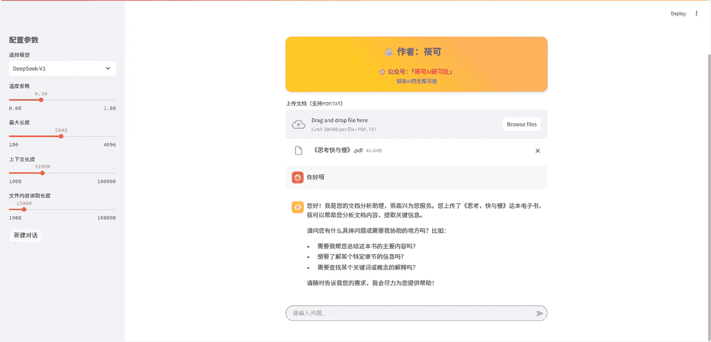
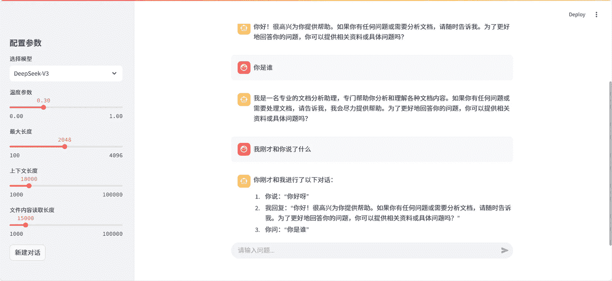
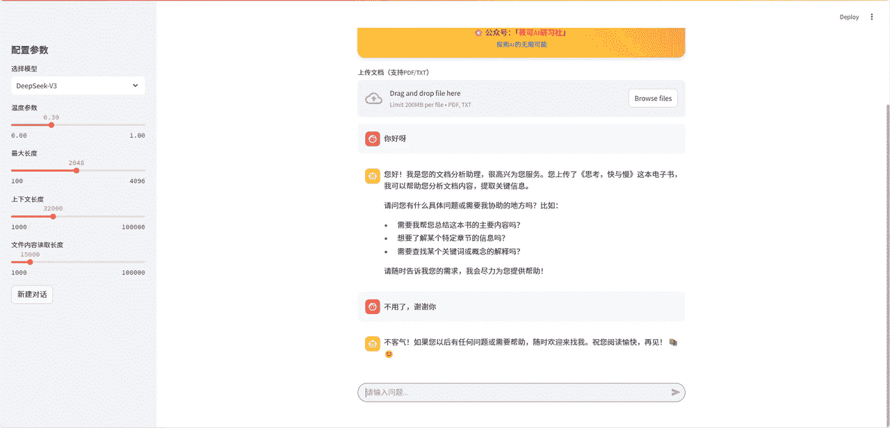

# 微学习04 | DeepSeek+Streamlit：开发文档助手

> 来源：[https://datawhaler.feishu.cn/docx/Bf21d8jqgoiu0tx5DGpcbS5bnCe](https://datawhaler.feishu.cn/docx/Bf21d8jqgoiu0tx5DGpcbS5bnCe)

## 基于 Streamlit 和 DeepSeek 的智能文档助手开发实战指南

✨你好，我是筱可，欢迎来到“筱可AI研习社”

今天的文章主题是：

基于 Streamlit 和 DeepSeek 的智能文档助手开发实战

本次实战效果展示：

**本篇文章，你将收获：**

+ 大模型前端基础交互界面

+ 大模型交互基础逻辑设计

+ PDF文件读取

+ 环境变量加载

+ 大模型在智能文档方面的应用场景实战讲解

> **技术预告**：下期我们将引入RAG（检索增强生成）技术，实现： ✅基于语义的文档分块 ✅向量数据库检索 ✅更优秀的动态上下文管理

## 前言：来自读者的声音

昨天收到读者反馈："AI开发教程光讲理论不够过瘾，能不能用真实代码带我们走一遍开发流程？" 今天我们就以`streamlit`为小前端，结合DeepSeek大模型，手把手带大家开发一个具备文档分析能力的智能助手。本文代码已通过实际测试（获取完整源码见文末附录前），建议边阅读边实操体验。

项目开源地址：

```
https://github.com/li-xiu-qi/XiaokeAILabs.git
```

---

## 一、开发环境准备

### 1.1 安装依赖库

```
pip install streamlit pymupdf python-dotenv openai
```

### 1.2 环境配置

在项目根目录创建`.env`文件：

>注意，`api-key`来自硅基流动，需要到下方地址获取`api-key`:

>https://cloud.siliconflow.cn/account/ak

```
API_KEY=你的硅基_API密钥
```

### 1.3 运行与体验

```
streamlit run xiaoke_doc_assist.py
```

启动后将看到：

1. 左侧面板选择模型和参数

1. 主界面进行文档上传和对话



---

## 二、核心功能拆解

我们设计的智能助手需要实现：

+ 📁 多格式文档解析（TXT/PDF）

+ 🤖 多种大模型动态切换

+ 🎚️ 温度值/上下文长度调节

+ 💬 带历史记忆的对话系统



---

## 三、关键代码解析

### 3.1 文档处理模块

```
# 文件处理函数
def process_uploaded_file(uploaded_file):
    try:
        content = ""
        if uploaded_file.type == "application/pdf":
            # 处理PDF文件
            doc = fitz.open(stream=uploaded_file.read(), filetype="pdf")
            for page in doc:
                content += page.get_text()
        else:
            # 处理文本文件
            content = uploaded_file.getvalue().decode("utf-8")

        # 截取前 file_content_length 个字符
        max_length = st.session_state.file_content_length
        return content[:max_length] + "..." if len(content) > max_length else content

    except Exception as e:
        st.error(f"文件处理失败: {str(e)}")
        return None
```

### 3.2 流式响应实现

```
with st.chat_message("assistant"):
    response_placeholder = st.empty()
    collected_response = []
    
    # 实时获取响应片段
    for chunk in response:
        if chunk.choices[0].delta.content:
            token = chunk.choices[0].delta.content
            collected_response.append(token)
            response_placeholder.markdown("".join(collected_response) + "▌")  # 打字机效果
```

### 3.3 CRISPE提示工程

```
<system>

    [当前日期] {CURRENT_DATE}

    [角色] 您是一名专业的文档分析助理，擅长从技术文档中提取关键信息

    [背景]

    - 用户上传了文档：{uploaded_file.name}

    - 文档类型：{uploaded_file.type.split('/')[-1].upper()}

    - 文档内容：{processed_content[:st.session_state.file_content_length]}...

    [核心任务]

    1. 当用户提问时，优先从文档中寻找答案

    2. 对复杂问题进行分步骤思考

    3. 不要生成文档没有提供的信息

    4. 保持专业且易懂的语气

    5. 不确定时，可以请求用户提供更多信息

  

    [交互要求]

    - 保持专业且易懂的语气

    - 关键数据用**加粗**显示

    - 代码块使用```包裹

</system>
```

### 3.4 streamlit前端按钮设置

```
# 侧边栏设置  

with st.sidebar:  

    st.header("配置参数")  

    selected_model = st.selectbox(  

        "选择模型",  

        options=list(model_list.keys()),  

        index=2  

    )  

    temperature = st.slider("温度参数", 0.0, 1.0, 0.3, 0.1)  

    max_tokens = st.slider("最大长度", 100, 4096, 2048, 100)  

    st.session_state.context_length = st.slider("上下文长度", 1000, 100000, 18000, 500)  

    st.session_state.file_content_length = st.slider("文件内容读取长度", 1000,100000, 15000, 500)  

    # 新建对话按钮  

    if st.button("新建对话"):  

        st.session_state.messages = []  

        st.session_state.uploaded_content = None  

        st.session_state.current_file = None  

        st.success("新对话已创建！")  

st.title("📑 DeepSeek 智能文档助手 ✨")
```

### 3.5 文件上传部件

```
# 文件上传部件

uploaded_file = st.file_uploader("上传文档（支持PDF/TXT）", type=["pdf", "txt"])

if uploaded_file and uploaded_file != st.session_state.get("current_file"):

    processed_content = process_uploaded_file(uploaded_file)

    if processed_content:

        st.session_state.uploaded_content = processed_content

        st.session_state.current_file = uploaded_file

        # 构建CRISPE框架系统提示

        system_prompt = f"""

<system>

    [当前日期] {CURRENT_DATE}

    [角色] 您是一名专业的文档分析助理，擅长从技术文档中提取关键信息

    [背景]

    - 用户上传了文档：{uploaded_file.name}

    - 文档类型：{uploaded_file.type.split('/')[-1].upper()}

    - 文档内容：{processed_content[:st.session_state.file_content_length]}...

    [核心任务]

    1. 当用户提问时，优先从文档中寻找答案

    2. 对复杂问题进行分步骤思考

    3. 不要生成文档没有提供的信息

    4. 保持专业且易懂的语气

    5. 不确定时，可以请求用户提供更多信息

    [交互要求]

    - 保持专业且易懂的语气

    - 关键数据用**加粗**显示

    - 代码块使用```包裹

</system>

        """

        # 清空历史消息

        st.session_state.messages = [{"role": "system", "content": system_prompt}]

        st.success(f"文档 {uploaded_file.name} 解析完成！")

else:

    # 默认系统提示词模板

    default_system_prompt = f"""

    <system>

        [当前日期] {CURRENT_DATE}

        [角色] 您是一名专业的文档分析助理。

        [核心任务]

        1. 当用户提问时，可以询问用户是否需要提供资料增强回答

        2. 对复杂问题进行分步骤思考

        3. 不要生成文档没有提供的信息

        4. 保持专业且易懂的语气

        5. 不确定时，可以请求用户提供更多信息

        [交互要求]

        - 保持专业且易懂的语气

        - 关键数据用**加粗**显示

        - 代码块使用```包裹

    </system>

    """

    if not st.session_state.messages:

        st.session_state.messages = [

            {"role": "system", "content": default_system_prompt}

        ]
```

### 3.6 聊天记录显示

```
# 聊天记录显示

for msg in st.session_state.messages:

    if msg["role"] != "system":

        with st.chat_message(msg["role"]):

            st.markdown(msg["content"])
```

### 3.7 对话逻辑控制

```
# 用户输入处理

if prompt := st.chat_input("请输入问题..."):

    # 添加用户消息

    st.session_state.messages.append({"role": "user", "content": prompt})

    with st.chat_message("user"):

        st.markdown(prompt)

    # 构建API请求

    keep_messages = 10

    system_message = st.session_state.messages[0]  # 保留第一个system消息

    messages_for_api = [

        {"role": m["role"], "content": m["content"]}

        for m in st.session_state.messages

        if m["role"] != "system"

    ]

    # 截断上下文以满足上下文长度要求

    total_length = sum(len(m["content"]) for m in messages_for_api)

    while total_length > st.session_state.context_length:

        messages_for_api.pop(0)

        total_length = sum(len(m["content"]) for m in messages_for_api)

    messages_for_api.insert(0, system_message)  # 将system消息重新插入到第一条

    try:

        # 生成流式回复

        with st.chat_message("assistant"):

            response_placeholder = st.empty()

            collected_response = []

            response = client.chat.completions.create(

                model=model_list[selected_model],

                messages=messages_for_api,

                stream=True,

                temperature=temperature,

                max_tokens=max_tokens,

            )

            for chunk in response:

                if chunk.choices[0].delta.content:

                    token = chunk.choices[0].delta.content

                    collected_response.append(token)

                    response_placeholder.markdown("".join(collected_response) + "▌")

            final_response = "".join(collected_response)

            response_placeholder.markdown(final_response)

            # 更新消息记录

            st.session_state.messages.append(

                {"role": "assistant", "content": final_response}

            )
```


## 四、DeepSeek 智能文档助手入门指南

### 项目概览

这个项目是一个基于 `Streamlit` 框架构建的智能文档分析助手。它利用 DeepSeek 的大型语言模型（LLM）来理解和分析用户上传的文档，并根据用户的问题提供解答。主要功能包括：

+   **文档上传与解析：** 支持上传 PDF 和 TXT 文档，提取文档内容。
+   **智能问答：** 用户可以就上传的文档内容提问，助手会尝试从文档中寻找答案。
+   **模型选择与参数调整：** 用户可以在侧边栏选择不同的 DeepSeek 模型，并调整温度、最大长度等参数。
+   **对话管理：** 支持新建对话(清除历史对话记录)。

### Streamlit 框架基础

`Streamlit` 是一个用于快速构建交互式 Web 应用的 Python 库，尤其适合机器学习和数据科学项目。它的核心理念是“让数据科学家也能轻松创建美观且强大的应用”。

在这个项目中，`Streamlit` 主要负责构建用户界面（UI），包括：

+   **侧边栏 (Sidebar):** 用于放置配置参数，例如模型选择、温度、最大长度等。通过 `with st.sidebar:` 代码块创建。
+   **文件上传器 (File Uploader):** 允许用户上传文档。使用 `st.file_uploader()` 创建。
+   **聊天输入框 (Chat Input):** 用户输入问题的地方。使用 `st.chat_input()` 创建。
+   **聊天消息显示 (Chat Message):** 显示用户和助手之间的对话历史。使用 `st.chat_message()` 和 `st.markdown()` 结合创建。
+   **Session State (会话状态):** `Streamlit` 的一个重要特性，用于在用户与应用交互的不同阶段之间持久化数据。例如，对话消息历史、上传的文档内容等都存储在 `st.session_state` 中。

### 项目逻辑设计分解

为了更好地理解代码，我们将其逻辑分解为几个关键模块，并结合之前生成的流程图进行说明。

#### 1. 初始化 (`init_session` 功能)

+   **功能：** `init_session()` 函数负责初始化 `Streamlit` 应用的 `session_state`。确保应用在启动时具备必要的状态变量。
+   **流程：**
    +   检查 `st.session_state` 中是否已存在 `messages`、`uploaded_content`、`context_length` 和 `file_content_length` 这些键。
    +   如果不存在，则分别初始化它们：
        +   `messages`: 存储对话消息历史的列表，初始为空列表 `[]`。
        +   `uploaded_content`: 存储已上传文档的内容，初始为 `None`。
        +   `context_length`: 设置模型上下文长度，初始值为 30000。
        +   `file_content_length`: 设置文件内容读取长度，初始值为 15000。
+   **目的：** 保证应用运行所需的 session state 变量已正确初始化，避免后续使用时出现错误。

#### 2. 侧边栏配置 (`with st.sidebar:` 代码块)

+   **功能：** `with st.sidebar:` 代码块定义了应用侧边栏的内容，用于用户配置参数。
+   **流程：**
    +   使用 `st.header("配置参数")` 在侧边栏添加标题。
    +   使用 `st.selectbox("选择模型", ...)` 创建模型选择下拉框，用户可以从 `model_list` 中选择模型。
    +   使用 `st.slider("温度参数", ...)` 创建温度参数滑块，用于调整模型生成回复的随机性。
    +   使用 `st.slider("最大长度", ...)` 创建最大长度滑块，限制模型生成回复的最大 token 数量。
    +   使用 `st.slider("上下文长度", ...)` 创建上下文长度滑块，用户可以调整上传文档的上下文长度。
    +   使用 `st.slider("文件内容读取长度", ...)` 创建文件内容读取长度滑块，用户可以调整读取文件内容的最大长度。
    +   使用 `st.button("新建对话")` 创建“新建对话”按钮，点击后会清除对话历史和上传文档。
+   **目的：** 提供用户友好的界面，允许用户根据需求配置模型和参数。

#### 3. 文件上传与处理

+   **功能：** 处理用户上传的文档，提取文本内容。
+   **流程：**
    +   使用 `st.file_uploader("上传文档...", type=["pdf", "txt"])` 创建文件上传组件，允许用户上传 PDF 或 TXT 文件。
    +   当用户上传文件后，代码会检查是否上传了新文件，并判断上传的文件是否与当前 `st.session_state` 中记录的文件不同。
    +   调用 `process_uploaded_file(uploaded_file)` 函数处理上传的文件：
        +   `process_uploaded_file` 函数内部逻辑：
            +   根据文件类型 (`uploaded_file.type`) 判断是 PDF 还是 TXT。
            +   如果是 PDF，使用 `fitz` 库 (PyMuPDF) 打开 PDF 文件，并逐页提取文本内容。
            +   如果是 TXT，直接读取文件内容并解码为 UTF-8 字符串。
            +   根据 `st.session_state.file_content_length` 截取文档内容的前 N 个字符，并添加 `"..."` 表示截断。
            +   如果处理过程中发生异常，使用 `st.error()` 显示错误信息。
            +   如果文件处理成功 (`processed_content` 不为 `None`)：
                +   更新 `st.session_state.uploaded_content` 为处理后的文档内容。
                +   更新 `st.session_state.current_file` 为当前上传的文件对象，用于判断文件是否发生改变。
                +   构建系统提示词 (System Prompt)，这是一个关键步骤，用于指导 LLM 如何扮演角色、理解背景、执行任务和进行交互。系统提示词使用 CRISPE 框架，包含角色、背景、核心任务和交互要求等部分，并动态地将上传文件名、文件类型和部分文档内容注入到提示词中。
                +   将系统提示词作为第一条消息添加到 `st.session_state.messages` 列表中。
                +   使用 `st.success()` 显示文档解析成功的消息。
                +   最后 `st.session_state.messages = [{"role": "system", "content": system_prompt}]` 部分将会清空历史对话，减少噪声干扰，如果需要优化用户体验可以选择插入替换的形式，更换模板，我们这里就选择前者。
+   **目的：** 接收用户上传的文档，提取可用于分析的文本内容，并根据上传的文档动态生成系统提示词，为后续的智能问答环节做准备。

#### 4. 聊天消息处理 (用户输入与助手回复)

+   **功能：** 处理用户的聊天输入，调用 DeepSeek API 获取模型回复，并显示对话消息。
+   **流程：**
    +   **显示聊天记录：** 遍历 `st.session_state.messages` 列表，将每条消息显示在聊天界面上。系统消息 (`role == "system"`) 不显示。用户消息 (`role == "user"`) 和助手消息 (`role == "assistant"`) 分别使用 `st.chat_message("user")` 和 `st.chat_message("assistant")` 显示，并使用 `st.markdown()` 渲染消息内容。
    +   **接收用户输入：** 使用 `prompt = st.chat_input("请输入问题...")` 创建聊天输入框，当用户输入消息并按下回车键后，输入内容会赋值给 `prompt` 变量。
    +   **处理用户输入：**
        +   将用户输入的消息添加到 `st.session_state.messages` 列表中，角色为 `"user"`。
        +   使用 `st.chat_message("user"): st.markdown(prompt)` 在聊天界面上显示用户消息。
        +   构建 API 请求消息列表 `messages_for_api`。为了控制上下文长度，代码只取最近的 10 条消息 (不包括系统消息，只是用户消息和助手消息) 作为 API 请求的上下文。
        +   调用 DeepSeek API 的 `client.chat.completions.create(...)` 方法发送 API 请求，获取流式回复：
            +   `model`: 使用用户在侧边栏选择的模型 (`model_list[selected_model]`)。
            +   `messages`: 使用构建的 `messages_for_api` 消息列表作为上下文。
            +   `stream=True`: 开启流式回复模式，模型会逐 token 返回结果，而不是一次性返回所有结果。
            +   `temperature`: 使用用户在侧边栏设置的温度参数。
            +   `max_tokens`: 使用用户在侧边栏设置的最大长度参数。
            +   `file_content_length`: 使用用户在侧边栏设置的最大读取文件长度。
        +   **处理 API 流式回复：**
            +   使用 `with st.chat_message("assistant"): response_placeholder = st.empty()` 创建一个助手消息容器 `response_placeholder`，用于动态显示流式回复。
            +   初始化一个空列表 `collected_response`，用于存储接收到的 token。
            +   遍历 API 返回的流式 `response`：
                +   对于每个 `chunk` (数据块)，提取 `chunk.choices[0].delta.content` 中的 token 内容。
                +   将 token 添加到 `collected_response` 列表中。
                +   使用 `response_placeholder.markdown("".join(collected_response) + "▌")` 动态更新助手消息容器的内容，显示已接收到的 token，并在末尾添加 `"▌"` 符号表示正在流式输出。
            +   将完整的回复内容 `"".join(collected_response)` 赋值给 `final_response`。
            +   使用 `response_placeholder.markdown(final_response)` 最终显示完整的助手回复。
            +   将助手回复消息添加到 `st.session_state.messages` 列表中，角色为 `"assistant"`。
        +   **处理 API 错误：** 使用 `try...except openai.APIError as e:` 捕获 API 请求可能发生的错误 (例如上下文过长)。如果发生 `openai.APIError`：
            +   构建包含错误分析和修正建议的错误消息 `error_msg`。
            +   使用 `st.error(error_msg, icon="🚨")` 在界面上显示错误信息。
+   **目的：** 实现用户与智能助手的对话交互，将用户问题发送给 DeepSeek 模型获取智能回复，并在聊天界面上实时显示对话过程和结果。同时，处理可能发生的 API 错误，提供友好的错误提示。

#### 5. 新建对话按钮

+   **功能：** 点击“新建对话”按钮，清除当前的对话历史和上传的文档，开始新的对话。
+   **流程 (参考)：**
    +   使用 `st.button("新建对话")` 创建按钮。
    +   当按钮被点击时：
        +   清空 `st.session_state.messages` 列表，删除所有对话消息。
        +   将 `st.session_state.uploaded_content` 设置为 `None`，清除已上传的文档内容。
        +   将 `st.session_state.current_file` 设置为 `None`，清除当前文件记录。
        +   使用 `st.success("新对话已创建！")` 显示成功消息。
+   **目的：** 提供用户方便地开始新对话的功能，清除旧的对话上下文和文档信息，避免对新的对话产生干扰。

#### 6. 代码结构与流程总结

+   **初始化阶段：** `init_session()` 函数在应用启动时初始化必要的 `session_state` 变量。
+   **侧边栏配置：** `with st.sidebar:` 代码块设置侧边栏的各种配置组件，允许用户自定义模型和参数。
+   **文档上传阶段：** 用户通过 `st.file_uploader` 上传文档，`process_uploaded_file` 函数处理文档内容，并动态生成系统提示词。
+   **对话交互阶段：** 用户在 `st.chat_input` 中输入问题，应用将问题和历史对话记录发送给 DeepSeek API，获取流式回复并在 `st.chat_message` 中显示。
+   **会话状态管理：** `st.session_state` 贯穿整个应用生命周期，用于存储和维护对话历史、上传文档内容等重要数据，使得应用能够记住用户的上下文信息，实现连续历史对话。
+   **错误处理：** 代码中包含了对文件处理异常和 API 请求错误的捕获和处理，提高了应用的健壮性。

### 给初学者的建议

+   **逐步学习 `Streamlit`：** `Streamlit` 的学习曲线相对平缓，可以从官方文档和示例开始，逐步掌握各种组件和功能。
+   理解 `Session State` 的重要性：`Session State` 是构建交互式 `Streamlit` 应用的关键，要理解它的工作原理和使用方法。
+   关注 Prompt Engineering：系统提示词的设计对 LLM 应用的效果至关重要。可以学习 CRISPE 框架等 Prompt Engineering 技术，不断优化提示词，提升模型表现。
+   **实践和实验：** 通过修改代码、调整参数、尝试不同的文档和问题，加深对代码逻辑和 LLM 应用的理解。
+   **查阅文档和社区：** 遇到问题时，查阅 `Streamlit` 和 OpenAI 相关的官方文档，或者在社群寻求帮助，欢迎向我提问，我尽力回答问题，很高兴能有一起学习的伙伴加入我们。

## 五、当前版本局限性

虽然基础功能已实现，但还存在以下待优化点：

1.  **上下文截断**：简单取前 `N` 个字符可能丢失关键信息
2.  **文件处理**：大文件加载时内存占用过高，且提取效果不好
3.  **历史管理**：固定轮次的记忆窗口不够智能

## 六、总结



通过本文的实战开发，我们完成了：

✅ `Streamlit` 基础布局搭建

✅ DeepSeek API 集成

✅ 文档对话系统原型开发

**动手挑战**：尝试修改 `file_content_length` 参数值为 30000，观察对长文件处理的影响，评论区分享你的发现！

**需要完整源码**的读者，欢迎在公众号后台回复智能文档助手,获取 GitHub 仓库地址，以及源码。下期我们将带来 RAG 技术的进阶改造，敬请期待！

---

🙋♂️ 入群交流 & 资料领取

1️⃣ **入群方式**

+   公众号菜单点击「社群」，扫码直接入群
+   回复关键词「入群」「加群」等，添加作者微信人工邀请

2️⃣ **资料领取**

+   入群后查看群公告，获取学习资源
+   回复「资料」至公众号，自动发送网盘链接（定期更新）
+   公众号菜单点击「资料领取」

## 附录——代码说明文档

### DeepSeek 智能文档助手应用说明文档

#### 应用概述

本应用是基于 DeepSeek 大模型的智能对话助手，支持以下核心功能：

+   ✅ 多模型选择（提供 3 个不同规模的模型）
+   ✅ 文档分析模式（支持 TXT/PDF 文件解析）
+   ✅ 可调节的对话参数（温度值、上下文长度）
+   ✅ 实时流式响应
+   ✅ 对话历史管理

##### 1. 多模型支持

| 模型名称 | 适用场景 |
| --- | --- |
| DeepSeek-R1-1.5B | 免费快速响应基础问答 |
| DeepSeek-V3 | 通用场景对话 |
| DeepSeek-R1 | 复杂推理和长文本理解 |

##### 2. 文档分析模式

+   支持格式：TXT/PDF
+   处理流程：
    1.  上传文件自动解析
    2.  提取前 15k 字符作为文档内容输入（可配置）
    3.  保留最近 32k 字符上下文（可配置）
    4.  自动切换文档/普通模式

##### 3. 参数配置

+   `Temperature` (0.001-1.2)：控制生成随机性
+   **上下文长度** (100-30k tokens)：管理对话历史长度
+   **最大输出长度** (固定 8192 tokens)

#### 使用指南

##### 环境要求

```
Python 3.10+

依赖库：streamlit, pymupdf, python-dotenv, openai
```

##### 安装依赖

```
pip install streamlit PyMuPDF python-dotenv openai
```

##### 运行步骤

1.  配置环境变量

```
API_KEY=your_deepseek_api_key
```

2.  启动应用

```
streamlit run xiaoke_doc_assist.py
```


## 界面操作

1. 模型选择区（左侧）

   + 下拉选择模型版本
   + 滑动调节温度值
   + 设置上下文长度
   + 控制文档内容读取长度

1. 文档上传区

   + 支持拖拽上传
   + 自动识别文件类型
   + 成功加载后显示绿色提示

1. 对话界面

   + 用户输入框位于底部
   + 实时显示对话历史
   + 小助手响应带打字机效果

## 关键模块

+ **文件处理** (`process_uploaded_file`)
+ TXT文件：直接读取UTF-8编码
+ PDF文件：使用`PyMuPDF`解析文本
+ 内容截取：保留前N个字符（N=`context_length`）
+ **消息管理**
+ 保留最近10条消息（5轮对话）
+ 系统消息处理规则：
+ 文件更新时添加文档内容

### API调用

```
response = client.chat.completions.create(
    model=model_list[selected_model],
    messages=messages_for_api,  # 包含系统提示的完整上下文
    stream=True,                  # 启用流式传输
    temperature=temperature,
    max_tokens=8192              # 固定最大输出长度
)
```

## 注意事项

1. API密钥需通过`.env`文件配置
1. PDF解析依赖字体嵌入，可能影响格式还原
1. 上下文长度设置需考虑模型实际支持的最大长度
1. 温度值设置低于0.3时可能产生确定性响应
1. 文件上传大小受`Streamlit`默认限制（200MB）

## 错误处理机制

+ 文件解析异常：显示红色错误提示
+ API调用失败：回滚最近消息记录
+ 流式中断：保留已接收内容
+ 类型错误：自动过滤无效消息类型

## 交互优化

+ 采用流式响应
+ 上下文窗口滑动管理
+ 文件内容预处理器
+ 对话缓存策略（保留最近5轮）

## 性能优化建议

+ 单次对话上下文建议 ≤16000字符
+ PDF文件页数建议 ≤50页
+ 复杂问题建议拆分为多步骤提问

---

## PS

问题：如果是你，你会如何实现本次的实战项目代码逻辑，你觉得有更好的实现方案吗？

小提示：发这篇文章之前，给社群的朋友看了一下，他们有的说文章写的太长了，有的说看不懂，我尽量控制了长度，这篇文章主要就讲这些吧，我后续再来一篇文章，写关于这个项目的一些库的入门，也会讲到一些大模型应用的基础知识吧，比如一些控制参数的作用等等。

## QA & 许愿池

<https://datawhaler.feishu.cn/sync/L5sAdGZKTsI1s9bg14LcGSJmnFg>

## 欢迎大家创作内容、投稿参与共建！

<https://datawhaler.feishu.cn/sync/XqhSdXAz0szNA4b59SLcDT3jnyf>

## 线下百校共学DeepSeek！

<https://datawhaler.feishu.cn/sync/GhQ0dc18ssEYrkbPXQhcXUv9nLh>
