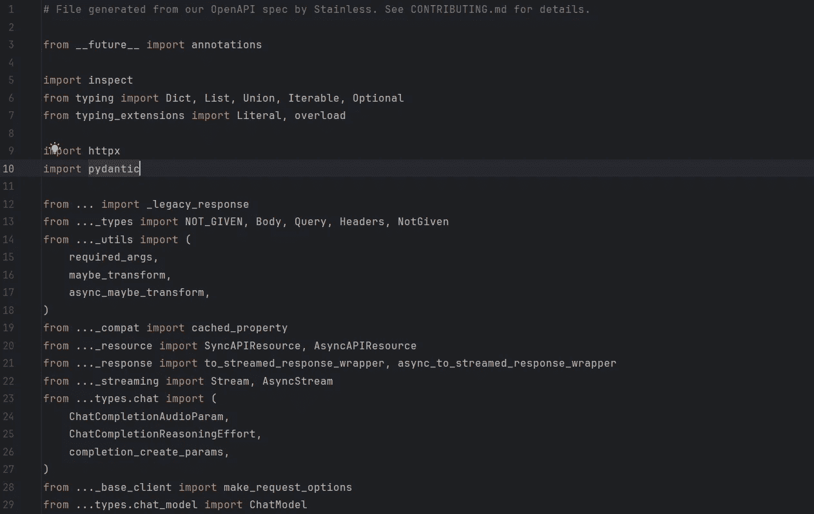

# 微学习05 | Streamlit+PyMuPDF：解析PDF论文

> 来源：[https://datawhaler.feishu.cn/docx/Fmm4dpfgioktssxt3Oncwwdun0g](https://datawhaler.feishu.cn/docx/Fmm4dpfgioktssxt3Oncwwdun0g)

## 大模型应用极简开发快速入门

✨你好，我是筱可，欢迎来到「筱可AI研习社」

🚀 标签关键词：| AI实战派开发者 | 技术成长陪伴者 | RAG前沿探索者 |

本次的主题是：

入门《基于 `Streamlit` 和 `DeepSeek` 的智能文档助手开发实战指南》

当然了，主要的目的是主题上写的，本篇文章也不仅仅是介绍这些库，还有其他惊喜哦！

（我们赶快进入本次的重点吧！）

通过本文你将收获：

+ 🛠️ 环境变量管理的艺术

+ 🔥 `OpenAI SDK` 高阶用法

+ 💡 `Streamlit` 交互魔法

+ 📄 PDF 解析技巧

下篇文章预告：

主题是，业界前沿的pdf提取技术！

---

### ❓前言：来自读者的求助

上一期我们通过《基于 `Streamlit` 和 `DeepSeek` 的智能文档助手开发实战指南》带着大家体验如何在本地构建一个具有基础文档交互能力的智能文档助手，不过有的读者觉得我写的不够详细，但是由于当时篇幅已经很长了，我也不好写太细了，所以本次开一篇文章具体介绍我们上次使用到的一些开发生态库当中的功能，以及用法，也会提到为什么用这些库的原因，还有这些生态库都有哪些缺点和优点，后续我们应该使用什么方式去改进。

### 🔐一、环境变量管理（`python-dotenv`）

环境变量一般长这样（`.env`）：


```
import os

def find_dotenv_path(dir_name: str = ""):
    # 首先在当前工作目录下查找 .env 文件
    current_working_dir = os.getcwd()
    env_path = os.path.join(current_working_dir, ".env")
    if os.path.exists(env_path):
        return env_path

    # 如果没有指定目录名，且当前工作目录下没有 .env 文件，则返回 None
    if not dir_name:
        return None

    # 从当前脚本所在目录开始向上查找指定目录
    current_dir = os.path.dirname(os.path.abspath(__file__))
    while True:
        # 检查当前目录是否为指定目录
        if os.path.basename(current_dir) == dir_name:
            # 在指定目录下查找 .env 文件
            env_path_in_specified_dir = os.path.join(current_dir, ".env")
            if os.path.exists(env_path_in_specified_dir):
                return env_path_in_specified_dir
            else:
                return None
        # 到达根目录时停止查找
        if current_dir == os.path.dirname(current_dir):
            break
        # 向上移动一层目录
        current_dir = os.path.dirname(current_dir)

    # 如果没有找到指定目录，返回 None
    return None
```

上面我们主要是定义了一个用来找到环境变量文件的地址的函数。

方面后续调用找到加载对应的环境变量，避免文件配置混乱,主要还是因为方便拉取我仓库的人能快速配置好环境变量就直接跑。

上面的代码我们也优化了上次展示的获取环境变量文件地址的逻辑，如果没有找到就返回`None`，后续我们在接收返回值的部分可以通过检查是否是字符串判断环境变量地址是不是被找到了。

🚨 安全规范：

+ 🚫 禁止硬编码敏感信息

+ 📌 强制`.gitignore`添加`.env`

+ 🔄 使用`dotenv`自动加载环境变量

---

### ⚙️二、`OpenAI SDK` 深度解析

#### 介绍

`OpenAI SDK`是`openai`公司开源的一个默认用来调用他们公司的模型的一个库，但是他支持配置`base_url`（我猜是为了让大家都支持他的规范，扩大业界影响力，去年和前年`openai`确实遥遥领先，当然现在也是领先吧，只是没那么多了，那个时候确实是业界规范制定者），所以我们还可以通过其他的模型服务商通过这个库进行调用模型服务供应商的大语言模型。

他的作用主要是简化我们调用模型的代码，底层也是通过类似`requests`发送http请求的形式向模型服务端请求服务，我看了源码，是通过`httpx`封装的。



#### 参数介绍(以阿里云的文档举例)

参考资料地址：

+ https://help.aliyun.com/zh/model-studio/developer-reference/use-qwen-by-calling-api#b30677f6e9437

| 参数名称 | 参数类型 | 是否必选 | 说明 |

| --- | --- | --- | --- |

| `model` | string | 是 | 模型名称，支持通义千问系列及数学、代码模型等。通义千问Audio仅支持DashScope方式 |

| `messages` | array | 是 | 历史对话消息列表 |

| `stream` | boolean | 否 | 是否流式输出，`false`为一次性返回，`true`为边生成边输出，默认`false` |

| `stream_options` | object | 否 | 流式输出时，设置`{"include_usage": true}`可显示Token数，仅`stream`为`true`时生效 |

| `temperature` | float | 否 | 采样温度，控制文本多样性，范围[0, 2)，与`top_p`选其一设置 |

| `top_p` | float | 否 | 核采样概率阈值，控制文本多样性，范围(0,1.0]，与`temperature`选其一设置 |

| `presence_penalty` | float | 否 | 控制内容重复度，范围[-2.0, 2.0] ，正数减少、负数增加重复度 |

| `response_format` | object | 否 | 返回格式，可选`{"type": "text"}`或`{"type": "json_object"}`，默认`{"type": "text"}` |

| `max_tokens` | integer | 否 | 最大Token数，超量返回截断内容，默认和最大为模型最大输出长度 |

| `n` | integer | 否 | 生成响应个数，范围1 - 4，仅`qwen-plus`支持，传入`tools`时固定为1，默认1 |

| `seed` | integer | 否 | 使文本生成更确定，范围0到231−1 |

| `stop` | string/array | 否 | 生成文本含指定内容时停止，`array`时不能同时含`token_id`和字符串 |

| `tools` | array | 否 | 模型调用工具数组，不支持通义千问VL/Audio及数学、代码模型 |

| `tool_choice` | string/object | 否 | 工具选择策略，可选`"auto"` `"required"` `"none"` 或指定工具，默认`"auto"` |

| `parallel_tool_calls` | boolean | 否 | 是否开启并行工具调用，默认`false` |

| `translation_options` | object | 否 | 翻译模型配置参数，Python `SDK`调用时通过`extra_body`配置 |

| `enable_search` | boolean | 否 | 是否用互联网搜索参考，`true`启用、`false`关闭，默认`false`，仅部分模型支持 |

#### 具体示例代码

```
from openai import OpenAI

import fitz
import openai
import os
import dotenv

env_path = find_dotenv_path()

dotenv.load_dotenv(dotenv_path=env_path)

api_key = os.getenv("API_KEY")

client = OpenAI(api_key=api_key,
                base_url="https://api.siliconflow.cn/v1")
model = "Pro/deepseek-ai/DeepSeek-R1-Distill-Qwen-1.5B"
messages = []

# 使用非流式输出测试下api是否可用
response = client.chat.completions.create(
    model=model,
    messages=[{"role": "system", "content": "你好"}],
)
print(response.choices[0].message.content, end='', flush=True)
print("\n")
while True:
    user_input = input("你: ")
    if user_input.lower() in ["exit", "quit"]:
        break

    messages.append({"role": "user", "content": user_input})
    
    response = client.chat.completions.create(
        model=model,
        messages=messages,
        stream=True
    )
    index = 0
    for chunk in response:
        chunk_message = chunk.choices[0].delta.content
        if not chunk_message:
            continue
        if index == 0:
            index += 1
            print(f"AI: {chunk_message}", end='', flush=True)
        else:
            print(chunk_message, end='', flush=True)
    
    messages.append({"role": "assistant", "content": chunk_message})
    print()  # 换行
```

上面我们主要是分别使用`openai`构建了流式输出和非流式输出的示例，在流式输出部分我们通过`messages`构建了一个支持对话历史形式的终端对话脚本，刚入门的小伙伴可以试试，这是使用最简单的形式构建与大模型进行多轮对话了。（调用其他的库除外哈，仅限于我们使用`openai sdk`构建多轮对话）

`print`函数的高级用法在上面有使用到哦，不知道有没有同学注意到，嘿嘿，`flush`是细节！

感兴趣的同学可以试试去掉或者改成`False`，你会发现不一样的结果！

**流式 vs 非流式对比：**

+ 流式：实时性高，适合面向用户对话场景的长文本生成，及时响应，可以大大减轻用户的等待焦虑，提升用户体验。

+ 非流式：响应完整，适合构建工作流或者需要模型进行多次加工的时候使用。

### 🎨三、`Streamlit` 交互魔法


```
import streamlit as st
model_list = {
    "DeepSeek-R1": "Pro/deepseek-ai/DeepSeek-R1-Distill-Qwen-1.5B",
    "DeepSeek-R1-Lite": "Pro/deepseek-ai/DeepSeek-R1-Lite-Qwen1.5-7B",

}
with st.sidebar:
    st.header("配置参数")
    selected_model = st.selectbox("选择模型", options=list(model_list.keys()))
    temperature = st.slider("温度参数", 0.0, 1.0, 0.3)
    # 其他的部分可以继续添加
    
# 主体聊天部分 

st.title("DeepSeek-R1")
st.write("这是一个测试页面，用于测试DeepSeek-R1模型的效果")
st.write("模型名称：", selected_model)
st.write("温度参数：", temperature)

# 写入html和css
st.markdown(
    """
    <style>
    .st-eb {
        background-color: #f0f0f0;
        padding: 10px;
        border-radius: 5px;
    }
    .custom-header {
        font-size: 24px;
        color: orange;
        text-align: center;
        margin-bottom: 20px;
    }
    .custom-paragraph {
        font-size: 16px;
        color: orange;
        text-align: justify;
    }
    </style>
    <div class="custom-header">自定义标题</div>
    <div class="custom-paragraph">这是一个自定义段落，用于展示如何在 Streamlit 中嵌入 HTML 和 CSS。</div>
    """,
    unsafe_allow_html=True,
)

# 显示两个对话的人
st.write("用户：你好，我想了解一下你们公司的产品。")
st.write("DeepSeek-R1：你好，欢迎来到我们公司。请问你对我们的产品有什么了解吗？")


# 加入一个按钮
if st.button("点击这里"):
    st.write("DeepSeek-R1：请问你对我们的产品有什么了解吗？")
    
# 加入带有头像的对话框
# 使用st.chatmessage()方法
# 类似：
# for msg in st.session_state.messages:
#     if msg["role"] != "system":
#         with st.chat_message(msg["role"]):
#             st.markdown(msg["content"])

with st.chat_message("user"):
    st.markdown("你好，我想了解一下你们公司的产品。")
with st.chat_message("DeepSeek-R1"):
    st.markdown("你好，欢迎来到我们公司。请问你对我们的产品有什么了解吗？")


# 加入一个进度条
import time
my_bar = st.progress(0)
for percent_complete in range(10):
    time.sleep(0.1)
    my_bar.progress(percent_complete + 1)

# 加入一个加载动画
with st.spinner("加载中..."):
    time.sleep(2)
st.success("加载完成！")


# 实现流式输出对话

import time

index_list = []
with st.empty():
    for i in range(100):
        index_list.append(str(i))
        st.write(f"计数器：{' '.join(index_list)}")
        time.sleep(0.1)

total_index = " ".join(index_list)
st.write(total_index)

# 来一个输入框
user_input = st.text_input("请输入一些内容：")
st.write("你输入的内容是：", user_input)
# 来一个chat_input
user_input = st.chat_input("请输入一些内容：")
st.write("你输入的聊天内容是：", user_input)


st.session_state.messages = ["你好，我想了解一下你们公司的产品。", "你好，欢迎来到我们公司。请问你对我们的产品有什么了解吗？"]
    

# 加入一个文件上传
uploaded_file = st.file_uploader("上传文件", type=["txt", "pdf"])
if uploaded_file is not None:
    st.write("文件名称：", uploaded_file.name)
    st.write("文件类型：", uploaded_file.type)
    st.write("文件大小：", uploaded_file.size)
    st.write("文件内容：", uploaded_file.getvalue())
    
# 打印下会话管理的状态
st.write(st.session_state.messages)
```

这个部分我们分别使用上次文章涉及到的一些库方法做了详细的注释，并加入了上次没有使用的功能，主要是进度条和一个加载的动画效果。

如果你真的运行了上面的代码，你会发现一个现象：

当你输入内容之后，之前的内容会被清空，并重新输出，这是由于`streamlit`底层检测到有变化的时候会重新刷新界面，当然，这里不是说浏览器上面的刷新按钮，而是页面的局部刷新，所以如果需要保存状态就需要使用到`st.session_state.messages`进行会话状态管理，相信看到这里，按照注释上讲的内容，我觉得你应该理解并能够自己通过上面的示例构建出来一个和上一篇文章一样的界面了，赶快去试试吧！

---

## 📄四、PDF 解析核心（PyMuPDF）

### 4.1 文本提取

```
import fitz
import pymupdf4llm

file_path = "写给大家看的设计书 ([美] Robin Williams) .pdf"


def process_pdf(file_path):
    doc = fitz.open(file_path)
    content = ""
    for page in doc:
        text = page.get_text("text")
        content += text
    return content

def pdf2md(file_path: str):
    md_text = pymupdf4llm.to_markdown(file_path)
    return md_text

pdf_text = process_pdf(file_path)
markdown_text = pdf2md(file_path)
print(markdown_text)
```

文本提取这个部分我们通过`pymupdf`（`fitz`）实现了 `pdf`内容的提取，首先是通过`fitz`对象调用`open`方法，`open`方法可以传入字节流数据或者是本地文件路径，如果是使用字节流，那么传入的就是`stream`数据，他的底层是通过将`pdf`按照页面转化成`page`对象，每一个页面都是一个`page`，`page`上面支持的方法有获取文本，获取图片，获取表格，当然了，实际效果，大家可以自己测试，功能肯定能实现，但是效果与专门做这件事的相比是有差距的。

此外，我们还引用了一个上次没有涉及到的库`pymupdf4llm`，它是`pymupdf`，也就是`fitz`官方出手，基于`pymupdf`构建的一个专门为了`RAG`搭建的`pdf`处理工具，目的是将`pdf`转化成`markdown`格式的文本，如果你的`pdf`只有文本，没有公式，图片之类的，那么他将是最好的提取工具，不仅有相当快的速度的同时提取成为`markdown`格式的结构化文本。

📌 解析效果对比

| 格式 | 优点 | 局限性 |
| --- | --- | --- |
| 纯文本 | 解析速度快 | 丢失格式信息 |
| `Markdown` | 保留结构特征 | 对复杂排版支持有限 |

> **拓展小知识：**
>
> `markdown`格式的文本指的是，如下格式的文本：
>
> ```
> # 一级标题
> ## 二级标题
> **加粗的字体**
> > 引用文本
> ……
> ```
>
> 这种文本能够让大模型更好地理解整体的文本结构，在文本分块部分基于`markdown`格式分块器也是一种不错的分块方式！（在`RAG`部分我们会有提到，尽请期待！）

---

## 总结

### 技术全景图

🔐 环境变量：动态加载 + 安全防护

🤖 大模型交互：流式处理 + 记忆管理

🎮 前端交互：状态保持 + 文件处理

📑 文档解析：结构化提取 + 格式优化

通过本文我们掌握了：

+   🔒 环境变量的安全管理姿势
+   🎛️ 大模型参数的精细调控
+   💬 `Streamlit`的响应式交互设计
+   📑 `PDF`解析的核心方法论

**动手挑战：** 尝试为本系统添加Word文档解析功能，并实现自动文件类型检测！

---

> 🗺️ 内容地图 ──────

> 下期预告：**《`pdf`提取逆天神器版面分析+版面识别》，通过飞浆系列`OCR`提升`pdf`识别效果**

> 小提示：标题可能不是这个，但是主题是哈！基于飞浆平台构建的`pdf`提取神器，算是业界先进的技术了，我觉得是处理`pdf`的时候非常好的方式了。

> 💬 互动问题：
>
> 1.  你在处理`PDF`时遇到的最大挑战是什么？
>
> 1.  最想了解的`Streamlit`高级功能是什么？
>
> 1.  希望看到什么类型的`AI`应用开发教程？

**欢迎在留言区分享你的思考，每一条留言我都会认真阅读！你的反馈是我创作的最大动力 ❤️**

> 来一句名言:
>
> 一个人被什么所激励，就会为什么卖命！
>
> ——筱可
>
> (这句话不是我写的，原文是我偶像写的，嘿！)

---

**立即行动：**

1.  点击点赞+喜欢，分享给需要的伙伴
1.  订阅👸号接收更新提醒
1.  在本地运行示例代码体验完整流程

（系统检测到你有99%的可能性成为`AI`应用开发高手，快去实践吧！）

📢 行动召唤：

"与其等待`AI`改变世界，不如亲手参与变革！在这里，让`AI`成为你弯道超车的秘密武器。"

---

🙋♂️ 入群交流 & 资料领取

1️⃣ **入群方式**

+   👸号菜单点击「社群」，扫码直接入群
+   回复关键词「入群」「加群」等，添加作者🛰️人工邀请

2️⃣ **资料领取**

+   入群后查看群公告，获取学习资源
+   回复「资料」至👸号，自动发送网盘链接（定期更新）
+   👸号菜单点击「资料领取」

## QA & 许愿池

<https://datawhaler.feishu.cn/sync/L5sAdGZKTsI1s9bg14LcGSJmnFg>
