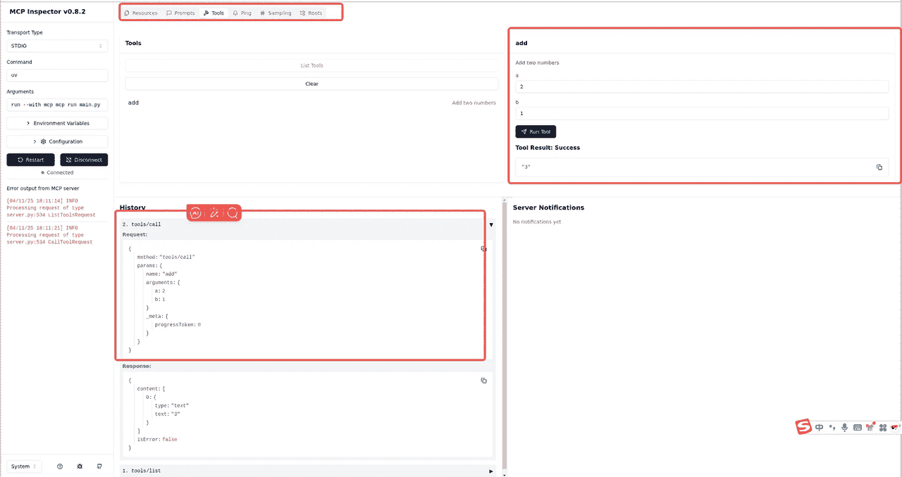
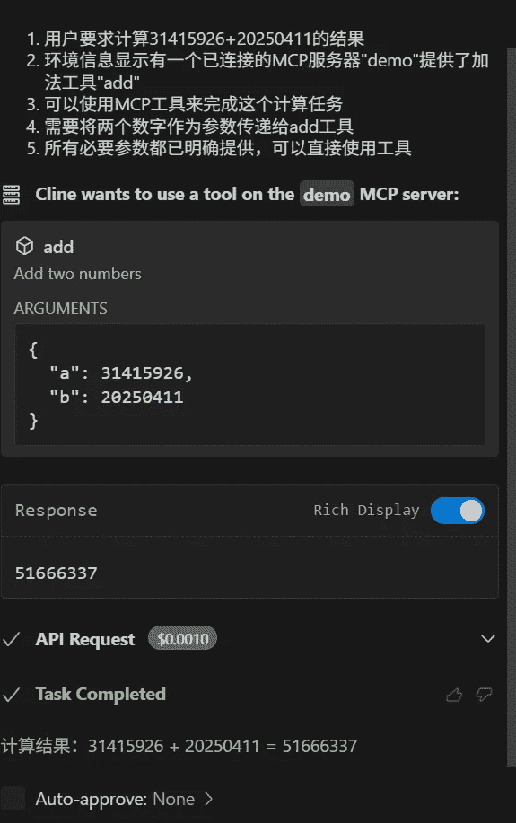
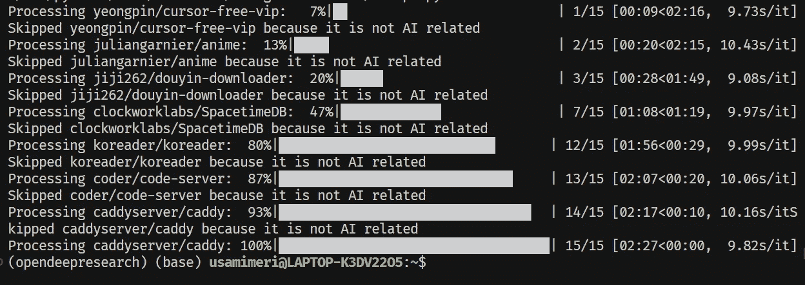
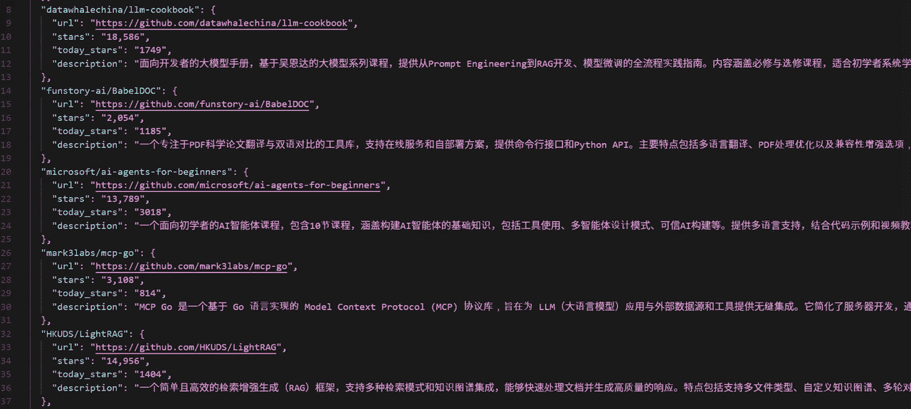
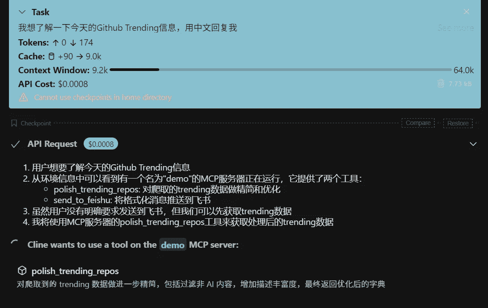
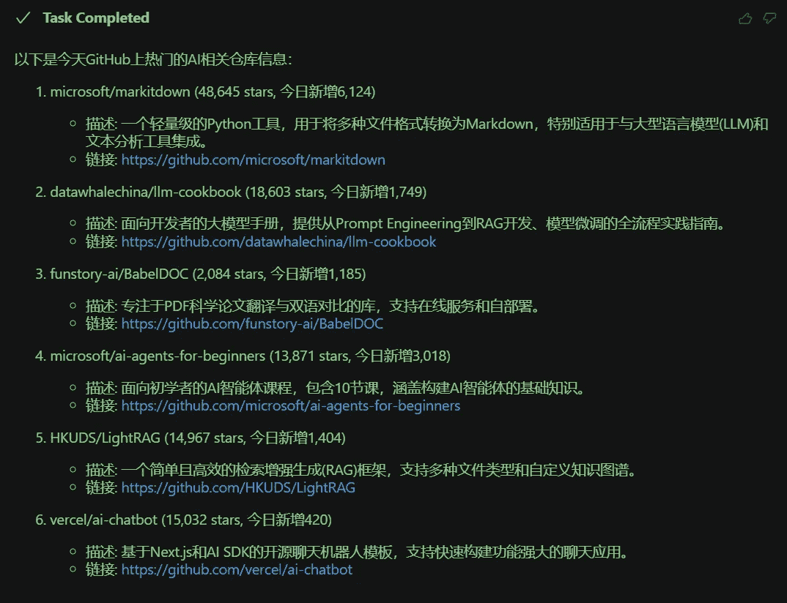
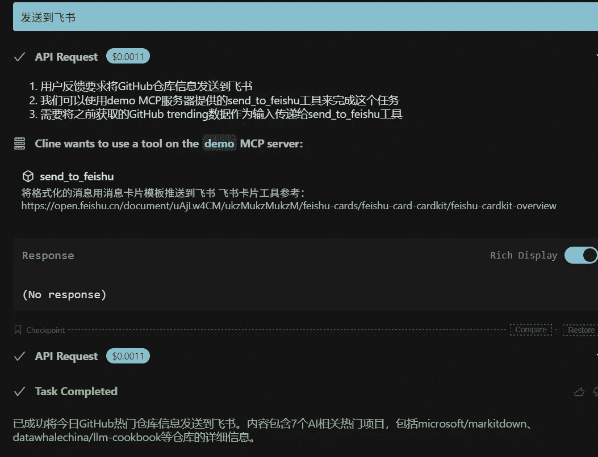
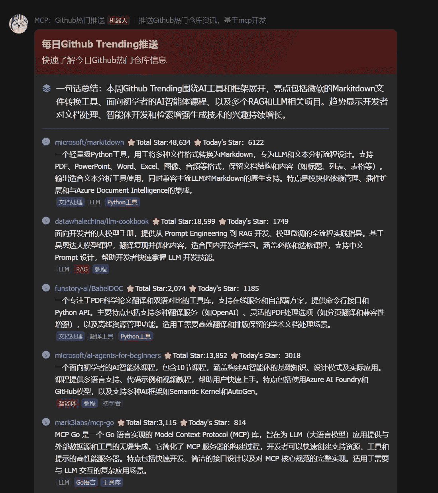

# 用MCP实现飞书推送Agent

> 来源：[https://datawhaler.feishu.cn/docx/KZUcdiUvuoEaolx4Heec8XcynKc](https://datawhaler.feishu.cn/docx/KZUcdiUvuoEaolx4Heec8XcynKc)

## 有用的资源

+   MCP官方文档（主要学习）：[https://modelcontextprot](https://modelcontextprotocol.io/introduction)ocol.io/introduction

+   精选的mcp服务端：[h](https://github.com/punkpeye/awesome-mcp-servers/blob/main/README-zh.md)ttps://github.com/punkpeye/awesome-mcp-servers/blob/main/README-zh.md

+   官方MCP：[https://github.com/modelcontex](https://github.com/modelcontextprotocol/python-sdk)tprotocol/python-sdk

## 代码实践

### 快速开始：创建一个MCP工具

创建MCP工具和平常我们创建Agent的tool类似，主要是让大模型知道：

+   这个工具有哪些参数，参数类型和要求是什么。这点需要在函数注释中详细说明。

+   这个函数的用途，返回类型是什么

使用MCP编写工具只需要在我们写好的函数上加一个装饰器`@mcp.tool()`即可

```
from mcp.server.fastmcp import FastMCP 
# 首先导入必备库，然后创建一个MCP服务器 
mcp = FastMCP(&quot;Demo&quot;)  

@mcp.tool() 
def add(a: int, b: int) -&gt; int:     
    &quot;&quot;&quot;Add two numbers&quot;&quot;&quot;     
    return a + b   
    
if __name__ == &#x27;__main__&#x27;:     
    mcp.run(transport=&quot;stdio&quot;)
```

### 使用`Inspector`调试代码

然后我们用`Inspector`来调试

1.  使用`mcp dev` 文件名 来启动服务

1.  一般来说链接是：`http://127.0.0.1:6274` ，由于一些wsl网络问题，可以用`google-chrome` <http://127.0.0.1:6274> & 命令来打开。如果连不上先在命令行中`unset` `ALL_PROXY`

随后就可以连上MCP了，点击可以测试工具



可以发现，通过`mcp dev main.py`后，我们成功使用了这个MCP工具，输入1+2正确返回了3，后面换成大模型也能做这件事。

### 使用`cline`运行mcp

`cline`可以让大模型利用写好的MCP工具，这里首先配置MCP服务的json文件，让`cline`知道有这么一个工具：

具体而言和使用`uv`运行这个文件是一样的，可以在命令行运行`uv --directory 存放你mcp服务文件的路径 run 你的mcp服务文件`，会发现也能启动服务

```
  {
    &quot;mcpServers&quot;: {
      &quot;demo&quot;: {
        &quot;disabled&quot;: false,
        &quot;timeout&quot;: 60,
        &quot;command&quot;: &quot;uv&quot;,
        &quot;args&quot;: [
          &quot;--directory&quot;,
          &quot;/home/usamimeri/MCP_Learning&quot;,
          &quot;run&quot;,
          &quot;main.py&quot;
        ],
        &quot;transportType&quot;: &quot;stdio&quot;
      }
    }
  }
```

询问大模型，发现成功输出了结果！到此就跑通了开发MCP的一个流程

+   创建`mcp`服务器（可以是一个python文件，里面有要给ai用的函数）

+   配置运行这个服务器的json文件

+   在支持`mcp`的客户端中使用这个`mcp`服务



## 一个复杂点的案例

现在实现一个复杂点的需求：Github Trending推荐智能体

### 初步需求

1.  爬取Github Trending信息，返回结构化字典便于进一步获取信息

1.  针对每个返回的repo，实现过滤功能，即只保留用户预设的感兴趣的库

1.  对于过滤后的repo，进入其内部读取readme作为额外信息，同时存入结构化字典，并保存到本地

1.  总结各个repo的信息，输出一个Github Trending推荐总结，包含每个仓库的介绍，用途，特点等

1.  将内容作为飞书卡片，推送到自己的飞书群

### 准备工作

#### 配置环境：使用`uv`

```
mkdir ossagentforfeishu
cd ossagentforfeishu
uv init
uv venv
source .venv/bin/activate 
uv pip install openai langchain html2text requests mcp langchain-deepseek
```

#### 创建`.env`文件管理环境变量

```
# OpenAI 或其他大模型平台的 API 密钥，可以换成OPENAI_API_KEY等 
DEEPSEEK_API_KEY=sk-xxxxxxxxxxxxxxxxxxxxxxxxxxxxxxxxxxxx  
# 飞书机器人的 Webhook，用于发送通知 
FEISHU_WEB_HOOK=https://open.feishu.cn/open-apis/bot/v2/hook/xxxxxxxx-xxxx-xxxx-xxxx-xxxxxxxxxxxx  
# 飞书消息卡片使用的模板 ID 和版本号 
FEISHU_TEMPLATE_ID= FEISHU_TEMPLATE_VERSION=1.0.0  
# 使用的大模型名称（如 deepseek-chat, gpt-4, gemini-pro 等） 
MODEL_NAME=&quot;deepseek-chat&quot;  
# 模型提供商（如 openai、deepseek、google、anthropic 等） 
MODEL_PROVIDER=&quot;deepseek&quot;
```

### 实现Github Trending爬取函数

首先导入一些必备库

```
import datetime
import json
import re
import requests
from bs4 import BeautifulSoup
from requests.adapters import HTTPAdapter
from requests.packages.urllib3.util.retry import Retry
from requests.exceptions import RequestException
from tqdm import tqdm
from pydantic import BaseModel, Field
from langchain.chat_models import init_chat_model
from dotenv import load_dotenv
import os
```

具体而言使用`BeautifulSoup`，依照所需元素设置爬取策略即可。

同时实现了一个重试策略，避免网络波动原因导致失败。

最后会返回一个包含Github仓库信息的结构化字典，这里我们需要利用url来进一步获取信息

```
def get_github_trending() -&gt; dict[str, dict]:
    &quot;&quot;&quot;获取Github Trending上的仓库信息
    - name: 仓库名称
    - url: 仓库地址
    - stars: 仓库的star数量
    - today_stars: 仓库star增长数量
    &quot;&quot;&quot;
    url = &quot;&lt;https://github.com/trending?since=weekly&gt;&quot;
    # 设置重试策略
    retry_strategy = Retry(
        total=3,
        status_forcelist=[500, 502, 503, 504],
    )
    adapter = HTTPAdapter(max_retries=retry_strategy)
    http = requests.Session()
    http.mount(&quot;https://&quot;, adapter)
    try:
        response = http.get(url)
        response.raise_for_status()
    except RequestException as e:
        raise RuntimeError(f&quot;Error fetching GitHub trending repositories {e}&quot;)
    html = response.text
    soup = BeautifulSoup(html, &#x27;html.parser&#x27;)
    trendings = {}
    for article in soup.select(&#x27;article.Box-row&#x27;):
        repo_info = {}
        name = re.sub(&quot;\\s+&quot;, &quot;&quot;, article.select_one(&#x27;h2 a&#x27;).text)
        repo_info[&#x27;url&#x27;] = f&quot;&lt;https://github.com&gt;{article.select_one(&#x27;h2 a&#x27;)[&#x27;href&#x27;].strip()}&quot;
        repo_info[&#x27;stars&#x27;] = article.select(&#x27;a.Link--muted&#x27;)[0].text.strip()
        today_stars_element = article.select_one(&#x27;span.d-inline-block.float-sm-right&#x27;)
        repo_info[&#x27;today_stars&#x27;] = re.sub(r&quot;[^\\d]&quot;, &quot;&quot;, today_stars_element.text) if today_stars_element else None
        trendings[name] = repo_info
    return trendings
```

### 实现README爬取

函数将返回README的内容，不过需要注意一些项目README有很多无关内容，可以进行一定的截取避免超出上下文长度。

```
def get_repo_readme(repo_url: str) -&gt; str:
    &quot;&quot;&quot;
    根据仓库 URL 获取 README 原始内容
    输入示例: &lt;https://github.com/punkpeye/awesome-mcp-servers&gt;
    返回 README 的 Markdown 文本内容
    &quot;&quot;&quot;
    parts = repo_url.rstrip(&quot;/&quot;).split(&quot;/&quot;)
    owner, repo = parts[-2], parts[-1]
    api_url = f&quot;&lt;https://api.github.com/repos/{owner}/{repo}/readme&gt;&quot;
    headers = {
        &quot;Accept&quot;: &quot;application/vnd.github.v3+json&quot;,
        &quot;User-Agent&quot;: &quot;readme-fetcher&quot;
    }
    response = requests.get(api_url, headers=headers)
    if response.status_code == 200:
        data = response.json()
        content_base64 = data.get(&quot;content&quot;, &quot;&quot;)
        if content_base64:
            readme_text = base64.b64decode(content_base64).decode(&quot;utf-8&quot;)
            readme_text = remove_unnecessary_content(readme_text)
            return readme_text
        else:
            return &quot;[该仓库没有README文件]&quot;
    else:
        return f&quot;[获取失败: {response.status_code}] {response.text}&quot;
```

### 实现过滤和存储本地功能

由于爬取的结果是html，有一些无关信息，为了节省上下文和突出主要内容，先创建一个预处理函数在`utils.py`中

```
import re
import html2text
def remove_unnecessary_content(text: str) -&gt; str:
    &quot;&quot;&quot;
    移除一些无用的HTML标签、文献参考等
    &quot;&quot;&quot;
    ref_pattern = re.compile(r&#x27;
.*?
&#x27;, re.DOTALL)  # 移除参考文献、代码、配置等信息
    handler = html2text.HTML2Text()
    handler.ignore_links = True
    handler.body_width = 0
    handler.images_to_alt = True
    removed_content = handler.handle(text)
    removed_content = ref_pattern.sub(&#x27;&#x27;, removed_content)
    return removed_content
```

为了实现过滤和AI无关的项目功能，我们使用Prompt结合大模型结构化输出来处理，并存在`prompt.py`中以便使用，Prompt设计如下：

```
FILTER_PROMPT = &#x27;&#x27;&#x27;
请根据下面的Github README信息，精简为仓库描述（即这个仓库是用来做什么的，能达成什么效果，特点是什么），在100-150字之间，
你不需要加上“这个仓库是……”，直接开始描述即可：
{README_CONTENT}
你不需要在仓库描述中包含以下内容：
仓库使用协议
仓库引用文献
如何配置项目环境、使用仓库的具体代码
同时，你需要判断仓库是否和AI（人工智能）相关、包括但不限于智能体、大语言模型、多模态、AI应用等。但不要包括只和计算机视觉、机器人控制领域相关的仓库。
&#x27;&#x27;&#x27;
```

我们需要实现过滤功能后，就可以遍历每个url了，然后对于每个仓库进行总结和过滤，最后存为结构化字典。


```python
from utils import remove_unnecessary_content
from prompt import FILTER_PROMPT
class FilterResponse(BaseModel):
    description: str = Field(description='''针对这个Github仓库的描述，
                           需要包括这个仓库是用来做什么的，能达成什么效果，特点是什么，在100-150字之间''')
    is_ai: str = Field(description="这个仓库是否是AI相关的，如果是请返回True，否则返回False")
def summarize_readme(repo_url: str):
    """将readme中的内容精简为仓库的Description,同时判断是否符合我们需求的主题
    返回类似：
    {'description': 'ChatTTS是一个……。', 'is_ai': 'True'}
    """
    readme_content = get_repo_readme(repo_url)
    model = init_chat_model(model="deepseek-chat", model_provider="deepseek")
    structured_llm = model.with_structured_output(FilterResponse)
    prompt = FILTER_PROMPT.format(README_CONTENT=readme_content)
    response: FilterResponse = structured_llm.invoke(prompt)
    response_dict = response.model_dump()
    return response_dict
def polish_trending_repos():
    """对爬取到的 trending 数据做进一步精简，包括过滤非 AI 内容，增加描述丰富度，最终返回优化后的字典"""
    date = datetime.date.today().strftime("%Y-%m-%d")
    trendings = get_github_trending()
    filtered_trendings = {}
    os.makedirs("filtered_trendings", exist_ok=True)
    # 设置一个进度条方便看处理哪个库
    with tqdm(total=len(trendings), desc="Processing Repositories") as pbar:
        for name, repo_info in trendings.items():
            pbar.set_description(f"Processing {name}")
            summarized_json = summarize_readme(repo_info["url"])
            if summarized_json["is_ai"] in ["True", "true"]:
                filtered_trendings[name] = repo_info
                filtered_trendings[name]["description"] = summarized_json["description"]
                # 每次迭代保存一次
                with open(f"filtered_trendings/trendings_{date}.json", "w") as f:
                    json.dump(filtered_trendings, f, indent=2, ensure_ascii=False)
            else:
                print(f"Skipped {name} because it is not AI related")
            pbar.update(1)
    return filtered_trendings
```

运行后发现成功实现功能，并保存到了本地





## 转换为MCP工具

转为`MCP`很方便，利用`mcp`库的装饰器即可，最后用`run`方法运行服务

```python
from mcp.server.fastmcp import FastMCP
app = FastMCP("app")
@app.tool()
def polish_trending_repos():
    ……
if __name__ == "__main__":
    app.run(transport="stdio")
```

## 配置MCP服务

这里我们使用`cline`进行测试，在`mcp`配置中添加如下命令，也就是让`Client`知道有这么一个`Server`。其中`—directory`后改成到自己工具所在文件的路径

```json
{
  "mcpServers": {
    "demo": {
      "disabled": false,
      "timeout": 180,
      "command": "uv",
      "args": [
        "--directory",
        "/home/usamimeri/ossagentforfeishu",
        "run",
        "main.py"
      ],
      "transportType": "stdio"
    }
  }
}
```

在`cline`中要求获取信息后，可以发现大模型成功找到了对应的`mcp`服务，点击允许执行，等待返回结果



成功！大模型正确根据工具返回的信息推送给了我们资讯



## （可选）发送到飞书

> [具体飞书卡片和w](https://open.feishu.cn/document/uAjLw4CM/ukzMukzMukzM/feishu-cards/feishu-card-cardkit/feishu-cardkit-overview)e[bhook](https://open.feishu.cn/document/client-docs/bot-v3/add-custom-bot)教程： 飞书卡片搭建工具，飞书机器人


[推荐智能体.card](https://internal-api-drive-stream.feishu.cn/space/api/box/stream/download/all/Gr2Gb6eL4oF7RJx2niLco5YInkc)

可以在卡片页面导入上方的卡片，并复制左上角的`id`，点击发布后，版本号一般为1.0.0

获得的内容可以配置为飞书卡片并推送到飞书群组，实现一个推送智能体的功能。需要先准备好：

+   飞书卡片模板，并获取`id`和版本号
+   飞书机器人的`webhook`，需要在群组中创建

### 生成飞书卡片

即让大模型根据返回`Trending`内容，生成富文本语法，格式符合飞书卡片的变量格式，`Prompt`设计如下

````python
TEMPLATE_PROMPT = '''
# Profile
你是一个相关的Github Trending信息整理师，旨在为用户提供精炼的每周Trending仓库的信息和亮点

# Context
以下是Github Trending的信息：
{trendings}

# Workflow
1. 首先用80字左右总结Trending中的综合信息（和AI相关的），帮助读者一下了解这周的Trending态势
2. 对每个仓库，在最后包含2<=label<=4个的标签，标签需要和仓库内容高度相关，让用户可以一眼看出仓库的特点。
标签语法为<text_tag color='red'>标签文本</text_tag>,支持color参考Constraints部分，标签之间不用换行。
3. description直接复制# Context 中对应description键的信息，不要再过多精简
4. 最后需要输出JSON格式，参考如下：
输出的字典仅有`summary`和`repos`两个键，`summary`为总结，`repo`为仓库列表，每个元素为一个仅含description键的字典（**不要包括其他键！**）
注意star描述后需要换行一次，列标签需要另起一行
```json

{{"summary": "你的总结",

"repos": [

{{"description": "[CopilotKit](https://github.com/CopilotKit/CopilotKit) ⭐Total Star:1111 ⭐Today’s Star：2222 

…对应的description原内容 

<text_tag color='red'>智能体</text_tag><text_tag color='orange'>RAG</text_tag>"}}, 

{{"description": "…"}},

…],

}}

```

# Constraints
1. 若要输出Markdown，只能使用如下的子集来美化你的输出，不能使用在此之外的语法例如标题#、引用>等：
换行:\n 
加粗:**粗体**
可点击的文字链接:[开放平台](https://…) 无
标签:<text_tag color='red'>标签文本</text_tag> 
其中`color`支持的枚举值范围包括如下：
- neutral: 中性色
- blue: 蓝色
- turquoise: 青绿色
- lime: 酸橙色
- orange: 橙色
- violet: 紫罗兰色
- indigo: 靛青色
- wathet: 天蓝色
- green: 绿色
- yellow: 黄色
- red: 红色
- purple: 紫色
- carmine: 洋红色

有序列表:
1. 有序列表1 
    1. 有序列表 1.1 
2. 有序列表2
要求:
- 序号需在行首使用
- 4 个空格代表一层缩进

无序列表: 要求同有序列表
2. 相同名称的标签应有相同的颜色
3. 输出中文，不要输出纯英文
'''

````

接下来让大模型根据`Trending`内容，填入提示词模板，生成飞书卡片

```python
def generate_feishu_card():
    """根据trendings字典生成飞书卡片"""
    date = datetime.date.today().strftime("%Y-%m-%d")
    trending_path = f'filtered_trendings/trendings_{date}.json'
    template_path = f"filtered_trendings/template_{date}.json"
    with open(trending_path, 'r') as f:
        trending_repos = json.load(f)
    if not os.path.exists(trending_path):
        raise FileNotFoundError(f"trending文件{trending_path}不存在，请先运行polish_trending_repos()")

    print("正在生成推送json……")

    template_prompt = TEMPLATE_PROMPT.format(trendings=trending_repos)
    model = init_chat_model(model=os.getenv("MODEL_NAME"), model_provider=os.getenv("MODEL_PROVIDER"))
    response = model.invoke(template_prompt)
    template_variables = parse_json_block(response.content)
    with open(template_path, 'w') as f:
        json.dump(template_variables, f, indent=2, ensure_ascii=False)
    print("推送json生成成功！,保存到", template_path)
```

完成卡片模板后就可以推送到本地了

```python
@app.tool()
def send_to_feishu():
    """
    将格式化的消息用消息卡片模板推送到飞书
    飞书卡片工具参考：<https://open.feishu.cn/document/uAjLw4CM/ukzMukzMukzM/feishu-cards/feishu-card-cardkit/feishu-cardkit-overview>
    """
    date = datetime.date.today().strftime("%Y-%m-%d")
    template_path = f"filtered_trendings/template_{date}.json"
    if not os.path.exists(template_path):
        generate_feishu_card()
    with open(template_path, 'r') as f:
        template_variable = json.load(f)
    FEISHU_WEB_HOOK = os.getenv("FEISHU_WEB_HOOK")
    body = json.dumps(
        {
            "msg_type": "interactive",
            "card": {
                "type": "template",
                "data": {
                    "template_id": os.getenv("FEISHU_TEMPLATE_ID"),
                    "template_version_name": os.getenv("FEISHU_TEMPLATE_VERSION"),  # 需要版本对应
                    "template_variable": template_variable
                }
            }
        })
    response = requests.post(FEISHU_WEB_HOOK, data=body)
    print(response.text)
```

现在我们要求大模型发送到飞书



大成功！



## TODO

1.  改成异步，提高响应速度
2.  本地`RAG`功能
3.  可选参数，每日，每周，每月`Trending`……
