# AI 妙笔生花，智能春联贺新春：传统文化与科技碰撞的火花

> 来源：[https://datawhaler.feishu.cn/docx/CD98dATnpowZt9x3BsfcHowfnWc](https://datawhaler.feishu.cn/docx/CD98dATnpowZt9x3BsfcHowfnWc)

## 一、AI 主题与方向

**主题：** 本文探讨人工智能（AI）技术如何与传统文化相结合，以智能春联生成为例，展现科技赋能传统文化的创新应用。

**方向：** AI 技术赋能春联创作。

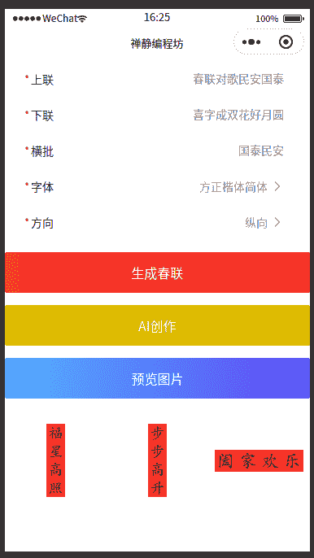

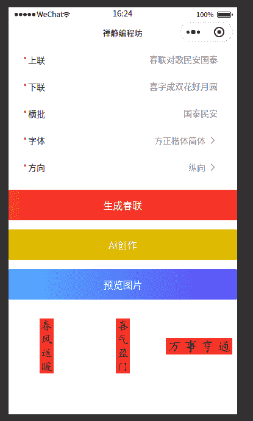

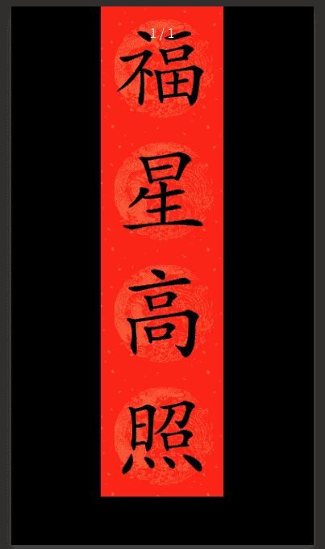

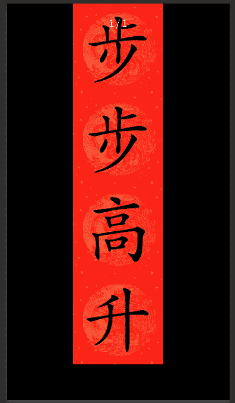

## 二、应用原理与实现技术栈

核心原理：让 AI 按照主题或者命题进行春联创造，然后将文本渲染到背景图上。

实现技术栈：🛰️小程序+Rust+AI。

应用主体流程：

## 三、小程序效果演示

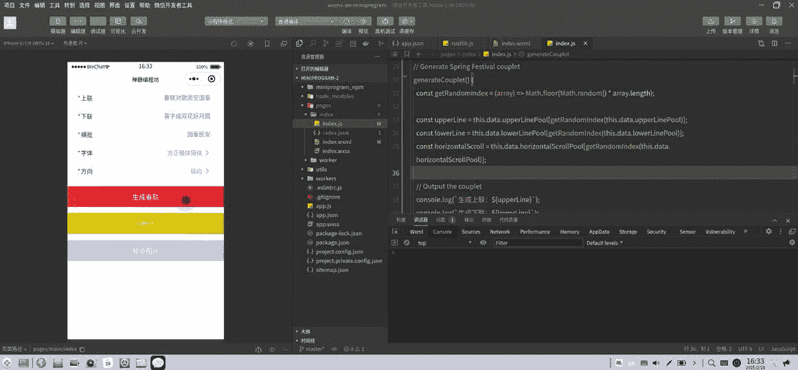

[20250226163329_rec_.mp4](https://internal-api-drive-stream.feishu.cn/space/api/box/stream/download/all/OE2Db1RnjoDCphxPPRvcJssVnKh)

## 四、深究：AI 春联生成的技术

想象一下，AI 就像一个学习能力超强的“春联学徒”，它通过以下步骤学习并创作春联：

1. **海量学习：** 首先，AI 需要“阅读”大量的春联，就像学徒要背诵很多经典对联一样。这些春联数据可以是网络上收集的，也可以是人工整理的。

2. **理解规则：** 在学习的过程中，AI 会逐渐理解春联的“规则”，例如：

   对仗： 上下联的字数要相同，词性要相对，例如“天”对“地”，“风”对“雨”。

   平仄： 每个字的声调要符合一定的规律，读起来才会朗朗上口。

   寓意： 春联要表达吉祥如意的美好祝愿。

3. **模仿创作：** 掌握了这些规则后，AI 就可以开始模仿创作了。它会根据用户输入的关键词或选择的风格，从“记忆库”中提取相关的字词，并按照春联的规则进行组合，生成新的春联。

4. **不断优化：** AI 并不是一次就能创作出完美的春联，它需要不断学习和优化。例如，用户可以对生成的春联进行评分或修改，AI 会根据这些反馈调整自己的创作策略，生成更符合用户期望的春联。

### 阶段1、最简单的春联生成器

```
import random

# 定义上联、下联和横批的词库
上联词库 = ["春风送暖", "福星高照", "万事如意", "财源广进"]
下联词库 = ["喜气盈门", "吉祥如意", "心想事成", "步步高升"]
横批词库 = ["新春大吉", "恭喜发财", "阖家欢乐", "万事亨通"]

# 随机生成一副春联
上联 = random.choice(上联词库)
下联 = random.choice(下联词库)
横批 = random.choice(横批词库)

# 输出春联
print(f"上联：{上联}")
print(f"下联：{下联}")
print(f"横批：{横批}")
```

**运行结果示例：**

```
上联：春风送暖
下联：喜气盈门
横批：新春大吉
```

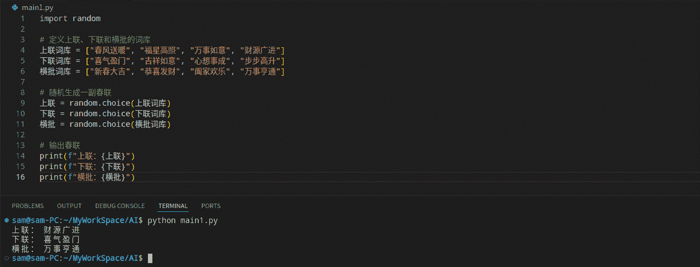

### 阶段2、基于规则的生成器

```
import random
from pypinyin import pinyin, Style

class OptimizedCoupletGenerator:
    def __init__(self):
        # 严格匹配的模板结构
        self.templates = [
            ("{自然}{动作}{对象}", "{自然}{动作}{对象}"),      # 结构对称模板
            ("{时间}迎新岁", "{季节}贺丰年"),                   # 时间对季节
            ("{颜色}{景物}添锦绣", "{气象}{万物}展宏图")        # 颜色对气象
        ]
        
        # 按对仗关系重组词汇表
        self.vocab = {
            '自然': ['春风', '喜雨', '瑞雪', '祥云'],
            '动作': ['拂', '润', '染', '沐'],
            '对象': ['大地', '山河', '千山', '万户'],
            '时间': ['腊尽', '梅开', '岁末'],
            '季节': ['春回', '夏至', '秋来'],
            '颜色': ['桃红', '柳绿', '菊黄'],
            '景物': ['映日', '临风', '傲雪'],
            '气象': ['风和', '日丽', '月明'],
            '万物': ['千川', '百花', '九州']
        }

    def validate_couplet(self, up, down):
        """严格平仄校验"""
        def get_tone(char):
            p = pinyin(char, style=Style.TONE3)[0][0]
            return p[-1] if p[-1].isdigit() else '5'  # 5表示轻声
        
        # 末字平仄校验
        up_last_tone = get_tone(up[-1])
        down_last_tone = get_tone(down[-1])
        if (up_last_tone not in ['3','4']) or (down_last_tone not in ['1','2']):
            return False
        
        # 词性对仗校验（简单版）
        pos_tags = {
            'n': ['春', '风', '雪'],
            'v': ['拂', '润', '展'],
            'adj': ['红', '绿', '新']
        }
        # 此处可扩展更精确的词性分析
        return len(up) == len(down)  # 保证字数相同
    
    def generate(self, max_retry=5):
        """带校验的生成方法"""
        for _ in range(max_retry):
            # 选择模板并生成初稿
            template = random.choice(self.templates)
            up = self.fill_template(template[0])
            down = self.fill_template(template[1])
            
            # 格式校验
            if self.validate_couplet(up, down):
                return up, down
        return "生成失败，请调整模板", "或扩充词汇表";

    def fill_template(self, pattern):
        """智能填充模板"""
        result = []
        parts = pattern.split('{')
        for part in parts:
            if '}' in part:
                key, suffix = part.split('}', 1)
                word = random.choice(self.vocab[key])
                result.append(word + suffix)
            else:
                result.append(part)
        return ''.join(result)

# 使用示例
generator = OptimizedCoupletGenerator()
print(generator.generate()) 
```

**运行结果示例：**

```
('腊尽迎新岁', '春回贺丰年')
('桃红映日添锦绣', '风和九州展宏图')
('桃红映日添锦绣', '风和千川展宏图')
('腊尽迎新岁', '春回贺丰年')
('梅开迎新岁', '夏至贺丰年')
```

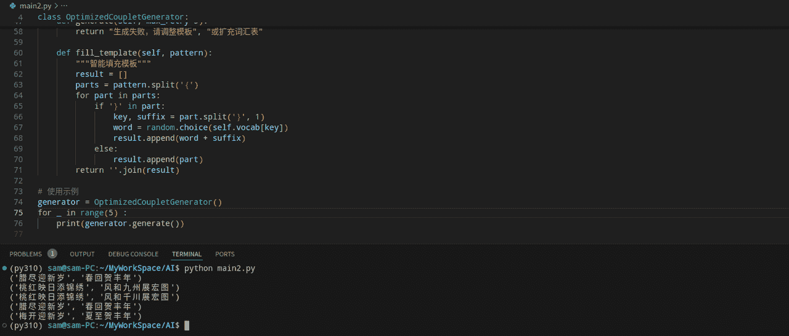

### 阶段3、LSTM深度学习模型


```python
import torch
import torch.nn as nn
from torch.utils.data import Dataset, DataLoader
import json
from collections import defaultdict
import math

# 词表构建
def build_vocab(files, min_freq=3):
    counter = defaultdict(int)
    special_tokens = ['<pad>', '<unk>', '<sos>', '<eos>']
    
    for file in files:
        with open(file, 'r', encoding='utf-8') as f:
            for line in f:
                line = line.strip()
                if line.startswith('//') or not line:
                    continue
                up, down = line.split(',', 1)
                for char in up + down:
                    counter[char] += 1

    vocab = {token:i for i, token in enumerate(special_tokens)}
    sorted_chars = sorted(
        [char for char, cnt in counter.items() if cnt >= min_freq],
        key=lambda x: (-counter[x], x)
    )
    vocab.update({char:i+len(special_tokens) for i, char in enumerate(sorted_chars)})
    return vocab, {v:k for k,v in vocab.items()}

def save_vocab(vocab, path):
    with open(path, 'w', encoding='utf-8') as f:
        json.dump(vocab, f, ensure_ascii=False)

def load_vocab(path):
    with open(path, 'r', encoding='utf-8') as f:
        return json.load(f)

# 数据集类
class CoupletDataset(Dataset):
    def __init__(self, data_path, vocab, max_len=32):
        self.data = []
        with open(data_path, encoding='utf-8') as f:
            for line in f:
                line = line.strip()
                if line and not line.startswith('//'):
                    parts = line.split(',', 1)
                    if len(parts) == 2:
                        self.data.append(parts)
        self.vocab = vocab
        self.max_len = max_len
        self.pad_id = vocab['<pad>']
        self.sos_id = vocab['<sos>']
        self.eos_id = vocab['<eos>']

    def __len__(self):
        return len(self.data)

    def __getitem__(self, idx):
        up, down = self.data[idx]
        return (
            torch.tensor([self.sos_id] + self.text2id(up) + [self.eos_id], dtype=torch.long),
            torch.tensor([self.sos_id] + self.text2id(down) + [self.eos_id], dtype=torch.long)
        )

    def text2id(self, text):
        return [self.vocab.get(c, self.vocab['<unk>']) for c in text[:self.max_len]]

    @staticmethod
    def collate_fn(batch):
        up_batch, down_batch = zip(*batch)
        
        def pad_sequence(sequences):
            lengths = [len(seq) for seq in sequences]
            padded = torch.zeros(len(sequences), max(lengths), dtype=torch.long)
            for i, seq in enumerate(sequences):
                padded[i, :lengths[i]] = seq
            return padded

        up_padded = pad_sequence(up_batch)
        down_padded = pad_sequence(down_batch)
        return up_padded, down_padded[:, :-1], down_padded[:, 1:]

# 模型类
class CoupletLSTM(nn.Module):
    def __init__(self, vocab_size, embed_dim=256, hidden_dim=512):
        super().__init__()
        self.embedding = nn.Embedding(vocab_size, embed_dim, padding_idx=0)
        self.encoder = nn.LSTM(embed_dim, hidden_dim, batch_first=True)
        self.decoder = nn.LSTM(embed_dim, hidden_dim, batch_first=True)
        self.fc = nn.Linear(hidden_dim, vocab_size)
        
    def forward(self, up, dec_input):
        up_embed = self.embedding(up)
        _, (hidden, cell) = self.encoder(up_embed)
        
        dec_embed = self.embedding(dec_input)
        output, _ = self.decoder(dec_embed, (hidden, cell))
        return self.fc(output)
    
# 模型保存与加载
def save_model(model, path):
    torch.save({
        'state_dict': model.state_dict(),
        'vocab_size': model.fc.out_features,
        'embed_dim': model.embedding.embedding_dim,
        'hidden_dim': model.encoder.hidden_size
    }, path)

def load_model(path, vocab):
    checkpoint = torch.load(path, map_location='cpu')
    model = CoupletLSTM(
        vocab_size=checkpoint['vocab_size'],
        embed_dim=checkpoint['embed_dim'],
        hidden_dim=checkpoint['hidden_dim']
    )
    model.load_state_dict(checkpoint['state_dict'])
    return model

# 生成增强模块
class CoupletGenerator:
    def __init__(self, model, vocab, rev_vocab):
        self.model = model.eval()
        self.vocab = vocab
        self.rev_vocab = rev_vocab
        self.sos = vocab['<sos>']
        self.eos = vocab['<eos>']
        
    def generate(self, up_text, max_len=30, temperature=1.0):
        up_ids = [self.vocab.get(c, self.vocab['<unk>']) for c in up_text]
        up_tensor = torch.tensor([[self.sos] + up_ids + [self.eos]], dtype=torch.long)
        
        hidden = None
        output_seq = [self.sos]
        with torch.no_grad():
            up_embed = self.model.embedding(up_tensor)
            _, (hidden, cell) = self.model.encoder(up_embed)
            
            for _ in range(max_len):
                dec_input = torch.tensor([[output_seq[-1]]], dtype=torch.long)
                dec_embed = self.model.embedding(dec_input)
                out, (hidden, cell) = self.model.decoder(dec_embed, (hidden, cell))
                logits = self.model.fc(out.squeeze(1))
                
                probs = torch.softmax(logits / temperature, dim=1)
                next_token = torch.multinomial(probs, 1).item()
                
                if next_token == self.eos:
                    break
                output_seq.append(next_token)
                
        return ''.join([self.rev_vocab.get(i, '?') for i in output_seq[1:]])

class CoupletLSTMWithAttention(nn.Module):
    def __init__(self, vocab_size, embed_dim=256, hidden_dim=512):
        super().__init__()
        self.embedding = nn.Embedding(vocab_size, embed_dim, padding_idx=0)
        self.encoder = nn.LSTM(embed_dim, hidden_dim, bidirectional=True, batch_first=True)
        self.decoder = nn.LSTMCell(embed_dim + 2*hidden_dim, hidden_dim)
        self.attention = nn.Linear(2*hidden_dim + hidden_dim, hidden_dim)
        self.fc = nn.Linear(hidden_dim*2, vocab_size)
        self.hidden_dim = hidden_dim

    def forward(self, up, dec_input):
        # 编码器
        up_embed = self.embedding(up)  # (batch, seq_len, embed_dim)
        enc_out, (h, c) = self.encoder(up_embed)  # enc_out: (batch, seq_len, 2*hidden)
        
        # 解码器初始化
        batch_size = dec_input.size(0)
        h_dec = torch.zeros(batch_size, self.hidden_dim).to(up.device)
        c_dec = torch.zeros(batch_size, self.hidden_dim).to(up.device)
        
        outputs = []
        for t in range(dec_input.size(1)):
            # 注意力计算
            query = h_dec.unsqueeze(1).expand(-1, enc_out.size(1), -1)
            energy = torch.tanh(self.attention(torch.cat((query, enc_out), dim=2)))
            attention = torch.softmax(energy.sum(dim=2), dim=1).unsqueeze(1)
            
            context = torch.bmm(attention, enc_out).squeeze(1)
            
            # 解码步骤
            dec_embed = self.embedding(dec_input[:, t])  # (batch, embed)
            combined = torch.cat((dec_embed, context), dim=1)
            h_dec, c_dec = self.decoder(combined, (h_dec, c_dec))
            
            output = self.fc(torch.cat((h_dec, context), dim=1))
            outputs.append(output)
        
        return torch.stack(outputs, dim=1)

class EnhancedCoupletGenerator(CoupletGenerator):
    def __init__(self, *args, beam_size=3, **kwargs):
        super().__init__(*args, **kwargs)
        self.beam_size = beam_size
        
    def beam_search(self, up_ids, max_len=30, temperature=0.7):
        up_tensor = torch.tensor([[self.sos] + up_ids + [self.eos]], dtype=torch.long)
        
        # 编码阶段
        with torch.no_grad():
            up_embed = self.model.embedding(up_tensor)
            enc_out, (h, c) = self.model.encoder(up_embed)
        
        # 初始化束搜索
        beams = [{
            'seq': [self.sos],
            'score': 0.0,
            'h_dec': h.squeeze(0).unsqueeze(0),  # 使用编码器最终隐藏状态
            'c_dec': c.squeeze(0).unsqueeze(0)
        }]
        
        for _ in range(max_len):
            candidates = []
            for beam in beams:
                if beam['seq'][-1] == self.eos:
                    candidates.append(beam)
                    continue
                
                # 解码步骤
                dec_input = torch.tensor([[beam['seq'][-1]]], dtype=torch.long)
                dec_embed = self.model.embedding(dec_input)
                
                # 注意力计算
                query = beam['h_dec']
                query_exp = query.unsqueeze(1).expand(-1, enc_out.size(1), -1)
                energy = self.model.attention(torch.cat((query_exp, enc_out), dim=2))
                attention = torch.softmax(energy, dim=1)
                context = torch.bmm(attention, enc_out).squeeze(1)
                
                # LSTM步骤
                combined = torch.cat((dec_embed.squeeze(1), context), dim=1)
                h_dec, c_dec = self.model.decoder(combined, (beam['h_dec'], beam['c_dec']))
                
                # 生成候选
                logits = self.model.fc(torch.cat((h_dec, context), dim=1)) / temperature
                probs = torch.softmax(logits, dim=1)
                top_probs, top_ids = probs.topk(self.beam_size * 2)
                
                for i in range(top_probs.size(1)):
                    new_seq = beam['seq'] + [top_ids[0][i].item()]
                    new_score = beam['score'] + math.log(top_probs[0][i].item())
                    candidates.append({
                        'seq': new_seq,
                        'score': new_score,
                        'h_dec': h_dec,
                        'c_dec': c_dec
                    })
            
            # 选择top候选
            candidates = sorted(candidates, key=lambda x: x['score'], reverse=True)[:self.beam_size]
            beams = []
            for cand in candidates:
                if cand['seq'][-1] == self.eos:
                    beams.append(cand)
                else:
                    beams.append(cand)
            
            if all(c['seq'][-1] == self.eos for c in beams):
                break
        
        best = max(beams, key=lambda x: x['score'])
        return best['seq']

    def generate(self, up_text, max_len=30, temperature=0.7):
        up_ids = [self.vocab.get(c, self.vocab['<unk>']) for c in up_text]
        try:
            best_seq = self.beam_search(up_ids, max_len, temperature)
            return self._post_process(best_seq)
        except:
            return super().generate(up_text, max_len, temperature)

    def _post_process(self, seq):
        # 去除特殊标记并筛选有效字符
        filtered = [self.rev_vocab.get(i, '') for i in seq if i not in {self.sos, self.eos}]
        # 长度对齐处理
        if len(filtered) % 2 != 0 and len(filtered) > 1:
            filtered = filtered[:-1]
        return ''.join(filtered)

def train_then_save_best_model() :
    # 显式设置CPU设备（PyTorch默认即为CPU）
    device = torch.device('cpu')
    
    # 词表构建
    train_files = ['data/train.txt', 'data/valid.txt']
    vocab, rev_vocab = build_vocab(train_files, min_freq=2)
    save_vocab(vocab, 'data/vocab.json')
    
    # 数据加载
    dataset = CoupletDataset('data/couplets.txt', vocab)
    dataloader = DataLoader(
        dataset,
        batch_size=2,  # 小批量适合CPU
        shuffle=True,
        collate_fn=CoupletDataset.collate_fn
    )
    
    # 模型初始化（自动在CPU）
    model = CoupletLSTM(len(vocab)).to(device)
    
    # 训练设置
    criterion = nn.CrossEntropyLoss(ignore_index=0)
    optimizer = torch.optim.Adam(model.parameters(), lr=0.001)
    
    # 训练循环添加进度条和模型保存
    best_loss = float('inf')
    for epoch in range(10):
        model.train()
        total_loss = 0
        for i, (up, dec_in, dec_tgt) in enumerate(dataloader):
            up = up.to(device)
            dec_in = dec_in.to(device)
            dec_tgt = dec_tgt.to(device)
            
            optimizer.zero_grad()
            output = model(up, dec_in)
            loss = criterion(output.view(-1, len(vocab)), dec_tgt.contiguous().view(-1))
            loss.backward()
            nn.utils.clip_grad_norm_(model.parameters(), 5.0)
            optimizer.step()
            
            total_loss += loss.item()
            if i % 50 == 0:
                print(f"Batch {i} Loss: {loss.item():.4f}")
        
        avg_loss = total_loss / len(dataloader)
        print(f"Epoch {epoch+1} Loss: {avg_loss:.4f}")
        
        # 保存最佳模型
        if avg_loss < best_loss:
            best_loss = avg_loss
            save_model(model, "model/best_model.pth")

# 使用示例
if __name__ == "__main__":

    # 训练并保存最佳模型
    # train_then_save_best_model()

    # 初始化模型和生成器（加载之前保存的最佳模型）
    vocab = load_vocab('data/vocab.json')
    rev_vocab = {v:k for k,v in vocab.items()}
    model = load_model('model/best_model.pth', vocab)
    
    generator = EnhancedCoupletGenerator(
        model=model,
        vocab=vocab,
        rev_vocab=rev_vocab,
        beam_size=5
    )
    
    test_cases = [
        "一帆风顺年年好",
        "春风得意马蹄疾",
        "四海皆春春不老"
    ]
    
    for up in test_cases:
        print(f"上联: {up}")
        print(f"生成下联: {generator.generate(up, temperature=0.7)}")
        print("-"*30)
```


## 运行结果示例

```
上联: 岁岁平安日
生成下联: 年年如意春
------------------------------
上联: 春风送暖千山秀
生成下联: 丽日生辉万木荣
------------------------------
上联: 一声爆竹庆民康国泰
生成下联: 三怀春酒祝人寿年丰
------------------------------
上联: 年年迎春年年添福年年乐
生成下联: 岁岁丰收岁岁有余岁岁欢
------------------------------
```

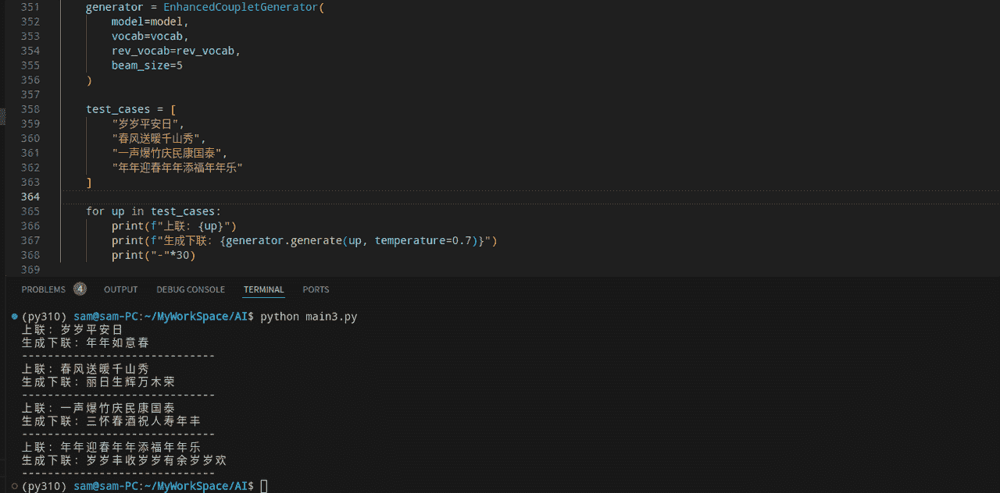

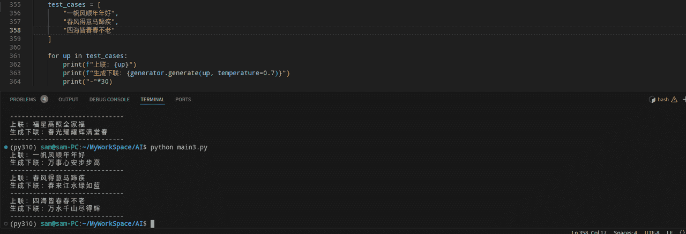

# 阶段4、预训练语言模型GPT-2应用

```
# -*- coding: utf-8 -*-
import torch
from transformers import GPT2LMHeadModel, GPT2Tokenizer, Trainer, TrainingArguments
from pypinyin import pinyin, Style
from datasets import load_dataset
import re
from transformers import DataCollatorForLanguageModeling
# import os

class CoupletGenerator:
    def __init__(self, model_name="gpt2-medium"):
        # 初始化模型和分词器
        self.tokenizer = GPT2Tokenizer.from_pretrained(
            model_name,
            sep_token="[SEP]",
            pad_token="[PAD]"
        )
        self.model = GPT2LMHeadModel.from_pretrained(model_name)
        self.model.resize_token_embeddings(len(self.tokenizer))
        
        # 平仄映射表
        self.tonal_map = {
            '1': '平', '2': '平',
            '3': '仄', '4': '仄',
            '0': '平'  # 中性字处理为平声
        }

    def preprocess_data(self, file_path):
        """数据预处理：将传统对联数据转换为模型输入格式"""
        def format_couplet(examples):
            inputs = []
            for up, down in zip(examples['upper'], examples['lower']):
                # 添加特殊标记和格式控制
                formatted = f"上联:{up}[SEP]下联:{down}"
                inputs.append(formatted)
            return {'text': inputs}
        
        dataset = load_dataset('text', data_files=file_path)['train']
        dataset = dataset.map(
            lambda x: {'upper': x['text'].split(' ')[0], 
                      'lower': x['text'].split(' ')[1]},
            remove_columns=['text']
        )
        return dataset.map(format_couplet, batched=True)

    def train(self, train_data, epochs=5):
        """模型训练流程"""
        def tokenize_function(examples):
            return self.tokenizer(
                examples['text'],
                padding='max_length',
                truncation=True,
                max_length=32
            )

        tokenized_data = train_data.map(tokenize_function, batched=True)
        data_collator = DataCollatorForLanguageModeling(
            tokenizer=self.tokenizer,
            mlm=False
        )

        training_args = TrainingArguments(
            output_dir="./gpt2_couplet",
            overwrite_output_dir=True,
            num_train_epochs=epochs,
            per_device_train_batch_size=8,
            learning_rate=3e-5,
            logging_steps=100,
            save_steps=500,
            prediction_loss_only=True,
            fp16=True  # 启用混合精度训练
        )

        trainer = Trainer(
            model=self.model,
            args=training_args,
            data_collator=data_collator,
            train_dataset=tokenized_data,
        )

        trainer.train()
        self.model.save_pretrained("./gpt2_couplet/final_model")

    def generate_couplet(self, upper_phrase, temperature=0.9, top_k=50, max_length=50):
        """智能生成下联"""
        def tonal_check(up_last, down_last):
            """平仄规则验证"""
            up_tone = self.tonal_map.get(pinyin(up_last, style=Style.TONE3)[0][0][-1], '平')
            down_tone = self.tonal_map.get(pinyin(down_last, style=Style.TONE3)[0][0][-1], '平')
            return (up_tone == '仄') and (down_tone == '平')

        # 生成候选结果
        prompt = f"上联:{upper_phrase}[SEP]下联:"
        input_ids = self.tokenizer.encode(prompt, return_tensors="pt")
        
        outputs = self.model.generate(
            input_ids,
            max_length=max_length,
            do_sample=True,
            temperature=temperature,
            top_k=top_k,
            num_return_sequences=5,
            pad_token_id=self.tokenizer.pad_token_id,
            no_repeat_ngram_size=2
        )

        # 结果后处理
        candidates = []
        for output in outputs:
            full_text = self.tokenizer.decode(output, skip_special_tokens=True)
            match = re.search(r"下联:(.*?)$", full_text)
            if match:
                down_candidate = match.group(1).strip()
                # 长度对齐处理
                target_len = len(upper_phrase)
                down_candidate = down_candidate[:target_len]  # 强制对齐长度
                
                # 平仄验证
                if len(down_candidate) > 0 and tonal_check(upper_phrase[-1], down_candidate[-1]):
                    candidates.append(down_candidate)

        # 选择最佳候选
        return min(candidates, key=lambda x: abs(len(x)-len(upper_phrase))) if candidates else ""

    def interactive_test(self):
        """交互式测试"""
        print("输入'exit'退出测试")
        while True:
            upper = input("\n请输入上联: ").strip()
            if upper.lower() == 'exit':
                break
            lower = self.generate_couplet(upper)
            print(f"\n生成结果:\n上联: {upper}\n下联: {lower}\n{'='*30}")

if __name__ == "__main__":

    # os.environ['HF_HUB_URL'] = 'https://hf-mirror.com'

    # 使用示例
    generator = CoupletGenerator(model_name="./models/gpt2")
    
    # 数据预处理（示例数据格式：每行"上联内容 下联内容"）
    dataset = generator.preprocess_data("couplets_dataset.txt")
    
    # 模型训练
    generator.train(dataset, epochs=3)
    
    # 交互测试
    generator.interactive_test()
```

## 运行结果示例

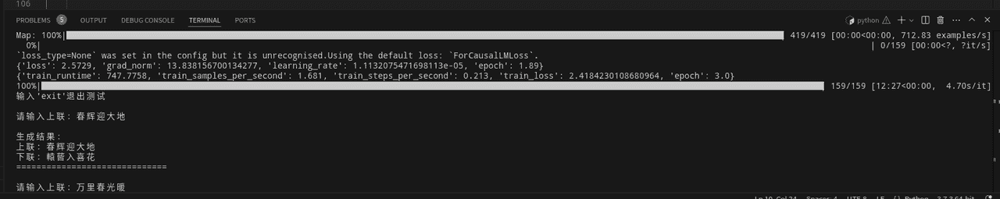

# 五、探讨：传统文化与AI融合的意义

关于传统文化与AI融合的讨论，本质上是人类文明演进的必然命题。这种融合绝非简单的技术嫁接，而是在数字文明时代重构文化生命力的深层对话。我们可以从以下维度展开思考：

## 1、文化基因的数字化重生

AI技术为非物质文化遗产提供了超维保存方案。敦煌研究院通过三维建模与生成对抗网络（GAN），实现了壁画褪色部分的动态修复，使千年色彩在算法中重生。更值得关注的是，AI不仅能保存文化形态，更能解码文化基因——清华大学团队用知识图谱技术解析《周易》卦象系统，揭示出二进制思维与量子计算的内在关联，这为理解中华文明的底层认知模式开辟了新路径。

## 2、伦理范式的智能重构

当深度学习系统面临道德困境时，儒家"经权之辩"提供了动态决策框架。MIT实验室将"义利之辨"嵌入自动驾驶伦理算法，创造出情境化的道德判断模型。这种融合不是简单的规则移植，而是通过强化学习让人工智能在传统文化构建的"道德场域"中自主进化，形成具有文化适应性的伦理体系。

## 3、美学体验的沉浸革命

故宫博物院与腾讯合作的"数字多宝阁"项目，运用神经辐射场（NeRF）技术让文物在虚拟空间中"活"化。观众不仅能360度观赏青铜器纹饰，更能通过触觉反馈手套感受"饕餮纹"的铸造肌理。这种超越物理限制的审美体验，使传统美学在数字维度获得新生，重构了"天人合一"的当代诠释。

## 4、认知边疆的跨界突破

AI与《黄帝内经》的融合研究揭示出惊人发现：经络系统的能量传导模式与神经网络的信息传递具有拓扑同构性。这种跨时空的认知共鸣，不仅验证了传统智慧的现代性，更为类脑计算提供了生物启发式架构。当AlphaFold破解蛋白质折叠之谜时，中医的"取象比类"思维正在为分子生物学带来新的认知范式。

## 5、文明对话的元语言构建

在GPT-4的多语言处理架构中，文言文与编程语言展现出相似的逻辑严密性。北大团队开发的"诗云"系统，通过对抗生成网络实现了七律平仄规则的自主演化，其韵律模型竟与宋词用韵的统计规律高度吻合。这种深层结构对应性提示，人类文明可能共享某种底层认知语法，而AI正成为解码这种文明密码的罗塞塔石碑。

这种融合的真正价值，在于创造"第三文化空间"。如同量子纠缠中的叠加态，传统文化与AI既保持各自特性，又在交互中产生新质。当兵马俑的陶土微粒通过纳米传感器转化为数据流，当《道德经》的"道生一"命题启发新型递归神经网络设计，我们看到的不仅是技术应用，更是文明形态的范式跃迁。这种融合将重塑人类的自我认知，在算法构建的"数字太极"中，实现科技理性与人文精神的螺旋上升。

# 参考文献

1. https://pytorch.org/docs/stable/generated/torch.nn.LSTM.html

1. https://developer.aliyun.com/article/1333079

1. https://github.com/openai/gpt-2

1. https://openai.com/index/gpt-2-1-5b-release/

# 训练数据集

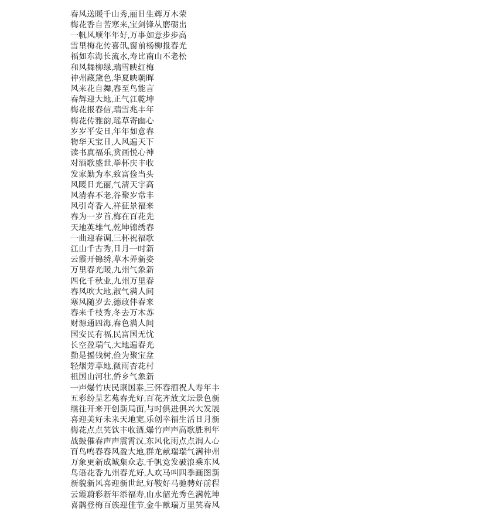

[`couplets.txt`](https://internal-api-drive-stream.feishu.cn/space/api/box/stream/download/all/LxEvbkWsdoICvpx84p6cVgRgnLe)
