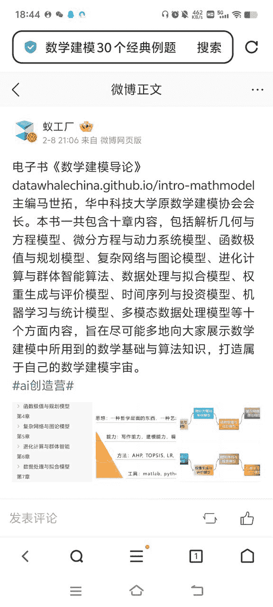
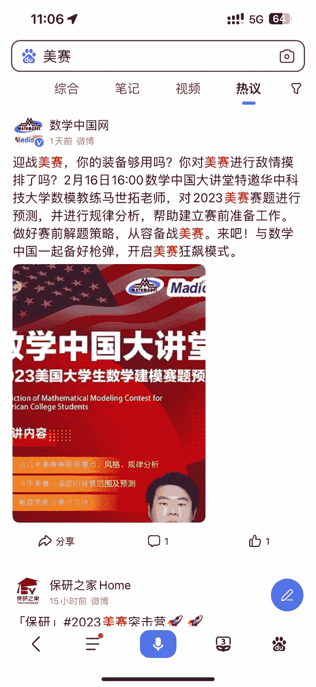
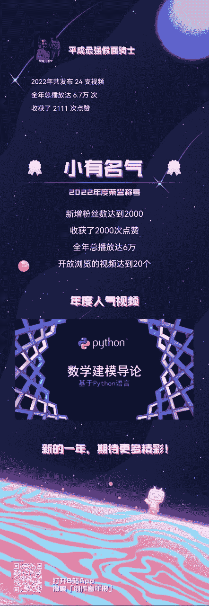
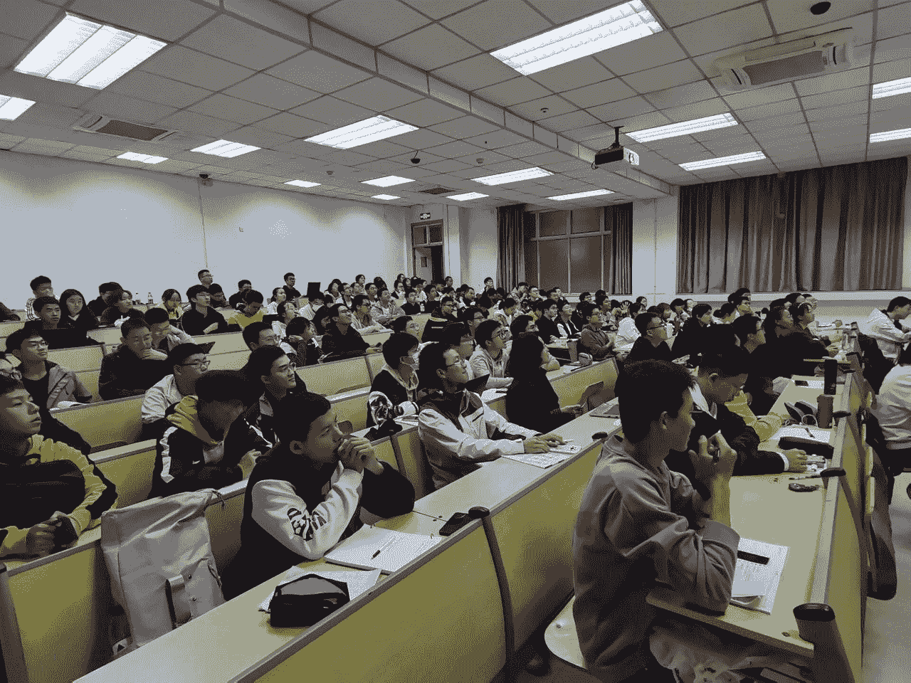

# 经验分享：从数模小白到走上讲台

> 来源：[https://datawhaler.feishu.cn/docx/U3PYd7wHLo2c8NxyKA9c8tk1nzc](https://datawhaler.feishu.cn/docx/U3PYd7wHLo2c8NxyKA9c8tk1nzc)

> 这是一则经验分享，也是我六年的数学建模真实故事。

> **写在前面**：来看这则经验贴的同学，很多是第一次参加数学建模竞赛，也有一些是从来没听说过。我知道你们新人在这方面有很多困扰，也很清楚知道你们缺乏什么。因为我在和你们一样大的时候也是一样，所以我想通过自己的这个故事来给你们一点激励。

> **核心想表达的点就是一条，不管采用什么**样的学习方法论，最重要的始终是相信自己。

### 2019年的数模小白

我是2019年考入华中科技大学的。出身小镇做题家的我根本不懂大学的专业模式，不懂得选修课和必修课，也不懂得竞赛能保研加分。相比一些大城市里一开始就有明确奋斗目标和规划的学霸而言，我无疑是普通的。高中的时候我对数学这门学科表现出很高的兴趣，所以想在大学里面也继续培养这方面的兴趣。于是，百团大战的时候，我盯上了数学建模社团。

加**入进来****学习，当时**的会长是一个大四的毕业生，平常可能指导我们不多，基本靠自学。我非常积极地去啃书，当时最权威的教材当然是姜启源的《数学模型》（第四版），然后也看了北航出版社的《MATLAB数学建模》。但总感觉和理想中理解的数学建模有点偏差。

这门课怎么要么全是在讲数学，要么全是在写代码啊……

怀着忐忑的心情，我参加了生平第一次数学建模比赛。当时校赛的题目出的很简单，但是我算了一天发现手算根本写不出来（参考《数学建模导论》案例1.3）。想了好长时间，才一拍脑袋：应该编程解决这个事的。这个事让我对算法在数学问题中的作用有了更好的认识。

2020年疫情期间，我和两个朋友一起参加了那年的mathorcup。那是我第一次感受到大比赛的压迫感，我真的对那个题目感到束手无策。队友也不会写索性开摆，但是我想救一救，我当时刚学会怎么用CSDN找代码，Python语法也是刚刚入门。胡乱拼凑的内容，最后拿了一个成功参与。

这件事给了我一个打击。交卷那天我坐在书桌前面没吃晚饭，最后觉得，还是知识体系不够完善。

是的，北航出版社的那本教材虽然内容是挺多的，但一下线性规划一下遗传算法一下微分方程……知识点太杂，让我一时间失去体系。

同时，我也意识到，想要参加数学建模竞赛，专盯一个点位（建模位/编程位/论文位）打，是没有好结果的。必须三个位置的技能都会一点，到时候根据安排主攻，这样即使队友划水自己也可以很快补位。

于是，我换了一本教材：**司守奎**老师的《数学建模算法与应用》，我把MATLAB和Python都买了。我当时有预感，Python会在未来几年内成为数学建模的主流语言。

### 2020年的会长sama

就是那一年，由于老学长毕业，把数模协会的担子交给了我。我即使再小白，也知道身上有重要的责任。

华科的数模协会挂在校团委，而数模基地挂在启明学院，这两边承担着重要的数学建模竞赛事务。如果我干不好，那是我工作的失职。

于是，一个小白被压着赶鸭子上架了。

学**校其实除**了暑假那一个月时间会有培训以外，其他时间是不太可能会有老师来给我们培训的。我当时为这个事很头疼。有人建议，清风学长是华科毕业多年的老学长，他一套课50块，要不用经费采购一点呢？

结果经费也没多少了。要命的是，通过我那一年招新，我那年把社团人数从一百多人变成了一千八百多人……

我咬咬牙，想了想，算了，没有胡萝卜照样办酒席。没有老师那就我自己学会了我来教他们。

就这样，我第一次开始线下讲活动，然后网上开始录制了2020冬第一版网课。现在你们没准还能去我的B站主页考古到。

并且我当时就觉得，一个社团的负责人，最应该做的难道不是身先士卒，带头和大家一起打比赛吗？

于是，那一年，我开始疯狂参加比赛。一边看司守奎的教材，一边参加各种比赛。亚太杯、小美赛、认证杯、华东杯、华中杯、深圳杯……

学不会的我就倒带回教材里面查，然后不停调试代码，优化文稿，逐渐形成我自己的风格，也慢慢与更多人有了连接。

华中杯最早的举办方是七个武汉地区9/2院校的数学建模协会，后来有了湖北省工业与应用数学学会。我作为华科当时的负责人，自然是要出席有关会议的。当时我认识了很多其他学校的朋友，扩充了我的人际关系，也在不断交流中调整我的比赛节奏。

渐渐的，我对数学建模竞赛开始上瘾。

### 2021年的夏天

为什么我特地提到这个时间节点，因为我第一次被邀请去做数学建模有关的分享，还有了很多好评。我看到有双非院校资源比我们更缺，却一点不放弃，而是想各种办法来帮助他们的同学。这让我受到很大触动。

我想，我应该给他们一些实质性的帮助，而非单纯地拉着他们一起打比赛。

在那个夏天，七月份，我尝试了六个专题的分享（从建模、编程、论文写作、算法、可视化、比赛流程）几个角度去展开讲解，尤其是论文写作的八股框架。反馈还不错。

九月份我把这个担子交给了我的朋友紫薯老师（他现在正在香港城市大学攻读硕士）。但我并没有完全放手协会这边的一些工作事务。即使已经不是会长，我总归是要帮一下的，于是那年我和紫薯老师设计了十二讲的数学建模课程内容，把数学建模知识分成了十二章，其核心正是从司守奎老师的教材里面得到的灵感。

**当我第一次站**上讲台，打开投影，用粉笔在黑板上写下数学建模导论这六个大字的时候，我感到我此刻已经完成了一种蜕变。我不再是一个单纯的学生，此时此刻我感觉我就是他们的老师，我在把我长时间以来的学习心得、感受和经验在传递给大家。

那天早上，我作为计算机学院的学生上完计网，晚上，我换了一身西装来给社团的新生讲第一课。

**是**的，没有老师，只有同学，只有学长与学弟学妹们之间的交流。但是那又怎么样，老师们能做到的事情，我相信我一定可以做得到。

当时的课程大纲设计还不是很完善，一个是顺序还有点乱，一个是知识密度大的离谱，一次课两个钟头就是讲一章内容，很多细节展不开。但我跟紫薯老师每次开课也好，还是竞赛的时候指导学生怎么打比赛也好，大家都很愿意和我们亲近。我想，不管这些学弟学妹们的比赛是出于什么目的，我们能和这些学习者连接起来，就是一件快乐的事情。

很好的一点是，那年，很多学校都邀请我和紫薯老师分享一些经验，无论是知识技术上的还是行政工作上的。这使得我后来在面对分享的时候，不容易怯场。

### 2022年写下数学建模导论

我知道缺乏培训资源的孩子不仅在华科，还有很多学校的孩子都**缺好的数学建模课程。但**是比较好的团队比如数学建模老哥、清风学长等他们的课都是收费的，学校自己的课程可能知识面和实操性不一定又那么好。

我当时其实也是考虑了一阵。我能讲的比清风、数学建模老哥他们更好吗？

最后拍桌子，我说：“紫薯老师，要不我们讲网课吧。”

当时我很崇拜我们学院的副院长谭志虎老师和秦磊华老师，觉得他们身上没有那种行政做久了的官架子，很亲和人，也是真的在从我们的角度解决问题。我当时就想：以后博士毕业当老师，就要做像大萝卜（我们当时对谭志虎老师的外号，他自己也这么叫）一样的老师。

然后就这样，由我起草大纲，安排课时，编写PPT，编写代码，我和紫薯老师共同录制的《数学建模导论：基于Python语言》和《数学建模导论：基于MATLAB语言》正式开拍了。

2022年的版本，到现在已经累计二十多万播放量了。

借着这个机会，赛氪网的任立峰董事，数学中国的马壮站长，还有很多数学建模有关的机构、学会，我都开始慢慢有了连接。

2022年我开始准备考研。因为长期的竞赛、科研项目、教学和学生工作消耗了很多精力，我并没有保研成功。但我并没有很失望，因为我在选择踏上这条路的时候，就已经做好了最坏的打算。

但偏偏在这个时候，北京大学出版社的编辑工作人员从B站联系到我，问我能不能写数学建模的教材，我想了想，答应了。

考研可以再来，但写教材的大学生可不是年年有。

第一次写教材我并没有什么经验，我就把我教学中怎么讲，学生问过什么，不会什么，如实地用口语化的语言记录下来。我从八月份写到十月份，在我生日的那天，我把我所有的数学建模论文开源了出去，把我的书稿也写完了。

**我**并没有写教程的经验，也不知道什么是好的教程，但我知道拿一堆艰难生硬晦涩的东西、拿毫无逻辑感的章节去搪塞学生的，绝对不是什么好教程。我是个本科生，不用去参评什么十四五，没有基金KPI，我最大的优势就是可以写我想写的，不需要在意什么车轱辘话的限制。

### 2023年，我和datawhale的相遇

也就是在2023，我第一次认识了范大。当时是茂霖，也是在我上一任的上一任华科数模协会会长，联系到我想办活动，我才知道原来datawhale的大佬一直在我身边。我那天也认识了骆师傅，这两个人是我进入datawhale最早的引路人。

那天，范大说，明明我们在不同的平行宇宙，却在做着相似的事情。

我知道很多同学缺乏数学建模的教程，所以我不遗余力去传达，去开源，去把我的经验共享出来。

也就是在23年，我加入了datawhale，成为了一名正式的DW人。在23年，我重新反思了我的数学建模教程，对已有的内容做了个重新整合，有了一个十章版数学建模教程的规划。

### 2024年，我在datawhale开源

我在2024年的时候，为了承担自己的生活费，不得不把原定录制好的72小时的数学建模导论24新版的视频拿到B站上卖。但我很少打自己的广告。并且，原来免费的2020版和2022版，我仍然设置为公开免费可学习。我知道很多大学生不容易，生活费并不充裕，没关系的，只要我的内容能帮到你们就足够了。等你们以后手头充裕了，想补票，也是欢迎的。

我自己当时其实已经把24版的python教程写的差不多了。我想把它免费地开源出去，让大家都能看到。

四月份我收到科学院的通知时，觉得一切都那么自然。我终于有时间来做我真正想做的事情了。

**于是，我第一次联系开源项目保姆团队**和文睿哥，走完了数学建模导论的立项流程。

在我创作这部教程的过程中，首先感谢萌弟、Susan(邢硕)、小熊老师、思州、刘旭、Prof.Jerry He等朋友的支持。其次，我要感谢从2024年到现在帮助开设数学建模导论组队学习的助教团队，尤其是陈凌威、吴汉钦、胡博毓、谭斐然、尼尼、嘉诺、余博等。最后，还要感谢每次组队学习的学习者朋友们，来为教程的迭代积极勘误、提出宝贵意见。

> 由于本人平常工作比较忙，加上开坑也不少，所以对一些同学的建议更新的会比较慢，还敬请谅解。

我还要感谢datawhale公众号在数学建模导论开源之初，积极帮我推广。现在虽然github star还没破一千，但我相信是迟早的事情。

也就是在24年十月份，经过十几轮的审稿刊定，《MATLAB数学建模：从入门到精通》也面世了（但明显没有datawhale开源版内容多，也没有开源版这么有逻辑）。

**我毕**竟不能一直待在竞赛一线，什么比赛都自己去打一把。我总有一天会退到二线的，到时候我的经验、手感这些东西总有一天会钝化掉。但我记录下来的教程、录下来的课、同学们的正反馈和鼓励，会一直留下来。

在我新书出版的那天，清风老师和司守奎老师也都表示支持我的工作。

曾经我学习的对象，如今真的和他们站在一起了。

### 2025年，大模型时代的一些思考

deepseek的火爆也让我们重新审视数学建模这门学科。尤其是从近期数学建模导论的组队学习来看，我觉得有必要从新时代人工智能的角度来反思数学建模新的教与学的模式。

人工智能的诞生让比赛论文写作这些事变得非常容易，也引发了同质化严重的问题。有很多同学已经懒得思考，直接把题目PDF给AI，让AI提供思路，然后照着思路，把模型、代码、文章全盘交给AI。

我觉得这不是一个好现象。

当**然人**工智能时代你能不能拒绝它？肯定不行。包括今年全国数学建模竞赛的组委会老师探讨了以后也觉得堵不如疏。但我仍然建议，大家在学习任何一门数学建模教程的过程中，一定要把握宏观的知识体系与逻辑。这也是我写教程的核心论点，如果我没有提出“道-法-术-器”的框架和双主线模式，这本教程可能读起来会更糟糕一些。就是说，你起码要知道这个学科里面有什么，每个点能解决什么问题，能对一个问题有宏观大致的自主思考才可以。而后的一些细节查询、展开，再使用AI，我认为才是合理的。

**大模型**时代的数学建模，我比较支持浙江大学陈叔平老师的观点：让学生驾驭AI，而不是被AI代替和驾驭。

因此，我可以断言，今后的全国大学生数学建模竞赛，问题会更加无厘头和琢磨不透；美国大学生数学建模竞赛，问题会更加开放而抽象；全国研究生数学建模竞赛，问题会更加贴近产业实际和攻坚克难。

因为只有这样的问题，AI缺乏有关资料和语料，而难以给出足够好的方案。但只要数学建模导论的知识体系框架在脑子里，方案的骨架是我们的，AI可以帮助我们填充内容就足够了。

当**然，怎**么想办法把AI和数学建模结合起来，怎么改进我现有教程的逻辑和体系，是我现在也在思考的问题。我也请教了东南大学的关秀翠老师，她的数学建模知识图谱对我也有很大启发。我需要一些时间来思考，谋定而动。

大家可以继续期待我的新作品。

> 我学的东西很多，想分享的也很多，所以开坑也会多。但是我可以保证，只要是我开的坑，就不可能暴毙。顶多做的慢，但是最后都会做完。

### 一些图片分享

数学建模导论开源内容：https://datawhalechina.github.io/intro-mathmodel/#/

（一些有关我的数学建模记录，按时间倒序排列）

**最后想告诉大家的只有四个字。**

**相信自己。**