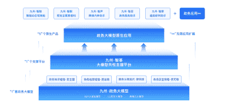
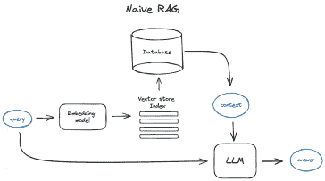
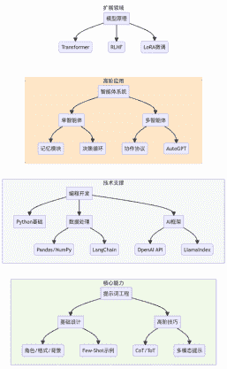

# 微学习25 | 学习故事：文科生如何学AI

> 来源：[https://datawhaler.feishu.cn/docx/IieFd8JCkogDJ5xWANzcdk0vnJc](https://datawhaler.feishu.cn/docx/IieFd8JCkogDJ5xWANzcdk0vnJc)

自我介绍一下，我是安那其，本科江南大学社会工作专业、上海工程技术大学公共管理专业研二在读，很纯粹的文科生了。去年7月份与datawhale相识，并在datawhale后续的活动中担任豆包Marscode“AI+编程”课程主笔人，同时自己也开发了“学术写作智能助手”，目前是Datawhale正式成员。

## 我为什么会对ai感兴趣？

**实际上，在2023**年之前，我经历了一段从本科毕业之后的“Gap years”，这段时间我几乎把求职、考公、考编、考研，所有能想到的路都走了一遍。现在回顾当时，我好像做了很多事情，又好像什么也没做成（当然考研上岸了）。

在这段时间里，**我陷入了极度的自我否定、自我怀疑、**不自信（现在其实还有，只不过不严重而已），我否定我的学历、否定我的努力，甚至怀疑我未来也就这样了。

2023年，openai旗下的ChatGPT出现了。当我第一次接触到它的时候，我觉得它特别聪明，能预测出我想要的东西，而且能用流畅自然的语言和我交流。我突然觉得AI好像不仅仅是高科技，它也可以很实用，很有趣！同时，我本身就是一个充满好奇心的人，喜欢折腾一些新鲜事物，可能多少有一些极客属性。所以，我就想，这么神奇的东西，我一定要好好了解一下！

**至于**我为什么会有这种极客属性，除了本身确实好奇心重之外，加上2023年之前病急乱投医，为了找工作几乎把与工作相关的内容都看了一些，总得在面试的时候“装”的像是一个能够胜任这份工作的人吧😂。

## 触发我开始学习AI的事件或原因是什么？

**2024年，我作为公共管**理专业的同学学习了一门《当代中国政府制度研究》，最后结课作业要求做一次分享，我分享的题目是《数字政府的智能助手：大语言模型的赋能与创新》，分享完之后，我发现ai确实可以结合我的专业领域。

分享结束之后，我凭借老师的关系，进入了一家金融公司的ai**研究院实习，了**解ai相关技术，同时做一些“政务大模型”的尝试。

在这期间，我接触到了**RAG（增强检索生成）**，同时也通过资料检索等等方式，了解到了Datawhale组织，了解到了dify，了解到了ollama，了解到了Ragflow.......当然，后来我也在实习的公司里做了这些开源项目的分享和演示，获得了公司成员的高度认可。

**在这之后，我跟随dat**awha**l**e“以赛代学”和组队学习的模式**，先后开发了“泽**苍政务查询系统”、“青少年CBT心理咨询助手”、“元提示词生成工具”、“智邻调解专家”等等应用，并且发布到了魔搭社区。同时也在GitHub上开源了“如何撰写高质量的提示词”、“速通ai编程”等课程。在这个过程中，我感觉到我一直在尝试将ai“注入人文情怀”，可能我从p人变为j人就是从这里开始的吧。

## 我是如何学习AI的？

我学习ai的路线可以用这一张图表示：

提示词工程：核心内容，我最初接触也是通过写好提示词进而引发的兴趣

编程与工具：这部分我最初选择的编程语言是python，因为这门语言在ai领域很广泛，而且相对简单。同时为后续的智能体开发奠定基础（因为很多框架都会提供python的sdk）

智能体开发：这部分是**ai转变为服务的存在形式**，ai通过提示词规定角色，通过编程语言实现角色的功能，功能与功能协作形成向用户提供的服务。

拓展领域：这部分内容是**ai的底层逻辑**，实际上我自己也没有认真学习。以至于我自己目前在找实习的过程中，与“算法”相关的工作我没有去投递（当然也与专业有很大关系），我投递了一些类似“产品经理”的角色，这也算是我现在的一个没有了却的心愿吧。

## 学习AI的资源与方法

### AI本身

**AI不会嘲笑你什么都不懂，也不会嘲笑你非专业也想碰瓷这个领**域，更不会嫌你问这问那觉得烦......

AI只是按照你的要求，去讲解它能够知道的东西。

有句话叫“窥一斑可见全豹”，AI告诉你的东西代表了这个领域需要了解的知识，可以不断追问AI，直到你弄懂这一切为止。

### AI领域的博主

这里推荐几个博主，来源于bilibili、推特等

+   [李继刚](https://www.lijigang.com/)：**提示词领域的大神**，他的提示词几乎颠覆了我对于提示词的传统认知

+   [归藏](https://www.guizang.ai/)：可以说关注的AI编程前端领域，包括一些开源项目都来自于这位老师

+   [AI进化论花生](https://space.bilibili.com/14097567)：小猫补光灯开发者，算是AI编程进入到生产力领域的代表人物

+   [Andrej Karpathy](https://karpathy.ai/)：计算机科学家，**AI教育领域代表人物**

### 开源社区

开源社区以及开源项目：可以说AI的不断发展，与开源社区的发展是分不开的，因此想要学习A[**I，开源社区**](https://github.com/)**埋**[**藏了不少好东西。当然上**](https://huggingface.co/)**面**[**的AI领**](https://modelscope.cn/)**域博**主也会推荐不少开源项目。其中以GitHub、Huggingface、魔搭社区为最。

**如果**你不知道从哪里开始，欢迎体验Datawhale的OPEN 1+X AI通识课以及Datawhale人工智能培养方案。

### 费曼学习法

用最简单的语言解释就是“通过向别人清楚的解说某一件事，来确认自己是否真正弄懂了这件事”。

如果你和我一样i人有些社恐，不太喜欢当着他人面讲自己“可能知道也可能不知道”的东西，那就先给AI分享吧，AI不仅不会嘲笑你讲错了，还会帮你修正认知。

## 我的一些心得与感悟：痛并快乐着

痛的原因：

+   **直**至目前我仍然有些自我否定、自我怀疑和不自信，因为我把“求职”这件事看得太重了，我希望通过一份工作去证明我对于AI的选择是正确的。

+   **交叉学科的身份建构困境：这个困境是用提示词建构**的AI心理咨询师“谈心谈话”梳理出来的。

快乐的原因：

+   **我强烈的“分享欲”得到了满足**：例如豆包Marscode编程教程、速通AI编程、提示词写作教程......

+   **在分享的**过程中，我觉得和大家因为“趣**缘”在一起，共同探索AI的魅力，大家在心里埋**下了靠近AI的种子，我对于AI的认识更加贴近真实的需求，我和大家都在成长。