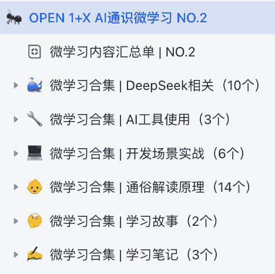
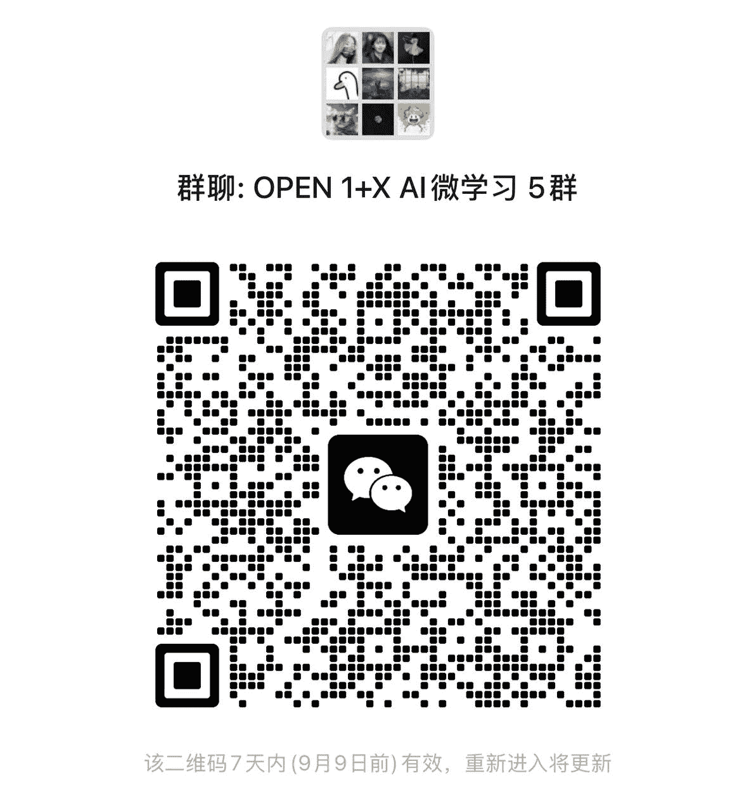
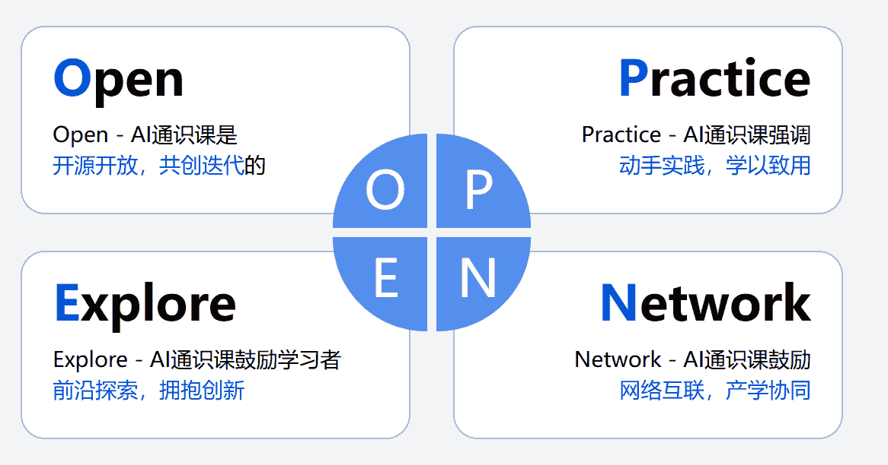
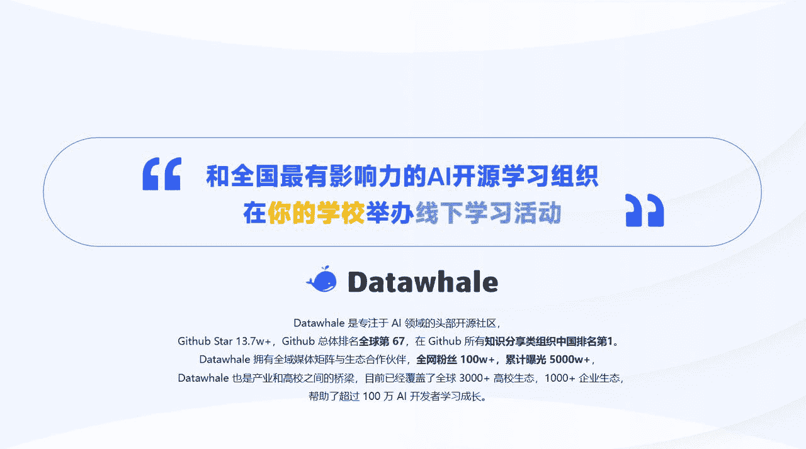

# OPEN 1+X AI微学习 NO.2

> 来源：[https://datawhaler.feishu.cn/docx/TobCdPtuPoG3maxMSPCcPIAnntg](https://datawhaler.feishu.cn/docx/TobCdPtuPoG3maxMSPCcPIAnntg)

# 什么是微学习？

> ——没有门槛、兴趣导向、快速上手的 快闪AI学习活动

>

> 短小精悍、**聚焦实践和快速上手**、内容丰富、量大管饱~

> 从**概念和原理、AI工具使用、**到**最新趋势**、应有尽有！

> [**打卡反馈**](https://datawhaler.feishu.cn/share/base/form/shrcnRfE2wiwONqZNw1utvw4x8g?iframeFrom=docx&ccm_open=iframe) 有机会获得 OPEN 1+X 微学习优秀学习者证书

>

>

> **根据兴趣 **选择适合自己的学习材料进行学习、

> 无需完成所有学习、完成一个内容的学习也是胜利！

> 挑战3天内、完成学习并设计自己的作业吧！

# 本期优秀学习者

> 恭喜 **丁梦媛、devinyin、nible、韩大瑞、与兼、**肥肥、倪飞、赵女士、王影、Gadfly 10位学习者获评本期——“AI场景优秀探索者”~

> “AI场景优秀探索者”证书 及 微学习内容组寄语 可在下方表格中查看。

<https://datawhaler.feishu.cn/share/base/view/shrcn4DvOugQ5VAc0OUjOuDrJeb?iframeFrom=docx&ccm_open=iframe>

<https://datawhaler.feishu.cn/sync/LmjsdPavlst4OxbSQCucgZOlnmd>

<https://datawhaler.feishu.cn/sync/LfRzdAExlsoykRbUZymc0Jrfngh>

# ① 你对哪些内容感兴趣？

> 我们此次微学习共计 38 个学习内容、内容丰富、量大管饱~

> 其中【DeepSeek相关】10个、【AI工具使用】3个、【开发场景实战】6个

> 【通俗解读原理】14个、【学习故事】2个、【学习笔记】3个

>

> **本期“AI场景优秀探**索者”评选截止时间为 2025年3月11日

> 评选截止后内容仍持续开放、大家仍可按照兴趣学习&打卡~

可通过下方的表单查看所有主题、选择感兴趣的主题：

<https://datawhaler.feishu.cn/share/base/form/shrcnkuvhyWMvsMpTEJFMVdnUjg?iframeFrom=docx&ccm_open=iframe>

**微学习内容合集目录**

> 来看看大家都对哪些内容感兴趣吧~ 有没有你的心选主题呢？

<https://datawhaler.feishu.cn/share/base/dashboard/shrcnN7prOm3G3J8qdgPspzKXad?iframeFrom=docx&ccm_open=iframe>

# QA & 许愿池：内容许愿都实现！

<https://datawhaler.feishu.cn/share/base/form/shrcntHMQzpnleXfR6bFhnpggig?iframeFrom=docx&ccm_open=iframe>

# 欢迎投稿参与共建、下次微学习就学你的内容！

学习交流可扫码加入学习群

有意创作学习内容投稿，可直接投稿：https://datawhaler.feishu.cn/share/base/form/shrcn13VsORqTwbGqOXKJLuhYqc

下次微学习也许就学你创作的学习内容！

想加入 **创作群 **了解详情，

可添加Datawhale教研负责人 微信👉🏻

**感谢所有参与共建的贡献者们！**

**名单详见：**[致谢AI通识课贡献者们](https://datawhaler.feishu.cn/wiki/HnMiwEzpdiLvWRkfbvFcaJFLnSg)

我们践行 **O**pen（开源共创）的 AI通识课 建设理念

期待与你一同——

**P**ractice（动手实践）、**E**xplore（探索前沿）

逐步实现 **N**etwork（产学协同）**！**

更多共建指南详见：[OPEN 1+X AI通识课共建指南](https://datawhaler.feishu.cn/wiki/LuIVwkmFYiD0RlknbRUcw7KYnBe?table=tblUf7zCmZlEFF7N&view=vewMMZ564l)

共建研讨会及内容写作经验可见：[OPEN 1+X 共建研讨会：每周一晚](https://datawhaler.feishu.cn/wiki/JMzgwtOBhiF8woksLIdcPbBvnzf)

**注：本文采用 ****署名—非商业性使用—**相同方式共享 4.0 协议国际版 许可协议进行许可。

# 线下百校共学DeepSeek！

> Datawhale将于3月底组织百校线下共学Deepseek工作坊。

> 招募感兴趣的社团负责人、高校老师，一起组织活动。

> 了解详情，扫码联系：Datawhale高校生态负责人。

# 特别感谢创作者团队

> 创作团队清单（21人）：

>

> 余衫马、安那其、陈晨、尼尼、马世拓、筱可、杨冰楠、星星、汪、高源、鲁力、陈辅元、Zgh_332

> 小揭、张龙斐、刘振亚、周景林、陈嘉诺、珞索、曹泽、章佳辉(沫兮)/monoy

>

> 合作组织：

> OpenManus，CAMEL AI

# 查看往期学习内容

<https://datawhaler.feishu.cn/share/base/query/shrcnunSSkKPUPRtfOrZ3GMTHvd>

| 微学习入口 | 打卡表单 | 微学习内容清单 |
| --- | --- | --- |
| OPEN 1+X AI通识课内容合集 | [点击完成微学习打卡](https://datawhaler.feishu.cn/share/base/form/shrcnhopDrI77ZzTkzxBoE0pCmd) | OPEN 1+X AI通识课内容合集 |
| OPEN 1+X AI微学习 NO.1 | [点击完成微学习打卡](https://datawhaler.feishu.cn/share/base/form/shrcnhopDrI77ZzTkzxBoE0pCmd) | [微学习内容清单 | NO.1](https://datawhaler.feishu.cn/share/base/view/shrcnDJnSD9RB6SQOAjRU86AaJd) |
| OPEN 1+X AI微学习 NO.2 | [点击完成微学习打卡](https://datawhaler.feishu.cn/share/base/form/shrcnhopDrI77ZzTkzxBoE0pCmd) | [微学习内容清单 | NO.2](https://datawhaler.feishu.cn/share/base/view/shrcnOknJfe4z3DLyS40SE7x2rg) |
| OPEN 1+X AI微学习 NO.3 | [点击完成微学习打卡](https://datawhaler.feishu.cn/share/base/form/shrcnhopDrI77ZzTkzxBoE0pCmd) | [微学习内容清单 | NO.3](https://datawhaler.feishu.cn/share/base/view/shrcnvzykzJRY2XBYNGObdvyB6c) |

更多详情可见微学习概况汇总表（点击即可跳转）