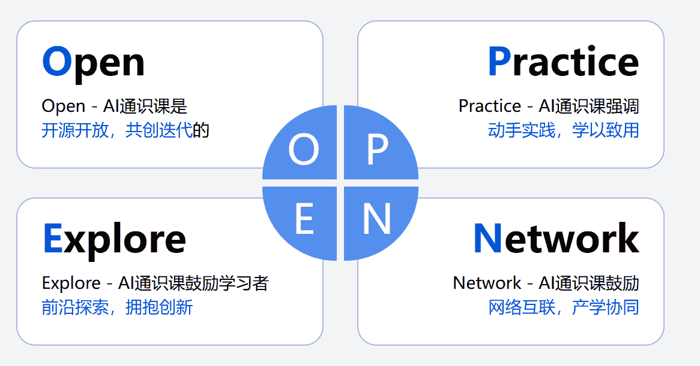
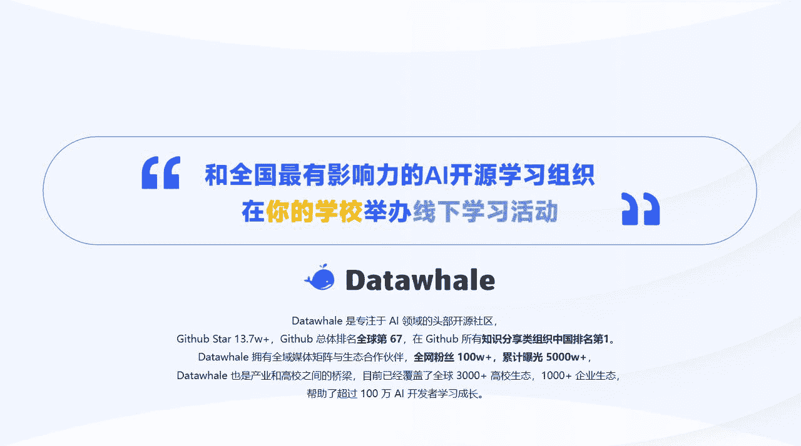

# OPEN 1+X AI微学习 NO.1

> 来源：[https://datawhaler.feishu.cn/docx/Br7NdsjTyoQKBdxkoHxccaQWn0f](https://datawhaler.feishu.cn/docx/Br7NdsjTyoQKBdxkoHxccaQWn0f)

# 什么是微学习？

> ——没有门槛、兴趣导向、快速上手的 快闪AI学习活动

>

> 短小精悍、**聚焦实践和快速上手**、内容丰富、量大管饱~

> 从**概念和原理、AI工具使用、**到**最新趋势**、应有尽有！

> [**打卡反馈**](https://datawhaler.feishu.cn/share/base/form/shrcnhopDrI77ZzTkzxBoE0pCmd) 有机会获得 OPEN 1+X 微学习优秀学习者证书

>

>

> **根据兴趣 **选择适合自己的学习材料进行学习、

> 无需完成所有学习、完成一个内容的学习也是胜利！

> 挑战3天内、完成学习并设计自己的作业吧！

# 本期优秀学习者

> 恭喜 **张辉、Molly、洋洋洋****、**与兼、王影、Gadfly、Yike 7位学习者获评本期——“AI场景优秀探索者”~

> “AI场景优秀探索者”证书 及 微学习内容组寄语 可在下方表格中查看。

<https://datawhaler.feishu.cn/share/base/view/shrcnETuHfRfpCYC7PPCd2XtG0b?iframeFrom=docx&ccm_open=iframe>

<https://datawhaler.feishu.cn/sync/LmjsdPavlst4OxbSQCucgZOlnmd>

<https://datawhaler.feishu.cn/sync/LfRzdAExlsoykRbUZymc0Jrfngh>

# 你对哪些内容感兴趣？

> 我们此次微学习共计新增 19个学习内容、内容丰富、量大管饱~

> 其中 8个【DeepSeek相关】、4个【实用场景】、1个【学习笔记】和6个【小白化原理解读】

>

> **本期“AI场景优秀**探索者”评选截止时间为 2025年3月3日

<https://datawhaler.feishu.cn/share/base/query/shrcnunSSkKPUPRtfOrZ3GMTHvd>

| 微学习主题清单1 | 你对这个主题感兴趣吗？ | 微学习主题清单2 | 你对这个主题感兴趣吗？ |
| --- | --- | --- | --- |
| 微学习01：DeepSeek+多维表格经验分享 |  | [微学习11｜原理：大模型](https://datawhaler.feishu.cn/wiki/KdUxwddPeilbFvkReoOcNVrJnMd) |  |
| 微学习02 |机器学习原理和损失函数详解 |  | 微学习12 | DeepSeek微调入门 |  |
| [微学习03 | 提示词](https://datawhaler.feishu.cn/wiki/L4VLwJKHoiQyELkR3XlcLDhunWc) |  | 微学习13｜音乐+人工智能是什么 |  |
| 微学习04 | DeepSeek+Streamlit 开发文档助手 |  | [微学习14｜国内文生图AI工具](https://datawhaler.feishu.cn/wiki/XyZ1wX1PCiSC3Iky5dscWdbUnqe) |  |
| 微学习05 | Streamlit+PyMuPDF：解析PDF论文 |  | 微学习15｜算法实战：RAG核心-BM25检索算法 |  |
| 微学习06 | 大模型原理讲解（视频） |  | [微学习16｜原理：高数现代基础](https://datawhaler.feishu.cn/wiki/C1R2wYrkSiqVGpkUeHZcC3Itn1v) |  |
| 微学习07｜DeepSeek+ragflow：构建本地问答知识库 |  | 微学习17 | Coze：生成书籍推荐卡片 |  |
| 微学习08｜DeepSeek：大学生减负示例集 |  | 微学习18 | Deepseek+coze：自动化新闻播报 |  |
| 微学习09｜deepseek多平台测评 |  | 微学习19｜DeepSeek+剪映+即梦：生成vlog |  |
| 微学习10｜coze：员工手册问答机器人 |  |  |  |

# QA & 许愿池：内容许愿都实现！

<https://datawhaler.feishu.cn/share/base/form/shrcntHMQzpnleXfR6bFhnpggig?iframeFrom=docx&ccm_open=iframe>

# 欢迎投稿参与共建、下次微学习就学你的内容！

学习交流可扫码加入学习群

有意创作学习内容投稿，可直接投稿：https://datawhaler.feishu.cn/share/base/form/shrcn13VsORqTwbGqOXKJLuhYqc

下次微学习也许就学你创作的学习内容！

想加入 **创作群 **了解详情，

可添加Datawhale教研负责人 🛰️👉🏻

**感谢所有参与共建的贡献者们！**

**名单详见：**[致谢AI通识课贡献者们](https://datawhaler.feishu.cn/wiki/HnMiwEzpdiLvWRkfbvFcaJFLnSg)

我们践行 **O**pen（开源共创）的 AI通识课 建设理念

期待与你一同——

**P**ractice（动手实践）、**E**xplore（探索前沿）

逐步实现 **N**etwork（产学协同）**！**

更多共建指南详见：[OPEN 1+X AI通识课更新简报](https://datawhaler.feishu.cn/wiki/LuIVwkmFYiD0RlknbRUcw7KYnBe?table=tblUf7zCmZlEFF7N&view=vewMMZ564l)

共建研讨会及内容写作经验可见：[OPEN 1+X 共建研讨会：每周一晚](https://datawhaler.feishu.cn/wiki/JMzgwtOBhiF8woksLIdcPbBvnzf)

**注：本文采用 ****署名—非商业性使用—**相同方式共享 4.0 协议国际版 许可协议进行许可。

# 线下百校共学DeepSeek！

> Datawhale将于3月底组织百校线下共学Deepseek工作坊。

> 招募感兴趣的社团负责人、高校老师，一起组织活动。

> 了解详情，扫码联系：Datawhale高校生态负责人。

