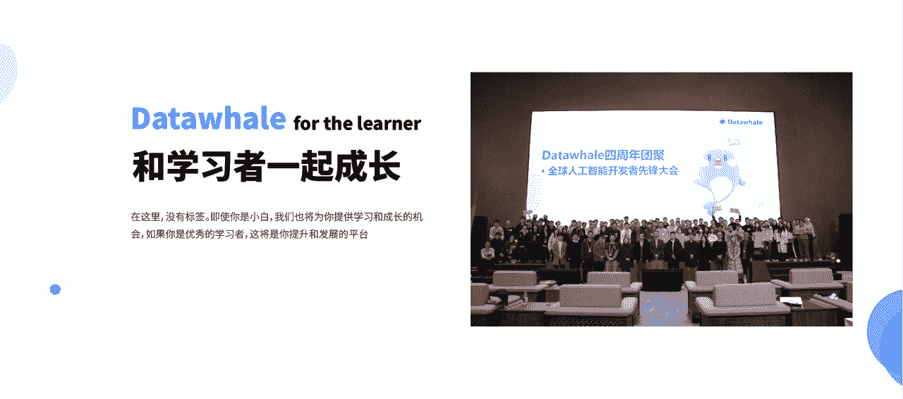
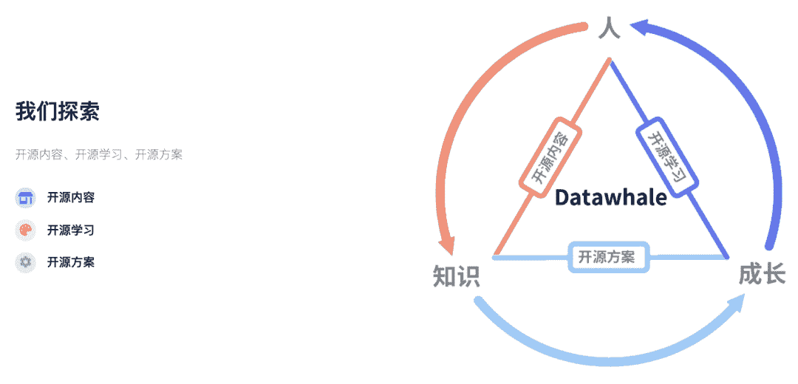
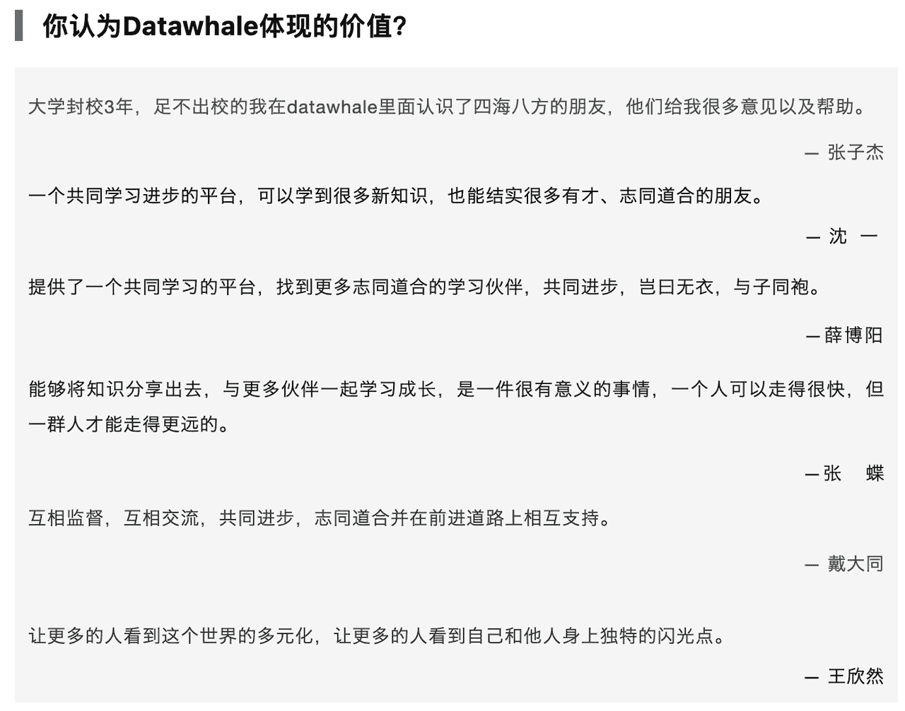
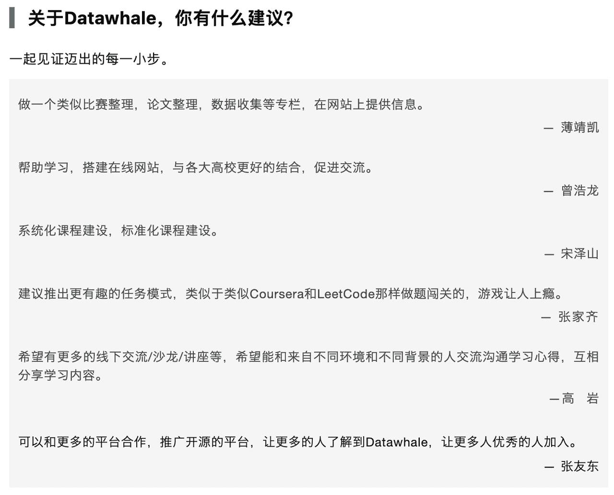
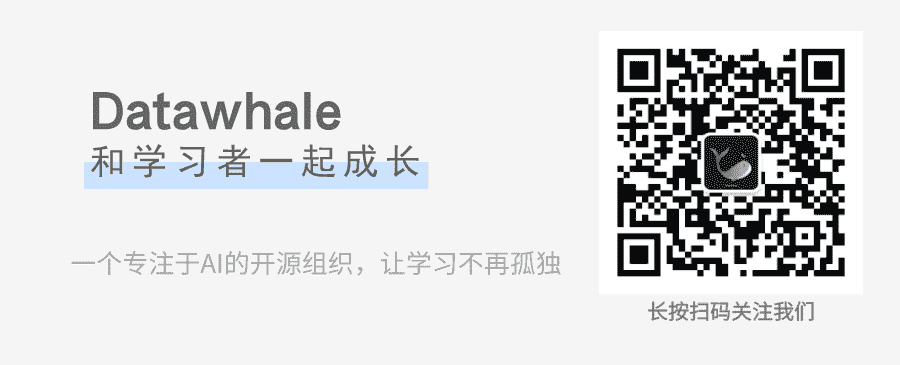

# 致谢

> 来源：[https://datawhaler.feishu.cn/docx/A39CdgdpoomslQxP0OXcPmnanfe](https://datawhaler.feishu.cn/docx/A39CdgdpoomslQxP0OXcPmnanfe)

> [**Datawhale**](http://datawhale.cn)** **成立六年了，从一开始的12个人，学习互助，到提议成立开源组织，做更多开源的事情，

> 帮助更多学习者，也促使我们更好地成长。

> 于是有了我们的使命：[**“For the **](http://datawhale.cn)learner，和学习者一起成长”，

> Datawhale 鼓励真实地展现自我、开放包容、互信互助、敢于试错和勇于担当。

>

> 同时我们用开源的理念去探索**开源内容、开源学习和开源方案**，赋能人才培养，助力人才成长，

> 建立起 人与人、人与知识、人与企业和人与未来 的联结。

>

> **在坚持组织开源学习**活动和发**起开源项目的过程**中，我们互相鼓励、互相陪伴，成长为更积极和优秀的人，感谢一路支持、陪伴、甚至做出贡献的伙伴们！

# 💐 致敬Datawhale课程背后可爱的贡献者们

薛传雨、王复振、杨煜、闫钟峰、杨梦迪、苏鹏、徐旺华、张晋、汪健麟、杨佳达、耿远昊、郝少春、谢文睿、秦州、贾彬彬、居凤霞、马晶敏、周天烁、叶梁、胡风范、陈安东、金娟娟、老表、李玲、高立业、张文涛、李祖贤、六一、陈琰钰、杨剑砺、李运佳、皮钱超、詹好、王茂霖、李一飞、杨昱文、刘羽中、王贺、刘洋、王佳旭、金一鸣、李嘉骐、牛志康、罗如意、吴忠强、何世福、徐何军、李万业、陈锴、梁家晖、宁彦吉、田雨、赖敏材、汪志鸿、王辰玥、唐鑫、宋禹成、王琦、杨毅远、江季、陈信达、安晟、闫永强、宋志龙、沈豪、袁明坤、王程伟、张强、游璐颖、樊亮、杨皓博、康兵兵、刘太路、芙蕖、聂平、张帆、张贤、李泺秋、蔡杰、hlzhang、台运鹏、张红旭、陈海顺、聂雄伟、杰少、王鹏、骆秀韬、王洲烽、蒋志政、王嘉鹏、胡锐锋、长琴、黄玉琳、易华挥、邹雨衡、徐虎、刘伟鸿、Joye、魂兮、宋志学、韩颐堃、陈逸涵、仲泰、万礼行、小饭同学、诸世纪、Zhang Yixin、Sarai

# **期待你的加入**

我们致力于探索 开源内容、开源学习、开源方案，致力于为学习者提供更方便清晰的学习路径和学习资料，通过组队学习的开源学习方式，助力每一个学习者和梦想者，

# ❤️ 我们一起，让国内的开源环境越来越好

